# CMU《机器学习导论｜Fall 2023 10-301⧸601 Introduction to Machine Learning》中英字幕（deepseek p01 Lecture_1_Problem_Formulation_&_Notation.zh_en [BV1Z2cUefE4A_p1]

Yep， okay， I think we're good。好。啊，所以说。F。And we're still happy not about that todayy。

 we're going to answer this question， if。

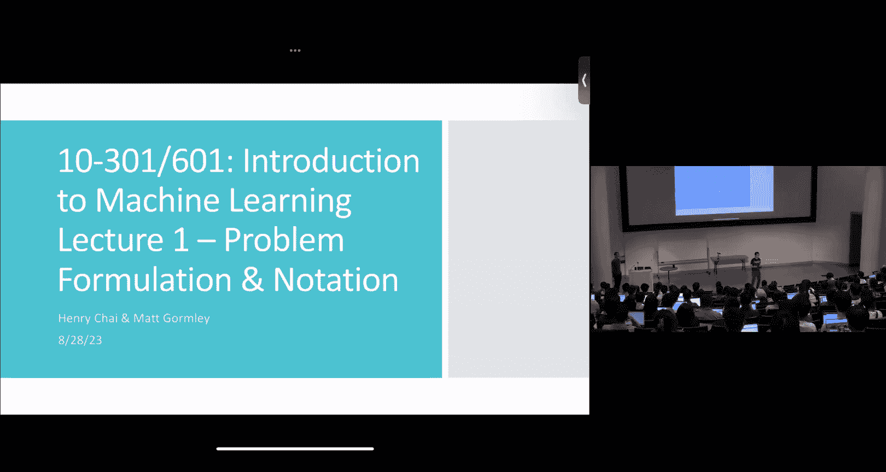

我这是。到他月。Thank I like starting give it very。走。In over a year ago。

 I haven stopped sitting three more in。我看到就个。Very exciting what machine learning one of the most things that machine learning。

噶我。And it years ago，But this really cool filter for recognizing hair that you and convert into computer possible Virginia or becomes's not that。

😊。

There was really big product of competition， even this created me by quite a bit here for my hiring machine I about。

 there was the very thing in competition about improving an emphasis of recommendations， you know。

 you can now go to yourself and of recommendations across all sorts of various platforms。😊。

I really getting emails or mobile ca email email all time like。

Not to disparage these very important patients。you all are going to be exposed to it when we go working on managing these problems your in the only timing that you'll have in this work so let's get interesting on。

And。When first staff teach on9 course？

Although number a was like you revisit getting people excited about what machine machine learning and doing I don't know four or five years ago at this point and it was a pretty displaying pause time was the notion of driving car here insburgh this was a deal a picture like it was a model in my house out there and the first the bottom of the vehicle driving all over the script。

I give you a second how it is if it was time ago， but dont。

I think maybe now they one close our way that being interact with the GA。

 they threw a beautiful guy in the pocket， Siri， Alexa。I' rather like on you yeah。

 think off the shamer in some of that very。I very that inviting they one the most playing。Rie。

media forms of machine game planning in this particular system。啊没。

Even this isn't quite these people have moved on， they lost over anyway， all of this is not be。

what machine it was won you my love a year ago， so sat down。

W是。ねねまね。诶。哎哎哎哎。😊，一新个人。多分。て。Okay，'s take chat。啊，不。的。诶啊， ok。奥特月节。In all the and。All right。

 you's a little bit of what we do as many people are so very the' I need to my。啊。对意噶。

Okay对啊 lot of people。哦。let's see what we have here， some natural language processing stuff。

 some image and videoynesis。😊，Explainably。两他日己开诶。

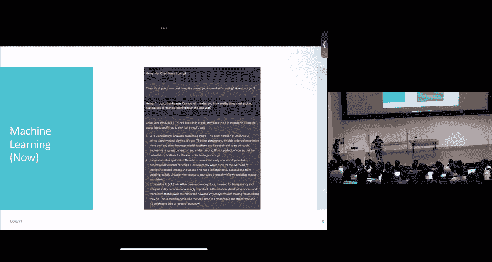

Oh， I安。Noせねて。Oh。三点啦。Okay。ビのビでです。

Oh putting down my head my collar， there's like a picture of someone interacting with a chat pod and I don't know what's going on here but。

TheImage creator powered by Ga，hu'。O。And， I a little joke up。

 but I think it's a little bit more excited to get going on with。behavior image。你吧说这个样别不。😊，你也不能把我。

为什么呀。I not the funny that past you're generating is like some that of like some human best。

lots of things can stop getting into a better model and I want say think was probably the most kind thing going on in the children。

要但系啊。ご습니다さは。And so it is a little promise to you all。You are not saying be。

 you are not necessarily but you're going to understand what's say 90% in the。嗯这 hours。Bye。All right。

 so that's one way thinking lots of。

这が。brief walk through what we're going to be talking about and I put this in slide。那个ま对。

not was the first it show that the， so we're going to try and make through learning models that everyone in person expect to know。

Mly forward in here。I people could not any more palat than narratively to this slide， if you will。

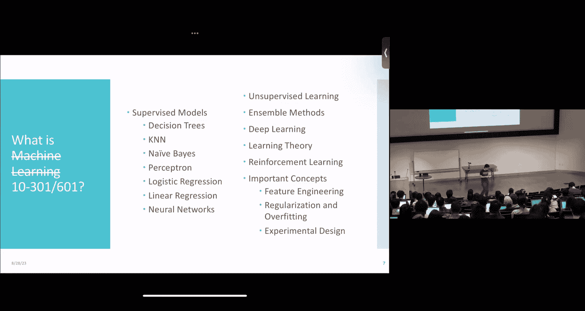

going to have different ratios of these things， but fundamentally。

 all machine learning models that we're going to talk about are built on these tools。😊，But you know。

 like。Like any good salad， you really need something to like tie it all together like this is just some frankly dry like crunchy bread at this point right what we really need is like some delicious salad dressing。

 which is going to be this this optimization that's going to be just like。

Oh good that did work it's going to be like sprinkled throughout the every little bite that we take so this is going to be the running theme that connects all the various machine learning models that we're going to be talking about in this semester。

😊，This analogy comes courtesy of Matt， by the way。

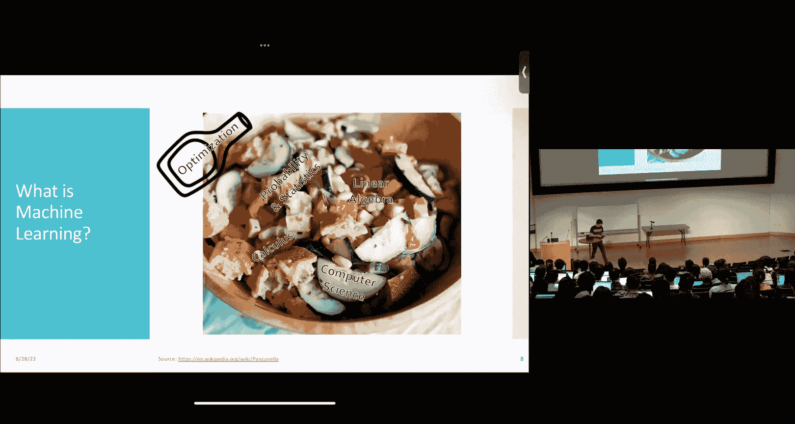

Alrighty so。I know I just mentioned generative AI， but I want to be a little bit more clear about what we're talking about in this class。

A lot of these words that you'll see sort of conflated with machine learning include things like artificial intelligence and data science。

 And， you know， I think。I think it's really hard to pin down exactly what people mean when they say these words。

 so I'm going to tell you what I mean when I say these words and how they differ from machine learning right so artificial intelligence is this sort of broad goal of creating agents。

 autonomous agents that can mimic human behavior in one way or another and somewhere very deep in that stack。

 a part of an artificially intelligent agent would be something like what we will call machine learning。

 the ability for an agent to make intelligent predictions of the world is a key component of getting it to behave like a human。

 but it's not the only thing there's tons of other things that go into that whole space。

 things like robotics and controls and sensors and lots of very important topics we're focusing on just sort of one narrow band of this topic。

On the other side， sort of data science， I guess I would think of as like a broader exploration of data。

 not necessarily using data to make predictions， but also using data to generally extract useful information and so here's a cute little Venn diagram I had that sort of shows the relationship between these two things or these three things rather they're all highly interconnected。

 but what we're focusing on is just that inner circle there。

 which is a subset of what we would consider maybe tools for artificial intelligence and。😊。

Related to， but not exactly equal to data science here。All right， so with that out of the way。

 let's spend a bit of time here getting a little bit more formal。

 so next we're going to think of how we can formulate machine learning problems in a way that actually allows us to go out and start solving them。

😡，And for that， I'm going to turn it over to my coinor， Matt。

Our first definition of machine learning， we're going to look at this idea that comes from Tom Mitchell who's actually a faculty in the machine learning department here。

 for how to define a machine learning problem and this is sort of like your first day of class sort of definition we're going to keep expanding on this as we continue through this course。

 but this is a really powerful way to think about what we're doing and the definition goes like this。

 a computer program learns if it's performance a task T。

As measured by some performance measure P or metric improves with experience E。Okay， so。😡。

So we need these three things， a task。A performance measure and some experience we're also going to talk about experience as data for reasons that will become obvious so to get our heads around this let's let's do kind of a first example so we want to think about how can we define the learning problem of learning to beat the masters at chess。

Okay， so the task here， I'll just give you the answer， it's play chess。Well。Okay， so here's our task。

Now， I want help from you guys to come up with a performance measure。 So remember the definition。

 right， a computer program learns of its performance at task T as measured by P。

So P is going to tell us how well are we playing chess。

 what could a performance measure for chess be？For an agent that plays chess。Yeah。

You have to talk loudly。Great， whether you win or lose。Okay。

 and we could actually sort of change this to be something like say out of 100 games。

 what's the percent of wins right， that would be a nice metric。Okay， other ideas。第二。Oh， helo score。

 How do you even spell Helo， It's like an acronym， right， H E。Yellow， great。

 so I don't even remember exactly how helo is calculated， but I think correct me if I'm wrong。

 it's like' you're actually looking at each piece on the board and like you know maybe a bishop and a rook actually have the same number of points assigned to them but maybe a bishop and a knight have the same number of points。

 but a rook actually has more points and a queen definitely has more points than either of those and so you actually kind of do this calculation based on how many pieces are on the board to figure out you know how many points each player has that sound does anybody who actually plays Jeess know this？

Okay well great no one knows how to play chess so so I can just tell you whatever I want Okay。

 and then if you're wearing an orange shirt you get times two points that's that's what the O stands for Okay so what else could we do。

😊，Yeah。Ooh， interesting。How many？Sort of possible。Situations。It can foresee， so this is interesting。

 right？If you actually think about a true master at chess， right。

 the thing that we know about them is that they're actually they're thinking ahead an incredible number of moves right they're actually playing out and they're probably not considering certain paths through the possibility of moves that wouldn't be very helpful for them and but they're able to go incredibly deep in this direction so maybe if we could actually measure how far ahead the agent is seeing that could be valuable。

Let's move on to experience so all of these are sort of different performance measures P。

 how could we define experiences， let's go back to our definition where an experience is something that we get more of over time。

Kind of like you know you could data is kind of a way of thinking about this。

 but I think the term experience here is carefully chosen because data is kind of a restrictive word it makes us think of like ones and zeros experiences maybe a little broader on purpose so what are some examples of experience E。

Great， so this is good， the number of games that it plays。

 but we don't necessarily need the actual measure of how much experience like the performance measure was how much are we doing well here we could just say like the actual games it plays is the experience。

Okay， so now the question is， who's this agent playing against？Yeah。Okay， good。

 those so those are two different kinds of experience games against itself。And games against。Humans。

Say， you know， the masters， right？Okay， does anyone know a chess master？

Like maybe we could just call。All that chest master up。They could play against our machine。No one。

 man。Henri， did he leave oh， man？Oh， no， you still here。 Do you know any any chess masters。

See if I mean， you're like worldwide rated， I don't I don't think I。Gary's not in here okay well。

So if we can't get chess masters because we're poor academics and probably can't afford to pay them whatever hourly rate they would require of us。

 where else could we get information from。You know， the masters themselves， yeah。到月 that。

Oh well or other ideas chess agents oh great idea Okay， so we could play against。So I'll just say。

Against。Kown chess agents， right and these could be。Um。

 say like the classical methods for doing this where you actually search over this just like you just do brute force search over the possible plays that you can make。

Any ideas how we could actually get access to information about how masters play chess？啊 yeah。Oh。

 great idea， so we could look at records of past games。And。

This would be a different kind of experience now right it's not that like we're actually playing the game we're looking at another game that was played by someone else。

 but that is experience that we could potentially learn from has anyone ever heard of these things I don't know if you've ever touched one before it's made of paper it's called a book you can get them at this thing called a library libraries have gotten rid of most of their books they replace them with chairs so that you can sit in your laptop and like you know type but there are like books on chess right and they actually have valuable experience like in the form ofs kind of like past games but like these little scenarios that you could play out and learn from。

Okay， so here I want to think about another completely different setting learning to respond to voice commands。

 so here the the action the the setup here。

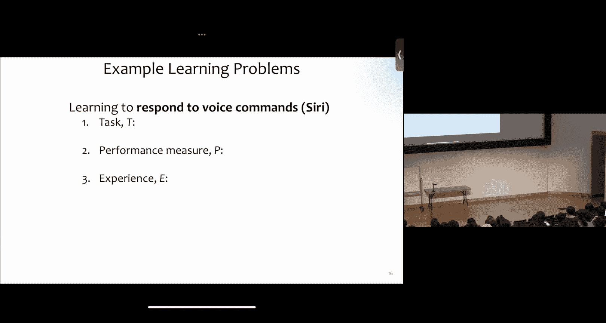

I need to really take us back long ago， this is probably now， this is over 20 years ago。

 maybe approaching 30， we had what were called rule based systems or expert systems。

And the idea was say you wanted to actually build Siri。

 you would put a bunch of linguists in a room and then you would have them introspect about the nature of their native language and write down rules right so for example。

 you know you might want Siri to be able to give you directions so they would think to themselves。

 okay like here's a rule， like if we wanted to handle the sentence， give me directions to Starbucks。

 we could write a rule that says it's like a regular expression if you match this regular expression。

 give me directions to X， then return a machine interpretable semantics directions from here to the nearest x。

😡，Okay， right， it's good stuff， oh， except。If the person says， how do I get to Starbucks， well。

 now they need to write down another rule， if they match， how do I get to x。

 then return directions from here to the Neex。Okay， I think we're set oh accept。

If they say where is the nearest Starbucks， we'll need another rule for that。Oh man。

 but there's others they could say I need directions to Starbucks or Starbucks directions， you know。

 they're really really caffeine hungry at this point。

 is there a Starbucks nearby right all of these should be doing the same thing so you're going to have to write down by hand all of these different rules to capture these various different ways of expressing something。

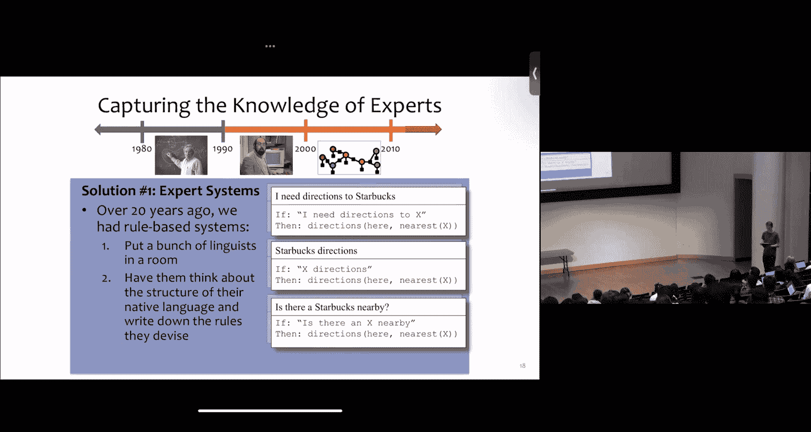

Okay， so。What people started to learn was that experts are very good at answering questions about specific cases。

 they're not very good at telling you how they actually did it。

 how they actually answered that question。嗯。And so in the 1990s， someone said， well。

 why not just have them tell you what they do on those specific cases？

And then let machine learning tell you how to come to the same decisions that they did。Okay。

 so here's what I mean。You could collect some raw sentences。

Let's you could label the sentences x1 x2 up to XN and then the experts could annotate their meaning as like y1。

 y2 yn so here's a sentence x1， how do I get to Starbucks。

 here's another one show me the closest Starbucks send a text message to John that I'll be late set an alarm for  seven in the morning and now an expert could come along and label these with what the semantics should be right so this one would be text message the recipient should be John and the message should be I'll be late and here this would just set alarm 7 a。

喂。So。If you collected enough of these， then that could be your experience。

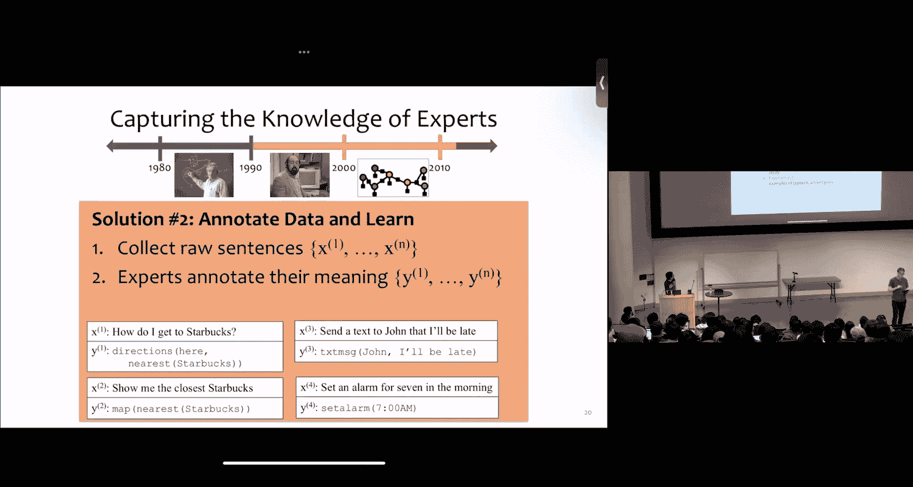

Okay， and so here we could answer this question as the task is predicting an action for yourphone to take from from some speech。

 the performance measure could be like the percent of correct actions taken in a user pilot study。

 and then the experience could be examples of speech action pairs。Okay。So the thing is。

 we're not quite done because in practice， often the same task can actually be formulated in more than one way。

So a good example of this is like loan applications。So if you wanted to just say。You know。

 this is the sort of a fundamental problem that every banker has to solve right someone walks into the bank and and you know basically the banker's job is to to give them a score。

 you could think of this as like a credit score。Yeah， zero to 800 or something。

 and the higher the score， the more credit worthy that person is。Right so you know。

 if if Henry was our banker and I walked in， you know， and I， hey， I'd like a loan。

 I'm going to start a business， you know， he might take one look at me and think to himself。

I'd score that guy， like a 500。You know， and so you know I just don't look that trustworthy right I'd probably squander the money okay。

 so another thing that our banker Henry could could do is he could think to himself about the probability that I would default on a loan if he gave me one。

Right。So whereas the credit score was a number between zero and 800。

This is now a number between zero and one and we call these different sort of formulations of the problem。

 the first one is a regression formulation， the second one is a density estimation because we're actually outputting a probability。

😡，The third thing that he could do is just make a hard decision， should I give this person loan。

 yes or no？Okay， that's a classification problem because there's just two possible outputs。😡，Okay。

 we're going to think about you， what is the structure of our output prediction and we'll think about many more different problem formulations as we go。

😡。

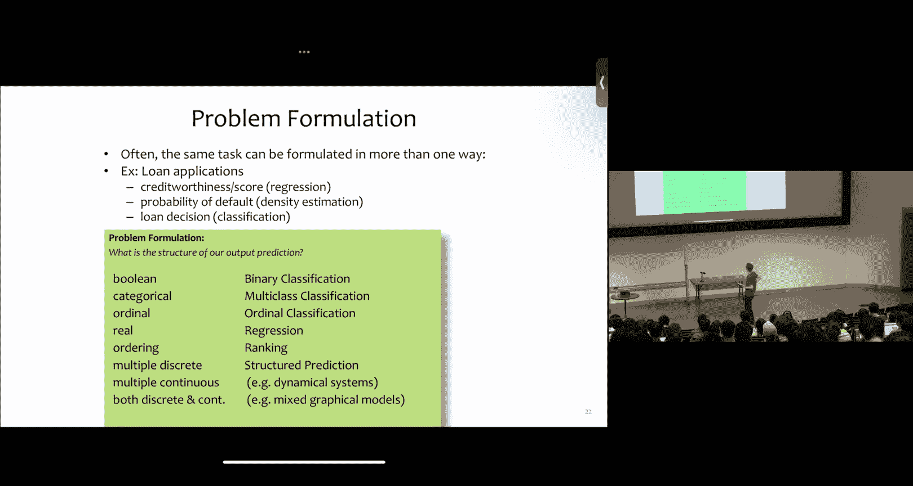

Okay， so what I want to do now is have you all do some work and think about how to formulate a problem and to do that。

 I want you to pair up with the person sitting next to you and you're going to select a task T。😡。

Then you'll write down for that task a performance measure P。😡。

And then identify some experience E that you could learn from。😡。

And then we'll report ideas back to class now my hope is that all of you kind of come in with some existing interests and so I would hope that between the pair of you。

 one of you has some task that's kind of related to what those interests are。

 your area of expertise and if not if you get like completely stuck there's also some example tasks on the far right that you could work with but you guys are creative you'll come up with something。

😡，Okay， so let's take three minutes and go ahead and introduce yourself to the person sitting next to you and get to work on finding a T。

 a P and a E。So you guys are already we talked to a bunch of you。

 you guys are already coming up with great ideas， let let's gather some of them back here to share with the class so who you could just raise your hand if you want to share your task。

 performance measure and experience。

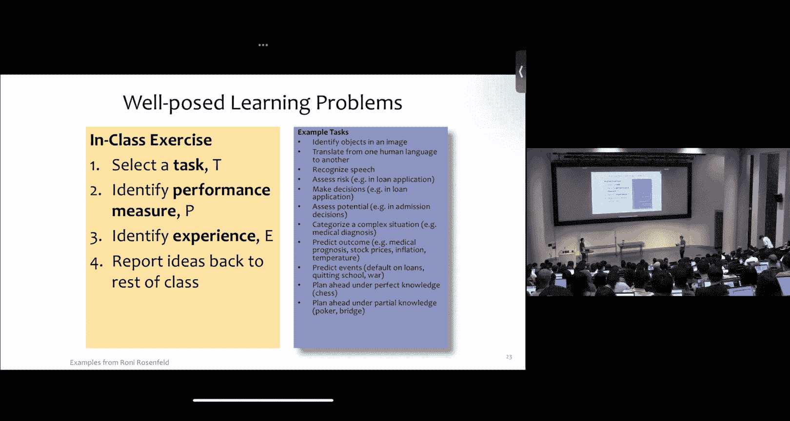

Yeah。I think the idea of identifying music， but not necessarily just from the audio itself。

 but maybe a rec creation of a。Oh， so wait， identifying music or creating music because as in like you you have a bunch of audio and you're trying to figure out like。

 is that， is that a truck driving down the street or is that。Like for instance。

 one problem I run into a lot is I have a melody in my head and the best I can do is find soap website that lets me write down the melody or try to recreate it and see if I can identify one piece Okay。

 so identifying。A specific。A song or rather。So it's not just identifying that it is music。

 it's actually identifying which music you are actually listening to great so what's your performance measure。

Reation in close phase 1。But we also came up with ideas like。

Oftentimes the websites that's tried to do this kind of past， they will try to give you a。

Now just of a problem with that。These are immediate。 You can also look at the average。啊对。啊，一这。Sure。

 so in in some sort of like ranking。诶。You know， average placement in that ranking。

So if the correct piece you know， makes it into the top 10 of your list。

 that's actually quite good right okay， great idea what about experience so how are you going to gather experience here？

Basically， theres database of songs and piecess and meloies。And。

Dake also came up with the idea of deliberately distorting samples， for instance even through audio。

 or could even do with me like adjusting notes and Lunots to trying to。And see howo。Great。So here。

 the key thing is that you're coming up with pairs。

where you have some audio as your input possibly distorted and or noised up in some way and then what you're trying to predict is actually what is the name of that piece of audio and I like this distortion thing because you know。

 you know if you hear the song， wow there is a truck driving down the street。

 that might sound rather different than if you're sitting in a concert hall。Okay， great。

 someone else want to give me something different。呃。In terms of actual idea for。A tasker， yeah。

Say it again。C。Oh， like a student GPA got it。Sure。See。

 I never think about grades as a we're just so focused on your learning and what you're going to come away with。

 I guess we do we have to assign grades in this class？I don't know， we'll figure it out。Okay。

 so predict student GBA， what is the performance measure？Yeah。

 so I think we need to be a little more specific， so we could say historical data。

 right we can actually look back at past student data。And we could say or maybe historical。

Is one option or we could actually consider future data right so either way you have historical students or future students and you could look at the say。

I don't know the difference。嗯。Between。Your。Actual prediction。And the actual。U。Right。Yeah。

 so we could actually。That's true too。Yes。Yeah， so so experience。

 so we want to be a little bit careful so we could basically look at sort of a profile。

Of the student。Meaning this is going to gather up a bunch of information about them。

 maybe it's like really fine grain it's like did you get you know you know 90% of the in-class polls correct and how well did you do on I don't know some crazy background test that a weird course would give you in the first week of class never do that and you know and then you could base sort of your prediction of based on that profile of them and you could look at their sort of actual GPA as what it is that you're trying to predict so you could gather a bunch of those。

Okay， great， another idea， let's do one more。Yeah， can you talk really loud from the back？Yeah。Oh。

 predicts adoption of。They'll wait， say that again。Oho knowledge absorption in class。 Okay。

 so this is， this is related， but different from。The previous one。

So what would be your performance measure？嗯。😮，Great， so this sounds a little bit like experience。

 So let's can I write these down as experience， so， you know。

 you'd actually have for experience their grades sort of class engagement。😊，Maybe。嗯。And hours spent。

Studying in the library or something like that， right？So then the actual performance measure。

 how do we measure if someone has absorbed knowledge？I'm serious。

 we actually would love to know the answer to this question。Yeah。

 so I think that this is actually like a really hard question I mean so sadly we might have to resort to like you know a test grade or something like that right I think that there are other ways that we could actually you know ask this though like can a student solve an unsolved problem right in some sense I'd be much more interested in finding out whether that's that's the case and that could actually be maybe a more informative prediction of whether someone's absorbed some amount of knowledge okay so I think we'll keep moving on here there's probably lots of other other tasks that we could talk about actually let's get just since these last few were sort of similar without doing experience and performance measure does someone want to throw out just a couple tasks that you came up with that are in different directions？

Tennis stroke analysis， I love this， what else？Okay。

 basically like sort of deciding how much glucose to give some someone who's like diabetic or something like this。

 right？Other wildly different ideas？Cool， so I think that the fun of this is that many of the problems that you care about can actually be cast in this way and actually writing these down starts to give you some insight into what it is that that you actually need to sort of。

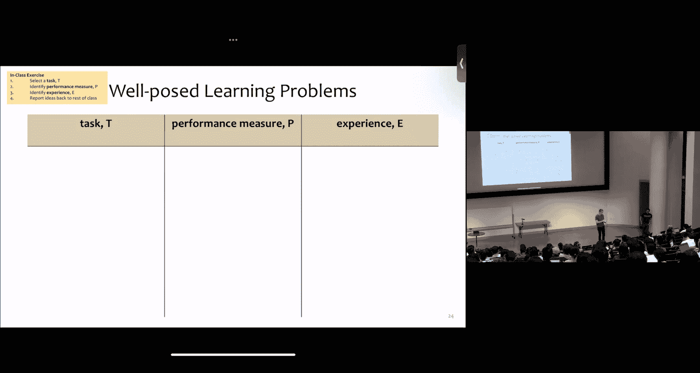

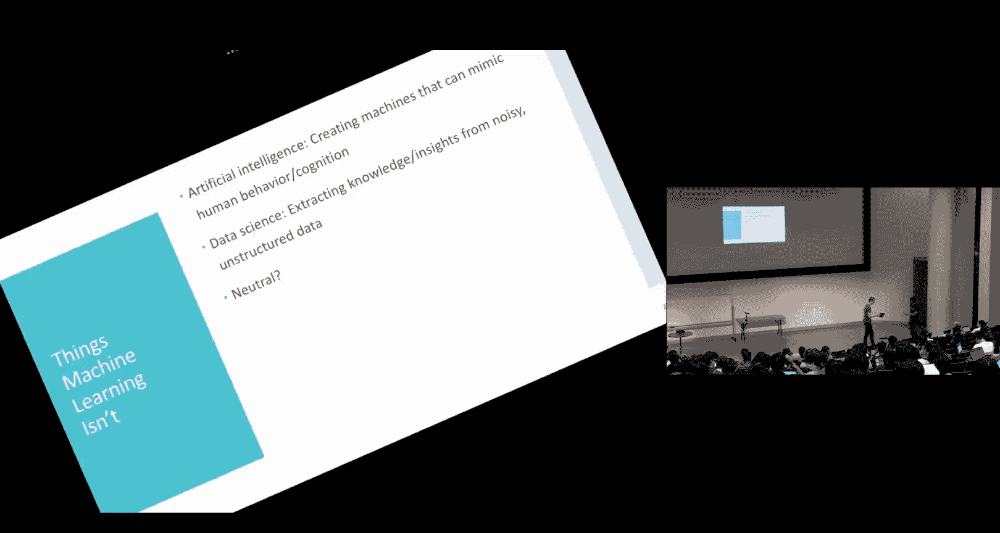

Begin working through and writing down an answer for how to formulate that problem。这个。

But let me revisit， actually， before we move on， let me revisit this task really quickly。

 because it is an interesting one。 It is something that Matt and I might benefit from in this class。

 But more broadly， isn't it something that like。😊，Carnegie Mellon could really benefit from like。

 you know， you guys like write all these essays to get in。

 you get all these like letters of recommendation， what if instead。They could just， you know。

Look at who you are。And predict what your GPA here would be after you complete your degree of study and then let you in based on that。

Y'all go with that。Any potential issues with that？Yeah。😊，Could it be biased， how could it be biased？

被上黑的。I like how diplomatic you're being here， I realized as I was starting this example might hit a little too close to home given that you the population I'm speaking to。

 but no this is exactly the point that I want to raise that like depending on sort of how you formulate these problems and what experiences you learn from you can end up with some let's call them problematic machine learning agents there's this somewhat famous mantra in the field of machine learning known as garbage in garbage out and this happens a lot in the context of historical data like if you're working with data that reflects some existing historical biases well then your models's predictions might also reflect those biases as well and so we're gonna spend some time talking about this later in the semester but I just wanted to put this on your radar as a consideration and one that well I guess maybe not this current administration but previous administrations have viewed significant enough to。

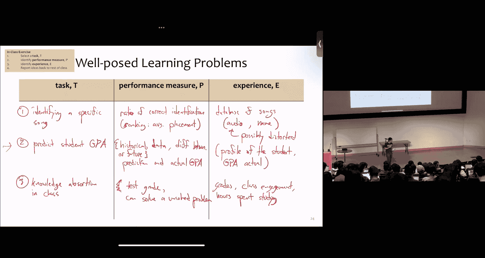

Put out white papers about describing you know sources of bias as the data or the inner workings of the algorithm themselves and so this is a really important problem to consider anytime you're formulating or building a machine learning agent so just something to keep in the back of your mind we're going to talk about a lot of examples in this class a lot of applications of machine learning and frankly we're probably not going to devote enough time to this particular topic so I'm putting it on you to think about for us。

😊，All right， so next we're actually going to build a machine learning classifier It's going to be our first machine learning classifier and just to mix it up a little bit。

 I'm going to pick a whole new task so this task is going to be learning to diagnose heart disease and I'm going to give you some experience this is a small data set of five patients and so in this data set we're going to pull out some relevant components and define some terminology here so each of these patients。

 each of the rows of our little matrix here if you will is going to be called a data point so this data is going to have five data points and there are going to be two different types of columns there's going to be what we'll call the features or the things that will be used to make the predictions about the label here。

So one of the reasons why I'm being a little stressful on this terminology is because depending on what previous exposure to machine learning you've had or depending on which of the various readings that we post on the website you read。

 you might see these things called different words。😡。

We're going to do our best to stick to this terminology。

 but you know you might also see data points called instances or examples。

 you might see features called attributes or independent variables。

 all of these various things you might see we're going try and stick to this terminology in this class all right so we're going to have three features that our classifier is going to use。

 it's going to be whether or not someone has a family history of heart disease。

 whether or not someone's resting blood pressure was high or low or normal and whether or not someone's cholesterol was normal or abnormal。

All right， so formulated in this way， here's a whole bunch of new words。

 we're going to call this problem a supervised binary classification task， all right。

 so let's break this down。😡，We'll say that it's supervised because。

 well I'm sort of telling you or I'm telling your machine learning agent what the right answers are for these data points。

 you have labels， so we'll see a little later in the semester what you can do without labels that'll be called unsupervised learning。

😡，This is a binary classification task because our labels exist in one of two categories， either yes。

 you have heart disease or no， you do not now。😡，Just to bring home Matt's point from earlier。

 there are lots of different ways that I could have formulated this particular task so that we would end up with different kinds of problems here。

If instead I wanted to categorize your risk for heart disease。

 I could maybe break that into buckets like low medium and high risk。

 and now all of a sudden we have a multiclass or just a normal classification problem。

 no longer binary。Or this is a bit of a stretch， so bear with me if I wanted to somehow measure the amount or predict the amount of money associated with your heart disease diagnosis。

 whether you have one or not， I might make this a regression task where I'm trying to predict some real valued dollar amount。

All right， so let me stop here， we're going to go through our first machine learning classifier next。

 but before I move on， what questions do you all have at this point？😡，嗯。Yeah， go ahead。Oh。

 this is a great question， I think we traditionally conceptualize。

Experience as the amount of data you have， spending more time on that same amount of training data。啊。

That can improve performance， but I think Matt wants to chime in here。

A where more time on the same data could count as more experience is going to come up when we talk about online learning and we'll think about that through the lens of the perceptron algorithm so there is a setting in which we could think of more time on the training examples as more experience but often we'll just think about the number of examples as kind of defining how much we have。

Great question， Any else here？Yeah。😡，How about the quality of the data that is sort of a maybe like a tangential point if we were being sort of really tied to this definition。

 we might not even count sort of bad experiences as experience。

 but there are ways that you can adapt your learning algorithms to sort of。😊。

Account for bad experiences that's a really great thought as well。Yeah。😊。

Should I choose my performance metric from the experience？Can you。Could they be the same？

That would be a bit odd， I think we could maybe come up with some。

Settings in which that would be appropriate。In some sense， like if you're giving your system。

 if you're giving your agent the thing you want it to be able to do。

 the performance metric as a part of the experience。

 well then you're opening yourself up to like sort of cheating in some sense。

 just like learning that performance metric as opposed to extracting any meaningful pattern from the experience。

😡，All right， so。With this terminology out of the way， we can actually get to our first classifier。

 and this is something that I've been sort of saying along the way。😡，Let's define this term。

So a classifier for the purposes of this class is going to be any function。

That takes the feature values as an input and returns to me a prediction。

 returns to me one of the possible labels here。😡，And so we're going to start with a really simple one。

😡，I love this one actually I love these next two classifiers we're going to talk about because I can do them without talking about any math。

 which is really cool。This first classifier is going to be what we call the majority vote classifier and what it does is it always predicts the most common label in the data set。

 so here looks like I have two nos and three yeses， and so I would always predict yes。😡。

Here's a question for you all。Is this a good classifier？Why not？

What makes this a good or bad classifier yeah？Certain features could have an effect on the outcome that's a really great answer because this currently does not consider any of the features at all right I could just sort of erase those from the data set and I would end up with the same classifier Anyone have a different answer。

😡，Yeah。Yeah， okay， so I really like this answer because what it's doing is it's looking at the data that we have and using that to try and assess whether or not the classifier is a good one。

 you have another answer here？😡，Oh， so maybe a bit of a defense for。

 although there was a big if in there about like this being reflective of the population that was kind of a big if。

 but regardless you both are getting at sort of an interesting point here。

 which is that like if I give this new data if I give this data set a new label。

 let's call it my training data， the data that I used to train or learn my classifier。

 well I can evaluate how well my classifier did on this data， so。😡，Here are actually sorry。

 let me take a step back。 The right thing to do the right thing to do is to get a new data。

 a data that your classifier has not yet seen before。

 which we'll call a test data I want to give my classifier a test so I'm going to go out and gather three new patients here and I'm going to ask it to make predictions these three new patients and compare those predictions to the true label of those patients and we'll see that in this test data set first a new definition we'll call the error rate。

 the proportion of data points that your classifier gets wrong。

 this is sort of one minus the accuracy rate， which I think was the other suggestion so very complementary statistics here we can evaluate this classifier's error on our test data and well。

😡，We actually did okay， the test error rate here was one/ third it only made one mistake。

 so maybe it just got a little lucky， who knows， but as was suggested， oh sorry， one more thing here。

😊，What I just did in like。Four minutes。Go me， what I just did was basically lay out a very classical supervised machine learning routine。

 which is we train some classifier and then we evaluate it on some held out test data set。

So we apply it to the test data set and then we。Evaluate how well it did by computing some sort of performance metric。

 in this case， an error rate。All right but。I think we all remain a little unsatisfied with this because。

 well， like I said。Completely ignores the features。 So let's think about what this means， right。😡。

Say I'm a doctor。not like a real doctor say say I'm a real doctor and I use this classifier to make diagnoses for my patients right And so you know。

 you walk into my clinic and well I look at you and then I completely ignore everything I know about you and say yes。

 you have heart disease and you have heart disease everyone look under your snow okay sorry。

Everyone's still like， is Oprah still a thing？Yeah， okay， good good， all right。

 sorry this was my point earlier you could if you wanted actually compute the training error rate as well and see that。

😊，You know even in the setting where I give it the answers it's doing kind of badly right it has a 40% or two fifth error rate。

 so maybe I want to improve on that and I actually care about using the features to learn the label。

 I care about using the features because I believe there's some relationship between the features to my label here。

😡，All right。That brings me to our second machine learning classifier。

 let's think about this one for a little bit。😊，So this new classifier says if a very specific set of features exists in the training data。

 I'm going to predict that label that I know to be the label in the training data。😡。

Otherwise let's just say I go back to the majority vote so what does this mean Well again imagine I'm a doctor patient comes into my clinic and I ask them three questions do you have a family history of heart disease they say yes。

 I measure their blood pressure turns out it's low I take their cholesterol turns out it's normal so yes low and normal have I seen that before well let me go back to my data and yes。

 it turns out I've seen that patient before they're this first row in my data set and so I look up the corresponding label and it says no so I predict no for this person every person。

That comes into my clinic。That matches those three characteristics， I'm going to predict no for。

 same for the next row and so on and so forth。😡，All right so。One thing to note here。😡。

Because each of these unique set of features exists in my training data that're always going to match themselves in my training data what that means is my prediction is always going to be right for them the training error rate here is zero I'm actually sort of doing well on the instances that I've seen on the data points that I know the answer for unlike the majority vote classifier right？

😡，All right， next question for you all。Is the memorizer learning？啊。

We got some time let's go ahead and take two minutes here why don't you chat with your neighbors and try and convince them of your answer so if you disagree try and convince them that you're right。

 if you agree， well try and come up with a good justification for why you think the memorizer is or isn't learning won'll reconvene in two minutes。

Gosh， this is a it's really great and I gotta say big first day of class energy here All right。

 does anyone care to share why they feel like the memorizer is or isn't learning？Yeah， right here。

I'm not exactly sure because I feel it depends on how you define the experience here。

 because if you define the experience as like the size of the training data。

 if you keep likelycorpoerrating actual cases into the training data。

 it kind of improves because you have more like correct answers to directly looking for。

But if you could find the experience like how many like the side of testing data， say like how many。

Patient it has actually visited， but without incorporating you into。

Training set the accuracy Oh I really like this answer so I think what you're getting at is it both depends on what you define to be the performance metric and what you define to be the experience and I think so let me give you my answer and it's no way the only answer because I implicitly made some assumptions here but if you assume that the experience is the size of your training data set or the number of training data points you give it and the experience is or sorry the performance metric is you know test accuracy or test errorerate and then you make all sorts of assumptions about how people in the real world behave and like the distribution of like heart disease and whether or not these are three good features if you make all sorts of assumptions about those things well then per our definition you might argue that it is learning I think there's reasonable case to be made that it's not learning as well but here's the thing that we care about here's the。

Surprise twist behind all of this We don't actually care how well your classifier does on things that it's seen before right if I cared about that I could just go to the training data myself and look up the answer I don't need something predictive what I care about is how well your classifier does on things that it hasn't seen before。

 things that I haven't seen before new instances， new data points that I don't know the right answer for and so the thing that we typically care about is what we'll call generalization or the ability of your classifier to generalize the knowledge from the training data to unseen data points like in the test data and so this is ultimately going to be the thing that we care about and as it turns out the memorizer does not generalize well because if it comes across something that it hasn't seen before well by this definition it defaults to the。

Majority vote classifier， and that's kind of a dumb thing to do， frankly。All right， so in some sense。

 this is basically what I said here， this is the whole point of machine learning。

 we want to be able to build classifiers that can generalize well from training data to unseen test data points。

😡，Okay， let me again stop here， what questions do you all have at this point？😡，Yeah。That。

And that8 doesnt that。AYes， this is a a really sort of fundamental assumption in machine learning that you're training so let me let me put this very technically first for the most part we will assume that your training data set comes from the same distribution as the population you're interested in right so if I'm。

😊，Let's say gathering patient data from my clinic here in Pittsburgh。

 I care about how well my classifier does on other patients with similar you know health factors and health risks to my existing clinic population it would not necessarily do well if I took that same classifier and ported it directly to I don't know Japan somewhere else far away right so we are going to be making some fundamental assumptions about the relationship between our training data and the real world or the test data set when it comes to things like that。

呀。This is a really great question so let me try and paraphrase a little bit here so what we're saying is is the label to any given set of features always going to be unique for a given set of features could I see both labels and in the real world the answer is absolutely yes in certain settings we might assume what we would call a noiseless label so that there's no randomness for every given set of features I always see the same label that's a really unrealistic assumption though right and so yes。

 if I were trying to formalize this memorizer to actually use in practice I would need to come up with some sort of I guess like tie breaking mechanism for if I saw the same number of yeses and nos for a given feature vector that is outside the scope of my little example here but absolutely a real world consideration。

Anything else？Yeah， one more。Yes， it does， while it is sort of reliant on a performance metric to measure。

 and we will get to that a little later in the semester， so hold on to that thought。😡，All right。

 so these are all really great questions I hate to cut this off。

 but unfortunately I have to talk about something terribly。

 terribly boring being the first day of class， it is important that you know a little bit about what is going on in this class and to do that you can go to this website here Also Matt。

 I don't do you own MLCourse。 org I don't know how that happened that's crazy Yeah so you can also go to that URL and like。

😊，Like。If I。If I could trust you all to go do that I could give you 10 minutes of your lives back here but instead you're gonna watch me flip through the website myself so here's the syllabus it's linked here that whole section is required reading but let me pick out some things that you all are going to be interested in maybe to motivate you to go read the rest of it so in this class we'll have sort of two kinds of assessments we'll have homework assignments and exams there will be three exams and there will also be a minor component of your grade related to participation we'll talk about that a little later。

Excuse me。So homework assignments those are going to be due pretty regularly starting well the first one is going to come out later this week one of the things that we always get asked what is our late policy you have some finite number of grace dayss that can be applied to your homework assignments there are lots of rules on how they can be applied in particular note this third bullet down for some special homework assignments you're not going to be able to use the normal allotment of grace dayss so just plan accordingly。

Oh， and this point also very important， no submissions accepted more than three days late。

 there are of course exceptions for these policies， if you want to read more about those。

 they're in the syllabus。😊，Collaboration， this is a very important point here that I want to make。

 we love it when you guys work together。😡，To a point。

I hope you got that from this first little lecture here that like we like it when you guys talk to each other about the ideas in class。

 but ultimately when it comes to doing the work， we want to make sure that we're assessing you all as individuals and so I personally like this last little section here when you're talking about homework。

 whether it be the sort of more programmatic questions or the more mathematical questions。

 feel free to talk about them however you want， but when it comes。😊，Actually。

 writing up or coding up your answers， do it on your own。

So some various technologies that you all are going to want to make sure that you are subscribed to or have access to hopefully you all have been added to the piazza and the gradecope for this class we'll use Piazza for making announcements and handling your questions gradecope will be used for submitting programming and written assignments we'll be using Google forms for inclass polls。

 this is actually not something you need to worry about well the only thing that you all have to make sure is that you have an Android ID which I hope you all do we'll talk a lot more about how those work next week and for those of you who are not here hi we have a recording going on you can all turn around and say hi you'll be able to view these recordings after the fact for reviewing purposes。

Yeah。It also focus your encourage us to use a low tax effort for homework without because fill。

So we will be posting lateEx templates for all of our homework assignments to the course website。😡。

Yep， only I think I have a few slides coming up on where exactly that'll be。Oh， so。Lecture schedule。

 one notable omission from this lecture schedule， many of you looking at the。😊。

Website right now we'll probably see a little link there that says slides for you to follow along。

 I know some of you like to take notes on our slides as we're sort of giving these lectures。

 so those slides will always be posted。some number of minutes in advance of the lecture。😡。

Who knows what that number will be？So one thing about lectures while we're on the subject here。

We again， I hope that we sort of made this point clear， we want you to ask us questions like。

We get it there are a lot of online alternatives to coming to a lecture hall like you know really excellent professors giving recorded lectures。

 but one of the great benefits of you all being here is that you get to talk to us and you get to talk to each other which is really great so always ask us questions and conversely when we ask you a question we want you to answer or we want you to at least think about it as if you were going to answer so you know please do play along。

😊，Interaction really improves learning both in this class in live lectures and also at office hours and crucially amongst yourselves。

 you know I think Matt and I we're pretty cool， we do a decent job but maybe the greatest resource you all have as CMU students is each other。

 so make use of that。😊，Oh dear， anyone else pick up on that？All right。

 let me interrupt this tour of the syllabus here for what we'll also do throughout lectures。

 which is a bit of FAQ here。😡，A question that we get a lot。Both， you know。

 like as the course begins or you know， probably like what 20。

 30 emails before the semester begins is hey， can I take this class。

 this is you know my entire resume from like grade school like am I prepared to take your class。

I we have no idea but。We have designed a way for you to figure it out and that is this background test thing so there is going to be a required inperson test on Friday during recitation oh we have recitations for this class they happen at the same time in place as lecture so in here 930 for you all on Fridays and it's going to cover all the various stuff you need to know in order to succeed in this class。

😡，All right， next question。Really guys？That's kind of what I said to Matt too and the answer is yes。

 really， first of all， but let me make you feel a little bit better about this hopefully which is look we get it。

 but if you want to think about it， there's actually a very clever grading scheme that Matt came up with that you can basically use to treat this exam this required exam as like bonus points for homework one I'll let you guys work through the math here。

 but it basically turns out that if you do really well on this background test then you can kind of blow off homework one conversely if you do really poorly put a little effort into homework one and you'll be able to make up for it so that's how you think about this background test。

But the real point of this test is it will help us and it will help you determine if you're prepared for this class and we have some historical data that shows there's like a good relationship between how well you'll do in this class and how well you how well you do on this background test。

 much more so。😡，Then if you had just done like a normal homework assignment。

 and so that's really what we want you all to get out of this test to really think critically about whether or not you're set up to succeed for the rest of the semester。

😡，All right， on the subject of exams， we already have a few exam dates nailed down for the semester。

 please do plan your travel accordingly because we have three exams in this class they fall on somewhat wonky dates you are expected to be here in person for these exams including annoyingly this last one which doesn't get scheduled until like you know November or something so I'm sorry about that I really don't know when it's going to be you all will find out at basically the same time that we do so you should probably plan on being here for the finals period。

I don't know why I have those disappearing。So another great question we will post all homework assignments to the course website under the coursework tab。

 this is where the actual PDFs and the lateEX templates will be released to you all along with any sort of data sets that you might need access to to complete them oh and the final point here we have a convenient calendar on our course website that will show you not just lectures but also the office hours schedules the first homework assignment comes out on Friday right after your background test and so office hours will start on Saturday this weekend。

All right， I think that's all I had for you all today， so I will see you all back here on Wednesday。

When we start talking about a real machine learning classifier， if you will。

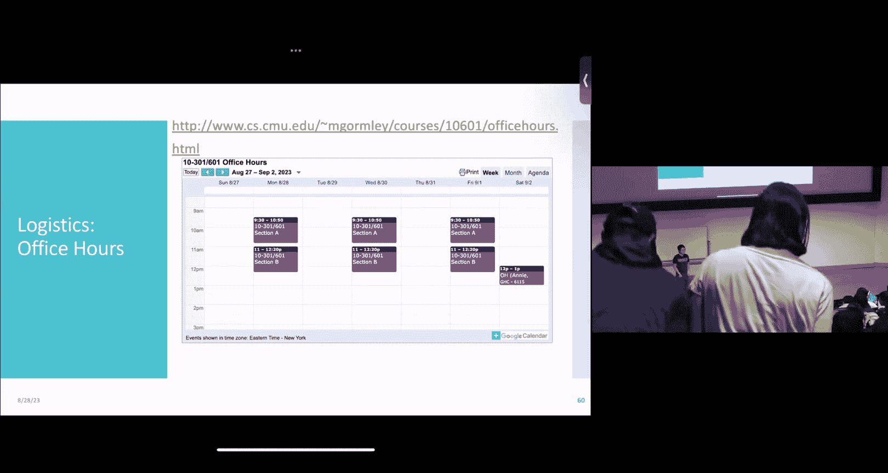