# CMU《机器学习导论｜Fall 2023 10-301⧸601 Introduction to Machine Learning》中英字幕教程

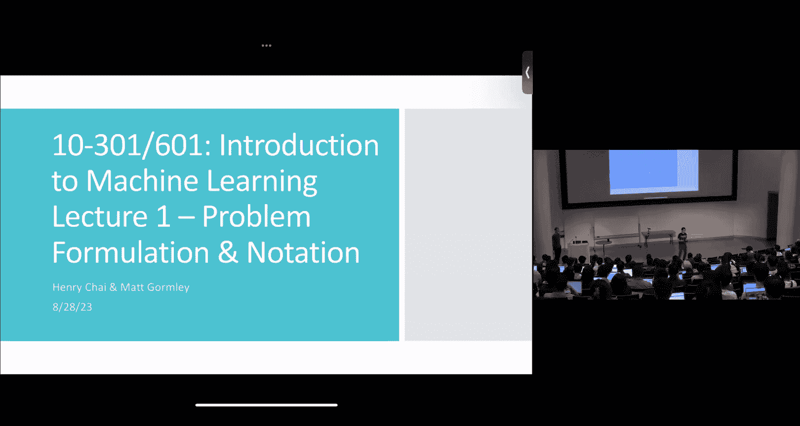

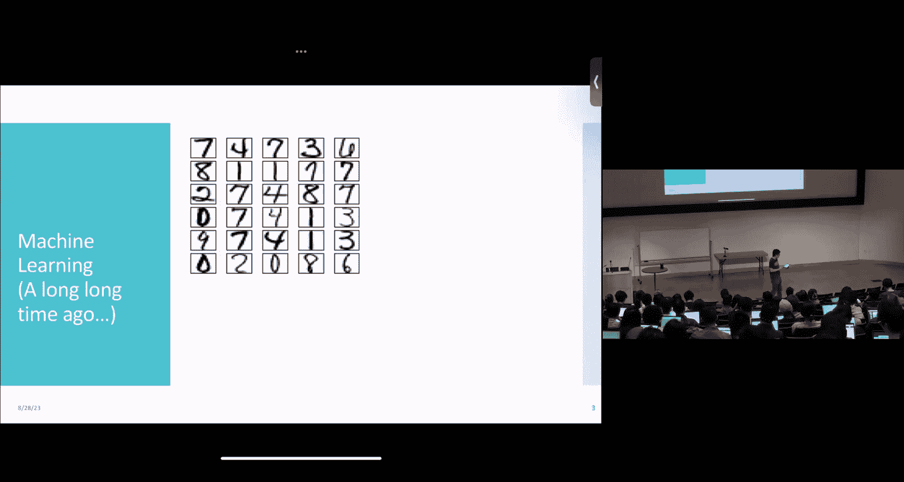

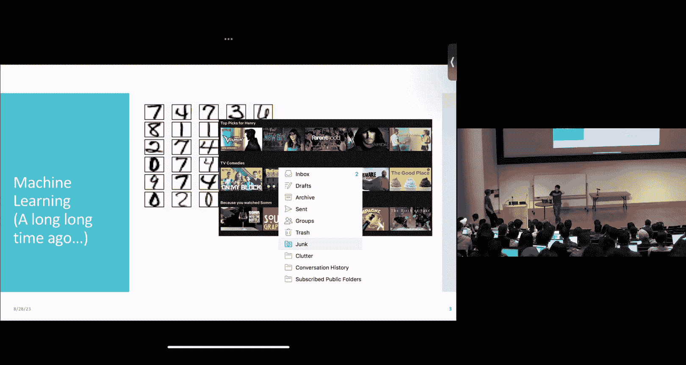

## 🧠 机器学习问题定义与符号

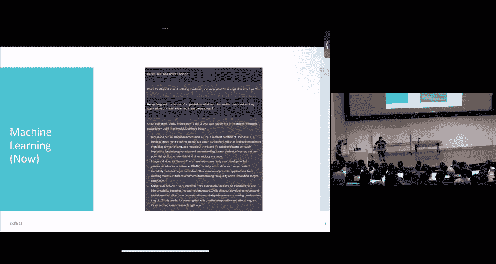

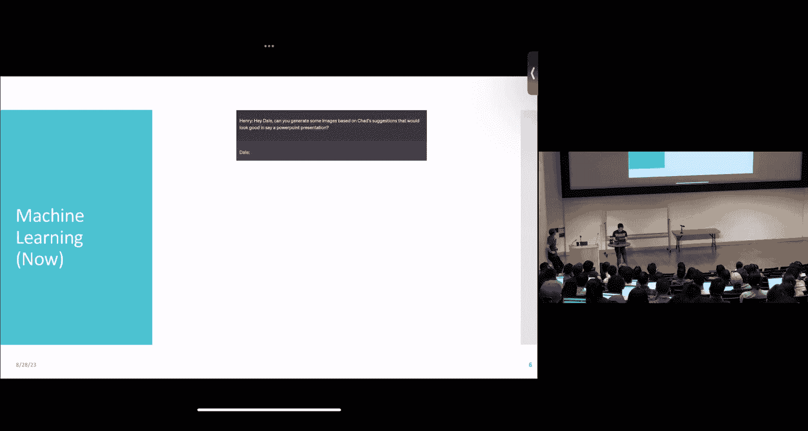

### 概述

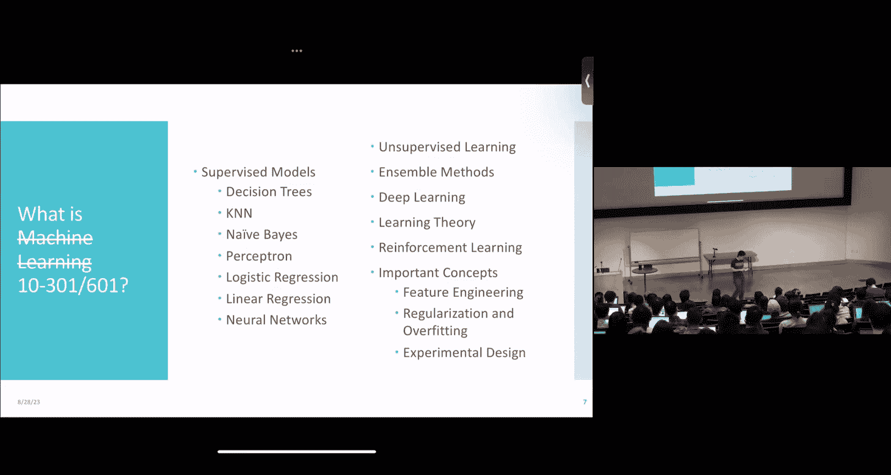

在本节课中，我们将学习如何定义机器学习问题，并了解相关的符号和概念。

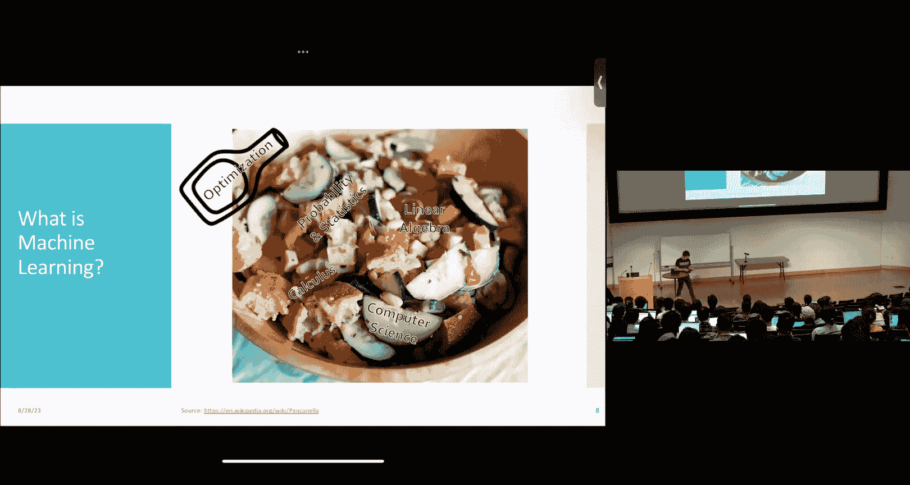

### 核心概念

**机器学习问题定义**：

一个计算机程序学习，如果它在任务 T 上的性能，通过性能度量 P 或指标来衡量，随着经验 E 的增加而提高。

**符号**：

* **T**：任务
* **P**：性能度量
* **E**：经验

### 例子

**学习下棋**：

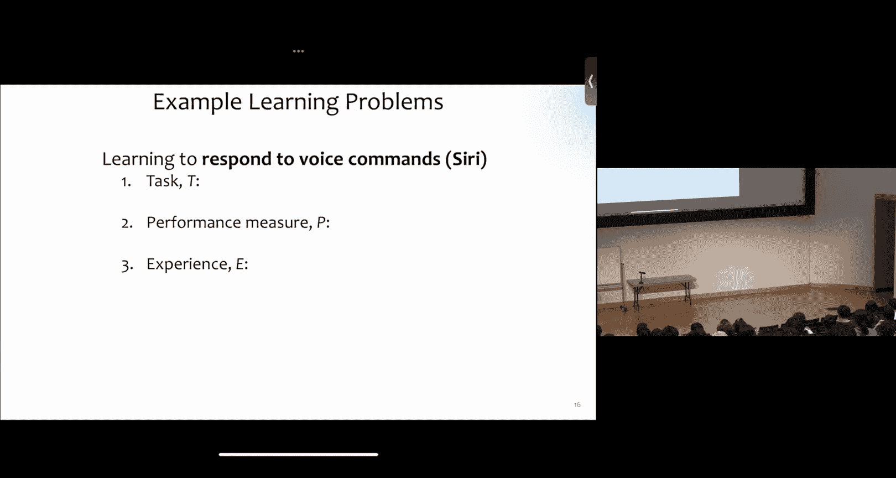

* **任务 T**：下棋
* **性能度量 P**：赢得比赛的比例
* **经验 E**：玩棋盘游戏的数量和对手

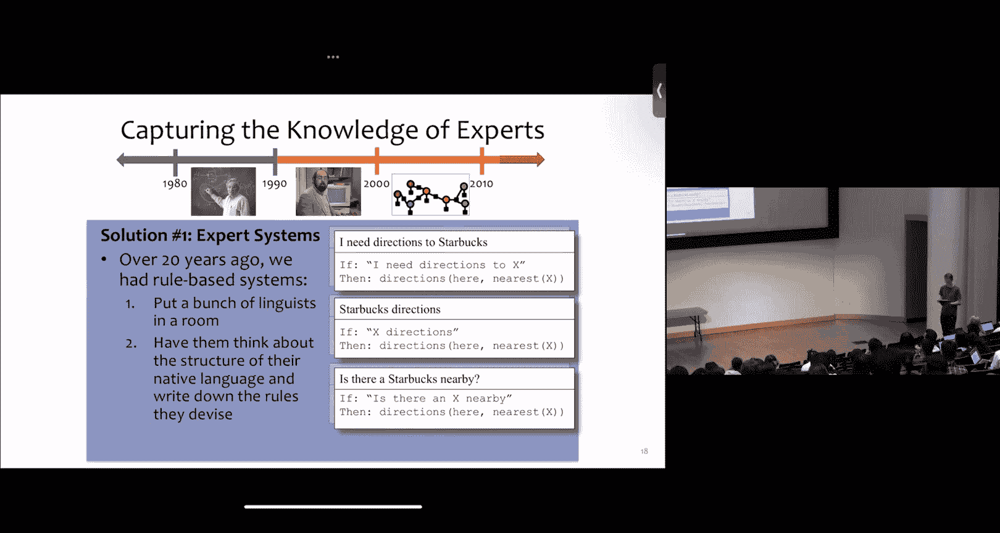

**响应语音命令**：

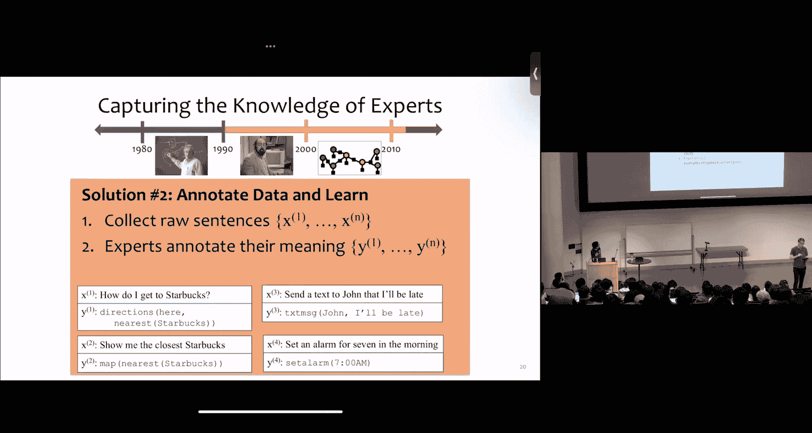

* **任务 T**：预测手机应采取的操作
* **性能度量 P**：在用户试点研究中采取的正确操作的比例
* **经验 E**：语音动作对示例

### 总结

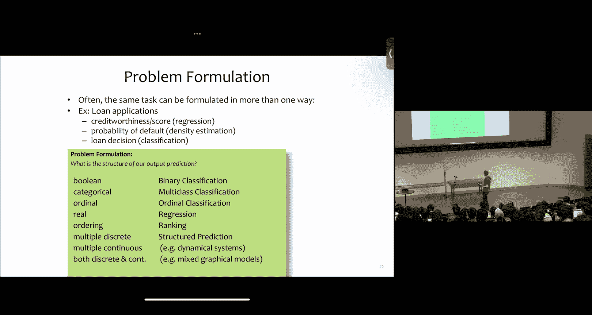

本节课介绍了机器学习问题的定义和符号，并通过例子说明了如何将实际问题转化为机器学习问题。

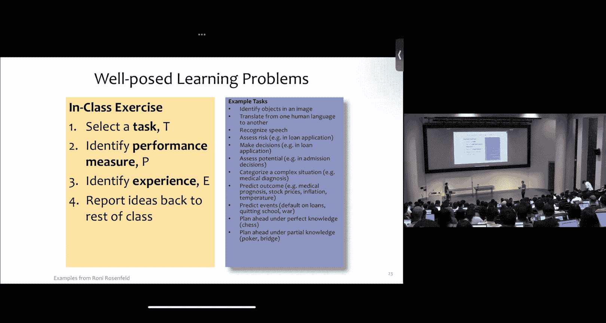

---

## 📊 机器学习分类器

### 概述

在本节课中，我们将学习如何构建机器学习分类器，并了解相关的概念和算法。

### 核心概念

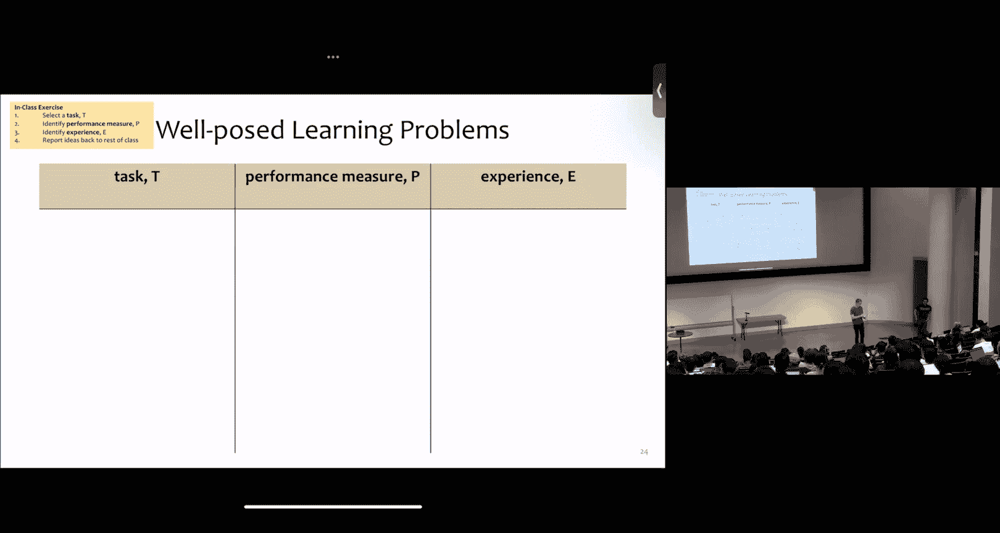

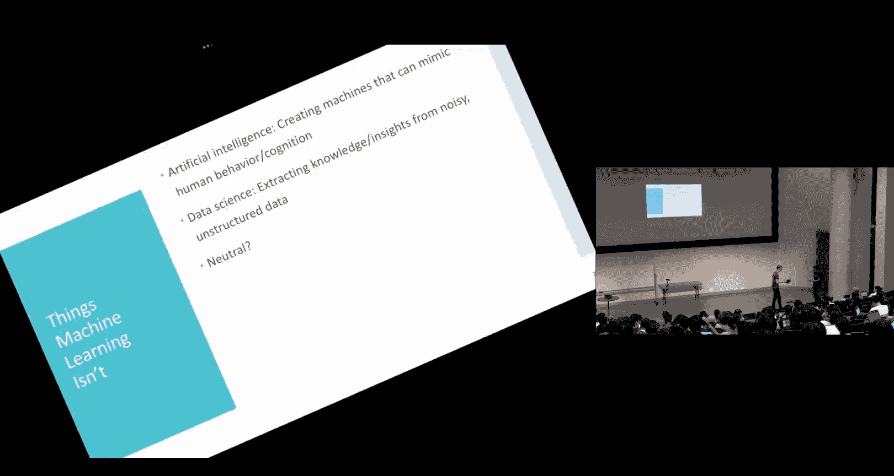

**分类器**：

任何将特征值作为输入并返回一个可能标签的函数。

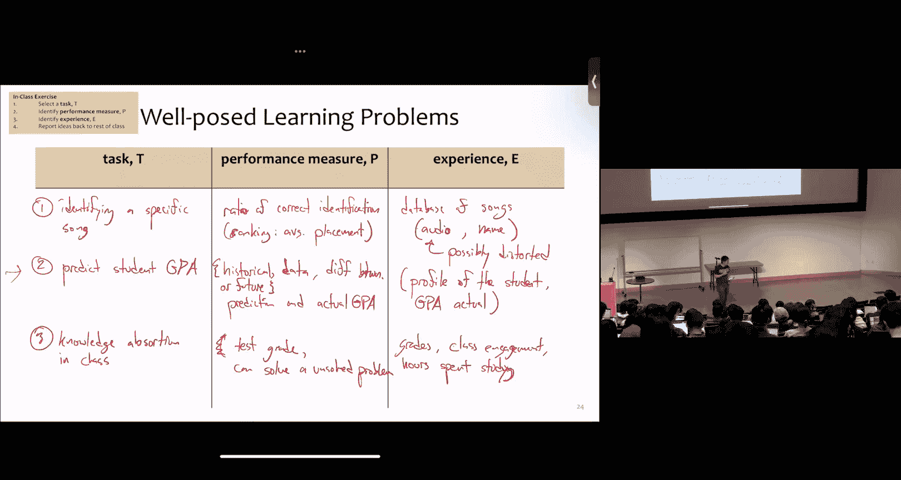

**分类器类型**：

* **多数投票分类器**：总是预测数据集中最常见的标签。
* **记忆分类器**：如果训练数据中存在特定特征集，则预测相应的标签。

### 例子

**诊断心脏病**：

* **特征**：是否有心脏病家族史、静息血压、胆固醇水平
* **标签**：是否有心脏病

### 总结

本节课介绍了机器学习分类器的概念和算法，并通过例子说明了如何构建分类器。

---

## 📚 课程大纲

### 概述

在本节课中，我们将学习课程大纲，包括评估方式、作业、考试和参与度。

### 评估方式

* **作业**：定期提交
* **考试**：三次考试
* **参与度**：课堂参与和讨论

### 作业

* 定期提交
* 晚交政策：有限次数的宽限期
* 合作：鼓励合作，但最终评估个人

### 考试

* 三次考试
* 考试日期：请提前安排行程
* 考试形式：闭卷

### 总结

本节课介绍了课程大纲，包括评估方式、作业、考试和参与度。

---

## 🤔 总结

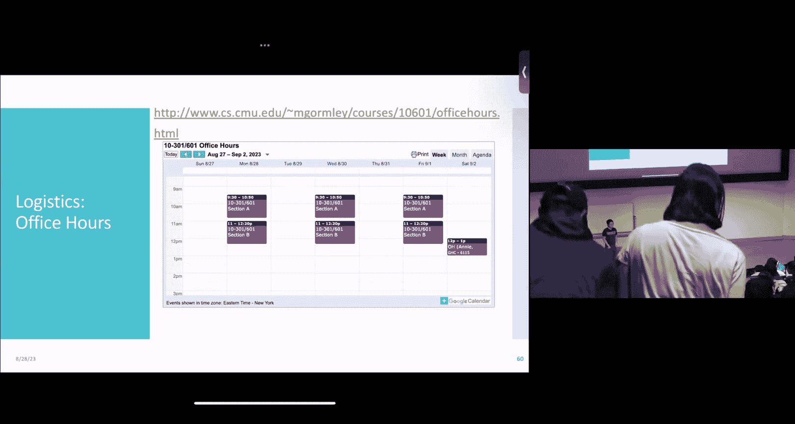

本节课介绍了机器学习问题的定义、符号、分类器和课程大纲。通过学习这些内容，你将更好地理解机器学习的基本概念和原理。