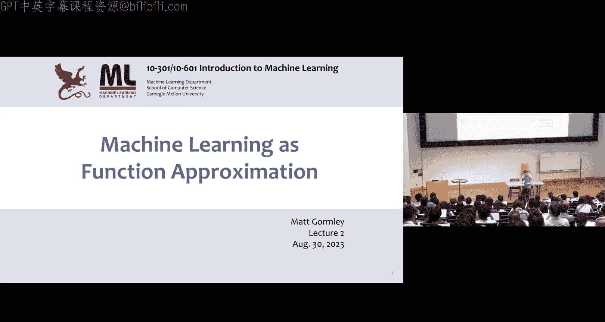
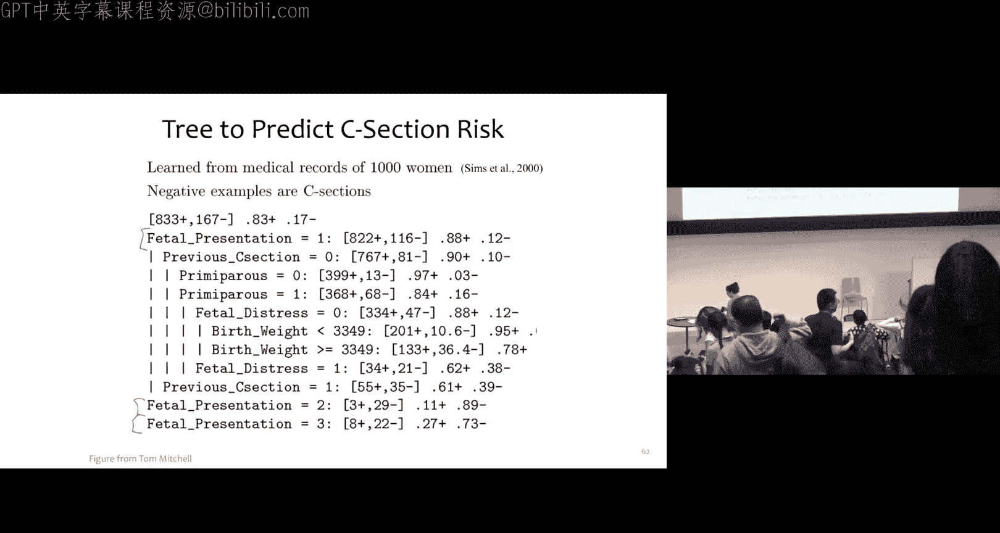

# CMU《机器学习导论｜Fall 2023 10-301⧸601 Introduction to Machine Learning》中英字幕（deepseek p02 Lecture_2_Machine_Learning_as_Function_Approximation.zh_en [BV1Z2cUefE4A_p2]

Okay， welcome back to 10301601。 Today， we get to pick up thinking about machine learning as function approximation。

 And as we promised last time， we're actually gonna take some time today。 Okay， so if I'm。

 if I'm speaking loudly， can you guys in the back row， hear me， okay， Okay。

 if if you're having trouble here hearing like there's lots of seats up here。

 you can kind of squeeze in。 there's lots of space。 So don't。

 don't be shy about that And there there it do goes。 So so as we think about。😊。

How to actually formalize these problems we'll be running through some examples as well before we do that just a couple reminders because we're throwing a whole lot of stuff at you this first week so Friday。

 September 1s right here at this time you'll be taking the background tests and then we'll release on Friday homework one which is going to have two parts and you'll submit both to gradecope but one part is a written assignment you'll upload an actual PDF the other part is some code and you'll be able to write your code and then upload it and check that you got full points on the auto grader unique to this assignment are these two policies the first is that you actually get unlimited submissions for the programming assignment normally we cap your number of submissions to like 10 or something we want you to like just keep on uploading until you get 100% on this assignment and。

So just we hope you all get there and then the other unique policy is that we'll grant essentially any and all extension requests so the reason that we're doing this is to be fair to everyone who is sitting in this room because I guarantee you there's going be that guy next week who comes to us like right before the ad deadline is iss like can I add this course and we'll be ready for them with this extension request that also applies to everyone here okay so as well like if there are if there's some sort of glitchy thing that you run into this is sort of helping to insulate against that a little bit as well。

All right， so the big ideas that we're going to be tackling over the next couple lectures are the following one how to formalize a learning problem。

 we'll get to some of the notation for that today， how to actually learn an expert system one of those rulebased systems that we talked about this is going to be talked about in the next lecture when we cover decision trees。

😡，Then we'll also think about sort of the importance of inductive bias for generalization。

 generalization is this idea of performing well on that test data that Henry had talked about。

And then we'll also talk about this big idea called overfitting。

 and we'll define that more carefully later on。Okay， so what is function approximation？

To answer this， I'd like to give you guys a little quiz。Okay， so here it is。

 I want you to implement a simple function。That returns。The negative sign。Of X。Okay。But。

I want to impose some constraints。 Number one， you can't call any other trigonometric functions。

Number two， you can call an existing implementation of Sine X a few times to test your solution number three。

 you only need to evaluate it for x in the range zero to2 pi。😡，Okay， who has ideas。

 how could we solve this problem？No idea。Oh， great idea。So， a Taylor series。

Approxiation or a Taylor series expansion。And。So now what would this do。

 what we would do is we would actually take the function itself。😡。

And if we knew something about its gradient， then we could use what's called a Taylor series approximation at a particular point and。

The first order Taylor series approximation actually would just look like a line。

 it might not be the greatest approximation， but it would give us something。

 the only thing is I'm going to be honest， it's been a while since I took a calculus course。

I honestly don't even remember what the partial derivative of， you know， negative signine of x is。

Could someone come up with something else be a little less calculus？Ideas。Yeah。

Peace wise linear function okay， can you say more？然诶 time。We are to。Re to5。Oh okay。

 so so here so what we're capitalizing on here is the fact that some of you actually have intimate knowledge of this function right so we could call this a peace wise。

Linear。Approxiation。And you know I actually remember some of the values of sine of x。

 so when it's zero， the value is0。Sine of pi is also zero。And sine of two pi is also zero。

And then if we connect those up， we get。A piece wise linear approximation。Oh。嗯。Okay。

 maybe this isn't so good how could we make this better？What could we could we do？

That's all I remember， yeah。yes， now I like where you're going option three sheet Okay。

 so we're going to this is supposed to just be protesting but I can't remember these numbers so if I just kind of pick some random values of x and evaluate negative sign of x at those values right I might get。

😊，A bunch of different points like this， right and。If。I then。

 let's say we start with the zero and the two pi as well， and if we connect these up。Now。

Depending on how many points we have。We get a slightly better approximation right if I had used all 100 calls。

 I probably could have filled in this part where we kind of did not so well， right？Okay。

 does anyone actually just out of curiosity， does anyone have other ideas。

 there are other solutions here。Does anyone want have other。Yeah。系 looks like嘅叫啊。Oh interesting。So。

 approximate。With a cubic function， yeah， so I think there are things that you can do if you know more information about sign。

 you can also do things with like sort of an infinite sum where you can get sort of arbitrarily close to the actual function itself。

Okay， so。So basically， there exists lots of different ways that we could approach this problem and what I want us to think about though。

 is this idea of well I guess our cheating solution of only having access to information about this function through a handful of calls to that function。

😡，This is the fundamental idea underlying most of what we're going to do in machine learning。

 we don't actually know what the underlying function is， but we have some data points for it。

 like those green points。😡，And what we're going to be trying to do is learning from those data points。

😡，Okay， so supervised machine learning to talk about it it'd be useful to have another running example。

 so the one that we just saw is actually an example of regression here I want to talk about a regression set a classification setting and that is the sort of incredibly useful problem of medical diagnosis so in this setting a doctor needs to decide whether or not a patient is sick。

And to do that， they're going to look at attributes of a patient to make a medical diagnosis。

 this is like the heart disease example that we saw last time。

 and they'll prescribe a treatment if the diagnosis is positive， right。

In addition to being a key problem area for machine learning。

 I think this genuinely has the potential to reshape healthcare in good ways if we're careful not to introduce problems like the existing bias that we know already exists in healthcare providers。

😡，So to prepare for this class see unlike Henry， I actually prepare for class don just go off and like I don't know ask Cha GBT to talk to me or something I went and I talked to a real doctor you know someone who could offer you guys some insight into what was actually going on and so I kind of took down a transcript of that conversation and here let's let's see what they had to tell you so。

I'll just kind of read it to you from both perspectives welcome thanks for interviewing with me today。

Interviewing。Yes， for the record， what type of doctor are you？Who said I'm a doctor？Well。

 I thought when we set up this interview， you said。I'm a preschooler dad。Good enough， Well。

 today I'd like to learn how you would determine whether or not your little brother is allergic to cats。

 given his symptoms。He's not allergic。We haven't started yet now suppose he is sneezing。😡。

Does he have allergies to cats？Well， we don't even have a cat， so that doesn't make any sense。

What if he is itchy， does he have allergies？No， that's just a mosquito。Here I should pause。

So if you don't interact with preschoolers regularly。

 it is sort of unilaterally agreed that anytime anyone is itchy， it's because of a mosquito。

 you could be like， you know， up at like， you know， 11。

000 feet of elevation where like mosquitoes just don't even live， it's always a mosquito。Okay。

 what if he's both sneezing and itchy？Then he's allergic。Got it。

 what if your little brother is sneezing and itchy plus he's a doctor。Then thumbs down。

 he's not allergic。How do you know？Doctors don't get allergies。What if he is not sneezing。

 but is itchy and he is a fox？And the foxes in the bottle where the tweetle beetles battle with the panels and a puddle on a noodle eating poodle。

Then he must be a tetle beetle noodle poodle bottled battled， mudddledd，fuddledhud f and soer。

 and that means he's definitely allergic。Got it， can I use this conversation in our lecture， yes。

Okay， so now I hope that you understand deeply what it means to actually do medical diagnosis here we could actually look at a equally。

Unrealistic data set and。😊，I want to first think about this as a supervised binary classification task。

 so as Henry defined last time we have rows that are examples， we have a column of labels。

 this is plus or minus whether or not the person is allergic or not。

 and we have these features like do they have hi sneezing red eye do they own a cat？

And so each row corresponds to a patient。And we call this a supervised task because we have labels。

 we call it binary because there's only two possible values that they could take plus or minus we could change this to a classification task in the multiclass sense that would mean that now we're trying to predict something like not do they have allergies。

 but what kind of allergies do they have， is it to dust or mold or to nothing and so now with these three possible options or maybe K possible options we would call this classification。

As well， we could formulate this as a regression task。😡，If we wanted to do that。

 you could think about。For each of these patients， what is going to be their treatment cost？

And so now this dollar figure is real valued， and so we would treat this as a regression problem。

Okay， so what I want us to sort of narrow in on today is that supervised binary classification problem。

And。And so what we're going to think about is that the role of the doctor。

Is to diagnose the patient as sick or not。 And we could denote that with a variable。

So we'll say y is this variable that takes one of these two values plus or minus。

And it's based on the attributes of the patient， which are labeled X1， x2， x3， and x4。

So now we don't have to sort of narrow in on something like， you know， are they sneezing。

 we can just refer specifically to the value of x2 for that patient。Okay。

 and this is convenient because it allows us to sort of carefully formulate what this data set is。

Okay， so you'll see now that we need to somehow distinguish the different rows here right we can't call all of the entries y the same variable so what we're going to do is add a little superscript。

And the superscript is going to correspond to the value of I， so here we have a value of I equals1。

 and so the label for whether or not they're allergic is y1。Similarly。

 whether or not they have hives is x subscript 1， superscript1。

And then whether or not they're sneezing is x subscript2 superscript 1 and so on down the line。

 and so this gets us a compact way of actually talking about our data。

Now we can even further sort of come up with like kind of a convenient shorthand by observing that。嗯。

The value of x superscript 1 without a subscript can be thought of as a vector。

And each of the entries in that vector is a Y or an n。And in this case。

 the vector x2 is all of the attributes of patient2。Of which there are four。Okay， so。As well。

 we' going to generally talk about we're going to use the letter N to denote the number of training examples。

 in this case there's five of them， five rows， and M to denote the number of attributes。Okay。

 so now one of the things about sort of math in this course is that it's it's sort of useful to。😡。

To be able to slow down and sort of take math as it comes give ourselves a little flexibility here so in this class we're going to we'll do some you know we'll do some whiteboard work and you know as you think about it really it's probably where should we start we should say you know ML。

😡，Is all。About。n。And。And so。No， though， what I'm noticing。Is。Why？Yes是。です。Whiteboard。

 you guys are taking notes， right？系。So。A你。H。Are we supposed to have three of these hold on， hold on。

 we can fix this？I think this thing。Spins around yep， okay， we're good， don't worry guys。

 20 of space over here。We'll just， we'll just use this side to talk about the。Problem。This is really。

Not going to， can you guys？In the back， can you guys read？

Read that no oh actually you can oh you can actually read that Oh okay。

 well maybe maybe we should just continue here do I have colors。It can only have a black marker。

I can't do this。I mean， in my other classroom， I have like。I have nine chalkboards and they're like。

 you know， they sp up and down。We're just going to scribble on this tablet。

And we can at least slow ourselves down a little bit。

And think carefully about the map in front of us。And hopefully also establish some important things Okay。

 so let's try this。AhProm setting。Can you guys in the back read that？All right。

We're going to be often thinking about the set。Of possible inputs。And。

We'll denote this by a calligraphic uppercase X。We'll also think about the set of possible outputs。

Denoted by calligraphic Y。And。诶 the。The setup here is that you could think of calligraphic X as all possible。

Feature vectors。And calligraphic why？Is all possible labels。Now。We're also going to think about。😡。

That function， negative signine of x。 But were， we're going to think about it generally as some。

Unknown target function。And we'll denote that。By C star。And C star maps from Calligraphic X。

To calligraphic y。ok诶。A quick aside here because this notation。May or may not be familiar to you。

So we're going to be talking about。Function types。Using the notation that I just wrote down。

And the whole idea of a function type is， you know， if I had some function like。F of x1。X 2， x 3。

Say equals。X 1， x 2。Maybe the quantity squared。嗯。Plus x3。

Then we could actually talk about the type of this function。😡，As some F that maps。

From vectors of length 3 or R3。Two， real valued numbers。Just the set R。So here。

 when we talk about C star， we're saying very specifically that it is the kind of function that maps from。

One of our feature vectors to one of our labels。And。What were。Also going to be working with is。

A set of。Candidate hypotheses。And。We'll denote that set as a calligraphic H， which is。啊哦。

Possible hypotheses。And you could think of this as just sort of depending on whether or not we have some additional restrictions or not。

 it might be the set of， say all functions H。Such that。H has the same type。

Meaning it takes in those feature vectors and it always returns a label。So嗯。Once we've set this up。

 we could now think about what the learner is actually doing。O。So the learner。Is given。

Training examples。And we're going to denote those training examples as some set。D。Consisting of。Pars。

X superscript 1， or x is a little vector。And a label Y superscript1。So that's our first pair。

 that's the first row in the table of data that we had。And then our second pair would be。

Vectctor x superscript 2。Why superscript2？That's our second pair all the way down to。

 you'll remember we said we have capital N training examples。

So our last one is vector x superscript n。Yhy， superscript N。

So these training examples are the only access that we actually have to that unknown target function。

 and in fact， you could think of them as examples of the unknown function。And。In the sense that。

For every value I from1 up to n。We have that Y I。Is equal to。

That unknown function C star applied to its corresponding vector。Exi。

That's where the label actually came from。And this is true for all I。1 up to n。So here。

 just just so we're all kind of on the same page n is equal to the number。Of。Training examples。

And M is equal to the number of features。And when we talk about the number of features。

 you could also think of that as the length。Of the vector。X I for any eye。So。

This is what the learner is given， what is the learner actually producing？So the learner produces。

What we're going to call a hypothesis。And。It will be some。Hypothesis function H。In that set。

Calelegraph H that we defined up there of like all the possible hypothesis functions。

That best approximates。C star。Or at least as best as we can hope for。

 given the access to the data that we have。嗯。So。So what we've just sketched out here。

I sort of the idea of training。Right， what we we set up like。You know， this unknown target function。

 we don't actually。Have direct access to it， but we have access to it through the data D。😡。

And we're going to use that data set D to pick。😡，A hypothesis H that is as good as possible yeah。

If not possible for the lie also to be modeled as a vector。

Oh great question so the question was is it also possible for why to be a vector absolutely yes。

 and in fact， one of the things that I was kind of alluding to when I was talking about problem formulation with that banking example was like there's many different ways that we could set up the problem and for now we're just going ignore that possibility we're going to keep it simple by restricting why to just be a label and at some point we'll actually switch and we'll start talking about a setting where y could be something more than a label or a number rather many numbers but we're not going to get there yet。

Okay， what other questions do you have？当式没毕。Oh， great question。 What does best approximates mean？

I'm not going to answer that question today。 I'm actually going sweep that under the rug as well。

 because， in fact， basically what this entire course is about is trying to figure out what that means。

 what on earth does it mean for a function to best approxi C star。

 I think already we have some intuition。 right， you all laughed when I drew that piecewise function that was just a straight red line across right it didn't seem to be a good approximation of negative signine of x。

 once we got that green piecewise linear function， then we were all kind of nodding along that looks pretty reasonable right。

 we have the sense of what a reasonable approximation often looks like。

 But to actually decide say if we're doing a good job of approximating it。 We need to evaluate so。😊。

In order to evaluate。嗯。What we're going to use is something called a loss function。

And this loss function。Is going to be some function L。That takes in。A pair。Of labels。

So we write that as why cross Y。It's going to take in two labels， and it's going to return。A number。

 a real number。Okay， and what that will do is。That loss function actually measures how bad。

Ourre predictions。From the hypothesis are。We'll call those predictions， say we could call it。

 you know， for some x， we could say Y hat is the prediction on that vector x。And。When we say bad。

 we mean how bad they are。呃。Compared。To。Say C star of x。For some X。Okay。

 so how do we use this loss function well？We're going to have another data set。

And what we'll do is we'll call this other data set。Detest。

And maybe we could even go back up here and this original be， if you wanted to。

 you could put a little subscript down here that。Calls this D subscript train。Meaning that， you know。

 D train and D test are sort of two separate data sets。Both of them consist of XY pairs。

But they're not。The same X Y pairs。And maybe we could， if we had N training examples， maybe we have。

And prime。Test examples。So a different number of these test examples。嗯。And what we could do to say。

 you know， is this。😡，Hypothesis doing a good job is actually evaluate。The average loss。

Of our classifier H。On detest。And this would give us。Some sense。Oh。

Whether or not we've done a good job。At this whole best approximates thing。Okay。

So this is the picture that we've set up。And it's now sort of a much more careful。

 a more formal picture of how to formulate a machine learning problem。But this is a lot of math。

 so I'd like to kind of run through this setup with our running examples。Okay。

 so let's do the doctor patient setting first。So， here。嗯。Our x's are like patients。

 right each little x1， x2， x3， those are the patients。😡，The unknown target function。😡。

Is the doctor that is the person who actually does the real you know human medical diagnosis。

 they actually take in all the information that they have about the patient and for each one they。

Produce some diagnosis。And it's written down and probably stored in the patient's medical record。

And so x1 gets diagnosis， y1， x2 gets diagnosis， y2， and so on。So after the doctor has actually seen。

 say， a collection of patients， we could gather up all of that medical record data and call that detrain。

Now we take the train and we hand it off。😡，To our learning algorithm。Okay。

 so our learning algorithm now is。Is going to produce for us。

 It's going to sort of crunch through all of that data， and it's going to produce some function H。

 H of x。Maybe it will be a majority vote classifier， maybe it'll be a decision tree。

 maybe it'll be a logistic regression model， something that actually is able to make predictions on these xes。

ok。So。So now let's go back to our data set if you think about where is C star here， right C star is。

😡，You know， the doctor's actual brain and the doctor had to look at these properties of the patient。

There might have actually been more right that some of them might not have been written down maybe you know maybe the doctor wasn't just looking at。

 you know do they have red eye， they actually examined the patient's eyes right they might have actually had like additional visual information they might have had additional you know conversations with the patient about their habits and sort of their experience and then but they took were what were pretending is that they took these features and via some unknown function produced that Y1。

 that Y2 and so on。Okay。So now if we think about an actual example hypothesis function like some H of x。

 we could say it's going to be this function， really simple one that returns plus。If。

If the value of sneezing equals yes。And minus otherwise。Okay。So using that hypothesis function。

We could actually get back a whole set of predictions。So here， if we wanted to actually look at that。

 you could just run through these and actually make predictions by looking at this column to produce a plus or a minus for each one of these examples。

Okay， so now let's return to this problem setting that we kind of sketched out before。

The set of all possible inputs for the medical diagnosis example。

 that is all possible patients or all possible sort of representations of patients。😡。

Calelegraph Y is like all possible diagnoses。😡，And then C star we already said is like the doctor's brain。

Celegraph H。Is。Something like， say， all possible decision trees。

We'll talk about what a decision tree is later。嗯。The learner is given these training examples。

 and this is like the history of the patients and their diagnoses。

 and that it produces this hypothesis function that best approximates the unknown target function C。

On the training data， because that's all we really have access to。Okay。

And we'll consider the sort of two important settings of classification and regression in classification。

We say that the possible outputs， the set of possible outputs， is a discrete set。😡。

It's like integers1 through k。Or itss colors， red， green， blue， purple。Regression。

 the possible outputs are real valued。Okay， so here's the other example that we went through。

 implement a simple function， which returns negative sine of x and here we can also think about。

You know， the setting in which we could sort of sketch out。嗯。

These different sort of aspects of the learning problem。So here's our hypothesis function， H of x。

 right our training data are these actual points， one， two， three， four。

 we have five training examples here that we used to train this piecewise linear function。Okay。

 the function negative sine of x， that is C star。Okay， so let's go back here。

 so calligraphic x here is all values in the range0 to2 pi the possible values of x calligraphic y is all values。

 well， you could say it's all real values or you could say it's all values in the range negative one minus to or negative one to plus one。

 I guess maybe saying all real values would be better because we might have come up with。

Say a different， I don't know， green or an orange approximation that looks like this。

Not a terrible approximation， but it's actually going outside the bounds of negative  one plus one。

So we could say or the set of reels， and there exists an unknown target function that is actually sorry。

 negative sine of x， not sine of x， calligraphic H is say all possible piecewise linear functions if that's your class of approximations。

And then our data is the true values of negative sine x for a few random x's。Okay。

 so now I want to think about that sort of evaluation notation we set up。Um so。

We have our training data set that produces a classifier through some learning algorithm。

We also have this test data set right and you'll notice here I actually started numbering these at four and five。

 just to really distinguish this is our different patients that visited the same doctor。Okay。

 so the labels came from the same place， but this is a distinct set。

And what we could do is we could actually take these patients by themselves without their medical records and feed them to the hypothesis function that we learned H。

And what H would do is spit out some predictions for us， right？It would be like， you know。

 synthetic medical records that say does this patient have allergies， yes or no。

 for patient four and patient five？What we could then do。I oh and sorry， let's do that here as well。

So we could think about， you know， the question of how well does H approximate C star， right。

 just as over here， we could ask the question， how well did H approximate C star？😡。

So if you wanted to ask that question here， what would you say。

 how do we know if the predictions are good？If we're predicting plus or minus allergic， not allergic。

What's our performance measure？So you get this where we really saw one minus y。Yes， so。

 so hold that answer for a second because I want that I want to use that answer for the next example。

 What about so here we're just working with pluses and minuses。 So root means squared error。

It's not defined if you give it a just a plus or a minus those are just sort of you could think of those as like little strings。

 so we need some different way of actually measuring whether our pluses and minuses are good that we've predicted。

Any ideas？呃Yeah。Theyta again， a matrix， what's a confusion matrix？Predictions like。Predi。

 so a confusion matrix is going to tell us the number of times that we correctly predicted that they had the disease the number of times that we correctly predicted that they did not have the disease。

 the number of times that they did not have the disease。

 but we corrected we incorrectly predicted that they did and the number of times that they did have the disease。

 but we incorrectly predicted that they didn't so that would give you four numbers and you could combine those four numbers to get an answer。

 another idea。How manyYeah， so there's also this notion of accuracy。

 which is the percentage of times that。That when it was plus， we said plus。 and when it was minus。

 we said minus。 Did you have a different idea。Every。Okay。Great answer。

 So you could actually test the error rate。 This is what we came up with last time on the test data and the error rate is actually one minus the accuracy so we could use either one of those。

 Okay， so these are all good answers。 Now I want to come back to to this idea of root mean squared error。

 Could you， could you red describescribe what on earth is root mean squared error。

 That's a long name。😊，Yeah so yes usually in the gr class we want to measure by the error between predicting the actual value so what if like the historical plan we' way to do that is to look at every single set of data so let's say have x1 x2S3 and you have I guess in this case of prediction so y1 y2 y3 it your prediction be like y1 had y2。

Any you have some set of like actual values what you minus let me onto you there so I can draw a picture to accompany this this is a great explanation so what we would do is we would say we have some test point this is like test point x6 okay。

And it has two things associated with it， one， it has a true C star of x6， which is y6。

This is in our test data set。O。It also has another open circle point here that we could denote as Y hat6。

 this is the prediction， so this is the actual C star of x6。And Y hat6 is H of x6。

And what we could look at is the difference or the distance。

 vertical distance between these two points。If they're far away， then we did a lousy job。

 if they're really close， we did a pretty good job。Okay， so the squared error says。

 don't just look at the distance， look at the actual square of the distance。😡。

So what this does is the further you get away from correct。

 the worse and worse that becomes the more penalized you are we'll talk in more detail about this as we get to regression later on。

 but the idea here is that we can actually do this for a collection of different points right if this was a test point x7 now it looks like you know the true and the prediction the distance here is actually much smaller。

 we actually did pretty well on that point。So in general。

 we can define this loss function L it measures how bad our predictions are。

 and it's compared to the in comparison with the true labels and so。

Some common choices I can actually give some names to are the squared loss。For regression。

 that's the one that we were just looking at。Where here now you can actually sort of see the form of this loss function。

 right， so it's taking in the true value of y。And the predicted value of y。

And it's taking the difference of those two Y minus y hat， and then squaring them。Right。

 so that's the y minus y hat is well， it is the difference。 so how would you get。

Say something else where say I didn't want to square this。What if like you know。

 penalizing it as it gets really far away， I didn't want to do that。

 if what if I just wanted the actual distance， how would I write down the actual distance between two y values？

😡，Yeah， we would use the absolute value。 So a different loss function would be why and why hat where we take the absolute value of y and why hat。

 That is the actual distance because now it doesn't care whether whether you're above or below the function。

It's just looking at how far away your prediction was。

So the squared error is it's looking at that distance because the square is always positive。

So you could think of this as the square of the absolute value， but it means that。You know。

 if you're if you're two steps away， right， you get a loss of four。Right。

But if you're four steps away。You get a loss of 16。Okay。

 so this binary 01 loss for classification is just going to look at why and why hat and say you get a value of。

1。If you made the incorrect prediction。And zero otherwise。And。

Here we should just make a little aside。On indicator functions。So indicator functions。

You may or may not have seen before。So。Oh。We'll sometimes write them like this。A double bar1。

 And inside， we write some proposition。And what it does is， it returns。1。If the proposition。

It's true。And 0。If。The proposition is false。So it's trying to take。

A truth statement and convert it to a number。So now let's look at that 01 loss with this in mind。

What we're saying is。We have a truth statement， is why not equal to why hat？

So if y is a plus and y hat is a minus。They're not equal， and we return one。If they're both plus。

 they are equal， so the proposition is false and we return zero。

So you're getting penalized by one every time you predict wrong。Okay。

 so now we can actually use this to write down more carefully that error rate that we talked about last time。

😡，As。The average number of mistakes that we make。We're summing over all of the examples。

 n equals 1 up to n in our data set D。And for each one we compute， did we make a mistake？

And then we multiply by the number of examples in D to get the average number of mistakes。

 That's what the error rate is。Okay。So to evaluate whether or not a machine learning algorithm is doing well。

 we check its error rate on a separate test data set testest。😡，Okay。

 so let's actually jump back to our running example here。

So if we had made our predictions with our classifier。

And we wanted to decide whether it was any good。We would take in the true values Y4。

 y5 and the predicted values why hat 4， Y hat 5。And we would compute the test error rate。😡，To decide。

 did we do a good job， yes or no？Okay， so consider。

A hypothesis H oh actually let me let me pause here this is a good this is a good pausing moment。

 what questions do you have？Yeah。They're always single function。 C star。

 like it's always not that function because you could have。Like the same label is sweet different。

Wow great that's a great question so is C star always a function？

Meaning for every X is there always only one y right so let's think about medical diagnosis Surely it must be the case that every time a patient comes in sneezing red eye and hives and they own a cat the doctor always says。

You have cat allergies。Right。They would never say anything， but you have cat allergies， right？

Anyone have a counter example。You're sneezing， you have hives。You're itchy。

 your nose is running and you own a cat， you must have cat allergies。There's no other possibility。

What if you have pollen allergies， right？You don't so just just because we have， you know。

 we have this limited access to information about a patient。

 it doesn't mean that we always are going to get the same answer。

 two doctors might actually look at some medical image and disagree about whether you know。

 something looks like a tumor or not， right？There are like very difficult medical diagnosis decisions that doctors consult each other on because they're not sure。

Okay， and so similarly， we will we will talk about settings where。啊。

We actually kind of allow ourselves to work in a space where there are multiple different y values for a given x。

 but for now we carefully restricted to this case where there's just one y for every X。

 and that makes it a little easier to talk about certain things， but we'll expand on that idea later。

我媳个。Which item is more in the train to do that like the。他我白。

That thingThat is a great question is this just an error in the training data and I would say that's exactly one way of describing what's going on so you could say that maybe the doctors are not the real C star。

The real Sea star is like， you know， the oracle sitting at the end of the timeline that knows everything about every timeline and and you know has some bureau that's like manipulating it。

 I don't watch Loki。Anyway， so you could imagine that that that is the real C star right someone that knows exactly whether or not a person has allergies and that the doctor is actually kind of C star plus some noise and so maybe we don't actually have access to the real C star we just have access to C star plus some noise so that's a perfectly valid way of thinking about this other view。

 but for now we've restricted we said there is no noise。It's really C star。Other questions。Yeah。にな。

Yeah so our origin is between one function。 So if we have means where international workers。

So I'm guess used to spread that because you want to calculate the team issues。

 whether one is one we want to humanize people， so how do we options choose between？And I part。

This is a great question， how do we choose between that squared loss that we wrote down here and this absolute loss？

That we wrote down next to it。And。The answer is it depends on what you're trying to accomplish maybe you care a lot about outliers and so you should use the squared loss。

 but maybe you don't care that much about outliers and so you should use the absolute loss。

 maybe you have some totally different loss function that isn't just error rate for classification。

Right，But something that looks at that confusion matrix and says， you know， if we。

Say that someone has a disease and then it turns out they don't， that's not a big deal。

But if we say that they don't have a disease and they actually did。

That could mean a life or death situation。And so maybe we would come up with a different loss than error rate if we had that in mind。

Okay， so。Now let's consider a hypothesis H and what we can do with error rate is kind of interesting because it's kind of taking in a function H and a data set V so we can talk about error rate over all the training data that's the training error we can also talk about the error rate over all the test data that's the。

😡，Test error。And we can also think about some other quantity， which is the true error。😡。

Over all of the data。Imagine this you have access to every single patient who has ever existed and ever will exist。

😡，And you could compute the error of your function H on all of those patients。

 that is what we actually care about。😡，That is the error that we want to be small。😡，Unfortunately。

 we generally do not have access to true error。U。It's unknown。 And so what we do is we use。

This test error as sort of a proxy。For that true error。

Okay so let's do a little in- class exercise here， so you'll remember that majority vote class from classifier from last time and what I want you to do is pair up with the person sitting next to you here's a data set D where the output label is Y and we have two attributes。

 A and B， and it looks like we have eight examples， training examples。And the question is。

 what is the training error， meaning the error rate on the training data of the majority vote classifier on this data set？

😡，Your answer will be one of those，08，18，2，8， 38，48，7，8，88。So think about that with your neighbor。

 come up with the answer， and then we'll just kind of vote to see what you guys came up with。

A training error of zero8。One8。😮，Anyone。Two eighths。😮，Oh， great， you guys have been listening。 Okay。

 so so let someone just explain this to me what how on earth did you get two8s。

 Someone want to just sort of sketch that out。 How did you yeah。😊，啊。嗯。我同埋打开唔见食下fi。

And that's what we're remember week where every。Every observation after works going guilty。

 he would have gotten observation from。Harment。Great。

 so what we're saying is we look at this column of Ys and we say， well， there's six pluses。

 there's two minuses， that means the majority vote decision is plus， so our hypothesis returns plus。

Always， it completely ignores A and B and it always returns plus。

 and that means our predictions are plus plus plus plus plus plus plus plus。

 and now when we compute the test the training error rate we compare these and we say well。

 we got this one wrong and this one wrong， so that's two errors out of eight and that's our final answer。

Okay so now I want to sketch out some learning algorithms the first one you've already seen before is this majority vote classifier that predicts the most common label in the training data set and here you can see this is now back to our medical diagnosis example。

 there are three minuses two pluses in the allergic columns so we always predict minus okay the other example that you've already seen is the memorizer right this says if you've seen the set of features before in your training data set。

 then you predict that corresponding label otherwise you predict a random label so so on the training data we predict exactly the labels of that training data and we get zero training error what I want to do now though is。

嗯。Sketch out let me。Let me come back to that。I want to sketch out pseudocode for these two algorithms。

 Okay， so this is algorithm 1， the majority vote algorithm。And basically。

 our pseudocode here could look like。嗯。You know， something pythonic。

 right where we define a function。And it's called train。And train takes in a data set D。

And then all it does is it stores。呃。Some value v， which is。The majority vote。

And this is like some function majority vote that inspects our data set D and picks out the majority vote。

And that value is you know the class。Or label Y in calligraphic Y。That appears。Most often。Indy。诶。

So that's the first function train。Okay， so now I want to write a little pseudocode that defines。

Each of X。So x is some feature vector that comes in。And what does H of x do。

 how would I write a little bit of pseudocode for H of X here？Yeah， just return V， right？

We already computed it， we just returned it okay， so then finally I want to write one more function here。

 which is we could call it I don't know some function predict。😊，And predict。

 we could say takes in an entire data set。Maybe let's just call it the parameter D test here。

And what it does is。It says。For each。嗯。Example。Say vector X I。Label Yi。In our data set detest。

 so we loop through those， and for each one， we produce a prediction。Why hat't I。

Which is just the function H that we just defined applied to the vector X that we're currently on in the test data set。

And the idea here is that。You could actually。Reuse this function。For。

Any classifier that we have today。Okay。Because this is kind of generic。

 right the thing that we're going to be changing is the train function and the H function that we defined。

Okay， so， so now we've actually written down。A little more formally， the algorithm for。

Majority vote now let's do this for the memorizing。对。So the memorizer， we're going to define。

Our train function here。And again， the train function takes in our data set D。

And what does the memorizer do， Well， the train function is actually kind of uninteresting。

 All it does is it stores。The data set。Di。That it。That's all it does。It just stores it。Okay。

 what's interesting is our definition of。H of x。For the memorizer。Okay。

So what we're going to do is we're going to say in comes this new X。😡，And we're going to say if。

There exists。Another vector。Xi。In our data set D that we just stored。😡，Such that。

The vector X that is being passed into H。Equals the vector X in our data set。Then。

We return one thing。Otherwise。We return。Another thing。Okay， so。What do we return？In the first case。

 if it does exist in the data set， what do we return？😡，Why I， that's right， It's the label。

That corresponds to the Xi that matches whatever vector we just passed in。Okay， yeah。

We also like view the scenario where。There could be two or in exc。

 which match media it's in perspective， but with different life。

Great question what if there are multiple Xs that match Y I okay now we come to that important restriction right do they have different values Y I say say x2 and x3 were identical。

Well， then because C star is a function， we know that y2 and y3 are also identical。

And so we've kind of covered ourselves， so we don't have to worry about that case。Okay。

 what do we return in the other case， I don't know， just a random。AVue of y from。

The set of possible labels， right？嗯。So。😊，What if？What if you walked into your doctor's office and they were like。

 yeah， we have this new machine learning system。It's using the memorizer algorithm。

I think it's related to ChatyBT。How would that make you feel like they' were going to diagnose you with the memorizer algorithm。

 right？I mean， I would feel terrible， it's randomly predicting a diagnosis for me if it's never seen someone like me before。

 right？I have red hair。 I mean， what if a red head hasn't come in anyway。

So here's a question for you， if we have 100 features。Or attributes。

 How many patients does the memorizer need to see。To ensure zero tester。That's right。

 so another way of asking this question is what is the size？Of calligraphic X。

The size of calligraphic x， the set of all possible feature vectors is2 to the power 100。Right。

I'm pretty sure there's like only 10 to the 80th particles in the universe。

So you're probably never going to see two to the 100 patients。

And I would say like 100 attributes is like a reasonable number that a doctor might look at for a complicated medical diagnosis。

 right？So。Okay， so the memorizer algorithm is terrible。 What if we could do a little bit better。

 Okay， so here is our first algorithm that does a little bit better。 It's called a decision stump。😡。

And what we're going to do is based on a single feature。😡，X D for some little D。

We're going to predict the most common label in the training data set among all the data points that have the same value for XD。

😡，So as an example。You could say， so let Xd equal。😡，Or let d equal 2。😡。

Then what we're going to do is we're going to say look at all the rows where x2 is y。😡，Thank you。

So here we have three of those。So whenever。呃。X2 or is y。

 we're going to predict a majority vote among those。Those y rows， which is plusluff in this case。

 right？And then whenever x2 is n。Right。There's two of those。The majority vote there is minus。

 so we're going to predict minus。Okay， so。So you'll notice here this actually has non zero training error。

 it got this one wrong。Perhaps in a way， it's actually better than the memorizer。

So let's actually jot down some pseudocode here for the decision st no。I just break everything Oh no。

 it's still there I look at that okay so。Here we're going to。Define。Our train function。

So it takes in data set D。And the first step， this is for the decision stump。Is to。Pick an attribute。

Which I'll call some attribute M。And then what we do is we actually divide our data set。D。On Xm。And。

What we'll be left with is that we have two little data sets。 D0 consists of。All of the X IYi pairs。

In our data our full data set D， such that。That little xM is equal to zero。Right。So this。

This is sort of generalizing right we're saying here let's assume that all of our attributes are just zero1 valued。

I think I had yeses and nos before， but let's just say there're always zeros and ones。

So then we end up with another data set and maybe zero corresponds to minus and one correspond or sorry corresponds to no and one corresponds to yes。

Then we create another little data set。D superscript 1。And this one is all the pairs in D。

Such that XM is equal to1。Now。This is sort of like majority vote。

 except we're actually going to store two votes。The first vote we'll call the superscript zero is the majority vote。

On data set D0。And the vote V1 is what we get as the most common label among all the data points for which XM was equal to1。

So now we've defined our train function。We can define our prediction function， H of x。

And it's pretty simple， it says if。X M equals0。Then we return。V0。And if XM equals1。We return。V1。

Right。Okay， so now what this allows us to do is actually something really special。

Because it actually allows us to learn something sort of generalizable about our data， right。

 we're saying among all the people。That we're sneezing。What was the most common diagnosis？

And then among all the people that were not sneezing， what was the most common diagnosis？

And so we're actually looking at our data， and so you know even if you haven't been， you know。

 you may have some patient attributes that are a little bit different。

 we can generalize to cover your case by looking at that attribute yeah。😡。

Oh great question I actually just left that。Again， purposefully kind of unspecified。

 We're going to spend a whole bunch of time thinking about how to pick a good attribute here。

Next time in the Decion trees lecture。What I want you to take away from this， though。

 is actually something different。Because if you'll remember back to our original medical diagnosis example。

😡，You'll recall that even a toddler could come up with something better than this decision st right I mean。

 even a toddler would like would ask， you know， wait a minute or is the person sneezing？Okay。

 yes or no。If they are sneezing， the toddler would say， okay， are they itchy？Yes or no， right？

And they would say， okay， because if they're not itchy， but they are sneezing。

 they probably don't have allergies。But。If they are sneezing and they're itchy。

 we should ask another question， are they a doctor because we all know that doctors don't have allergies。

 right， but if they're not a doctor， they probably do have allergies， right？

And then we could go over here and we could ask， you know。

 something different like or we could ask the same question here are they itchy right if they weren't sneezing。

 but they were itchy。Or say they're not itchy then they probably don't have allergies if they weren't sneezing but they are itchy we could ask are they a fox and you know that would then lead us down a weird and I don't even know do foxes have allergies I have no idea anyway the point is even a toddler can do a better job then the decision stump right。

And so what we're looking at here is actually sort of a preview of what's called a decision tree。

 this is a rule based system。😡，And the topic of next lecture is going to be how do we learn a hypothesis function that looks like that that actually captures how a real doctor makes a medical diagnosis and so what I'll leave you with is this picture of a decision tree that was learned from data to actually predict Cse risk。

😡，And essentially this picture is looking at sort of attributes like you know the fetal presentation。

 is it facing up， is it facing down， and it's asking questions about are they Priie Paris。

 what's their birth weight， and it's actually making predictions based on real patients to understand what's going on。

Oh you don't have mic， but so don't move， we have one last small thing for you here。Hey everyone。

Human subjects research and it's about your data so i'll make this very quick for this class you're conducting research on student outcomes the research will involve your work in the course。

You will not be asked to do anything above and beyond normal learning activities and assignments that are part of the course。

 You're free not to participate in the research and your participation will have no influence on your grade for the course or your academic career at CMU。

 If you do not wish to participate or if you're under 18。

 please send an email to Chad Hershock email addresses in your syllabus。

With your name and course number。Participants will not receive any compensation。

 data collected as part of the research may include student grades。

 All analysis of data from coursework will be conducted after the course is over and final grades are submitted。

The Eberly Center may provide support on the project with analysis and interpretation。

 the Eberley Center for Teaching Excellence in Educational Innovation is located on CMUttsburgh campus and its mission is to support the professional development of all CMU instructors regarding teaching and learning。

To minimize risk of breach of confidentiality， the Everberly Center will never have access to data from the course containing personal identifying information all data will be analyzed in a deident form and presented in the aggregate without any personal identifiers If you have any questions pertaining to your rights as a research participant or to report concerns of the study please contact Chad Hishock and begin his emails in your。

Syllabus basically you're going through the courses normal completing all the activities and assignments if at any point you don't want your data use for educational research please email Chad her shock and say I don't want to be I don't want my data use for educational research okay otherwise have a wonderful semester thank you all so much bye。

没始。

