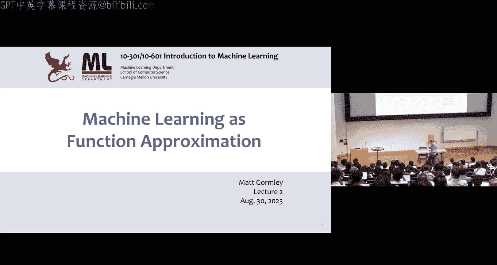
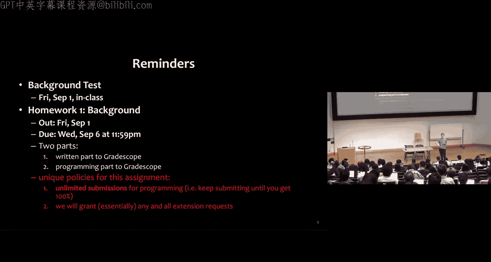
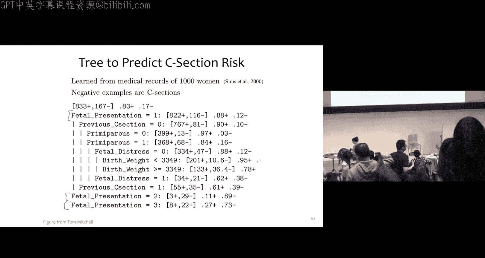

# CMU《机器学习导论｜Fall 2023 10-301⧸601 Introduction to Machine Learning》中英字幕（deepseek p02 Lecture_2_Machine_Learning_as_Function_Approximation.zh_en [BV1Z2cUefE4A_p2]

## 🧠 机器学习作为函数逼近

在本节课中，我们将探讨机器学习作为函数逼近的概念。

### 📚 课程概述

**在本节课中，我们将学习以下内容：**

* 如何形式化学习问题。
* 如何学习专家系统（例如决策树）。
* 归纳偏置对泛化的重要性。
* 过拟合的概念。

### 📝 核心概念

**函数逼近**：

机器学习试图通过数据学习一个函数，该函数可以逼近未知的目标函数。目标函数通常未知，但我们可以通过观察数据来学习它。

**公式**：

C^* : 目标函数，将特征向量映射到标签。

H : 假设函数，从假设集C中选取，尽可能逼近C^*。

### 📝 例子：函数逼近

**问题**： 实现一个函数，该函数返回X的负值，但不得使用任何其他三角函数。

**解决方案**：

* **泰勒级数逼近**： 使用泰勒级数在特定点附近逼近函数。
* **分段线性逼近**： 使用分段线性函数逼近函数。
* **随机点逼近**： 在随机选择的点上评估函数，并连接这些点以获得逼近。

### 📝 例子：医疗诊断

**问题**： 医生需要根据患者的症状判断患者是否患有过敏症。

**解决方案**：

* 将问题形式化为监督二分类任务。
* 使用特征向量表示患者，标签表示是否患有过敏症。
* 使用学习算法从数据中学习假设函数，该函数可以预测患者是否患有过敏症。

### 📝 例子：回归

**问题**： 实现一个函数，该函数返回X的负正弦值。

**解决方案**：

* 使用分段线性函数逼近函数。
* 使用数据点训练假设函数。

### 📝 评估

**损失函数**： 用于衡量预测与真实标签之间的差异。

**误差率**： 在测试数据上评估假设函数的性能。

**真误差**： 在所有数据上评估假设函数的性能。

### 📝 学习算法

* **多数投票分类器**： 预测训练数据集中最常见的标签。
* **记忆化器**： 如果特征向量在训练数据中出现过，则预测相应的标签，否则随机预测。
* **决策树**： 根据特征值进行决策，并预测最可能的标签。

### 📝 总结

在本节课中，我们学习了机器学习作为函数逼近的概念，并探讨了几个例子。我们了解了如何使用损失函数和误差率来评估假设函数的性能，并介绍了几种学习算法。

**本节课中我们一起学习了以下内容：**

* 机器学习作为函数逼近的概念。
* 如何形式化学习问题。
* 如何学习专家系统。
* 归纳偏置对泛化的重要性。
* 过拟合的概念。
* 损失函数和误差率。
* 学习算法。