# CMU《机器学习导论｜Fall 2023 10-301⧸601 Introduction to Machine Learning》中英字幕（deepseek p03 Lecture_3_Decision_Trees.zh_en [BV1Z2cUefE4A_p3]

Good morning everyone， I hope you all had a great long weekend we're going to get started today and we're going to pick up where we left off continuing our discussion of decision trees Before we do that。

 I'd like to start class with some announcements or reminders so reminder homework one is due today but。

😊。

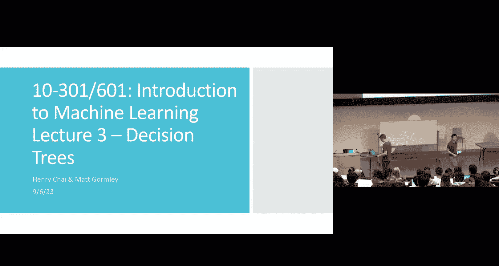

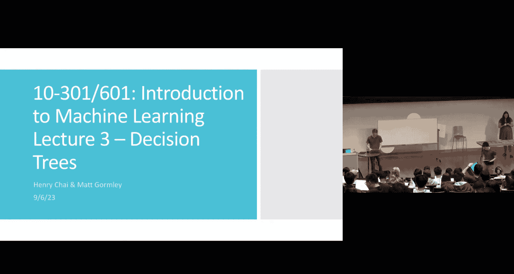

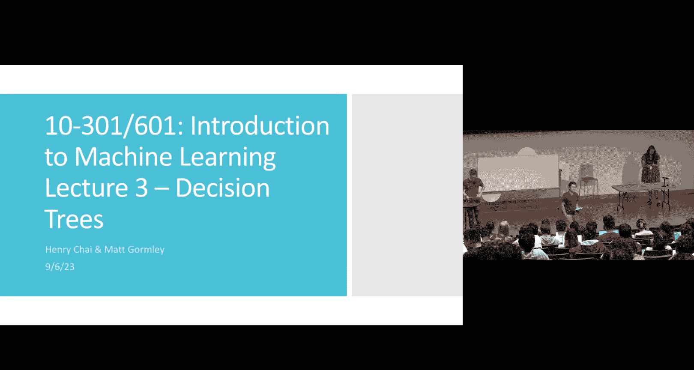

Reminder about the reminder we will grant basically any extension so for those of you joining the class late or you know still shopping this course。

 you need a little extra time just email Bn here and she'll be happy to give you basically any extension that you request I should probably put another reminder here。

 which is that if you missed the background test on Friday for any reason whatsoever we are having a makeup background test this evening the details of which can be found on Piazza again if you need to attend that。

😊。

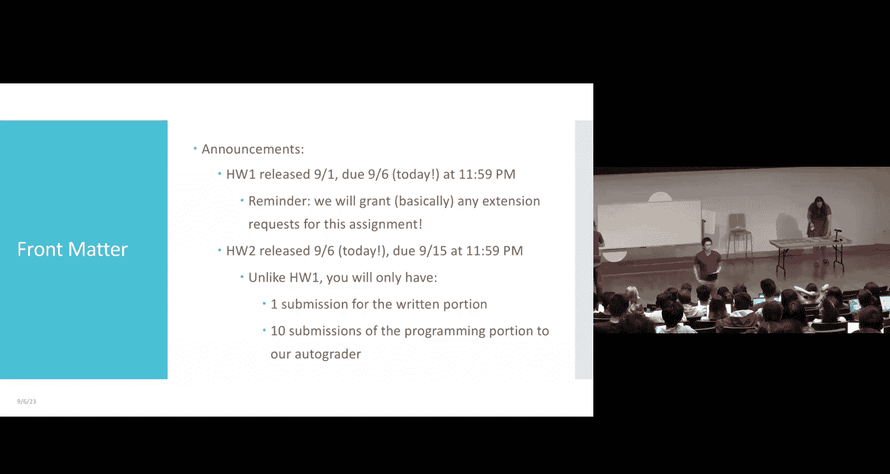

Briins your gal。Second reminder for today man， the wheel just keeps turninghu homework two will be released later this afternoon and crucially unlike homework one。

 we will not be entertaining any extension request you might want for this assignment you of sort of the normal amount of submissions for the homework。

 both the programming and the written portion and our normal extension policy and late day policy as detailed on the syllabus will apply。

All right。Here's a question that we've been getting a lot on piazza that I figured now would be a good time to address how do these in class poll things work Well I'm glad you asked so every lecture we will have a specific Google form that will contain all of the various poll questions that。

😊，We'll be posing during this lecture and so today's poll question you should be able to find at this URL here。

 poll。mlCourse。 org it's also linked on the schedule page of the course website sort of like right next to where the slides are linked there's a slides link and then there's a poll link that'll take you to some Google form that you will need to log in with your Andrew ID for please do not use any other email address I don't think you can access it even from other emails but this is how we will be assigning your participation grade so if you want credit for that please do use your Andrew email。

😊，During the lecture we'll put up a number of polls and there will be typically some number of options one of those options we will clearly indicate as a toxic option this is。

😡，Yeah， I forget if they still like。

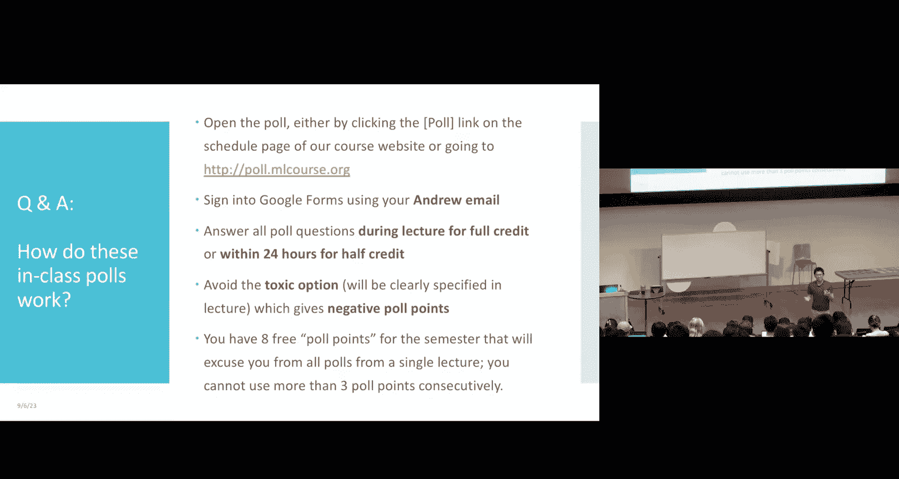

Like do this on the SAT but like this is basically to disincentivize randomly guessing or randomly filling in the poll question so the toxic option gives you negative poll points in expectation so if you just you know decide to skip class one day and randomly pick options for the poll questions you are in expectation going to lose points so just don't do that if you can't wait into lecture don't fill out the poll instead use some number of your free poll points that's what they're there for。

😡。

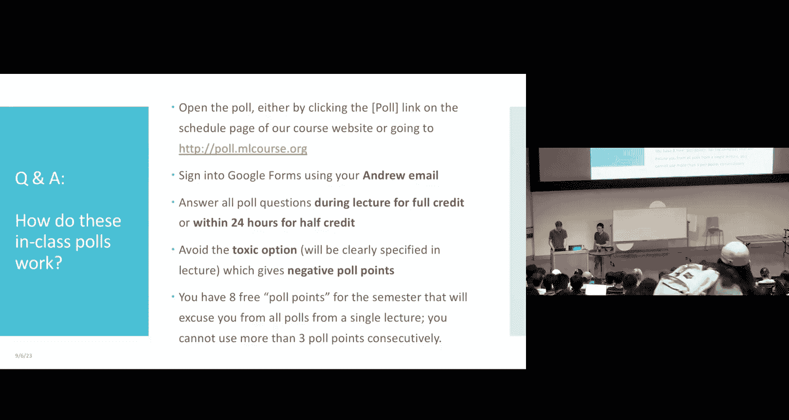

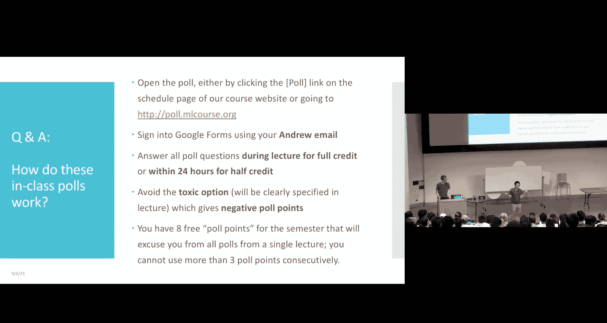

Okay， so let's test this out， shall we？

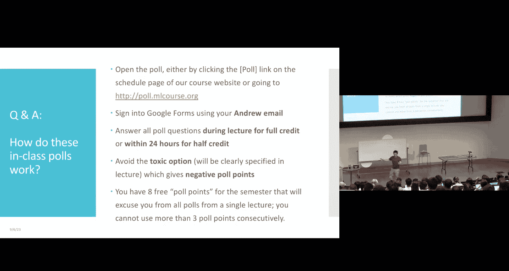

You know， I used to like have a lot of concerns about equity when we were doing these online polls and then I realized that this is just kind of like。

Me showing my age because like you know we used to come prepared to these lectures with like physical pieces of paper that like if you didn't have an internet enabled device you could fill out the poll on and don't get me wrong。

 we still have that like if you need it， we're happy to provide you with some sort of like sheet of paper that you can complete the poll on and then turn into us after lecture but based on your responses to this sort of question over the years I think this is maybe not necessarily a concern we need to have。

Matt so when we started teaching this course， Matt had a dumb phone。And that was only like。

 what two years ago。 But since he has upgraded to a real phone。 Also， you know， it's funny。

 I like this option B here is meant to be sarcastic。 Flip films are making a comeback。 You know this。

 Like who here has like， you know， one of those like Samsung flips or like Google， anyone。😊，Yeah。

 right， flip phones， they're making a comeback anyway。

 I should probably tell you before we go too far。

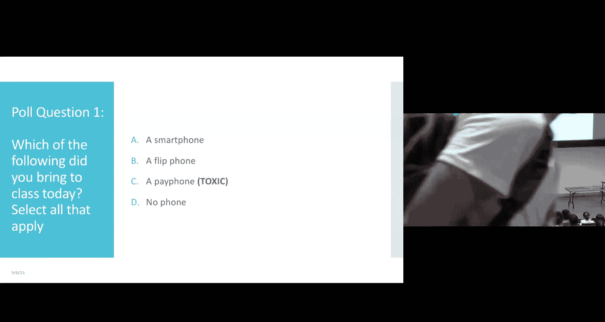

I'm looking out into the crowd here and no one came with like a giant you know English toll booth。

 no one came in the TartIS here， so option C， a payphone is your toxic option。

 please don't select it unless you want negative pull points。😡。

It didn't bring the paper we don't actually oh I've got some paper yeah I got some paper anyway go ahead and take a minute make sure that you're able to access the polls that you're able to。

 you know select the option correspondingent， you should be able to select however many options you want here and then as you are selecting those options。

😊，I can watch them roll in。Also relatedly don't。I mean。

 feel free to take your best guess at the next poll questions， but again。

 you risk the negative pull points and expectation thing。嗯，是嗯O。She's not as small。

Well I know for a fact and one of you has a flip phone。All right。

 it seems like that's working for most of you all， I'll continue to just leave this open if there are any issues with the poll。

 please come find us after class and we'll help you out then。That put the slide in time。

You can click submit you're allowed to submit multiple times。

 but just clicking just selecting it is also acceptable actually we do encourage you to submit just in case there are any sort of technical issues we encourage you to submit after every question。

 but you should be able to。😊，You know， resubmit once we get to later poll questions as well。

 good question。All right， so。Logistics out of the way， let's pick up with the content。😡，Oh。

I had the strangest thing this morning。I woke up。I had the strongest urge to talk about recursion。

Never happened to you like I just I just like I woke up and I was like man I really need to tell someone about binary search trees and I was like wait a minute I have a rap audience of like 150 students who will just like listen to whatever I tell them which is perfect for this all right so we're going to talk briefly about recursion so a binary search tree hopefully this is an object that many of you are familiar with this is a data structure that consists of some number of nodes where each node will have these components it will have some value and then up to two children either a left child right child or both。

And then here's the crucial property that defines a binary search tree。

 all of its left descendants will have some value lower than this current node's value and all of its right descendants will have some value higher than this current node's value。

 so here's an example of what that might look like and you can briefly verify the property as defined here that if you go down the left branch starting from the root node of seven。

 everything to the left is less than seven， everything to the right is greater than seven and so on and so forth。

😊，And so we like binary search trees for lots of reasons， in particular。

 they allow us to search through them for values that we might be interested in in log n time。

 where n is the number of nodes in this tree。So there are a couple ways that we can think about doing this iteratively and recursively。

 and remember any recursive function you can always write iteratively。

 that's going to be an interesting connection that we'll explore a little bit。😡。

So let's start with the iterative version of a search function here right so I might write something like contains iterative。

 so I want to know whether or not this particular value。

 the key that I'm looking for exists in this tree and this tree is going to be defined by the root node object。

😡，So what I'm going to do is I'm just going to set my current node。

 the node that I'm currently searching through as this root node。

 my initial node that I'm passing into this function and just loop forever following this procedure。

 which is if the value I'm looking for is less than my current node's value。

 well that means if it exists in the tree at all， it's going to exist down the left branch。

 and so I'm just going to set my new current node to the left child of this node if one exists that's what this。

😡。

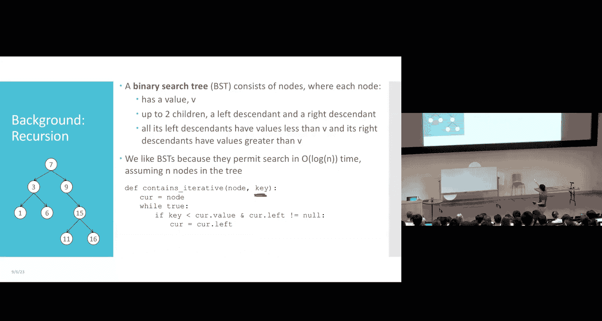

As long as that left child is not null causes looking for。Of course。

 if the value I'm looking for is greater than my current nodes value。

 I'm going to go down the right child， I'm going to go down the right branch。And then。😊。

What I'm going to do is。If。The value I'm looking for， if neither of these two statements is true。

 well that means one of two things， either I found the value I'm looking for or。😡。

The node that I'm at has no children， has no left child and has no right child so what I can do。😡。

At this break is just check whether or not the node I'm at。😡。

The value is equal to the value that I was looking。If it is， that means this tree contains it。

 if it doesn't， that means I'm at some node with no children。😡。

And there's no further place in the tree that I can go looking for this key that I was searching for。

So for instance。I don't know， let's say I'm looking for。

5ive right does five exist in this tree Well following this iterative path what I would do is I would start at seven and I would check okay。

 five is less than seven and there is a left child so I'll go down this way five is greater than three and there is a right child so I'll go down this way and here's where I get stuck because unfortunately there are no more children and five does not equal6。

All right， so that's how I would do this iteratively， but that's not what I wanted to talk about。

 right， I woke up this morning being like， man， I want to talk about recursion and recursion is this really nice。

Framework for a program where I break the problem down into smaller and smaller subcomponents that all share the same structure what do I mean by that Well what I can do when I'm framing this search problem through a binary search tree recursively is ask does the node I'm looking for exist in one of the subtrees defined by my current nodes children does the current node exist on the left half of the tree or does the current node exist on the right half of the tree and both of those are identical problems smaller identical problems to the big search problem that I started with out here。

All right， so every recursive。Function has two properties。

 it has some recursive call and it has some base case that tells us when we get to stop you know。

 going down to deeper and deeper levels of recursion。So here。

 very similarly to what we were doing in the。Iterative case。

 all we're going to check is basically which half of the tree do I need to go down if the value I'm looking for is less than my current nodes value。

 well then I'm going to call this contains function looking at the left half of the tree。😡，Similarly。

 if the node with the value that I'm looking for is greater than my current node's value。

 I'm just going to look for that value in the right half of the subt。

 so I'm just calling this contains function again， these are the recursive calls。😊。

But what I need is some sort of base case that tells me when I get to stop and that's exactly what we defined before。

 which is that if the node has no more children and the value if the node that I'm currently looking at has no more children。

 well then there's no more subtes for me to search for and I get to stop and return whether or not the current node's value is equal to the value that I was looking for。

 so this right here。😡，Is what we would call。The base case for this function。All right。

 hopefully this is review for many of you， but in case you haven't seen this before。

 this is going to be a very powerful tool both for the rest of this lecture and for your upcoming homework so let me stop here。

 what questions do you have at this point？😊，唔嘅用一先。Do we return contains recur return oh sorry。

 this you're right， this should be， first of all， retains recursive。And no。

 we don't need to put a return statement in there because as we go through those contains recursive calls。

 eventually one of them will hit a return。Actually， sorry。

 what am I saying that is what we do we returning contains recursive， yes。

Because what we need to do is we need to pass that return up to the next level of recursion。It's 930。

 give me a break， guys。Alrighty， so we'll come back to that weird digression in a minute。

 but let's pick up where we left off on last Wednesday talking about decision stumps and so。

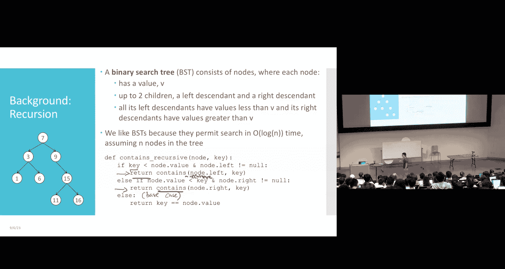

Matt ended lecture。Bye。Putting up this little decision stump here and recognizing that it has some nonzero training error。

 but perhaps it might be better than the memorizer which did achieve zero training error because this decision stump has some ability to generalize。

 it's trying to extract some pattern from the training data here。😡，So。😊。

The thing that we ended on was why would we ever stop at just one feature right why would we ever take some decision stump that looks like this and here here's our little cartoonish representation of what a decision stump might look like where I split on x2 and if the x2 value is no I go to predict a negative or a minus sign and if the x2 value is yes。

 I go to predict a plus why would we ever stop at just one feature when you know even something is simplistic is。

😡。

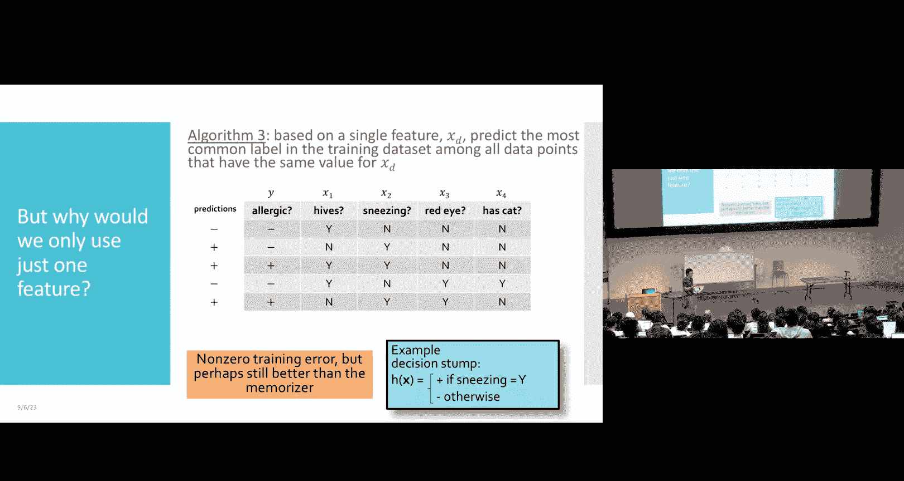

Now your child is two， three， almost three he's almost poor right why would we even stop there when you know a three year old can come up with a much more complex so much more rich representation or a much more rich classifier that looks at you know。

Four features here。But you know。Matts said something on Wednesday about。Me coming to lecture。

 unprepared， just talking to my friends， Chad and Dale and you know。

 I took that kind of personally so I spent the weekend。Thinking。

I got to be able to come up with something better than this like ridiculous cartoon involving like foxes and bottles and I got to come up with a better decision tree example。

 I got to show Matt that I can come to lecture repaired and so I。

I concocted the world's best decision tree。For predicting， wait for it。

 for predicting whether or not someone is a cat or a dog person。Do you guys want to see？Yeah。

 oh good， good。Okay。Big reveal。Oh gosh。

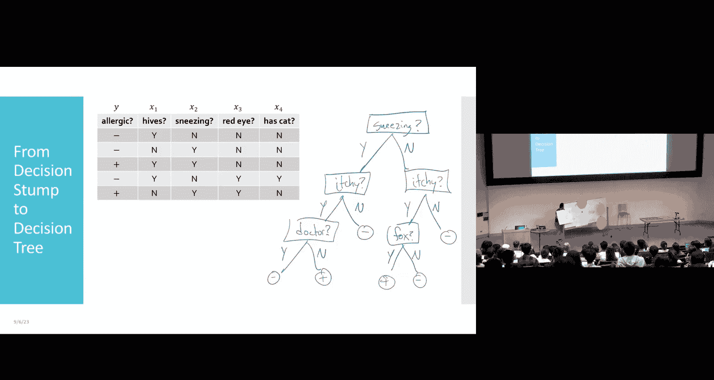

Here it is。😡，Instead of spending time with my family and grilling and doing whatever the things you're supposed to do on Labor Day is no。

 this is how I spent my weekend preparing for this lecture and so in order to test out this decision tree I would like。

😡，Let's say one volunteer， anyone care to share something about themselves with the class？Yeah。

 way in the back， come on down。All right， so while he's making his long track from the back of the classroom let me introduce this decision tree to you all so this decision tree has two features that it's going to split on this decision tree asks at the root node whether or not someone prefers warmer temperatures or colder temperatures。

 whatever that may mean to you all and then。😊。

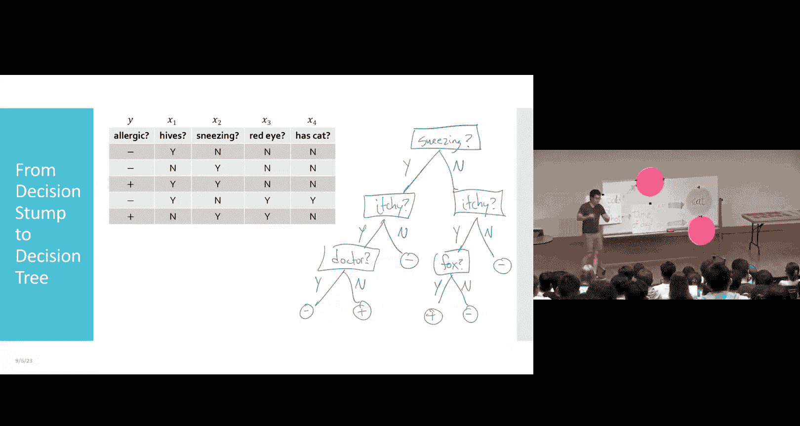

Depending on which branch they go down asks whether or not they are a morning person or a night owl and so my friend。

 if you are a dog person， please take a red piece of paper if you' are a cat person please take a yellow one and then what I want you to do is sort of just place yourself along this tree at one of the root nodes that corresponds to your particular features。

Yeah。Exical。Really？Okay， okay， so what my tree would say is this individual prefers colder temperatures and so you must be a dog person why don't you go ahead and put your sticker there and let me revel in my shame all right so I have a confession I made this tree up in the 10 minutes before lecture gosh。

😡，Well， first of all， thank you now your peers know a little more about you， but what I really need。

 I guess， is some data instead of just， you know。

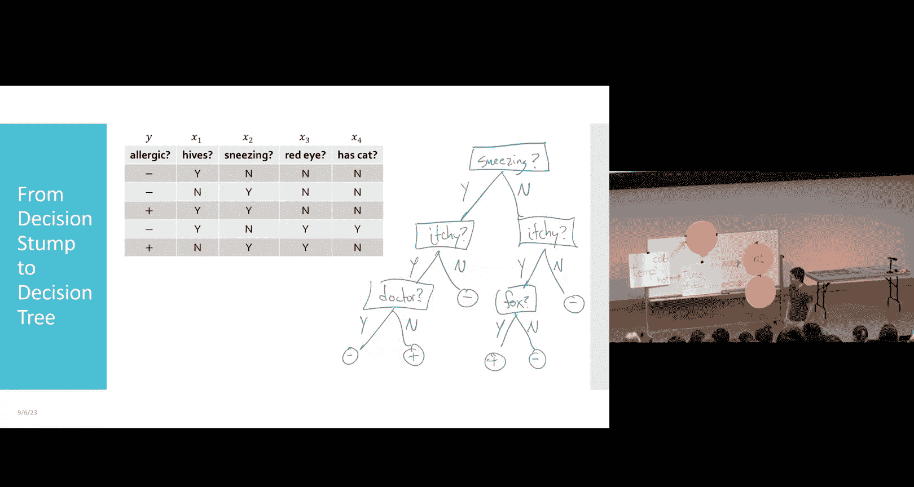

Making this up。Hi， where did I get some data to train this tree？Oh。😮，I know could I get like， oh。

 I don't know，15 volunteers， let's say one， two， just come on down as I'm calling you down。

 That's two， and takers three。

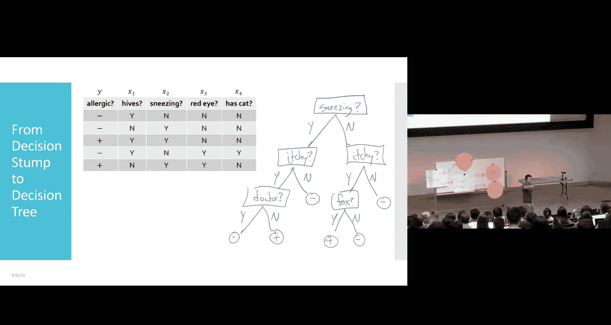

Come on four， five， six， good， seven， eight， come on down， come on down， nine，10。

 five more prize of a lifetime， get to know something about your peers or， you know。

 get your peers to know something about you， I guess let me get。

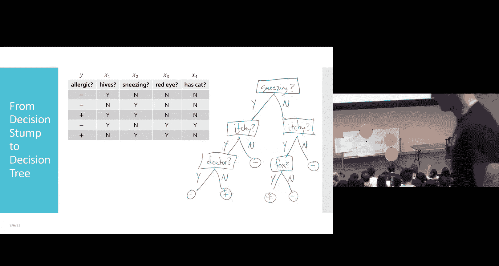

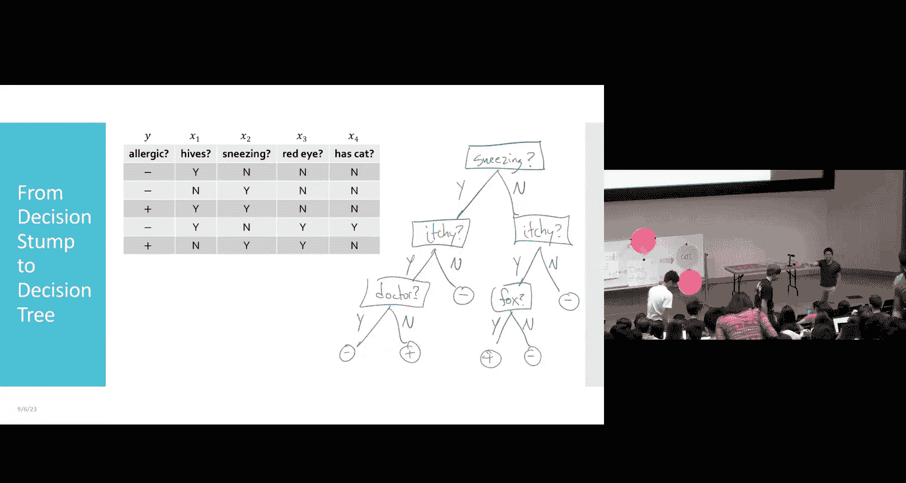

11。12。Three more， come on guys， I know it's early， 13。Friend clapping for him come on 1415。

 let's go sorry hang on before you all start ruining my predictions even more go ahead and take that off again。

 if you're a cat person， please take a yellow sticker if you're a dog person。

 please take a red sticker and what I want you to do。Before you。

You know ruin my predictions is instead go ahead and place your sticker on one of these blank circles。

 but let's take let's take a more principled approach to this， so thank you。😡。

Let's start with everyone just splitting on this first feature so if you prefer cold temperatures go ahead and place your label either the red dog label or the yellow cat label on this circle and if you prefer hot temperatures go ahead and put your label gently on this one all right so go ahead and just in any order here。

😡，Thank you， thank you， oh oh， we got a lot of dog people did I run out or did I have exactly the right amount？

Anyone， okay， cool and hang out over here， Don't go back to your seats quite yet。Please work。

 please work， please work， please work， please work。Okay， okay。Not bad， not bad。Okay， pretty good。

 pretty good。Allright， interesting， Okay， okay， so I want to appreciate what we've done here first。

 what we started with was a large collection of people with a pretty good mix of cat people and dog people and now after one split after one feature what I've created is two subsets of my data that well there's still a lot of ambiguity about the labels。

 So we'll get to that in a minute。 but what I've done is I've created two smaller portions of my data that I could then I don't know。

 apply some similar。😊。

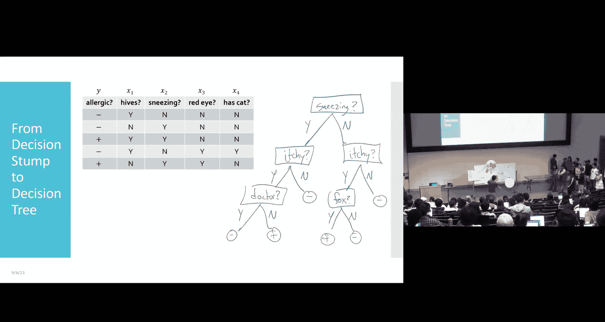

Recursive approach to maybe so what I'm going to have you all do now is everyone who sticker lives somewhere in this mess go ahead and split yourselves down this last feature。

 So as a reminder， if you're a morning person， you'll go to that node and if you're in night owl。

 you'll go to that node So everyone who has their sticker somewhere in here go ahead and move yoursels to the leave nodes。

😊，And what we're doing is we're making another recursive split， don't be shy， any order is fine。

 you don't have to like figure out exactly which sticker is yours too that it'll work itself out。😡。

Please work， please work， please work。Yeah cards on the table。

 I have like a pretty good hit rate with this little exercise that like this decision tree usually does a reasonable thing。

 oh。I say that， and I'm going to jinx it pretty bad here。All right， so when I say a reasonable thing。

 what am I hoping for， what would sort of be a good outcome and I'm not going to look and I want to spoil it for myself。

 so I'll see how I did in a second， but what would be like a good outcome for these leaves What would I hope to see when I turn around？

😡，Yeah， right here。Like a couple are really prevalent dog and one cat is clear Yeah。

 I like how you sort of bias yourself towards two dog and one cat。

 but I don't necessarily need that what I would hope to see when I turn around is that all of the yellow stickers are sorry all of the white circles contains stickers of just one color because that would tell me what I've done is I've sort of grouped the cat and the dog people using these two features appropriately。

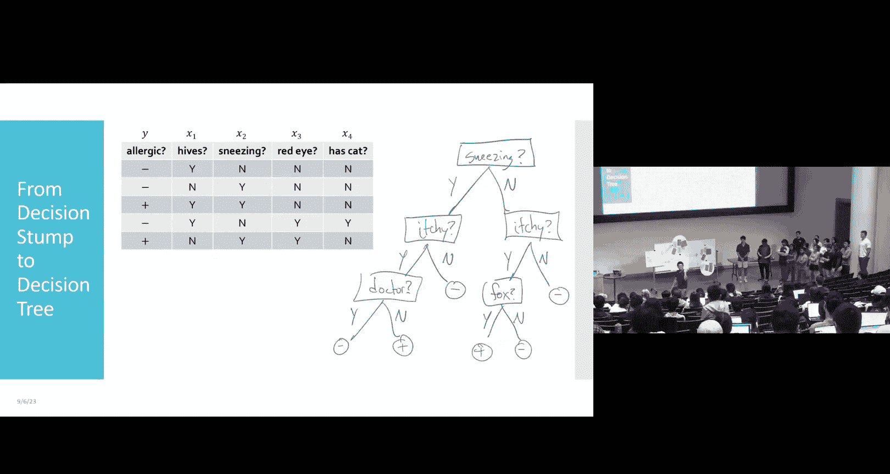

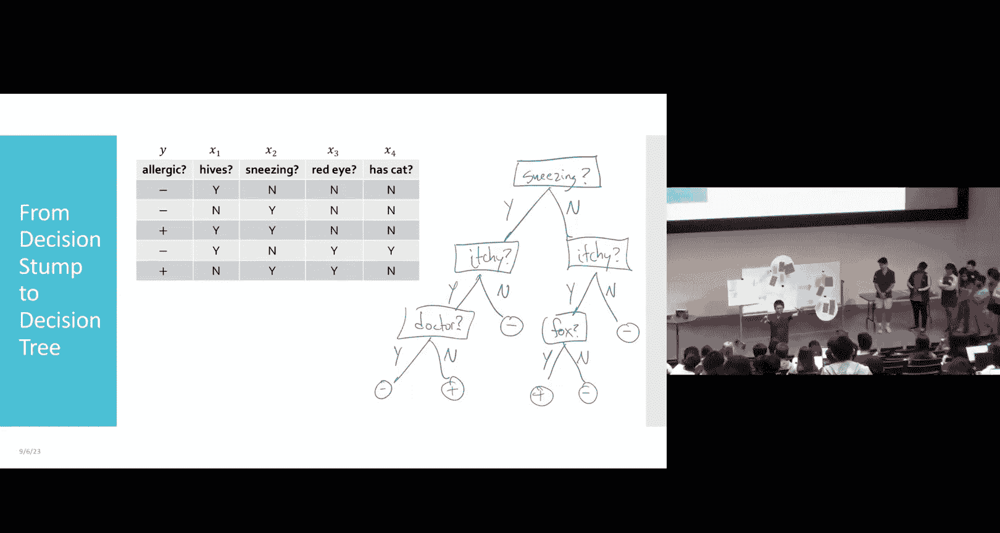

Guys， why do I even plant you guys in the Ona， I'm kidding。 All right， so what I really need， though。

 what I really need is another way to distinguish between you all， right like。

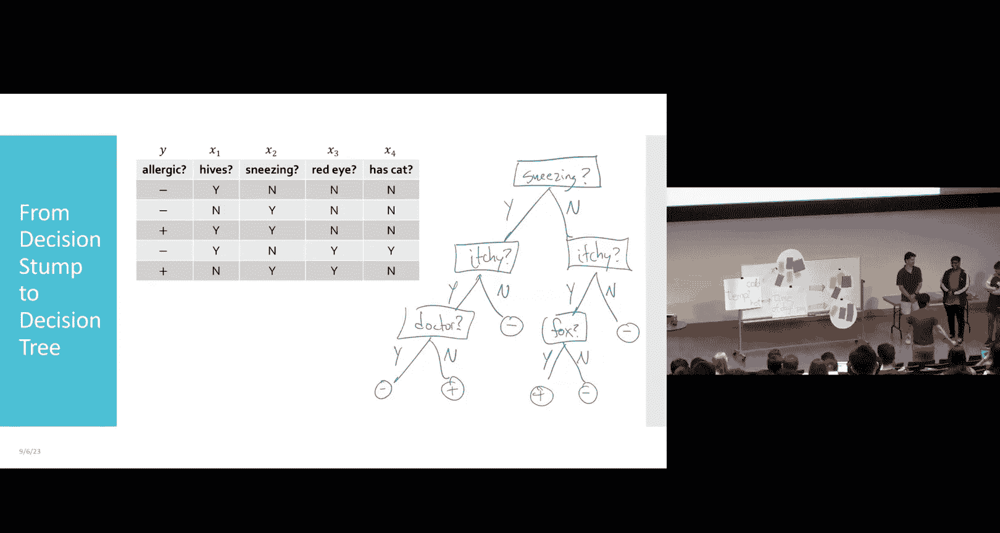

Okay， I'm going to give myself partial credit。 This is not bad three out of four dog people down here。

 we'll call that good enough。😡，This is a pretty what we would say mixed node a mixed leaf re node still。

 and this one is really bad， right， three and four is like。I feel like， gosh。

 if only I had come prepared with like another probing personal question to ask you all。

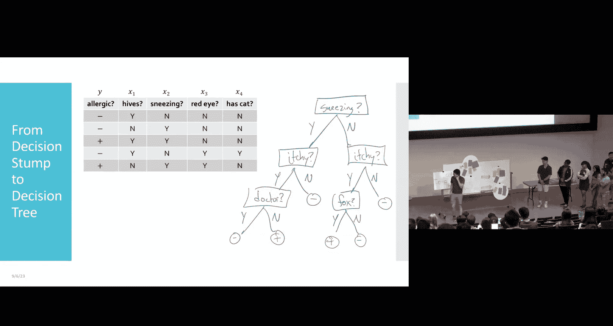

It's like say what kind of foods you prefer so for those of you who put your stickers here。

 what I'm going to do is I'm going to move this over here and why don't you all come claim your stickers because I have another question for you。

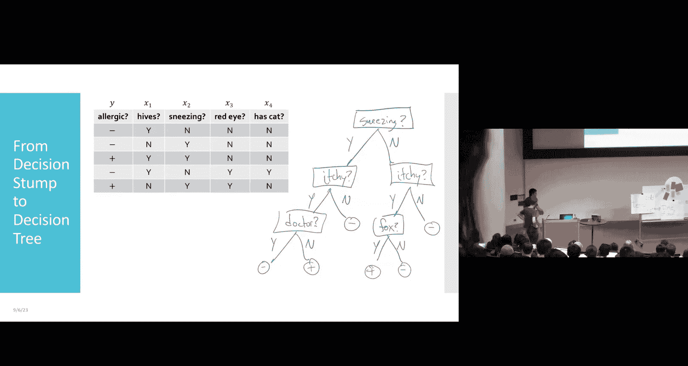

And。Gosh， now what I really need， what I really need is another whiteboard。

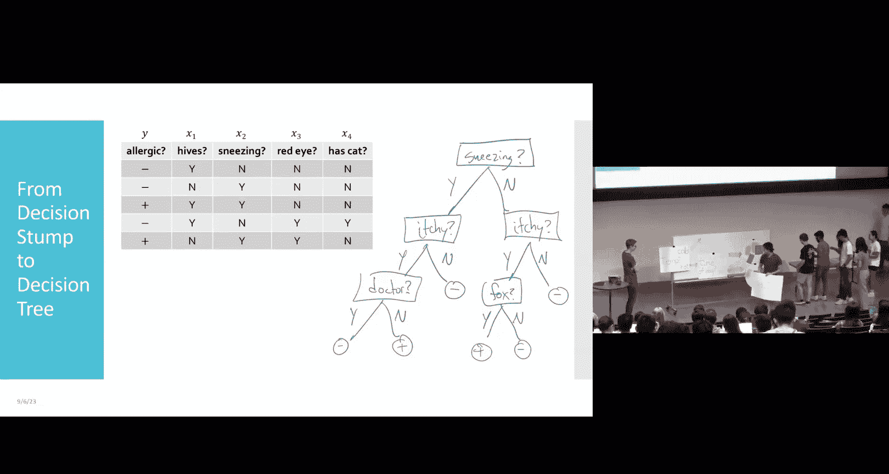

Funny， how that is short of that。Man， if only I had like a。

Comically tall co instructoror or something to hold up。

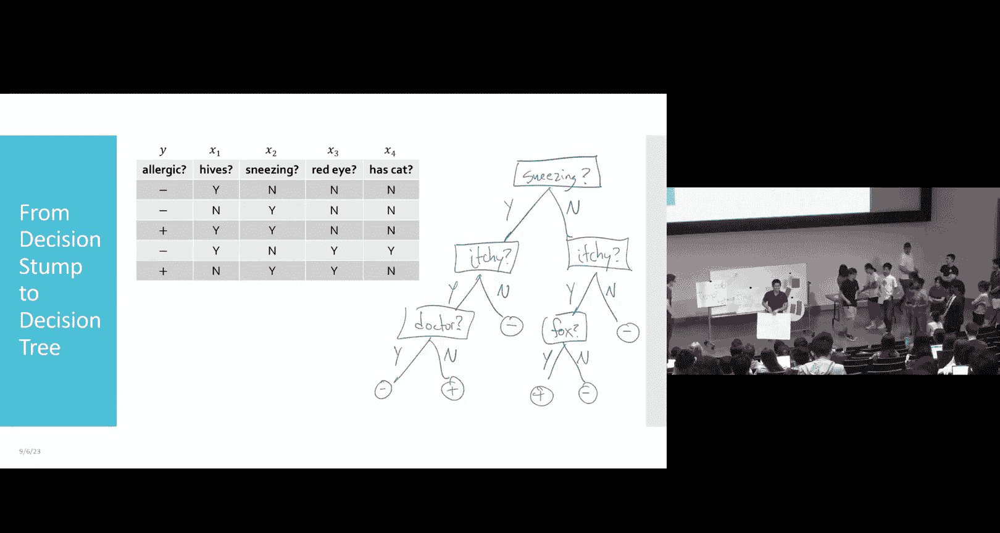

Sheets of paper for， oh hey， man， how's it going？Probably not how you envision spending your morning。

Excell， well， neither did I。So。😊，All right， well we'll cover that up a little bit that's no big deal So what we need now is I don't know。

 say maybe Matt you can hold this up nice and hi back here perfect so I have a new question for you all which is what sorts of foods do you prefer do you prefer。

😊，Breakfast foods， whatever your conceptualization of breakfast might mean or dinner foods。

 whatever your conceptualization of dinner might mean。 I realized I did forget one white circle。

 So instead what we're going to do is say this one goes up to Matt out there and this。😊。

Goes to this very small root node here or leaf node rather， so go ahead again in any order。

 let's see how well this split partitions the previously very mixed up node。😡，Whatch。You're kidding。

Matt， I quit。Okay， well。All right guys， this is never really happened for。

 but this does illustrate an interesting case， which is what happens？How do I translate this data。

 let's say these are all the features I have because this is really all the features that I have。

 How do I translate these still very mixed up。😡，Leaf nodes into a prediction。

Because that is what I need at these circles right。

 that is what the sort of leaf nodes in my decision tree corresponds to。

 So let's start with the easy case here。😡，Which one should I use？

Dog right pretty easy and I think we oh whoops just because I love being wrong how we got that largely was probably by taking some sort of majority vote right looking at what the most common label in our leaf node here should be。

诶。Let me ask a new question， what about here， what should we predict？😡。

And for those of you can't see in the back， there are four red dog labels and three yellow cat labels。

 what should we do？

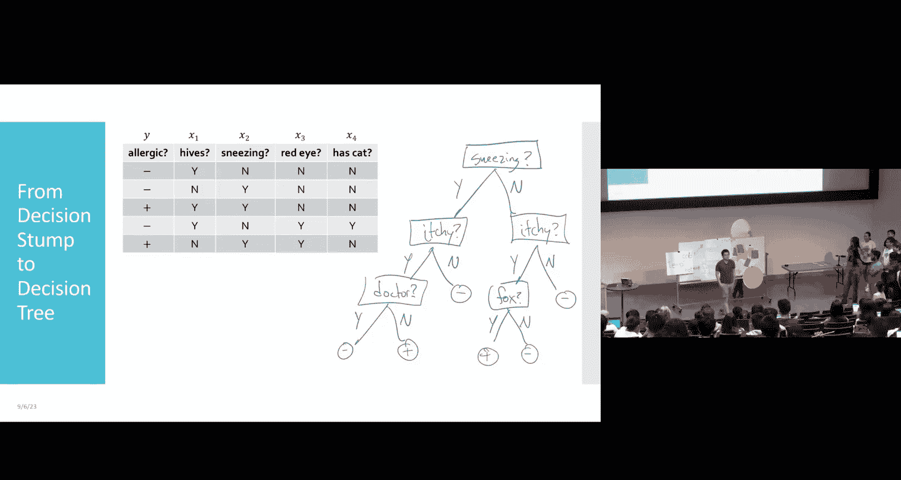

Dog， what else could we do？

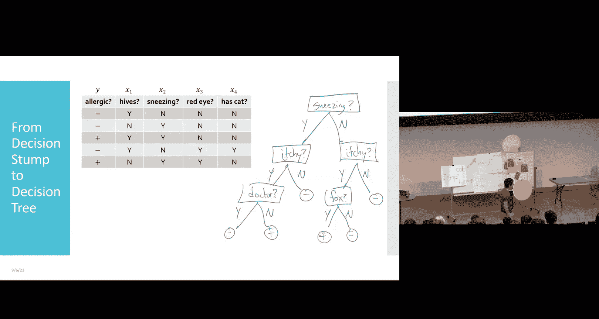

Sorry， random， purely at random， flip a coin。

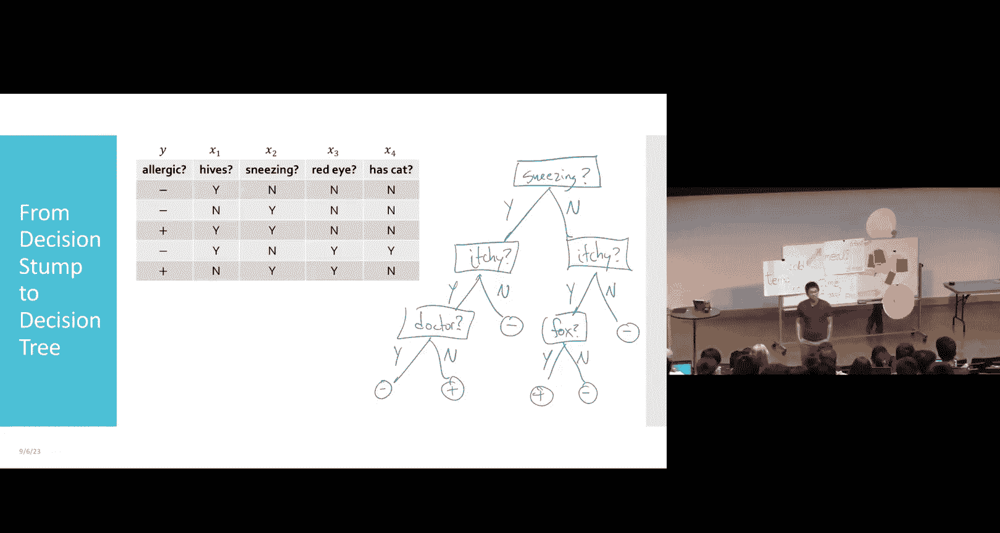

非常。Random based on the proportion turns out both of those are great suggestions。

 I could absolutely do sort of any of those， I could return a probability instead of a hard label if my you know downstream use case had the ability to reason about probabilistic predictions for sure。

 here's an interesting question。😊，What should I do here with this lovely node that Matt is holding that is blank？

I still need to make a prediction for the data points that。😡。

T to like is it the people who like the cold don't like more like they don't like mornings and so they don't like breakfast maybe I got to like think about some correlations here anyway。

 what should I do at leaf nodes that are empty how can I translate that into a prediction？😡。

Random sure randomandom 5050 any other suggestions Yeah absolutely I could have taken the majority vote in this note。

 I could have taken the majority vote of my entire training data set so there's lots of different ways that I can break ties in some sense here so all of those are great suggestions unlike this well train record of an example thank you all for your volunteering now your peers know a little bit more about you and hopefully they learned a little bit about decision treats。

😊。

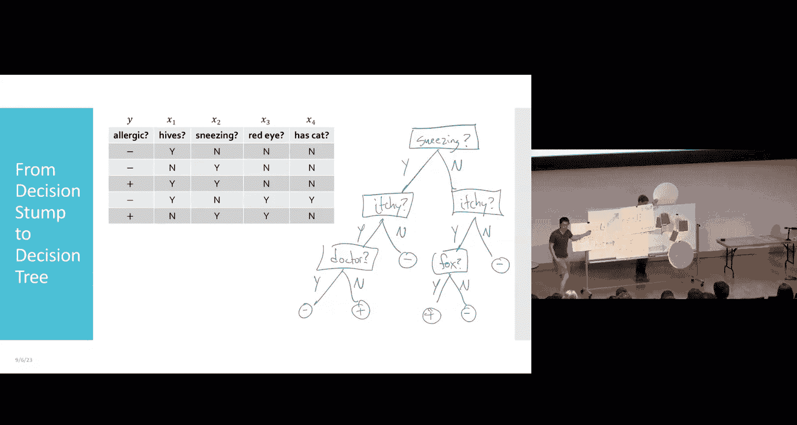

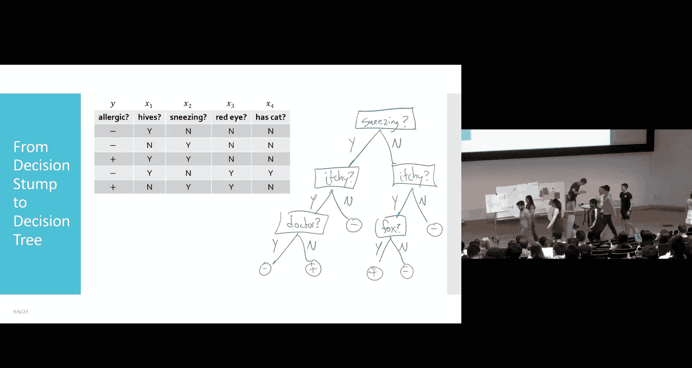

We got to break this habit guys， we can't clap every time I do something cool。

 it's just going be like nonstop clap， it isn't oh。All right， so。

What do we see from this example well we learned a lot about how decision trees behave and a little bit of intuition about how we should go about learning decision trees so let's start with that first component here we're going to return to this little pseudocode framework that Matt established on Wednesday and we're just going to think about how we can。

😡。

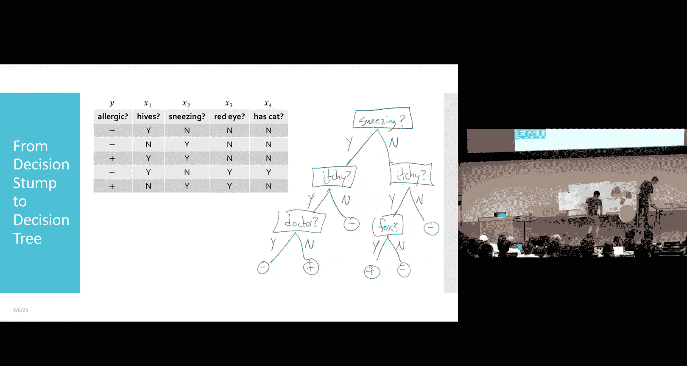

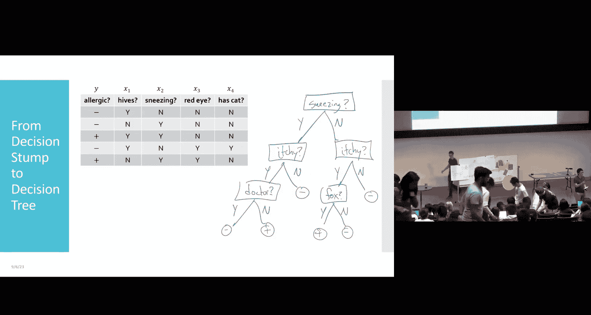

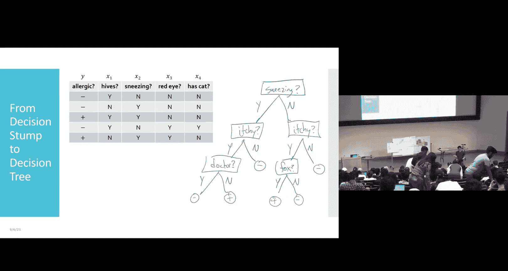

Make predictions using decision trees so this would be the predict method let me back this up a little bit so it's not in anyone's way what we're going to do is we're going to sketch out a little bit of Python ask pseudocode for making a prediction with a decision tree right so intuitively all that we're going to do is walk。

😡，From。The root。2。A leaf known。Right。Programmatically。One way。Of doing this well。

 this is going to look very familiar one way of doing this would be to do something similar to what we saw for iterative search in a binary search tree。

 which is I can say。Wow true。If。Let's call this current node。Is。An internal node。

What I'm going to do is I'm going to check。Associated。Feature。I let's say this is just some x sub D。

 so remember， every internal node， including the root。

 is going to have some feature affiliated with it。😊，And what I'm going to do is I'm going to go down。

The branch。According to。X D prime， so remember my feature vector x prime here looks like some feature value x1 prime。

 x2 prime all the way up to x capital D prime where capital G is the number of features I have。

And I'm just going to look at what the feature value Xd prime is and go down the branch that corresponds to that specific value。

😡，Going down the branch here programmatically would look something like setting the current node equal to whatever node comes after that comes along that branch。

😡，Else？And in this case， the else is。Sorry。If my current node is not an internal node。

 that means my current node is a leaf node。And all I'm going to do is return。The label。Sttored at。

Coronno。So this is exactly the process that we went through for making my first erroneous prediction and you know。

 is how you would make predictions using a general decision tree one thing to note is that this is，😊。

The iterative procedure for making these predictions。You can， in fact。

 write up a recursive function to make predictions with the decision tree。

 and I encourage you all to think about how you would go about doing that。All right。

 so let me stop here。Give you guys a chance to catch up。

 what questions do you all have at this point？Yeah。

 way in the back if there's two differenteds and one of them shows up a lot of there are two different one if there's two different like classes in five states and one of them shows up a lot of other what if in one node for one that doesn't show up how much shows up a lot for how inly it appears in the training data like would we want to predict that because it a lot more of that？

It shouldOh is a really great question so the question is about imbalanced data sets right so let's say I have one very rare class and I've been able through some number of splits to make that rare class more prevalent but still a minority right there are a few different approaches that I could take to handle this。

 one would be to continue splitting on that until that rare class does eventually become a majority the other is to take one of the approaches that we described for sort of very jumbled nodes that is make some sort of probabilistic prediction that is even though that prediction is still sort of very low prevalence I have some non-zero probability of returning it as my prediction at that particular leaf and that probability will be higher than at other leaves for instance。

😊，Yeah。Internal means non leaf node， so any of the like what we're representing as rectangles in our little diagram。

 another way to think about it is if the node has any children， it is internal。😡。

If the node has no children， it's a leaf node， yeah， that's correct。

 I have already built some tree H， and I just need to write a predict method。

 We'll get to how we build that tree in a sec。😡，Yes。

So in this example we saw that when we be the where there are no samples showing if the mental work on the previous have an identity on person。

This is a really great question， so one of the strategies that we could do to sort of make a prediction at the empty leaf node is return the majority vote at either the previous internal node or of the entire data set。

And the question was do we need to store the majority vote at that node or at the previous node in order to make those predictions and the answer is yes。

 if that's how you chose to break your ties， you would need to find some way of passing that information from one level to the next again we'll talk about how we can do that when we're building our decision tree。

 but right now we're assuming that all of these leaf nodes have some inherent label stored at them。

 how we populate that that becomes a matter of implementation。One more question here。

is sort of an interesting question the basic premise is like I didn't split on every possible combination of these features right if I had I would have two more splits at either of these nodes that ask about what the individual's favorite meal is and I could have asked on these nodes what the individual's preferred time of day is is it typical to sort of stop after just a few features or is it typical to stop after not using all of your features I would say it's really hard to answer in general it depends on sort of the complexity of your problem if your problem is able to be sort of like well predicted by just a few features then this might be the behavior that you see but。

In this instance， maybe it did merit a few more splits。

All right these are really great questions unfortunately in the interest of time I have to move on and talk about some questions of my own before I do that I want to revisit this diagram this is a diagram that Matt had up at the end of Wednesday's lecture which I don't know hopefully makes a little bit more sense now in the context of decision trees but what I want to stress is that this is one way of programmatically generating or representing a decision tree it's like kind of annoying to get say Python code that you write for I don't know a homework assignment to an introductory machine learning course it's kind of hard to get that kind of Python code to generate diagrams that look like this but what isn't hard is to get it to generate text that looks like this so this is a representation of a decision tree where。

😊，The number of pipes in front of a row represent the depth of that feature so this。😡。

Feature fetal presentation has no pipes in front of it， pipes are those vertical lines。

 it has no pipes in front of it that means it's my root node。😡，This feature。

 whether or not the individual in question had previously had a C section。

 that is the second feature I would split on under。This branch， so if fetal presentation is one。

 I make a split on previous C section， if fetal presentation is two or three I go directly to a leaf node there are no other splits under those two branches there are no more pipes underneath them and so those correspond to leaf nodes where the prediction。

😡，Would be made according to this data， so this information in the brackets tells me how many of each of the different kinds of labels I had at those nodes。

 so under fetal presentation equals to there were three instances of plus and 29 instances of minus I could use that information to take a majority vote I could use that information to take some sort of random prediction however you want to use it that information gives you sort of the sufficient statistics of the labels at that node。

😡，And then back down my first branch， I would have some more splits on Pria Paris。

 whether or not the individual had a previous pregnancy and then on fetal distress。

 so what I want you to take away from this is this is how you should be printing out your decision trees for homework too so that you can know spot check your work along the way we'll ask you to print decision trees like this so that we can check your work so it's important that you familiarize yourself with this format for decision tree as well。

Okay， now that we've talked about this， like I said， I have some questions for you all， which is。

 well， we've talked about how we can。Make predictions using an already built or already learned tree。

How do we go about learning a tree I'm going to break that question down into two sub questionss。

 which is how do we pick which features to split on and then how do we pick the order on which to split？

😡，So let's start with this first question。The high levell approach that we're going to be taking to pick the feature that we're going to split on is we're going to use what's known as a splitting criteria and the way to think about this is it's some metric or it's some score that maps each of the possible features I could split on to some number that tells me how good it would be to split on that feature for a given data。

 so this is some function if you will， that takes in a feature and a data and returns some score that tells me how good it would be to split on。

😡。

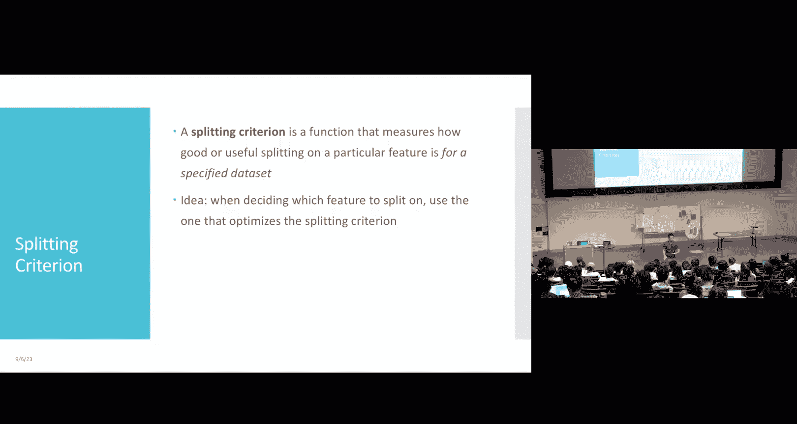

So here's an idea。😡，We're given training data， and we know that we want to， you know。

 keep our training error low。 So why not use training error as our splitting criteria。

 Here's our data set from。Oh wow， a while ago last Monday。

 and what we're going to do is we're just going to walk through all three possible features。

Construct the decision stump we're going to stick with stumps for right now。

 construct the stump that we would learn using each feature and then compute each stumps training error rate to determine which of these features we should split on so let's just do this together。

😡，For x1， what we're going to see is if we look at。😡，The data points where x1 is equal to yes。

 there are three of them， and we have one no and two yeses。

 so down here at the leaf node we would take a majority vote and predict yes。For the no case， well。

 this one's a bit tricky， I have one yes and one no。How should I break this tie？

Let me ask a very different pointed question does it matter how I break this tie？😡，No， why not？😡。

The error rate stays the same， So if I put no here I would make one mistake on this leaf if I put yes there I would make one mistake on that leaf that's sort of the nature of a tie So the key thing here is when computing。

😡，This training error rate， it doesn't matter how I break the tie。

 you will need to come up with some mechanism， but for right now I'm just going to say no is how I break the tie and what this gives me is I make one mistake on this data point here and I make one mistake on this data point here。

😡，So I get a training error rate of two fifths using this decision stone。All right。

 I'm going to go through the rest of these kind of quickly。😊。

These will be available to you after the lecture for you to just sort of review in case I lose you along the way。

 but what we'll say here is for this next feature， well there's only one data point with a high resting blood pressure。

 so no worries there for both medium and low I have another tie I need to contend with I'm just going to stick with my policy of breaking ties in favor of no and when I do this I again make two mistakes。

 this data point here and this data point here。😡，So we'll save this， let me change colors。Oops。

This stump also has a training error rate of two fifths。And lastly， for this decision stump on x3。

 let's see， looks like I should predict yes， for abnormal， that's a terrible color。

 and we change colors。嗯。She predict yes for abnormal and no for normal。And I make one mistake。

So this feature has a training error rate of 1 fifth。So what I've done is for each feature。

 I've computed a score。 This is a splitting criteria， if you will。

 and because I want to keep training error rate low based on this splitting criteria。

 I would choose my first feature to split on。😡，To be x3， it has the lowest training area。

So it seems like a reasonable enough thing to do let me give you guys an opportunity to do some practice here。

 this is I believe your second poll question poll question two。

 so what I want you to do is I want you to consider this data set here and using the training error rate splitting metric。

😡。

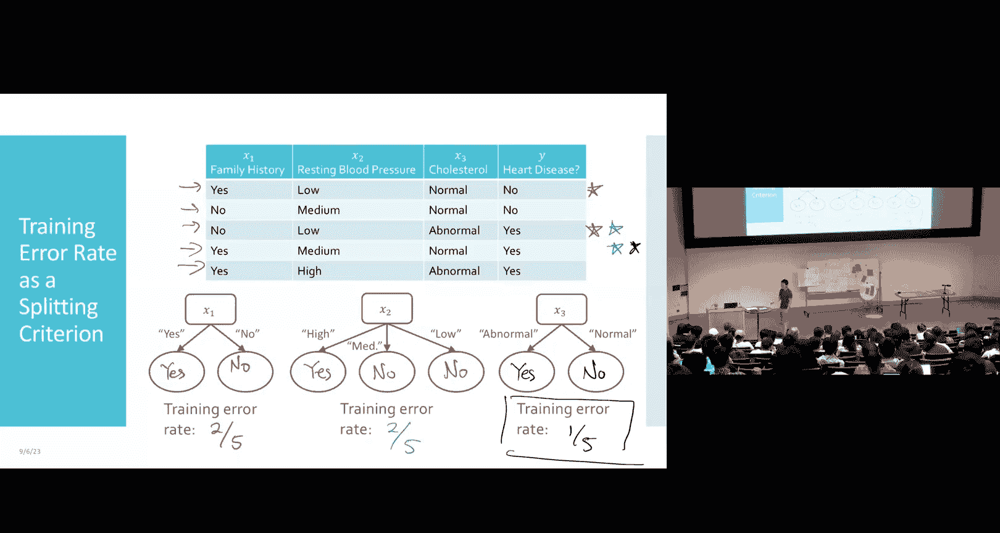

Which feature would you choose to split on？As the first feature here， either x1 or x2。

 so your options， x1， x2， either x1 or x2， and neither x1 nor x2 is your toxic option。

 don't pick this。😊，All right， so go ahead and take， I don't know， let's say two minutes here。

 talk it over with your neighbor， see if you can work it out and we'll reconvene and see what you all have to say in just a sec。

All right， go ahead and submit your best guess if you haven't had a chance to yet。

 I see you that one person out there who selected D， I'm onto to your tricks， maybe reconsider。嗯。

Or you know maybe you're not here in that case， sucks。All right。

 so wow okay as more and more answers come in， the majority increases。

 I'm pleased to see many of you have consolidated around the correct answer which is in this case C what do I mean by correct I guess you could argue that x1 or x2 is correct depending on how you're doing your tie breaking but that is to say there is a tie here right that regardless of which feature x1 or x2 that you split on。

 you'll end up with the same training error rate of two8s so if you split on x1 you'll predict the label 1 down the branch1 and you'll make two mistakes on those first two data points if you split on x2。

 youll again predict the label 1 going down the branch corresponding to1 but going down the branch corresponding to0。

 regardless of how you break this 5050 tie here， you'll make two mistakes so again two eighths。😊。

Seem right to you all。Let me seem a little off about this。Yeah。😊，us。Yes， kind of ridiculous。 right。

 Like what this。Splitting criteria is supposed to tell me is which feature is better than the other right。

 but what it's actually telling me is that these two features are equally good。😡，Which is ridiculous。

 Like look at this。 X1 is telling me nothing about the label， nothing at all。 at least with x2。

 if I know that x2 is equal to1， I can be very， very certain that the label should be one。

 And if x2 is equal to0。 sure， I don't know。 but like at least it told me something。

 X1 is just like a constant， completely meaningless in the context of this label here。

 So we should hope to do better。 And that is where our next splitting criteria is going to come in。

 I want to just introduce the idea of gene impurity to you all。

 this is a very common splitting metric， if you use the gene impurity。

 you end up with what's known as the cart。😡，Stands for classification and regression trees algorithm again very popular commonly implemented in many libraries we're instead going to focus on the second third splitting criteria here。

 mutual information if you use mutual information is your splitting criteria。

 you end up with something known as the ID3 algorithm so again very common in most machine learning library。

😊，So what is this mutual information thing， let me just do a quick informal poll of the room。

 how many of you have heard of the notion of mutual information before in one concept text or another？

😊，Okay， good。 One very confident person in the middle。 You can take a nap for the next 15 minutes。

 and I'll wake you up when we talk about something else。 for the rest of you。

 this will be a good introduction。 So in order to talk about mutual information。

 I need to first introduce this notion of entropy here。

 So entropy is typically defined in the context of a random variable and we'll say that the entropy of a random variable sort of describe how uncertain we are about its outcome And one way to sort of think about this is in terms of what is basically an expected value here I'm writing out the negative expected value of this quantity the log based to of the probability distribution here。

 So X is my random variable and V of x is the set of possible values X can take on that's。😊。

The typical definition， but for the purposes of machine learning。

 I think it's more helpful to consider like this alternative here where we think about the entropy of a set。

 so these two are very related， you can think of the set of values as just being draws from this random variable if you will。

 but what we're saying when we compute the entropy of a set is basically how mixed up or how like nonuniform this set is。

😡，Again， just parsing this formula here， what we're saying is we have some set of values S and v of S is all of the unique values that the set can take on。

 so think of you know all of the possible labels in your training data set those are going to be the sets that we're taking these entropyies with respect to and S sub V here is the count or the collection of elements in S that take on some specific value V and all we're doing here。

😡，These like little absolute values， This is size of。Or cardinality。

For those of you who haven't seen that notation before and all we're doing is we're counting how many elements take on some given value Sv and dividing it by the total number of elements size of S all right so this formula not super intuitive let's go through some examples and hopefully that'll help illuminate what's going on with this computation right so I'm going to start by computing。

 if you will like the extremes of entropy so if all of my elements in this set S have the same value。

 this isnt what we'll call like a pure set in some sense this is like the purest possible set。

 there's no mixture， there's no confusion I know with sort of absolute certainty what all the values are if I sort of randomly draw a value from the set。

 I always know what I'm going to get。😊，So what does that mean when I compute the entropy of this set here？

What we'll say is。If there's only one unique value in this set S。

 well then V of S just holds one element。 there's only one distinct value so that sum boils down to just one term。

 What is that one term Well here will say let's say there are n elements in my set All n of them take on this one value。

 So this first。😡，Fraction just becomes n over n。And similarly， I have。

N over n inside this log as well， that gives me minus1。Log base two of one。

The log of anything the log base anything of one is always zero。

 so this gives me an entropy of zero what this is telling me is that this is like a pure set。

 there's no impurity， there's no like mixed upness， it's as uniform as it could be。😡。

All right so this is one end of the extreme， let's consider the alternative so suppose my set consists of two values and it's evenly split 5050 between those two values this is in some sense the most mixed up my set could be I have the least certainty about say whether or not someone is a dog person or a cat person right this is sort of the bad case of entropy in the context of making predictions。

😡，So what we'll say here。Is that the entropy of this set， well it consists of two terms。

There are two unique values in V of S。😡，In the first term。

Exactly n over two or half of the elements in my set have some value， call it plus minus0，1。

 whatever you want。😡，And that will be multiplied by log base 2 of N over 2。

And I'll get the exact same thing for the second term as well。 And over to log base 2。

Of n over 2 divided by n。This will give me minus1 half log base two of1 half。Plus。one half。

Log base 2。Of one half， I have two copies of this， each multiplied by one half。

 So what that gives me is just minus log base 2。Of one half。And log base two of12。

 you can work through this yourselves， that's just minus1， so I end up with minus minus1 or one。😡。

And so these two entroies that we just computed represent sort of the extremes when you're working in a binary setting。

 when your labels can take on two possible values， you can go from either zero entropy。

 all of your labels are the same best case scenario two。😡。

Entropy of one your labels are split 5050 between the two options worst case scenario。

 if you will now one thing to keep in mind is that if you have more than two labels。

 your entroies can go above one this is some artifact of the fact that log base two in a binary setting sort of caps the entropy at one。

 but you can compute entropy greater than one， if you have sort of more than two possible labels。😡。

All right， again， I'll give you guys a minute to catch up here。

 what questions do you all have about this？Yeah， log based a no。

 so logb two comes from information theory， it talks about how many bits in expectation you would need to represent this sort of random variable again and we're not going to worry too much about that context here。

 but it is not related to the binary labels。😡，Yeah。

 we use space not for this computation or technically you can， you'll get a very similar metric。

 but it won't be what we call Shannon entropy here it's interesting。😡。

I think you would get a similar behavior， you'd just be multiplying by a constant。

 you would go from bits to nest。Alrighty， so this gives us， oh yeah。

 let's take one more question here。😡，So if we have more than two values is the worst case scenario always like a type to like of these numbers of different Yes。

 so if we had more than two possible values， then let's say we had C possible values if each value represented one over C of our data set that would maximize the entropy of a set consisting of C possible values yes。

😊，All right。So this is， well， some measure of how mixed up a set is。

 but I can't use this as a splitting criteria， I can't use this as a splitting criteria because what I need is I need some score for my feature and to get that I'm going to define a new quantity known as the mutual information and again I can define this in the more traditional setting of probability which is that the mutual information between two random variables basically tells me how much knowing one variable。

😡。

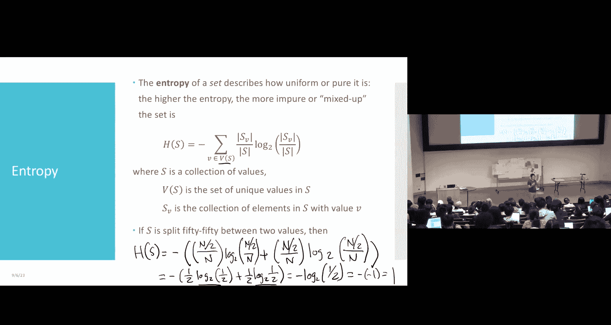

Gives me information or clarity about the other so if these two variables are somehow related to each other through a joint probability distribution say then knowing one will give me some information hopefully about the other this is how it's defined in the context of probability crucially there's this notion of a conditional entropy whoops a conditional entropy here which is just the same as the entropy computation we made on the previous slide using the information that one of the random variables X takes on some specific value。

😡，Again， I think it's maybe helpful to know that it comes from like a probability and information theory context。

 but for the purposes of our class， it's maybe more useful to see how this is defined for say like a data set right so what we'll say here is that the mutual information between some feature x subD。

😡，And the label set， why？Corresponds to this。Formula here。

 it's basically the reduction in my entropy set from knowing what the feature value x sub D is。

 So I start with some initial entropy H of y。 And then if I tell you what the feature value X sub D is。

 how much does that reduce the entropy of my labels。 So if I went from say。😡，Gosh。

 this is where the example of working out would have been really nice。

 but if I had went from say a really mixed up here and I split on this feature。

 if I know how these data points behave according to that feature and I ended up with two very pure or not mixed up leaves we would say that feature has high mutual information it did a good job of reducing a mixed up entropy to two not so mixed ups so that's what we're looking for here and that's what this formula corresponds to if you will。

Again， what we're doing is we're computing the entropy of my original label set。😡。

And subtracting the weighted entropy， so FW here is the fraction of data points where this feature takes on some specific value V。

 so it's the weight or the number or the fraction of data points that go down some particular branch according to this feature x sub D。

😡，And I'm waiting all of the subsets of my labels with that feature value Xd equaling V。

 so that gives me the sort of subsets that I get as a result of making some split。

 I compute those entroies， I weight them according to how many data points there were。

 and then I subtract that from the original entropy。😡，All right， again， a very abstract example。

 let's see sorry a very abstract definition， let's see some examples that'll hopefully help clarify this and again what we're going to do is we're going to consider the sort of two extremes of mutual information here so what I have here is a feature XD that perfectly predicts my label Y if I tell you what XD is you have all the information you need to know about Y。

😊，So let's compute what the mutual information in this setting is。😊，So what we'll say here。Is that I。

Of this feature， x sub D， relative to my labels， y is equal to the entropy of my labels。Minus。

This is just the formula on the previous slide。This weighted。Entropy of my subsets。

So we've already done a lot of the leg work we need to to compute this quantity。😡，That is。

Here we have a label set。😡，That is split 50，50 between two possible values right。

 so I know what the entropy of that set is， that's an entropy of one。😡，Here， well。

There are two possible values that XD can take on， either one or0 and each。😡。

Represents exactly one half of my data set，2 out of four。 So that's going to be。FV。

And then I have two subsets。😡，One where， let's say xd is equal to1。And one where Xd。Is equal to zero。

All right， when xd is equal to1， well， what I have is a pure set。

 I have two values that are the same， so that has an entropy of0。😡，Similarly。

 the entropy of my labels， when xd is equal to0， I just look at these two labels here and again I have a peer set and so the entropy。

😡，Is zero。And what this gives me is a mutual information of one。😡，Again。

 in the context where everything is binary， where both your features and your labels are binary。

 one is the maximum amount of information this is again related to the log base2 and the sort of bits interpretation of this quantity。

😡，But this corresponds with our intuition that X subD tells me all the information that there is to know about my binary label in this setting。

😡，All right， what's the opposite case， right， what's the other extreme？Well。

 that's this data set here where I start with a 5050 split between my labels， two ones and two nos。😡。

And if I look at what happens after I split on XD， I end up with again a 50-50 split。

 so splitting on XD tells me absolutely nothing about the label here。

 I have as much uncertainty about the label as I did before knowing the value of XD It's almost like you know someone asking what someone's favorite meal is relative to whether or not they're a dog or a cat person you might think that has no information and it turns out you'd be right。

 So what is the information here。😡，Between this feature。And the label why？

This is once again going to be。The label of my original the entropy of my original label set， H of Y。

😡，I'm going to skip the equation here。Minus1 half times the entropy。

Of the set when my feature is one oops。H。Y x of d coin1， close that， close that minus2 force。H。

 Y X D equaling 0， close that， close that。 And now what I have is， well。

 I know what the entropy of my original set is。 This is still one。

And now when I compute the entropy of the subset of my labels， where Xd is equal to 1， I have again。

 a 5050 split between two values。That gives me an entropy of one。Again。

 an entropy of  one for when xd is equal to0。So this gives me zero。Again。

 this corresponds with our intuition that XD contains no information about the label。

 that knowing XD gave me no additional clarity about what the label should be。😡。

And much like entropy， this0 and one for mutual information in a completely binary setting represents the extreme values that it can take on。

All right， again， let me stop here， give you guys a chance to catch up for those of you taking notes。

 what questions do you all have at this point？Yeah。

 only more than we have logical Yes absolutely so we have more than two labels or if our feature can take on more than two values。

 if anything is non binary we can have mutual information is greater than one we cannot have mutual informations less than zero in some sense。

 knowing something can ever hurt your clarity about the label that is。😊。

Not a true fact for real knowledge， but it is a true fact for random variables。Anything else here。

 yeah。I there any scenario in which entity of the Android data as not equal to one？

Is there any way in which you can get the entropy of the entire data set not equal to one？😡，Yeah。

 absolutely if your original labels are not evenly distributed between the two possible classes。

 like I'm pretty sure we had。10 dogs people and six cat people here。

 the entropy of that label set is not one。Yeah， one more question here。

Yes so this is another common word for mutual information gain。

 it's an unfortunate fact about notation and machine learning。

 you'll hear the same entity called different things in different places。

 information gain for the most part， is synonymous with mutual information。😊，Yeah。😊，Sorry。

 can you say one more time？Can we use neutral information to determine if two features are correlated？

This is a bit of a tricky concept， so there is a relationship between mutual information and this notion of independence。

 so if you go back to this definition here involving probability。

 what you can compute is that like if two features are like independent from one another in the statistical sense。

😊，Then they will have zero mutual information and that is。Related to the notion of correlation。

 but you have to be a little bit careful about like。Exactly the directionality of that。

Now and another thing， we typically won't be computing mutual information between features。

 we'll be computing mutual informations between a feature and a label。

 so just make sure you have that process right。😡，All right these are really great questions in the interest of time I do need to move on let me just propose this to you all let's see in the interest of time I'm going to work through this exercise with you all as opposed to posing this as a poll question for the purposes of your poll don't select this option pick any of the other ones but again。

😊，What we'll find is that now using mutual information as our splitting criteria。😡。

We resolve the sort of issue we had with training error rate as our splitting criteria in this setting。

 so mutual information tells us two things that we would hope the mutual information of splitting on x1 is0 this depends a little bit on how you define what the log of zero it is the log of zero is you could also think of it as negative infinity if you want it's really bad right but regardless this other feature x2。

😡，Has some non zeroro mutual information， and so using mutual information as our splitting criteria。

 we get what I would argue is the more rational result here that we should in fact split on x2。😡，Oh。

 here's another example of a label set that does not have an entropy of one。😡。

This is a split between two zeros and six ones。All right， so that answers our first question。

 which is how do we pick which feature to split on that is？Use。Mutual information。

At least for this class you know when you go out in the real world you might use something else you might use gen and purity for sure a good option but for the purposes of this class we'll use mutual information then the question is how do we pick the order of the splits man if only I had talked about like a programming method that would be helpful for learning decision trees oh wait a minute。

😊，I did。😊，We're going to use recursion。Why is that well intuitively。

 when we ask ourselves what feature should we be splitting on next。

 what we're doing is we're asking the same question on a smaller subset of my data。Again。

 we can go back to this terrible， terrible example here at the root。

 I had some collection of labels and my question was which feature should I split on？😡，Well。

 once I split on that feature， I've partitioned my data into two smaller subsets where again I can ask the same question which feature should I split on next and so on and so forth until I hit some base case so what we're going to do is we're going to again write out some pseudocode for how we might train this decision tree recursively So we're gonna have some trained method it's going to take in some original data set D or D train however you want to think about it and all this first method is going to do is it's going to。

😡，Store the root node。Which I'm going to get。By calling。My recursive。

Training function on the entire data set， so here's the you know here's one structure you could use。

 which is I'm going to represent my entire decision tree by its root node root。

 and that's going to be what's stored when I train this decision tree much like I can define a binary search tree using just the root node。

😡，All right， so what's going to happen in this tree recurse function？Given the way I called it。

 I know that it's going to return some node， so I'm going to define some node object here， Q。

 and at the end of all of my recursion， I'm going to return this node Q。😡。

And like I laid out at the beginning， every recursive function is going to have two components。

 it's going to have some base case that we'll work on in a minute。

 but let's start with the recursive case because I think this is the more interesting one。😡。

What we're going to do in the recursion is we're going to find。The best。A featureature to split on。

Using， let's say， mutual information and I'm just going to call this feature XD and what I'm going to do is well。

 first I'm going to store。😡，That feature as the thing to split on at this node queue。😡，And then。

For each possible value that X D can take on。All possible values。Of X D。Well。

 for each of the possible values that my feature can take on， I'm going to have a new child node。

 so we'll say we'll create。😡，Q dot child。That corresponds to that specific value V。And this。

Is just going to be some new tree。That looks at just。DV。Where DV is the subset。

Of my data set D prime here。喂。All data points。X D equaling V。

 So this is just partitioning my data D prime into a bunch of subsets。

 one corresponding to each possible value that XD can take on I'm going to have a new child node for each of those and each of those children is going to build some decision tree using just the subset of the data corresponding to this feature and that specific value V。

So again， the way to think about it is I started with some large data set here。

 I split on this feature， and then at this new node， I'm just learning a smaller decision tree。

 a smaller decision tree that contains all the subset of my data with people who preferred warm temperatures。

😡，All right， so there's one last component of this recursion， which is。I need some base cases。

 I need to know when I get to stop splitting， let's take some suggestions here before I let you all go。

 when do I get to stop making splits in my decision tree？😡。

max set oh a max depth hold on to this idea， I like it， it's going to come up。Next week。

Entropy of Yeah， or another way to say it is all labels。Are the same。

Or I've reached some sort of pure collection of labels， in which case I just get to， well。

 we'll talk about what I do in a second， what are some other cases where I would stop splitting？😡。

Yeah， there are no features left if there are no features left， what do you mean by that？Yeah。

 that's another great way of putting it all features have already been split on。Put a big or here。

Anything else？There's only one label there's only one point that only one data point that actually falls under this condition that all labels are the same。

I about when Matt was just sort of standing there holding a very awkward， empty node。

 anything I can do there？Not really right， doesn't make any sense to keep splitting there or if D prime is empty。

Or and this is where I'll come back to your point， some other。Stopping criteria。

And we'll talk about why we might want to employ some other stopping criteria on Monday。

 But for right now， we'll say that if we reach any of these。

Conditions will stop and we'll just return some label。😡。

We can do this using the majority vote or we can do this probabilistically， as I detailed。

 there are lots of ways that we can manage ties， but this。😡。

Is one consistent way and this is exactly the pseudocode you might follow if you know someone were to ask you to implement a decision tree in like a homework assignment all right with that keep an eye out for homework two to be released later this afternoon and we will see you back here on Monday for an extended discussion on decision trees。

😊。

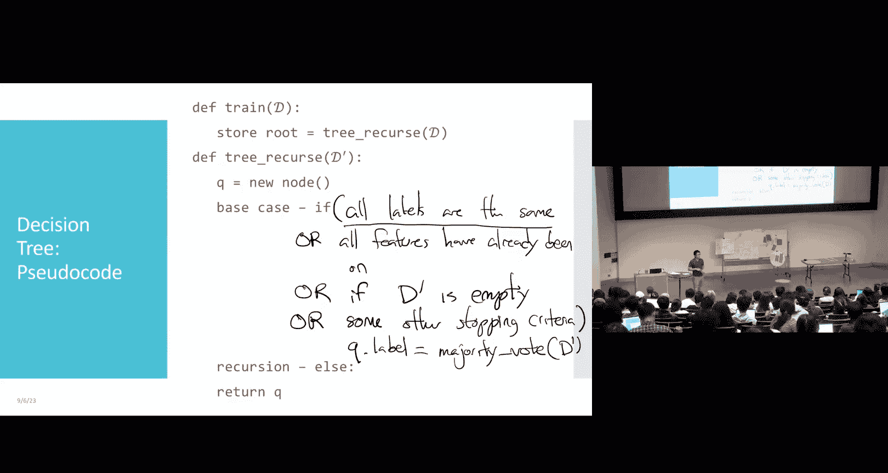