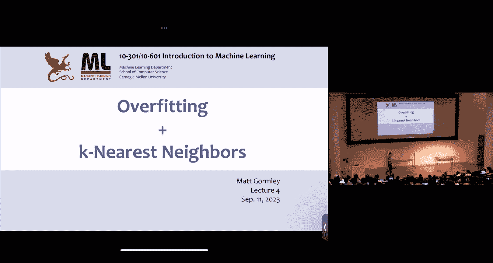
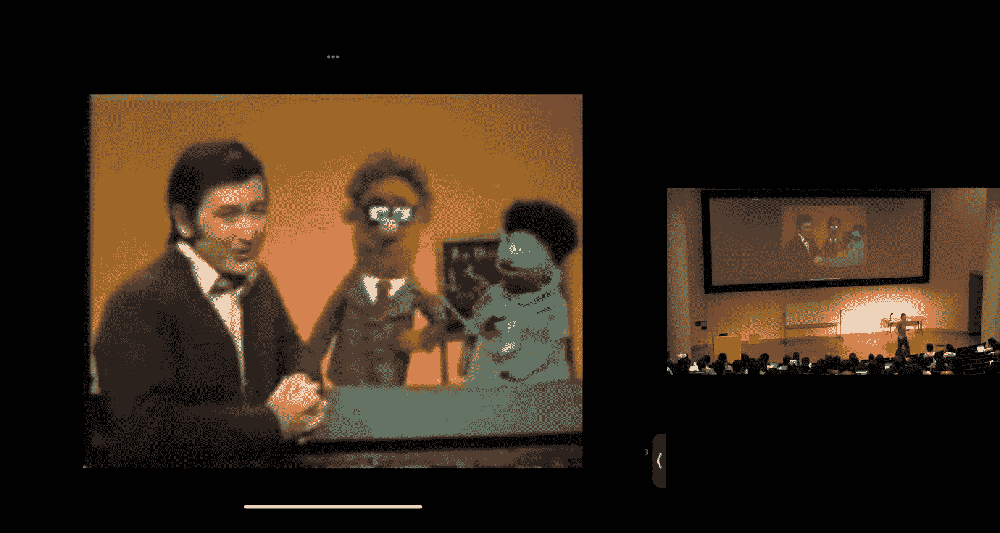
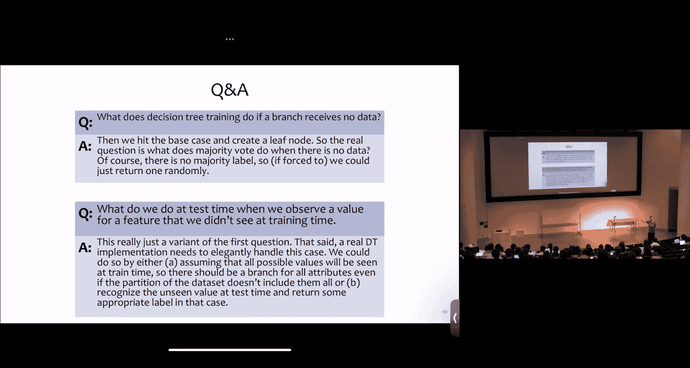
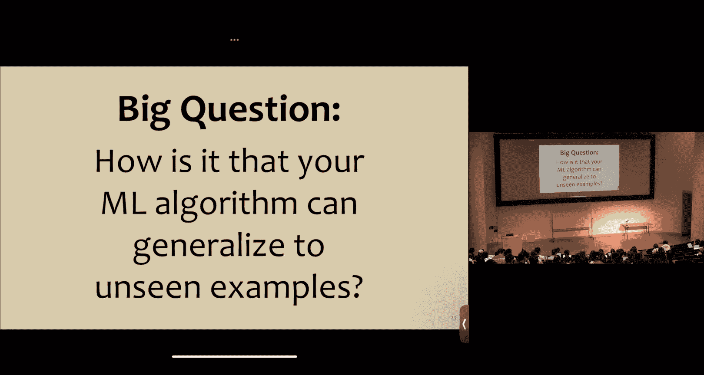
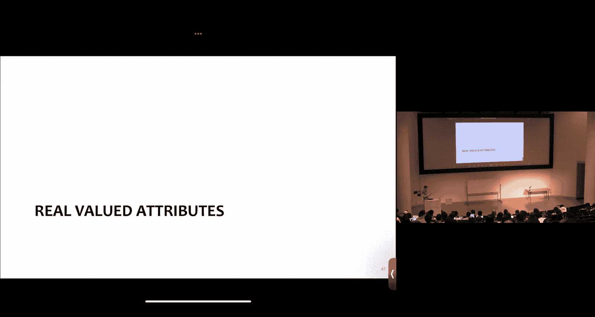
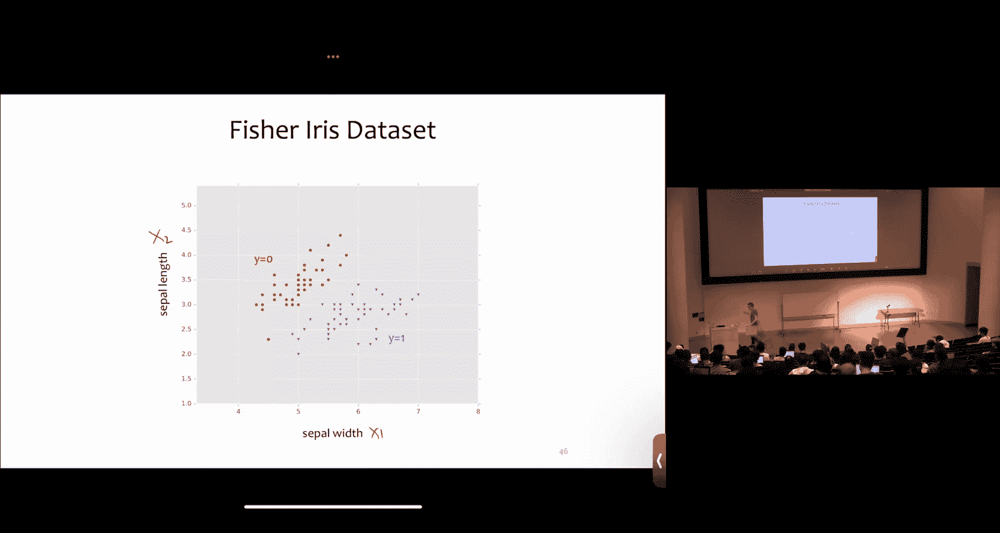

# CMU《机器学习导论｜Fall 2023 10-301⧸601 Introduction to Machine Learning》中英字幕（deepseek p04 Lecture_4_Overfitting_&_k-Nearest_Neighbors.zh_en [BV1Z2cUefE4A_p4]

二海经行。So。One of the things that you'll learn about this class is that these lectures that we give you are really like a not so fundamental part of this course。

 the place where you're actually going to learn things in this course is not during these lectures where we try to jump audio through three different devices in order to get it out of the speakers。

 it's going to be。😊。

With these people， your Ts in this class because and as well with the other people sitting around you in this room。

 because these are your neighbors right these are the people in this class who are going to have a fundamental effect on your learning in this course。

 the conversations that you have in this class just outside the class while you're struggling to get through that homework at the whiteboard these are the these are the sort of places where you'll find that you have these light bulbed moments where everything clicks together and we have a superb group of people working with you this semester and。

They are going to be sort of shaping what it is that your experience in this class looks like and so I really encourage you to capitalize on the time that they're investing back into this course because they've all many of them have sat through this course just like you okay so let's start with a couple Q and a things so the first is。

You might be like working through decision tree stuff and wondering why don't your entropy calculations match those on the slides don't forget to use logb2 this is really important you might also be asking when and how do we decide to stop growing decision trees and in particular what if the set of values and attribute could take was really large or even infant like the real numbers so we'll address this for discrete attributes today but if an attribute or a feature was real valued then there's actually a clever trick that only considers big O of L splits where L is the number of values the attribute takes in the training set。

And so I encourage you to actually think through how you could actually go about that。

 and then we'll kind of spoil it for you later in case you haven't figured it out。Okay。

 so another question that came up is you know what does the decision tree training do if a branch receives no data so Henry already addressed this this is going to hit a base case and create a leaf node。

 so the real question is what does majority vote do when you're voting over no data？

And the answer is probably that you pick an arbitrary label or a random label or something like that。

Okay， so at test time， what do you do when we observe a value for a feature that we didn't see at training time？

This is effectively creating a new branch in your tree。

 so it's kind of like a variant of the first question and how you actually handle this。

 it probably there's a lot of different options， but either way it's useful to actually think carefully about what you should do here。

Okay， the usual reminders homework two is due on Friday， September 15th。

 I want to jump into to start an empirical comparison of some different splitting criterion。

So last time you saw a couple splitting criteriaion namely you saw error rate as a floatinging criteria and mutual information。

 so here this is this classic paper from Bluntine and Niiblet in 1992 where they actually compared four different criteria two of which you're familiar with so random and mutual information and。

😊，So a random splitting criteria would literally just be， you randomly pick a feature at each node。

 right you don't actually look at any of the data， you just randomly pick it。Okay， so。

So genium purity is sort of the new one that I want to highlight here。

 we're not going to talk about it in the class， but it's sort of a formulation that's。

Probabilistic information theoretic， it's kind of akin to mutual information。

 but has some different properties。And so what they were doing in this paper was looking at。

 among other things， four medical diagnosis data sets， and so you can see those four listed here。

 and they were actually trying to do medical diagnosis through the lens of these data sets。

And they split each data set up into a training set and a test set。

 so you know some of them had larger training sets then test sets。

 some of them had small training sets and large test sets and so on。Okay。So。第。

The actual results that they got here， are the these first four are those four medical diagnosis data sets showed that this Ginie gain or Gin impurity was actually sort of statistically indistinguishable from information gain。

 which is just another name that they were using back then for mutual information。

And so what they found here is that if you looked at the performance， the error on these data sets。

 you know here。The error was you know 1。01 with Gin impurity and 0。

95 with mutual information and 2866 with Ginny and 2849 with mutual information right and just down the line these were pretty close to each other and they actually ran statistical significance tests to actually see are these differences that they were observing significant and so in。

呃。the next slide， which is taking super long to Billy。😊。

What they were looking at here was the actual difference itself between Genum purity and information gain。

 that's the non parentthesized part of the column and then the parenthesized part is the P value so these P values are really large close to 1 much。

 much higher than 0。05 and anything less than 0。05 might have been considered significant。

 these were very far from significant differences。Okay， so。

The point here is that sometimes you have a question about how an algorithm is actually going to work and you can't actually kind of deeply understand the answer until you start to unpack it empirically。

 and that's what they were actually doing here because up until that point。

 you people had argued for these different splitting criteria。

 but no one had really across many different data sets done this in-depth analysis of which one was working better。

So decision trees， one of the things that is useful to kind of think about when we're talking about decision trees is the actual inductive bias of the decision tree and this is the principle by which it generalizes so to get a sort of warmed up here thinking about decision trees。

 let's do this first in- class poll so this is question one on your poll and。And question one here。

Is going to have this data set。Where the output label is y， so plus or minus valued。

Each row in the data is an example。And then our attributes are A， B and C。Okay。And。And so here。

Each of the attributes is binary valued， so they're always going to split into two branches。

And the question is which of the following trees would be learned by the decision tree learning algorithm using error rate as the splitting criterion。

 and you can assume that ties are broken alphabetically。Now as usual。

 they're in these poll questions， there's going to be a toxic option。

 you should not pick the toxic option because it will give you negative points and expectation， oh。

 speaking of neighbors， does anyone know who this is？我。呃啊。So we just dropped internet again。嗯。

I'm going to pull the slides up here。And maybe we will present the good old fashion， oh no。

 but then I'm off zoom。哼。Okay。Okay， so actually let's try something else so everybody has like two devices connected to the internet right now。

 let's each pick a device and disconnect it from the internet I'm going do this one All right Wifi off。

😊，This one is already I'm part of the contributing problem here I had four devices。

 this one is already disconnected。All right， and we'll see if we can get me back on the internet。

There is an actually， iss there a network cable here？Yes， but not one that I can use yeah。

That would make too much sense， wouldn't it？All right。Okay， so this is also important。

 the internet is important for you guys to have access to because otherwise you can't fill out polls if if the internet is dropping you from。

诶。From being able to access it。Okay。All right， so hopefully now that you've flipped off a device you can get through and yeah。

 so Mr。 Yuck here， he's actually a Pittsburgger， he was invented by the Children's Hospital to tell kids in Pittsburgh what not to eat。

 so similarly here you should know that Mr。 Yuck is sort of telling you don't pick option four。

 but you can pick any of the other options。Okay， and so if you're trying to actually find the poll。

 there's two ways that you can do it one is you can go to the schedule page。

 as Henry had you do before and underneath the lecture title， there's a little link to the poll。

 there's also this cute thing that you can do， which is just type into your browser poll do Ml course。

Dot org。And if you go to that， it'll redirect you twice to the right place。嗯。Okay。

 so take a moment with your neighbor and go ahead and see if you can come up with which of the trees would be learned by decision treele。

Okay， so。You guys are coming in at like 15% on the first two options and a low 3% on option six。

 8% on option five， and the winner at 57% was option three and。

So does someone want to briefly justify your answer as to why option three makes sense here？

Why did you come up with option three？You want to go。啊哼。😊，click gets it right mode。

so we can see very easily but just by sort of funneling all of the examples through the tree that this option is achieving zero training error it's sort of probable that that's a good thing and then the other thing that's interesting is that we actually are getting some ties。

 did anyone find any ties along the way？As you had to break alphabetically。

Yeah right exactly so A and C tie at the top and then B and C tie the next time you're looking to split and so we have to break those alphabetically the fact that this works this way is sort of because we carefully constructed the data set this way okay so。

😊，So here。How many people know what greedy search is？

A handful okay let me explain it so the goal of greedy search is you have some search space of nodes and edges and and your goal is to actually find the lowest total weight path from a root node on the left to a leaf node on the right。

😊，And at each node， what greedy Search does is it selects the edge with the lowest immediate weight。

And this is sort of a heuristic method of search， it does not necessarily find the best path and so if we actually sort of look at how it works。

 it's going to look at its immediate neighbors of the first node and see that the lowest weight option is the one that has weight one and then the neighbors of that node are7335 and it'll break the tie arbitrarily between the threes and pick another neighboring node and then here we find its neighbors are 412。

2 and it picks the one and then it continues in this way all the way to the end until it finds an end state。

Okay， so what goes wrong here？It turns out that here where it was picking the branch with option three。

 if it had instead picked this seemingly worse option， option four。

 then it would have gotten to a a lower total weight path。Meaning that the non greedy decision right。

 which was three plus seven， so an additional weight of 10 here could have been better if we had gone this way because we would have gotten four plus one。

Okay， and not only that， if we had looked back even further in the tree and instead of taking this initial one edge。

 we could have found a much lower weight path， which was only weight two plus one plus two plus one okay so。

😊，Why do people like this method， Well we like it because its computation time is linear in the pathway。

Okay， so。There's another algorithm called Global Search。Global search works like this。

You compute the weight of the path to every single leaf node。Okay。

 this is very laborious right so here this would be like two plus seven Okay。

 that's nine2 plus one plus2 plus5 let's see seven， three 10 Okay。

 and then two plus one plus two plus three that's going be five plus one plus that two gets us up to let's see seven。

No， that's not right5 plus the two is seven， so this is actually eight。Oh boy。

 this is going to take a while。Well， the reason that nobody likes this algorithm is because it takes a while。

 in fact， it takes exponential time in the length of the longest path。So this is brutally slow。

 but it has an advantage which is that it gives you back the exact lowest path in the search space。

Okay， so。So we can actually conceptualize how decision trees are doing learning through this lens of search and here's what I mean。

 so if you think of the search space as all possible decision trees。

 then a node is like a decision tree。Okay and our edge in this search space are connecting one full tree to another here's what I mean。

 so we start out with this empty root node it doesn't it has just the empty tree。

 which you could think of as like the majority vote classifier， it has no nodes。Okay。

 so then we pick a root node。And you'll notice that the edges here。

Are weighted by the negative of their splitting criterion。So the negative mutual information。

 so we want the we want to in decision tree learningning。

 we want to pick the highest mutual information， but by convention here we're picking the lowest weight path。

 so we're negating it。Okay， so here we have four different options， sneezing hives。

 age and gender that we could split on， each of them has a corresponding negative mutual information。

 we pick the lowest one。Which in this case is negative 0。5 age。And then we expand its neighbors。Okay。

 so in this case， the neighbors of a tree node right are going to say。

 pick all of the possibilities for expanding the left child。Okay， so it could be gender。

 it could be hives， it could be sneezing， it's not going to be age again and we compute again the negative neutral information for each of those and pick the most negative one。

 which is gender and then。😊，We split again， and so here we get negative 4 and negative 。

7 and we pick the lowest one again and this continues on down the lung。Okay。

 so you can think of the decision tree learning algorithm as essentially a greedy search through this big space of every possible tree。

If we expanded out all of these nodes， eventually we would see every possible tree。Okay。

 so so if decision tree learning is greedy search， maximizing our splitting criterion at each step。

Then we could ask sort of a fundamental question， which is。

 how is it that your machine learning algorithm？Can generalize to unseen examples。

This is the big question in this course， if we can answer this question。

 then we can unlock sort of the secrets of machine learning。

 and this is fundamentally what it is that we're actually trying to understand about these algorithms。

😡。

Okay， so we could actually think about decision trees and say， well。

 there's this notion of inductive bias， which is the principle by which an algorithm generalizes two unseen examples。

So what then is the inductive bias of a decision tree learner？

Does anyone want to take a crack at this？What principle is decision tree learning using to generalize to unseen examples？

Yeah，So it knows all possible values for the attributes so that's important right so it's actually going to look at the attributes it's not going to ignore them so that's sort of one part of how it is actually learning。

What is the principle that helps it to generalize to unseen examples though？Any thoughts？Yeah。

similarYeah， so the idea here is that unseen examples should behave like the samples that you actually saw。

And so likewise， that they will have similar mutual information behavior as the examples that you saw。

 so if you put say the。Features with high mutual information at the top of the tree。

 then that should be beneficial to the ones that you haven't seen。 Okay。

 there's another aspect of this that's a little more subtle。

 so I agree with that I actually that's exactly what I put so the data with high mutual information attributes near the top。

 The other component is that it's doing greedy search。

But it stops once it has matched the training data。

And so we're not just continually expanding the tree as deep as it can possibly be。

 we actually pick the smallest tree that matches the training data with the highest mutual information attributes at the top。

 that's what that greedy search is doing right it's not continuing to expand every node just because it can。

Okay， and we could actually take this principle of Aham's Razor。

 restate it for machine learning and say that what we're doing is we're preferring the simplest hypothesis that explains the data。

 that is the fundamental idea here。😊，Okay， so now let's do one more example with the same data set that you saw before。

 I think you'll be able to move a little faster now， suppose you had an algorithm。

That actually found the tree with the lowest training error that was as small as possible。

Meaning that instead of doing greedy search to learn。

 you actually expanded every single possible tree and did exhaustive global search。

 which tree would that algorithm return？And again， we have a toxic option。

 don't pick option six and again， assume ties are broken by choosing the。

 but here that they're broken by choosing the smallest tree。Okay。

 so take a minute with your neighbor， see what you can come up with there。

 and then we'll jump back in。So this one you guys are feeling a lot more confident on 78% of you are reporting option five and I agree with your answer here so if you just start looking at all of these different trees this option five and as we already know option three both have zero training error but we're picking the smallest one and we can see that option five fits the bill okay so the fact that this happens is exposing an important property of decision tree learning if you use the decision tree learning algorithm from homework two。

You might not actually find the smallest tree because it's doing greedy search and it's prone to making these sorts of errors。

If you had an ability to do exhaustive global search。

 you might actually be able to find a better tree like option five here， okay。

 this data set happens to be as far as I know， the smallest data set of three attributes for for which this happens so it's not like an accident that this happened。

 but rather to kind of reveal this issue。😡，Okay， so here's poll question number。

This also has a toxic option， don't pick option B here。

 so which of the following would generalize best to unseen examples。

 a small tree with low training accuracy， not option B， a small tree with high training accuracy。

 or a large tree with high training accuracy。😊，Okay actually you guys are quick way faster at answering this one。

 so 81% of you are coming in with option C and I agree with you there a small tree with high training accuracy is going to help us to generalize the unseen examples and the reason for that is that it's not going to be paying attention to spurious noise in the data set so for example。

😊，If you had an attribute on your medical diagnosis data set that was， is the patient？

Wearing an orange shirt today。Actually not a lot of people wear orange shirts。

 I don't think anyone's wearing an orange shirt in here wow。No one at all？Okay， well anyway。😊。

So when that one person who wears his orange shirts comes into the office。

 they might be diagnosed with a really rare disease。

 okay the data now makes it look like the reason that they have that rare disease is that they also have this rare property that they wear orange shirts。

 but as we all know it's just a coincidence right， but your decision tree wouldn't and it would actually pick up on this sort of noise in the data set and so if you allowed your tree to grow very large。

 it might pick up on these sorts of spurious behaviors。Okay。

 so we say that there's two concepts here that we want to think about one is underfitting and one is overfitting in underfitting the model is said to be sort of too simple it's it's unable to capture the trends in the data and it exhibits too much sort of inductive bias right so here we could think about an example of this as like a majority vote classifier。

On the other hand， overfitting is when the model is too complex and it's fitting the noise instead of what we actually care about and so our memorizer algorithm。

Sort of responding to these irrelevant attributes would be a good example of a model that tends to overfit。

Okay。So we can actually express overfitting in terms of error rates。

 so these are the three error rates that we've looked at before。

 training error test error and true error。We say that H overfits the training data if the true error is much larger than the training error。

😡，And that the amount of overfitting is the true error minus the training error。Now。

 you should naturally be thinking to yourself， wait a minute， we can't measure true error。

So in practice， we often are looking at the difference between test error and true error to see if there's overfitting。

Okay， so here's an example of overfitting in decision tree learning， where on the vertical axis。

 we have accuracy and on the horizontal axis， we have the size of the tree。😊。

And I have two data sets， a training data set and a validation data set， okay。

 this is not a test data set， it's just like， but it is some held out data that I'm going to use to evaluate how well the tree is doing。

But it's not used in actually training the tree per se okay so we start this training process and it goes from you know zero nodes and then we add a bunch of nodes it gets up to 10 nodes and now at each step along the way I'm actually evaluating the training error and the validation error and so by 20 nodes it seems like you know the training error and the validation error have plateaued。

But you know， might as well keep going， I mean， maybe the validation error which is kind of this held out data。

 maybe we could actually drive it up even higher。Well。

 here we went up to 30 nodes now the training error went。

Lower oh sorry right accuracy is what we want to be high error is just one minus accuracy。

 so this is one minus。Error。So can we？What can we do here well， maybe if we add more nodes。

 it'll come back up。That seems like the validation error kind of flattened out maybe maybe it'll still come oh no now we're up to like 50 nodes and the validation error is getting worse and worse and so we see that what happens here is there's kind of this sweet spot right if we had stopped back at like 15 nodes you know the validation error was at its highest and as we kept adding nodes we started overfitting to the noise in the training data and so our performance on this held out validation data was getting worse and worse。

😊，Okay， so what do we do about this？There's a bunch of options， one is， as you'll do in homework two。

 don't grow the tree beyond some maximum depth。Another option would be don't split if the splitting criterion is below some threshold。

 right if all of the splits give you low mutual information improvements。Then maybe you should stop。

You could stop growing when the split is not statistically significant right so there would be ways of testing for that Another option that we could talk a little bit about is you could grow the entire tree。

 the full you know，100 nodes tree and then prune away some of it。

So let's look at that more carefully。So there's one way of doing that that's called reduced error pruning and the idea is you split your data into a training set and a validation set。

And then you grow the full tree using the training data set。Okay。

 so that's the normal part that we're used to。But make sure that you grow it all the way。

Until it perfectly matches the training data and then repeatedly prune the tree as follows。

So you're going to evaluate each split using a validation data set by comparing the validation error rate with and without each split。

😊，So if you have some tree consisting of。Nodes like this。

You could pick each of those nodes and you could say， well， what if we just got rid of this node？

Would my validation error be higher or lower？And you could record how much of an improvement you get。

 and then you could say， okay， what if I got rid of， say。

 this whole node and all of its sub childrenildren。

Would that give me even more improvement or less improvement？

So after you check for all of these nodes， you could pick the one that gives you the greatest improvement。

And then repeat。And then you would stop if there's no sort of removal of a node that would give you an improvement。

Okay， so we could actually play this out as before， so after you run through your training。

Pruning is going you're going to be checking your accuracy on the validation data。

So it's going to start out at 100 nodes， but now you prun some away。

 you get back down to like 85 and look， your validation error is a little higher。It's a smaller tree。

Okay， so now you prune away some more， now we're down to 75， oh， and the error went back up again。

And now we prune some more and some more and some more until finally we stop at about。

 it looks like 21 nodes， 22， maybe。And this is the best performance that we had on validation data。

And it's actually even a little bit better than we were getting as we were training。So。

One important note here， Henry will talk a bunch about this next time。

 but just you should note that we were very careful to use this validation set。

 we're going to carefully define this for you next time。

 it would be the wrong thing to do to do this sort of pruning on your test set your test set is really just sort of held out for your final evaluation and there's a sense in which this pruning strategy is another kind of learning。

And so we're actually learning something about how to prune the tree on this validation set。

 so you should still go evaluate the final tree that you get on a test set。Okay。

 so so decision trees are for good reason one of the most popular classification methods out in the real world。

 they're easy to explain to a non-machine learning person they're efficient in computation and memory they can be applied to all sorts of problems so far we've only seen them for classification but you can also do them for regression and density estimation。

 the applications include all sorts of things medicine molecular biology。

 text classification manufacturing astronomy agriculture。

 those are just the ones that I could actually find like scholarly journal articles for there's countless more out there in the real world。

and they have all sorts of interesting extensions we'll talk about ensemble methods of which decision forests is an example later in the course。

Okay， so the learning objectives for this kind of broad section on decision trees are not just about understanding decision trees。

 though that's certainly part of it， we hope that you're able to actually implement decision tree training and prediction use effective splitting criterion such as mutual information。

 explain the difference between generalization and memorization。

 describe that inductive bias of the decision tree that we talked about today。

 formalize a learning problem， and sort of a careful way using mathematical tools。

 explain the difference between true error and training error。

 judge whether a decision tree is underfitting or overfitting and implement air pruning or say some other early stopping method to combat overfitting。

Okay。So with the rest of the time here， I want to talk about real valued attributes。

And to do that， I'd like you to think about hies。If you haven't seen an Iis at the Phps Conservatory。

 it's also in your neighborhood just over there and there's some great people who are your neighbors and they grow these beautiful irisees and if you look up close and iris has these different parts to it。

 it has petals。On the sides， and then in the middle it has what are called sepals。Okay。

And it turns out that you can actually learn something from the size of these different aspects of the iris。

So back in。呃。1936， there was this botanist by the name of Anderson。And he went out into a field。And。

He brought with him his notebook and his pencil。because he didn't have one of these and he carefully walked along and every time he found an iris。

 he would stoop down and he'd take out his little tape measure and he would he would check what the pal length and the sepL length were by measuring them and then and then he'd do the same thing for the for the pedal and sepL。

So after he did that， he would write down what the species was， maybe a shorthand just like。

 you know， zero for iris， sattosa， one for irris， forica and two for iris versa color or something like that。

 and then he'd find another iris and he'd make the same measurements and then he'd write those down。

Okay， and he did this 150 times to collect all of these careful measurements of flowers。Now。

 what I'd like to do is actually use this data set to sort of study what it means to actually work with these sorts of real valued attributes。

 and you could imagine trying to predict what the actual species of the flower is just by looking at these attributes。

Now before we do that， there's an important takeaway with this dataset so this data set is called the Fisher IIS dataset and that's because some statistician by the name of Fisher came along and he used it to do something interesting with statistics and everybody instead of calling it the Anderson Iris data set for the guy who actually did all the work of collecting it they named it after the statistician instead。

 so I guess the lesson is don't be a botanist。😊，I'm not really sure maybe there is no lesson here anyway it's kind of frustrating。

 but we're going to call it maybe we'll call it the Anderson Iris data set and we're going to actually delete two of the four features so I only want to look at SEL length and SEL width。

😊，So that。Our features， which are x1 and x2， can be thought of in two dimensions。

And this is sort of the power of real valued features。

 we can actually conceptualize them as points in high dimensional space where they have labels。

 Y that you could think of as colors or shapes。😊，Okay， so if we plotted this in two dimensions。

 here's SL width， that's our x1 feature， here's SL length， that's our x2 feature。

And you can see these are the actual irisees and they actually separate out really nicely into the two groups。

 y equals zero and y equals1。Now I'm actually leaving off the third species because it would get a little bit messier if we included it。

 but at least for these two species， it separates out really well。And if you only had one of them。

 the separation wouldn't be as clean， you need both。Okay， now。

In order to sort of better understand this， it'd be nice if we could actually have our own real world data set you know。

 I mean maybe we could call it the I don't know the 10301601。Student data set。

 I don't have any irisees， but you guys are here and you could stand in for the irisees。

 So if you're holding a red or a blue folder， can you go ahead and raise that up into the air。

Thank you。😊，You could imagine that one of the things that you might want to be able to do with a data set like this one is think about conceptualize it as。

 you your actual seat number， the sort of column that you're sitting in is like the X1 feature。

And then the row that you're sitting in so this would be like you know value1，23，4， five， six。

7 and then the row that you're sitting in is like the x2 feature， so this is you know value  one。

 two，3 and so on Okay so now we could actually think about what would happen。😊。

If a new unlabeled point came along。And we set it up， say right here， can you hold that up？

So hold that up high so everyone can see it。So here this new point comes along。

How would you classify this point？How many would say or you could just call it out。Okay， mostly blue。

 you seem to be strongly in agreement， let's see if I can get you to come up with a different idea here。

 you know， something a little more contentious， what if the new point that came along here was somewhere else。

 I don't know like off on the other side of the room you could hold this up for me here。Okay。

 what now oh okay， well you've changed your minds at least so it seems like position certainly matters now what if we actually had this point。

Come along， could you？Could you pass it down the road so that it's like， right， yeah， where you are？

And。Okay， so now here's the point。What is it now？HThat sounded like。😊，Okay。

 so now it seems we're a little unsure。嗯。😊，Boy， well， I mean， you guys were so in agreement before。

 why are you not in agreement now？我是他。Say it a little louder it's close to some blue points。

And it's close to some red points。So now that it's close to over there it was just close to a bunch of blue points and so we all said blue and over here it was mostly close to red points so we all said red and we just moved it a little bit over but now there's all these blue points lurking nearby and so now we're not so sure should it be blue。

 should it be red maybe purple。诶。So it turns out that I think all of you actually share a common inductive bias here。

 you can put the folders down and then maybe bring them down to me at the end。

I think that your inductive bias。Is something about you know how points in high dimensional space should behave。

 okay， so let me see if this algorithm actually kind of captures your intuition。So here it is。

 it's called the nearest neighbor algorithm， and the idea is that we store our training data set D。

Okay。And。That's the entire training algorithm。Okay， pretty simple， you should be thinking now。

 oh dear， are we going back to that memorizer algorithm again， no， no， no， no。

 because the prediction that we're going to do here is actually much more interesting。Okay。

 so h of x is going to take in some new point， we'll call it x prime， that's the white folder。

And the data set D consists of these you know red and blue folders and what we're going to do is we're going to let X I。

Be the point in D that is nearest to x prime。And then we return whyI。Okay。

 so this algorithm seems to be behaving a lot like what you all were just doing。

In order to kind of understand it a little more deeply。

 I'd like us to kind of think about a little bit of the math of classification and binary classification。

So classification in this sort of new careful setting we have with real valued features。

 you can think of as consisting of。X I，Y I pairs。And this is a shorthand that we'll use in this class what this is saying is it's a set of pairs we've written these out before as like x1 y1 comma parentheses。

 x2 y2 comma parentheses right this is saying we have I equals1 to n of these pairs。X I Y。

And each for all I。From one to n， we have that our Xs， these little vectors。

Are going to be real valued vectors of length capital M。And then also for all I， we have our Y eyes。

As being discrete valued labels， say one。To。L， where L is some integer。Greater than one。

And so what we're doing here is we're thinking about。Kind of setting these up as。

The X's are our features。And the Y's are our labels。Okay。

And you could also think about this as sort of mapping back to the notation that we set up before。

Where。We had those sets， calligraphic y and calligraphic X。

So calligraphic X is the output space it's or sorry the input space。

 it's the possible sets of features that we could see and so here that is real valued vectors of length M。

And our output space are the set of all possible labels， in this case it's the set 1 to L。

So as before， we have n equals the number of examples。Or training examples。

And we have M equal to the number of features。So that should be kind of familiar by now。

 and you could also think of this as the size of the data set D。Okay， so that's classification。

We can also think about binary classification。Binary classification is almost the same setup。

It's just classification。Where we have an additional restriction。That the size of calligraphic y。

Is equal to two。And so what this means for us is that for all I。

Why I should come from a set of just two values like plus。And minus。Or maybe。Like red。

And glue for folder colors。Or if you wanted to cat and dog。

It doesn't really matter what these labels are， the point is that you have two of them and that's what sets binary classification apart from regular classification。

😊，Okay， so the key difference from everything that we've done up until now。

Is that our x vectors are the real valued vectors。Okay。

And what that allows us to do is when we think about。These ideas of。呃。Of actually learning。

 we can think about what it is that we're actually learning as a。Decision rule。Or。A hypothesis。

 so a decision rule。Or a hypothesis。Is going to be some function H。

And we write that the type of the function。A little colon after it is one that maps from Rm。To。

 if it' binary classification， are binary output spaced。Plus， minus。And the whole idea。

Is that at train time， we say。We're going to learn H。And at test time。We're going to。

Given some new X that we haven't seen before。Make predictions。Say， why hat？

Which are H applied to that X。嗯。So this is a decision rule or a hypothesis。

What I want you to think about， though， is actually something different called a decision boundary。

So。It's useful to have examples here。So we can do our examples of decision boundaries。

As in the setting of two dimensional。Binary classification。Okay， so what does that mean？

To say that it's two dimensional。Means that the number of features m is equal to 2。

To say that it's binary， that means that the size of calligraphic y is 2。

So what we want to think about is。A data set in two dimensions。With binary labels。

 so here's example one。And example one， we have two features， x1 and x2。

And we have a bunch of points like these。And a bunch of minuses like this。And。

The decision boundary that we might learn here。Would be one like this。

Where everything on this side of the line is y equals plus。

And everything on the other side of the line is y equals minus。And if we wanted to。

 we could actually take a little highlighter and sort of shade in this side of the line。

To say this is the y equals plus side。Okay。So。What we've just drawn here actually has a name。

 this is called a linear。Decision。Boundary。没得这。The line itself is a line， right， separating these。

 and so we call it linear。Let's do another example。So suppose now， instead。

 we have the same two features， but a different data set。This time。

 our data set looks like a bunch of minus points like so。And a bunch of plus points。

Scattered through like this。And so now if we actually learned some sort of decision boundary to separate these points。

It might look something like this。Where everything on this side of this curve is y equals plus。

And everything on the other side is y equals minus。And again， we could go and shade in。

The y equals plus side。And what we would find is that now in this new decision boundary。啊。

That we've constructed。It is non nonlinear。So it's a linear decision boundary。

Just because the actual shape of this blue curve separating them is not a line。

And so what we'll do over the coming weeks is we'll actually think a lot about these two kinds of decision boundaries。

 linear decision boundaries and non linear decision boundaries。Um。

 and they both have a bunch of really interesting properties that we'll kind of use to kind of dissect the actual learning algorithms themselves。

😊，Okay， so let's come back to our nearest neighbor algorithm。And do an example。

So here I have some plus points and some minus points。

And we could actually think about what it would look like。To essentially run this algorithm。

But for every single point。In the space。Okay， what I mean by that is I want to know for every pixel up there。

 should we label it blue or should we label it red？Right。Okay。

 so how would we actually go about doing that？The answer comes from this idea of a vorrennooid diagram。

This is the Borenar diagram for this set of points。

And the idea is that each cell contains one of our training examples and all the points within a cell are closer to that training example than to any other training example in the data set。

😊，哎。And then if you look at the points on the Vono line segments。

 those are equidistant to one or more training examples。

So let's see how this vorrani diagram comes about。What you do is you take a pair of points like this plus and this minus。

And you draw the line of points that are equidistant to that plus and to that minus， okay。

 that would be a line like this one。Cutting through here。Okay， now let's do it again。

 but for a different pair， let's do this plus and this minus。Okay。

 so the line that has all the points that are equidistant to those two is this one。Okay。

 now let's do this minus up here and this minus down here and we'd get this line。Okay。

So if you did this for all pairs of points。You would start to get all of the line segments that you need。

And you could use those line segments， maybe with a careful algorithm to actually sort of separate out these points into their own vorani cells。

And then you could just color each cell。By whatever point is inside it。

And what you would get back is an image like this that shows for each pixel right in from you know。

 in our zero to one space on each of the two features， x1。And x2。You know。

 what should that pixel be labeled？And so if a test point came along here。

You could just immediately answer， oh， we'd labeled that blue because you can see that the pixel underneath that test point。

 according to our decision rule， should be labeled as blue。Whereas if a test point came up here。

It would be labeled as red。Okay， so the nearest neighbor model actually requires no training。

So this is nice， it also always has zero training error。😊，And further。

 the reason for that is that a data point is always its own nearest neighbor。

 right if we go back to our example。You know what is the nearest so here's a minus right in the middle there right。

 what if we had a test point that landed right on top of that minus？Well， of course。

 the nearest point in the training data to that test point is the minus sitting right under it。

So it's clearly going to be labeled as minus。O。So we can actually take the nearest neighbor algorithm。

And generalize it a little bit further。Okay， so now I want you to raise those folders again for me。

All right。So what if I said？Let's base our decision。On the five well。

 let's say on the one nearest neighbor to that point。Then what would you label it？

Just on the one nearest neighbor。Yeah， I think this red folder。

 Can you raise that up a little higher。 I think that red folder is the nearest point。

 Maybe it's just the angle I met。 But I think some of you agree with me anyway。 Now， what if I said。

 let's use the closest。Five points。How would we label it？Still probably red， I think one， or wellow。

 actually。I don't know actually this blue oh yeah， so if you lean that blue folder forward we've changed it now the closest of of the five are1。

2，3，4，5 right so if we take those five folders there。

 the three blues beat the two reds in a majority vote and so maybe we would label it as blue this is what the K nearest neighbors algorithm does you can lower the folders。

 we store two hyperparameters， these are sort of properties of the algorithm that are really important to us one of them is K the number of nearest neighbors and the other is a distance metric D that allows us to measure distance here where I guess measuring it by Euclidean distance。

You store the data set and the interesting bit is that now in our prediction step。

We let S be the set of K points in D that are nearest to x prime according to our distance function。

And then we do a majority vote on those K nearest points， as you just did here。

And so suppose then we have a data set like this one below。Um， you could think of this as， uh。

 you know， maybe like we're labeling u u。People in your neighborhood as to whether their favorite childhood television show is Mr。

 Rogers。Lovingly created right here in Pittsburgh by your former neighbor， Fred Rogers。

 or by Daniel Tigerger， who I guess lives in like this imaginary neighborhood of makebelieve。

 but really the neighborhood of make believeve is actually just Pittsburgh anyway you need to watch the show but the point is that we can actually think about a new point that comes along。

And naturally， you know， if you live near a bunch of people that like watching Mr。

 Rogers neighborhood， then you'll probably be more likely to watch Mr。 Rogers neighborhood。

 whereas if you live near people that like Daniel Tiger's neighborhood。

 you'd be more likely to watch Daniel T。I'm sure this has nothing to do with age。Suppose we have。

This。Set up where the new point that came along is distance three to this minus distance four to that minus distance7 to these two pluses。

 distance two to this close up plus and distance8 to that minus and the other distance is they're farther away so we don't even need to think about them how should we label the new point well。

It depends on K。So if k is equal to1。Then our prediction for that new point is only going to look at the one nearest neighbor。

 which is this blue plus。So it'll label it as plus one。If k is 3。

 well now we need to consider these two minuses as well。Taking a majority vote， we'd get minus。

If k was five， actually now we'd be back to plus again because we have three pluses among the five nearest。

Okay。Okay， so you can go learn about Mr。 Rogers on your own time there's a great video in here about him and yoy ma anyway so。

So there's a lot to say about Can nearest neighbors and maybe one of the most important details is that you have a bunch of options available to you for the actual distance function itself。

So we've been thinking about Euclidean distance， which is like tape measure or distance。

 but in high dimensions。Where you compute that by taking a sum over all your dimensions and adding up the difference between each entry of the two vectors。

 squaring it， and then once you've computed that sum， you take the square root。

Another option would be something like Manhattan distance。

 which would essentially be like if you were walking the city blocks of Manhattan。

 you can't walk like straight through them because there's these giant skyscrapers in the way。

 so you actually you know would count the number of blocks that you're going。

So that's Manhattan distance， which looks at the sum of the absolute values of the differences between the vector entries。

So we'll stop here for today， I'll leave a couple sort of additional comments about KNN for Henry。

 so thanks for your participation， if you're holding a folder please bring it down so that I can reuse that for the next class and we'll see you next time。

