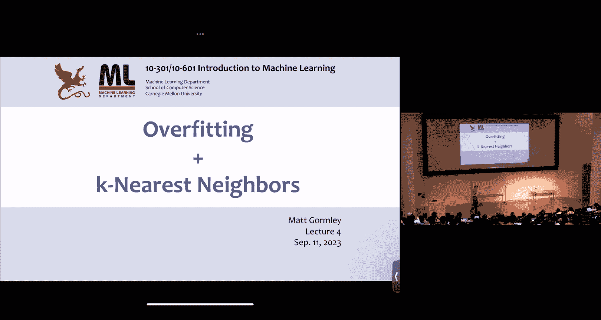
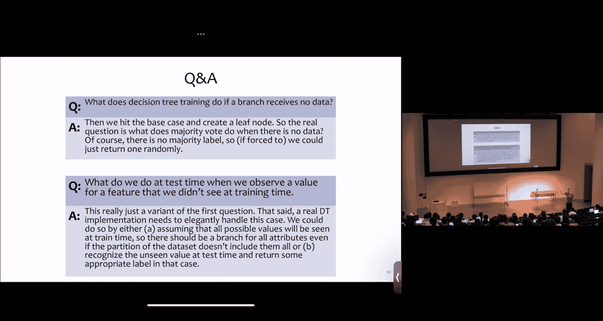
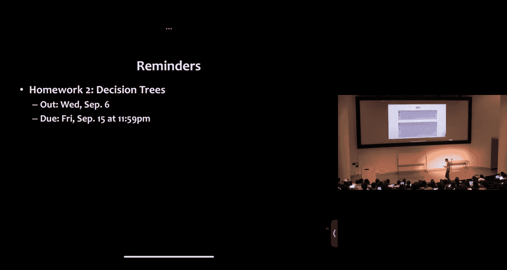
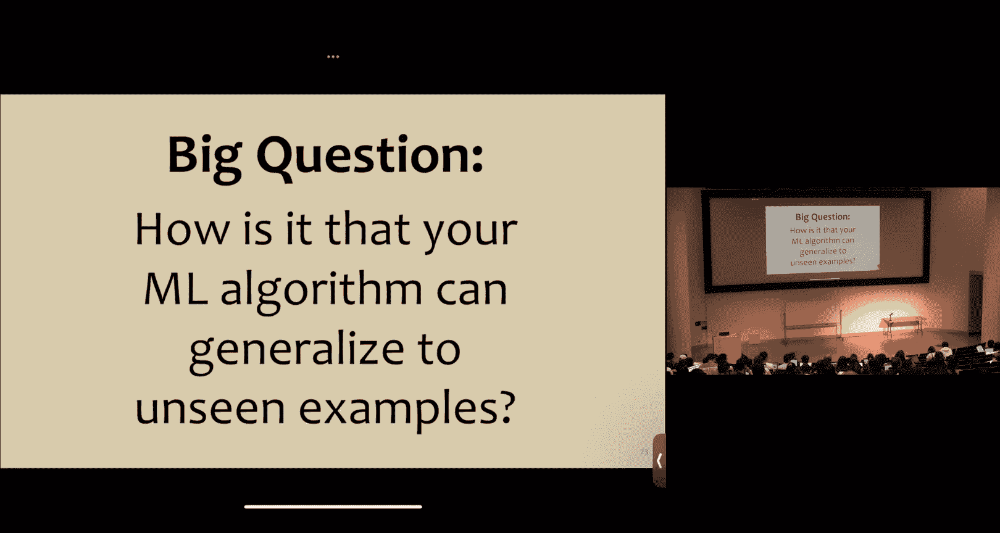
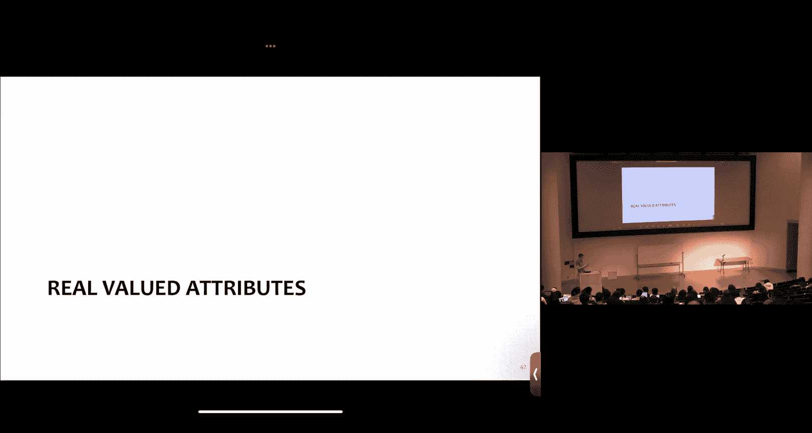
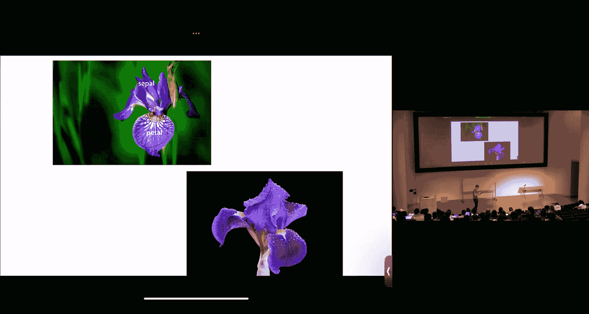
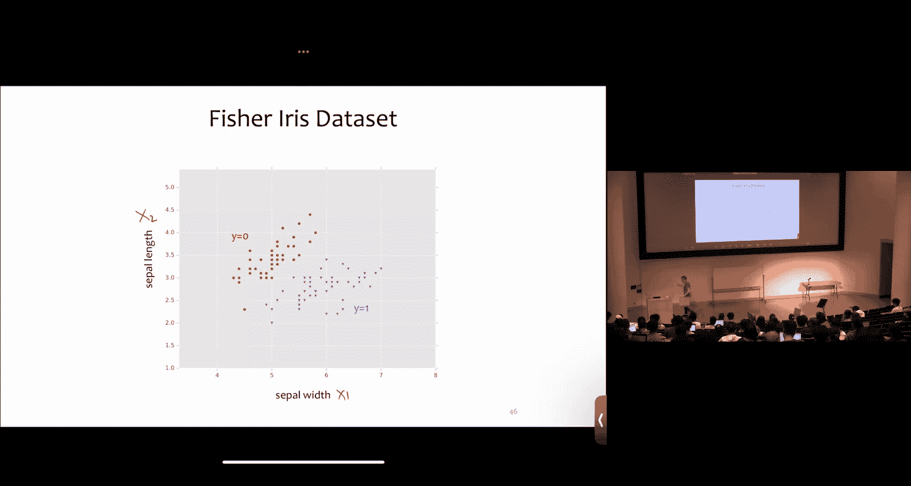
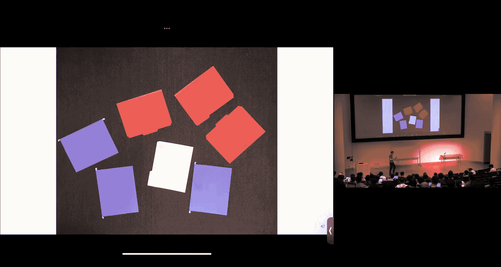
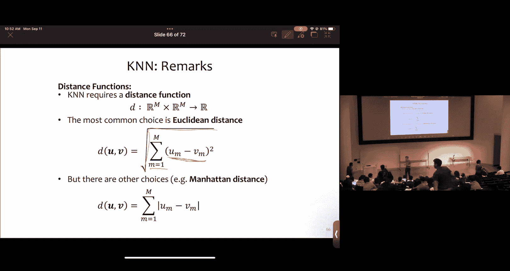

# CMU《机器学习导论｜Fall 2023 10-301⧸601 Introduction to Machine Learning》中英字幕（deepseek p04 Lecture_4_Overfitting_&_k-Nearest_Neighbors.zh_en [BV1Z2cUefE4A_p4]

## 1. 课程概述

在本节课中，我们将学习决策树和k-最近邻算法。我们将探讨决策树的归纳偏差、过拟合问题以及如何通过剪枝来解决这个问题。此外，我们还将介绍k-最近邻算法，并讨论其如何处理实值属性。

## 2. 决策树

### 2.1 归纳偏差

决策树的归纳偏差是指其泛化到未见示例的原则。决策树学习算法使用以下原则来泛化：

*   **属性重要性**：决策树学习算法会考虑所有可能的属性值，并选择与训练数据具有相似互信息行为的属性。
*   **贪婪搜索**：决策树学习算法使用贪婪搜索来选择具有最高互信息的属性，并在满足训练数据的情况下停止扩展树。

### 2.2 过拟合

过拟合是指模型过于复杂，无法区分数据中的噪声和真实趋势。以下是一些过拟合的迹象：

*   **训练误差低于测试误差**：如果模型在训练数据上表现良好，但在测试数据上表现不佳，则可能存在过拟合。
*   **模型复杂度增加**：随着树的大小增加，模型可能开始拟合噪声。

### 2.3 剪枝

剪枝是一种减少过拟合的方法，通过删除树中的某些节点来简化模型。以下是一些常见的剪枝方法：

*   **最大深度剪枝**：限制树的最大深度。
*   **最小信息增益剪枝**：停止扩展树，直到分裂标准低于某个阈值。
*   **减少误差剪枝**：在验证集上评估每个分裂，并删除导致验证误差增加的节点。

## 3. k-最近邻算法

k-最近邻算法是一种基于实例的算法，它通过查找与测试点最相似的k个训练点来预测标签。

### 3.1 距离度量

k-最近邻算法使用距离度量来衡量两个点之间的相似度。以下是一些常见的距离度量：

*   **欧几里得距离**：在多维空间中，两点之间的距离。
*   **曼哈顿距离**：在多维空间中，两点之间的“城市街区”距离。

### 3.2 预测

k-最近邻算法通过在k个最近邻中取得多数投票来预测标签。

## 4. 总结

本节课中，我们学习了决策树和k-最近邻算法。我们探讨了决策树的归纳偏差、过拟合问题以及如何通过剪枝来解决这个问题。此外，我们介绍了k-最近邻算法，并讨论了其如何处理实值属性。

**本节课中我们一起学习了决策树和k-最近邻算法**。