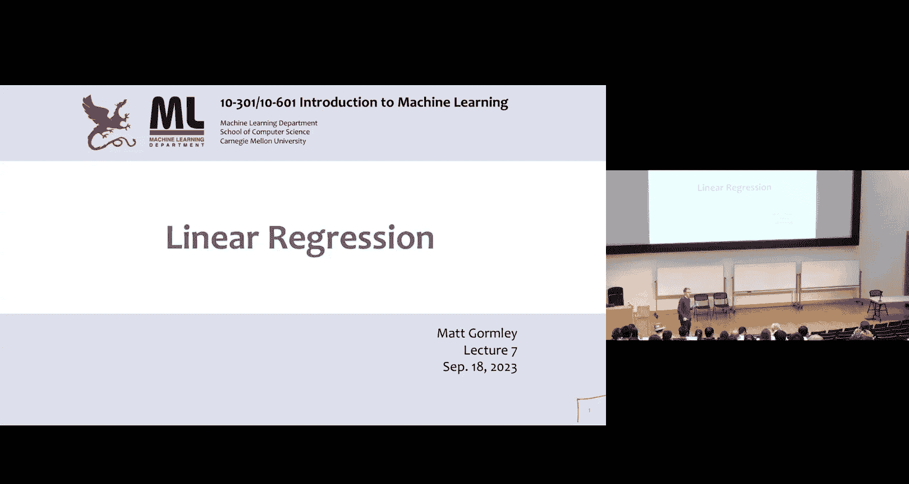
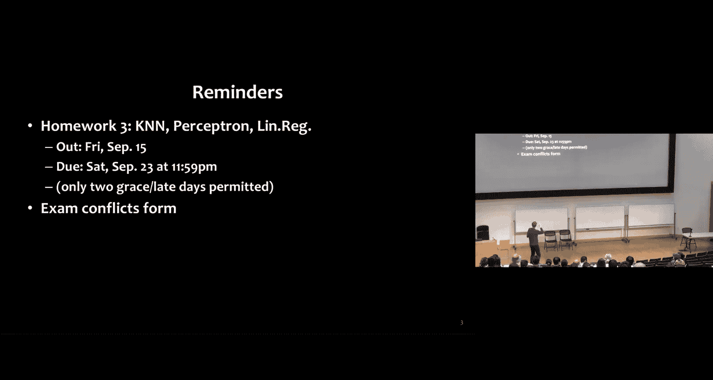
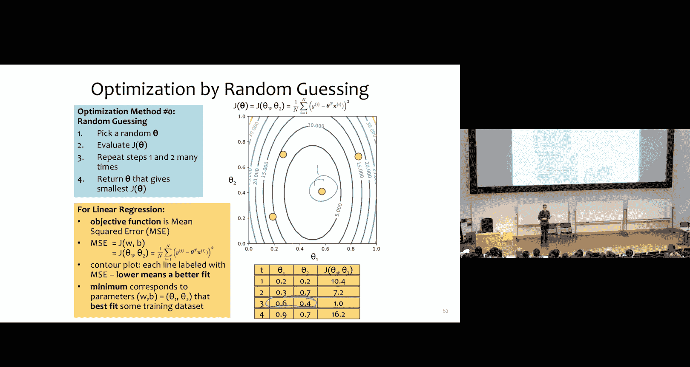
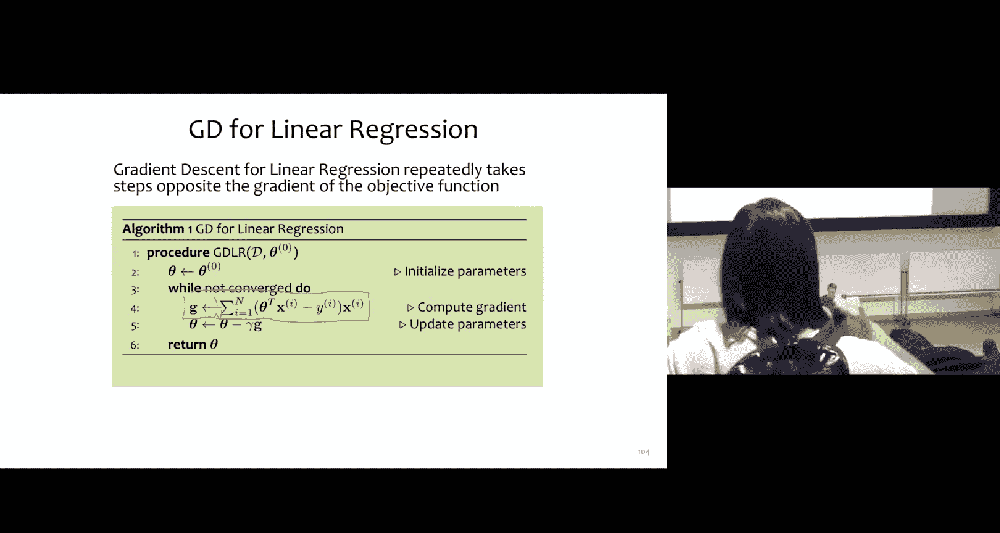

# CMU《机器学习导论｜Fall 2023 10-301⧸601 Introduction to Machine Learning》中英字幕（deepseek p07 Lecture_7_Linear_Regression.zh_en -BV1Z2cUefE4A_p7-

All right， welcome back to 10301601。Today， we get to talk about regression。

And I think that this is fun for a couple reasons， one is that it allows us to depart from sort of the running example of classification that we've been using and I think it's useful to think of classification as just a running example for machine learning there's all sorts of different machine learning problems not all of them are classification problems。

 classification and regression only encompass a handful of problems that even beyond that there's lots of other ways to formulate it and so this is already a different way to start to think about what a machine learning problems is。

As well， this marks one of the most interesting turning points in our discussion of machine learning because we're going to use the topic of linear regression。

 that algorithm， as a way of pivoting towards an understanding of casting learning as an optimization problem。

And this idea of learning as optimization is what has。

Completely reshaped and defines most of the current state of the art in machine learning right now。

And so we'll spend not just this lecture， but a whole bunch of subsequent lectures thinking about different optimization algorithms and how they can be used to get us to learning。

O。Before we do all that， or just a reminder about homework  three， which is due on Saturday。

 September 23rd， and only permits to grace or late days。

 we'll have an exam conflicts form coming out if it's not already。

Some good questions have come up， one is just a practical one。

Like I have a medical emergency or a family emergency or some disability or other compelling reason and I am unable to attend office hours in person this week can an exception be made so I can attend office hours remotely the answer is yes。

 but there's a very specific way of doing that you need to set up a special arrangement with our education associate Bryn and request a period of remote office hours and we'll reply with instructions on how to do that。

Okay， so Henry presented this picture of a decision boundary。For a for a decision tree。

And and what this evokes for us is actually how to build decision trees with real valued features and so we've been kind of teasing around this topic if you haven't like fully latched on that。

 there's a little you know five or seven minute video on Piazza that you can go check out where this is required content for the course so you need to understand how to build decision trees with real valued features so if you get it great but we would just recommend everyone watch that video another question that came up so Henry presented this this picture of how good the perceptron algorithm actually is。

We were able to bound the number of mistakes that it makes as R over gamma of the quantity squared。

And this is called the Perceptron mistake Bo， so it turns out that this theoretical result is one of the simplest to prove that we'll look at the entire proof is just a sort of a geometric argument。

 it's rather elegant and so there's actually a 15 minute video that we posted as well that kind of restates the mistake bound and then proves it in about yeah。

 five or 10 minutes。So that's also another required video， so check those out。Okay。

 and then the accompanying slides are all sitting here so you can。Have those as your。

Going through those videos。Okay。On to regression。So to talk about regression。

 let's first state what the problem is， so given a training data set of X Y pairs where x is a vector and y is a scalar。

Okay， no， this is the most important bit of this entire slide right why being a scalar is what differentiates us from classification in classification why was discrete it was like a binary label plus or minus or it was a categorical label like red green or blue right here y is an actual scalar value and our goal is to learn a function like a curve or a line but in high dimensional space that best fits the training data and so。

Examples of this come up all over the place things like。You know。

 predicting the stock price on the next day or forecasting epidemics。

 which the Delphi group at CMU has done a ton of work on。

 speech synthesis where you're actually trying to go from a text string to the actual audio signal。

Generation of images like these shown by deep dream。

So all of these are examples where the Y output is scalar。

 and most of these are actually sort of maybe a little more interesting than just a mere regression problem because they involve multiple scalrs。

Okay， so when we think about regression， this is often a good place to start。

 so we think about a data set with only one feature that's x on the X axis and one scalar output。😊。

Okay， so this is not a two dimensional classification problem we're not trying to draw a decision boundary here。

 we're trying to find a function that best fits these points。Okay。So what do you guys think。

 what is the function that best fits these points？I'm going to describe it funny。Yeah。

A linear function like y equals mx plus B right， so yeah， it would look something like this， right？

Nice line。All right， so we're done， I think you guys get it。Any concerns， anyone？

I see some thumbs off， any thumbs down。Yeah，That's very kind of you I think I you I think I can draw a better line than this right one that cuts through the points。

 that's right， something like that。Right through the points。Okay。

So what is it that makes a line fit these points？All。Okay。

 now we've hit some good technical terms minimizing something called RMSE， right。

 I think can someone describe intuitively why these these lines feel funny？

Don't use fancy technical terms， can you describe it intuitively？Yeah。It。

Yeah we the distance between the line and the points is really large in these examples。

 we want a line that has as the distance between the lines and the points is as small as possible。

 right， like this line。Or maybe what you'd actually prefer。

 since we want the distance between the lines and the points as small as possible is a line like this one。

Or a curve like this one， right？Okay， so okay， so clearly we need to get on the same page about what it means for us to have a good fit to a collection of points。

Okay。What I want to do first though， is actually present you two algorithms because we spend all this time talking aboutane nearest neighbors and decision trees。

 let's think about how we could use those algorithms to do regression。

So here's K andN regression and actually I have two different algorithms for you。

 this is the same data set as before， the first algorithm is called K equals one nearest neighbor regression and the idea is you store all your XY pairs。

😊，And then you predict。By picking the nearest x in your training data and returning its y。😡，Okay。

So this algorithm， I mean it's so simple， it's just a few words， in fact。

 it's so simple that I challenge you to go and draw the function。😊，For Al one。

Okay not right now you can do it later and what I'll give you is the algorithm the picture for algorithm two so k equals two nearest neighbors distance weighted regression stores all the Xy pairs and then picks the two nearest instances in the training data and returns the weighted average of their y values okay so let's see how this will work we're saying along comes a new point like this x prime。

Okay， so we pick the two nearest x values right there's a lot of x values here right。

 there's this one and this one， this one， this one， this one， this one。

 there's five or sorry six different ones， but the two nearest are x and1 and X and2 those are like the two nearest neighbors。

And so what we do for x prime。Is we take a weighted average of those two y values。Okay， waiteded by。

Ands distance to its two neighbors， and that gives us back the answer of why crime。

 which is what our model would predict for X prime。

what's interesting is that there's some discontinuities in here。

this sort of line that we were working with for X crime。

 that little line segment is the distance weighted average of XN1 and XN2。

But what you can see happening is that。Here。This region is actually closer to the two points to the left of x prime。

And so it's actually averaging out the weighted distance between those two points。

Because we've actually gotten closer to this one。Same thing on the other side。

There's also an interesting bit which is way out here。

You can see that the line segment is actually trending back upwards。

 that's because it's trending to the average height of the leftmost two points。

The further you get away。So this is kind of an interesting behavior and you know。

 honestly this curve doesn't look too bad and maybe if we had sort of had data that was like even more overlapping points and more neighbors。

 we would have actually seen something that was even a little smoother than this。Okay。

 what about decision trees， how could we do regression there？

So this is our classic decision tree for classification。

 we have pluses and minuses in the leaves and we're splitting on our， say binary attributes。

Here's one fer of regression where again， we have binary attributes like A B and C。

 but now the leaves contain scalar values that are predictions。Good。

So how would we build one of these well imagine now you have a data set for regression。

And so our Y output is scalar and we have attributes A， B， and C。

So what we're going to do is during learning we're going to choose the attribute that minimizes some appropriate splitting criterion okay but the splitting criterions are actually now going to look a little bit different they're going to want a bunch of points that all have similar scalar values so if you look at these it turns out that if we were to split on。

Say B here。That would actually give us a rather nice。Division。

Because the points that go down the b equals zero side， 4137 are all pretty low。

And the points that go down the vehicless one side are all pretty hot。

So it's not like we're trying to get them to have the same label。

 we're trying to get them to have the same value。And we could do that with something called mean squared error or mean absolute error which we'll talk about later。

 so once we split on B then we have the top four data points going down the b equals zero side and we'd look at them again and we'd say。

 well， you know if here we split on a， that'll actually get us the biggest of those seven down the a equals zero side and then the other three small ones down the a equals one side。

Now at the seven， we've hit a base case and we could just return the value seven。

 there's only one value。On the a equals one side， suppose we hit some other base case。

 then we could return something like the average of those three values， say return the scalar 2。7。

Okay。On the other side， we do something similar， maybe we split on a again。

 and we get six on one side， 589 on the other， six is a base case， but then we split again on 589。

 maybe they're a little too far apart so we split on C。

 we get the five and the8 on the c equals zero side and the nine on the other side and we put values in their leaf notes。

And this allows us to actually do regression with a decision tree。Okay。So before I go on。

 any questions about can nearest neighbors regression or decision tree regression？

Yeah are either of these yes actually so are either of these used in practice so I think canous neighbors regression is like fairly uncommon I haven't seen a lot of use of it。

 but decision tree regression is used in practice for all the same reasons we use other decision trees for classification。

 which is the tree that you learn is super interpretable you can actually like look at the tree and say well first we're going to split on this attribute B and then if it is b equals zero we're going to split on this attribute a and then we'll look at all of the data that has b equals zero and a equals one and we'll predict the average of those similar looking data points and so that intuitive interpretation is really valuable in a lot of different settings where you need to know why the classifiers making or sorry why the regressiongressor is making the decisions that it is。

Great question。So what we want to do from here is think about how to actually learn linear functions。

So regression is predicting real valued outputs so it has a data set D of X IY I pairs。

 there's n of them， and maybe this should be capital N and we say that。

This is different from a linear decision boundary。So in perceptron。

 we were just learning a linear decision boundary， but here we're learning a linear function。

 so here y equals W X plus B， as someone already said。

 is a nice example of a linear function in one dimension。

It gives us a line in with two dimensional inputs， so if we have features x1 and x2。

 our linear function is a plane y equals w1 x1 plus w2x2 plus B。Okay。

 so a general linear function would be y equals w transpose x plus B。So。

This is different than what you were just doing in Perceptron in Perceptron。

 you were learning a linear decision boundary。Namely， the sign of W transpose x plus B。

It was looking at is this positive or negative， if positive return plus one。

 if negative return minus one， that's not what we're doing anymore。

 we're taking the actual output of W transpose x plus B as our prediction。Okay。

 so what we want to think about here is sort of the key idea underlying linear regression and to some extent I think we were kind of already hinting at that and so to do so。

Let's start by considering residuals。So we need a definition here of a residual。

Is the vertical distance？Between。Or we could say from。Our observed value。Which is in the data set。

 right， this is our YI。2。Our predicted value。Which is what the actual regression algorithm。Outputs。

And just as in。Classification， we labeled that why hat I， we're here also labeling it Y hatt I。Okay。

So。We can draw a picture of this to kind of make it clearer。So pictorially， you could think of。

Us as having some。Line。That we learned on a collection of data points。

So say we have these red data points。And this line。Was sort of the。The best fit to those data points。

 so we would measure the residuals。By looking at。The vertical distance of each of these points to this line。

So this has a long vertical distance。 these ones are shorter。

 and we could label these if this was you know point。X1， then we could call this residual E1。

 and if this was point x2。The vector， then we could call this。The residual E2 and so on for x3。

All the way down the line。We could label all of these right so this would be E4 E5 E6 E7。

And down here。E8 for vector。X8 right？Okay， so the residuals are actual values here。So we'd say EI。

Is equal to。The distance between why I and why had I so we could take why I。

 that's the true value in our data set and subtract from it。Why hat I？How does that look？

Is that the right residual？That's right。 So if we just wrote why I minus y hat I sometimes this would be positive and sometimes it would be negative but a distance is always positive。

 So we want to take an absolute value of this Okay。

 so if we actually think about what why hat I is really it is something like。😊。

Our function H that we learned。Applied to the vector Xi。

So it's the difference between our prediction on Xi and the true Yi。And further。

 if we're working with a linear model。Then we actually know what the form of this function H is。

 name it。W transpose。Our general linear function， X I。Plus， B。Okay。

So this is the idea of a residual and armed with this。

 we can actually now think about what the key idea of linear regression is。

So the whole thing that drives linear regression。Is that we want to find the linear function。That。

We say or let's call that linear function H。That minimizes。Squarees。Of these residuals。

And we could be specific and say。For a training set。Now， one of the key things here is that。

This idea of minimizing the squares of the residuals， this is just one option。

It happens to be a mathematically convenient option。Has a nice derivative。

And so it's the one that we're going to work with first here。

 but but there would be lots of other options， we could minimize the absolute values of them for for example。

Okay， so if we minimize the squares of the residuals。

 then what we get back is an objective function called mean squared error。

So this is an actual definition。Of。The mean squared error。Objective function。

And the objective function is the thing that we are going to try to minimize。Okay。

 so we'll write this as J of a function of our parameters of the linear function， W and B。

And I'm going to subscript J by a D to sort of say that this is。Implicitly like。

Going to use D to define this function， but D is sort of thought of as a constant。

We're going to be minimizing this function over W and B。

 and so that's why we write it as a function of them。And what it'll look like is1 over n。Times a sum。

From I equals 1 to n。Of each of our residuals， EI， the quantity squared。Okay， now if we were to。

Say substitute in。Our previous definition of the residuals。

We could write this as one over n times a sum from i equals1 to n of。The true value， Y I。Minus。

W transpose。Xi。Plus， B。And that whole thing is squared。

Now you'll notice that I've actually left off the absolute value sign。

That's because once you're squaring a quantity。Like over here。

 we were just working directly with Yi minus W transposexii plus B。

But here we're squaring that residual， so squaring it ensures that it's positive。

 and so we don't have to worry about it。Going negative。K。

So the goal of linear regression is going to be to minimize this quantity。

And what we want to think about then is how to do optimization。Now。

 the idea of unconstrained optimization is that we。

Are trying to minimize a function with no constraints on the inputs。To the function。

 So we're given some function J and J maps from M dimensional space。

 which is the number of parameters that we have。To some single value that tells us how good are those parameters？

And our goal is to find the parameters theta that minimize that objective function。

Because if we can say。Minimize the sum of the squares of these residuals。

 then that would get us our intuitive goal， which is to find a line that has the shortest distances to these points。

 vertical distances to these points。😡，O。So this is not quite the same as other fields。

 the function that we're optimizing might not actually be our real goal。

 like often we are you know are minimizing， we're minimizing negative log likelihood。

 but what we actually care about is error on test data right precision might not matter in a lot of fields in engineering often precision is super important up to 10 to the negative 16th。

 but here our data is noisy being really precise might not actually help all that much。As well。

 not so intuitively at first， if you stop your optimization algorithm early。

 sometimes that can actually help you on the thing that you care about like generalization error。

 this early stopping technique is something that will kind of tie back to regularization discussed in a future lecture。

Okay， so here's our first poll for the for today， actually it's two poll questions。

So this is question one。And this is question two on your poll。

 and as usual you can get to the poll by going to poll。ml course。Dot org。And。

These are open ended questions there's no。There's no toxic option here and so the first question so here our function is y equals f of x。

 which is x squared plus1， so question one is what is V star。😊。

Which is the min of F of x and question two is what is x star， which is the argument of F of x？

And this this is basically， I'm just I just kind of want to do a quick knowledge。

 check to see what you guys， whether you guys are familiar with this terminology。

We'll define it in a second if you're not。Okay so I think there's a I think it's that the correct answer。

 the percentage of the correct answer is actually slowly trending downward， which I think is fine。

 I think it's like you either know this right away or you don't so does someone but it's like in the 80s of correct answers is just great。

So does someone want to explain to me what is V star？Yeah。

 is it the smallest value that F of X can be perfect answer it's the smallest value that F of x can take and so in this case V star is one。

Okay， what about X star？Yeah。啊。Yeah， great answer。 it's the value of x1 F of x is minimized so in this case it's zero right so what we're saying here is this function is at its lowest right here。

😊，And so v star is the min value that F of x takes， and x star is the value。

 so that's like y equals1。And x star is the value x equals zero。

 because that's what x is when the function is minimized。So。When we write something like。

Our goal is to find theta hat。That is the argument of J Theta。 What we're saying is。

There's a vector out there that makes the mean squared error as small as possible。

 and we want to return that vector。That's what we mean by ad men here。Okay， so okay。

 so now we're ready to talk about our first optimization algorithm。啊。🤢，Okay。

 I'm gonna to be honest it's a little bit silly it's called random guessing。

 but it's really illustrative so let's actually think about this so the first thing that we need to know is we're going to use this notation trick that we did in the perceptron lecture where we were folding in our intercept term right so we are going to basically say instead of writing our function our linear function as W transpose x plus B we're just going to write it as theta transpose x or x prime because what we're doing is x prime is just taking the original vector X and it's dropping this one at at the beginning and it's folding our intercept term B together with our other weights vector W。

😊，Okay， so this is just a convenience trick that will allow us to write down the math for this a little more compactly。

Okay， so to think about linear regression as function approximation。

 we have our data set D consisting of these X IY I pairs that we've seen before。

 we're sort of assuming that our data was generated by randomly sampling some XI's from some unknown distribution P star and then there's some unknown function。

 H star。That we're actually trying to approximate if you think all the way back to our second lecture。

 this would be like the negative sign of x function that we were trying to figure out。

 but we only have access to it through a data D。Now we're choosing a hypothesis space as all linear functions in M dimensional space。

And we choose our objective function to be the mean squared error that we wrote down before。对。

Now what we want to do is actually solve this unconstrained optimization problem to find this vector theta that minimizes mean squared error。

😊，And there's lots of different ways that you could do that。And then at test time。

 when we're given a new X， we make a prediction simply by passing it into our function。

 so youd just compute theta transpose x and that would with theta hat。

 and that would give you your prediction。Okay， as well to understand what's going on in random guessing。

 we also want to think about contour plots。 So in a contour plot。

 each level curve is labeled with a value。 So these are the level curves on the right。

 And the value of the label indicates that all the points lying on that curve have that same value。

 So all points on this innermost ring have value 5。

 And then the next most ring have value 10 and 15 and so on down the line。Okay。

 and it's just like a topographical map， but for a function。Okay。

 so what we can do is we can write down our J of theta as a function of two parameters。

 theta 1 and theta 2。And you could think of theta 1 and theta2 as like if this was one dimensional data as our W scalar and our B。

Okay， or maybe vice versa。Okay， so the way that we're going to do this is we're going to pick a random vector theta。

 okay， so let's just we take out a dart。Okay， I didn't actually bring darts that would be dangerous so like we're going to bring you know sharp objects to a classroom or something Henry okay。

Okay， so so we take out a pretend dart and we throw it up there and it lands and we get our first point at 0。

2。2 and we evaluate the function as 10。4 Okay， not too bad let's try another random dart so we take our next random dart we throw it and we get。

Another point at 0。3。7 it actually did a little better it's 7。

2 so we take our next start and throw it up there 0。6。

4 oh this is actually a lower value of one all right。

 let's see I'm getting better at this I got to close my eyes though because this is random so we throw the last one and it's not very good 09。

7 at 16。2 Okay so now having done this a bunch of times we just return the value of theta that had the lowest mean squared error so that。

😊，Value of theta is this one0。6。4 corresponding to this position。

 and if you think about this for linear regression。

 our objective function is just mean squared error on the contour plot。

 each line is labeled with mean squared error。 so lower means a better fit to the data。

And the minimum would correspond to the parameters W andB that best fit some training data。

Okay， to make this a little clear， we need some running example right so that you can really kind of latch on to understanding like what it is that we're doing here。

 so what I want to think about is actually counting oh my gosh。Ok。Man， those things get me every is？

Oh， sorry， sorry， like you just see them and then then you just start thinking they're everywhere。

Man。Oh， even in the classroom， no， we are not going to count these things， I am so sick of them。

And we're going to count something beautiful， like these guys。嗯。Monarchs。

Doesn't that just make you feel relaxed， you know？

Oh， they're so elegant。So we could think about how to actually feel like I should sit down。

 count butterflies。You know， could one way that you could do this would be you could actually think about X。

 our feature as the number of mountains。And you could use that to predict the number of monarchs。

And then what we're trying to do is match to some unknown H star function。Okay。

 you might be thinking I'm silly here， but I think this is actually reasonable and here's why so if you know anything about monarch butterflies。

 the migration routes of monarch butterflies in North America。

 they actually on the at least this side of the Rocky Mountains。

 they all and literally I mean all monarch butterflies migrate down south to this one specific spot in the winter they're all headed there like I think right now and that specific spot is just outside of Mexico City。

And it's this very narrow region that has a specific kind of tree that they love。And in fact。

 if you were to go up in a helicopter over those trees and look down， you could actually see that。

The color of the trees where they're residing is different because there's so many of them packed into those trees。

Okay。So。So the question here is how are we actually going to do this as a linear regression problem Okay so we always assume there's just one output y but in general our inputs are actually going to have many features it's not just like the number of mountains right so here's an example suppose we had a drone take pictures of each section of the forest so now each feature could correspond to a pixel in this image such that M equals one xm equals one if the Mth pixel is orange and xm equals zero otherwise。

And then the output y would be the number of butterflies in each picture。Sound good。Okay。

 there's a problem， how would you obtain the ground truth data？

How do you know how many pictures are actually how many butterflies are actually in that picture？

Any ideas？What would you do yeah？Mannually count them that is an excellent answer and in fact。

 that's exactly what scientists go to they literally I guess maybe they're kind of。

Statisticians as well， they go down to these forests and they stand under a tree。

And they maybe they actually have to like nowadays they send a drone up or they actually have to like you know climb up an adjacent tree。

 but they actually count the number of butterflies in one tree and then they do this again and again。

 and then they use sort of the average number in a given tree to give an estimate of how many butterflies are actually in those trees and they can generalize that by counting trees。

 so we could use a similar methodology here where we're counting the number of butterflies in certain pictures and then using the pictures to actually estimate what the conversion from orange pixel density is to number of butterflies。

So this would be a very costly data set to collect， but once we did。

 we could use a completely ridiculous algorithm to actually learn the linear regression here。

 so again what we would do is follow the algorithm where our target function H star is unknown。

 we only have access to it through training examples and we want the Hx parameterized by some theta that best approximates h star。

😊，And the inductive bias we have here is that we're working with linear functions。

 not just any function， but only linear ones， and that's what allows us to generalize。😡，Okay。

 so what we could do is our first random guest gives us back， say this line。

Not very good now we randomly guess another line looks like that。

That's actually pretty good and then we randomly guess another line。

 that's even better and then another line is pretty bad。Okay。

 so this random guessing is exactly what we were just doing right so when we randomly guess our first theta that course these 0。

2。2 correspond to the actual slope and intercept of this line right it has a low intercept and low slope now the next one actually has slightly higher intercept say point B of 0。

3 and slope of 0。7。But it's a little bit too high then the next one has slightly steeper oh I guess I got these backwards so is the this is the W and this is the B so here we have a steeper slope and a lower intercept and then the last one is high intercept high slope and is just off。

Okay， so now we can think about our next optimization method， which is gradient descent。

And to do gradient descent， what we want to think about is derivatives。So derivatives。

 we can conceptualize them in a couple different ways。

So the first way that I want to conceptualize a derivative is by thinking of the derivative。

As the slope。Of a tangent line。And this is probably one of the first sort of intuitions that you learned in calculus。

Where we think about having some line。That， you know， say our curve。Looks something like this。And。

What we can do is evaluate at some specific theta prime。Sa this black curve is our J of theta。

So at some specific theta prime， we could find out what is the value of J of theta at that point。

And then we could。Look at the actual slope of this tangent line to the curve。And。

And so in this interpretation， we'd actually think of the slope of this line。

As the partial derivative or derivative of J of theta with respect to the value theta at theta prime。

Okay。So the next interpretation that we could make here is。To think of。The derivative。As a limit。

Of second lines。O。So what I mean by that is imagine if we took now two points， right。

 this original red line plus some other green。Value of theta。

And we could connect those two points up， and that would give us a line segment between them。Okay。

 now let's take instead of that green point on the function， let's bring it a little closer。嗯。

That would give us a new second line。And if we pick another green one， a new second line。

And as we get closer and closer。You'll notice that this second line。

 the slope of it is actually approaching。The slope of the tangent line。So in fact。

 this is probably the。One of the first。Definitions of a derivative that you might have seen where we write the derivative of J of theta。

Is actually defined as a limit。As some E goes to 0。Of the difference between J of theta plus E。

 that was our new green point。With J of theta， that was our red point。And we divide that by E。嗯。And。

And this。Limit here。Is the same thing that we were just drawing the limit。Of the secs。Is the tangent。

So。Okay， so this is now two two ideas of for sort of conceptualizing derivatives the third one we want to think about is the derivative。

As a tangent plane。So here。Maybe this one is sort of one that you've thought less about。

 maybe not depending on。So if we have a function now。

 let's draw it as a contour plot of two parameters theta。Then。

We could draw that contour plot of J of theta 1， theta 2。

 where maybe this is kind of like a bowl where it its minimum is down in the center。

And we could actually think about taking two points like theta1 prime。And theta 2 prime。And finding。

The value of the function at that point。嗯。And then if you think of this as like a bowl sort of rising up out of the screen。

 right， that's what the function actually looks like。Then you could drop。

A piece of you could take a nice big four by eight sheet of plywood and you could push it up against the outside of that bowl。

And。That。If you made it tangent to the actual surface of the bowl。That would give you a。

A plane defined by the partial derivatives， which partial derivatives？Well。

 it would be defined by the derivative of J of theta 1 theta 2。With respect to theta 1。

 that's the first entry in the vector。And the derivative of J of theta 1 theta 2。

With respect to theta2。And。And so this picture of。Sort of these derivatives and I guess three different ways。

Is valuable to us。Because it allows us to conceptualize something called a gradient。In fact。

 a gradient is putting together the two partial derivatives like we just did here。

But not just for two dimensions， for many dimensions， Okay， so we say that。The gradient here。

Of a function。Let's say our function is some J。That maps from。

M dimensional space to a single scar saying how good that theta is。And we write it as。Nabla。

 this upside down triangle， J of vector theta。And。This vector has the same size as the vector theta。

Where the first entry is DJ Theta。D theta 1。And then the second entry is DJ Theta。D theta 2。

 that's the second partial derivative all the way down to DJ theta。D theta M。

Where M is the number of parameters in our model。Okay。And each of these。Is just。

A first order partial derivative。And。By packing them together inside this vector。

 we get back what's called。A gradient。Okay。We're going to use these gradients to actually run an algorithm called gradient descent。

And to understand that， we need to think about。呃。诶。

A topographical map because I want you to think about these because they have this beautiful analogy to contour plots。

 so if we understand what's going on in a topographical map。

 then we can understand what's going on in a function in high dimensional space。Okay。

 so we need a mountain and you know， this is actually one of my favorites。

It's called nobody recognizes this right that would be amazing if you could like recognize。嗯。Okay。

 so this is called Franconia Ridge。And it's up in New Hampshire it's maybe next to the more famous presidential range in New Hampshire and in fact you can be on the top of Franconia Ridge and look across to the presidential range so my wife and I we one day decided hey let's go for this this beautiful hike and if you know New Hampshire in the fall has these beautifully colored leaves so you know I mean we were young and love and it was so romantic right I mean just a lovely trip but the thing is we。

We kind of slept in and so by the time we actually got up there， you know。

 it was a beautiful lunchtime， I would say， and turns out that you know this hike is is not super short。

 so we parked at the bottom。😊，Here and and this is the the topographical map and and we started in on the hike and we worked our way up and you know we we kind of hiked for a while and traversed this first sort of。

you know three miles or so up to Eagleles Lake which is just this sort of beautiful spot pretty far up and you know stop there。

 we got a nice lunch and then we continued on another mile or so and we kind of got to our first summit which was all the way up at Mount Lafayette and see Mount Lafayette it's a lovely summit because from there this is the moment where you get to see your first glimpse of the presidential range and so you can actually on a clear day see all the way across and we had beautiful weather then and then the colors of the trees were just you know these spectacular yellows。

 oranges and reds and so then what I love about this hike is this next part is called the knife's edge and if you noticed in the picture it's just this long ridge where you're kind of like walking on either side and at certain points it actually feels rather treacherous along this is the top of that ridge。

That'sAnd you can kind of see down far on either side。In either direction， you can see for miles。

And yeah， we just really enjoyed it and then we got over to。Little haystack mountain here。

And from there， it was really cool because now we actually noticed hey。

 we're going to be able to catch the sunset and you know it was just incredible seeing this sun setting and you know you have the colors of the trees and the colors in the sky。

 I mean， it was just spectacular。Until we realized that the sun was setting。

And we still had three miles to hike down the hill through the dark woods。

 and so then suddenly it didn't feel so good anymore。And you know， we looked around and like。

 man what are we going to do？And。You know my wife was like， well。

 you know I have very extensive backpacking experience in some serious mountains and I was like no。

 no， no， don't worry about it， I'm a computer scientist I got this and you see at that point I was like。

 look all we need to do is find the direction of steepest descent and if we just，😊。

Follow the direction of steepest descent。 then eventually we'll end up back at the car and she was like yeah。

 I don't really think that's a great idea。 I mean， it could be really you know what if we get injured and I was like no。

 we got this So we looked around us and and we could only see a couple feet in either direction but from that we could tell where the hill was trending downward So we took a couple steps in that direction downwards and then you know we'd stop and we'd look around again and'd say okay I think this direction is is the direction of steepest descent and you know little by little we worked our way。

😊，down along the steepest descent path and you know。

 gradually as we made our way following the steepest descent direction。

 you we'd stop again as it got darker and darker and eventually we made it back to our car at the parking lot。

So the takeaway from this lesson is that gradient descent might not just be one of the most useful algorithms in machine learning。

 it might also save you someday when you're stuck in a dark on a dark mountain。

And you need to get back to your car seriously， you should not take advice from me。

On backpacking or hiking definitely should have listened to my wife who knew much more about this okay。

呃。Don't replicate my mistake， but okay， but it gives us this great picture of what gradient descent is actually doing。

And so now what I want to do is flip this back to thinking about functions right so here's a contour plot of a function。

 some J of theta， and here are all of the gradients for that function Okay the way that I made this plot is at each point。

Um， I went in like， you know， I just say we pick some point like this one。

And I actually evaluated the gradient at that point。

And then plotted it there right so each of these little arrows is actually a two dimensional vector consisting of two partial derivatives。

 DJ theta 1， DJ theta 2。And then you know， normally if you were thinking about like what is a vector。

 a vector is always kind of plotted at the origin right and it goes to the point DJ theta1 DJ theta 2 Okay。

 so what I was doing here is I was taking those numbers and instead I was instead of plotting them all at the origin。

 I was moving them to where I had evaluated those derivatives and that's what would actually give me。

This little era。Okay， here's the thing， these are gradients。And。

These are the directions that gradient ascent would follow right。

 but we want to descend down the mountain right， so what we should do is work with the negative of the gradients。

Okay， so these arrows， let's flip back and forth between them if you look。

They're almost exactly the same arrows。Except that I flipped the sign。

I negated both of the partial derivatives。So that's like if you think about what that actually means in two dimensions。

 if the gradient is pointing in this direction， then the negative gradient is pointing in the opposite direction。

Okay， and these negative gradients are what gradient descent follows， so what it's actually doing。

 you could think about it as picking some initial point like say here and from that point it's actually taking a step in the direction of that gradient So you look at this little arrow。

 it's pointing in this direction and so we take a step in that direction。

Now we reevaluate the gradient at this point， and we take another step。And then we do it again。

And again。And we keep on taking these steps。And getting new points。Until， hopefully。

We arrive at the minimum。Okay， so。Here's the thing。呃。

What if you're feeling a little bit impatient right， I mean， you know。

 what if you don't have all day to wait around to take， you know， one， two， three， four five， six，7。

9， 10 steps or something like that。Well obviously one solution would be to just take bigger steps right okay so let's run this algorithm again starting at the same point。

 but now let's take nice big steps Okay， so our first step we're going to take a nice big step and in one step we follow the gradient to here。

Right， great， okay， now we just did like three steps in one。

 so now we evaluate the gradient again and we take another big step。Over here。

And then we could take another big step in the direction of the gradient here。

And then another big step over to here。Oh， u and then another big step back up， dear。

 this is not working out。At this rate， we're never getting to the parking lot， I mean， the minimum。

The step size， the actual size of the steps you're taking is actually really important。

To ensuring that you actually get to the minimum。So another solution would be you could take infinitesimally small steps。

If you did that， we could actually plot out the little curves that you would follow。

 and if you started around the same spot and then followed。Infantiteimally small steps。

They would leave you eventually to the minimum of the function。Soum。

But let's actually think about this gradient descent algorithm in a little more detail。

So the first thing that we want to think about is。The algorithm itself。So。The first step。

Is we're going to actually choose。An initial point。And we'll call that initial point theta。No。

And then what we're going to do is repeat a bunch of sub stepss many times。可以。So step2 A。

We could say is where we're actually going to compute。The gradient。And we'll call that gradient。

Some vector G。Or we'll store it in a vector G rather。And。That G is going to be。呃。

The gradient of J of theta。哎。Now， once we've computed that gradient。We choose。A step size。

And we could call that some gamma， okay， it's a scalar。And then。We update our parameters。

And that parameter update is going to give us back。

A different value of theta by taking the current value of theta。And subtracting off。

The step size gamma times that gradient vector G。嗯。And then， finally。啊。Our last thing is。

We're going to return。The vector theta。When some stopping criterion？Is reached。Okay， so。

The thing is we've left a lot of。呃。A lot of things underspec here。For one。

 what on earth is our stopping criterion， when do we stop？Another question would be。

How do we choose this initial point？Also， how do we choose this step size？

So it turns out even in this very simple algorithm。

 we have a lot of options in front of us so to think those through let's actually take them kind of one at a time okay so。

😊，The first one we'll think about is that how to choose that initial point。So the initial point up。

 I guess one option would be you just choose。Randomly， you just pick a random value of theta。

It's a thing that we do though。呃。Sometimes you actually need to know something about your data or your model so that you choose a reasonable value of theta。

Another thing would be you could just set the vector theta to all zeros。So this would just。

Initialize everything to zeros and there's actually a really good reason that'll come up when we're talking about regularization that will kind of illustrate why that actually makes a lot of sense。

Okay， so the next thing is we could think about that step size and。

One solution would be we just choose some fixed value like sit gamma equals to 0。

1 and then that gamma is just our value for for every single step that we take。In practice。

 what people usually do is they use a schedule for gamma。

 so what I mean by that is let's go back over here。In our algorithm。

 we could say we're going to repeat this for time steps t equals one。To。Three。

 right up to maybe some capital T if you want to pick up that as a possible way to stop。

And then when we choose a gamemma， we're actually choosing a gamma subscript T。

So there's a different gamma one， gamma two， gamma three， gamma four， and so on down the line。

And so if we do it that way。Then we could choose something like。Set gamma tea。Equal to， say。

Some initial value， gamma not。Divided by， say。T minus1 times gammaot plus1。

What this would do is basically。Gam or not would be like a parameter that you choose。

 it would be a fixed value， say it was 0。1。And when t is equal to one。

Gamma one is equal to gamma not。When t is equal to two， though， now it's gotten。

It's been cut in half。Well not in half quite because it's t minus1。

 which is2 minus1 times gamma not plus1， so if it was 0。1， then you'd take 0。1 divided by 1。

1 and then 0。1 divided by 1。2 and divided by 1。3 and so on down the line and it would get a little bit smaller。

 but not quite as fast as cutting it in half， it would decrease sort of based on your initial gamma。

Okay， so so this is a nice setup， there's there's also other options。

 things like line search line search is like where you kind of look out across a possible disscent direction。

 like you take a slice of the function and you find the minimum of the function along that slice。

 this could require a lot of computation time and in modern machine learning we tend not to use it。

So our stopping criterion is sort of what decides when this algorithm stops。

 There's a couple of good options here。 One is we could stop when the gradient vector G。

Is close to the vector of all zeros。Okay。嗯。Why would that be a reasonable stopping criterion？Yeah。

8 of the of the objective function will be same given as。Yeah， so at the bottom of the function。

The gradient actually flattens out。Um， because you're not improving the function very much as you get kind of close to the bottom of like a nice smooth function。

So we could operationalize that as saying when the gradient J of theta， if you take its L2 norm。

 when it's less than some epsilon。Say， for。Epsilon equal to say10 to the negative8 right so when the length of that vector is really small。

 then it's close to zero and you could stop。Okay。So this gives us the actual gradient descent algorithm。

 and now we could actually go and apply it to linear regression。Okay。

I'm going to skip that question for now， we'll come back to it if we have time。Okay， so to apply。

 this is gradient descent on a slide， to apply gradient descent to linear regression。

 all we need is the actual gradient of the objective function， meaning the gradient of J of theta。

Okay， and then。So this would follow the same sort of linear regression as function approximation picture that we had before。

 where now instead of doing random guessing， we're doing gradient descent。

And we'll think about other ways of optimizing this next time。Okay。

 so here is our gradient descent algorithm up on the left， pick a random theta。

 repeatedly evaluate the gradient and step opposite the gradient and then return the theta that gives the smallest J of theta at the end okay so we pick some initial point like 001。

02 which has admittedly bad mean squared error， we evaluate its negative gradient thatarrow is pointing in the direction of the negative gradient and then we step to some new point that gets us to 03。

12 a little bit better mean squared error and then we evaluate its negative gradient and step and step and step until we get to a nice low MSE。

Okay， so if you want， you could also think about this not as moving around in parameter space。

 but how it's actually affecting that line so our initial point is actually a pretty bad fit right but then as we increase the the slope and the intercept slightly the line is getting a little bit closer and as we get closer and closer to the minimum it's like our line is sort of sliding up to snap into the best fit。

Okay， so if we put this together， the actual steps that we're taking。

 each step corresponds to an actual line or a function， a linear function。

 and that's what we're getting is that as we improve J， we're improving the fit。Okay。

 so you can actually plot the mean squared error J as a function of our iteration， our time step T。

 right and if you did that you would see that over time the mean squared error is kind of decreasing。

And then if we put all four of these together， this is my favorite picture ever。

 we could imagine moving through parameter space over here。

 getting better lines here and actually improving the function there where this is showing us the actual values that we're working with。

😊，Okay， so all that's missing。Is a little bit of calculus。

Because what we're left with is that we need the actual gradient。

 meaning like the partial derivatives to run this gradient descent algorithm。

 we need to be able to compute G， okay。So how do we do this gradient calculation？

So step one is let's write down the mean squared error。So the means grade error， remember。

 is sum J of vector theta， and I'm going to write it down a little differently。

I'm going to write it down as it's the same function as before。

 but a sum from I equals 1 to n times 1 over n。And then the inner part here is the square of those residuals。

 those Es， but I'm going to write that I'm going to define a new function called JI。Of theta。

And we'll use this new function， JI of theta。As the square of the residuals。

 so now we can say this is equal to Y I。Minus our prediction， which is vector w transpose X plus b。

And we take that and square it。Okay， and then I'm going to make one more change here。

 which is I'm going to throw a little one half in here。

Because it's going to make it more mathematically convenient and also doing so does not change。

For us， the Arrgmin。We actually have the same exact arg min， whether or not this one half is there。

Okay， so now let's look at。The actual partial derivatives。And。

Rather than going directly to J of theta， let's actually work with this simpler function。JI of theta。

 so this is the partial derivative for one training example。With respect to the Jaeth parameter。

Because this is just the residual for the IF example。

 and we're going to see what is the partial derivative just for that simple JI function。Okay。

 so taking the derivative here， the first thing that we do is apply the chain rule。

So what is the derivative of that thing with respect to theta I？Well， it's going to be。

That one half comes out in front。Right。And then when you take the derivative of some function f of theta squared。

You need to do the chain rule， so you do two times whatever that f of theta is。

 so that would be what's inside the parentheses。Yhy I minus。W transpose， oh， you know what。

 Let's actually drop。 This is where we can save ourselves some save ourselves some handwriting。

 So if we get rid of。This W and B。Then， instead of。Working with。With that。

 we can cut down and just work with theta， so let's do。Vectctor theta transpose。Xi。嗯。

So same thing over here。And now we can。We can write。Y I minus。Theta transpose。Fctor X I。Okay。

And then by chain rule， we have times Dd theta J。Of what was inside those parentheses。

 which is Y I minus。Theta transpose Xi。嗯。So now。We just copied down this initial part。

 the two in the one half you can see they cancel， that's why we put it in there。

 so we just have Yi minus theta transpose Xi。And。Then we need this derivative。

 so so to get this derivative， I think it's actually easier to understand what's going on here。

If we actually expand the dot product， so this dot product， theta transpose Xi。Is really a sum。

From little M equals 1 up to capital M。Of。Theta M， little M。Times。XMI。

What is XMI XmiI is the MF feature。Of the Iath example。So the question is。

 what is so here we have the same thing in the front。Yi minus theta transposexii。

 this has not gone away。What is the derivative of Yi with respect to theta J？Zero。

 because Yi is constant with respect to theta J is just a number。It's like the number 27。Okay， so 27。

Doesn't change as theta J changes。 What is the derivative of this negative sum with respect to theta J？

Minus theta J， you're close， there' the minus is going to be there。And the J is going to be there。

X I J， that's right， So it's going to be minus X I J。

So I'm actually going to write the XIj here and I'm going to put the minus out in front just so we don't lose track of it。

And that's because all of the entries in this thumb in this sum deal with other values of M， right。

 not this particular one。Okay， so now what we can do is to compute。The gradient。We just。

Stack these partial derivatives on top of each other。So。This gradient vector is going to be。

 you know， DJ， d theta 1， DJ， d theta 2， all the way down to DJ， d theta M。These are DJIs。And。

If you think about it， the only thing that's different between each of those entries is the value J。

So in fact， we could take the first part here， the Yi minus theta transpose Xi and the negative。

 because that is exactly the same， regardless of which theta you're taking the derivative with respect to。

 and we could just multiply it by the vector Xi。Because that will give us back exactly the right set of partial derivatives。

嗯。Now， the last detail is。So that's our gradient for JI to get the gradient of J。

We just need to take we take this gradient operator and we apply it to1 over n times a sum from I equals 1 to n of JI of theta。

And as you'll learn， sort of later in this class， this gradient operator。

 it has the same properties of linearity that the partial derivative does。 And so， in fact。

 this is just the sum。😊，Of the gradients of the Js。

Meaning that if you want the gradient of the whole thing， all you need to do is take this part。

And add it up over the end times。So i equals one to n for each example， we just add up negative。

Y I minus theta transpose Xi。Times vector Xi。And notice here that this front part is actually just a scalar。

And it's just this back part that is a vector。And so we're scaling each vector Xi。

 adding them all up， and that's what gets us。The gradient that we need for linear regression。Okay。

 so now the punchline I'm going to do in the last two minutes here。So if you need to leave。

 that's fine， you can watch the video， but you do need to know， oh。

 this is just the same thing but in sort of death by PowerPoint。

So here is gradient descent for linear regression。And it looks exactly like。

The gradient descent algorithm that we just saw。Except that now we substituted in this most important bit。

 which is actually how to compute the vector G。Which is just that we sum up all of the gradients for all of the examples。

s and I missed a one over end here。Multiply it by1 over n。

 and then we keep on updating the parameters in that way。

And so this is gradient descent for linear regression。

 and it's our first look at actually how to optimize an objective function and learn the parameters as a result。

嗯。

Thanks for staying two minutes late， see you guys。