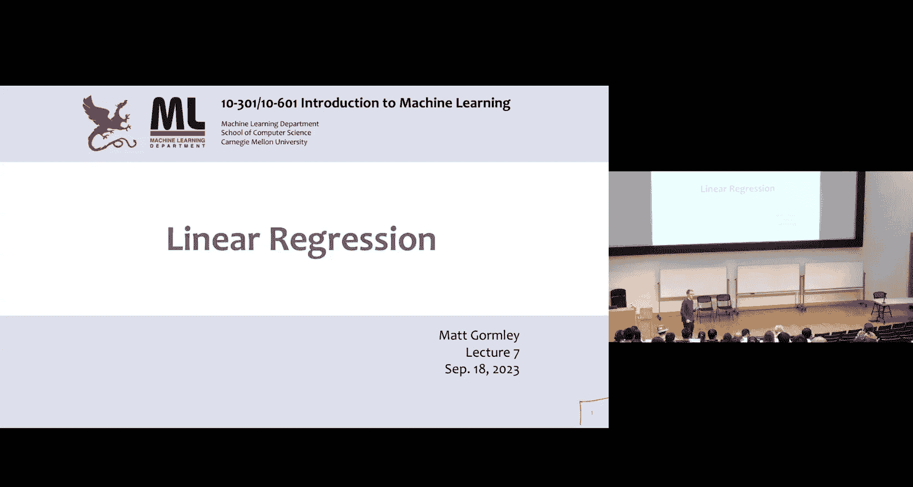
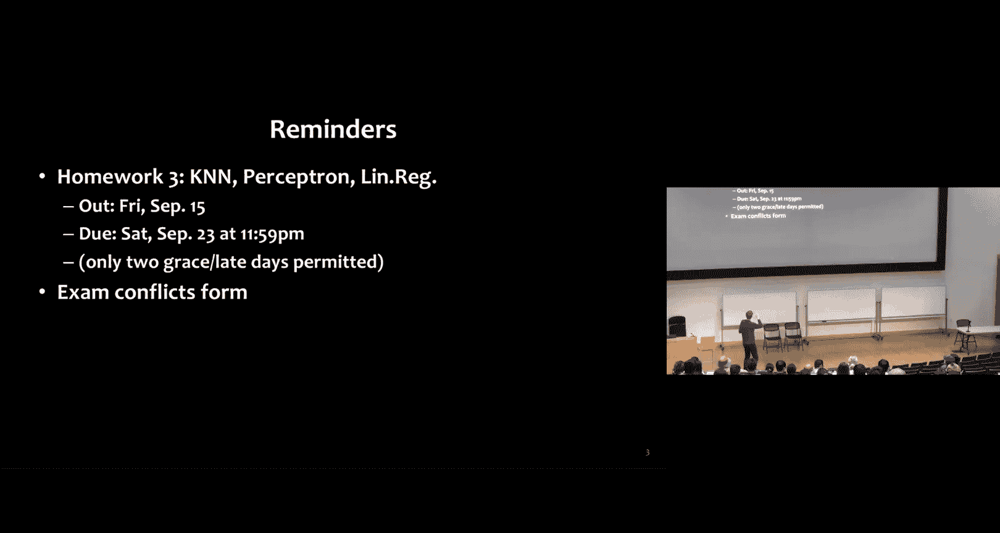
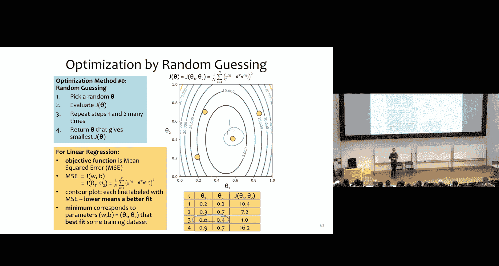
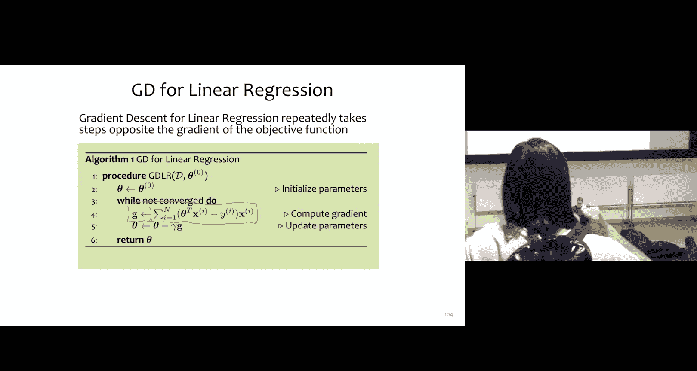

# CMU《机器学习导论｜Fall 2023 10-301⧸601 Introduction to Machine Learning》中英字幕（deepseek p07 Lecture_7_Linear_Regression.zh_en -BV1Z2cUefE4A_p7-

## 1. 回归问题概述

在本节课中，我们将探讨回归问题。回归是一种机器学习任务，其目标是预测连续值输出。与分类问题不同，分类问题通常涉及离散标签，而回归问题则涉及连续值。

## 2. 回归问题示例

以下是回归问题的几个示例：

* 预测股票价格
* 预测流行病
* 语音合成
* 图像生成

## 3. 线性回归

线性回归是一种简单的回归方法，它假设输出值与输入特征之间存在线性关系。线性回归模型可以表示为：

**y = W^T x + B**

其中：

* y 是输出值
* x 是输入特征向量
* W 是权重向量
* B 是偏置项

## 4. 线性回归的目标

线性回归的目标是找到最佳的权重和偏置项，以便最小化预测值与实际值之间的差异。这种差异通常通过均方误差（MSE）来衡量：

**MSE = (1/n) * Σ(y_i - y_hat_i)^2**

其中：

* n 是训练数据集中的样本数量
* y_i 是第 i 个样本的实际值
* y_hat_i 是第 i 个样本的预测值

## 5. 线性回归的优化

为了找到最佳的权重和偏置项，我们可以使用梯度下降算法。梯度下降算法通过迭代更新权重和偏置项，直到达到最小化目标函数。

**梯度下降算法步骤**：

1. 选择初始权重和偏置项
2. 计算目标函数的梯度
3. 更新权重和偏置项：θ = θ - α * ∇J(θ)
4. 重复步骤 2 和 3，直到满足停止条件

## 6. 线性回归的局限性

线性回归假设输出值与输入特征之间存在线性关系，这在许多情况下可能不成立。此外，线性回归容易受到噪声数据的影响。

## 7. 总结

在本节课中，我们介绍了回归问题、线性回归模型和梯度下降算法。线性回归是一种简单而有效的回归方法，但它在某些情况下可能不适用。