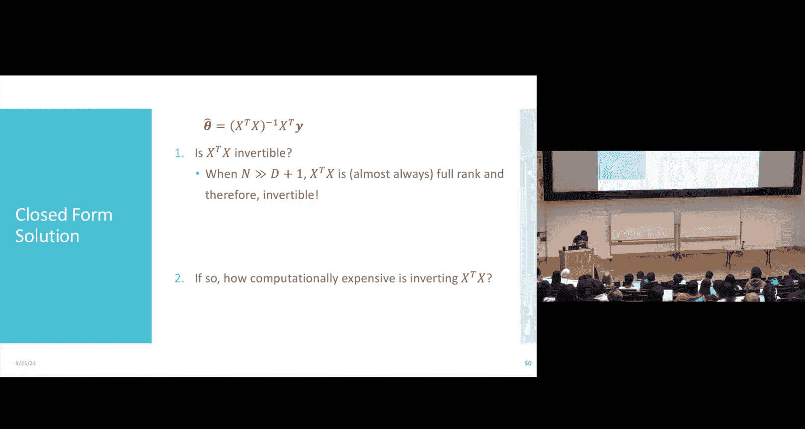
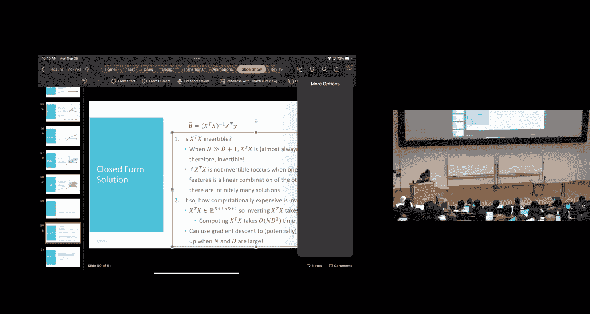
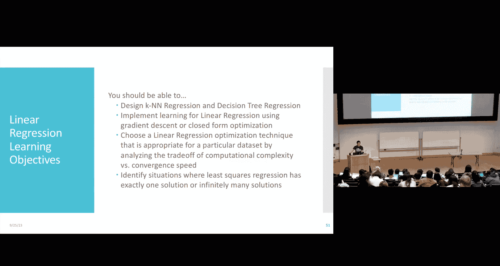

# CMU《机器学习导论｜Fall 2023 10-301⧸601 Introduction to Machine Learning》中英字幕（deepseek p08 Lecture_8_Optimization_for_Machine_Learning.zh_en -BV1Z2cUefE4A_p8-

He， everyone。Happy Monday we're going to go ahead and get started per today today we're going to pick up where we left off on Wednesday last week and continue to think about machine learning as an oh I guess we left off on Monday last week well it's been a week we're going to pick up where we left off a week ago and we're going to think about machine learning as optimization and we're going to think about lots of different ways of optimizing the linear regression objective that Matt introduced on Monday。

😊，Before that we have well lots to talk about， don't forget your homework three was actually due on Saturday。

 but if you forgot about that don't worry you still can use at most two Grace dayss on homework of three so you can still turn it in at 11。

59 pm today， so you know 12ish hours from now。All right。

 the big thing that I wanted to spend some time talking about here at the beginning is your first exam which is on Thursday。

 it'll be Thursday from 630 to 830 lots of logistics here so I believe yesterday sometime during the day yesterday we posted a seating chart for this first exam crucially you may all be in different rooms don't just like follow your friend to like where they're going to take the test that might not be the same room where you are going to be taking the test so this has been posted on Piazza you should make sure that you have an assigned seat if you plan on taking the exam with us if you receive a testing accommodations through the office of disability resources they will be proctoring your exam on our behalf you must schedule your exam with them they know when our exam is they'll tell you when to schedule it so that you know you are in line with the rest of your peers hopefully you all have done that already if you haven't seriously go do that right now。

All right， so a little bit more about the test， we released a set of practice problems I actually think those are relatively representative of the kinds of stuff you will see on our test。

 but you know lots of different kinds of questions here。

 the big things two big things for you to remember you do not need a calculator， phone laptop。

 whatever no electronic devices will be allowed no smartwatches or anything like that you are allowed to bring one sheet of paper you can put whatever you want on either side of it。

 do not ask me if this is okay， do not ask me if I can print out the entire the entirety of Wikipedia and shrink it down really small。

 you can do whatever you want we will not be checking we will not be collecting them as long as it's just one sheet of paper。

Okay。Sorry， is it？Am I like really loud in the back？

All rightll I think it's because I keep looking down I'll try and work on that so the first exam will cover the first seven lectures so that's everything up through last Monday's lecture on linear regression one thing to note we have listed here like foundations this is the prere material that was。

😊，Roughly assessed on your background exam these will not appear as standalone questions。

 but rather you know you should be prepared to the level at which we assessed you in your background exam to use those to solve questions related to more core machine learning things so there won't be any questions like what you saw in the background exam that are solely about the preRA material。

😡，All right， how can I prepare for the exam， Great question You can come to lecture we're gonna spend some time preparing right now right after this slide you can review the exam practice problems like I said I think those really are quite representative they're kind of tucked away they're linked on the same page your homeworks are linked under we also went over those some of your Tas went over those on Friday in recitations so if you weren't able to attend that definitely review that recording I think that'll be really helpful as well our homework questions our homeworks are a really great way to prepare personally I've always found that like you know when I was taking exams like preparing cheat sheets preparing notes。

 things like that that was always my favorite way to study so I think that's a good place to start。😊。

During the exam， you know we don't put all the easy questions at the front and all the hard questions at the back take off the low hanging fruit first and then this is another thing that comes up a lot in the exam。

 if you feel like we omitted something or there's not enough information。

I would like to think that doesn't happen too often， but if you think it does。

 you should feel free to write down any assumptions you're making in the margins or in the actual box in the exam and then work from those assumptions and if you your assumptions are not fundamentally flawed in some way。

 we might be able to give you partial credit for it。😊，Don't ever leave anything blank。

 this good practice in general。All right， like I said。

 let's spend a few minutes here warming up before we dive into today's lecture with us some practice problems。

All right， so we're going to start from the beginning。

 thinking all the way back to decision trees here， suppose you had this binary data set where the label you're trying to predict is whether or not the university will be closed on a given day。

And so。是。Without even really taking too much effort， just like scanning over this data set。

 I wonder if someone in words can describe to me what the effect of this weekend attribute is on the label。

😡，Yeah， in the back there。啊，对于比如说承担申请。It doesn't give you any information it doesn't give you any information。

 okay， what's another way of phrasing that in terms of mutual information？Yes。

 that's exactly right the mutual information here is zero because all of the feature values for that attribute are the same。

 it depends a little bit on how you do the bookkeeping around the log of zero。

 but regardless we're going to call that as zero mutual information feature so ignoring that feature let's think a little bit more about the other two features here so now I want you to do a little bit of math assuming we're not going to split on weekend which of the other two attributes snowstorm or holiday would you split on first using mutual information as your splitting criteria。

😊，诶。I don't know why this is an approximation， turns out log base two of one4 is exactly equal to negative two。

 but regardless you can use those values and let's go ahead and take two minutes here and then we'll reconvene and see what you'll have to say。

😊，All right， let's see here， I know it wasn't quite two minutes。

 but I see some of you are looking up as if you're done。

 does anyone care to share what they got and a brief explanation of how they got there？

Which feature will we split on first year？Yeah later informationstorm the mutual information you get from snowstorm is zero。

 How did you get that the and the end of the data even snowstorm is is also and the same So one by one' one one is split so one minus10 Yes。

 I really like this explanation so if we look at our initial label set we'll see that it's a 5050 split between。

😊，True and false， there are four false labels and four true labels here。

And then if we look at what happens when we split on snowstorm， just looking at the true labels here。

 we see that there is。One false， one true， one false and one true so again it remains a 50-50 split and you can double check the same thing as true for when snowstorm is false technically that's not a complete explanation you then need to go and actually show that holiday has non-zero mutual information but a relatively cursory scan shows that it does that when I split on true and false for holiday there are three falses and one true versus three trues and one false so there is some nonzero mutual information gained by splitting on holiday。

All right。Let's move on and then i'll take questions after this next exercise this one is also a little bit more involved but I think is a really great question it's sort of testing two concepts at once here what I want you to think about is given this data set of let's see five blue pluses and three red minuses。

😊，How would you compute the leave one out cross validation error for a one nearest neighbor model using the Euclidean distance here？

All right， so it's a little more involved， I'll give you guys three minutes and then we'll reconvene and see what you'll have to say about this。

All right， let's go ahead and reconvene， does anyone care to share。

 let's say before you share the answer you got does anyone care to share how they approach solving this problem？

so by default one out I think we assume at each date what every single data point is step out for each iteration and then so you find the nearest neighbor of that data point and check whether that is the same table as the one that was set yeah that's a really great high level explanation so for each data point。

You find its nearest neighbor that is not itself because crucially we are leaving it out of the training data。

If I were to compute the training error， the answer here would be zero， training error for 1 and n。

 always zero， but if we leave it out， then we find the nearest neighbor of all the other data points in the data set and check if the label matches and if you do that。

 what do you get？4our ace， I think that's also what I got do you care to just shout out the points that got misclassified？

And then it's I think that's right， I think that's the same set that I got as misclassified。

 the sort of only really tricky one here is you kind of need to work out the Euclidean distance between 77 and its nearest neighbor。

 but after you do that the rest of this sort of just falls out。Okay。

 a few more questions and then we'll move on to content for today here's a true or false question。

 so consider two data sets for binary classification。😊，You have one data set consisting of N1 points。

 the other consisting of N2 and we'll suppose that N1 is greater than N2 and similarly the dimensionality of your first data D1 is larger than the dimensionality of your second data D2 this is in fact your first poll question and so as you log into your poll poll。

mlCse。 org you'll see there are also a bunch of questions about homework2 I don't want you to answer those quite yet I want you to answer this should be poll I think it is labeled question1 so skip down a little bit and I don't want you to pick the toxic option true and false sorry this should be。

😊，A， B， and C， of course， so take a minute here， think about whether or not you agree or disagree with this statement and we'll reconvene and see what you'all have to say about this。

Alrighty， if you haven't had a chance yet go ahead and submit your answer for the poll question labeled question one this one is maybe a little closer than I would have thought。

 but you guys are coming in at 67% roughly two thirds for false and one third for true I believe the correct answer is false does anyone who put false care to share why。

Yeah statement bound it based on the largest distance origin the dimension it's like that's exactly right that like simply increasing the number of data points or changing the dimensionality doesn't in and of itself affect the perceptron mistake bound guarantee some of these things might be related to the quantities in the guarantee but they're not directly related to they're not sort of one for one equivalent to the margin and the radius of the data points so this are great observation all right we've got a few more questions on linear regression here and these are sort of three questions that all take the exact same style what I want you to imagine is you've trained a linear regression model using something like gradient unitcent and you've learned this line on this data set here。

😊，What I'm going to do is I'm going to add a bunch of data points to this data set。

 and I want you to just sort of imagine how that would affect the line that you would learn for this problem。

😡，So you're going to have three options for each of the following questions。

 a line that is slightly above the line that you learned， a line that is， well。

 it's meant to be right on top of the line and a line that is slightly below the line that you learned previously。

😊，So all three of those new lines are in green here。All right。

 so let's start with our first question here， let's suppose I add in three new data points。

 I apologize that a little hard to see， but there's two up there。😊，And one down below it。All right。

 so let's just do this by a show of hands， who here thinks the new line that I would learn would look something like this one。

Okay， maybe about half of you and who here thinks the line I would learn would be something like this one in the middle here。

😊，Okay， some number of you and then any takers for option C over here on the left on the right。

All right， no one believes it looks like this， I think both of these two options are maybe justifiable。

 I would maybe argue that the two on the top should skew it significantly off of the previously learned line。

 but I could see an argument for it staying relatively close。Here's an interesting one。

 it's a bit hard to tell where the new points are， the new points are right on top of the existing points。

😡，So I've just duplicated my data set， basically。😡，All right， let's do this again by a show of hands。

 who here thinks that I would learn this linear separator or sorry this linear aggressor。😊。

No tankers。How about this one here？Hey， there we go， Pret unanimous。

 And so I'm assuming no one is going to learn this one， All right。In words。

 can anyone describe to me why I would learn that line for this data set？😡。

Using some of the terminology we built up in Monday's lecture， perhaps。Yeah。

Okay I like this intuition that we're sort of scaling everything as opposed to actually meaningfully changing the solution。

 Anyone have another way of thinking about this？Yeah二。

Y the line that minimize also minimize on the sure， sure。

 I think you guys are both getting it the same idea here。

 which is that we've changed our objective function by sort of a scaling factor。

 And so what that means is that this line is still the argument of the。😊，Squared error。

 but the actual squared error of value at this line for this line will be twice as large。All right。

And we'll do one more here， so now I've duplicated the data set and I've also added in four new points。

😡，That fall exactly on the line that I learned。Given this， anyone like option A？Anyone like option B。

Alrighty， I think we're all on the same page， no takers for option C cool so similarly what we've done here is we've also increased well sorry I should say we've maintained the same doubling factor on our squared error。

 but then we add it in four new points that don't affect to our squared error at all。

 or rather move the line off of these four points， these four points lying on the line exactly。

 we would be guaranteed to be increasing our squared error。

 and so it only makes sense that these four points。😊，If we keep the line where it is。

 we will continue to minimize the squared error。😡，Okay。

 that was a lot I moved relatively quickly because I know many of you probably did attend our practice problem session and I didn't want to retread the same ground。

 but at this point I do want to open。😡，So this is your second poll question。

 this is poll question two， it is an open ended question and you know。😡。

Matt and I do this thing where we stand up here and we ask you what questions you have and frankly that somewhat benefits those of you who are maybe more comfortable speaking out and asking questions so we want to give those of you who don't necessarily want to raise your voices a chance to ask us stuff as well so' say go ahead and take three or four minutes here put in any questions you might have and also now you can take a minute and fill out the first few questions about homework too as well just so we can get a little feedback about what you thought about that homework。

All right， so yeah， go ahead and take three minutes here and then I'll flip through some of these questions as they come in on my phone here。

 yeah。Ex with the one change it all no it wouldn't change at all and so that green line is meant to be directly on top of that black line that's some rendering error sorry about that。

Oh okay， some really great questions here， I want to highlight one thing just because this is maybe not something many of you realize。

😊，Of the two responses， the first two responses for do you have any feedback for us on homework2 the open ended question。

 the first two responses are too much work followed by more questions so that just gives you a sense for you know the kinds of audiences we work with here let's see scrolling through questions about the exam。

😊，Let's see here。Which of these first topics tends to be the most tricky for students on exam one。

 that's a good question， what do you think？regression according to our linearar regression okay that's reasonable you have sort of the smallest amount of practice with it I would think that that's a reasonable question how is my weekend it was great Thank you there will no there will not be any proofs for exam one we will。

😊，A practice with gradient computation in today's lecture。😊。

Does having only one feature guarantee that the mutual information between that feature and the label is zero no crucially it does not you can go back to the first lecture where I introduced entropy and mutual information and you can see that with just one feature you can still get a mutual information of one even。

😊， let's see。How to split among training validation and test data sets。

 we talked about some heuristics for doing that， common percentages are like 70% training。

 20% validation， 10% test。😊，Is the training error only zero for a one nearest neighbor model and can it be greater than zero for k greater than1 yes absolutely so back here I mentioned that for a one nearest neighbor model a training data point is always itself as soon as you start adding in more neighbors you can actually misclassify data points in your training data。

The video for proving the margin， the Perceptron mistake Bo is posted on Piazza。

 you should be able to find it also in our Panopto folder as well。

Homework three solutions will be available to you before the exam。

 the possums are no way related to this class。Just a t shirtt that I like man lots of really great questions here let me try and get one more oh what are the answers you know what that's maybe a good point here so let me annotate these slides with the answers we would split on holiday here this would be four out of eight。

This one is whoops。False。For this first question， I would say。Ohoops。

I would say this option would be correct。Followed by two copies of this option。

Oh someone else asked about my weekend I watched a lot of football that's what I do on weekends anyway lots of really great questions i'm sorry I don't have time to get to them all we'll have lots more opportunities like this we'll try and incorporate more sort of like asynchronous question asking so you guys can get a chance to answer your questions without necessarily raising your hands here。

All right， so we're going to dive into new content for today as a reminder。

 this content is out of scope for exam two， but it will be in scope for exam or sorry。

 it's out of scope for exam one， will be in scope for exam two and it will show up on your upcoming homework as well。

So where do we leave off？On Monday Matt presented this nifty little algorithm for doing gradient descent for the linear regression problem and you know he put up this really amazing slide。

 I actually really got to commend Matt this slide is incredible。

 I think it does a really great job of so sort of showing you excuse me how the solution improves over time。

As you take more and more gradient descent steps， and it shows you that the line your' learning sort of gets。

Better and better and better until you learn， well。

 a pretty reasonable line for fitting these five points here。All right。

 but I think a key unanswered question from Monday's lecture last Monday's lecture is。😡。

Why would we do this， why should we think that gradient descent for linear regression is a reasonable approach to solving this problem right and to answer this question。

 I need to introduce some mathematical concepts to you all bear with me we're going to go on a bit of a tangent but I promise this will come back and be tied back to linear regression in just a minute。

 in order to answer this question of why we might want to use gradient descent for linear regression。

 I have to define this notion of convexity and so convexity shows up a lot in math here we're talking about convex functions and we'll say that some function F is convex。

 if it satisfies this inequality。😡，All right， so this inequality is a bit。

Oaque I think it's not really immediately obvious what's going on here。

 so let's take a look at a picture shall we here's some function F right。

 it looks like this What this inequality is saying is I pick any two points in its domain so I pick some x1 and x2 maybe they're here and then what I can do is I can imagine considering drawing a line between the functions value at these two points。

😡，Oh， sorry， first things first。On this side of the inequality。

 what I'm saying is I can pick some value of c between0 and1 and as I move C from say0 as it increases all the way up towards one。

 what I'm doing is I'm picking some point between x1 and x2 I'm just taking some linear combination of x1 and x2 and that basically is shifting where between these two points I'm considering。

The function has some value at every point between x1 and x2。

 that's what's on the left hand side of this inequality。

 so F of c times x1 plus 1 minus c times x2 and now what I could imagine doing is I could imagine drawing a line that connects。

😡，The functions value at x1 and the functions value at x2 and that's exactly what's going on on this right hand side of the inequality here。

 I'm looking at f of x1， I'm looking at f of x2， and again I have this slider variable C if you will。

 that as it varies between0 and1 I'm just sort of moving from the functions value at x1 up to the functions value at x2。

😡，All right， so here's the key result for this inequality。

 which is that at every point between x1 and x2。The function's actual value。

 f of c times x1 plus 1 minus c times x2 has to be less than or equal to。

The value of this line so there's always this sort of region if you will between the line and the actual functions value and that's what it means for a function to be convex in 1D you know gets a little harder to imagine what the intuition looks like in higher dimensions but you know if you are in 2D you could imagine having some sort of bowl that you slice through with a sheet of paper I don't really know what the analogy looks like in higher dimensions than that。

All right， so that's what this inequality means but。You know that。

This is one example of a convex function。 It's maybe like the canonical or prototypical example of a convex function。

 but there are lots of other maybe sort of more strange looking convex functions right， Here's one。

 for instance， this one。😊，Also kind of looks like a bowl and also satisfies this inequality here。

 but note that if I had picked， say a different x1 and x2， like if I had picked x1 here and x2 here。

 well then the line between f of x1 and f of x2 sort of lives directly on top of the function。

 which is like okay by this definition， it's fine because I have like less than or equal tos in these inequalities。

 but maybe we want to somehow differentiate between functions that look like this。

And functions that look like this right and so that's where we're going to introduce a new term。

 we're going to say a function is strictly convex if I can get rid of those sort of annoying equalities。

 if I don't have to worry about them， if I know that this is always going to be strictly less than the stuff on the left hand side。

 then we'll call these sorts of functions strictly convex。😡，Okay， like I said。

 I promise we're going to tie this back to linear regression and machine learning in just a second。

 but before I move on， are there any questions？Yeah， it' is certainly con as it continues。

If a function is strictly convex， is it continuous？I don't know if it matters。I don't think so。

 I don't think a function needs to be continuous in order for it to be strictly convex。

There I have a absolute value function。Stricly complex。Not continuous， yeah。

 so I don't think continuity is a requisite for convexity。Interesting question， yeah。

 should we to repeat complexity or just。Should we be able to recreate this mathematical definition of convexity。

 we may ask you if functions are convex that may involve sort of this mathematical relationship。

 but I think there are other ways of showing it as well that we'll touch on in just a second。😊，Thank。

All right， so。If we have convex functions， of course， there exists。Non convex functions。

 they look like this where you know， just from this example here。

 there are plenty of regions where the actual functions value lives above some line between。

 I guess x1。Index2 here and so。😊，To contrast these two things。

 I need to introduce a few more definitions here。Again。

 we're going to think about the sort of utility of convexity from an optimization perspective。

 and to do that we're going to consider some function F here and we'll say that，😊。

A value or a location X prime is a global minimum if。

The functions value at x prime is less than or equal to the functions value anywhere in its domain。

 so any possible value that you could pass into F， if f of x prime is less than or equal to all of the functions values everywhere else。

 then it's a global minimum and we'll say that a location x prime sorry x star here。😡。

Is a local minimum if you can define some radius or some distance around which it's the smallest possible function value。

 so if I were to draw a little ball around each of these functions locations。

 would there be some location that is the smallest inside a ball of radius epsilon here？😡。

I don't know why that isn't rendering。We'll say and here。

Gip between convexity and optimization again， I promise we're getting back to linear regression in just a second。

 we'll say that for a convex function， every local minimum is， in fact， a global minimum， right so。😊。

All of the points on this flat bit here， these are all local minima you can draw sort of little balls around each of them in which they will be the lowest function value or tied for the lowest function value。

 but they're also all global minimum， crucially each one of those is also the lowest function。

 the lowest value the function takes on anyway。This is a lot less nice for nonconvex functions。

 you can have lots of local minima like these slightly grayed out points here。

 but there is only sort of one unique global minimum in this example here and so for nonconvex functions you might find lots of these other local minimum but there's sort of one sort of best answer here。

 that dark black dot。I want to say this gets even better if you're thinking about strictly convex functions here for strictly convex functions because we can't have any of those long flatbits。

 there exists one unique global minimum。All right， so how does all of this relate to gradient descent and linear regression Well the thing to remember about gradient descent is that it's a local algorithm at each iteration。

 all it does is it looks at its current location and computes the gradient of the functions the gradient of the function where it currently is it doesn't sort of look ahead it doesn't try and plan and think about oh if I take this step that'll actually move me sort of in the right or the wrong direction。

 it doesn't think about any of that so all it does is it sort of rolls down the hill right and this is great if your objective function is convex that means regardless of where I start the ball on surfaces that look like this。

 I'll eventually roll down to some local minimum which is guaranteed to be a global minimum it might not be the exact same point depending on where I start this gradient descent routine from but eventually I'll find a good solution。

This is not the case crucially in nonconvex objective functions right depending on where I start the gradient descent routine I might get oh that one was so close but nope rolled the wrong way I might get really bad solutions I might get okay solutions like this one is pretty close to the true global minimum located there and this is actually sort of related to one of the points that Matt brought up which is that。

😊，Frequently in machine learning， we don't necessarily care about finding the best possible solution。

 we care about finding a good solution， and so looking ahead， spoilers。

Tns out we still use gradient descent to optimize nonconvex functions all the time in machine learning。

 we have lots of tricks that we use to improve gradient descent that we'll talk about。

 but at a high level the idea is that we're still using gradient descent for these nonconvex optimization tasks。

😊，The good news for today， though。Is that we don't need to worry about that for linear regression because the mean squared error here。

 the objective function for linear regression is convex but not always strictly convex and we'll think a little bit more about that in just a second。

 but the key intuition here is that most of the time for linear regression tasks our objective function looks like these ISobar here it looks like this。

😡，This picture in the top right where you can imagine it as some sort of bowl or some sort of dish going into the screen here with the lowest function value being in the center。

And so gradient descent works really well for problems that look like this。

 it works really well for linear regression， were guaranteed to converge to the a global minimum in problems like this。

All right， that was kind of a lot again， I'm going to stop here。

Yeah error oh this is a really great question so I'm not computing sort of any sort of test error here right this is entirely computed on a training data set so the mean squared error for your training data set of these various lines is always going to be convex I have no idea how well or what the relationship between say like this mean squared error in my training data and the mean squared error for some heldout test data will look like I'm not optimizing with respect to the test data。

😊，Yeah。😊，Previous slides， when you say it converts， does it mean the object function is con。

If it converges， does this mean the objective function is convex no。

 I can still depending on my definition of convergence。

 converge for non convex functions right like if I run gradient descent on something that looks like this。

 let's say I choose my step size well and I know set some termination criteria that looks like my gradient being close to zero then eventually I'll converge to that local minimum so it's not guaranteed that if gradient descent converges we have a convex function。

😡，All right， this is a really great picture and all I said that already。

Couldn't we do something simpler， I think many of you are maybe thinking this。

 like this whole gradient descent thing seems great and all。

 but like I bet there's an easier solution。 And it turns out the answer is yes。😊，Although。Two things。

 one depends on what you mean by easier and not always， so we'll get to that in just a second。

 but in order for me to introduce this new alternative way of solving this problem。

 I have to establish a little bit of notation at a high level what we're going to do instead of this whole gradient descent thing is I think。

😡，Maybe what many of you thought when we said we were going to optimize functions right like many of us in whatever early calculus course we took。

 the first way that we learned to optimize a function is by taking derivatives。

 setting them equal to zero solving and then if we were sort of being very particular maybe checking second order partial derivatives seeing if they were in fact minimums so this in a nutshell is exactly what we're going to do this is what's known as critical identifying the critical points of this function our mean squared error here or you might hear this called closed form optimization and it turns out you can do this for linear regression as well。

😊，Like I said， we're going to have to establish a little bit of notation here。

 given our training data set consisting of these N real valued features and our one real value label。

😡，What I'm going to do is I'm going to stack all of my feature vectors x together into some big old matrix here there's a few notational things to note first I'm preending that one that we talked about to all of my data points here this is just that notational thing that allows me to treat the intercept term like any of the other weights。

😡，And the big thing is that here。I'm taking the transpose of each of these feature vectors so that each data point is a row in this design matrix and I'm stacking them all together and that gives me some end by。

😊，D plus one matrix here， sorry， the parentheses go like this。All right。

 and I'm going to do the same thing for my targets as well， my Y's note that I have a transpose here。

 so the y vector is a column vector as well that just folds all of the values that I'm trying to predict y1 through Yn。

😡，All right， why did I do this well it turns out the solution。

 the closed form solution for the linear regression problem is a lot easier to arrive at if you use this sort of matrix vector notation。

😡，And what exactly is that solution， well let's find out。

So here's my mean squared error objective function from last Monday note that I have。

Sort of this one over and out front and then I think Matt might have mentioned this here。

 I'm just sort of sticking a one half in front of the actual squared error for each term。

 this is going to make the gradient and this closed form solution come out a lot nicer。😊，All right。

 so the first thing that I'm going to do is I'm actually going to rewrite this objective function using。

😡，And that new notation that we just established。So what is that going to look like？Well， we'll say。

This is， actually， I'm going to move some stuff out front first because that's going to make my life a little easier。

We'll say this is。To end。I close one to end。OhAnd then I'm going to just flip the order in which I'm writing this squared error we'll say this is X I transpose。

Data， minus。Y I quantity squared。All right， so what does this gap mean well。

 if you look at the form here， what we're saying is。😡。

We're taking Xi transpose against our weight vector theta。

 and we're doing this for each of my data points。😡，In my design matrix。

 I've written the rows to be X1 transpose， x2 transpose， so on and so forth。

 And so really what I'm doing here or one way to sort of write down this computation Xi transpose the for all of my data points at once。

😊，Is just by writing。X theta， so remember， if I go back a slide here。X is this matrix here。

 all of my features， all of my data points are the rows。

 and so when I do x theta I'm just multiplying one row corresponding to one data point against my weight vector theta so what this is computing for me is given some weight vector theta this is computing my current predictions for each of my data points it's just computing the value that this weight vector would predict for each data point Xi。

😡，And if I subtract。My so now this is a vector here。

 if I now subtract my target vector from this quantity x theta。

 note that x theta is a vector here and if I subtract y from it。

 this is giving me exactly my sort of residuals or like the signed residuals， if you will。😡。

But what I need is some way to get from this quantity here to the squared error well the first step is going to be multiplying this each term inside this vector。

😡，Against itself that will give me the squared error and then adding them all up。

 it turns out in vector notation， I have a really convenient shorthand for doing that。😡。

I can just take the dot product。Of。This quantity by itself。So again。

I'm kind of going a little quickly over this。Let me just sort of write out what's going on here。

You can imagine that this looks something like x1 transpose theta minus y1。X2 transpose。

Data minus y 2， so on and so forth， all the way down to。XN transpose theta minus YN。

And so this is what。This vector here。Corresponds to and if I take the transpose of that and multiply it back by itself。

 I get the squared error， I'm multiplying each term inside the vector by itself and then adding them all up。

😡，So if I just stack a。1 over 2N out front here。This is how I would write my mean squared error here using。

😡，The notation that we've established。The design vector， sorry。

 the design matrix and the target vector allow me to write this sort of much more succinctly and crucially now。

😊，When I go and take gradients。I can express my gradients in terms of these quantities here。

 and I think Matt already walked through this， so I'm not going to spend a whole ton of time doing this。

 but if you do take the gradient of this function， it looks something like one over2 n。Times。

2 x transpose x theta minus2。X transpose y。So again， this is exactly the same as the。

Like gradient that Matt derived yesterday just using some of the matrix notation from today's lecture。

All right。So the next thing is we're just going to take this gradient and find the critical points of our objective function that means we're going to set this thing equal to zero and solve so the way that I like you to denote that is I can say the condition。

😡，That one over2 n times 2 x transpose x theta hat minus2 x transpose y has to be equal to 0。

 I put this little hat over the variable theta to indicate that at optimality at the optimal value for theta。

 this relationship needs to be true that the gradient of the function needs to be0 at one of these critical points。

And so now， let's see here。These twos cancel and I can multiply both sides by n that gives me。

X transpose x beta hat minus x transpose y。And if I add。X transpose y to both sides。

And then multiply by x transpose x inverse I get。A relatively famous result。

That the optimal value for。Beta hat here is x transpose x inverse x transpose y and so this as I mentioned is a relatively famous result you might see this in other places called like the ordinary least square solution for us this is just going be the closed form solution to this mean squared error I'm going stop here give you guys a chance to catch up with my chicken scratches and then take any questions that you might have。

😊，Yeah。😊，beta hat is the optimal value of theta， it's the optimal weight vector or the set of weights that minimizes。

J our mean squared error here， it's the sort of answer that we're looking for。Yeah。😊。

The data hot is a solar vector and is the why the human writing is appropriate。Yeah。

 that's exactly right sorry it's a little harder to like write bolds， if you will。

 I I'll add in some arrows here to indicate vectors。😊，Yep。Any of first still。So。Here to here。啊。

One friend， that's what over to。Oh， from here to here。

So I just pulled the one half out front that's a constant that's being multiplied to every term it's not affected by the index so I can pull it out front and then the other thing I did is I just sort of swapped the I guess I did two things I swapped the order that I was subtracting those two terms because I'm taking the square on the outside I can do that like the order in which I take that difference doesn't matter if I square the result and then I swapped the order that I'm taking this dot product this is just a common matrix identity that a transpose B is equal to B transpose A。

So I did apply a lot of steps there， sorry about that。Yep。Oh my gosh。

 that's a great question we'll get to that in just a second。😊。

Is the matrix x transpose x always invertible？All right， so first。

 before I answer that really excellent question， I want to reflect a little bit on what this gets us。

Skipping all the math here， this line tells us what the best weight vector to use is。😡。

We don't need to worry about sort of this whole complicated gradient descent routine of like I don't know getting stuck at the top of a mountain and trying to make your way down in the middle of the night like instead we can just know what the right answer is。

 and I think like when we saw this figure many of us probably knew what the right answer is it's probably like right smack dab in the center of that loss function right at the bottom of this bolt。

 And it turns out we have an expression for that best answer for that optimal weight backward it's just the thing that we just computed So instead of taking these sort of tedious gradient descent steps instead of having to worry about setting our step size or running many。

 many iterations of some algorithm here， I can just tell you what the right answer is I can just sort of throw a very precise dart at this projector and tell you that the correct answer is。

I guess 0。590。43 for this particular problem。But as was raised， that doesn't come for free。

 there's some cost associated with this methodology and I want you to think about it。

This is actually just good life advice in general anytime you see a matrix inverse。

 so note that's what's going on here x transpose x is a matrix and I'm suggesting to you all that we take its inverse anytime you see this in some textbook or whatever in your daily life。

😡，I don't know how many matrix inverses you're running into in your daily life， but sure。

 you run into some matrix inverse， you should ask yourself two questions。Is this matrix invertible。

 great question， and if so， if it is invertible， how computationally expensive is inverting it？😊。

And so I'm going to answer both of these questions， we'll start with the first one here。

 but to answer this question I'm kind of going to go about it in like a demonstrative way as opposed to an actual solution here。

😊，So。I want to think about the kinds of optimal weight vectors。

 the kinds of answers that linear regression might return to us here。So。Here's a data set。

 it consists of two 1D data points， these two red dots here， and one real valued target。

And my question to you all is， how many weight vectors or another way to think about it is how many lines can I draw on this figure that will minimize the mean squared error for this data set？

😊，I think I see the right answer here， does anyone care to show what it is？OneOne。

 that's exactly right， it's the line that passes sort of exactly through these data points， right？

Two points in a space always define a line， turns out I can draw that line here and it will achieve zero mean squared error。

 great。Come on here。How many lines can I draw here？That will minimize the means whatever error。

Infinitely many lines， right， any number of lines or rather any line。That passes directly through。

This data point， well， maybe not any line。Think about that in just a second。

 but there are infinitely many lines that I can draw here that will pass through that data point and give me a mean squared error of zero。

😊，What this one。Don't shout it out。This is your third poll question。The answer is not negative one。

Don't pick a， but I want you to think about how many lines could you draw on this figure？

That minimize the mean squared error。Zero， one， two or infinity so go ahead take oh I don't know。

 let's say take two minutes here， talk this over with your neighbor see if you can come to some sort of consensus and then we'll reconvene and see what you'll have to say about this。

Sorry I hate to derail this conversation a little bit。

 but like i'm just looking at more of these open ended questions。

 one of them is have you seen the offerings of this course from the mid200s I can say I haven't。

 but have you。When did you take it？啊，是这个。The website， a dirty question。We've been 20 like 2005， 2006。

 like the oldest websites that you link on your on your web page。There's links to them。

Can't imagine the kind of stuff they were teaching in those classes that's what I'm saying yeah anyway also。

Sorry another question， is the exam typically a time crunch， we hope not， that's not how we write it。

 I would say inevitably some people end up staying like the full time。

 I would say most people end up staying the full time。

 but it's hard for me to assess how hard exactly the time is affecting them。So， I would say。

Work at a good pace， but don't feel like you have to rush anyway。

 sorry those questions just came up right before I got to the actual answer here。

 which is this is pretty contentious I like this I think this is a good poll question for this reason 15% of you have put zero I think that's an interesting answer 50% of you。

Have put one。These numbers are changing as I say them， of course， 10% of you。

Have put two and let's call it 25%。25% of you have put。Growing number，25% of you have put infinity。

 Does anyone care， Let's start with the two most popular options。

 Does anyone who answered one care to share why they think the answer is one。😊。

Yeah and the back vertical a vertical line that goes between the two points。

 right so something like this。I don't know， let's say this location is。I don't know。

Let's say it's  two right so the equation for this line would be something like x equals 2。😡。

Is this a valid linear regression model？This is some assertion about the like kinds of features that I'm seeing right that I'm seeing two data points with the value x equal2 can I take this and make a prediction about some new data point some new data point that x equals4 comes along and I look at that data point and I say no x equals2 and I move on that's not really the point right no so in fact it turns out this is the one line that you can't well sorry this is a line that you can't return as a valid linear aggressor and notably this is sort of what I was alluding to on the previous slide this line。

Let me draw it in a different color here， this line here。

That looks like it might minimize the mean square error， not a valid linear aggressor。So instead。

 let's go back here。Let's hear from the other camp。

 does anyone care who answered E care to share why they think it's infinitely many lines？😡。

Let go here because a function can only pass through one points given that position then we only have one choice when trying to both these points so what means we the midpoint because square returns and so anything that passes in the midpoints that's exactly right So the high level intuition I liked how you said it was that I can only make one prediction for the function value at this given location X and so the best guess that I can make at that location if I'm trying to minimize the mean squared error crucially if I'm trying to minimize the mean squared error the best location I could guess would be this and I'm sort of back in this previous case where there's basically only one dot that I need to fit and so again。

 I have infinitely many lines here that I can draw that pass through this midpoint。

All of which minimize the mean squared error。All right， I have one more example about this。

 this is kind of a fun one that just shows that like in multiple dimensions。

 if all of my points lay on a line， I can get a similar behavior。

 which is that like there are infinitely many planes that will perfectly predict all of the points on this line I can just sort of rotate these planes about all of the points on this line and that corresponds to a 2D linear regressor if you will and so this problem exists in multiple dimensions I just wanted to highlight it but how is this connected to the question of invertibility well all of this comes back to this idea that the mean squared error。

😊，Let me go back many slides that the mean squared error is。Convex， but not strictly convex， right。

 so there are lots of solutions。Potentially， rather。Your objective function could look like this。

 where there are lots of solutions with the exact same function value。

 there might be sort of lots of these。😡，Or there might be this long straight section where every setting of the weights along that line achieves the same global minimum for the function and again。

 we can see this play out for linear regression。In the possibility of there being infinitely many solutions。

So。To answer the original question posed。Here's the real answer or in some sense the real answer。

 I would argue that in practice the answer is almost always yes。

 as long as you have sort of a sufficiently large data set crucially you definitely need more data points then you have features。

 features plus1 but if you have lots and lots of data points。

 if n is much much greater than d plus1 then it turns out this matrix x transpo x is almost always full rank and will therefore be invertible the case where you get infinitely many solutions whoops。

😊，2。It's weird， just swear I had something else there。Hang on。

Pay no attention to the man behind the curtain。

Oh yeah， there it is。All right。

啊。It turns out that x is not invertible when one of the features is a linear combination of the other。

 so as long as you're not sort of like gathering bad features。

 as long as you're not intentionally sort of putting features that are linearly dependent on one another like two data points that live on top of each other then you'll have sort of an inverttable x transpose x if you do have sort of a non-invertible x transpose x what you end up with are infinitely many solutions we get this question sometimes if x transpose x is't invertible。

 does that mean there are zero solutions the answer to which is no in an optimization problem。

 you can never have sort of zero solutions in an unconstrained optimization problem you can never have sort of zero solutions and so the alternative in this case is infinitely many solutions。

All right， let me go back a little bit before I reveal the answer to that next question。😊。

Are there any questions about the invertability of x transpose x before I move on？Yeah， right here。

I'm sorry， can you say one more time？2。People。And you the some media organization know。

So your features are allowed to be correlated， they're allowed to have some sort of like statistical dependence on one another in fact they can even be like non nonlinear functions of one another right like if you have x and you have x squared in your data somehow like if those are your features that's totally fine x transranpose x will still be invertible but you can't have you know let's say three features x1 x2 and x1 plus x2 that's a linear dependence that will make x transpose x not invertible。

I actually， before I answer this next question， I realized I did want to go back because now is a good point for me to talk about another factor related to this invertability。

 another way you can think about whether or not this objective function here is convex and I mentioned like。

When we first。Learned about critical point optimization and optimizing functions in closed form I mentioned that a very common thing we do in sort of our early calculus classes is take second order derivatives and check their sign check whether they're positive or negative at the critical points we found right well there's a multi-dimensional variant of this。

 which is we can take what's known as the Hessian matrix。😊，Of our objective function。

And so this is a matrix that holds all the second order partial derivatives， if you will。

 it's the way to think about it if you want is kind of like taking the gradient of the gradient。

 although that's not exactly what's going on， but it's not a terrible way of conceptualizing it and if you do that what you'll see is that this function here so this is the gradient if I take the gradient of this again I end up with something that looks like1 over 2 n times 2 x transpose x and again here I see this matrix x transpose x。

😊，So this is maybe a little bit of an aside， it's outside the scope of this class certainly what we'll say is that this matrix X transpo X is positive semi definite。

 it's like the higher order version of saying it's greater than or equal to zero。

Positive semi definite as opposed to positive definite and what that means is that this function is convex。

 but not strictly convex。 I would need this matrix X transpose x to be positive definite in order for it to be guaranteed to be convex。

 but the fact that sometimes I can get， you know a linear dependence between these future values means that。

It's only positive semi definite so I think this was in answer to your other question。

 this is another way of showing whether or not a function is convex or strictly convex or anywhere else。

😊，Okay。Aside over， let's get back to the other question， which I've now sort of ruined the answer to。

I was going to ask you all how computationally expensive inverting x transpose x' is does anyone care to explain？

😊，Why I got this， so my claim here is that x transpose x is a big O of d cubed。

 Does anyone know what the canonical matrix inversion algorithm is for this？

And that's kind of a boring question let me ask a more fun question Does anyone know what the actual answer for inverting an x transpose x matrix is。

😊，In big O time。2。4 no one knows oh I like that answer that's a good way of phrasing it The current best I think is like 2。

373 or something like that pretty close， pretty close yeah。

 so for those of you matrix andversion nerds out there there are algorithms that can do better than big O D cubed don't use those。

😊，They have like galactic constants in front of them that like make the actual runtime much。

 much larger regardless。My point here。Is that inverting this matrix can in and of itself。

 even if you can invert x transpose x。😡，Actually doing it can be very computationally expensive。

 it can take big O of d cubed where d is the number of features you have big O of d cubed time beyond that even just computing this thing here x transpose x takes N D squared time that in of itself can be very computationally expensive so。

😊，If。Depending on the relationship between N& D， you might be able to potentially speed things up by using gradient descent when N andD are both。

😡，Sort of very large so all this to say there's a time and a place for both of these solutions don't just throw out gradient descent just because we learned the closed form solution it has its benefits。

 but like I said we're going to be revisiting gradient descent a heck of a lot this semester so definitely don't forget about it especially because it's going to be on your exam。

😡，All right， that's all I had for you guys today， we will see you all back here on Wednesday and the meantime don't forget about your exam。

 start continue studying for it hopefully and yeah Matt will be back with you all in a couple days。

