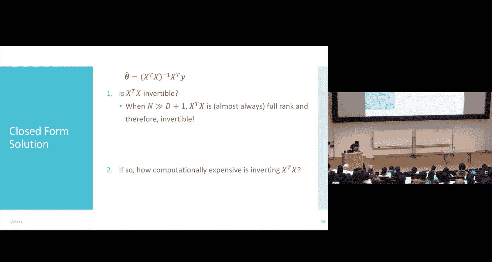
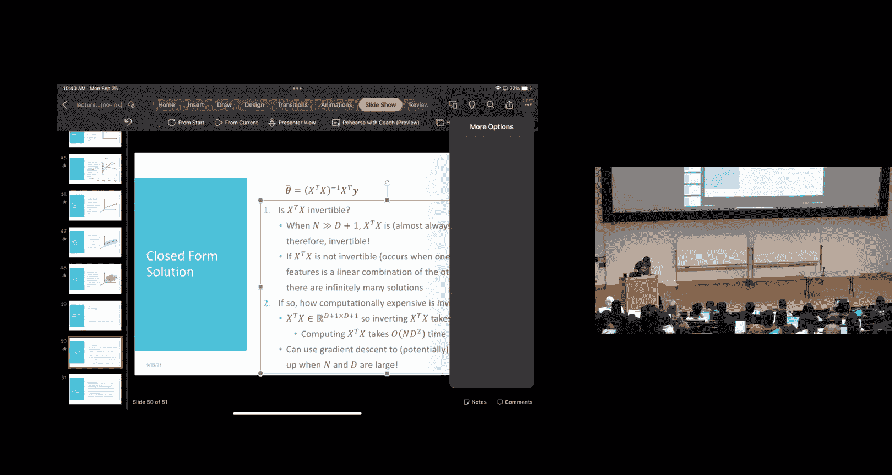
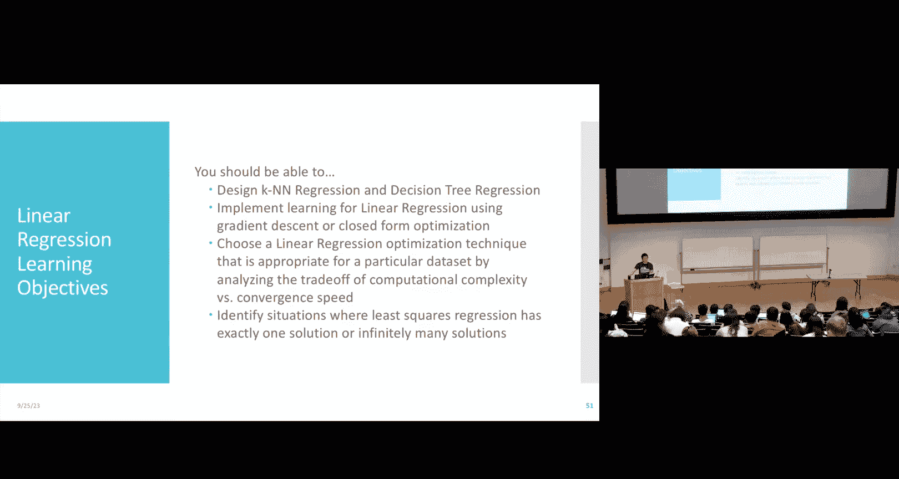

# CMU《机器学习导论｜Fall 2023 10-301⧸601 Introduction to Machine Learning》中英字幕（deepseek p08 Lecture_8_Optimization_for_Machine_Learning.zh_en -BV1Z2cUefE4A_p8-

## 📚 CMU《机器学习导论｜Fall 2023 10-301⧸601 Introduction to Machine Learning》中英字幕（deepseek p08 Lecture_8_Optimization_for_Machine_Learning.zh_en -BV1Z2cUefE4A_p8-

### 📝 概述

在本节课中，我们将继续探讨机器学习作为优化的问题，并深入探讨线性回归目标函数的优化方法。

### 📝 作业三

*   作业三已于周六截止。
*   如果忘记提交，可以使用最多两个宽限日。
*   可以在今天晚上11:59之前提交。

### 📝 第一次考试

*   考试将于周四进行，时间为6:30至8:30。
*   请注意，考试座位图已发布在Piazza上，请确保您有指定的座位。
*   如果您通过残疾资源办公室获得考试安排，他们将代表我们监考您的考试，您必须与他们安排考试时间。
*   考试将涵盖前七次讲座的内容。
*   考试不需要计算器、手机或笔记本电脑等电子设备。
*   您可以携带一张纸，可以在纸的任何一边写下任何内容。

### 📝 准备考试

*   参加讲座，我们将花时间准备考试。
*   复习考试练习题。
*   完成作业，特别是作业中的问题。
*   准备笔记或复习资料。

### 📝 考试技巧

*   不要将所有简单问题都放在前面，所有困难问题都放在后面。
*   先解决容易的问题。
*   如果感觉遗漏了某些内容或信息不足，请将您做出的任何假设写在试卷的边角或实际框中，并从这些假设开始工作。

### 📝 练习题

1.  **决策树**：假设您有一个二元数据集，其中要预测的标签是大学是否会在某一天关闭。请描述周末属性对标签的影响。
2.  **最近邻**：给定一个包含5个蓝色加号和3个红色减号的数据集，如何使用欧几里得距离计算最近邻模型的留一法交叉验证误差？
3.  **线性回归**：考虑两个数据集，一个包含N1个点，另一个包含N2个点。假设N1 > N2，并且第一个数据集的维度D1大于第二个数据集的维度D2。请判断以下陈述是否正确：增加数据点的数量或改变维度本身会影响感知器错误界限保证。

### 📝 线性回归优化

*   **梯度下降**：上周，Matt介绍了用于线性回归问题的梯度下降算法。为什么我们应该认为梯度下降是解决此问题的合理方法？
*   **凸性**：为了回答这个问题，我需要向您介绍一些数学概念。我们将进行一些偏离，但请放心，这将在几分钟后与线性回归联系起来。
*   **凸函数**：一个函数F是凸的，如果它满足以下不等式：F(c * x1 + (1 - c) * x2) ≤ c * F(x1) + (1 - c) * F(x2)。
*   **严格凸函数**：如果可以去掉这些讨厌的等式，则函数是严格凸的。
*   **局部最小值和全局最小值**：对于凸函数，每个局部最小值实际上都是全局最小值。
*   **梯度下降**：梯度下降是一种局部算法，它在每次迭代中只查看其当前位置并计算函数的梯度。
*   **线性回归**：线性回归的目标函数是凸的，但不是严格凸的。

### 📝 关闭形式优化

*   **设计矩阵**：给定训练数据集，将所有特征向量堆叠到一个大矩阵中。
*   **目标向量**：将目标值堆叠到一个列向量中。
*   **目标函数**：使用设计矩阵和目标向量重写目标函数。
*   **梯度**：计算目标函数的梯度。
*   **临界点**：找到目标函数的临界点。
*   **最优解**：找到最优解，即最小化目标函数的权重向量。

### 📝 矩阵可逆性

*   **矩阵可逆性**：如果矩阵X'X是可逆的，则线性回归问题有唯一解。
*   **矩阵不可逆性**：如果矩阵X'X不可逆，则线性回归问题有无限多解。
*   **矩阵X'X