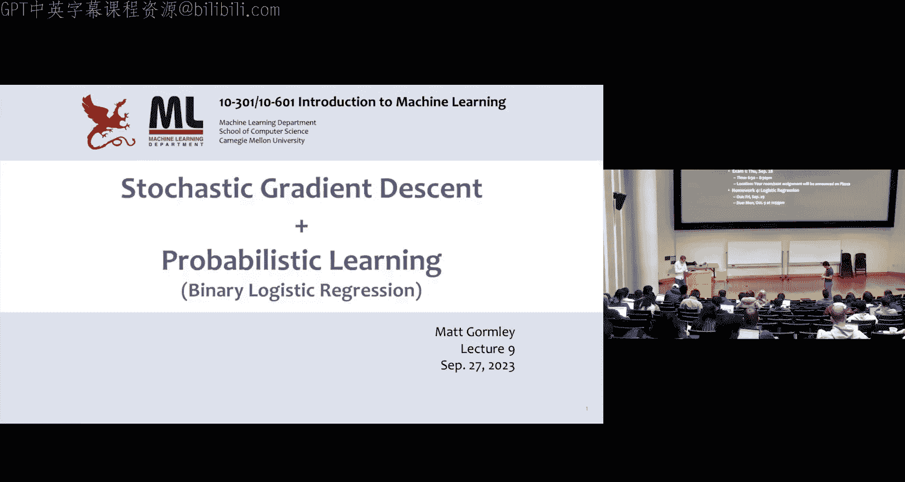
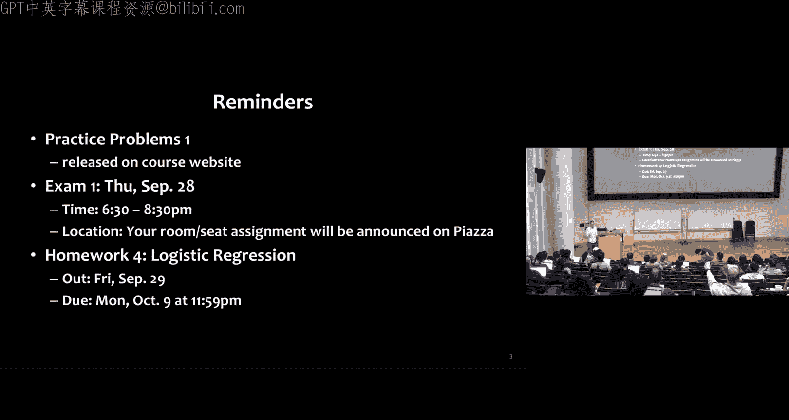
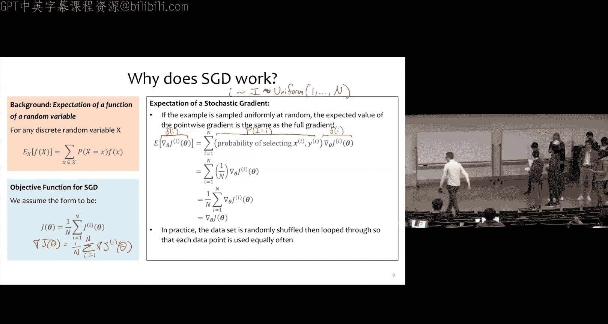
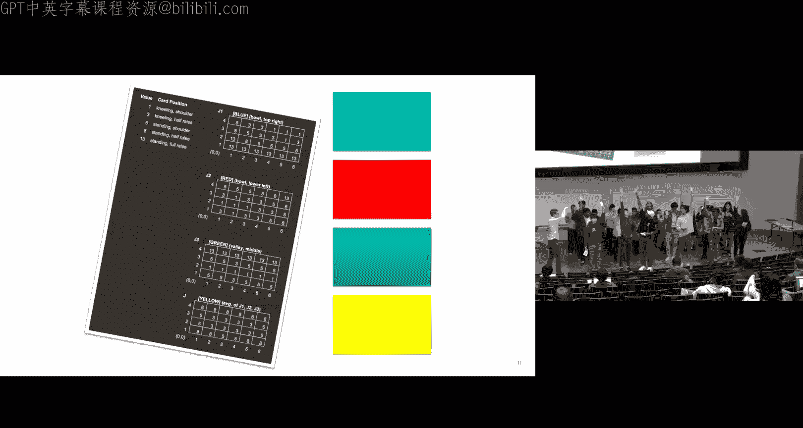
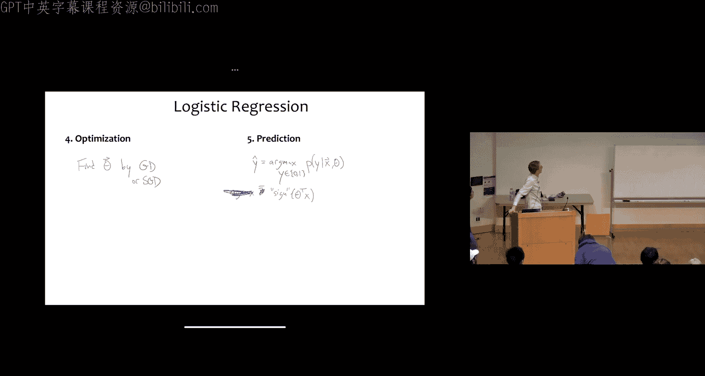

# CMU《机器学习导论｜Fall 2023 10-301⧸601 Introduction to Machine Learning》中英字幕（deepseek p09 Lecture_9_Stochastic_Gradient_Descent_Logistic_Regression.zh_en -BV1Z2cUefE4A_p9-

Okay， good morning， everyone。Today we'll be talking about stochastic gradient descent。

 so we'll be introducing this new optimization algorithm。And then from there。

 we'll switch to thinking about a new model called logistic regression。Okay。So。

Couple reminders， practice problems are out， the exam is on Thursday。

 be sure to check Piazza for the location of your room and seat。

Which may be different than the person sitting next to you right now。

And homework 4 will come out on Friday and September 29th and be due on Monday， October 9th。

And in homework 4， you'll actually get to implement stochastic gradient descent for logistic regression。

 as well as do some other cool stuff。

So so far we've seen a number of different optimization techniques， right， random guessing。

 I think that was method number zero， gradient descent。

 closed form optimization and so now we're on to stochastic gradient descent and you can think of it sort of through the lens of gradient descent。

 so gradient descent says we initialize theta to some initial value called that theta zero。😊。

And then while you've not converged， you take a step opposite the full gradient of your objective function。

啊。And then we have this step size gamma that dictates how big or small that step size is。

So here's stochastic gradient descent。It's not that much different。The key difference though。

 is that in lines4 and5， whereas before we just had line4。

 a single parameter update Now we have lines4 and5 in line4， we're randomly picking。

An integer I from1 to n。Where n is the number of training examples that we have。

And then we take a step opposite the gradient， not of the full objective function。😡。

But rather of the objective function for one of our training examples。

And so here we're going to assume that whenever we run stochastic gradient descent。

 our objective function can be decomposed into a sum of n little objective functions。

 J superscript 1， J superscript 2， all the way up to J superscript N。

And I think throughout the rest of the lecture， for the most part。

 we will also assume that there's a one over n term out in front。

So that you could think of this as like the average of those JI functions。Okay。

 so this is the algorithm。The thing about it is what we're saying in this version of the algorithm。

Is that？You always randomly select from a uniform distribution， what the next example is。In practice。

 something sort of silly could go wrong here， which is that you might accidentally。

 or at least with a low probability， end up that your first training example that you select randomly is example number seven。

So you take a small step in the direction that example number seven wants to send you and then you take another random example。

 so it might be example number three， so you take a small step in a different direction that example number three wanted you to go。

And then you select another example， oh back to example7， okay。

 well take another step in the direction7 wanted， and then you randomly sample4 and then5 and then 10 and then seven again。

Oh man， and then the next five examples that you select。

 what if they were all seven right now it feels like boy。

 example number seven is getting a lot of attention and we haven't seen example number one at all Okay so in practice what we do is actually this version of the algorithm。

😊，So while we've not converged， we say we're going to randomly shuffle the integers1 to n。

 so we take a random permutation of them。 that's what shuffle means。

And then we iterate through that random permutation。 In this way。

 we're effectively doing sampling without replacement。

So this is like you know if you have a big bag of n numbers。

 when you reach in and you pull out example number seven， you say， okay。

7 and you take the small step in the direction of seven now you discard it and now when you reach in and pull out the next example。

 it can't be seven because you've discarded it it's three okay you discarded that one and then you reach in again and you get four and we don't have to worry about coming back to seven until the bag is completely empty because then we'll pick up all the numbers again。

 dump them back in the bag， shuffle it up and do it again。Until we converge。So。

What's interesting about this algorithm is that stochastic gradient descent。Has this problem。

 which is that if you have， say1 million training examples。😡，Then what it's going to do。

 say the minimum is over there， is it's going to start over here and it's going to think and think and think really hard until it computes the gradient for every single training example and adds all those gradients up。

😡，That will give us the gradient of J of theta， and then it will take a very confident step。😡。

In the direction that it came up with。Then it will stand here and it will recompute the gradient for all million training examples until 10 minutes later。

 it's ready to take another big step。Right stochastic gradient descent is doing something very different。

 it's saying okay， let's just randomly take an example， quick gradient calculation， let's step here。

 now let's step here， oh another example let's go here and then here。

 and it's taking all of these tiny little steps and you know sometimes it might move closer to the objective minimum and sometimes it might move farther away but on average it's going to be going in the right direction such that you'll get there faster in practice because you don't have to wait to compute the gradient for a million examples to make some progress。

😊，Okay， so why does this work Well one way that we can understand this is by thinking about the expectation of the gradients that we're working with okay。

 so here's just a little bit of background， the expectation of a function of a random variable for any discrete random variable x is written e sub x of F of x。

And this is simply the sum over all the possible values that random variable x could take。

 where we have the probability of taking that value times f of x。F of the value。

So our objective function for SGD is assumed to be of this form。😡，And so we can ask the question。

 what is the expectation of one of our stochastic gradient steps？

So if the example is simpled uniformly at random。Then we'll find that the expected value of the stochastic gradient is the same as the full gradient。

Okay， so the first thing to think about is you could think about。We have some random variable I。😡。

And I is following a uniform distribution。Over the integers 1 to n。

And what we're doing is we're sampling some value， little I from the random variable capital I。Okay。

And so over here， what we're writing is that we have some function here of I。 This is like F of I。

Okay以。And。We're saying then， that this。Is basically the probability of。

Random variable I equaling little I。And this。Is。F5。So what is the probability of I equaling little I？

😡，1 over n， it's a uniform distribution。So we can replace B of I equals little I。

 the probability of selecting that training example， that X I， Y I pair with 1 over n。

Okay so now we have the sum from I equals 1 to n of1 over n times the gradient of the Ith training example。

If we just pull that one over n outside the sum。Now we can see that we have one over n times the sum from I equals 1 to n of the gradient of JI equals0。

 look at that， this is exactly the form of J of I where we've taken the gradient of it。

So if we had instead started here and written gradient of J of I if theta because of the linearity of。

This function， we get that the gradient。Is just that。And so。Here we are seeing that in expectation。

 if you randomly pick a training example from your data set and compute its gradient， in expectation。

 you're going to be following the true gradient that you want to follow。Okay， okay， so。Of course。

 what we just said was that in practice you randomly shuffle the training examples to show why that's so this sampling without replacement version。

 there's actually some recent like in the last five years or something there's been some recent advances in the theory explaining why that works even though we'd all been doing it in practice we didn't actually have the theoretical justification for it until just recently but this version is much easier to kind of intuitively explain now I just said this was easy。

 but you might be sitting there thinking to yourself。

 wait a minute gosh I mean I like probability and all but like this is like expectations of vectors and they're not just vectors。

 they're like gradient vectors so there's like we're mixing like linear algebra and calculus and probability all into this big messy slide I just don't get it。

You're probably thinking， man， it would be so nice if Matt and Henry could come up with some better way of explaining why this worked。

Sorry guys， I got nothing。 This is it so we got， I mean， you know， like it would be cool if， I mean。

 if I did have a better explanation， but yeah we're just going to stop here。😊，Unless。Wait a minute。

I mean， what if？Oh， this would be too silly， right？I mean， N plus， I mean， if we did it。

 if we did this， we would need like 20。Four volunteers and I mean there's no way we're going to get 24 people to come up to the front of class I mean。

 especially for the morning section like you know， you guys are all kind of tired and not really interested in volunteering for some activity that would help you better understand what we're talking about here I mean。

There's probably no way that I could convince you。So actually joined me up here， right， I mean。

 24 volunteers。Oh， we have one。Two， oh， oh， ways。Okay。

 now we need 24 volunteers or I'm just going to let the air out of this balloon and that would be not as fun。

 Okay， okay， 24 people come on down if you raise your head， okay， we're going to need many more。

 that was like not nearly just come down if you want to come。I'll keep filling up this plan。

All right。Come on， guys， you can do it。ぱいそ。はい。We only need。It's six times four right， Yeah。

 we only need two more， come on guys， two more。 you can do this Now you got to make smaller。あ。

All right， so all right， two more people， come on guys， two more。

It doesn't work if we don't have the full grid。It's very easy。 You don't have to worry that like。嗯。

All right， there we go so okay。えとだよ。All right， so if you came down to the front here。

 do you want to try very delicately taping that to the end of this Oh okay sure okay。

 so if you joined us down at the front here you should currently be holding a sheet of like white paper that has some numbers for you and those numbers are actually describing。

A function。And you should also be holding a colored card four different colored cards， a red。

 a green， a yellow and a blue and what we're going do is we're actually going to use you guys to define this function okay so you guys what you're looking at on the floor here are actually our axes and right here is the origin maybe we'll drop a balloon here2 and so this is the origin so this here would be the 0。

11 okay so if you want to step forward you'll be at 0。

11 and then this is12 here and then  one3 okay so you're going to line up so that we have a person at each point that's one yeah you're good3456 and then we have two okay so I think you're good this is row two you guys have to be very clear about which point you are。

So。So that， you know， okay， so everyone in。This column you guys are your horizontal axis value is1，2。

3，4， and then5， and6 and then from the front this is the vertical axis value of 1，23。

4 so for all of you out there you might be wondering what does this function that we're going to be working with look like okay so these guys can show it to you by looking at the bottom of their card where it says J next to a description of a function and the J function is yellow and so you can grab your yellow card and you're going to need to use this key at the top of your white sheet of paper and so if you are in a position so your position 1。

1 with value 8 that means that you're going to be standing can I borrow your card so you're going be standing with like your card sort of half raised so your arm could be at like a 9。

degreeeg angle if you were had a value of 13， then you would fully raise your arm like that。

 if you were a value of5， then you should hold the card at your shoulder no higher and then if you have value 3。

 you take a knee and you do the half raise So the 90 degree angle above your shoulder and a value of one you'd keep it you'd kneel and you'd keep it at your shoulder Okay so does everybody know what their value is for function J go ahead and set your card to the right height for value J。

For function J， excuse me。So let's see we should have so everybody in front。

 this is like you guys are at eight so you're going to have that and then you're a five here。

So you're also five great you guys are8 so you have the half is okay so you can actually see now the topology of this function right so the center of the minimum of this function is kind of at the center where there's those values of threes and so here we have this whole collection of people who have value3 at the center and then we kind of have this higher part of the function around the outer rim。

😊，So now what we need to do is make sure that you understand where this function came from because it's the sum of three little functions。

 J1 J2 J3 okay so everybody grab your blue card and look at the top of the page to find the value that you have for the function J1 the blue function and this is kind of like a bowl where like the minimum is kind of at the top right so you guys are going to be down in the back you're going to be kind of on one knee and the function is going to be swooping up so that we have some 13s up at the front here and then some ones all the way down at the back there and so this is a really steep change in the function right you can see it pulling down towards the back there did that succeed Yes I'll let you hold on。

Oh， my slides disappeared。And Internet。He's not my friend today。So。

See if that。Got us back so okay so now we've established what the function J1 is now let's switch to J2。

 This is the red function so grab your red card and this is sort of a bull where the minimum is actually like I think you're the minimum of the function you've got the half raised they've got the shoulder and then it's kind of growing up so that it's high at the back and now so you can see this is the J2 function now let's look at J3 J3 is sort of a valley down the middle I think you guys in the front row here a little bit higher。

 you guys are the lowest so you should be ones。

In row2 here so you'll have it at your shoulder on a knee and then you can see the function is going down and then back up。

 so these are two are three wildly different functions。

 and what we want to know is how would the stochastic gradient descent algorithm work so to do that we need to actually have a data not a data point。

 a value of the parameters because if you think about what these axes are。

 this is like the theta1 axis and this is the theta2 axis and these are like if we were doing linear regression。

 the slope and intercept of of the actual model that we're trying to learn。

 So we're going to start or we're going to initialize our value of theta。

 say somewhere back here even if this fails and falls off of the little pointer。

 I think you won't be injured so there shouldn't be any liability concerns anyway so here is our point。

You can see that it is currently at the value。 the vector theta is 6，4。 So why don't we start。

 What function are we on guys。Okay， so we're on function 3， let's suppose we randomly pick an I。

 now that they've practiced all the functions， someone raise your hand and give me an eye。Oh。

 this is all the people that don't volunteer for things。Oh， thank you。Okay wonderful。

 so we're already here at function 3 and so we'll now take a step that the direction of this function is telling us to go。

 Well it looks like the slope is working its way down here and so we'll take a small step in the direction of the function so we've stepped forward to about 6。

3 so now we randomly pick a new function， let's say this time we pick J2。

So you guys have to switch to the red function。This is where we really test their their function skills here。

 Okay， so now you can see that the red function is kind of sloping down towards that front corner。

 So we take a step in the direction of the minimum for this function。 Okay。

 so now we're about I don't know，4，2 or something like that。 Okay， this was a good step。

 So now let's switch to function J 1。😊， this is you guys are kind of the minimum at the back here。

 and it's sloping up towards the front。And so this is the blue function。So here this is a little odd。

 we know that the minimum is like right there， we were so close but now the gradient is actually pointing us in the opposite direction。

 so we take a small step but now it's sort of backwards right now we're at like what is this44。

 three and a half or something like that so we're actually moving away from the minimum of the J function but let's keep running this algorithm we randomly pick another random function。

 oh and we got two okay so we picked I equals 2 so we switch to the red function。😡，可以。Yeah。

 nice work， guys。 Okay， so now we take another step and we've stepped back in this direction Okay。

 and so now we randomly pick， say J3。😊，Okay， this is the valley。

 So you guys in the front are like a little higher， you guys at the back are the highest。 Okay。

 now this is weird。 We're actually already at the minimum of the function J3， so we don't move。

I guess we'll just because the gradient at this point is actually about a zero vector。

 Okay so now we need to pick another random function。 We pick J1 again。AOkay， man， this is terrible。

 we have to step back again。Okay， well， we stepped back， but now we next picked J2。And yeah。

 this is like calllisthens right， and we step back towards the minimum and lucky for you guys。

 we'd pick J2 again and we step right here， so now let's check how we did。

 let's switch to the function J。😊，This is at the bottom of your page。Allright。Okay。

 so you can see now that we're actually really close， right？In fact。

 when we had stopped before at J3， we were actually like at the minimum of the function。

 which was right here and so right now we're sort of somewhere like right between the front row and this second row so it we just inches away from the minimum which is right here and that was just after what was it like five steps of stochastic gradient descent now remember what gradient descent would have needed to do it would have don't worry I'm not going to make you guys do it all over again it would have had to start back here and it would have had to change to the first function and compute the gradient for that then it wouldn't have moved right it would have had them change to the second function。

 computed the gradient for that and it would it wouldn't move again then it would change to the third function。

 compute the gradient for that one and then finally it would add those three gradients up and it would take a step。

Towards the minimum。 But only after doing the work of three steps of stochastic gradient descent。

Then to take its next step， it needs to recompute the gradient for J1， J2， J3。

 add them up and take another step。 By now， we've done essentially the work of six steps of stochastic gradient descent。

 and we still haven't quite gotten to the minimum。Okay。

 let's give these guys a big round of applause。😊，Demonstrating stochastic gradient to send to you。

 thank you so much。So。Oh yeah， if you can save those all for me。

 we'll use them again on the next class， let me move this out of the way。和问题。All right。All right。

So this is the stochastic gradient descent algorithm。

 the brilliance of this algorithm is that where gradient descent is taking all of this time to do a bunch of computation just to get the gradient。

 stochastic gradient descent is really fast off the blocks。

 it just immediately starts taking lots of little steps and so because of that it can make a lot of early progress。

And in fact， if you look at sort of pretty much any problem in machine learning these days。

 you could actually plot， say this was an example from linear regression on the say vertical axis your training loss function right in this case its a means or your training objective function this is mean squared error and then on the X axis we could plot the number of epochs。

 so what's an epoch， well this is a convenient way of comparing SGD and GD。

 so an epoC is a single pass through the training data。😊，So for gradient descent。

 there's only one update to the parameters per epoch。😡，Whereas for a stochastic gradient descent。

 you're actually making n updates per epoch。Where N is the number of training examples。

And so what we see empirically over and over again is that stochastic gradient descent reduces， say。

 your training error means square error much more rapidly than gradient descent does。

And we can see at the very bottom here is this horizontal line。

 which is the true minimum of the function， this is like the actual normal equations where if you had solved this in closed form as Henry showed you how to do last time。

 you could have jumped right to that minimum，😡，But potentially that could have been really computationally intensive。

As we talked about just inverting the matrix might actually be an order n cubed operation。

And so here these gradient descent， these iterative algorithms， tend to be a lot faster。

We can also compare the speed of gradient descent and stochastic gradient descent in a different way。

 which is by looking at their theoretical rates of convergence。

So here we could say we're going to define convergence。To be when the difference of。

Your current values of the parameters minus when you apply J to them。Minus J applied to。

The true arg men。Of J of theta， right， Theta star is， you know， the actual。Arg min。 So this is。

 if you knew what the right answer was。Okay。So you can define convergence to be the difference of how good your current value of the objective function is versus what it would be at the minimum。

And you say we've converged when that is less than some epsilon。

And so if we think about the two methods， gradient de and stochastic gradient descent。

 we can actually look at the number of steps in terms of big O notation that it would take to converge。

And what we see is that stochastic gradient descent is going to take one over epsilon steps to converge。

So the smaller you want that epsilon， the more steps you're going to need to get that close。Okay。

 but gradient descent actually does better。It can get there in biggo of log of one over epsilon steps。

😡，And so this is actually a little bit。Od， because it's actually converging at an asymptotically faster rate than stochastic gradient descent。

But everything I just told you suggested that stochastic gradient descent was faster。

So how can it be that we get asymptotically faster convergence with GD？When empirically。

 SGD is better。 And and that comes to how much computation we're doing。

 because we we can see that if n is the number of examples and M is the number of。Features。Then。Here。

 gradient descent is essentially doing， say， for。For linear regression， BigO of n times M work。

Per gradient step。Whereas stochastic gradient descent only needs to do big O of M work per gradient step。

And that's where we get。This advantage for stochastic gradient descent。

So the main takeaway here is that even though it's slower in theory， SGD is often faster in practice。

Okay， so now let's apply stochastic gradient descent to linear or yeah， questions。Good question。

 so if you have a function that's not convex or strictly convex。

 is it better to use say gradient descent than stochastic gradient descent。

 It turns out that what we've learned recently is that well so a lot of the objective functions that you guys are going to work with in this class as soon as we get to homework5 are going to be nonconvex。

 they're going to be for neural networks and we lose all convexity。

 which means that our objective function is this funny looking thing with lots of local minima and lots of saddle points。

And it turns out that stochastic gradient descent often does better in this nonconvex case because it's actually less likely to get stuck in a local minimum。

 essentially what happens is that gradient descent can move very confidently to the nearest local minimum of a nonconvex function。

 whereas SGD might actually kind of skip right over that local minimum and keep going and find a better one。

嗯。And then there's， yeah， another question。快困啊。With theYeah go back。Yeah， this。

 so I was wondering on the right side expectation of this capital。On the first line on the left。

Should it be jails capitalize？Or。Oh， yeah， catch this should be a capital。

Because this is the expectation。Under random variable capital I， yet well。

 you could actually write it either way， so we could write expectation under little I sampled from capital I。

 and then we could have left it as a little I。So yeah， so it could be。Or little a。Yeah。Degr。

It's the wrong one。Hands up with the wrong。Over。这个方。Maybe if it's like you're wrong future。

 let's say it optimize。It's like regular gradient percent， it sums up all of them。

 it's much lower obviously。But it's more or less kind of a scary。好了。

s on so happens so if we were in that version where you uniformly a random sample an example then you can have that problem where it keeps on picking the same example and that's exactly why people don't use that version and instead use this version where you actually take a random permutation of the examples and sample without replacement and then we're good in that case。

 you don't get stuck on one example kind of repeatedly following it and you tend to do what you actually want。

你看呀。Sample like all that sample。Does that that open to a single step。Regular center。

This is a great question， Maybe we should put this on the homework I don't think it's there I taking n samples with your training examples equivalent to one step of gradient descent So let me just tell you the answer is no and maybe I'll leave as an exercise for you to come up with why is it not the same if you can understand why it's not the same then you've latched on to kind of the heart of what's going on differently between these two。

😊，报悔でま。Yes， okay， so now it's not an exercise for everyone else because now you all know the answer。

 but yes exactly it's changing the value of theta at every little mini step。

 and so the gradient that you evaluate at step2 is not at the same theta that gradient descent is still using。

So it's getting different gradients。Okay so armed with this new algorithm。

 we can go revisit linear regression as function approximation where now same setup as before。

 but we're going to use stochastic gradient descent to minimize our mean squared error objective function and so we can actually reuse all of that calculus that we did two lectures ago because and that you did last time because what we need is actually for stochastic gradient descent is just the gradient of JI of theta and at the time we were kind of doing that as a mathematical convenience it was a little easier to actually do the calculus for just JI of theta but it also gave us the gradient of JI of theta that we needed for SGD and then gradient descent is going to use this one。

 the gradient of J of theta which here now you can really see the difference between these stochastic gradient。

just picks a random eye， and then it computes a dot product， subtracts off a scalar。

 and then multiplies by a vector over here you do that exact same computation dot product subtract off a scalar multiplied by a vector。

 but you do it n times one for each example。And that's the sense in which we're adding up the gradients for all the examples。

And so finally， we come here and this stochastic gradient descent for linear regression。

 it's also sometimes called the least mean squares algorithm。

 is just saying whileow we've not converged。😊，Take a random permutation of the integers 1 through n。

And then for I， compute the gradient， store it in some vector G。

And then take a small step opposite that gradient， scaled by a step size eda。

And that's the whole algorithm。And then if we compared it with gradient descent。

 you can see this difference coming out because here in line  four we have this four loop over I。

 whereas in gradient descent in line 4， we have a summation over I。And so for gradient descent。

 we have to go all the way through that summation before we get to step five and make the update。

 whereas for stochastic gradient descent， we get to make the update in line six after every little example gradient is computed。

Okay， so if you flip open your poll， you could do that by going to poll。mlCse。

org or find it the link on the schedule page。嗯。不是。呃。

The first couple questions are just about homework 3。

 just so you could fill those out and just give us a little bit of feedback on homework 3。

And then the actual poll question is question one。Which asks true or false。

 if mean squared error has a unique minimizer。Then mean absolute error。

Must also have a unique minimizer。Okay， so let's digest what this is asking。

 so here is one objective function， let's call it J of theta。Which is the one that we know。

 And here's another objective function。 Let's call it J prime of theta。So this is a different one。

 And you'll notice that it's different in the sense that。呃。

Instead of squaring the difference between Yi and our prediction H of Xi。

 it's taking the absolute value of that difference。Oh， and。Let me give you the options here。

A is true。B is false。And C is the toxic option。There's a split between true and false。

I think like 55% of you have one answer and 45% have another answer。 So let me。

 let me try to give you a little bit of assistance。

 and then you can talk to your neighbor and see if you can get more confidence in your answer。

so suppose。We were doing linear regression with just one feature。And your data set。Looks like this。

This is 1，2， And this is like 1，2。Three， so we have a point at 11， at 1，2。3，1。And3，2。All right。

 so with that data set in mind， you could think about what line minimizes mean squared error。

And what line minimizes or sorry， line or lines minimizes means square。

 And what line or lines minimizes。Mean absolute error。O， so take another second。

 talk to your neighbor， see if you can come to a stronger consensus on what this is。

 and then go ahead and resubmit your answer once you agree on something。Started out， 55% wrong。

And now you guys are like。Almost 60% right so what is the line that minimizes mean squared error for this data set？

So I'm going to call it out。Yeah， y equals 1。5， right， It would be the line that cuts right through。

The center here。Because this line y equals 1。5 is going to give you。Errors of 0。5 squared， 0。

5 squared， 0。5 squared and 0。5 squared， and this is the best that you can possibly do for this data set。

If you tried to swing that line sort of spin it a little bit。Then one of those numbers would go up。

 the other one would go down， but one of them would go up， and then the square of， say。

 the sum of so 0。6 squared plus 0。4 squared is larger than 0。5 squared times 2。Okay。

 so what about mean absolute error， What minimizes mean absolute error here？Yeah。Say say love。

What are they？呃，应该不。我。Yeah， so if you had this y equals 1。5 line for the absolute error。

 that would give you error an error of 0。5 plus 。5 plus 。5 plus 05， an error of 2。

 if instead you took the line that went through 1，1 and32 like this。Right， well。

 we have an error of 0 plus1 plus 0 plus1， which is also an error of 2。But in fact。

 there's a bunch of lines like this， like this line， for example， also has an error of  two。

 And in fact， as long as you keep this point the same right in the middle here。

 then if you spin that line around that point， then all of those are going to have mean absolute error of  two。

 yeah。Oh that's right， yeah so it actually oh there's so many right， so if instead we had done this。

 that also would have had mean absolute error of two。😊，Okay。

 so what we're saying is that this is false。Because in this case we're seeing that mean squared error was strictly convex。

 only had one unique minimum， whereas mean absolute error in this case was non-sth， convex。

 but not strictly convex， it had many different answers that were all achieving the global minimum。

All right。So the point that we're stopping at here at the end of sort of this optimization unit。

 we would want you to be able to apply the gradient， apply gradient descent to optimize a function。

 apply stochastic gradient descent to optimize a function。

 apply knowledge of zero derivatives to identify a closed form solution if one exists to an opt problem Dis between convex concave and non convex function。

 I don't know that we actually defined concave。 did we ever defined concave。 I don't remember anyway。

 We might not have defined concave for you。 It's not really important。

 It's just take a convex function and negate it and now you have a concave function。Yeah。呃。

If mean Abbsolr has a unique minimizer， will。嗯。My guess would be。Like， almost certainly yes。

 but I I haven't like written down a proof of that。 So I don't want to like， but。

 but maybe you should write down a proof of that and then bring it back and we we'll present it to the class。

 I think it's actually like I think it would be fairly straightforward to kind of show that one implies the other。

嗯。And you could probably argue， you could probably come up with some examples where you can see that happening。

So if we had just had like two corner points here。Then they both do have a unique minimizer。

 for example。Great question。We also， we're not really talking about the Hessian。

 there's a whole class of second order optimization methods that we have tended to move away from in machine learning that involve second order。

 partial derivatives connected together into a matrix， give you a hessian。

 and we don't really need that for this course。Okay。

 so what I want to talk about now is probabilistic learning。To do that。

 we need a whole change of paradigm。And by that， I mean that we need a change of paradigm for where our data actually comes from。

 Now some of you were actually complaining way back at the beginning of this course that we have been assuming that our output was was generated using a deterministic target function and that this was actually a real unrealistic assumption we were saying that X's are sampled from some unknown distribution P star。

 and that y eyes are computed from some unknown function C star。

 which means that every time you see an X， we're saying in our data。

 we assume that it has the same value Y I， but we know that this is unrealistic。

 what if there's noise in your data set， if this was medical diagnosis。

 what if you know some doctors give one diagnosis， where some doctors give another diagnosis for the same patient。

Okay， so with this assumption， our goal was to learn a hypothesis H of x that best approximates C star。

Now I want to shift to a totally different way of thinking about where our data came from。

 which is to say that we assume that X's came from the same place。

 but now that YI's came from some unknown distribution， P of y given X。

And we sample our y label or our y value of its regression from this probability distribution over possible outputs。

And so our goal changes。It's not to learn a hypothesis directly。

 but rather to learn a probability distribution P of y given x that best approximates that unknown P star of y given x。

So this is what we're going to try to do in this next section。Okay， to sort of hammer this home。

 let's think about an example， imagine you're trying to solve some problems in robotic farming right and so you might think to yourself。

 well， there's a lot of deterministic problems like for example， is this picture or sorry。

 is this a picture of a wheat kernel right this is like a yes or no question。

 it has binary output yes， no。Okay， regression， you could ask something like how many wheat kernels are in this picture？

喂。For that problem， again like。Assuming that there's sort of。Well， actually， this， this one。

 it might be impossible to answer for because the background is blurry。

 but there's some correct answer， right， If you had full complete information。

 you could answer the exact number of weak kernels。Okay。

 so a probabilistic question that you could think about is， is this plant drought resistant？

So what do we mean that is probabilistic， Well， imagine like that the plants， you know。

 it's not that。All of the plants are going to survive a drought。It's that for some plants。

 the probability of surviving a drought。For some species。

 it's going to be higher than some breeds than some breeds of wheat that are not so drough resistant。

Similarly， if we ask， what will the yield of this plant be？It's probably not a specific number。

 What we want is like a probability distribution over the amount of wheat kernels that a plant is yet likely to yield over its lifetime。

So these are sort of probabilistic answers to questions。And that's what we're driving towards here。

And so to do that， we're going to think about a different objective function that comes from the principle of maximum likelihood estimations。

So。If we first think about sort of the statistics way of thinking about this。

 we'd think about one random variable。 Okay， so we're going to assume that we're given n independent and identically distributed samples。

 That's our data set D。Consisting of x1， x2 up to xn。From some discrete random variable x。

That has a probability mass function。P of x given some parameters theta。So the likelihood function。

Is going to be some L of theta， which is just the product of a bunch of probabilities。

 We can say that it's the product of these because these samples are independent。

 meaning that one sample doesn't influence the other。 They're also identically distributed。

 meaning they're all using the same probability distribution。 So we can multiply together。

 The probability of x1 given theta times the probability of x 2 given theta all the way up to probability of x and given theta。

And that product。Is the likelihood of this data set for the parameters theta。Okay。

 so often we find it convenient to work with the log of the likelihood。

So this log likelihood function is some lowercase L of theta。

 which just takes the log of this product right So the log of a product of numbers is equal to the sum of the logs of those numbers。

 So this simplifies to the log of p of x1 given theta plus the log of px2 given theta all the way down to the end。

Okay。So。This objective function is useful because it tells us how likely one sample of data is relative to another。

Another interpretation is that it tells us how likely a particular value of theta is。

Going to make that single data sample relative to a different value of theta。

And that's how we're going to consider it。So we say that the。

Pinciple of maximum likelihood estimation is choose the parameters that maximize the likelihood of the data。

So this is our likelihood。L of theta。And we choose the theta that maximizes that L of theta。Okay， so。

If you were imagining this as as an objective function in with just one parameter theta。

Then you could plot L of theta like this， and theta MLE would be the value of theta that gives you the highest L theta。

If we had two parameters， theta 1 theta 2， we could have a contour plot。

 like a bowl coming up out of the slide， and maybe the minimum is at the center of that bowl。

 that's the minimum of L of theta1 theta 2 or L of the vector。ok。So here's the thing。😊。

The data sets that we're working with。Aren't just one number samples。 They're actually little pairs。

 right？ We have N IId samples。That are pairers， X X 1， Y1， X 2， Y 2， all the way up to X and， Y N。

And we're assuming that these are coming from random variables X and Y。

 where y is discrete because we're going to do classification。With a probability mass function。

 P of y given x and theta。And so here we could write what's called the conditional likelihood function。

Which is now the probability of y1， given x1 and theta。

Times the probability of each subsequent sample。And likewise， we can take the log of that。

 So the log of L of theta。Equals little L of theta。

Which is just the sum of the log probability of each training example。So。

If we were to rewrite the principle of maximum likelihood estimation。

 we could say for this data setup with these pairs。

Choose the parameters that maximize the conditional likelihood of the data。 right。

 So now the only thing we change is that this is now a conditional probability。

 P of Y I given X I in theta。But Im want to change one more thing。

 Let's actually change over to that log conditional likelihood。or conditional log likelihood。

 So we take the log of that product。 It gives us the sum of the log probabilities。

So this could be maximizing the conditional log likelihood。Except I don't want to stop there， I mean。

 we could also change it。So that we minimize the negative conditional log likelihood of the data。

why would we go to such great extents to come up with a name like negative conditional log likelihood。

If you remember all the algorithms for optimization that we just thought about by convention。

 are trying to minimize a function。So I don't want to give you a new objective function that you have to maximize。

 then we'd have to start talking about gradient ascent instead of gradient descent and the whole thing would just be so confusing。

 So instead let's just add a negative in front of our objective function。😊。

And then take the min of that new objective function。

And what we get back is going to be the same exact value of theta。

 The arg min of that negated function is the same as the arg max of the original function。

To see that， you could just think about a simple function like x squared。

 its minimum is say x equals 0。Sorry， this is x squared plus one。

 and the negation of that function would be negative x squared plus 1。And oh sorry， sorry， this is。

 I did it backwards。 So the max of this bottom function is x equals0 and the min of its negation is also x equals 0。

That's all we're doing here。Okay， so intuitively， what does this maximum likelihood thing accomplish。

 well， there's only a finite amount of probability mass。

 meaning we have this constraint on these probabilities that they all have to add up to one。

And that means that MLE is trying to allocate as much probability mass as possible to the things that we have observed at the expense of all the things that we have not observed。

Okay， so I want to use MLE to talk about logistic regression。

 just want to motivate logistic regression real quick。So in 2010 there was this contest。

 it was called the IageNet contest and the idea was that participants were given a data set of 1。

2 million labeled images， there's 1 thousand0 different classes and the task was given a new image label it with the correct class。

 So this is a multi-class classification problem。And。

And the classes were actually arranged hierarchically。 you can see the hierarchy on the left。

 This is a bunch of examples of bird pictures。 Here's a bunch of oh German irisees。

 Now you might be thinking this task seems easy。 Iris versus bird， I can do that。

 but you might not be able to tell the difference， say between the Iris Coie and the Iis Germanica。

 for example。 So a challenging task， Oh， here's some courtyards。

 and what happened in 2011 was there was this submission for this competition that came from。😊。

3 now very famous people。 and they submitted a convolutional neural network。

 I think some of you have heard of Jeff Hinton。 Maybe some of you have heard of this company called Open AI。

 I don't know。 it's in the news anyway。 So they submitted the CNN。 and the。

The CNN consisted of taking an image as input。 And then it had all of these complicated convolutional layers with max pooling and free fully connected layers and all this stuff that we're going to talk about much later。

 But at the very end， it had what's called a 1000 way softm layer。That layer。

Is essentially just multi class logistic regression。Okay。

So what we're going to do is start with binary logistic regression。

 and I raised this point to say this is a foundational building block。 I mean。

 it's a useful algorithm， but it's also this foundational building block that we're going to use as a stepping stone to understand much more complicated neural networks。

And the rest of this stuff is just some fancy feature extraction that we'll get to you later。Okay。

 so logistic regression。We're going to assume the inputs are continuous vectors of length M。

 and the outputs are discrete， and this is not like perceptron where they were plus 1 minus1。

 we're assuming that y is in0 or 1。So we're back to classification。

 despite the very confusing name of this method， logistic regression。Okay。

 we'll explain that in a minute。Okay， so the key idea is to try to learn a hyperplane directly。

 This is another linear model。 and we're essentially going to directly model some decision function of the form sine equals theta transpose x。

And so we're going to again use this trick where we fold the intercept term in so that we can write instead of W transpose x plus B。

 we'll just write theta transpose x prime。Okay， so here's the key idea behind the rest of this lecture。

 We're going to define a linear classifier。We're going to define an objective function that'll be likelihood。

 We'll optimize it with gradient descent to learn the parameters。

 and then we'll predict the class with highest probability。Under the model。

 that's how we make test time predictions。O。So as a warm up。

I want to think about optimization for linear classifiers。So to do that。

 we've already spent a bunch of time with mean squared error。

 So I thought it might be useful to think about mean squared error for。嗯。Linear regression。First。So。

So mean squared error for linear regression。We have our objective function， J of theta。

Which is1 over n U a sum equals y， I equals 1 to n of Y I minus theta transpose X I。

The quantity squared， and what we do with that is we take that objective function。

And we compute the gradient of J of theta。And， we've done that before。And then we hand that off。

To gradient descent， and it minimizes this function for us。Okay。

 so here I want to throw an interesting idea at you。 What if we did mean squared error。

For perceptron。Right，It's a linear model， right？ We want to learn a linear model。

 So what if we wrote down an objective function， J of theta， But now。

 instead of working with a linear function， theta transpose X I。We could work with。The perceptron。

 which says we're going to take Y I。 That's the true value and subtract off from it。 the s S， I， G。

 N。Of theta transpose X I。What perceptron predicts。 And then we can square that。

 and think about what this objective function is saying。

 It's saying it will be low whenever the difference between the true Y I and the actual prediction that you make is 0。

So if you make all the correct predictions， the mean squared error here would be 0。

 and for each error that you make， error， your mean squared error goes up。Right。Okay。

 so now what do we do， We take this and we compute the gradient of J of theta。Okay。

 what would that be？Just a little bit of calculus， right？Oh， wait a minute。

Something's going to go wrong here。What goes wrong here。We fail to compute the gradient。Right。

Because the sine function。The sine function is not differentiable。

So we can't actually compute the gradient even if we wanted to。Okay， what do we do instead？ Well。

 what if instead。We computed mean squared error for some new model， call it logistic regression。

So what that would look like is just like what we had before。

But now we replace the sine function with some new function。 We'll call it sigma， where sigma。

Is carefully chosen。To be differentiable。Because now we can actually compute the gradient of that objective function。

 and just like for linear regression， we can hand it off successfully to gradient descent。

And the key intuition here is that。This。Is chosen to be。Differentiable。Okay。So。

Before we actually get into what that function is。I want us to think about this theta transpose x that we're throwing around here。

Okay， so for a classification setting， when we're talking about theta transpose X。

You should think in terms of a data set， say like consisting of。X 1， X2 features。

 And let's say we have。Three plus points。And we have， say， another three minus points。

And that we learn some linear decision boundary。Where this is， say。

 the vector w and the decision boundary is all points such that w transpose x plus b is equal to0。

 or equivalently that theta transpose x prime。Is equal to zero。

So what I want to think about is what are these？These theta transpose x's。 Well， for this point。

 say theta transpose x might be something like。I don't know， positive four。And over here。

 maybe it looks about the same distance。 Maybe it's a little bit less。

 theta transpose x might be like three。This one's farther away。

 and theta transpose x here is actually going to be a larger number because it's farther away。

Because what we're measuring with theta transpose x is if W was of unit length。

 it would actually be the distance of that point to the decision boundary。In general。

 W isn't unit length， but that's the intuition here。What is。

What is theta transpose x going to look like for this point？What could you say about it？

Someone want to guess like an actual number for what it might be。Yeah， it。

 it might be something like。A distance of about 5。5 away。

 but theta transpose x is not just the distance。 In this case。

 because it's on that side of the decision boundary， It's negative of that distance。

So it's negative 5。5 here and maybe this is theta transpose x equals like negative 2 and this one is negative 3 right and so the point here is that theta transpose x is sort of telling us as you go in this direction on this side of the decision boundary where W is pointing it gets higher and higher positive values。

 the further out you go and in that direction it gets larger and larger smaller and smaller negative values。

 the farther away you go。Okay。And so what we're going to do is we're going to try to choose a vector theta that gets us the right values of theta transpose x。

 That's what our objective function is going to be trying to accomplish。

So suppose we wanted to learn a linear classifier， but instead of predicting y and plus 1 minus1。

 we predicted y and01 here。We're going to take our original sine function， sine of theta transpose x。

 and we're going to switch it。We'll call it quotation sine function。

 where the quotation sine function is just like the sine function。

 except that it maps negative values， instead of to negative1， it maps them to zero。Okay。

 and now our goal is to learn a classifier with gradient descent。

 except this function isn't differentiable， so we should use a differentiable function instead。😊。

And the function that we use is called the logistic function shown here。

 one over one plus x of negative u。And you can see that its shape is actually somewhat similar to that quotation sine function。

 large negative values of u give you something close to zero and large positive values of u give you something close to1。

And it's also sometimes called the sigmoid function。

But what we can do is we can actually say that we're going to use this function to tell us what the probability of y equaling1 is under our model。

So essentially， we'll say the probability of y equals1 is going to equal。

The logistic function or sigmoid function applied to theta transpose x。

And that gives us one over one plus x of negative the transpose x。

 And as theta transpose x goes really positive， it will map it close to probability 1。

 And as it goes really negative， it will map it to probability。😊，0ero。Okay， so logistic regression。

 this is going to be our model。 It's a probabilistic model。

And we're going to find the parameters that minimize some objective function。

But we're not going to use mean squared error。 We've kind of done that， been there， done that。

 We're instead going to use a log likelihood function， a negative conditional log likelihood。

 And then at test time we'll output the most probable class under that model。Okay。

So let's do a little bit of math。So。Here。We're going to assume that。Why follows。

A Bernoulli distribution。With some parameter phi。And that parameter phi。

 so a Brnoulli is like a coin flipping distribution。

 that parameter phi is going to be the sigmoid or logistic function applied to theta transpose x。

Where？Sigmoid of U is just1 over1 plus X。Of negative theta transpose x。ok。Oop， sorry。Fruze。呵。

It's like still erasing。Okay， so sigmoid。Of U is going to be one over one plus x。Of negative U。Okay。

So what that means is that if we write the probability of y equaling。Some value。Given x and theta。

Then we have two separate cases。So it's going to have probability sigmoid of theta transpose x。

If y is equal to one。And。What is the probability then of y equaling 0？Yeah。

 it's just going to be1 minus this sigmoid of theta transpose x。Why is that？ Well。

 a Bernoulli distribution tells us。That。呃。That we need to。

Compute the total sum of the probabilities needs to add up to one。

 so the probability of y equals1 needs to equal the probability of y equals 0。

And so when we add those two together， we get back a total of one。Okay。

 so now we can write down our objective function。And our objective function is going to be the negative log conditional likelihood。

So we write that this is the log of the probability of our data given our parameters。Data。

Which is the log？Of the product equals1 to n of P of Y I， given Xi and theta。And。

If we take that sum through or that log through the product。

 we get that this is the sum of the log of the probability of Y I given X I。And vector theta。And。

Further。We could write that our objective， J of theta。Is just going to be the negative1 over n。Times。

L of theta。Meaning we get back one over n。Times a sum for i equals 1 to n。Of the negative log。

Of the probability。Of Y， I， given X I。And theta。And this is what we would call JI of theta。Okay。So。

Oh， it's 151。 So I'm gonna keep you。I'm going to keep you like three more minutes。 Okay， so if。

 if you need to leave， you can， but I'm going to keep you three more minutes because this is like essential。

 And I definitely want to not leave it like right in the middle of the objective function。

 So what we're about to do is figure out how to apply gradient descent or stochastic gradient descent。

To this objective function。And to do that， we need to actually compute the derivatives and the gradients。

ok。So the derivatives， this is just going to be a little bit of calculus。

So the derivative of JI of vector theta。We're going to take the derivative with respect to one of our parameters。

 theta M。 so you could think of this as D， D theta M。Of。

The negative log probability of one training example， which is P of Y I。Given X and theta。Now。

 this probability breaks up into two cases。So we have the case where y is equal to one。

Which would be the negative。Of the log。Of sigma， of theta transpose X。So that's if y is equal to one。

And then we take the derivative with respectectta a theta M of the negative log。

 and this we need to be careful of1 minus sigma of theta transposexii。If y is equal to0。Okay。Now。

 here we would do a bunch more calculus。😊，I'm going to leave that calculus for you guys to do on your own in recitation or homework or something like that。

 but I will give you the answer， which is that you get back negative Yi minus。😊。

Sigma theta transpose Xi。So the difference of Y I with what you predicted times。The MF element of Xi。

Now， this should look super familiar because it's almost what we had for linear regression。

 We've just slapped a sigmoid around theta transpose X。And so to get the gradient。Of， say。

 J I of theta。All we need to do is to take the same trick that we played with linear regression and observe that this is just going to work out to be the negative Yi。

 so that same scalar that we just came up with， the difference of our prediction with the true value times the whole vector Xi。

And that's our gradient。And。That means that the gradient of J of theta is just1 over n sum from y equal1 i equals 1 to n of the gradients here that we just came up with。

Okay， so the last detail is that。To optimize this model。

We just find theta by gradient descent or stochastic gradient descent。

And when we want to make a prediction。We just predict why hat。As the value of y in 01。

That has highest probability under our model。Given x and theta。

Where theta are the actual parameters that we learned。And。What's interesting is that。

And this I leave is an exercise for you。This is。Actually， equivalent。To finding。The Arg Max。Or sorry。

 not the Agm， just this is exactly equivalent to finding the s of theta transpose x。

And so we could actually， if you start to substitute in。The actual probability。

You can simplify it down so that it's just that simple sign of theta transpo x。

So I leave that as an exercise for you to show that those are equivalent。

 but that's it for logistic regression。

