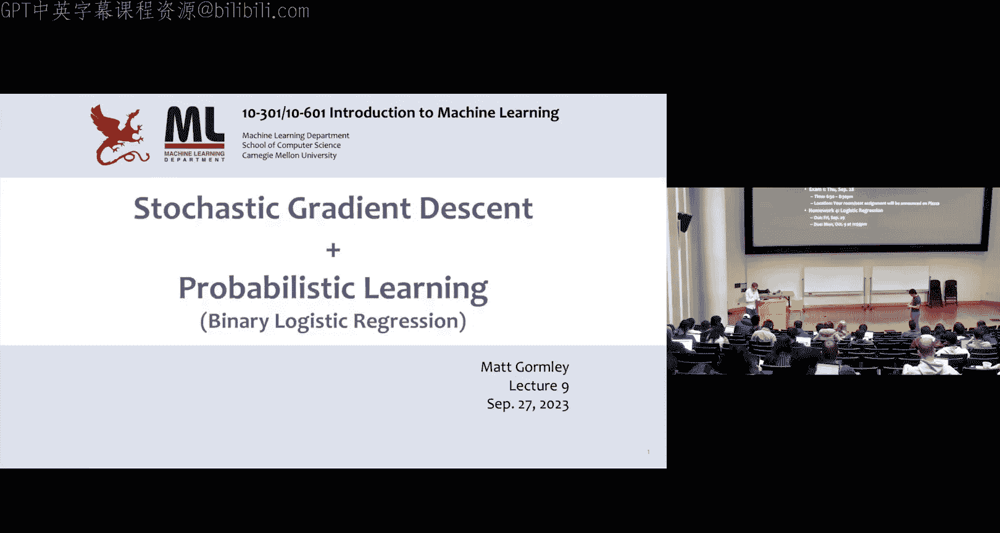
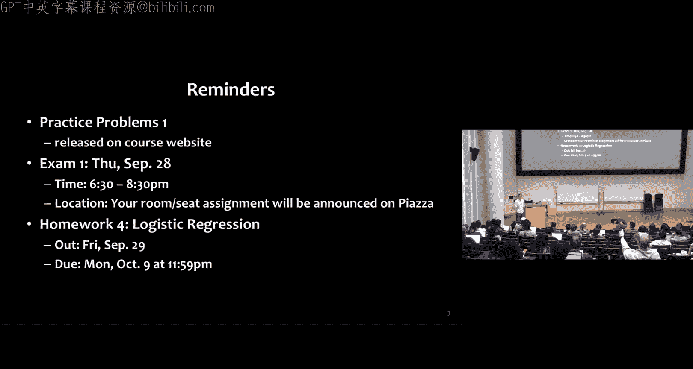
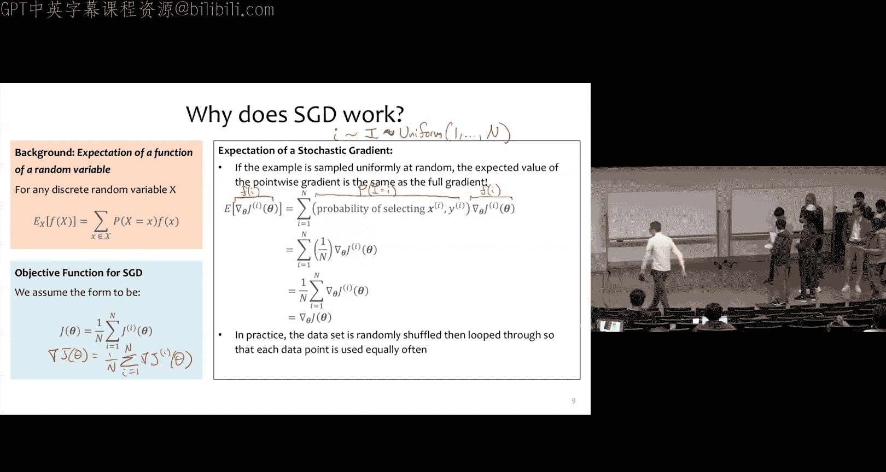
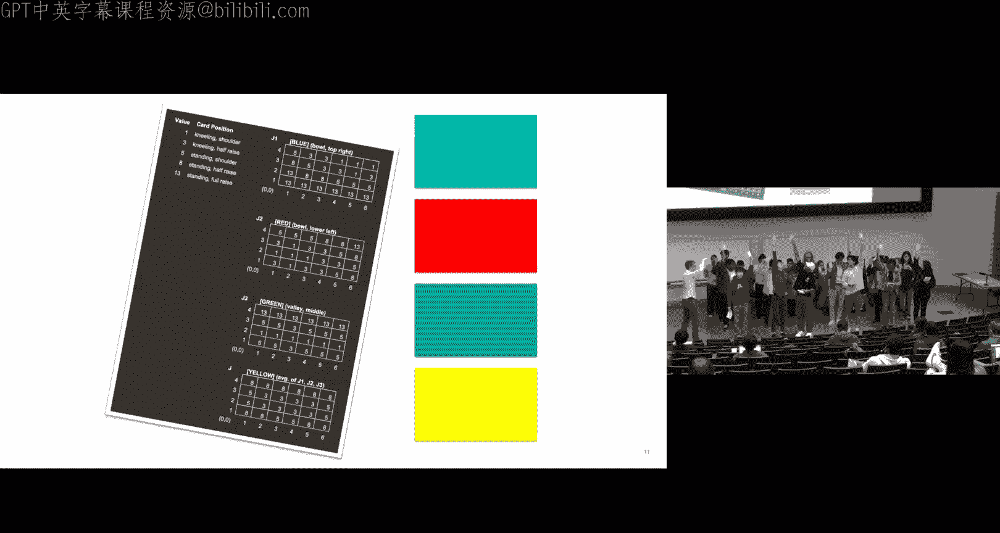
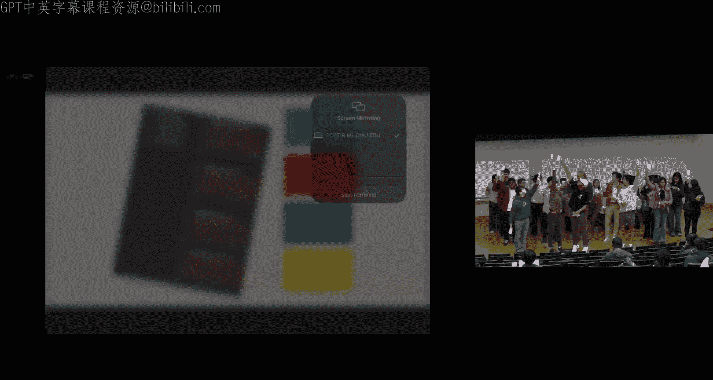
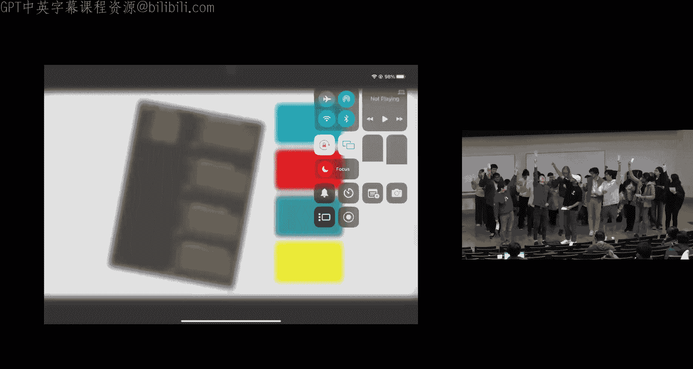
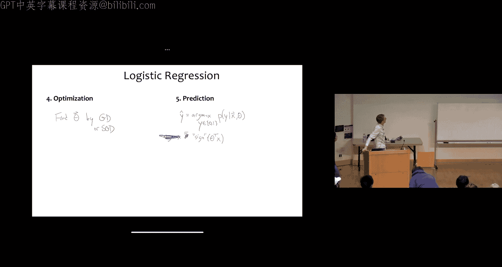

# CMU《机器学习导论｜Fall 2023 10-301⧸601 Introduction to Machine Learning》中英字幕（deepseek p09 Lecture_9_Stochastic_Gradient_Descent_Logistic_Regression.zh_en -BV1Z2cUefE4A_p9-

## 1. 引言

在本节课中，我们将讨论随机梯度下降（Stochastic Gradient Descent，SGD）和逻辑回归（Logistic Regression）。

### 1.1 作业和考试提醒

- 实践问题已发布，考试将于周四进行。
- 请务必检查Piazza以获取您所在教室和座位的地点。
- 作业4将于周五发布，截止日期为10月9日（周一）。
- 在作业4中，您将实际实现用于逻辑回归的随机梯度下降，以及进行一些其他有趣的事情。

## 2. 随机梯度下降

### 2.1 优化算法

到目前为止，我们已经看到了许多不同的优化技术，例如随机猜测、梯度下降、闭式优化等。现在，我们将转向新的优化算法——随机梯度下降。

### 2.2 随机梯度下降与梯度下降的关系

随机梯度下降可以看作是梯度下降的一种变体。梯度下降初始化theta为某个初始值theta0，然后当未收敛时，沿着目标函数的全梯度方向进行一步。而随机梯度下降的关键区别在于，在步骤4和5中，我们不再只有步骤4，而是一个单个参数更新。现在，在步骤4中，我们随机选择一个整数I，范围从1到n（n是训练样本的数量），然后沿着目标函数的一个训练样本的梯度方向进行一步。

### 2.3 随机梯度下降的算法

以下是随机梯度下降的算法：

1. 当未收敛时，随机选择一个整数I，范围从1到n。
2. 沿着目标函数的第I个训练样本的梯度方向进行一步。
3. 重复步骤1和2，直到收敛。

### 2.4 随机梯度下降的优缺点

随机梯度下降的优点是计算速度快，可以快速进行早期进展。缺点是收敛速度较慢，并且可能会陷入局部最小值。

## 3. 逻辑回归

### 3.1 逻辑回归的背景

逻辑回归是一种用于分类的机器学习算法。它假设输入是连续向量，输出是离散值（通常是0或1）。

### 3.2 逻辑回归的目标函数

逻辑回归的目标函数是负条件对数似然函数。它表示为：

J(θ) = -1/n * Σ[log(P(Yi|Xi, θ))]

其中，P(Yi|Xi, θ)是给定参数θ和特征Xi时，标签Yi的概率。

### 3.3 逻辑回归的梯度

逻辑回归的梯度可以通过对目标函数进行求导得到。它表示为：

∇θJ(θ) = 1/n * Σ[(-Yi + σ(θ^T * Xi)) * Xi]

其中，σ(θ^T * Xi)是sigmoid函数，表示为：

σ(z) = 1 / (1 + e^(-z))

### 3.4 逻辑回归的预测

在测试时间，逻辑回归通过输出具有最高概率的类别来进行预测。它表示为：

P(Y=1|X, θ) = σ(θ^T * X)

## 4. 总结

本节课中，我们一起学习了随机梯度下降和逻辑回归。随机梯度下降是一种优化算法，可以快速进行早期进展，但收敛速度较慢。逻辑回归是一种用于分类的机器学习算法，其目标函数是负条件对数似然函数。