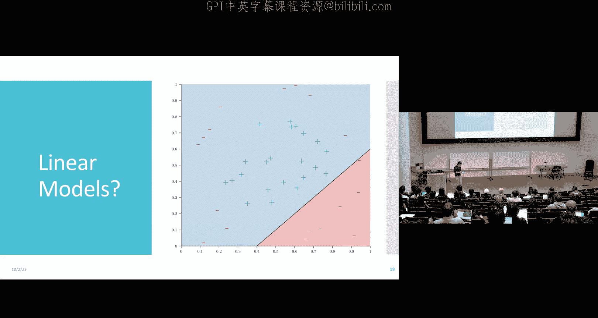
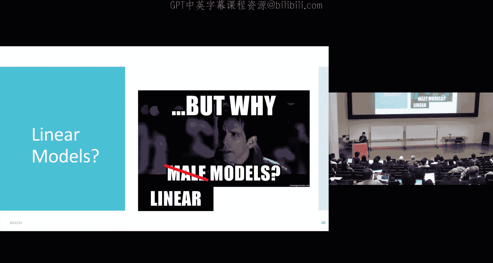
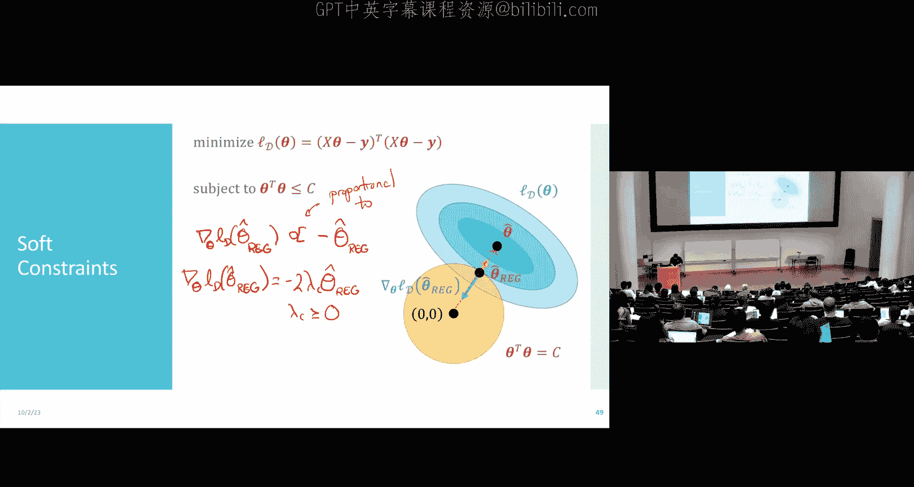
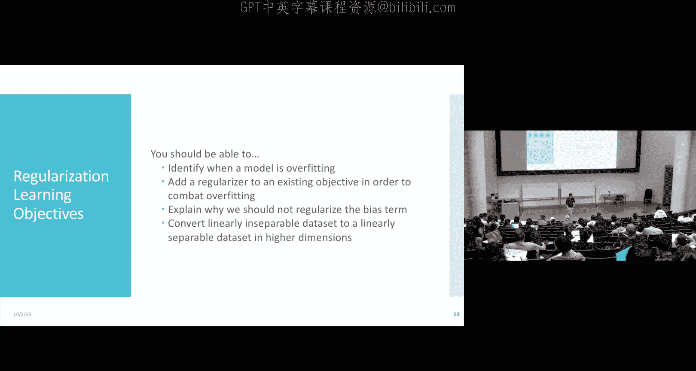

# CMU《机器学习导论｜Fall 2023 10-301⧸601 Introduction to Machine Learning》中英字幕（deepseek p10 Lecture_10_Regularization.zh_en -BV1Z2cUefE4A_p10-

All right， good morning， everyone。Happy Monday， I hope you all had a great weekend。

 We're gonna go ahead and get started for today。 So today we're gonna pick up where we left off and wrap up a few loose ends regarding logistic regression and then we're going to talk about well we're gonna talk about a method known as regularization in the context of linear and logistic regression but this is actually like a really general really powerful machine learning tool that's going to come up a whole bunch。

 especially when we talk about neural network。 So just keep this one in the back of your mind you know。

 we just had an exam not too much talk about you have a homeworks do like a week from today So plenty of time it's on logistic regression So some of this stuff will be helpful speaking of which here is let's see the back half of Wednesday's lecture all in one nice tidy slide here I think Matt did a pretty reasonable job of breaking down the logistic regression model and then we sort of rush through some of the。

😊，Actual derivation of the methodology but you guys will work through that on I don't know。

 say homework floor or something like that what I wanted to talk about a little bit today is like what you actually get when you do all of this and the takeaway here that we ended lecture on Wednesday with was that if you use this sort of weirdlook sigmoid function sigma here and you do this sort of gradient descent to train your logistic regression model your final decision boundary。

 your predictions look something like this weird sign function that s function that went from zero to one the weird sine function of a linear combination of your features we saw something that looked a lot like this when we talked about the perceptron and that gave us a linear decision boundary and the big takeaway from logistic regression is that if we do logistic regression on some data that looks like this what we end up learning is。

😊，A probability distribution between the two classes where each of the various probability values corresponds to a line or a linear decision boundary in this space so the way to read this diagram is that over here on the bottom left。

 we have low probability of a point being a red circle or conversely high probability of it being a blue triangle and as we move towards the upper right hand corner。

right hand corner， we get higher and higher probabilities of the points being these red circles and it's a little hard to infer the shape from this diagram。

 but in some sense， if you want to think about it， these look like these sigmoid functions。

 these S curves sort of stretched out。In this dimension here。

And this gives us a sort of really unique thing that we can do with this kind of classifier。

 which is that。We could pick some probability value。

 some sort of notion of certainty that we want before we classify a point as one class or another so if you wanted to be sort of really certain that a point was a red circle before you predicted it as such you might use one of these sort of heavier probability higher probability decision boundaries like 0。

75 or 0。9 but you know if you were just sort of agnostic or indifferent between these two classes。

 you didn't have one heavy leaning or another， you could use the probability line corresponding to 0。

5 and this is the decision rule that is sort of implicitly being used in our earlier statement of the model that Y hat is the Arg max or the more likely of these two classes that corresponds to a decision boundary of 0。

5 and it might look something like this so big takeaway here is that logistic regression much like the perceptron。

😡，Model that we learned about earlier gives us a linear decision boundary as well。😡。

But a reasonable question you might ask is。Is this the best that we could do you know why should we care about this particular line over any of the other various linear decision boundaries that we could learn here it's a fair question I'm going to change that question up a little bit just to introduce a new concept。

 something that we've sort of already briefly mentioned in a previous lecture。

 but suppose that you knew what P star， this true target generating distribution was you knew where the labels were coming from。

😡，Could we do something better and the answer is yes and this allows us to formally define something we mentioned in a previous lecture so let me establish a little bit of terminology here。

 so we're going to imagine that our labels come from this binary distribution P star so we have some distribution y equaling1 given x and supposed for right now we want to minimize this01 loss。

 this binary classification error thing that we've sort of been thinking about this whole time。😡。

Well then you can show that the Bays optimal classifier or the best classifier you could possibly do in this setting with respect to this loss function well。

 it's sort of the obvious thing right you look at P star you look at the right answer and if it turns out that the probability of y being one is greater than one half well that means that the probability that y being one is greater than the probability that it's zero and you predict one correspondingly So where have we seen this before does anyone remember。

😡，It's very briefly mentioned。Sorry。In the back there。Yeah。😊。

The1 me neighbor like that exactly right I think many of you put this as your answer for the miscellaneous question on the exam。

 so it's at least very fresh for some of you this is the exact quantity the entity that we refer to in the cover and heart theoretical guarantees on the performance of the one nearest neighbor so the best thing that you could possibly do is this base optimal classifier I think we said that the one nearest neighbor does at worst twice as badly as this but what exactly is this right well here's another way to think about it suppose we have a 1D input so x here is our one dimensional feature right and suppose I tell you again in this setting you know what p star is suppose that this curve here corresponds to I don't know。

😊，P star y equaling1 given x。And I'm me pick a different color here。

This one over here corresponds to。P star y equals zero given x note here that there's this relationship where of course p star y equals zero is just one minus p star y equal one so if you like add these two curves up they should add up to one ish。

And then the idea is you get some new data point that comes along， say。😡。

X prime here and you have a choice you can either predict it as one or zero right and looking at where this point lies and what the values of p star at this particular location R。

 well， if you decided to for some reason predict p star here or rather if you decided to predict that the label of this point X prime here was zero。

 well then you would in expectation incur some loss。

 that is there's a really big gap between you know。

This value of p star y equals1 and the value of p star y equals0 at this location。

 this is sort of your expected loss that if you had predicted one instead of zero here。

 then you would incur sort of less loss using that loss function up there。😡。

We can formalize this using some notion of what we'll call reducible error。

 so reducible error is like you have some classifier and it makes some mistakes that could be improved upon。

😡，If you knew P star， so this is an example of where like your classifier here predicting zero。

 well we could definitely do better if we knew that at that location x prime p star of y equal0 was much。

 much lower than p star of y equaling1。😡，But there are some places where we wouldn't necessarily be able to do better。

 notably like right， need a new color here， like right here， for instance。

Let's call this x double prime at that location， we have even if we knew P star。

 we still have a lot of uncertainty and we still have a very high probability of making a mistake and so there's some fundamentally irreducible error of even the best possible classifier。

 even the classifier that knows P star is going to make some number of mistakes。

 but it's not just at points like that right like even out here。

 this sort of distance to the lowest curve represents the probability that you make a mistake。

 even when you're making the best possible prediction in some sense。😡。

So there's two notions of error here， irreducible and reducible error。

 the Bays optimal classifier minimizes the irreducible error as best as it can，😡。

That won't necessarily be equal to zero。All right， one thing that I want you all to think about。

 maybe in your own time here is this is the Bays optimal classifier for a specific loss function。

 that sort of 01 loss function there。😡，If I were to change up that loss function so that let's say one kind of mistake。

 false positives were much more heavily penalized than false negatives， for instance。

 how would that affect what the Bays optimal classifier is I'll let you guys think about that a little bit and we'll probably revisit that a little later in the semester。

In the meantime， let me stop here， we're moved a little quickly through this beginning bit。

 what questions do you all have at this point？😊，嗯哼。😊。

And said that there could be other when the irreducible leader could under than the detection。Yeah。

 the big idea can here is that regardless of like even if you get some location， say like X prime。

 right？And you predict。😡，The most likely class， you predict one here。😡，P star of Y Uing1。

Isn't exactly one the probability at that location of the label being one， it's pretty high。

 maybe it's like 0。9 or something， but that still leaves and notably this is where that lower curve comes in。

 that lower curve tells you the distance from one that that highest curve is so the probability you make a mistake at x prime is not quite0。

 maybe it's like 0。1 here or something and that exists sort of for all possible values of x。😡，嗯。😊。

Something for like a specific set data or is it like a theoretical thing for the Reducable error is time to be target generating distribution of P star like you know not a reducable error any black wire have is related to like sort of the gap between these two classes but not like not very reducedpon specific data that it's like or the undermine distribution for the does do that it's related to P star related to P star and or your classifier。

Yeah， no morning。because we know E then if we then compared the value of Eta of y equal to1 an x and y equal to0 to and if you are making error and then we look at the E star value then know there a sum it then we can control one time it's more like you know that we can better we might have got that Y just because there remains law。

 but even though we got by say one to you know realize we shouldn of that time。

 we inex could have done better because one of our probability values was higher than the other。

All right， these are really great questions， I confess this is sort of a very abstract concept in general because we don't typically assume we know P star。

 but it's nice to know that there is some like notion of the best possible classifier。

 it comes up a lot in theoretical results like the Coant heartbound。All right。

 so we talked a little bit about logistic regression。

 How on earth do we actually go about learning a logistic regressor Well。

 the way that we would do that， the way that Matt proposed briefly at the end of lecture on Wednesday was using stochastic gradient descent So that's that little exercise that you all took part in using the cute little balloon on a stick here the big idea is very similar to gradient descent。

 you initialize all of your parameters， all of your weights to some value。

 say all zeros here and then。😊，In practice， what is typically done is you shuffle your data and then you loop through your shuffle data。

 computing the gradients with respect to each data point and then。

Taking a step in the opposite direction of that pointwise gradient。

 and you do this repeatedly until you converge， and then you return the final weight vector at the end。

😡，So this is the form of the gradient for。Logistic regression and one of the things that I want to point out。

 one of the really sort of interesting interpretations of this gradient here is that well。

 we have a sort of meaning。😊，For this term here， right？

Sigma of theta transpose Xi under our modeling assumptions。

 that corresponds to the probability that Xi is equal to1。

 that's sort of how we defined our predictions and so if I push this negative sign in，😡。

I can rewrite this gradient as the probability under my model that y is equal to1。😡。

Minus the actual label Y I， Y is this interesting Well， it tells us sort of。😡。

How big of a step we should be taking in some sense， What do I mean by this。 Well。

 think about if y is equal to 1， Let's start by assuming y I here is equal to1。

 When y I is equal to one。 if this probability is low。

 if the probability that my model predicts that point is equal to 1 is low， well。

 then this gradient is going to be big， there's going to be a big difference between the probability and the actual label。

 conversely， if that probability is like 0。99， if the probability of the point being 1 is very。

 very high。 well， then that difference is going to be really small。

 and I'm going to take a small step。 basically， this is saying。😡，For this given point。

 how good is my current weight vector theta if it's very， very close to predicting the right label。

 I'm going to take a small step if I'm way off in terms of my belief about what its label should be。

 I'm going to take a bigger step And so that's some nice intuition about the gradient for logistic regression same thing works if the label is equal to zero。

 I'll let you guys puzzle that one out yourselves。😡。

What I want to talk about very briefly here is the sort of difference between gradient and stochastic gradient descent right so remember gradient descent takes these sort of slow ponderous steps that are generally always in the right direction。

 especially for nice convex functions like these and stochastic gradient descent in the aggregate wanders in the right direction but can meander off in sort of very bad steps occasionally right and so a reasonable question you might have is is there some middle ground here and the answer is absolutely right so this wow that was meant to appear more slowly this is。

😊，A compromise between gradient and stochastic gradient descent known as mini batch gradient descent or mini batch stochastic gradient descent And here's the real difference。

 it's just in this sort of inner loop here where instead of picking just one point you pick some number of points usually smaller than n。

 maybe like 10% of your data or something you pick a batch of points and you compute the gradient with respect to that batch This is like exactly what you would think of as like the compromise between gradient and stochastic gradient descent。

 instead of computing the full gradient with all end data points。

 you just pick some small subset of them and you use those to compute the direction to move in and this is just like the notion of compromise right now your steps are going to be a little slower but on average that are going to move you in a better direction So this is like a very common method for optimizing convex。

nonn convex functions， it does introduce another hyperparameter here。

 this notion of how many data points you take the gradient with respect to。

 it's just another hyperameter you set the same way you set all the rest of them。Okay， so I confess。

 I'm pretty sure in homework 4 we have you implementing stochastic gradient descent in homework 5。

 we might have you doing mini batch gradient descent。

 but regardless there's just a variant of stochastic gradient descent we want you to be aware of。

All right， any questions about this before I move on？嗯。In the back。Yeah。

 I mean one way to think about full gradient descent is your batch size B is equal to n that's totally one way to think about it。

 typically when we're running mini batch stochastic gradient descent B is some function of n。

 so like B might be n over 10， 10% of your data points or n over five or something like that。

 so not usually one or two one or two is basically equivalent to stochastic one is equivalent to stochastic gradient descent。

😡，Yeah。Whathy does each batch so what we're doing here is we'reing all the point wise gradients for the points in that batch so that's what this sort of big nobla J B line is doing so instead of what we had for stochastic gradient descent where we're just computing the gradient with respect to one point here。

We're now computing the gradient with respect to capital B points and then averaging them all together。

wait to say a little by the point times the beans just do all hands she's a shle those fat pains that do we have to shuffle that or is it just like random enough that it only so。

I've seen it both ways for batch gradient and descent， definitely a fair question。

 especially when you make your batch size， some like multiple or some like， you know。

 if your total number of points is some multiple of your batch size。

 it's easy to just shuffle your entire data set and take， you know， sequential chunks through it。

 or like you said， when you're sort of sampling larger batches， you。

You decrease the probability that you overly focus on some subset of your data points。😡。

Anything else， yeah。Would so when you're randomly sampling。

 would there be times where you would want to focus maybe on like ensuring that your samples are somewhat more representative like each label shows up or。

That's an great question。I would say h if you had some good reason to like overly weight。

Let's say some of your data points for one reason or another。

 there are maybe more principled ways of baking that into your model than like oversampling them in a stochastic gradient descent routine。

 like you can actually just sort of weight the error on specific data points higher or lower and that might cause you to try and predict them more correctly。

😡，All right， so that wraps up what I had for logistic regression next we're going to talk about like I mentioned。

 a very general machine learning model known as regularization。

 it pops up in all sorts of strange places， but we're going to present it from a very sort of like first principles sort of perspective and the way I want to motivate this is by talking about well。

 something we've seen a lot of in this class linear models。😊。

So linear models are great for lots of reasons， they're really efficient to learn。

 they're sort of simple， they're not liable to overfit as much as more complex models that we'll see in a little bit and you know for lots of real- worldord data sets。

 they do really well right like imagine okay this is a totally contrived data set but like you know you can fit lots of datas with linear models。

 something like this or you know even something like this where you make a couple mistakes。

 no big deal right？😊，But it's not all data in the world and lots of data might look something like this where I don't know。

If you tried to fit it with a linear model， maybe you would learn something like that。You know。

 I think we can do better。All right。I have a joke on this next slide。And。

I always get so nervous when I put I get so nervous when I put this up here that no one is going to lap。

 so I'm just going to put it up there and then I'm going to see what your reaction is。So， a question。

You might ask when you see data like this is。

Why linear models？The number of people who laugh。She keeps getting lower and lower， Okay。

 how many people know what movie this is from？Oh， dear God。Yeah， zoolander， all right。

Zou Andrew came out in the year 2001。How many of you were born after the year 2001？Okay， I get it。

 I get it， I need to find a better reference。You know。

 Zoolander2 came out pretty recently it was a terrible movie。

 we don't talk about Zoolander 2 anyway it's a movie about male models。

 it's really crass and somewhat rude， but the question still stands。

 why would we constrain ourselves to linear models for data you know that clearly looks like it would be better fit by a circle。

 right？

So how can we go about learning models that look like this well using the techniques that we've already established in class。

 all we have to do is just change up the features that we're learning from what do I mean by that well consider you know that same problem those 2D inputs。

😡，What I'm going to do first before doing any machine learning is take my two features X1 and x2 and compute two new features Z1 equals x1 minus0。

5 squared Z2 equals x2 minus0。5 squared sort of really strange looking features but I'm going use z1 and Z2 instead of x1 and x2 to learn a model What is that going look like Well here's my original data on the x1 and x2 aes here and if you just compute what z1 and Z2 are for every data point you end up with data that looks something like this。

 which is now very clearly linearly separable and you might learn sort of this line here and if you plot what this line corresponds to in your original space you get back this decision boundary here。

😡，All right， so fair question now。😡，Where exactly did these features come from Well。

 I think probably many of you looking at the you know shape of those features recognize like this to be some big approximation of the formula for like a circle in 2D right like this is the equation for like a circle centered at 0。

50。5 with radius。😡，One， I think。Or。Yeah， regardless， it's a circle centered at 0。5。

R just square root two。Well regardless the idea here is those are really heavily cherrypic features right I like looked at this data and was like oh I know what features I need in order to fit this data set。

 I need some sort of circular feature centered at that location and that's cheating that's like ridiculously liable to overfit your visualization of the data。

 your particular biases of how these training data points are arranged and so a much more principled way of doing this would be to use what are known as general polynomial transformations right like if I believe for some reason or another that my data followed a quadratic pattern in the features like if my decision boundary or a parabola or an ellipse or something like that well then I would use sort of this feature expansion here what I would keep both the original features X1 and x2 and then take every possible。

Second order combination of my features， x1 squared。

 the cross term X1 x2 and x2 squared that would actually allow me to learn sort of flexible second order models。

😊，But I don't know， maybe you believe your data follows a cubic pattern or acortic pattern。

Or you know， maybe you think I need bigger slides so I can fit。😡，52。

 five here the issue is this scales very， very poorly right if you have some 2D input， so sorry。

 my notation here， this is the input size。And this is the polynomial order。

 so how high of a polynomial？You want to expand your features out too。So this。

Scale sort of really poorly， even for 2D inputs， it's sort of squared in the number of features。

 much less if you have you know more than two features and you want to start applying high order polynomial transformations to them things get out of hand really really quickly so this is one consideration that I want you to keep in the back of your mind we're not going spend too much worrying about this computational cost for right now。

 no instead we're going to think about something else。😡，Which is。

Here's my one of my original motivating examples for linear models right we said。

 you know a linear model here totally fine makes a couple of mistakes， right？This is a。

I want to say it's like a sixth order polynomial or something like that that fits the data perfectly because it is the lowest order polynomial like could get to fit this data perfectly。

 so it's some sixth order decision boundary here。What do we think about this one do we like it Yeah。

 I love it， I love that enthusiasm， any other takers？Yeah， okay cool all right。

 cool so that's all I had for you today no， all right what don't we like about this？All at once now。

Overfits it dramatically overfits right and this is the tradeoff that I want to focus on for today's lecture that if we have some sort of high dimensional feature transformation。

 we can do a really good job at minimizing our training error we can do a really good job at fitting sort of any arbitrary looking decision boundary as long as we use a high enough polynomial order transformation。

 However， this is going to lead to very poor in most cases， very poor generalization。

 and I'm going to prove that to you in just a second So what we're going next is we're gonna to see a little example of these sort of high order feature transformations going awry and then we're going to talk about how we can re them in what we can do if we want to use high order feature transformations but we want to avoid that sort of dramatic overfitting So that's where we're going with the rest of today's lecture let me again stop here Are there any questions about the premise。

😊，All right， so let's see an example of where this can go awry and for the purposes of this example。

 it's a little easier to think about regression。😡，One of the cool things about these kinds of feature transformations。

 they extend naturally to both classification tasks like we saw in the first few slides and regression tasks。

 So what we're going to imagine is we have one feature as our input X and we have one real value target we're trying to predict Y and let's start with 20 data points。

 right。😊，Here's a theme for these past few lectures that is a bit unrealistic。

 I'm once again going to tell you where the targets come from。😡，In practice。

 you don't typically know what the target generating function looks like here I'm telling you that the targets come from some10th order polynomial with additive Gaussian noise。

 so the true data lies on a10th order polynomial but I'm adding some amount of noise either up or down just to make the problem a little interesting right so the true data the true labels Y that we're going to try and learn come from a10 order polynomial。

😡，We're going to consider two candidates， two models basically we're going to be doing linear regression for both of them。

 but the first is going to be linear regression on a second order feature transformation of my data the good news is if I have just a 1D input X these higher order polynomial transformations they're really easy they're sort of we have less to worry about in terms of efficiency so here the second order polynomial features are just x and x squared and the 10 order polynomial features the features that actually generated the target y are x x squared all the way up to x to the  tenth。

😡，Okay so let's take a look at what this problem might look like here is my target function so this is the10 the 10th order polynomial that I'm actually trying to learn and here are 20 data points sampled from it you see there's actually a reasonable amount of noise。

😡，Some of these earlier data points here on the left are pretty far off that curve。

 but for the most part they tend to follow this pattern All right， like I mentioned。

 we're going to compare two models what I'll call H2 and H 10。😡。

I want you to think about this a little bit first take let's say take one minute here we'll see the answer in just a sec。

 this is your first poll question poll。mlCse。org take one minute here and think about which model you think will do the best in terms of minimizing true error on this data。

😡，And we'll reconvene and see what you have to say in one minute。

This is maybe a little more contentious than I thought。

 sometimes I think I pose this question in such a very leading way but。

65% of you have chosen H2 here and 35% of you have chosen H 10 here， so let's actually play it out。

So given this data set， using the exact same linear regression algorithm that we talked about a few lectures ago。

 if I fit a second order polynomial to these data points， I learned this curve。

 which you have to take my word for it is in fact a like slight bend here。

 it is a very sort of broad parabola， and it does a pretty reasonable job of capturing the high order trends of this data set。

 but it definitely misses pretty big especially on some of those more noisy data points right？😡。

Here's the 10th order polynomial and well maybe some of you can see where this is going。

 it does a really great job at fitting those extreme like noisy data points。

 especially here on the far left and on the far right but，😡。

In the context of trying to learn this blue line， it makes some very wild predictions。

 it makes some very bad predictions， let's say， and because I know what the right answer is。

 I can basically take an integral of the difference between these two functions。

 and tell you that the trend that I had highlighted a few slides ago stands correct。

 that the oh sorry I should say this is a squared error， this is mean squared error。😡。

The mean squared error on the training data set for the more complex model is lower。

 actually only slightly lower， it only does slightly better than the second order polynomials。

 but it does better whereas，😡，It does。😡，1，2，3，4， like  seven orders of magnitude worse than the second order polynomials at predicting the true function in blue here。

 And if you want to know why it's cause like off in this region and off in this region。

 the predictions run off to like。I think it's like plus 400 plus 500 or something like that。

 and then when you square it and average how far off it is with all the other possible values。

 you end up with something in the thousands。All right。

 so this is really bad right what can we do to try and fix this problem because well I know。😡。

That the model comes from， the targets come from a10 order polynomial。

 I want to use10th order polynomials to try and learn this blue curve。😡。

So there are two things that we can do。You know what I realized I'm just gonna give you the answer to your second poll question because that makes for a much better presentation。

 you can fill it in in just a second here the first thing that we can do is we can increase the amount of data we have if we go from 20 data points to 100 data points sorry before you jump through your poll and meant to try and trick you up on this one turns out to option here's a don't pick a but it turns out that if we dramatically increase not even dramatically if we increase the amount of data that we have access to。

😊，We can now learn something that looks like this。😡。

Which is frankly really incredible that that red line is now basically almost on top of that blue line。

 that shrew target function that we're trying to learn here。

 whereas that green line is still stuck just being this like awkward parabola that doesn't really do a good job of capturing all the ups and downs So I think we might have mention this in an earlier lecture。

 but I really do want to stress this as one of the primary takeaways for this lecture the amount of data you have access to dictates how complex of a model you can use more data means you can get away with more complex models。

 more data allows you to use higher order polynomial feature transformations so given you know signs of overfitting in practice if you believe your model is overfitting the first question you should always ask yourself is can I go get more。

😡，Good data， can I go get more representative data？And it turns out in a lot of cases。

 the answer is going to be no。😡，In some cases， it'll be yes， in a lot of cases the answer will be no。

 you're sort of stuck using the data that you have access to and in those instances。

 what can we do well？😡，That's where our next method comes in。

 what we'll call regularization and the way to think about regularization is it's a set of constraints or it's a constraint on our optimization problems。

😡，We've seen numerous examples now of machine learning as just optimization problems gussied up with some data right at the core of what。

 you know， sort of linear regression and logistic regression are， these are just。

Objective functions that we' maximizing or minimizing with respect to some variables。

 You can formulate that very cleanly as unconstrained objective unconstrained optimization problems。

 And now we're just going to throw some constraints on them to prevent overfitting。😡。

Why is this going to work Well， here's a really sort of strong man example of one type of constraint that might。

😡，Help with this kind of problem What do I mean by that Well here's the setup for the exact problem we were just thinking about we had our 1D feature X which we pushed through our 10th order polynomial transformations and that gave us these features X through x to the 10 here and all we were doing to learn those sort of polynomial curves on the last few slides is computing you know these design matrices。

 these target vectors except now in our design matrix x we have all of these features x x squared all the way all the way up through x to the 10 and we're learning theta0。

 the intercept term theta 1 all the way up through theta 10 here but we're just still minimizing this exact same function here I think we might have had a one over n out front doesn't really matter just scales the thing here but we're still minimizing this mean squared error we can do this in closed form here I think that's how I was solving it but。

Instead of just directly minimizing this mean squared error here， we subject it to a constraint。

 we subject it to a very ludicrous constraint that says theta 3 all the way through theta 10 have to be exactly equal to0。

😡，I think many of you can probably see where I'm going with this。If you were to use this constraint。

 I'm not saying you should， but if you did and you like expand out what exactly is going on in this mean squared error。

 you would see that， you know， in this inner sum here。

 most of those terms go to  zero because you're just multiplying them by something that you know has to be zero。

 I can just rewrite my objective function that looks to something like this where I only consider the non-zero terms and。

😡，Wila， I've recreated。Second order polynomials。So this is meant to be some like intuition that like adding constraints to the problem can make your model simpler right I started with a tenth0th order linear regression problem and I constrained it in such a way that I made my model sort of comically simpler。

😡，This is like a really fictitious sort of strawman argument though right like if you wanted to do this。

 you would just start with second order polynomials so instead we're going to consider what we would call maybe soft constraints or like a much more realistic set of constraints on our weights here so instead of just saying all of my weights or some subset of my weights have to be exactly equal to zero。

😡，I can say something like this that says the L2 norm or the dot product of my weight vector against itself。

 the L2 norm squared， that has to be less than or equal to some threshold C。😡，Intuitively。

 what this is saying is my weights need to be small that like if there's any。

 you one or two weights in there that are very， very large。

 if I square them and add them all together， this is going to violate my constraint。😡，So intuitively。

 this is very similar to the previous constraint of saying my weights have to be zero except now I'm sort of allowing more flexibility。

 I'm not telling the model which weights have to be exactly equal to zero。

 I'm letting the model pick， what it thinks the more important weights are and I'm not saying they have to be exactly equal to 0。

 they can be some small number depending on what I set C to， maybe like 0。01 or 005 or whatever。

 but they don't have to be exactly equal to zero。😡。

And you're just gonna have to take my word for it because you can't really see it from this figure。

 but intuitively the reason why you know this red curve ran off to like plus 400 or plus 500 is because some of those coefficients in front of the higher order terms were really really big I think there was a coefficient in there that was like 100 something right and so if we can keep our coefficients small。

 we'll still be able to use these higher order features but this constraint here will keep them from doing anything super crazy we'll keep them from running off you know super high values that make my predictions really unrealistic。

😡，All right， so that's the intuition behind this constraint next we're actually going to see how we can learn a linear regression model using this constraint here before I move on。

 what questions do you all have at this point？😡，Yeah。

 to use what is our choice of nonlinear transformation？Sly， no， it can be， doesn't have to be。

 it is a hyperparameter。And there you have your ads。

I will say that frequently for these kinds of problems。

 we might have some sort of domain expertise about what。

Kinds of features to use like if we believe there is a cyclic relationship between our feature and our label。

 we might pick some like trigonometric function that captures that so there's room for you to incorporate prior information in your feature transformation choice。

😊，But。I would say the most principled way to do it is with hyperparameter optimization。

That's a really great point here actually I actually sort of glossed over this part of this slide。

 we've been talking about polynomial future transformations。

 but what we're talking about the method that we're about to establish works for basically any nonlinear transformation remember if you use a linear transformation。

 you're going to end up with a degenerate matrix here。

 it's not going to be invertible when you compute x transpose x so we can get away with anything like x log s square root。

 any nonlinear transformation you want。😡，Okay。Let me again stop any other questions at this point。嗯。

😮，てたか。Oh we're going to get to that in just a second， the short answer is yes。Or it can， yeah。

Two which features like to tap their reading literallyly like like you just said that like two some features to months。

Yeah no I mean this is a really great question it chooses the same way it would choose it chooses in the same way that it would choose if I didn't have a constraint that it just tries to minimize that objective function。

 the squared error here by setting the weights however it wants。😡。

So now we're having it still have that flexibility。

 but it has to weigh that against this constraint now we're leaving it up to the model。😡。

Anything else here？All right， so next we're going to talk about how we can actually learn these parameters。

So when I say we're leaving it up to the model that's maybe a bit of an inappropriate expression。

 we're actually going to solve this problem ourselvesse。

 but we're not going to specify what weights are set to what we're going to allow this data to sort of tell us how to set these weights in some sense so now instead of having our simple unconstrained optimization problem here is really the problem that we want to try and solve right written out in like an optimization format that some of you might be familiar with here the objective is to minimize this squared error loss。

😡，Subject to a constraint， subject to this L2 norm squared of my weights being less than or equal to some threshold C here。

😡，All right， so we're going to solve this using the method of LaGrange multipliers， quick poll。

 how many of you are intimately familiar with the method of LaGe multipliers？😡，Oh good， some of you。

 you can take a 20 minute nap or so and I will wake you up when you should come back for the rest of you。

 we're going walk through a geometric interpretation of this methodology but basically at a high level it's a way to take a constrained optimization problem like this one and make it an unconstrained optimization problem that we know how to solve。

So to do that。Here's a little picture to help us。Here's our loss function right so remember we're still talking about the squared error loss for linear regression this is a convex function。

 not a strictly convex function， although here I think I've drawn it as a strictly convex function just to make it a little easier and you should imagine this as like a bowl going into the screen right the minimum value the value that we're trying to find is right there at the center of this bowl this is the solution we would get if we were just solving the linear regression problem if we didn't have any constraints we would return theta hat here right？

😊，But we do have a constraint， and our constraint also has a geometric shape。😡，Specifically。

 if you think about what theta transpo theta is in this setting， it looks something like。😡。

Theta0 squared plus theta 1 squared is less than or equal some C。

 and this is just the equation for a circle centered at 0，0 in my two dimensional space right。

 so it looks like this yellow curve here where I've just picked some value of C。

So there's two things to note here one depending on how I set C。

 this problem might be very easy right like if I set C to be sort of ridiculously large and the optimal solution to the unconstrained problem lives inside my circle well then that's still the right answer that's still always going to be the best that I can do and so in some sense this is not really a constrained problem at all。

 we're going to ignore that case， we're going to imagine that instead we do live in a case where the constraint is meaningful where the constraint actually changes what the optimal solution is and my claim this I'm not really going to prove but I'm just sort of going to hand wave my way through the geometric intuition here。

 but my claim is that the optimal solution to this regularized problem what I'll call theta hat reg lives on the line from zero0 to the unconstrained optimum theta hat that that point there sort。

😡，Lives directly on the vector between 0，0 and the optimal solution theta hat。

And is on the edge of the circle。 So intuitively， if either one of those two things weren't true。

 I could move the data point a little bit better and get a better I can move the data point a little bit and get a better solution。

 So like if theta hat Regg were like，😡，Inside the circle。

 I could push it to the boundary and achieve a lower objective function value。

 And if theta hat lived like sort of off the。Line between00 and theta hat。

 then I can move it back onto that line and get a lower function value remember my goal here is to minimize the blue function there so the closer I can get it to that theta hat。

 that optimal solution， the better。All right， so this implies sort of one very key fact here。😡。

Which is。If you imagine this is the vector。From0 zero to theta hat， well。

 I know that at the optimal location to my constrained problem。

The vector corresponding to theta hat reg is pointing towards。The unconstrained optimum theta hat。

And。The gradient of my objective function is pointing directly opposite to that direction。😡。

So remember the gradient points in the direction of steepest ascent。

 so opposite that is the direction of steepest descent， I'm moving my data point。

 my optimal constrained solution， theta hat re to be as downhill as possible and live on the boundary of my constrained surface。

😡，So this is the big like geometric leap you need to take in order to understand the method of lagangia multipliers that basically this relationship。

 I'm going to write it out in just a second here。😡，That。My gradient。Of the。Objective function。

At optimality here。But this gradient。Is proportional to。The negative。Of the value itself。

And here this means proportional to， or if I multiply it by some value， these two things。

Become equal。 I don't exactly know how the magnitude of these two vectors relate to one another that depends a lot on。

 you know the actual specifics of my problem， the size of my constraint space， yada， yada yada。

 but I do know they have to be pointing in opposite directions to one another。

 That's the big intuition here。 So again， I'll stop here。

 What questions do you all have about this before I move on。😡，Give you guys a second to digest that。

Yes， why is it an important about in negative？proportion proportional toSo the negative sign captures some of the intuition that we want。

 and it also is going to come up in the actual mechanics of solving the problem。

But it captures the intuition that they're pointing in opposite directions。All right， like I said。

 this is a very big leap I encourage you to spend some time just sort of staring at your slide convincing yourself that this is true that like if you were to move the optimal solution theta hat re sort of anywhere else you could do better by moving it to a point where this condition is met but right now let's suppose we accept this condition to be true what we're saying is this relationship has to be true at the optimal solution to my constrained problem I'm going to manipulate this expression a little bit to basically get an unconstrained optimization problem What do I mean by that well let me first rewrite this expression a little bit here。

If these two things are proportional to each other， that means I can always find some quantity。

Let's call it， I don't know， Lambda C。I can always find some quantity Lambda C， such that。

I'm gonna leave my negative sign here and I'm going to put a two here just because it'll be convenient in a second。

 but regardless I can always find some quantity lambmbda C such that these two vectors are equal to each other that's basically what I mean when I say proportional to the big constraint here is that lambmbda C has to be technically greater than or equal to  zero it can be0 that happens when my constraint space is a little too large regardless this is this quantity lambmbda C two things one it has to be positive because I put the negative sign in my proportional to statement and it depends on c I don't exactly know what it is。

 but I don't exactly know what that dependence is but I know like the magnitude of this difference is going to relate to how tight how big my circle is right？

So I can say this quantity here or this， whoops， no why。

 I can say that this equation here has to be true。😡。

Right here。And now I'm just going to manipulate that to look sort of like a gradient being equal to zero。

 What do I mean by that Well， if I add。😡，The stuff on the right hand side to both sides。I get back。

Two， lambmbda C， theta hat Reg。Equaling zero。And if you kind of squint at this。

 what you kind of see is something that looks like the gradient of a function equaling zero right I have the gradient of a function plus。

 well， that's not quite the gradient of a function。

 but if I rewrote this to look something like theta hat and now the parentheses go on the outside，😡。

The gradient with respect to theta of lambmbda C theta hat。Rg。Transcose。Theta hat， Reg。

 now you can see why I added in that too。Now， what we have here is some assertion that at the optimal solution to my constrained problem。

 the gradient of this function has to be equal to zero。😡。

What can we say about the gradient of a function being equal to zero。

 well that defines a critical point for that other function。This location here， theta hat reg。

 I'll just give it to you， corresponds to the minimum of a different， very related。😡。

Objective function here。So what we've shown basically is that the solution。😡。

To this constrained optimization problem here is also the solution to this。

Unconstrained optimization problem。I guess that's not。A theta hat anymore， it's just a theta。Plus。

 lambda C theta transpose theta。All right so that's the method of LaGe multipliers in a nutshell I think many of you have probably learned a much more like algorithmic way of like you take your constraint you just like tack a multiplier known as the LaGrange multiplier onto it and you add it to your objective function this is sort of the geometric intuition behind that methodology I'll again stop here give you guys a second to catch up with my chicken scratches what questions do you all have before I move on。

嗯。哎。that's a sort of good question in some sense， it looks a lot like if you took these two things and added them together。

That's actually sort of exactly what it is。 right， I'm adding that blue curve there， my。

Los function with my constraint here， so it kind of looks like a weird shape like where I'm like sort of skewing the solution the minimum solution to somewhere in between these two values zero。

 zero and theta hat。Doesn't have a nice， pretty picture。All right， so we're actually almost there。

 my claim from the previous slide is that these two optimization problems when I'm calling the augmented loss function。

 that L Og there， the augmented loss function。This is technically subject to a constraint this is subject to。

Lambda C being greater than or equal to zero I'm just kind of rush that under the rug the way to think about that is like you actually get to pick lambmbda C when you're using regularization and so we don't have to worry about that constraint being satisfied or not satisfied what I want to show really briefly is actually what the solution to this problem is and as it turns out we've seen it or like we've sort of seen all the various components of it already which is。

😊，The first thing you do， of course， is you take the gradient， which we've sort of already seen。

This is an unconstrained optimization problem。 We're going to take the gradient。

 we're going to set it equals 0， and we're going to solve。 I'm going skip some steps here。

 So remember， this is。😊，X transpose theta。Minus y transpose x transpose theta minus y。

 This is my squared error。 Again， I've just dropped the。

One over end factor because it makes the math a little nicer here。

 what that looks like is the gradient here will be two times。

X transpose x theta minus two times x transpose Y loss oops， sorry。

I mean just leave all the twos out like this。Plus two times lambda C。Data。And now。

We know that at optimality。😡，This equation here， let me just put this rag back in。

Two x transpose y plus 2 lambmbda C。Beta， hat， Regg。Has to be equal to zero。

So now if I manipulate these quantities a little bit， let's say I add。

That over there and get rid of all of these twos， I get something that looks like x transpose x theta hat。

Rg plus lambmbda C theta hat reg equals x transpose Y。 Here's another small step that I need to take。

 What you're seeing here is I have some scalar multiplied by this vector。

 and then I have some matrix here， multiplied by this vector in order for me to do that next step that I'm about to do here。

 which is pull out theta hat reg。I need to scale this so that like I'm not just adding a scalar to every element of this vector what that ends up looking like and I'll leave this for you all to sort of confirm to yourselves is I end up multiplying this by the。

😡，D plus one by D plus one identity matrix， so this is a bunch of ones on the diagonal so really all I'm doing is I'm adding lambmbda C to just the diagonal elements of this particular matrix and that's how I get these two expressions to be equal to each other。

😡，That equals x transpose y here and the big takeaway。Is that the regularized solution？😡。

For linear regression。Looks， frankly， a heck of a lot like。

Our ordinary least squares solution from a few slides ago just looks like instead of x transpose x inverse directly。

 I have x transpose x plus some lambmbda C times the identity matrix inverse instead。

And some things to note here for those of you who are very into know linear algebra。

 adding in this lambda C times the identity term can definitely help make x transpose x invertible remember one of the questions that we posed。

In our linear regression lecture is is that matrix x transpose x always invertible adding in a positive？

😡，Element。To the diagonal。Remember， Lambda C， always greater than equals0。

 adding in a positive element to that diagonal can help make the inversion either possible or numerically stable if you're having issues with that。

All right， so this is the form of our。Regularized linear regression solution you can see over here on the title。

 this equation is also so famous it gets its own name this is called the Rige regression solution。

 don't ask me why I have no idea。😡，All right， so again I'll stop here。

 what questions do you all have before I move on？All right so here's your third poll question it is a little bit related to the geometry of the problem。

 so I'll let you guys take a minute and think about this one here I want you all to think a little bit about the effect of lambmbda C here so what we're saying is。

In this geometric figure。As Lambda C increases and oh。

 I've replaced my like theta transpo theta with a more generic what we'll call regularizer R of theta。

 we're going to replace theta transpo theta with other functions of theta in a minute here。

 so I just wanted to prime you on have you all thinking about general regularizer functions， R theta。

😡，And as we increase Lambda C， as Lambda C gets bigger and bigger， remember it's always positive。

 but as it gets more and more positive， how do we think this optimal solution will behave。

 it will not stay the same， this is your toxic option。😡，All right。

 so go ahead and take lets say two minutes here， talk about this with your neighbor and we'll see if we can come to some sort of consensus。

😡，Sorry so while you're looking at the poll for that second poll question。

 pick anything except a A is the toxic option， pick whatever you want that's not a for question two for question three。

 pick whatever you want that's not f I realize I left this question a bit underspecified and that might be why some of you are putting the answers that you are I will say 50% 48% of you have put the answer that I intended which is C here intuitively this makes sense because as lambda C gets larger as the amount of penalty we're paying for the magnitude of r theta goes up we're going to want to make r theta smaller and smaller that's the intuition here so the solution will tend to move towards the minimum of r theta however this relies on some assumptions about r theta specifically that r theta sort of is always positive if r theta is negative。

😡，Which is not the case here， but the thing I left under specifiedified as it turns out if you leave r theta negative and you start increasing theta C。

 then that might actually push you away from our theta。

 so I apologize about that confusion if that's why some of you put a different answer here the crucial assumption that we're making is that r theta is like a penalty on the magnitude of the weights that r theta is positive and grows as the magnitude of your weights grows。

😡，Okay， so a few more loose ends to tie up about regularization。

 let me actually pose these as questions to you all just to get a sense for what you think and these are very nuanced so don't worry if you don't intuitively snap to the right answer but。

😡，Here are two questions that I want you to consider， let's start with the first one。

 should we regularize， should we constrain the bias term in our regularizer R of theta。

 what do we think here？😡，Anyone care to pick a side and say why they think one way or the other？Yeah。

because it doesn't really Yeah， I think this is a really great answer that like the bias term in some sense just allows our data to shift up or down it doesn't make our model more or less complex well it for the most part can or for the most part it won't we in some sense want our data to be able to move up and down or rather our model to be able to move up and down the Y axis to fit whatever data that we see。

So I agree with you， I think the answer here is no， let's go with the second question。

 is feature scale a concern for regularization， I think this came up a little earlier。

 but do we all think here。😡，Think I saw a nod over there。Anyone care to share？Yeah， thank。

 because the future is still very fine。Care about him a lot with the very。

That's exactly right that if you have sort of a very like large feature or conversely。

 if you have a very small feature and you need to bring it up to the same scale as your other features。

 you might need to multiply it inherently by a larger weight just for it to have that same contribution right and so I think you guys got the right answers here no we should not regularize the bias or intercept term because it just limits our ability to adapt to shifting in scale of our y value。

 it doesn't limit our sort of model complexity。😡，And then feature concern is feature scale is absolutely a concern with regularization。

Again， we mentioned this when we were talking about KNNs。

 a common practice is to standardize your data or normalize your data。

This is standardizing your data where you subtract the mean and then divide by the standard deviation。

All right so just some tips and tricks for when you use regularization in practice let's take a look at that example that we started with this whole section with again right so here is some 10th order polynomial that i'm fitting with 10th order linear regression this is with no regularization right here i'm plotting the true error on this example it actually isn't as bad so sorry this is me resampling those 20 data points you get a slightly different result。

😡，In like， yeah， this true error isn't bad， but I think we can do a little better here。

 if I add just the tiniest amount of regularization。

 if I set lambmbda C the weight on my regularizer to 0。000001。😡，That's the function I learned。😡。

That's incredible look at that that red line like lives right on top of that blue line。

 I'm not giving it anymore more data， I'm just saying don't do anything crazy。

 don't make your weights so， so big that they run off of you know large values。

 just use a little bit of a constraint and you can oh。Oh dear。What happened here？Anyone。

K suggest what happened here？Inwards。Yeah。What's the ultimate solution that's exactly right and I'm limiting my model's ability to actually fit the data because now all I care about is making my weight small and so I suspect actually you have something here that looks a lot like a second order polynomial model it could be the case that many of our higher order terms。

 they did have their coefficient set equal to zero so we end up with something that looks a lot like our hard constraint or second order polynomial model setting here right。

😡，Everyone's favorite question How on earth do we go about setting lambmbda C Here's a little experiment for you。

 The right answer is to do this with validation or test data It turns out when you have access to the true target function。

 you can run experiments like this where you actually compute over I guess1 thousand trials what the average true error is using different values of lambda。

 it's a little noisy because I am doing some random sampling。

 but the general trend exists where if lambda is too low you end up with some sort of overfitting behavior if lambda is too high。

 you end up not caring about the data at all and you end up just minimizing your weights that can lead to underfitting here and so you know just arbitrary or if not arbitrary like rigorously testing a bunch of values of lambmbda C and minimizing the true error in this setting but in practice minimizing the test error or validation error is one way of going about setting this hyperparameter。

The other hyperparameter which we haven't really talked much about is what kind of regularizer to use so for the entirety of this back half of this lecture we've only talked about one kind of regularizer L2 regularization or ridge regularization turns out that's because it's the friendliest it has a nice sort of closed form tractable solution but there are lots of other alternatives right if you just keep in mind that intuition of wanting to penalize large weights basically anything that penalizes large weights will work here right so like L1 regularization where you your penalty or your regularizer is the sum of the absolute value of your weights。

 totally valid and in fact you get some really interesting behavior here what happens when you use L1 regularization is that it tends to set some of your weights strictly equal to zero L2 regularization will make your weights very small but L1 regular。

😡，And the extreme version of L0 regularization where you just count the number of non-zero weights。

 that's what L0 is both of those will tend to set weights exactly equal to zero and that can have some very nice properties for like doing you know feature illumination or like it can very it can speed up your computation if some of these weights are equal to zero and you can just sort of drop them。

😊，The issue with these two though， is that they are intractable to solve in closed form。😊。

Because remember。The absolute value and。Certainly this like weird L1 or L0 norm。

 neither of these are differentiable everywhere， and so you need to resort to like sub gradientient methods to optimize them。

😡，Here's a little geometric intuition about what L1 and L0 regulars look like relative to L2 regularizer。

 I confess I'm not super in love with these like geometric pictures， but the idea here is that like。

The closest you can get to theta hat， the closest you can get to theta hat in that particular picture is at the corner of this square or hypercu in higher dimensions。

 and that's where some number of the features or some number of the weights are directly equal to zero。

😡，All right， that's all I had for regularization， don't forget about homework4 and I will see you all back here on Wednesday。

😡。

