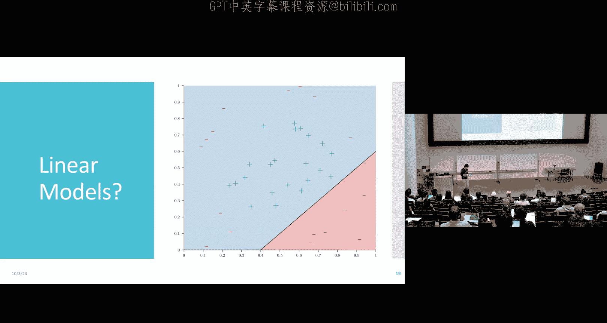
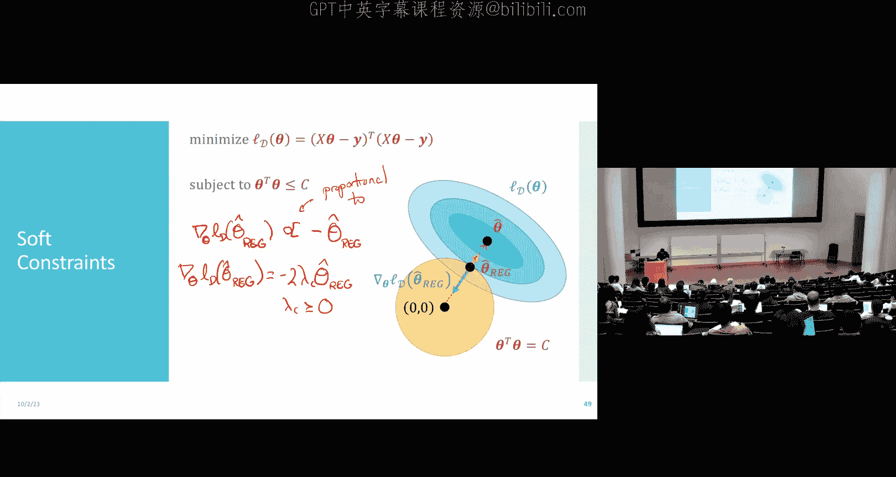
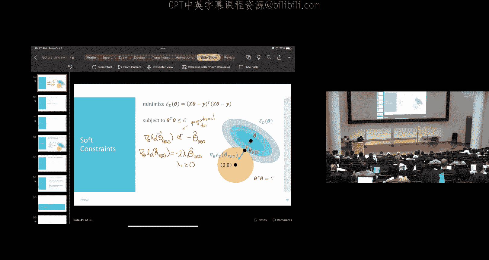
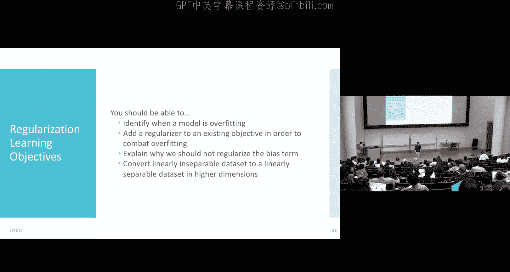

# CMU《机器学习导论｜Fall 2023 10-301⧸601 Introduction to Machine Learning》中英字幕（deepseek p10 Lecture_10_Regularization.zh_en -BV1Z2cUefE4A_p10-

## 1. 逻辑回归回顾

在本节课中，我们将回顾逻辑回归的相关内容，并引入正则化方法。

### 1.1 逻辑回归模型

逻辑回归模型使用sigmoid函数将线性组合的特征映射到0到1之间，从而预测概率。

**公式**：

$$
\sigma(\theta^T x) = \frac{1}{1 + e^{-(\theta^T x)}}
$$

### 1.2 逻辑回归的决策边界

逻辑回归的决策边界是一条将数据集分为两类（例如，红色圆圈和蓝色三角形）的线。

### 1.3 逻辑回归的优势

逻辑回归模型简单、高效，并且可以用于二分类问题。

## 2. 正则化方法

正则化方法通过添加约束条件来防止模型过拟合。

### 2.1 过拟合问题

当模型过于复杂时，它可能会在训练数据上表现良好，但在测试数据上表现不佳，这种现象称为过拟合。

### 2.2 正则化方法

正则化方法通过添加一个正则化项到损失函数中，来惩罚模型参数的过大值。

**公式**：

$$
J(\theta) = \frac{1}{2m} \sum_{i=1}^{m} (h_\theta(x^{(i)}) - y^{(i)})^2 + \lambda \sum_{j=1}^{n} \theta_j^2
$$

其中，$h_\theta(x)$ 是逻辑回归模型的预测函数，$\lambda$ 是正则化参数。

### 2.3 L2正则化

L2正则化也称为岭回归，它使用L2范数作为正则化项。

**公式**：

$$
R(\theta) = \sum_{j=1}^{n} \theta_j^2
$$

### 2.4 L1正则化

L1正则化也称为Lasso回归，它使用L1范数作为正则化项。

**公式**：

$$
R(\theta) = \sum_{j=1}^{n} |\theta_j|
$$

## 3. 正则化方法的求解

正则化方法通常使用拉格朗日乘数法进行求解。

### 3.1 拉格朗日乘数法

拉格朗日乘数法将约束优化问题转化为无约束优化问题。

**公式**：

$$
L(\theta, \alpha) = J(\theta) + \alpha R(\theta)
$$

其中，$\alpha$ 是拉格朗日乘数。

### 3.2 求解过程

1. 计算拉格朗日函数的梯度。
2. 将梯度设置为0，求解拉格朗日乘数。
3. 使用拉格朗日乘数求解正则化模型的参数。

## 4. 总结

本节课介绍了逻辑回归和正则化方法，并展示了如何使用正则化方法来防止模型过拟合。

**本节课中我们一起学习了**：

* 逻辑回归模型
* 正则化方法
* L2正则化和L1正则化
* 拉格朗日乘数法