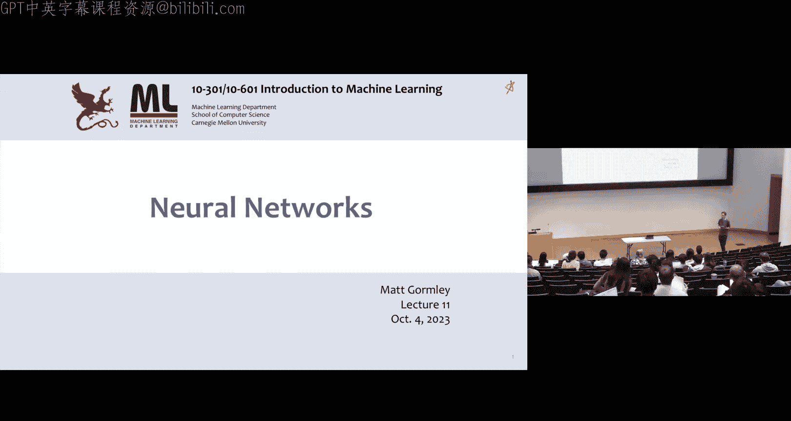
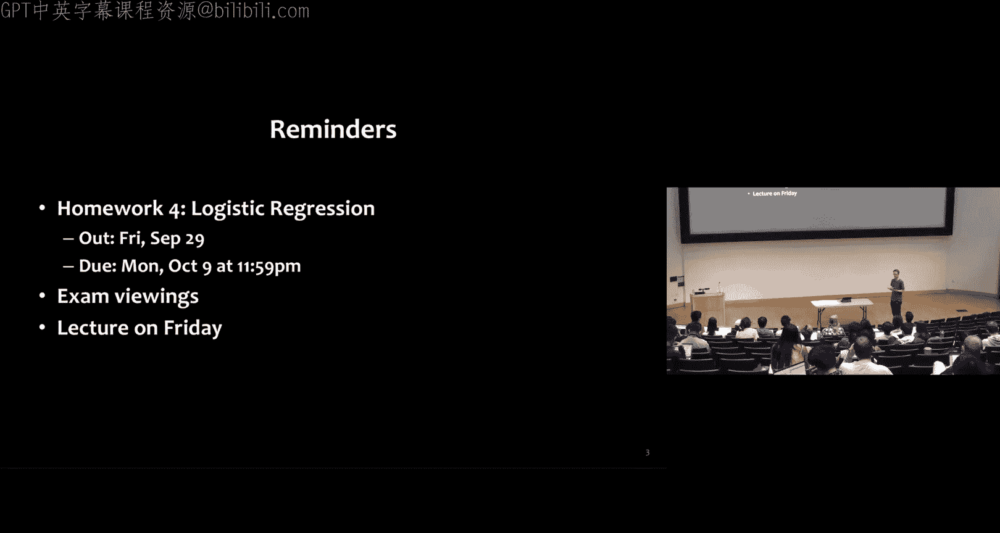
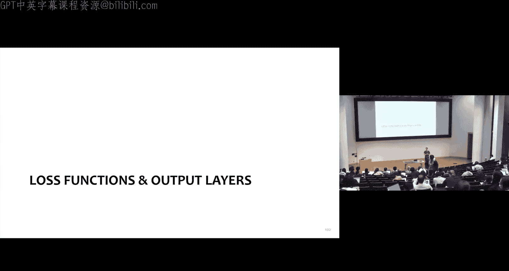

# CMU《机器学习导论｜Fall 2023 10-301⧸601 Introduction to Machine Learning》中英字幕（deepseek p11 Lecture_11_Neural_Networks.zh_en -BV1Z2cUefE4A_p11-

All right， good morning， everyone。Welcome back to 301601。Today we have。A pivot towards， I think。

 one of my favorite topics。 And it's particularly。😊。

I think exciting to be talking about this topic in the current climate， and that's neural networks。

And neural networks are essentially at the heart of deep learning。

 They're at the heart of all of the sort of revolution and generative AI that we're seeing right now。

And。And so today， what we're going to be thinking about。

Is how to establish a new kind of decision boundary， a new kind of decision rule。

Using a special kind of parameterized function called a neural net。Okay， a couple reminders。

 homeworkmark4， you all know about exam viewings we just announced。

 one of the really important things to know about our exam viewings。

Is that they allow us to sort of protect the work that you are all doing by so what we used to do was we would just release a PDF of the exam back to everyone and it's super easy for us。

 it takes like no work， you just click publishub on gradecope and then we started to notice that our past exams were showing up on these sites where you can pay for PDFs of past exams。

And so now we have some very strict rules in place to kind of。

Protect essentially the degree that you're getting and that involves a lot of inconvenience for us and some inconvenience for you。

 meaning that you'll have to print out a paper copy of your rubrics show up to an exam viewing in person to view a paper copy of your exam feels very old-fashed。

 but it works really well the key thing that I need you to know is in the exam viewing room your Ts are going to be totally swamped。

 there's like two of them maybe and all they have time to do is just like get exams into people's hands so when you have a question about the exam。

Turn to your neighbor who's sitting next to you in that room。

 ask them what did you get on this problem this is your chance to dialogue with other students about these problems。

 the only mechanism that we have for dialogue with you about the exam is regrade request。

 you can't talk to the TA during the exam viewing there's just there's not a mechanism for that timewise。

Okay， and then last reminder is just that there's lecture on Friday instead of recitation just to kind of keep the schedule in order。

Okay， so here we start with a high level recipe for machine learning。 Okay。

 hopefully this feels familiar。 You're given some training data pairs。 these are X I，Y I pairs。And。

Your job is to choose a decision function。Some F theta or H theta。And a loss function， L。

Okay so your training data， it might be like images， labeled as like face， not a face。

 something if you're doing face recognition。Your decision function。

 it could be something like a linear regression model， alingistic regression model。

 maybe a neural network。Your loss function， well， you guys already know a couple of these like squared error for linear regression。

 negative log likelihood for logistic regression。We'll think about these and more today。

Or maybe actually next time。Then you define a goal as minimizing the empirical risk。

 this is actually exactly how we trained linear regression and how we trained logistic regression。

 which is just you're minimizing the average loss of your prediction。Against the true label。

 averaging over all of the training examples。 and then。

You train with something like stochastic gradient descent， taking small steps opposite the gradient。

This is sort of a foundational recipe for us， and what we're going to do now is we're going to think about sort of two really interesting problems。

 one is how to compute gradients and Henry is going to introduce this algorithm called back propagation。

😊，That's going to be a general purpose way of actually computing those gradients that we need。

What I want to talk about today is。A new class of decision functions。It's called neural nets。

 and we'll kind of think about how to vary this recipe slightly。All right。

Here is your first look at a neural net diagram。Okay。

 it feels a little bit anticclimactic because at the top of the slide， it says linear regression。

 right， But what's important is how we drew a picture of linear regression here。 So let's unpack it。

😊，What we're saying is we have our input features， x1， x2， x3， xMM features。

 and we have the usual weights for linear regression， but they're labeled now on these little arrows。

And what this picture is saying is the way that you compute Y is by multiplying x1 with the weight on its edge。

 theta 1， and then add to that x 2 times theta 2， and then add to that x 3 times theta 3 and so on。

Once you've essentially computed a dot product。You pass that through some function sigma。

In this case， Sigma is just going to be the identity function， right。

 It's just going to return the value that you passed in。And that gives us back linear regression。

Okay， so to be this。Ever so slightly more interesting。We could change。The function sigma。

 not to be the identity function， but to be the sigmoid function or the logistic function。

And if we do that。What we get back is exactly the logistic regression model。Okay。

So here our decision function is sigmoid of theta transpose x。In this case。

 we think of why as representing。The probability of the positive class。Or the y equals one class。

Okay， so we could also do perceptron， just make sigma the sine function。

and this picture kind of captures all of these different models just varying this sigmoid。Okay。

 so here's a neural network。The picture actually has the same semantics。

 it's just that we've kind of grown its complexity a little bit。Okay， so let's unpack that picture。嗯。

I want to assume that we already trained our neural network。Okay。

 this is sort of backwards from how we've been doing things。

 but assume that you already have the weights of the neural network or the parameters。

And now we want to make a new prediction， so we take in some feature vector， 13，27。Okay。

 that's called the input layer。And we're going to perform what's called feed forward computation。

 Okay， so let's start by computing the first hidden unit on the left。

So we do that by multiplying 13 times 0。1 plus 2 times 0。3 plus 7 times negative 。2。

 we're essentially taking the dot product of the features with the blue weights。That gives us 0。5。

 that we pass 0。5 through some nonlinear activation function。 in this case。

 it's the sigmoid function， just like logistic regression。And we get back 。62。

So the computation of that first hidden unit is essentially just the computation that we do for a binary logistic regression model。

Let's do the second hidden unit。 Now we take 1327， and we take its dot product with negative 。4。5。8。

 the red weights。that gives us 1。4， pass that through sigmoid to get 0。80。

We have the second hidden unit。Now for the third， it's a little different。

 we take as input to the third layer， the hidden units， so we take 0。62 times negative 0。7 plus 0。

80 times 0。9 that gives us 0。29 pass that through a sigm and gives us 0。57。

 and that's the value of the last hidden unit in the output layer。Okay。

 so here is the full feed forward computation， and it really does resemble essentially a bunch of little logistic regression models that we've kind of tacked together in this interesting way。

😊，But there's a big difference from real logistic regression。At training time。

 we're only going to have access to the value of why， the output layer。

And we're going to have to learn to actually create useful values for what we'll call Z1 and Z2。

The values of the hidden units。Okay， so just to kind of flesh this out a little。

It's fun to actually think about why it's called a neural network。

So let me draw a very loose analogy for you from the biological model of a neural network to our artificial one。

😊，So in the brain， a neuron is an excitable cell。ASyapsse is like a connection between neurons and a neuron sends an electrochemical pulse along its synapses when some sufficient voltage change occurs。

😊，And then that biological neural network， your brain。

 is a collection of neurons along some pathway through the brain okay？

So in the artificial neural network， a neuron is a node in one of these directed acyclic graphs。

The weight is one of those multipliers on the edge。And our activation function。

 kind of like the synapses it's a nonlinear thresholdholding function， which allows a neuron to。

 we say fire when the input value is sufficiently high。 So think about that sigmoid function， right。

 when that dot product。😊，Of the input to the layer with the weights is a large positive value。

 it takes value close to1， and when it's a large negative value， it stays close to0。

So if it's large enough， it feels like it's firing at value1。O。

 so then the neuro net is a collection of neurons into a directed basicallycycl graph with which defines some differentiable function。

 And what's kind of interesting about this is。The biological computation is blazing fast， right。

 Your neuron switching time is something like 0。01 seconds。 The number of neurons is 10 to the 10th。

 and the number of connections per neuron is like 10 to the fifth。😊。

So if you were to just close your eyes。And then open them。In about a tenth0 of a second。

 you're going to recognize the scene。In front of you you'll say。

 oh okay we're still in Mac economy so what that means is given the number of neurons。

 this is not happening in sequentially there's a lot of computation happening in parallel and similarly we do this highly parallel distributed computation these days it's all done on GPUs for neural networks。

😊，And。And likewise， that computation can happen in parallel。Okay。

 so now let's define a one hidden layer neural net。To do that， I want to sketch out。

Sort of both parts of this one is the。The actual picture of the neural net diagram and。

The other is the math that goes along with it。So what we should start with here。Is。

The different values that we're computing。So y is at the top？啊。Z1 and Z2 are used to compute y。

And we're just going to have two features， x1 and x2 to keep things simple。Okay， and so we have our。

Input layer down here。 our hidden layer here。And our output layer at the top。So。

If we wanted to compute Z1。We would do that as a function of X1 and x 2。

And we would use parameter values。 Let's call them alphapha 11。And Al 12。Nowe， to compute。Z 2。

We're going to use x 1 and X 2 again。 But this time， we're going to use the weights。

Alpha 21 and Alpha 22。And then finally， when we're ready to compute why。We will do so with weights。

 beta 1 and beta 2。Okay， so there's a different weight on each edge。And。We could say。That。

We're going to let sigma。B the activate so called activation function。Yess。

And if we were to define sigma。As sigmoid。Then we have sigma of a is equal to one over。1 plus X。

Of negative a。So why don't we just think about what these values are， X，Y， Z。

 So each of these little Xi values are XM values， let's say。Each of those is a real number。

And similarly， each of the ZM values is also a real number。呃。And this would be sort of in general。

But then we could also say that Z M is in the range。Or the open range。Z to one。If sigma is sigmoid。

Because then we actually know that。The range of those values is limited。Okay。

 so now let's actually think about the computation that we're going to do to produce。

The hidden and the output layer。So the first one we'll do is Z1。So Z1， we're going to compute。

As sigma of。Alpha 11 x1。Plus， alpha 12， x2。Okay。Now。The thing is。

If we were doing an actual binary logistic regression。Then。

We would want to be sure to include an additional term here。 What is， what is that term。Yeah。

 a biasor or an intercepted term。So we could call that alpha 10， okay。And that would give us C1。Now。

 let's suppose we wanted to compute Z2。So here we're going to have alpha21 times x1。Plus， alphapha 2。

2。Tys X2。Plus， a different bias term， which is alpha 20。Okay， and that gives us Z2。Okay， so now。

We could think about how to compute why。So why is。It's going to be sigma。

 It's going to be the same form。But now it's beta 1， not times x1， but times z1。Plus。

 beta 2 times z2。Plus beta 0。Okay。And。The interesting thing， though。

 is that you could view Y as a function of X。And the way to do that would be to substitute in。For Z1。

 the thing that we actually compute in terms of x。 So that would be beta1 times。

 I could copy this down。Alpha 1，1， x 1 plus。Alpha 1，2， x 2。Plus， alpha 10。And so。

Here we're now getting。At the fact that。We usually write why。In terms of Z1 and Z2。

Because it shows us the。The sort of intermediate computation that we need along the way。But。In fact。

There's。This sort of additional computation that went into that。So to get Z2。

If we substitute that in， we'd have alpha 21 x1。Plus， alpha 22 x2。Plus， alphapha 20。

Then then finally， we'd have our。Intercept term for why。Now。I guess what's interesting here is that。

The value of y that we're computing here。If you had some random variable， say capital Y。

We're essentially treating this little Y as giving us。The probability。Of that random variable。

 equaling one。And we could even say we could write that conditionally。So like given the vector X。

The parameters is alpha and beta。Okay。So。Maybe the remaining question is。

 how would we actually make a prediction？So after you do all of this computation。

Suppose you wanted to。Actually predict a 01 value。How would you actually predict a 01 value from this？

Yeah。Exactly。In other words， we could use a base optimal classifier。

And that would just be a thresholdholding。On this probability。So we could say。Our classifier here。

Is going to produce sub Y hat， that's our hard prediction。Which is going to be。Our function， H。

Applied to vector x， and it will be。Say one， if y is greater than or equal to 05。And zero otherwise。

Okay。So that would give us an actual way of。Of having a classifier in the end。Okay。

 so this is what a neural network with one hidden layer looks like。

And we've been able to now establish a bunch of notation that's going to be useful to us as we build up through more complicated networks。

Okay， so here's sort of a slide capturing the same thing。 and again。We can now really see， oh， sorry。

 This is not exactly the same。 We have three features this time。 And now we can really see that。

This is just like a bunch of logistic regression models。Okay。So the next question is。

How on earth does this help us？Like we have this new function。But。Like。

 what do we actually get out of it？So to think about that。

 I want to actually have a running example here。Of face recognition。So。

So we could actually think about how do you take in a feature vector X？

Representing one of those images and then predict a 0，1 label like face， not a face。

The thing is these images。They're a little bit hard to work with and practice。

 so I was thinking that we could work with simpler images。

So I'm going to actually resize the images down to just two pixels。

 and I'm going to make them grayscale。Okay。So now we just have two real valued features， X 1 and X 2。

Okay， and those are our images and we need to predict whether it's a face or not a face。😊，Okay。

 this might be challenging。You are guys are good。 I think we can handle it。Although honestly， I mean。

You know， two features， it's a lot。 It's a lot to throw at you and。You know。

 it's still early in the morning。 Maybe， maybe we should simplify further。

 Let's go down to just one feature， one pixel， one grayscale pixel。 And from that pixel。

 we'll try to predict face， not a face。 Okay， we'll see how far we can get there。就啊。

So what we need first here for。One dimensional face recognition。Is a data set。So our data set。

Is going to consist of。Some plus points and some minus points。And so here we have the real line。And。

You know， it looks like。Zero。What。To。Say all the way up to6，7， eight，9， whatever。

And somewhere in the middle。We have a collection of plus points。And then， on the。On the one side。

 we have some minuses， and then we also have some minuses on the other side。Okay。

 so this is our data set。And。So this is our feature。X1， there's only one feature。

And the plus minus is telling us the y value。So what do we do now？Well， I want to think about how to。

Actually， take this and。呃。Driry it in a different way。So namely。I want to draw this， so that。Our。

Our picture。Actually uses a vertical axis。For our y value， so this will be our y axis。

And this will be our feature axis x1。And what we could do now。Is we could actually draw。

Points on here。That are， so our， our minus points we could have as。say。Y equals0。

And then this is like y equals1。To。3。Then down in the negative direction， right， And so。

 and then here we had， you know， something like 0，1。To。Three， four， five， six， seven。And。

So now our minus points are。Y equals zero points over here。And then our y equals one points。

We draw them up here。And then we have more minus points over here。O。

So this is the new representation of the data。嗯。What's what's funny about this is。

We're still doing classification here，Usually if we were doing classification。嗯。

When we draw the pictures of this， we wouldn't actually show。

Like an additional vertical axis to represent the y value。

 we would usually just rely on the top picture with pluses and minuses。

 So this is actually kind of a deviation from what we normally do。

And so what I want to think about is two functions。 The first one。We'll call H。呃。H A。Of x。

And it's going to look like this， this H of x。Is essentially what a binary logistic regression model？

Would learn if you trained it only on the left blue points and the center red points。Great。

So what would we learn if we trained a binary logistic regression just on the center red points and the right blue points？

What would that look like？Yeah， you just kind of mirror this thing。Right。

And what this binary logistic regression model is trying to do。It wouldn't swoop up at the end。

 sorry。Sloppy here。Is it's trying to use a sigmoid so that wherever it's y equals1。

 we have high probability of。Y equals 1， and wherever it's y equals 0。

 we have low probability of y equals 1。Okay。Okay， so here's where things get interesting。

What I want you to think about is this question。What is this new function， Let's call it。

Let's call it a function Zc of x。Where and where I define Z C of x as。HA of x。呃。Plus。Hb of x。And。

And maybe we could say。呃。We could take that， and。If we wanted to。Divided by 2。OK。So。I think that。

Or actually， let me， let me think about this a different way。 So。

 so what if instead we start with a different setup here。So I'm going gradually build up to。

Some H of x。啊。Well， actually no， let's start with the Z，So this is Zc of x。

What is this function going to look like？How would I plot this， Can you be more descriptive than？

Wfi啊。了在？有话食。Great， so it's 0。5 all along here， and then it swoops up to 2。Okay sorry， 0。5 there。

 and then it swoops up to 1。And then it goes back down to 0。5。So that is the function Zc of x。Okay。

 so。So now what I want us to get to is。A picture of。A different function。HC of x。

 which is going to be a little more interesting。So HCc of x is going to be。呃，在。The sigmoid function。

Applied to。W A。Times H of x。Plus， WB。Times Hb of x。Plus sum w0。And。But in order to unpack this。

I want us to actually draw a couple functions。So oh， and we need some weight values here。So。

 let's set W A。Equal to 2。WB equal to 2。And w0 equal to negative 3。Okay。

 so the first function that I want to draw。Is going to be very similar to what we just came up with CC of x。

Let's call it function 1。Which is just going to be this thing in brackets。WA， H A of X。WB，HB of x。

Okay， so I'll draw this one for you。So it's going to be two times H A plus two times H B。

 So it's going to be like this dashed line。 It's going to start at 2。And then。It's going to。呃。Go up。

Oh， sorry， it would start at zero。Let's see。So， yeah， we want。Oh， it's going to go up to4 yeah。

It's going to start at zero here。See I should have had you guys drive it for me？

Go all the way up to four and then come back down。To zero on this side。Okay。Oh yeah。

 I was right the first time tricked me。All right， we'll ignore the dashed line。

 thankfully we can draw a solid line， so it would start it， yeah， okay。

 so I think I was right the first time。😊，So。You could think of this as just all we're doing is we're taking two times Zc of x。

 right？So that's why it moved up。Or no， yeah， four times Z of x。Okay。So。Yeah， that's correct。Okay。

 so you can see now that we have this。Interesting nonlinear function。

But it doesn't look anything like what we would want in the sense of。It doesn't look like。

Something that we could use as a probability。Okay， so if instead we did this function inside the sigmoid。

 so let's call this function 2。And maybe we'll color function2。As red。

So all I've done is I've subtracted off three。So now our function starts。At negative1。

And it goes up to。1。And then back down to negative one。Okay， so this is function 2。ok。All right。

 so the last most interesting function。Is going to be H of x。

What happens when you pass function 2 through a sigmoid？What do you get back？哦。いや。

One wise lessons here or between zero。Yeah， so when， when y is greater than 0。

 it's going to return something between 。5 and 1。And the larger it gets， the closer the one it gets。

When y is less than0。It's going to be between 0 and 。5 and closer to the more negative。

 the closer to 0。Okay， so the final function that we get is going to be this pink thing。

 which is close to 0 here。 And then it swoops up and is close to one there。

And then it swoops back down and is close to zero over here。O。Now。I just constructed this by hand。

 but it illustrates something incredibly powerful that we could not do with logistic regression。

If you think about the decision boundary。😡，That we just constructed。Right。

 the actual decision boundary is saying everything over here。Is going to be classified as y equals 0。

If you use H of x as a probability， because it's less than 05。

Everything in the middle is classified as y equals1。And everything on the right is classified。

 y equals0。And so what we've just accomplished is a nonlinear decision boundary。

Right a linear decision boundary would have been。Use a point that separates right from left。

But now we've actually accomplished an interval。And one dimensional space。

 which is a nonlinear decision boundary。Okay， so as well， how did we do that， we did that。

By taking two logistic regression functions， those are like H A， HB。 Those are like hidden units。

And we took some linear combination of them。And then pass them through another nonlinearity。

This is essentially a one hidden layer neural network。Okay。And。So。All right。

 we had this running example。 It'd be nice if we could flesh this out a little more clearly。

 So to do that， I'd like to。😊，You know， grow the example， you know。

 do something a little closer to real facial recognition。 Let's use two pixels。Okay。

 for the two pixel thing， I need four volunteers and the volunteers。

 you guys don't actually have to think very hard。 The class is going to think for you。

 All you have to do is hold a poster board。 It's a very large poster board， but。😊，嗯。

That's pretty much it。Okay， so four volunteers。哎。Oh， I should't note。

 I'm like almost certain that I'm， I'm like sniffling up here。 I don't think I'm sick。

 I put on a jacket that。I think。ItM have been covered in pollen or something。Right before class and。

I'm like sneezing， but I think I'm quite healthy。 Anyway， you can grab a poster board。

So you remember those red points and blue points where we gave you guys folders？Two more volunteers。

す。Yes。One more volunteer。对。Thank you。Okay， so。Here。We now have two features。

An x1 axis that's running along the floor in this direction。

And an x2 axis that's running along the floor in this direction。

Just like our one dimensional picture。We have a vertical axis that's telling us the Y label。

If it's y equals1， it's up on the table。😡，If it's y equals 0， it's down on the floor。

So suppose we trained。A logistic regression model。And we wanted to see what sigmoid of theta transpose x。

 what that function actually looked like in three dimensions。When trained on this data set。Okay。

 so we have some poster boards。 they could be used to represent a function in three dimensions。

And the object here is for you guys to figure out how is it？

That you could put into words what that function would actually look like。Three ideas。

You guys aren't allowed to answer， they have to come up with that。

What would a binary logistic regression function Sigma of， So it's going to be sigma。Of theta 1。X1。呃。

Plus， theta 2 x2。Plus， an intercept term， theta to zero。What would that function look like？

It's analogous to something like HA of X。But in three dimensions。Any ideas。

Think in three dimensions is hard， let me see if I can help。So let's take two poster boards。

 You guys can kind of attach them at the short edge by。You do let's do the red and yellow here。

 So someone needs to hold like pinch the two poster boards together。 Great。

 And now if you bring it over here。We could imagine。Flipping it up so that it's flat。Okay。

 I guess maybe yeah， there we go。Now here's the tricky part。

 we want something that kind of looks like a sigmoid function， which would be a line。

But we want it extruded across a plane。Okay， so what you would essentially need to do is get a function。

That's kind of flat here and then swings down and is flat down there。It's a little bit of a。

 it's like a。Poster board， can you do it， maybe we need a third poster board actually。

You want to bring the green one over？So if you can attach the green poster board to the end。

So now you can see， and if you attach your poster board in here。Then we can just sort of， yeah。

 s the。 Yeah， that's great。So what we have here is essentially the function Sigma of theta transpose X。

And it's essentially returning a probability that's close to one for the red points and close to zero for the blue points。

Okay， so now if。Instead。We trained a logistic regression model。On， okay。

 so you guys can step back for a second。 Suppose we trained it on these blue points。Right here。

And those red points。Now， what would the function look like？Yeah， it would be like the same thing。

 you guys could try it again here。 You guys are pretty good at this。

 It would be the same thing except it would be like flat here。 I is the problem， I guess here we go。

 and then it would swoop down towards the blue points， okay。😊。

So now we can see this is kind of like HB of x， right， but in three dimensions。Okay。So。

Here's an interesting thought。What if we took a linear combination？Of H A of x and H B of x。

And then we passed those through a sigmoid。Okay， so why don't we leave this red and yellow here。

 And now if you bring these two over here， the purple and the green。

And we add our HA of X picture back。So if we were to take H of x and HB of x。

 take some linear combination of them， pass them through a sigmoid。

 we would get back a function that looked like this。

 it would be low probability on these blue points。Probability y equals 1 here。

 and then probability of y equals 0 really low over here。Okay。Now， you might be thinking， well。

 that's cool， this is now just like the one dimensional thing that we did。

But it doesn't feel very like much like we're using the x2 axis in this direction。

 what if we added now some blue points over here， and further some blue points back here？

Okay so now there's no question that we would have to have a nonlinear decision boundary。

 and now it's so convenient， we have four poster boards。

 imagine if we had four different logistic regressions。😊。

One trained on these and the red points and these on the red points and these are the red points。

 Okay， so why don't we pick up the green and the yellow。

And you could each take one side here and you guys with the purple and red can kind of stay in the same place。

 but now this is the magical part， if you take a poster board and you put your hands on the short sides of it。

And then you kind of push together in just the right way you can create a sigmoid function。

 It could be a little bit short。But so you can imagine now this new function that's essentially high probability of y equals 1 in the center and low probability of y equals1 on the outsides。

😊，Right， and we accomplish this by putting together essentially four logistic regressions。😊，O。

So the resulting function that we learn is going to give us back a nonlinear decision boundary。

So where would the decision boundary be？Can someone describe what the decision boundary would look like。

 It would be a line on the floor or a curve on the floor。 What would that look like。

It would just be like a big circle around the table。

 because the points where the probability is equal to 0。5， that's the decision boundary。

 which is about halfway up on this function that we're creating here。

 which is like a big circle around the table。Okay， let's give these guys a round of applause。

 thanks for your help， guys， you could just drop them back on the table。Okay so。

So this is a powerful tool that we have at our disposal。😊，And oh， thank you。

And it can do not just face recognition with two pixels， but many pixels。

So here actually is your first poll question。And。So this is question one。Suppose。Oh， and。

Your options are a， true， B false。And C toxic， don't pick C。

 So suppose you're training a one hidden layer neural network。

With sigmoid activations for binary classification。On on the data set shown here with。

Plus minus points。Qu is true or false， there' is a unique set of parameters that maximize the likelihood。

Of the data set above。True or false， and you should definitely talk to your neighbor about it。

The answers are coming in as 45% A。And 55% B， so you guys are rather split on this issue。

So let me try to convince you of the right answer。Suppose you give me a set of parameters and you claim these are the unique set of parameters that maximize likelihood。

 and they are。Alpha 1 here， alpha 2 here。Beta 1 there and beta 2 there。O。So， I claim that。

I can give you back。Another set of parameters。That are just as good as the parameters you gave me。

and they are alpha 1 prime， alpha 2 prime。呃。Beta1 prime and beta 2 prime。Okay。

Does anyone know what they would be？いや。少爱搞跳香。Exactly。Alpha 1 prime would be alpha 2。

 Al 2 prime would be alpha 1， beta 1 prime would be beta 2， and beta 2 prime would be beta 1。

Because think about the neural network computation， it's symmetrical。

 it doesn't care whether you compute Z1 on the left or Z1 on the right。

 if you flip flop the parameters， you're getting back a different function。😡，Right。

 but it's going to give you back exactly the same likelihood。Okay。

 if you think about it in terms of poster boards， it's kind of like saying say we had one H of x here and one of HB of x over there。

 well， you could just swap places right， you could swing them around so that now HA of x is on this side and HB of x is on that side and it would give you back essentially the same function。

😡，But they're not the same parameters。Okay， so what's interesting then？😊。

Is that so for this false answer。This actually implies for us that even in this super simple case。

Our objective function。It is non convex。Meaning that if you think about the actual function that we're optimizing。

It's going to have at least it's going to have like two different local minima right in that H of x and HB of x case。

 to get H of x over here， you actually have to go through a low likelihood space， right？😡。

To swap HA into of x and HB of x， there's not like equally good answers in between them。

 you actually have to move through some things that are not good。Okay。

 so this is the sense in which even for these simple problems。

 we've left the land of nice convex problems。😊，Okay， so what else do we have to do today well。

 essentially theres even for a basic neural network。

 there's all sorts of design decisions that you can make number of hidden layers。

 the depth of the network， the number of hidden units per layer， the width of the network。

 the type of activation function， the nonlinearity。😊，The form of the objective function。

 how to initialize the parameters。 Okay， so let's think through some of these。

Let's start by thinking about building wider networks。Okay， so if you're building a neural net。

Suppose you choose the number of hidden units D to be equal to the number of input features M。😡。

Okay well in that case， the hidden units could be used。

 remember they're not specified by hand the way we've been specifieding them。

 they're not specified in your training data， but rather they're going to be learned。

 That's what Henry is going to talk about next time here we're just trying to get a handle on what these functions actually are。

And so you could imagine， though， that you might learn some parameters that cause the Z1 through ZD to literally just be a copy of your features。

 right？😡，You can learn essentially that all of the weights on these crossing edges are zero。

And that these are ones。 And so it just copies them。That would be super uninteresting。

But you could also learn that maybe Z1 is actually like an interesting nonlinear combination of features x1。

 x2 and x3。😊，Right。嗯。If the number of hidden units D was。Substantially less than M。

You could imagine it might actually pick out the most informative features。😡。

In your larger set M to use as hidden units D。呃。It might also be some lower dimensional projection of the features。

If D was a lot larger than M， well， then it might copy over all M features into some of the hidden units。

 and then use the remaining hidden units to produce interesting nonlinear combinations of the features。

Essentially， it could learn to do its own feature engineering for you。

Or some interesting mix of the above options。Okay， so I'm about to show you some decision boundary examples with real neural nets。

 we're going to have two input features， just x1 and x2。😊。

And then I'm going to vary the number of hidden units D， so let's see what we get。

So we're going to have four different data sets。A diagonal band of blue points。

 a little pocket of blue， and then these other ones where we have like other interspersed blues。

So here's the diagonal band， you can see all the blue points in the center surrounded by a wash of red。

And if you train logistic regression， this is what it predicts。Everything red。

 that's its decision boundary， right， And this is， in some sense， the best that it can do。

Because there's more red points than blue points， so it just predicts everything is red。

Kind of a big fail。Here is what we learn with a neural network and two hidden units， D is equal to 2。

Okay， this decision boundary is essentially exactly what we want。 And how is it getting there。 Well。

 it's learning one function that is essentially Z1， which is。呃。

Essentially some nonlinear combination of x1 and x2， right？

Where this is feature x1 and this is feature x2。It's like sigmoid of a weighted a of a linear combination of x1 and x2。

And that function F。Is essentially looking something like this。Here it's shown as a contour plot。

 but it's so steep that those contour lines are all crammed together。

Here it learns Z2 as some other function of x1 and x2。

And the contour plots are going off in this direction。喂。So。When you put them together to get why。

Which is sort of a third interesting。nonlinear combination of x1 and x2。We get this plateau function。

Where it has high probability mass。At the center and low probability mass on the outsides。

And that is what gives us。The desired decision boundary。If you have a pocket of points。

 here's what logistic regression learns。It's not very good。

Here's a neural network with three hidden units。Look at that， it actually gets it right。Okay。

 how did it do it Well， here's what it learned for Z1。

 it's like low probability over there and it swoops up high over here， here's Z2。

 it's low probability in that top corner and it swoops up high over there。

 here's Z3 low probability going up to high。And then it takes。

A linear combination of them passes it through a sigmoid and it gets back this function。

Which is a little plateau in the center。Okay。Let's look at a more complicated example。

So here I made this one。Because I wanted to show you。A case where a simple neural network fails。

 right？So what we're looking at is a blue followed by red， followed by blue， followed by red。

 or triangle circle， triangle circle。And I wanted to put this together so that you could actually see why。

 for some problems， even the neural network can't actually figure it out unless you give it enough hidden units。

Okay。So first， I trained logistic regression and it failed in an interesting way。Here's that failure。

Okay。And then I said， okay， let's。Let's train。呃 the。呃。Ohoops。错。Not ready to start rehearsing。You。

Okay， so here's logistic regressiong failing。 here's what K nearest neighbors gets。

 It actually nails it， right？😊，This is with k equals 5。Here is the failure of the neural network。😊。

Wait a minute， I got it right。 that can't be， that can't be it。

Maybe the slide is mislabeled or something， I mean， two hidden units， d equal to2。

 and it somehow did this。Wt a minute， let's look at this more carefully。

 So here's what it learned for Z1。It's a function like this。This is z1 of x。

Here is the function Z2 of x。It's much more shallow。Great。嗯。And here is y of x。

And look what it accomplished。I mean， this is honestly like one of the most beautiful pictures that you'll see in this entire course。

 the neural network actually figured out how to create with just two hidden units。

 this S shaped decision boundary。😊，Like when this happened。

 I had to sit there and I just assumed that I had a bug in my code because I was convinced that surely there was no way a neural network with two hidden units could come up with a decision boundary that could work here。

 and yet what it accomplished is it essentially it's hard to see in the picture。

 but essentially Z1 and Z2， one is much wider than the other。And as well。

 the actual slope of those contour lines is slightly offset。

And that little bit of difference in slope is what allows us to get this S shaped curve。

 such that we get the right decision boundary in the end。Okay。

 here's an example with two pockets of points。Logistic regressionggress fails。

 Can nearest neighbor nails it， here's neural nets with two hidden units。

 so this time it actually can't do it， it genuinely can't get it right。Okay。

 so then I trained with three hidden units， and it actually does a little bit better， right？

But it still misses up in this corner。Okay， so then I thought， well， maybe with four hidden units。

 it could get it right。是。But it got worse。Here's three hidden units。Here's four hidden units。

So this seemed strange。Why would three hidden units be doing better。Then four hidden units。

 any ideas？I mean， whatever the parameters of this were。

We could just copy those parameters over and then just ignore the third hidden unit。

 just zero out the parameters for the third hidden unit， and it should do at least this well。

 it shouldn't add more error down in this corner。So what happened here？That's right。Yeah。

 so the function that we're optimizing。Is some non convex thing。

And so we found a local optimum for the parameters， which got this error。

And it missed out on the better solution that was over here。Okay。

 so then what I did is I randomly initialized the parameters 10 times。

And I trained it a bunch of different times， and I found that even with four hidden units。

 it actually can do better。But this was just sort of an interesting case where it failed。

Here it is with 10 hidden units and it gets it right。Okay。

 so what if instead of building wider networks， we built deeper networks？

So here is an example of a neural net with two hidden layers and two hidden units each。

And you can see that the computation here is very， very simple notationally so we're now going to take in the first layer。

 we're going to take our hidden units and we're going to superscript them with a one。

 This is not indexing the training example。 It's indexing the layer。

 right It's like a little label saying these Zs are from the first layer。😊。

And these these with a two in the label。Are from the second layer。Okay， and so to compute Z1。

 superscript 1， z sub 1， superscript 1， we just compute sigmoid of alpha sub 1，1， superscript 1。

 x1 plus alpha sub 1，2， superscript 1， x2 plus alpha 1，3， superscript 1， x3 plus alpha 1，0。

 superscript 1。😊，And then to compute Z2， we're going to compute z sub 2 superscript1 as sigmoid of alpha。

😊，2，1。Superscript one。Oh man， I don't think I can make it through this whole slide， guys， I mean。

 it's really pretty colors and everything， but。I'm would to be honest。

 I have limits and like I just can't do this job， I mean this is just crazy。

 I mean would ever who would even create a slide like this， I mean gosh。

 it's just obnoxious to look at I。😊，If only there was some way that we could just greatly simplify our expression of this computation。

Oh， oh， we could， actually。😊，You can see， okay， so what if。

What if we just use matrices and vectors right， so here's what I have in mind so all of these weights that you saw in this first picture。

 you could think of alpha superscript 1 as really like a matrix right it's a little two by3 matrix。😊。

And Alpha superscript 2 is like a little two by two matrix， right？Okay， so if we do that。

 now we could say。😊，In the more general case， if we have D sub1 hidden units in the first layer。

Then to compute Z superscript1， all we need to do is take the matrix alpha 1。

 multiply it by the vector X， and then add a bias vector B1。Where alpha 1 is a N M by D1 matrix。

 and B is just a D1 dimensional vector。Okay， so now when we want to compute Z2。

All we need is sigmoid of。The matrix alpha 2， which is m by D2 times z1。

 which is a D1 dimensional vector， oh， there's a mistake here。So this M should actually be。D1。Right。

Because Z1。Is itself。A D1 dimensional vector。And we're multiplying this times the transpose of something that's d1 by T2。

Right。And then we add to that。A D2 dimensional vector。

So if you think about this from a matrix multiplication perspective， this is like a D1 by1。

 and this thing transposed is really， once you transpose it， it's M by D1。😊，Oh wait。

 no other way around。呃。可以呀。And then， here。Did I get that wrong。 O， C I did get that wrong。Okay。

 so this x is M by one。And this alpha 1 transpose is d1 by M。And then this thing is D1 by one。

So what we get back is a vector d1 by1。Now what's interesting here is sigmoid is a function that's supposed to be applied to a scalar。

So this sigmoid is said to be applied。Element wise。To the vector。What we mean by element wise here？

Is when you write something like vector Z equals sigma of vector U。Right。

We're saying that the Ih element of Z。Is equal to sigma of。You eye for all I。

So this is just sort of a nice notational trick that we play with neural nets。Okay。

 then the last detail is we compute Y。From this Z2， which is。D2 by one。

 by multiplying it with a1 by D2 vector， and then we add a 1 by one matrix。

So what we get back is just a scalar here。So what's lovely about this is， first of all。

 we don't have to write out ridiculous looking slides like this。😊，That said， I think it's actually。

 if you're like， oh man， that was a lot of linear algebra really fast to understand what's going on。

 it's sometimes actually useful to go back to this picture because this is doing the same matrix vector computation that we just did。

 is just doing it in this like fully expanded out form right？😊，And so here。

 the only difference between these is that I kind of explicitly gave names of these B vectors。

So rather than。Kind of packing in the bias terms into something called alpha。Okay。

 and then if you wanted to do to say go back to the one hidden layer neural network that we had before。

Now you could think of each hidden unit。Z1 and Z2 in vector form as being computed as。

The dot product of X。With sub row of the weight matrix。That passed through the。The scalar sigmoid。

Okay， so this gets us up to two hidden layers， we could generalize that to three or four or five。

 and really the question is how many should we use， how deep should we go？😊。

So the theoretical answer is that a neural network with one hidden layer。

Is a universal function appromator。Meaning that for any continuous function， G of x。

 there exists a one hidden layer neural network， H theta of x。

Such that the difference between H theta of x and g of x for all is less than epsilon。For all X。

 assuming that you have sigmoid activation functions。What this is saying is somewhere out there。

For every function G of x， there's a neural network that's that perfect match。😡。

And it's such a perfect match that it's within epsilon of that function G at every point。Okay。

 it doesn't say anything about whether you can find that neural network。😡，Or learn it。

The empirical answer is before 2006， we would say， oh。

 deep networks being three or more hidden layers， they're too hard to train， you shouldn't do it。😊。

Then after 2006， we were like， oh， actually。Turns out deep networks are easier to train than shallow networks。

For many problems。Where a shallow network is two or fewer layers。

And the big caveat is you need to know and use the right set of tricks。To actually make it easy。Okay。

 so the other reason to like this idea of many deep layers is that traditional feature engineering is essentially building up levels of abstraction by hand。

 you might you know if you were doing computer vision， you might have pixels。

 then you could build up some functions that give you lines or parts or objects。

 a deep neural network could actually learn increasingly higher levels of abstraction from the data。

😊，And in fact， if you use a convolutional neural network。

 you can actually learn these little convolutions that pick out things like lines in an image and then parts of a face and then full face detectors。

😊，In the units， if you did the same thing on cars， you could learn different parts of cars and then full cars。

Okay， so here we have questions two and three on the poll。And。For both of them。The toxic option is E。

So for question two， we're asking for which of the data sets below。

 does there exist a one hidden layer neural network that achieves zero classification error。

 select all that apply？And for question three， for which of the data sets below does there exist a one hidden layer neural network for regression that achieves nearly zero mean squared error。

 select all that apply。Okay， so with your neighbor take。

Take one minute and go ahead and answer that question。 So let's start with let me spreadarrow。

 So I claim the correct answer is AB，C， and B， all of them。And by the universal function approator2。

 what we just said is there exists some neural network that can get nearly these zero means square error for all of these functions。

Oh， thanks。So for all of these functions， there exists some neural network that can get a nearly zero means square to error。

😊，I'm not claiming that you could easily learn it， but just that it exists。

The same thing goes for the ones on the left， the answer is all of these。

 and it's that we could learn a surface that gives us back whatever decision boundary it is that we need to correctly classify these。

Okay so what other choices do we have available to us another one is activation functions so far we've just been thinking about sigmoid activations。

 but we could also think about just sort of taking this picture of a neural network and expanding it out into sort of reusable parts right we have our input then a linear layer then a nonlinear layer then another linear layer than a nonlinear layer and what are we actually going to use for these functions sigma。

😊，Well。So far， we've assumed that Sigma is the sigmoid function。But in fact。

 you could swap out the sigmoid for something else， it's not really widely used anymore。

 a much more common one is the T0 H function。 you'll notice the key difference here is in the Y axis。

Where its shape is very similar， but it has a very different range between one and negative one as opposed to one and zero。

嗯。And。And this is the picture that。I think is so fascinating about to look at。

 so this is a 2010 paper that trained a bunch of different deep neural networks。😊。

I want to highlight the red and the blue， you can see that the blue curve is using a sigmoid activation。

 and the red curve is using a TNH activation function。😊，And so TNH is doing better。

But they kind of cheated right because the sigmoid only had depth4 whereas the T0H had depth5。

 so we should have run sigmoid with depth5 right for a fair comparison。Oh， they did。

 it's that black curve。Can you find the black curve？It's up here。And it does terribly。😡。

This is why we don't use sigmoid activation functions so much， they tend to get stuck。

 the gradients are really small when you're training these things in the bottom。

 and it's hard to get unstuck。😊，Another really popular function in use today is called the rectified linear unit or a REU。

 it's just a simple function max of 0 and X people have started using something called an ELU。

 which is basically just like a smooth version of that。😊。

That goes down to negative numbers on the left side。And similarly。

 we can see that ELU kind of yields lower error as in this blue curve than RELU。

 which is that red curve。Okay， so when we come back next time。

 Henry is going to think about how do you actually train these things？

And so we'll kick off by thinking about what sorts of loss functions you would need。

 objective functions， and then how to actually back propagate through those。😊。

