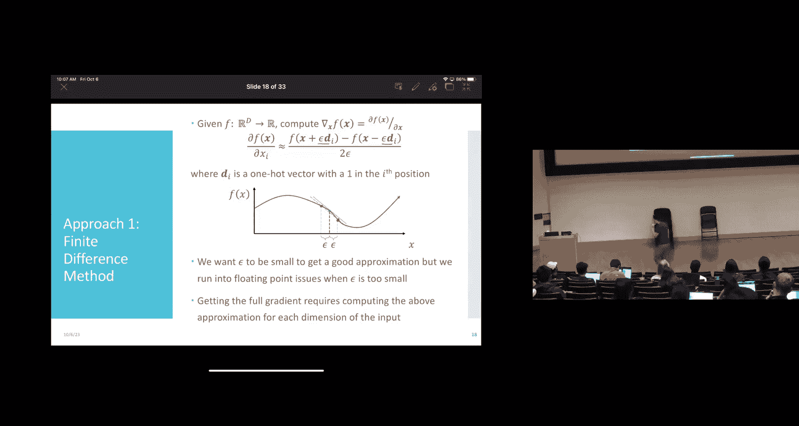
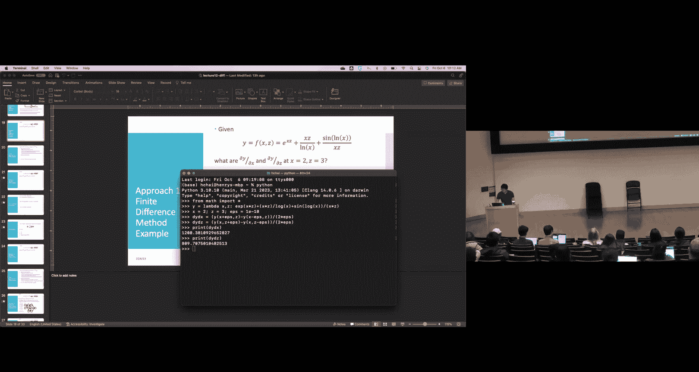
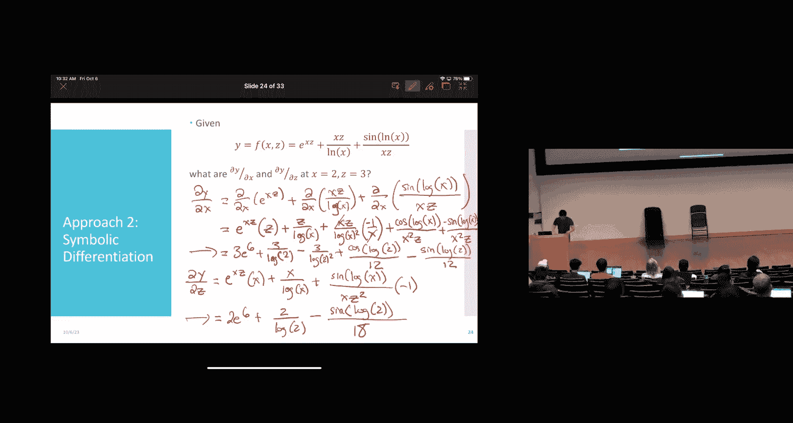
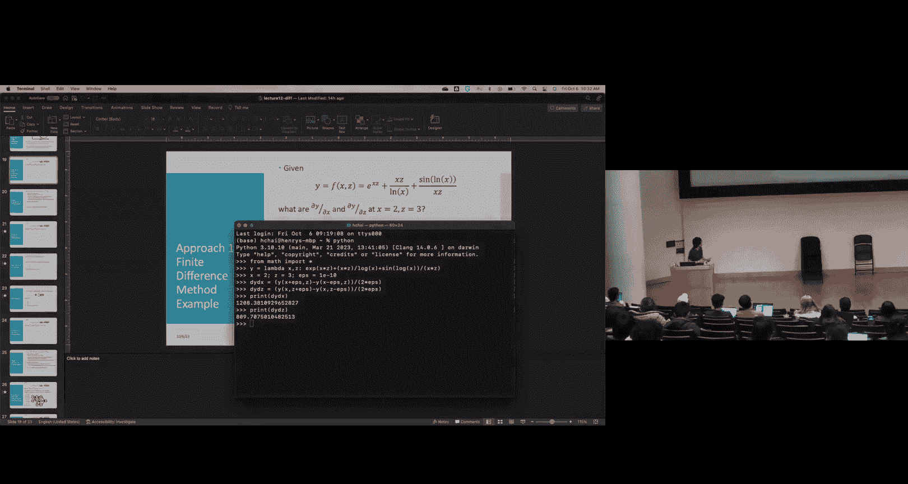
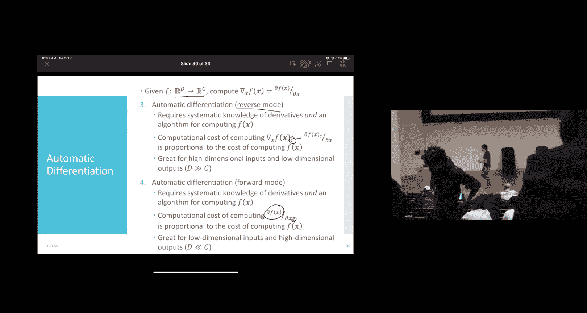

# CMU《机器学习导论｜Fall 2023 10-301⧸601 Introduction to Machine Learning》中英字幕（deepseek p12 Lecture_12_Backpropagation_I.zh_en -BV1Z2cUefE4A_p12-

Hello， hello， testing， testing。All right， good morning， everyone。Happy Friday。

 thank you all for joining us for lecture。😊，I I want to apologize。

 I kind of hate like spring Friday lectures on you。

 there's a good reason why your fifth homework is coming out on Monday。冰备了。も。course。

 all right so like I was saying， I apologize for having Friday lecture。

 there is a good reason why though your fifth homework is coming out on Monday。

 we need to make sure that you're prepared to do it it is due after fall break so you have plenty of time to work on it we write these homeworks with the intention of not having you work during your fall break so we encourage you to get started on it when it is released that way you can enjoy your break that being said that option is open to you the recitation that would have been today is moved to Wednesday that will help you cover homework5 one scheduling note not on here we do have a lecture on Friday next week so one week from today Also Matt mentioned this on Wednesday exam viewings have been happening there are two more for those of you who haven't yet had a chance to go see your exam those are tonight and then again on Monday night all that information。

😊，I on our course calendar， all of the logistics around our exam viewing can be found on Piazza from what I'm tod by RTAs。

 you guys have compored yourselves very well so far， let's try and keep that up。Okay。

 so you know what， a lot of logistics stuff， let me stop here。

 any logistics questions before I move on to content for today？😡，Yeah。You can show up to any of them。

 either of them， the remaining ones， just make sure to bring your CMU ID and a print out of your exam rubric from GrScope。

All right， so where do we leave all？On Wednesday Matt introduced this new model that we're going spend frankly a lot of time thinking about here and we called it a neural network。

 partly inspired by the biological neural networks that I presume reside in all of you and we ended on this note that we can sort of define these entities in matrix form and we're going to make use of that very heavily today and then again on Monday by trying to use this matrix form to compute gradients and derivatives those are going to come in very handy before I do that I want to just remind you all of one brief thing so if you look inside these sigma functions here you'll note that we're taking sort of like the linear form that we might have been familiar with from like linear regression or the perceptron or logistic regression and in all of those cases we played this notational trick where we sort of just folded in this vector of biases or previously this scalar。

😊，But now this vector of biases， we can fold this into our other parameter entities right we can fold this into our alpha matrices as just sort of the first row if you will and then if we prepend ones to all of our various output layers if we prepen to one to our input that you reduces the amount of overhead we need to keep track of that reduces the number of variables the number of parameters that we need to keep track of and so we're just going to start writing things like this I just want you to remember that implicit in there there's a bias term you sort of already know how to handle it。

😊，And written out like this well we can sort of algorithmically describe the procedure that Matt was sort of working out on paper using a quick algorithm known as forward propagation and so here the idea is you've let's say trained your neural network or you I don't know downloaded some pre-trained neural network from the internet。

 you have some set weights already and you want to use it to make predictions right how do you go about doing that is relatively easy。

 you just sort of initialize some output layer of the zero with layer。

 some output of the zero with layer to the feature vector that you're trying to make a prediction on we'll call this x prime and then going layer by layer starting with the first layer you can compute this sort of intermediate quantity well use a here to denote basically the input to the sigmoid function you can also think of this or you might see this in some places called like the linear layer or the linear。

😡，Operator all we're doing is taking some linear combination of the previous layers output。

And then we pass that through our sigmoid function remember here we're operating element wise。

 so this sigmoid function is being applied to each element of the vector a and we just keep doing this until we hit our last layer for notation purposes we differentiate the weights in our last layer with this beta iss actually also no good reason for that so if you want you could think of this as just being another set of alpha matrices regardless the output that you predict this y hat is just the beta weight matrix times the output from the last hidden layer z capital L and so algorithmically you can think of this as just sort of stepping forward layer by layer through our network hence forward propagation。

😡，All right， so this is all recount from Wednesday， let me stop here。

 I came out of the gates a little hot， What questions do you all have about this？Yeah。Sure。

 we're just making a distinction between the sort of weights from hidden layer to hidden layer and the weights from our last hidden layer to the output layer。

This is actually going to come up in just a second because sometimes we need to treat our output layer a little differently depending on the exact nature of the task。

But if you want， or if it helps you， you can think of this as just another weight matrix like the alphas。

Anything else here？Yeah。对的对。Is this similar to like W transpose x plus B， is that what you're asking？

对个。都据。Yeah， so what's going on in our linear layer is almost exactly that like we're taking some weight matrix now instead of a weight vector。

 our weight matrix alpha and we're just multiplying it by some input vector previously when we only were thinking about like linear regression or logistic regression you can think of that as like I think Matt had these cute pictures of like a one layer neural network all we're doing is we're applying that multiple times with a nonlineity sigma now。

嗯。All right， so here's where we're going for the next two lectures。

 We talked about the model and we've seen that it's relatively easy to make predictions with this model once you've trained it。

 But how on earth are we going to train it， right， And that's going to be the focus of these next two lectures and。

High level， you already know the answer we're going to train it。

 you're going train it in homework5 using stochastic gradient descent right so all that's going to be is you have some data set。

 you have some learning rate， and then you initialize all of your weights somehow。😡。

And looping until you hit some termination criteria。😊。

You shuffle your data and then you go point by point through your data computing gradients here。

 so again I've just sort of broken broken out the gradients of the weights going into your output beta and all of the weights between your hidden layers。

 these alphas a somewhat arbitrary distinction but regardless you can think of computing gradients for each of these parameter matrices and then taking steps in the opposite direction of the gradient so once you've computed the gradient at your current location for each of these entities。

😡，We just take a negative gamma step。In that direction。And you do this for a really long time。😡。

Hopefully not that long， I don't know， I actually forget how long homework five takes。

 but you do this for a really long time and then at some point you say good enough and we'll return those weights as the converged weights。

So this sketch leaves a lot to be desired， for instance。What on earth are these things。

 How are you going to initialize your weights， how are you going to decide when to stop We're going to talk about that all on Monday。

The answer is it looks kind of like what you've done before。

 but there's a little nuance with neural network training specifically instead we're going to focus the majority of today and Monday's lecture on two questions which is looking at this algorithm。

 the thing that stands out is，😡，How on earth well okay what is this loss function and then once you've decided that how on earth are we going to take these gradients these gradients that look sort of like really scary and frankly are somewhat like poorly defined entities as written that's what we're going to spend the majority of today and Monday's lecture focusing on I'm going to take a brief detour first and start with this easier question I say this is the easier question because much like stochastic gradient descent you already know the answer to what these loss function should be they are things that we've seen before so for instance you know all right notational shorthand I'm going to collect all the parameters of my neural network。

Just so I can stop writing alpha 1， ellipses， alpha L betada yada yada just so I can stop writing that I'm going to write capital theta so all of my parameters in this big sort of set capital theta here。

😡，If you're doing regression with your neural network。

 just use the squared error or I don't know if you're feeling edgy， just use the mean absolute error。

 whatever you want， it can be the same and so here I'm just showing point wise。

 the notation is this is the prediction of my neural network for a input value XI so one of my training data points。

 I just subtract that from the real value， the real target that I observed in my data YI and squared。

😡，For binary classification， we're going to use something called the cross entropy loss。

 but this is just a fancy name for the negative conditional log likelihood we've already seen this for linear regression so let me actually show you what it looks like here。

😡，We're going to again assume we have labels encoded as 01 and we're going to assume we'll talk about how you can do this in a second but we're going to assume that the output of our neural network corresponds to a probability much like the output of our logistic regression model was a probability because we pushed it through a sigmoid if I push the output of my neural network through a sigmoid I can make it be sort of some positive number between0 and1 and just assume that we're learning these probabilities here right and if I do that well then。

😡，My objective function， my pointwise objective function is to minimize the negative log of the actual point that I'm sort of focusing on。

 Y I Xi here。😡，Now it turns out we can write this in a very convenient way and that's what gives rise to this cross Enpy notation。

 so let me just walk you through that here， what we'll say let me change colors here。😊。

What we'll say is this is the negative log of， well。

 the issue with sort of just saying the probability of Y I given XI is I have two cases I need to worry about and I want to be able to handle somewhat generally。

 right？Why I can either be zero or1。😡，And when I'm coding this up， I don't want to have to say。

 you know， if Y I is one， compute this thing。 If Y I is0， compute this other thing。

 So here's a compact。 Well， I say compact。 Here's a single expression for both cases， right。

 I can say that this probability corresponds to the log of。The prediction。Of my neural network。

So that's Y hat data。X。I hear。To the。Why I。Times。1 minus。Y hat beta of Xi？Close that。

 close that to the1 minus。Yi。And so I'm just playing a sort of cute trick with the encoding here。

 the fact that we're using0 and 1 for YI means that raising these two terms to either YI or one minus YI sort of allows me to pick out the right probability what do I mean by that Well suppose that YI is one。

😡，Then under my model， the probability of Yi being 1 is y hat theta of Xi and if I look at this expression。

 when I plug Yi equals1 into let's say that second exponent， I get1 minus1 is0。

 I'm raising something to the zero with power that just gives me a1。

 and so I'm multiplying Y hat theta Xi times 1， that's the right probability for when Yi is 1。😡。

When Yi is0， that first term disappears， it goes to 1。

 and I'm left with 1 minus y hat Xi raised to the1， which is the probability that Yi is0。😡，Yeah。U。是。

It is here， so this is an exponent here right here。😡，对。都不打车。Oh， sorry。

 here why hat theta is a function， I'm saying my prediction。I'm not multiplying it by XI。

 Y hat theta is a function that corresponds to the output of my neural network with XI as the input。

😡，That's a good point here。 I should clarify my my notation a little bit here。 we'll say this is the。

Prediction。Of my。Neurural network。For the data point X。Sorry about that。

If any of my notation is ever unclear， please don't hesitate to ask。😡，All right。

 let me simplify this a little bit further and then I'll stop and give you guys a moment to digest the last simplification and sort of how you can see the name cross entropy arising is I'm just going to apply log identities so what I have here is the log of a product and then each term in this product is being raised to some power so remember。

😡，Log of like， I don't know， a to the B is B times log of a， and if I use that identity。

 I get something like。Why I log。Why hat data。Of X I， close that， close that。

 close that plus1 minus Y I。Log。1 minus。Y hat beta of Xi。是啊。

And here you can sort of see it looks a lot like this expression for my objective function looks a lot like our definition of the entropy of some probability distribution right it's some probability times the log of that probability here I'm using natural log in our definition we use the log basease2。

 but regardless it has a similar structure， the only difference is I'm using two different distributions if you will and the computation of my entropy here。

😡，These YIs correspond to my target distribution， they're either zero or1 depending on what the true label is。

 and these Y hat thetas correspond to my you know prediction distribution。

 these are the probabilities that the label is either zero or1 under my model。

 and so that's where the name cross entropy comes from。😡，All right。

 but the key takeaway here and I know we went on a bit of a tangent。

 the key takeaway here is this is the exact same objective functions you use for logistic regressions。

 just sort of written out in a slightly more convenient form。😡，All right， let me stop here。

 give you guys a chance to catch up with my a chicken scratches。

What questions do you all have at this point？Yeah。It's a plus because I sort of put the minus in parentheses all the way out at front。

 you could think of it as being minus the first term， minus the second term if you want。😡，Yeah。哎。

Because we're doing gradient descent， we're trying to minimize functions here。

 you could absolutely do gradient asscent， it's just， I don't know。

 like a weird quirk of the optimization community， I guess。A咩。Yep。Yeah， sure。

 so going from here to here。Right， so the idea here is I need to worry about two cases right if Yi is zero。

 I'm trying to make the probability that Yi is0 under my model as high as possible and if y I is one I'm trying to make that other probability as high as possible and so if you were to code this up like some pseudocode might be like an if statement like if Y I is one optimize this objective if Y I is zero optimize this other objective that's a little ugly and so what I'm trying to show is from that first line to that second line。

😡，I can sort of capture both of those cases in a single expression and the intuition here is that I'm using Y I and the exponent to either like get rid of one of the two probabilities so under my model。

😡，This is the probability that y equals0 given x。And data， given X and data。And this is。

Probably that y equals one。Give an X。All right， so one thing we haven't seen before。

 but a cool thing that you can do with neural networks is that this sort of loss function naturally extends to multiclass classification。

 So far， we've only really thought about binary classification to classes coded as0 and1。

 turns out you can relatively easily。😊，Stend this exact same loss function to the multiclass setting。

 So let's suppose we have C possible labels encoded as like it doesn't really matter1，2，3。

4 all the way up to capital C one trick that you can do first here is encode your labels as vectors or one of C vectors where the corresponding entry in this vector indicates what the class is right so for this data point。

 I guess the class was three， the third element is a one everything else here is a zero So this is kind of like encoding our labels as0 and one in the binary setting except now we can handle sort of multi multiple classes。

And we're going to assume。We'll show you how to do this in just a second here。

 but for right now let's assume that our output from our neural network is also a vector of length C capital C here where each element corresponds to the probability that that data point is of the corresponding class right so if I have five classes then the first element in my output is the probability that that input comes from class1。

 the second element is the probability that that input is from class2 and so on and so forth right and if I can encode my labels in this way and I can get my neural network to behave to output these probabilities。

 well then the loss function getting ahead of myself here。

 well then the loss function is exactly what we had on the previous slide it's the negative log probability of the label that I saw and I'm going to sort of skip through the math here。

 but it looks a lot like the term that we had on the previous slide just expand it out to all capital C possible cases and again the intuition。

😡，Here is that this first term， this Yi of C。😡，These are all either zeros or ones。

 they're mostly zeros。 Only one of those terms is going to be a one corresponding to the correct class。

 and I'm just using that one。😡，To pick out the probability I care about。

 all of the other probabilities in my neural network output are just getting zeroed out because of the zero hot encoding or the one hot encoding rather。

 And here I'm just picking out the correct probability to try and maximize。😡，rather。

 the log probability to try and maximize here。All right so how do we get our neural network to output this vector this is one of the cool things that you can get neural networks to do and I don't think we've touched on this in Wednesday's lecture。

 but there's no reason our output layer has to just be one node right for many of the models that we've considered up until this point they output like a single number or a single prediction I can get my neural network to output you know capital C values where I have one value for every class。

😡，And let me step through the math here a little bit because again I think that forward algorithm is a little abstract。

 this might help so what we're doing from the first layer。

 the input layer to the hidden layer is we're taking this linear combination of our inputs that is sometimes called the linear layer here and then I'm pushing that linear layer through a sigmoid function so I'm showing this written out for every given element so you can think of for each of those hidden nodes Z1 Z2 all the way down to Z capital D there's some input going into them that's a subd here。

😡，And then the output from each of those hidden nodes is just sigmoid of a subD。😡。

I take all of those outputs and I apply sort of another linear transformation to them。

 this is my beta matrix and now how do I get，😡，My outputs， my wises to be probabilities。😡，Well。

 there are two things that these probabilities have to sort of abide by Probabilities are always positive。

 and for any given distribution， they sum to one。 So to sort of enforce those invaris。

 I can apply this as my。一名。This as my non linearity to my output layer where the Xs。😡。

Make everything positive， so I'm exponentiating all of the inputs to each node and then just summing them all up and dividing each node by the sum and that will make sure that when I add all of these outputs together I get valid probabilities。

😡，And so this is called the softmax function， or when you see it in a neural network。

 you might see it called a softm layer， this is a sort of very common tool to get multiclass classification out of your neural networks。

😡，Okay， that was a lot I'm going to stop here next we're going to go back and revisit the much bigger question which is how on earth are we going to take these gradients now that we've picked out some loss functions。

 we have to start worrying about derivatives before I move on what questions do you all have？😡，What。

All right， so the big question， the elephant in the room here。

Now that we've picked out some loss functions appropriate to whatever task we're using or we're trying to apply these neural networks to。

 how on earth are we going to be able to compute these gradients with respect to all of these weight matrices。

 right？😡，And in order to answer this question。Here's actually the real rub of this lecture。

 I'm not actually going to directly answer this question today。

 I'm going to give you the high levell answer， but even before I give you the high levelvel answer。

 we have to establish what exactly these gradients are right and order to do that we need to establish a convention here so we're going to be talking about matrix calculus a lot in today's lecture and again on Monday and we're going be talking about shapes or rather derivatives that look like this right we're going to be taking derivatives of functions with one output but many inputs sometimes we'll be taking derivatives of functions with many outputs and many inputs and so we need to establish some convention here and we've sort of implicitly been doing this in some cases already but we're going to formalize that here for right now in this course we're going to be using。

😊，Deenominator layout I always get these backwards so I apologize we're going to be using denominator layout and the idea here。

 the big idea is that if the output of my function is some scalar or some single value。

 then the derivative always has the same shape as the thing that I'm taking the derivative with respect to right so here's the easy case if I have a 1D function and a 1D input the derivative is of number it's of value。

😡，If I have a 1D output and a d dimensionional vector as the input。

 the gradient here and I'm just sort of writing it as these partial derivatives。

 but it is in fact a gradient， it is a vector of the same size as the input。

 it is a vector of length to D where each element length P here I guess where each element holds the corresponding partial derivative。

😡，And here's the big one。 This is going to be the one that we're going to be thinking a lot about because。

😡，Or a neural network。The things that we're taking gradients with respect to are weight matrices right we have weight matrices for all of the weights going from one hidden layer to the next。

 and so the shape of the gradients that we're going to care about are matrices of the same size as their input。

😡，So。In a minute we're going to start obfuscating a lot of this by just writing partial Y， partial X。

 I think it's helpful for you all to keep in the back of your mind that those partial derivatives。

 those gradients have a shape。😡，Just a few more cases that we need to concern ourselves with here。

 if the output of our function is a vector， but it only takes like one input somehow。

 well then we have sort of the opposite case here where this is now instead of a column vector。

 it's a row vector where I have one element for each element of my output。😡。

And here's the sort of wild one， if you have a vector valued output and a vector valued input。

 the partial derivatives or the gradient here is a matrix of all of the。

 I guess if you want to be really rigorous， it's a matrix that holds all of the gradients with respect to each output y1。

 y2 all the way down through yN and again you can kind of see how these two things interact the Y's。

 the outputs are along the columns here and the x's， the inputs are the rows。😡，All right。

 I apologize， that's just some tedious notation， we have to get out of the way。

 it's going to come up mostly on Monday， maybe a little bit later in today's lecture。😡，Okay。

 so on to the fun stuff。We're going to think about differentiation at a really high level to start with。

So in a minute， we're going to derive sort of a bunch of different ways for taking derivatives and I think all of them have some youth in this class。

 the one that we're going to care about。😡，The one that you're going to spend a lot of time thinking about and we're going to spend a lot of time talking about on Monday。

😡，The one that we're going to care a lot about is this automatic differentiation thing here。

 but I think it's helpful to build up to it gradually。

 So we're going to start by talking about the finite different。

 the finite difference method for taking a grading。 And for right now。

 we're going to imagine that we have a 1D output and some D dimensionional input here。

 So this is thinking like。😊，sortrt of standard neural network， if you will。

 the neural network diagrams that we've seen a few times in this class with just a single output node and some vector input。

You can think of that as just some big function going from my inputs to my outputs。

 and I want to take the partial derivative of that with respect to， well， not directly my inputs。

 but something in the way。😡，The weight vectors， if you will。And so。

We're going to start with this first method， the finite difference the finite difference method。

 and I suspect many of you have seen something like this before。

 this is probably the first way you learn to like take derivatives in a calculus class The idea here I'm going to write it out in math and then I'm going to show you a picture because the math is somewhat。

😊，I don't know， opaque。 The way to think about the finite difference。

 the finite difference method is for one of the inputs X。

 I can approximate its gradient by seeing how much the function's value changes if I slightly increase this dimension around a point and I slightly decrease its value around a point。

 So here what I'm saying is I'm adding a little epsilon value to this deep input or rather this I input and I'm subtracting it and then dividing it by how much I moved。

 This is just the equation for a linear approximation， if you will。

 and that's exactly what we're doing right So if we have some function F。😊。

Here's the point that I'm taking the derivative with respect to some value， I don't know。

 x prime here。😡，And what I'm saying is。The gradient or rather the derivative。Well。

 the exact value is the slope of that tangent line。But if I don't want to compute it。😡，Oh， he。

 that's why I didn't put the label there。I can take a small step on either side of this location。

 x prime and evaluate the function at F plus f of x plus x prime sorry。

 f of x prime plus epsilon and F of x prime minus epsilon。😡，Come on。

And compute the slope between those two points here。

 and so what I'm doing with this dashed line I apologize。

 it gets a little crowded in this figure is I'm connecting those two points and hopefully that gives me a good approximation of the slope of the tangent line at my actual location X prime。

😡，And so。The sort of fundamental theorem of calculus here says that like as I shrink epsilon。

 this estimate gets better and better， but if you're doing this sort of programmatically。

 you can't make epsilon sort of too small， you'll run into like weird floating point issues。

 especially if you know your computation of F of x involves like many manipulations of this epsilon。

😡，Here's the other trade off though， computing the gradient。

 so this is just the finite difference approximation for one element of my input XI。

 if I had you a billion elements in my feature vector，😡，For some reason。

 I would have to run this method for each of those elements to compute the full gradient and so it's maybe not great for incredibly high dimensional inputs。

 but for I don't know， very simple problems with even like a couple hundred features。

 like this is a very easy thing to implement。😡，All right。I've been doing this for a while。

 I've been teaching for like a couple years now。I wouldn't say very many things make me nervous anymore when I first started I used to get like really nervous about like。

 you know speaking in front of you all and making mistakes and stuff。

But there's like one thing that like。I am very afraid of。But。

I'm going to do it right now because I want to prove a point to you all。😡，So。

Here's a little background about me。I may have a degree in computer science。

I really like to think of myself， I identify much more as a mathematician and programming is not my strong suit。

But it turns out。😡，This finite difference method is so easy to implement。😡，That even I。

A fake computer scientist。Can stand up in front of， I don't know。

 like 50 or so of you all and implement it。In the blink of an eye， so to prove this to you。😡，诶。

I would like two volunteers。 And these volunteers don't have to do anything。 Okay。

 two people in the back。 This is。I don't like how quickly you volunteered。

 I'm very nervous now you don't need to come up。 In fact， this is so easy。

 you don't even need to come up。 what I need is for one of you to be a timer and one of you to be a checker。

 you can decide however you want。😡，What is going to happen in a second here is I'm going to put up a function of two variables。

 and I'm going to use the finite difference method to compute its gradient。😡，In real time。

And we're going to figure out how quickly I can do it and whether or not I can do it right。

 and hopefully I convince you that this is very easy and a thing that you should do。😡，Okay。

 before we do that， I have to actually switch over to my computer。

 so give me a second here while I switch over to this display。😡。

So I am sharing that screen， which means if I move。This over to here。All right。

 so this is the function。😡，It is some ugly looking function of two variables here right so when I say go。

 don't start yet。😡，When I say go， I want you to turn on your timer and I don't know。

 maybe you can start whenever I say go as well， go to whatever website you want， Cha GT。

 Wolfram Alpha， Mathematica， don't do it yet。😡，We'll have a little race， Okay。

 go whatever website you want and see if you can implement this faster than I can implement the finite difference method。

 I'll let you get set up。 Okay， you tell me when you're ready。😡，I'll get set up too。Oh。

 that is terminal。All right， and I'll zoom in a little bit so we can all follow along here。

 all right， that's the function。而家。Timer gun。 All right， why don't you say go， Okay。

 count us down here。All right， so let's go oops。Oh god， I'm sweating already。对。All right。

 so we'll say why is？XZ。This is X x times z plus x times z divided by log x plus9 log x divided by x times z。

X is2， Z is3。 I don't know。 What's our favorite。Epsilon here， we'll say 1 e minus 10。

 hopefully that's not too small， Okay， D Y， D， X。Is。Y of x plus epsilon， z minus Y X epsilon。

When you finish。Why don't you just shout out done and so we can see how badly I'm going to get embarrassed here times。

 es。D， Y D Z， it is Y X Z plus epsilon minus Y X Z。V minus epsilon。啊 goodbyee， by bye。No。2。Dar okay。

 you know what， the fact that I have to look over my shoulder and do this is definitely a bit of a disadvantage DY D X print。

 D Y DZ time。Howd I do？Let's start with how long did it take me？Oh man。

 I' trying to get under Matt did it in like 30 seconds one semester。

 I don't know how I'm trying to get under his time here。

 so why don't you finish out checking this answer， see if I'm right First of all。

 we got to confirm that this method works。All right。

 whoever wants to do it can pull it out and see if they can figure it out。The idea here， though。

 the thing that I want to highlight。😡，Hopefully， assuming this is the right answer is that you can take。

Any function， as long as you've implemented it as something that like a Python script can call。

This is part of my embarrassment here I'm using Python as a scripting language Don't don't do this like I should have used some depths。

 I should have like comment in my code like don't don't don't use Python as a scripting language so the idea here though is regardless however you implement let's say I don't know the forward pass through your neural network forward propagation you can compute the gradient of that function with respect to any of its inputs using this method which is I don't know a great way for checking more advanced derivative computation methods like the thing you're going to be asked to do in homework by so I highly encourage you all so this is definitely a toy method it has all of the drawbacks that I mentioned on the previous slide but I highly encourage you nonetheless to take you know a minute and 29 seconds probably less because you're much better coders than I am take a minute and 29 seconds and implement this for yourselves to double check your gradient。

Computations in homework five。Have I vamped long enough for you to check that that's the right answer？

Let's go。Anyone else got a quick check？You know what， let's check it together。

 Let's check it together using。😡，Our next method。Oops。

You're still seeing my slides Okay on the zoom Alrighty。

 So let's check it together using my next method。 We'll revisit my answer in just a second。

 but I think。When many of you sort of looked at that function。

 you started it's amazing how automatic this is for some of us。

 you started just taking derivatives the way that you've been taught right you looked at E to the x of Z and you' were like。

 oh I know the derivative of that what you were doing is something known as symbolic differentiation except well。

😡，You are also probably doing something else right because if you look at this function。

 there's a lot of different components where X and Z are sort of all jumbled up together， right？😡。

Looks like we're going to need our other favorite tool from introductory calculus classes。

 we're going to need the chain rule but。😊，To introduce the chain rule to you all for vectors。

 we're going to draw some pictures to help you illustrate what's going on in the chain rule。😡。

And so we're going to define a new entity for this class known as a computation graph and。😡。

When I draw it， you're going to be like， wait， this is just like the neural network thing that we've been talking about this all time。

 It's not。 I want to stress that like a computation graph is a。😡。

Is a generic way of representing the behavior of some function， not necessarily a neural network。

 and we're going to be very sort of specific about how we draw this so that it contains like all the relevant information we need in order to take partial derivatives。

😡，All right， so what do I mean by that Well suppose we have these two functions right。

 I'm saying y is some function of a 1 d input Z and z is some function of a 1D input X。😡。

If I care about。What is partial y， partial x， if I care about this partial derivative。

 well then we can reason about this by drawing a little picture right we'll say that let's see here we'll say that X。

😡，Is this first node in my computation graph？😡，And it gets passed to some function G G returns the value Z。

😡，And then this value is passed to a function F， which outputs the value Y。

 So there's just a little cartoon to represent how exactly all of the various quantities relate to one another right and so now。

😡，When I asked the question。Partial Y， partial X， what I'm really asking in some sense is how does changing X？

Affect Y， how does changing X change Y？😡，And the identity that hopefully many of you are familiar with is that while in this graph。

X has to go through Z to affect Y。 There's sort of only one path， if you will， from X to Y。

 So what we can say is all of the effect or all of the change in y is gated by。This change in Z。

 or rather I can say that this change in y as I change Z decomposes into these two components。

 the effect of z on y， and then the effect of x on z。😡。

All right so far it doesn't look like our computation graph has really given us anything right this is just a cute little picture I promise this is going to come in handy。

 maybe not immediately， maybe not immediately in this next case。

 but eventually we're building there so。😡，Slightly more complicated example now。😡。

Y depends on two variables， Z1 and Z2， but both Z1 and Z2 depend on this variable x。

 so my slightly more complicated computation graph will look something like，😡。

X gets passed to G1 and x gets past to G2。 Let's see this is Z1。 This was Z2。

 and then both of these get fed into some function F， which returns y。And what this means now。

If we again follow this sort of path analogy is that there are two paths from X to Z so that if I change x。

 I have to worry about two effects， I have to worry about how Z1 changes when I change x and I have to worry about how Z2 changes when I change x。

 so the result is，😡，The partial derivative becomes a sum。Of these two effects。All right。

 hopefully nothing new for you all， hopefully all still relatively familiar stuff the last case is maybe the most interesting one here we'll say。

Now。Yhy is some function that takes a D dimensionional input and this D dimensionional input is generated by some vector valued function。

 so G of x takes in a single input x and returns to me a vector somehow。😡，Well。

 the way that I can represent that。😊，It is much like in the previous picture。

 I'm going to have some G1。Some G2。All the way down to some G capital D。

It's going to give me some Z1， some Z2， and then all the way down to the D component。

Of this vector Z and all of these。Get fed into this function F， which returns y。

So the picture looks a lot more complicated， the intuition is still the same。

 I now have D paths from x to y， so this partial derivative oops sort of giving away the answer there。

😡，This partial derivative。😊，Becomes。A sum。Over all of these paths。D equals 1 to capital D， partial y。

 partial the D。二兄ZD。Pial X。All right so this is the chain rule again hopefully this is review for you all really I'm just using this as like a tool to introduce computational graphs we're going to use computational graphs in just a minute when we think about automatic differentiation let me stop here give you guys a second to catch up what questions do you all have about this before I move on。

😡，Yeah。Yeah， absolutely we're going to see that when we talk about actual gradients for neural networks on Monday。

 we're going to see how the chain rule affects gradients here we're still thinking about scars and vector sorry we're going to think about how the chain rule affects matrices right now we're going to stick with scarrs and vectors though。

😊，All right， I have a question for you all so imagine。You have this following setup now。😡。

Where y is equal to same thing as before some function F of z z is equal to some function G of W。

 so note here both w and Z are vectors， this is one of those functions that takes as input of vector and outputs a vector and w itself is a function of X。

😡，So here's the equation we had on the previous slide。😡，Does this equation still hold。

 is this still the correct form for the partial derivative， partial y， partial x？😡。

Before you all go rushing to answer， these are your options， it's definitely not only on Fridays。

 that's not how math works so go ahead and take oh I don't know， let's say take two minutes here。

 think about this， talk over with your neighbor and then we'll see what you all have to say。

All right， if you haven't had a chance yet， go ahead and just sort of submit your best guess here。

 this is slightly more contentious than I would have imagined you were coming in at about。

Give you guys a chance to maybe reach some stable distribution here， you were coming in at about 62%。

 yes and 30。38%， no， and so the correct answer here is in fact， yes。

 we successfully tripped up some of you by complicating this a little bit if you think about what's going on here。

All we've done is we've sort of added a layer， if you will， to my computation graph。😡。

Where I don't know。All of these things feed into， let's say， some number of other nodes。

These other nodes feed into， so what is this， this is H， H。H。D， and this is G1 and G2， and this is F。

So we've added in a sort of other layer to our computation graph， but really in some sense。

 all we've done is we've specified the behavior of Z a little bit more we've added in like a bit of unnecessary detail。

 however， if you look at again the paths，😡，Through this graph from X to Y。

 the idea here is that all of those paths still pass through。Here， I guess implicitly。

 the same number of z nodes， so I can still describe the effect of x on y in terms of how x affects z。

😡，If I wanted to， I could expand that a little further and say。

 you know how x affects Z might look something like。😡，D1， D， partial Y， partial Zd。

Times the sum from a new variable， let's call it C。See， personal。W。See， Iopm so sorry。我说。😔，CD。

 partial WC， partial W，C， partial X。So this would also be a correct expression for this partial derivative。

 but that doesn't invalidate that first one。It just gives you two different ways of thinking about this quantity here。

😡，Okay， let me stop here， are there any questions about this before I move on？😡，All right。

 so armed with our newfound knowledge of the chain rule and our hopefully existing knowledge of like sort of fundamental derivatives here。

😡，Okay， I said not very many things make me nervous， this doesn't make me nervous。

 it just makes me like。I don't know。Borard anxious， regardless。

 we're going do this partial derivative using symbolic differentiation。

 mostly because I want to make a point and I'll tell you what that point is in a second。

 but also because we can use it to check my implementation of or finite difference methods so。😡。

Partial y， partial X is。The derivative of。E to the X， Z plus。The derivative of。Z， natural log of x。

ます。A手 X。Sign log X， close that， close that over X Z。Okay， so this first one。😡。

What we have here is we have some nested function right the first function is x。

 so the derivative of that is just B to the xz and then I take the derivative of the stuff on the inside with respect to X and that gives me Z。

😊，Okay， this next term I'm going skip some steps just because this is gonna to get really tedious so bear with me also feel free to double check my math the way to think about this partial derivative here is I can look at this as x times z over log of x so that derivative of that first term gives me Z over I guess I'm writing log of X。

😡，Sorry， that's a little inconsistent， I'm going to stick to writing log of X plus。

Now I need to worry about the derivative of that second term， so that gives me something like。X。

Z times log of x squared over1 over x。There's a minus sign in there。

 so luckily all this stuff goes away。Buss。Oh gosh， all right， this is。Cosine。Log。

X finds the partial derivative of x， which is x squared z plus。Sign log。Oh gosh。

 running out of room sign log x over x squared z， and there's a minus sign out here okay。😊。

That looks like we're done， except。I'm telling you I care about the partial derivative of this function at a point。

 so now I'm going to take two and three and plug them in for X and Z。😡，Respectively。

 and that's going to give me。Oh dear。 Okay， three times e to the six plus three times。Log。Two plus。

 oh sorry。マイナス。Three times log2 squared plus。Posign log。Two， close that， close that over， oh gosh。

 where is that 12？Minus sign。Log。跳。Over 12。Howd I do？I'm okay。All right， good， so we're halfway done。

Maybe some of you can start to see the point， but for those of you who haven't seen the point yet。

 I'm going to really hit you over the head with it here， partial Y， partial Z， this is。😡，h，Okay。

I'm going give some steps here because as much as I want to hit you overhead with the point。

 I also want to finish class on time this is X over log X。Was。

Let's see sign log x over x z squared times minus1， which gives me。2， E to。

 the6 plus2 over log 2 minus sign log2， close that， close that over8。Teen。Okay， hey。

 my checker back there， you want to compute these equations for me？😡，This one and this one。

 that should give me the right answer。哎。Yeah， did I make a mistake？好，系。A。Chat UBT takes pictures now。

间。然等。Yeah， sorry， I have it behind， it's EXzZ， but yes， thanks， Chad GT。拜拜拜。

data contamination is probably an issue here because that notion has been in my slides through a long time and PeT has probably been reading and practicing the for two years now so it's not really a fair fair and has。

Wow， I mean。Matt， for those of you online is making a joke about data contamination and this information probably existing in chat QPT's memory somewhere。

 regardless， first of all， that's a really big question， regardless。

 did it give you a numerical answer？What was the numerical answer？

3，8，1， something， and then the other one。Yeah， let's go。 Al right， okay， Oh， thank you guys。

 Thank you so。😊，It was correct It took me a minute in 20 someone odd seconds which is you know what I'll take it three times slower than chatd GBT I still think you guys can do better than me I don't know if you guys can do better than chat GBT Alrighty so let's go back to these now all right so what is the point that I was trying to make Well this is incredibly tedious right this is incredibly slow and requires you to know sort of partial derivatives right like I hope most of you know the partial derivative sine of something is cosine of something maybe you don't maybe you can look it up relatively easily but there's a whole other problem。

With this method。Which is that。Imagine you were implementing this like on a computer right and you wanted to compute partial Y partial x of this function at that location right well what you would do is you would sort of get to this third line here the one that starts3 e to the6 and then you would ask it to compute all these things you would ask it to compute you know what is E to the6 and what is log2 and what is log2 squared and what is like sign log2 right all this stuff。

😡，And then you would get a number。😡，And then you would have to go through these next two lines and you would get to this bottom line here and you would ask your computer to compute some more stuff。

 What would you ask it to compute， Well， you would ask it to compute， Oh， what is E to the6。

 What is log 2， What is sign of log 2 right all this stuff that I don't know if you had been sort of saving your work or like。

😡，Putting some of these intermediate values in memory。

 you could just call again right instead of having to get your computer to sort of recompute these quantities multiple times and you know this could be sort of arbitrarily bad right I could have you know for each variable for each input I could have to redo all of this exact same work because many of these partial derivatives。

😡，Because of the chain rule have similar terms inside them， right。

 the partial derivative of E to the x times z sort of looks the same， for the most part。

 for both of these two inputs x and z， and if I could somehow exploit the structure of my function to save those intermediate computations that I know are going to be reused。

 I could make this computation much， much more efficient。😡，All right。

 so that's the big takeaway from this little exercise other than the fact that I'm the best coder in the universe。

 the big takeaway here is that symbolic differentiation。

 really great if you know you are a math whiz and you don't mind sort of doing a bunch of extra computation。

😡，So instead we're going to present a much better method known as automatic differentiation。

 we're going to present it in the reverse mode first。

 this is going to be the one that we're going to care a lot about in this class。

 there's another version called the forward mode we'll touch on in a second here。😡，Allright。

 and here's the big idea。 All we're going to do is we're going to define some intermediate quantities that are going to be very helpful for us to save and reuse multiple times。

 so just sort of looking at the structure of this function it looks like I don't know x times z comes up multiple times and log of x comes up a few times right and so I could just sort of enumerate a bunch of intermediate variables。

 say a is equal to x times Z B is equal to log of x I know both of those are going to come up at least twice and then from there I'm going to define all of the computation of this function in terms of these intermediate quantities so at some point I take the s of B I take the sine of log of x I expentiate x to the Z some places and then I do some divisions and I add them all together right。

😡，So what does this look like so here's my computation graph they're not crudely drawn out like a child I have two input variables X and Z。

 their initial values I can store in their nodes if I want。

 it's two and3 and then from here those get used to compute my initial set of intermediate values A and B will say that A multiplies X and Z together so there's a little multiplication symbol B takes the log of X。

😡，And from here， well， I need to take the sign of that log of x and I exponentiate a x times z here。

😡，These two nodes are a little special， what I'm sort of representing here is that this is the oh whoa。

 not that marker。😡，The upper corner input。😡，Is the denominator？And the lower corner， no， sorry。

 I have that backwards。Because that wouldn't make any sense the upper corner here is the numerator。

And the lower corner represents the denominator here， so E is a divided by B。

 which is why a goes into that top corner， this is just a little like way of pictorially representing the operation because when it comes to taking partial derivatives。

 it matters which input is the denominator and which input is the numerator。😡。

Nummerator denominator same thing for F here and then the last step is I just add all three of these things together D corresponds to this term E corresponds to this term F corresponds to that term and this gives me my computation graph。

😡，Okay， so the first step of automatic differentiation。😡。

Is to run the forward computation through your graph and store all of these intermediate values。😡。

Why is that， well， it's because I know when I go to compute the partial derivatives。😡。

Which we're going to do in a second。 These forward values are going to appear。

 right If we go back to my symbolic differentiation。Stuff like。U， I don't know。

 new color here stuff like。Six and e to the six are going to appear。

Log2 is going to appear multiple times in my expression for these partial derivatives。😡。

And so when I run the forward computation， I'm saving all of these values， whoops。

 don't do that quite yet， I'm saving you know。A equals6 and I'm saving D equals E to the six and so on and so forth that way。

 when I need to use those values， I don't need to recompute them。

 I can just go look them up in my little table here。😡，All right， so I've run the forward computation。

 I've computed what all of these intermediate quantities， A， B， D， E， C， F。

 all of my intermediate quantities are， and now I can just sort of step backward through my graph。😡。

And compute the relevant partial derivatives Why am I working backwards Well。

 this is a little hard to see from this figure， but the idea is all of the partial derivatives I need can be computed from the partial derivatives immediately downstream of them right so the thing I care about is partial Z。

 partial sorry， partial Y， partial X and partial Y， partial Z。

 those are the derivatives that I want to measure Well those things they're going to depend on partial A。

 partial x， partial B， partial x， so on and so forth， partial A。

 partial x is going to depend on partial D partial A。

 so all of those things I can compute going backwards from the end and I'm just going to step through some of this because frankly this is going to be really tedious but the idea here is that I can define these intermediate gradient variables so I had intermediate variables storing the forward computation I'm going。

😡，intermediatemedia gradients storing the backwards computations。

 and they're just going to be the partial derivatives。 So GY is going to be， well。

 the partial derivative of y with respect to Y， not very interesting。 that's one。😡，我 say。

GD is the partial derivative of y with respect to D。

Turns out that's also not very interesting because。😊，Remember， y is just D plus E plus F。

 So this is just one。 and it turns out this is also what G E and G F are。

Here's some interesting ones， so let's start with。G， A， if you will。 So G A is partial。Yeah。

 shall we show with GA。Actually， let's not， sorry。I got my topographical order here a little backwards。

 we'll start with GC， we're working backwards to the alphabet this is partial y partial C。

 and now we just follow our computation graph How does C affect Y Well the only path from C to Y is through this node F。

So this is partial。I'm going to write this in a slightly different way。This is Gf times partial F。

 partial C where Gf。Is this。Partial derivative that I've already computed。

 I don't need to compute it again when I'm computing partial Y partial C。

 I've already computed this first term and this second term well this is。😡，See sell this Gf times。诶。

F here is C over a， so this is just1 over a， and here's the real magic。This a。

I've also already computed， I computed this。In my forward computation， so I can just plug it in here。

 A is6 and G。😡，F is one， so I can tell you what GC is without having to do any sort of additional work。

😡，If we keep going a little bit here， G。Is partial Y， partial B。

 and let's see here there are two paths。From B to Y， one is through C。This is partial C， partial B。

 and the other is through E， so I have GE here， partial E， partial B。And this， well。

 I know what GC is， I just computed it， C over B here， this is the sine function。

 and so the partial derivative of this is cosine。😊，GE， I also already know in here。

We have B in the denominator。 So note this arrow means that E is a divided by B。

 And so I end up with something like negative a over B squared。 Again。

 I already know what A and B are。 I know what。Well， I don't know what cosine of B is。

 but I know what B is and so I can just compute this here and I can just plug in。😡。

These previously computed。Partial derivatives。Oops， not that。So this is why。

 intuitively or maybe as an example， why we need to go backwards。

 all of my partial derivatives for earlier nodes in my computation graph。

 all of my partial derivatives for things like A B and C。

 those are going to depend on my partial derivatives with respect to D E and F。

 and so if I'm working backwards， I've already computed everything I need to know。😡。

Let me do just one more here and then I'll let you guys work out the last one we'll say GA here。

 oh gosh。I chose a really bad one to do as my last one because A has lots of dependencies。

 or rather there are lots of paths from A to Y here。Personal A plus。G E。Partial E。

 partial A plus G F。Harshal F。Partial hey， and this will look something like GD times。Ch。

E to the A plus。G E times。1 over B。B Gf。Times minus C over a squared and again I can just sort of read all of these values that I care about off of either my forward pass or my backward pass。

 and so this is going to be a much more efficient way to compute the actual things that I care about next。

 which I'm not going to do G X and G Z。So I'll leave those for you all to verify。

 let me stop here because again I understand it's a bit of an abstract idea here。

 what questions do you all have before I move on？😊，Yeah。😊，Yeah， so if you formalize this。

 you can say something like in order to compute the partial derivative of any given node B or any given node here。

 you need to have previously computed the partial derivatives of its children and so as long as you're always working from like the end node Y the node with no children and you work up you'll always be able to have the。

😡，Necessary partial derivatives at your disposal。Yeah。Yeah， G here stands for gradient。

 although technically these are just like partial derivatives。

 I guess you can think of those as like gradients of 1 d functions， but。

I'm just using it sort of here as like a placeholder， you can call it whatever you want。Yeah。😊，电宝贝。

I don't have be the five based on that。The merit to programming this approach。

Is that you can use sort of vector vector matrix manipulations to like speed up a lot of this stuff if let's say you're trying to compute these partial derivatives for a neural network and so like this is some arbitrary function involving signs and logs and like all of these ugly looking functions for a neural network the structure of all of your derivatives are going to look very similar and very sort of like。

😊，One liners in code， so it is very easy to implement。U。

The other thing here is that this will get you well like an exact answer to machine precision in some sense。

 whereas like the finite difference method is in approximation。😊，All right。

 so the thing that I want to highlight the big takeaway here is turns out automatic differentiation。

 you still need a lot of things right， you still actually need to know what these derivatives are right I needed to know that the derivative of cosine of sine was cosine and so on and so forth and you also need to be able to make the forward pass here。

 so you need to be able to compute F of x and also all the intermediate quantities。

 so there is some overhead but what is that overhead get you well now you can show that computing this partial derivative which is really a gradient so computing。

😡，This。Graadient all the way up here can be done in time proportional to how long it takes you to run the forward pass。

 basically for every element in your forward pass， you have one step in your backward pass as well。

 and that's how long it takes you to compute these gradientds。😡，So this is really great。

 this is what you will be concerned with on homework5 and what will flesh out for neural networks on Monday。

 one last thing before I let you all go， this is what's called the reverse mode of automatic differentiation。

 this is why it's called backpro， we work from the last layer， which is the know output layer。

 the layer with no children if you will， and we keep going back through the layers in reverse order。

😡，There's an alternative for computing these gradients known as the forward mode。

 so let me note the slight change in setting here， imagine you have a multiclass classification problem so the output of your neural network now is a vector of dimension C。

😡，So it turns out for the reverse mode， all of that work we did。

That gives us the gradient with respect to one element of our output so we could compute partial Y1。

Partial sum weight matrix。 But then if we needed to say go to the second output。

 the probability of the second class， we would have to do that whole procedure again。

 we would compute partial y2 over some weight matrix and we do it again for each of our possible outputs and so the takeaway here is that reverse mode automatic differentiation is great when the number of dimensions of your input is high and when the number of dimensions of your output is low because I'm getting all of these partial derivatives for each output element at once。

 but for each output element I need to rerun a whole other pass。

 a whole other backward pass of automatic differentiation。😊。

Forward mode is sort of the opposite case computing the partial derivative of the entire vector。

 so now here this is the vector of outputs， F of x with respect to a single input is fast。

 it's proportional to the cost of the forward pass and so conversely this is really great when you have low dimensional inputs and high dimensional outputs。

😡，Now the reason why we care a lot more about this reverse mode is because that latter scenario is a weird one。

 for the most part we have high dimensionional inputs。

 we have lots and lots of features and we care about predicting one thing we care about predicting the label or the real value target so for the most part we're going to worry about reverse mode automatic differentiation。

 I just want to make you aware that an alternative exists。😡，All right。

 I know I had a few other slides in here， we'll get to them on Monday， otherwise enjoy your weekend。

 don't forget about homework4 if you haven't already turned that in and we will see you back here on Monday。

😡。

