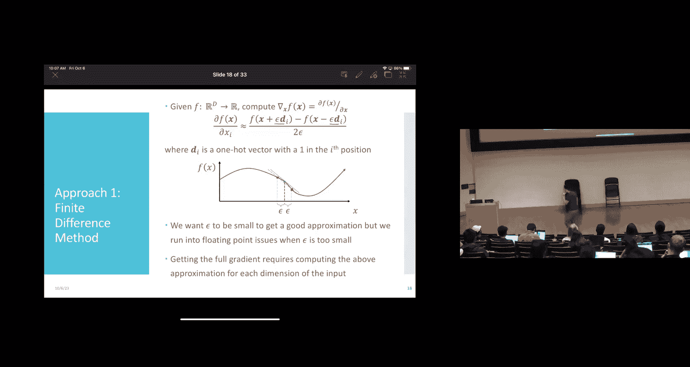
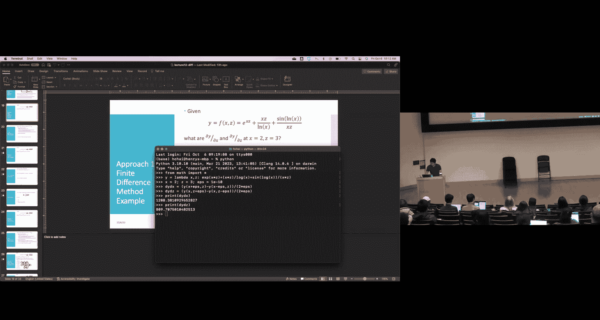
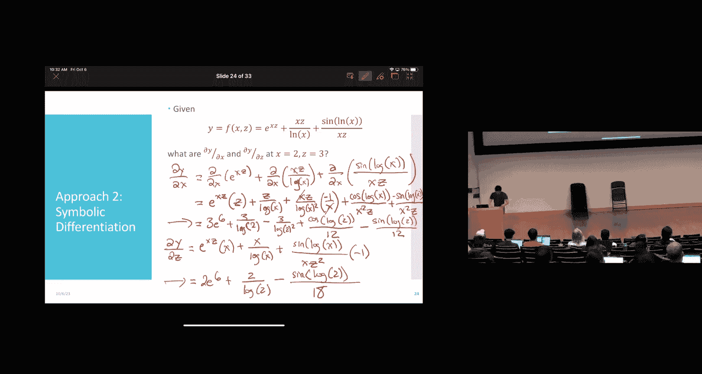
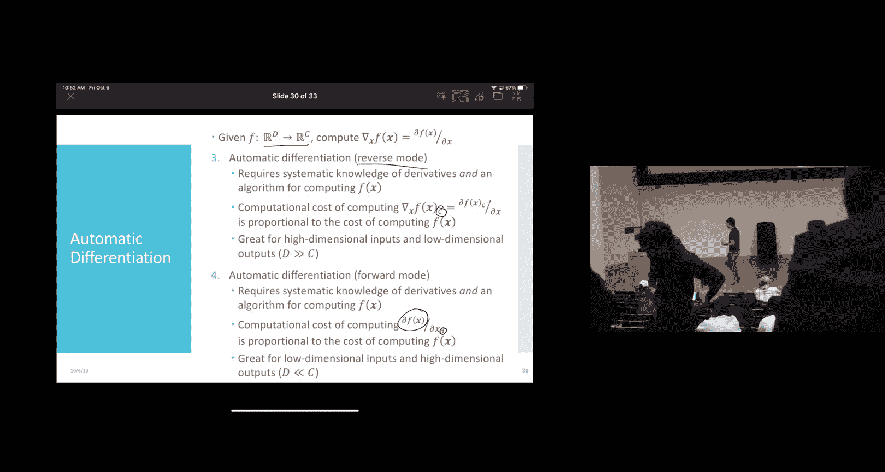

# CMU《机器学习导论｜Fall 2023 10-301⧸601 Introduction to Machine Learning》中英字幕（deepseek p12 Lecture_12_Backpropagation_I.zh_en -BV1Z2cUefE4A_p12-

## 概述

在本节课中，我们将学习神经网络的基本概念，包括前向传播、损失函数和自动微分。

## 神经网络

### 神经网络模型

*   神经网络是一种由多个神经元组成的层次结构，用于模拟人脑处理信息的方式。
*   每个神经元接收来自前一个层的输入，并产生输出，该输出传递到下一个层。
*   神经网络的参数包括权重和偏置。

### 前向传播

*   前向传播是指将输入数据通过神经网络，并计算输出预测的过程。
*   在前向传播过程中，每个神经元都会计算其输出，并将其传递到下一个层。
*   最终，输出层的输出是神经网络的预测。

### 损失函数

*   损失函数用于衡量神经网络的预测与真实值之间的差异。
*   常用的损失函数包括：
    *   **均方误差 (MSE)**: 用于回归任务。
    *   **交叉熵损失**: 用于分类任务。
    *   **softmax**: 用于多分类任务。

## 自动微分

### 自动微分

*   自动微分是一种用于计算函数梯度的方法，无需手动计算导数。
*   自动微分可以用于神经网络的前向传播和反向传播。




### 反向传播



*   反向传播是一种用于训练神经网络的算法。
*   在反向传播过程中，损失函数的梯度被计算，并用于更新神经网络的权重和偏置。
*   反向传播算法基于链式法则。

## 总结

在本节课中，我们学习了神经网络的基本概念，包括前向传播、损失函数和自动微分。这些概念是理解神经网络如何工作的基础。

## 代码示例

以下是一个使用Python实现的简单神经网络前向传播的示例：

```python
import numpy as np




# 定义神经网络参数
weights = np.array([[0.5, 0.5], [0.5, 0.5]])
bias = np.array([0.5, 0.5])

# 定义激活函数
def sigmoid(x):
    return 1 / (1 + np.exp(-x))

# 定义前向传播
def forward(x):
    z = np.dot(x, weights) + bias
    return sigmoid(z)

# 输入数据
x = np.array([1, 0])

# 计算预测
y_pred = forward(x)
print(y_pred)
```

## 下节课预告



下节课我们将学习神经网络的训练过程，包括损失函数、梯度下降和反向传播。