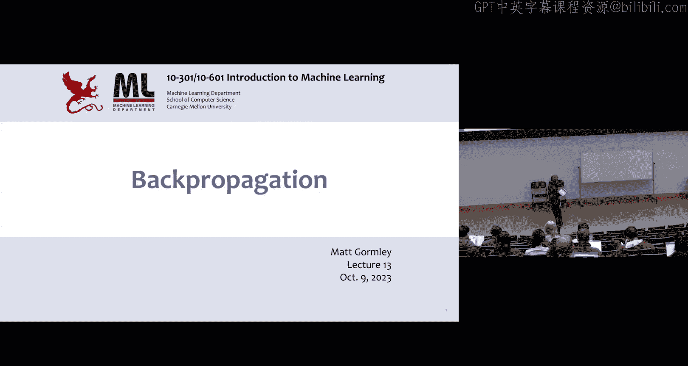
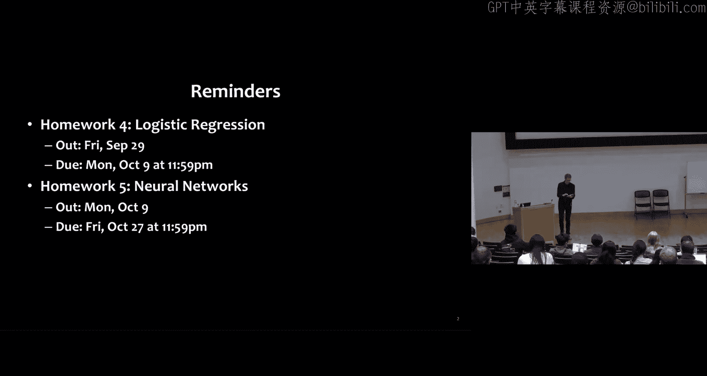
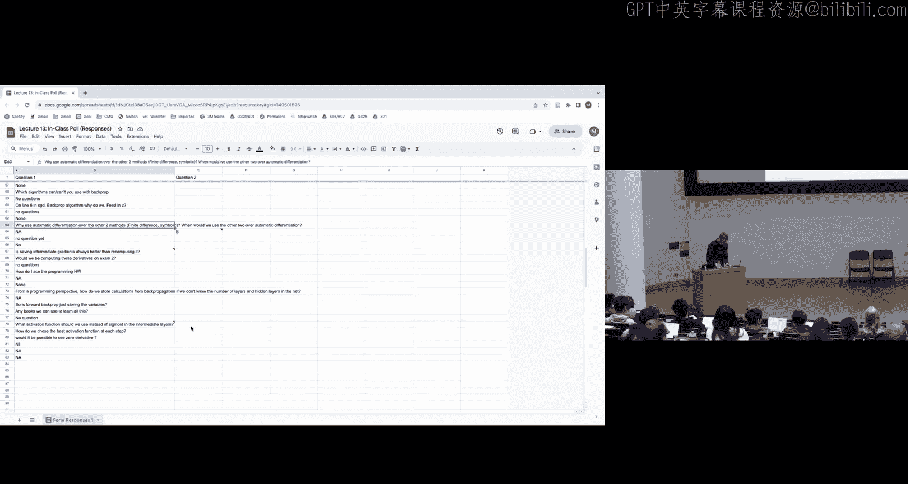
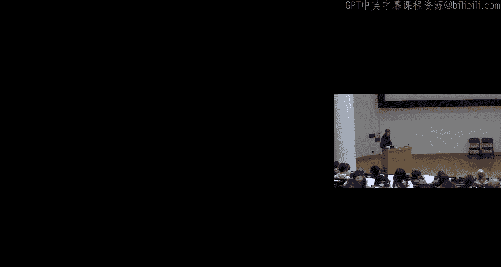
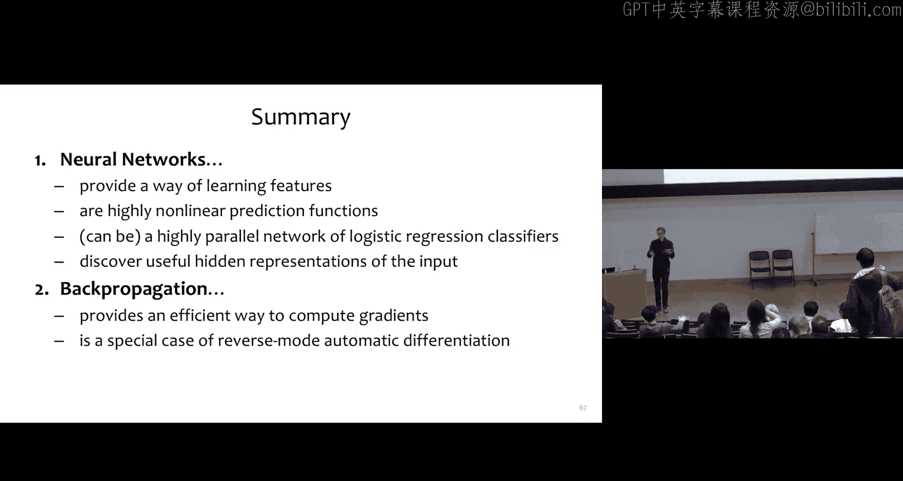

# CMU《机器学习导论｜Fall 2023 10-301⧸601 Introduction to Machine Learning》中英字幕（deepseek p13 Lecture_13_Backpropagation_II.zh_en -BV1Z2cUefE4A_p13-

Good morning。Let's get started。Today。We're going to be thinking a bit more about back propagation。

And。嗯。And so we'll use。This lecture to kind of follow up on what Henry started last time。

 kind of exploring this polynomial time algorithm。For efficiently computing gradients of differentiable functions for which you have an algorithm to compute the function itself。

And so we'll look at a bunch of different examples。

 we'll go almost to the point of showing you how you could efficiently implement sort of line by line。

 a neural network with two hidden layers， but then we'll actually stop because we got to leave something for you to do on the homework and so we'll kind of take you most of the way there and then you'll get to kind of explore that last step on your own。

嗯。

So before we jump in any further。Let's see， we have homework four。

Do today and then homework five out today in which you actually implement a neural net one note about homework5 so the timing of homework5 is sort of expecting you not to be working on it during fall break that means we are expecting you to be working on it this week so we strongly encourage you to get started early this is a challenging homework assignment but many people have accomplished it in the past before you but it's important that you you don't wait until after fall break to get started。

Okay， also happy Indigenous People's Day。So oh， I guess I should probably switch here Sakarri。

 let's see how lette Hobel。😊，And you all say cheerie， Okay， ready， let's try again。

 How we like tick Oval。😊，very good you're learning Kiche Oh okay so my family would be proud so what do indigenous people have to say about AI and machine learning。

 it turns out there's actually like a working group on this very topic you can go read this AI and indigenous critical position paper there's been a lot of people thinking about what does it mean to sort of preserve indigenous art in the face of something like these generative models that are capable of preserving art。

 there's been a lot of like white people have a long history of misattributing styles of indigenous art or just outright stealing their style and then not attributing them at all so I think we're already now facing in AI kind of this renaissance of artwork being stolen without attribution and so I think there's。

There's lots of opportunities to kind of learn from the challenges that indigenous people have gone through in this space for centuries and so now I think that has become a part of sort of the public discourse so anyway。

 happy indigenous people say okay so let's jump back into back propagation for a simple computation graph the one that we were looking at last time was this and you guys actually kind of walked through Henry kind of carefully wrote out this back propagation algorithm thanks for having you like put together this careful slide too didn't。

So。😊，So this is kind of walking through exactly what you did last time and I guess what what I wanted to kind of remind you of was what the。

嗯。What the actual updates for back propagation are looking like here because the point of going through an exercise like this is to reveal to you sort of the systematicity that's happening here So remember what we're doing is for some say variable X that we want a derivative with respect to and let's suppose the output that we care about is some variable Y okay so these are not now I'm just talking about a general X and y。

 these have nothing to do with the X and Y of machine learning。

 this is just an arbitrary variable X and Y and you want to compute DY Dx and store it in GX。

So what do you do， you say， well by the chain rule。

 I can sum over k equals 1 to capital K of all these intermediate variables。😡，U1， U2。

 U3 all the way up to U Capital K。And by the chain rule， I can just take DY D UK times D UK， Dx。

 and sum over K。And that will give me the partial derivative for why for any set of intermediate variables you that fully describe what。

😡，And the trick of back propagation。Is。It's sort of staring us in the face when we look at this chain rule。

 but it's incredibly important that you understand what that trick is。

The trick is that we don't recompute。DYD UK every single time。We store its value in a variable。GUK。

And by the time we're using GUK， we've already stored it there。Such that when we need it here。

It's already sitting ready for us to use it。And if we need it again， we'll be able to reuse it。

And so in fact， that's exactly what's happening here， so for example。

 we computed DYDF early on and then DYDF is reused as GF here a couple times DYDF GF right and this is not just for DYDF this happens you can go through and trace through this and find all of the different reuses of these partial derivatives。

Those reuse of partial derivatives are an essential part of why this algorithm is efficient。

But it's not just happening in the backward pass， we're also reusing computation in the forward pass。

 for example， the variable A here is used to compute D and E and also F， right？😊。

So just by storing the value of a， which was the product of X and z。

 we got to reuse it three separate times， we didn't have to recompute that multiplication。

So this is a trade off between space complexity， you have to store these variables and time complexity。

 avoiding having to recompute them。And the advantage that we get is a reduction from exponential time computation to polynomial time computation just because of this reuse of variables。

Okay， so let's do another back propagation example。

 I want to do it though on a model that you're all familiar with。

 which is binary logistic regression。Okay so the last time we talked about binary logistic regressiongress I think we actually we were talking through what this derivative would look like and then we purposefully stopped and we said you know what I'm not going to give you this derivative you guys can do calculus you go off and do this on your own okay so now I'm actually going to come back and give it to you but I want to show it to you in a totally different light before we were thinking in symbolic differentiation we were on paper we were we weren't sort of thinking in terms of this back propagation algorithm so here the first thing to notice is that we could take the typical computation that you do for binary logistic regression and break it up over a couple intermediate variables so the first intermediate variable is something I'm naming a here。

Which is just the value of the dot product between theta and x right so this is the typical thing that we compute theta transpose x。

Right and then why is computing？Sigma of， well， a， which is just sigma of theta transpose x。Okay。

 but the point is that we computed a once we stored it， and then we computed y as sigma of a。

 where sigma is the sigmoid function。And then finally， at the end here。

 we computed the cross entropy loss， which is the same as the negative log likelihood that we've been computing。

 it's just under a different name， this is what neuralNe people call this。Okay。

So what's important about the fact that we introduced these intermediate variables is it dictates the particular structure of your back propagation algorithm。

If I had instead introduced I don't know two intermediate like an extra intermediate variable for the denominator of y call it some z right then we would have been sort of adjusting how we were actually carrying out the back propagation algorithm okay so these are the intermediate variables we chose and now we can go backwards through and see what the algorithm looks like so we compute。

😡，呃。So this is。This is our output J and you could actually think of it as really our first step is to compute。

G subub J。But G sub J is just DJ with respect to J。And what is that？Yeah， it's just one， right？

So in these slides I'm not even going to write in that variable。

 but it's implicitly there and you could think of it as to compute GY we computed。DJ， DJ。Times DJ DY。

Ira would have been a little bit silly to write it that way。

And this thing would have been a one anyway， so multiplying a one at the beginning here wasn't really going to change anything anymore。

Okay， so our first thing is DJDY and we store it in GY。

 and that's the derivative of the cross entropy loss with respect to Y。Okay。

Now we come down and we want to compute for this row， we want to compute GA。

And so we do that by taking GY times DYda。Okay， so this is the key point of background whenever you have this partial derivative that's just one of these very local partial derivatives like DYDA。

 where you really only need to look at this one expression to figure out what it is that we're actually going to compute directly there and we're not going to store that little bit。

Okay， so DYda in this case is x of negative a。Divided by x with negative a plus1。

 the quantity squared。 So basically what we're getting is G is just GY times this expression。

And we already computed and stored A in our forward pass so we can reuse it twice here。All right。

 so now in the last block。We come down and you notice that there's two input variables here， right？

theta J and X I， and so we actually when we compute the partial derivative rootus here。

 what we're doing is actually two separate ones， G sub theta I and G sub X J。So both of those。

 we multiply GA， which is the intermediate。Partial derivative that we care about times D d theta J。

And then GaA times D， Dx Xj。And these partial derivatives are very simple。

 they're just xj and theta J respectively。Okay， so just so that we're 100% clear here。

 what what my notation is saying here is that this quantity G theta J。

This thing is equal to G times xj。嗯。Okay so now let's do the same thing。

 but for a one hidden layer neural network Okay so remember we we kind of looked at this sort of decomposition of the layers before this is a really useful decomposition because it allows you to sort of see where the same both matrix calculus and the same。

😊，Computation is being reused， so if you were thinking about how to implement this you might say oh well there's a sigmoid function that's used twice here。

 maybe I only need to implement the sigmoid function once right？Same thing with the linear layer。And。

So here we have some loss at the end。And maybe we could think of sort of。

Coloring these so that the identical style of layers are colored the same way。Okay， so。

So now the actual stochastic gradient descent algorithm that you guys looked at before sounds like this。

 where we start out with some training data D and some test data DT。

We initialize our parameter somehow， maybe randomly， maybe to zeros， those are alpha and beta。

And then for each of our epochs one through capital E。

 we're going to loop through the whole training data， usually this is in some。

 if it's stochastic gradient descent， this is often in some shuffled order。

Though just pay attention to what we ask you to do on the homework so that you don't introduce unnecessary stochasticity and then we compute the neural network layers by calling some function that does that forward pass right this is the feed forward computation that computes given the input and the parameters all of our layers up until our loss。

And then we return from that some collection of all of the intermediate things， X， A， B， Z， Y， J。

 right that we just computed。And then we store those in some O and we then compute the gradients via back propagation where we pass in all of the variables that we just computed in the forward pass。

To get back G alpha and G beta。Because those are the gradients that we actually need。From there。

 we update our parameters。Alpha becomes alpha minus our step size times g alpha and beta goes to beta minus gamma times our steps times g beta。

So these two things， if you thought of this collection， G alpha G beta as。

Together representing some theta。Right， what we're essentially saying is that these two steps are essentially。

Computing。Theta minus gama of times g theta。Where I guess you could think of this as。

Computing GSub theta。But it's a whole collection of parameters。

 and so we compute them all and then we make an update with those that we computed。

From there we evaluate our training loss or our training objective function。

 so JD alpha beta usually sorry this is like at the end of a pass through the data at the end of an epoch。

 we typically evaluate the training mean cross entropy and the testamine cross entropy and this gives a sense for how we're doing over time are we actually improving those two and I guess okay。

 well we usually wouldn't pass in the test data here， this should really say the validation data set。

Okay， so now we could think about this one hidden layer neural network and how we would go about running back prop here。

Okay， so。We're going to build up。Through these individual layers right so on the forward pass。

 let's start at the linear layer we're going to compute each of these little AJs or sorry these are our input nodes。

 this is x1 x2 up to xm and then we're going to compute the dot product of X with our parameters alpha to get。

A1 through say， A D， where D is the number of hidden units。Okay。

So we compute a dot product for each of our hidden units。And then we compute。Sigmoid。Of。

AJ for each of our units。嗯。Then we kind of do it again， right。

 but this time we only have one output hidden unit。So we compute the dot product again， that's B。

Beta and Z。And then we compute sigmoid of B， which gives us Y。And then finally， in that last layer。

 we compute the loss。So now we go backwards through the back propagation algorithm。And we say okay。

 GY actually it's the exact same thing that we computed for binary logistic regression right and then GB is just GY times DY db DYdb is the derivative of a sigmoid function。

 which if you start doing the calculus looks something like this。

And then we get our first derivative with respect to a parameter。Which is。G beta J。And。

That's going to be Gb that we just computed times Zj。嗯。And then。Here we get GZj is Gb times beta J。

And working backwards， we have another sigmoid and then another linear layer。

And so this part actually probably looks very similar to what we were just doing in binary logistic regression。

In the last layer。So this is the version。Where I have all these intermediate G variables。

But you could also look at this version。Which is。The exact same thing that we just had。

 except instead of those G variables， I've actually replaced with。

The partial derivatives that we want。And so the point here。Is that？We have， again。

 reuse of these variables。And so whenever it comes time。To。For example， compute。These two， we have。

DJDB used twice here。Right。So if you were implementing this not with back prop but with some recursive thing that every time you needed DJDB。

 it went back and it recomputed it for you well， you'd have to like go back through these top two steps twice。

Just to get。Those two things， so just by storing it again， we're seeing reuse here。Yeah。我我要。对。

Oh great question Why would you have to compute DJDx so I guess the reason that it's on the slide is to show you the generality of what we're actually doing okay the automatic differentiation algorithm doesn't really care about what you're differentiating with respect to that could be with respect to parameters or inputs or right so typically we think of the inputs as fixed right so in essence these derivatives would just be discarded at the end。

😊，So in some sense it's wasted computation and in practice if you were implementing a deep learning library。

 you'd probably want to put something in there that didn't compute derivatives that people didn't need。

However， there are cases where we actually want to have derivatives with respect to inputs。

 can anyone think of any such cases？Yeah。The后果。What， what do you have in mind？开始点到。Yeah。

 there's a lot of homework questions， I lose track。youYeah。

 so you're trying to say given some model parameters。

 what would the input look like that most activates sort of the narwwa probability and so in fact one of the ways that we actually interpret neural networks is by looking at what are the inputs that most activate a particular node in the network and so in fact when I showed that slide talking about like deeper and deeper layers we looked at little how a neural net like a convolutional neural net can build up you know these little detectors of lines and then parts of faces like ear ear detectors and nose detectors the way that we got those pictures was actually backproagating through and getting the partial derivatives with respect to the input。

Now， in the， oh yeah， another question。啊，我去发。So usually if you have a sigmoid output。

 it's conventional to， oh I this one， yeah， so if you have a sigmoid output。

I would say it's conventional to use a log likelihood loss， its gradients are steeper。

 it tends to behave better， but this would work fine too and you'd probably get close to the same parameters in the end。

 might just take a longer time to train。Good， great question。Yeah。

 that's just that was an oversight on the slides， not an intentional thing。

 but a great discussion question。Okay， so。These derivatives here seem kind of annoying like there's all these calls to x the X function is kind of inefficient so it turns out that if you look more carefully at the derivative of the sigmoid you can take so here's you know if we have something some variable S that's a function of some input B。

😊，This is the sigmoid function， then we could say DSSDb is x of negative b over x of negative b plus 1。

 the quantity squared。So it turns out that if you just do some careful algebraic rearranging。

 you find that the derivative of the sigmoid simplifies to just S times1 minus S。

What's nice about this is then when you go back to this algorithm。

Instead of this more complicated looking computation， you can just replace it with。

Effectively s times 1 minus S， which in this case， the output of this derivative is y。

 so it would be y times 1 minus y， the output of this derivative is Zj so it would be Zj times 1 minus Zj。

And it cleans up our computation a lot。As well， this actually answers for us why it was that that depth5 sigmoid neural network was failing compared to the TNH neural network。

So if you remember we had this slide where the test loss just got stuck at the very top of the slide it never improved。

 that's because of the vanishing gradient problem， so you can see here that y is always a number between zero and one。

So it's some small number and when you multiply two small numbers together， it gets even smaller。

Right。And so what's happening is when you start out training this neural network。

 these Ys and these ZJs are so tiny that and oh， and further as you go down with more and more layers。

 that y is effectively being multiplied in here， right？The y times1 minus y。

 that factor shows up in that GZj term。And so that means that this now has not just Zj times 1 minus Zj。

 but also y times1 minus y if you add many more layers。

 then you're multiplying in even more small numbers together。

And the effect is that the gradient that you care about down at the bottom here can be absolutely tiny。

That's the vanish ingredient problem and something that we want to avoid。

 and so this is one of the reasons that we don't mind having a sigmoid in this last layer。

 but we often avoid putting a sigmoid in these intermediate layers。Okay。Okay。

 let's stop here for a poll question， what questions do you guys have。

 this is question one in your poll there's no toxic option。

Oops let's get this back on I'm really confused by all of these variables one of the things that we're doing here is showing you what this all looks like from the perspective of scalar variables。

Meaning the computation that we're doing is all in terms of scalrs what we're about to do is look at it in terms of vectors and matrices and in some sense it actually cuts down a lot on the notational complexity。

But it comes with the cost of having to do a little bit of matrix calculus。

And so I think that it's a worthwhile trade off， it requires you to spend a little time learning matrix calculus。

 but it gets you a little bit less complexity in the end。

This is a great question why are we taking derivatives again so I think that fundamentally what we're trying to do here is remain in this realm where we use stochastic gradient descent specifically to actually learn the parameters of our neural network。

And in order to do stochastic gradient descent， we need the gradient of our parameters。

And so we spent a lot of time thinking about the fact that。

This function is differentiable and we can actually compute these partial derivatives or these gradients that we need in order to run something like stochastic gradient descent。

嗯。Let's see。My weekend was great， went to a costume party。It's like you got to make puppets。

 the parties I go to are like a little bit different probably than the parties you guys go to。Anyway。

So there are other methods to train a neural network in fact。

 I mean so it sounds a little bit silly but there was a time where people used gradient free methods of optimizing neural networks so you could think of these as sort of a class of methods that don't explicitly evaluate the gradient all they do is they evaluate the function itself like the likelihood and so they try a current position for the likelihood and then they try some other random position for the likelihood and they see if it gives them some improvement a descent direction if it does then they move in that direction if it doesn't they try another random direction。

Okay， once you find that descent direction， then you can do it again。

 you can try to move in some direction and see if it gives you a lower likelihood and so these these methods have say fallen out of favor because back propagation tends to be so efficient。

嗯。There are also like other fancy things that people can do if you know something about the particular structure of the network。

嗯。So this is actually a great question how do you decide which values to save and which to compute on the spot。

 so in some sense this is actually a design decision。😊，So for our。For our example。

 with the one hidden layer neural network， what I was doing was was the most conventional thing。

 right which was to break up。inch。Computation for the hidden layer into two separate computation steps。

 right the computation， the linear computation that those dot products from the sigmoid。But in fact。

 if you wanted to， you could put those two steps back together。

And what you would be doing is effectively reducing the amount of memory that you need at the cost of greater computation right the partial derivative back propagating through a sigmoid and a dot product is more computationally intensive than if you were just back propagating through each separately or computing the derivative separately。

 and so this is like an actual tradeoff that we often want to consider。Um。

So this is definitely a problem gradients definitely get too big so a common trick that that we probably won't really talk about is called gradient clipping maybe maybe I don't know if we'll have time to spend。

On on sort of these various tricks in sort of our deep learning section。

 but gradient clipping is just when the gradient gets too big， you sometimes just say。

 let's just take any of the values that seem too large。

 whose absolute value is too large and let's just let them let's shrink them down to some max value and this can actually it's not a particularly well theoretically motivated thing to do。

 but it can actually behave well in practice。嗯。So softmax and sigmoid。So。

Those we should think of as sort of separate things right so sax and sigmoid sigmoid is used when we want one number that's between zero and1。

Softmax is used when we want one vector。That is a probability distribution over， say K outputs。

And so when you use one versus the other， it's not really a question of which is better。

 it's sometimes a question of like which one do you need at the moment and so the thing for you to think about。

Is the difference if there is one between a neural network that uses a softmax with two outputs？

And a neural network that has one output that's just a sigmoid。

And so I claim that you could actually establish some equivalence between those two cases。

And you could do it just by kind of thinking about it algebra。

This is this is a great comment is this just a form of memorization， absolutely yes。

 this is just dynamic programming dynamic programming is exactly what's making this efficient。

We do use gradient descent SGD when the objective function， not the gradient is non convex。

 and this is particularly useful。嗯。So the problem that I was talking about with vanishing gradients was contrasting two different activation functions。

 and so to maybe fully flesh that out， I recommend actually going and figuring out what is the partial derivative of a TN H function and if you multiply a bunch of those derivatives together would they get smaller and smaller or would they at least get smaller and smaller less quickly than a sigmoid function？

嗯。Hopefully we kind of circle them back to that big picture。

So I guess what we're doing so the trade off between sort of human。Calculus。Work。

 symbolic differentiation and automatic differentiation is that usually a human figures out the symbolic derivative。

For some simple computation like a dot product or for a sigmoid or for a tan0H。

And then we write that down once and we can reuse that little bit of calculus over and over again。啊你。

ThisThis question why automatic differentiation over the other two methods。

 it's totally about efficiency， you could use the finite difference method。

 but it would be horridibly inefficient。😊，嗯。Great， I think we'll stop there so these are wonderful questions and。

Think。Beful。

For me as well。

Ok。So now we come to training and the forward computation and the backward computation for a two hidden layer neural network。

 so recall that our two hidden layer neural network，Look something like this。And。Now we want to ask。

 how do we actually train this model？Okay。😔，So。So maybe let me actually go。嗯。

Start with the big picture。Because I think if we start with the big picture。

 it's clear why it is that we're doing back propagation。

 so let's start with this question of how do we do neural network training？

So the thing that we're going to be thinking about here。Is。Considering a。

A two hidden layer neural network。对以。And。Our parameters are。Some theta。

 this isn't really a vector theta， it's actually like a list。Consisting of。A matrix alpha 1。

 a matrix alpha 2， and a vector beta。And。What we're going to do is stochastic gradient descent training。

And the algorithm is going to be that we iterate。The following until convergence。

So the big picture here is that we have some data set D consisting of training examples and now we're going to use those training examples to actually learn the parameters theta here Okay。

 so the first thing that we do is we sample I。From the uniform distribution over the integers one。

Through capital N， where n is the number of training examples。Okay， step two。

 we compute the gradient by back propagation。So here。嗯。We'll delve into this in much greater detail。

But suffice to say， what we're going to get out of back propagation is G sub alpha1。She。

Sub alphapha 2。And G sub beta。Okay。And what we would write is that these are three separate gradients。

We would rate them as the gradient。With respect to Al1。Of our objective function， which is。

The objective like the cross entropy loss or the mean squared error for the IF training example。

Where we've passed in that full list of parameters theta。

And then G alpha2 is the gradient with respect to。Alpha 2 of。JI of theta。

And then the gradient with respect to， o， sorry， that should be a beta。Of JI， of Theta。Okay。

 so this this gradient notation might be a little bit new here， so let's just。

Do a little bit of background。So when we write something， say we have a function。J of AB。

And A is a vector and B is a vector。可以。And so when we write gradient of JAB。What we really mean。

 this is actually shorthand for the gradient with respect to。Viectctor A。And vector B of。J A， JB。

Okay， but if we wanted to。We could consider the gradient just with respect to vector A。

 even though this is a function of A and B。And if we did that， we would get back。

A collection of partial derivatives， they'd be DJ。呃。D， A1。DJ。😔，The A2。Down to DJ。D aK。And here。

 let's say that the size of the vector a is k。That's why there's K entries。

And we could do the same thing with respect to B。So the point is that this offers us a way of talking about partial derivatives with respect to vectors。

Okay。So that's what we're getting here is just these partial derivatives with respect to a matrix。

 a matrix， and then a vector。So we could ask the question， what is the shape of G alpha1？

Is it a scalar， is it a vector， is it a matrix， what are its dimensions？

How do we know anything about G alpha 1？So JI of theta。

Is a function that takes in this list of different parameters， Alpha 1， alphapha 2 and beta。

 right we've been calling that theta for shorthand。And it returns one single scalar， which is。

Basically， a loss function that's saying how bad your current predictions are。The higher the loss。

 the worse the predictions， and we want to choose parameters that drive that loss down on the IF training example。

So what is the shape of G alpha 1？An idea。Yeah， Al1 is a matrix。

 and so what is the shape of G alpha 1？It should be exactly the same shape as alpha1 right so the other way that we've been writing this stuff is。

To write sort of the matrix calculus version of this， which would be DJI theta。

With respect to D alpha1。And if we're using denominator layout。

Then this has the shape of whatever's in the denominator。So G alpha 1 is the same shape as alpha1。

Okay， and we could do the same thing here where we'd be taking the。

Derivative with respect to alpha2 and here with respect to beta。

So G beta is a vector the same shape as。Ass that。Okay。

 so maybe one more note here is just so we're clear。When we write G I theta。

What we mean here is this is what we've been saying is the loss。

This is what Henry had before of our decision function， H theta applied to X I。With why I。Okay。

So that's the thing that we're trying to actually minimize。Okay。

 so once we've gotten these gradients， now we can go to step three。Which is to actually update。

Our parameters。And when we do this parameter update， what we're saying is alpha1。Goes to。

Is updated to the current value of alpha 1。Minus gamma times G alpha1。

And then alpha 2 goes to the current value of alpha 2 minus gamma times g alpha 2。

And beta goes to beta minus step size times g beta。Okay。

So this is the whole picture then of how it is that we do training for a two hidden layer neural。

OkayYeah， question on the right first。The great。But the A vector and。Oh so。Like in this case。

 what I was kind of getting at was that this one。Would be equal to。Longer vector。DJ。DA1。

Down to say DJ DK。Followed by DJ。D B1 down to。DJ， let's say they're the same size just for so I don't have to define another variable。

 DBk。So now what we're doing is we're thinking about the inputs to J as just some big long vector。

With A followed by B。Other similar points this data， just A1，82，83， all in one big back to the4。

So you could think of it either way， so in practice when you're implementing this thing。

 it's actually kind of convenient to keep theta as like a list like you actually could carry around a little。

 maybe not a list， maybe it's an object right， an object that says here's the matrix alpha one。

 here's the matrix alpha two， here's the vector beta and to keep them separated。

And then when you do this computation， you're actually explicitly computing G alpha1 g alpha 2 g beta。

 and then down here you're explicitly updating all of them sort of separately。😊，If you wanted to。

 you could write a little code that takes two matrices in a vector and stretches them out into some big long vector。

 store that as theta。And then your gradient step would just be theta equals theta minus step size g theta。

But now you'd have to take that theta and you'd have to probably convert it back to two matrices and a vector。

 and that might be a little inconvenient and slow。Great question though。Okay。

 now let's think about backpro for this tu layer neural lit。So here zoom in。

 so were going to we're going to think about， I guess three。Sort of the three pieces here。

 but actually before we get to the backpro bit， let's see what what is it that we're starting out with so we're given。

嗯。A couple things， one is where someone decided for us what our decision function was。

Or our hypothesis。And that is what allows us to compute why hat。As a function， H theta of x。And。

Let's say for simplicity that。This decision function is sigma of。Alpha 3 transpose。Time sigma of。

Alpha 2。Tranpose。Time sigma of。Alpha 1。Transpose。Times x。

 and then we need to close a bunch of parentheses here。对。

So so what am I writing here because it looks a little bit different than what we've seen before for one。

You could think of this thing。As producing for us a vector。The superscript one， right。

 that's the first hidden layer。And then here this thing is producing for us a vector Z superscript 2。

可以。😔，And then。This alphapha 3 here。Up until now， I've actually been calling beta。

But I just renamed it to alphapha3 because it's going to make。Everything that we do on this slide。

 just a little bit easier。So it's just the vector beta， but I'm just renaming it alpha3。Okay， so。

I should note here。That I'm kind of cheating。To keep this slide simpler。嗯。I'm actually leaving out。

The intercept terms。Okay， this is a bad decision in general， but for this slide。

 it'll make us kind of be able to kind of narrow or focus in on the actual computation that's happening here without having to keep track of adding a bunch of bias terms along the way。

 okay。😊，So。Then。We have our loss function。So our loss function is what computes J。

Where J is the loss。Of why hat， which is our prediction with why star， which is like。呃。

The true value。And this is going to be， let's say cross entropy loss。

 which is the negative of Y star。Times log of why hat。Plus1 minus y star。

Times the log of one minus y hat。So we're trying to minimize that。And of course， we're also given。

For this setting， a training example。And you'll notice that sort of for notational convenience here。

 I'm actually dropping the eye。Because carrying around this little superscript eye would make our math just look a little complicated。

 so explicitly this is the IF training example right we've dropped the I and we have the vector X and then the true value Y。

 but I'm making put a little star next to the Y just to make it really clear that this is the true value Y not to be confused with Y hat which is our prediction。

😊，Okay， so now what we want to do is。We want sort of three important。Big steps。

So we're going to do some forward computation。We're going to have a computation graph。

And we're also going to do some backward computations。嗯。So those are the pieces of the puzzle here。

So the forward computation。啊。Again， we're given。Vectctor X， Y star and our parameters。Alpha 1。

Alpha 2。Alpha 3， which is just renamed beta。And the first thing that we're going to do is we're actually just going to rename x as well to z0。

Okay。So it's kind of like applying the identity function and the reason that I'm going to do that is so that I can write a little four loop over the layers for I equals one。

 two， three， okay。Because we have two hidden layers and an output layer。

And then I'm going to compute a vector Ui， which is for the IF layer。Which is。Alpha I transpose。

Times。Vectctor Z。Minus1。Okay， so that's our dot product and then we're going to compute our linear activation。

Whi in this case is going to give us ZI， and that's just applying sigmoid element wise to vector UI。

Okay， so we'll do that three times and then at the end we'll get out a Z3 and we're going to rename that Z3 back to Y hat。

And finally， using Y hat and the Y star that we were given。

We'll pass those into our loss function and we'll get back J。Okay。

 so now we want to actually draw the corresponding computation graph。So what does this look like？

Well， at the bottom， so we'll draw this sort of in the shape of a neural net where we proceed bottom to top。

So at the bottom， we're going to have。I guess I should start even a little lower。

So we'll have this vector， this is our input vector。And this is what we're calling vector x。

And then we also are starting out with three matrices。

So we'll have a matrix here that is matrix alpha 1。We'll have a matrix here。

Possibly you have a different shape or size。That's alphapha 2。

And then alpha 3 will assume is some vector。And we're also given why star。Hey。

 so those are what we're given。And now we want to compute our intermediate nodes， so remember。

 the first thing that we do is we rename x to z0。😊，And then we use Z0。To compute a new vector。

Which we're calling vector u1， So this is the first time through that for loop。And。

That first time through the four loop， what we're doing is we're taking this。This vector X。And。

We're taking this matrix alpha。And we're multiplying alpha1 transpose times x， so that gives us u1。

The next thing we're going to do is compute vectors Z1。

 so this is still in the first time through that for loop。And vectors Z1 is exactly the same shape。

As you one and each of these is actually being， we're computing this。Eleement wise， right？

There's no crossing arrows here。Zj is just the value sigmoid of Uj。Okay。

 so now we've completed the first time through that for loop for I equals 1 now let's do for I equals2 Okay。

 so we're going to compute vector u2。Which here it might actually be a different size。

And vector U2 is computed by taking。The matrix multiplication of Z1。With alpha2 transpose。

And then the second step in the I equals 2 pass through this for loop is to element wise apply the sigmoid function。

 and that will give us back Z2。嗯。From there。Let's see we still have another pass through that for loop。

So let's compute。The value of U3。Which this time is actually just a scalar because this time we're taking alpha three transpose。

Z2， but because of the shape here， this is effectively just a dot product。

And then we can compute Z3 by applying sigmoid， and then we can rename that to Y hat。嗯。

And then the last step in our computation graph。Is we're going to compute。Jake。

From why hat and why Star。So when we think about this algorithms。

 the so called back propagation of errors algorithm。

What we're doing is actually sort of working our way backwards through this computation graph。

 starting at the top and working back down。😊，So let's actually see what that would look like。

I guess I didn' I didn't line up my headings very well we'll keep this in view and we'll start the backward computation here so the first thing that we do is we compute GJ which is just DJ DJ which is as we saw before one。

😊，And you could think of this if you want like a little matrix。

 like a one by one matrix so that everything is kind of in in matrices。Then when we compute GY hat。

 this is another one by one matrix， and this is the same exact computation that we had before。

 which is y star over y hat。This is the derivative of the cross entropy minus1 minus y star。

Divided by one minus y hat。嗯。So it's just some calculus applied to our loss function up there。Okay。

 so now we're working backwards through the computation graph。

 we went back to Y hatt now we're going to compute the derivative with respect to U3， okay。

 but to make this look a little cleaner。What we can do is we can write a for loop again。

But now in reverse for I equals three， two， and then one。And we can， oh， yeah。完事。这话。呃。

But negative on， oh， maybe I just have a mistake。I wonder if I had a mistake on the previous slide。

 let's see。So it should be。Oh maybe it's the parentheses or the issue so the first term should be the derivative of negative y star log Y hat is negative y star over Y hat。

The derivative with the second term。Is。诶。So by the chain rule。

 we're going to get a negative out in front。And so。When we take the derivative of negative Y hat。

 that's where that negative， this particular negative is coming from。哦，他知的那。slide。晓的。

Oh in slide 17 okay that's probably a mistake on the slide this seems right to me what we're doing is we're minimizing the negative log likelihood it could be that my slide I was just thinking about maximizing log likelihood at some point I had slides that kind of were trying to do ascent and then I realized that was a terrible decision and I tried to convert everything over to descent but maybe I missed a negative。

Yeah。A terrible decision pedagogically， right I think that there's something valuable about actually trying to keep us in this desent mode。

And it allows you to catch mistakes like that on slide 17 or whatever。Yes， slide 17 is far away。

 so we won't go back that far。Okay， so now。We have。This little for loop， and we're going to compute。

G sub vector Ui， which when I equals 3 is G U3。And then we'll compute G sub。

Right trace backwards when I is equal to three， now we want to compute。

The derivative with respect to Z2， so that would be G sub i minus1 Z I minus1。

And then what's going to come after that， then it's going to be also。

The derivative with respect to the parameters。And that's going to be。Gess sub Alpha I。

So now you can see why we renamed beta because here when I is3。

 we're taking the derivative with respect to G alpha 3。Right and so we can kind of。

Beautifully encapsulate the fact that now when I equals2。

 we'll compute the derivative with respect to u2， Z1 and alpha 2。

 and then when I equals 1 we'll get z1， u1， alpha 1。Okay， at the end of that for loop。

 we'll compute the derivative。好。Of G X。Here， which is just by renaming the derivative G z0。Okay。

 and again， maybe we don't actually need that derivative。Okay， so what's interesting？

Is how to actually do these steps and it's so interesting that we thought why waste。You know。

 potential for learning here。And so we put it on homework five instead of just giving you the answer。

嗯。Okay。So this to get those steps， what are you going to do。

 you're just going to do some matrix calculus。Okay。

 and I'll talk about matrix calculus a little bit more today， but that's the whole picture。

 that's how we do back propagation through a two hidden layer neural net。😊，Okay。So。

We've been pushing on math here all day， what if we try to establish some intuition to get there。

 I'd like to tell you a little bit about myself。You might not have guessed it but。You know。

 after I put the kids to bed。Sometimes。I like to go to the pool hall and you know I might look like an honest guy。

 but it turns out I'm a bit of a pool shark。And you know， I kind of walk up to the table。

 looking real inexperienced and I put a big pile of money down on the table and I say， you know。

 like， come on， let let's play for some money， you know。

 and some unsuspecting person comes up to the pool table， oh， I can take this guy。

And but they don't know that I am spectacular at geometry， I mean， so， you know。

 when I see this game pool， which if you don't know pool right the whole idea is you got this cu stick and you need to hit the white cu ball and then if I was stripes。

 I'd be trying to hit the striped balls into the pocket。

before the opponent gets all of the solids in。And so。

 you know I line up the Q stick and I kind of see， you know I can't I can't actually hit the eight ball into a pocket that would actually lose me the game and so I need to actually go all the way around the a ball and this is going to require some complex geometry here because I'm going to have to hit it off the wall and hit the4 and then oh no。

Oh but sometimes I I actually make mistakes because even if you know the right geometry， you know。

 really， like hitting with this cu stick is hard。 I mean， it's a challenging game。

 but here's the thing I also know how to correct for my errors。 You see， because if we look at this。

 the 13 actually hit a little bit too far in this direction。

 I should have adjusted so that the 13 was actually a little bit higher， right。😊，To make that happen。

 the 14 would have had to come down a little bit so that it hit the lower side of the 13。

And that means that I would have needed to ricochet off the wall a little bit further to the right。

 which means that the angle of approach for the ball should have been about this。

 that means that the Q stick should have been over here。

 so if I you know had a chance to take the shot over again。

 you know maybe the guy went for a drink and then I could actually sort of line things up again and take my shot I'd hit the 14 and then the 13 and then man。

But you see sometimes I actually take a step that's a little bit too large sorry by step。

 I mean adjustment to the Q stick that's a little bit overcompensating you know I'm trying to get this in the pocket but I go too far and so similarly you could think about how what we're trying to do is actually get our neural network to line up with Yi the true value and so what we're doing is actually predicting some value P of Yi given XI and so we need to adjust our probability。

In order to get it to match up with the true value so how do we do that well we need to work backwards by saying well we were off by some bit in the probability and to get it to write itself we need to adjust our hidden layers Z to get the Z to adjust。

 we actually need to adjust our parameters theta。😡。

And so this is the sense in which back propagation is a back propagation of errors right we're working from the end and saying here's how we were in error and then going backwards through to figure out what we should have done differently with the parameters。

Okay， so let's say a little bit about the back propagation algorithm。

 so the forward computation you can actually understand as。😊。

Evaluating some function through a directed acyclic graph right the dag that I'm talking about here could be that computation graph is explicitly that computation graph that we were just drawing where each variable is a node and for each node we visited in topological order。

😊，And so for variable UI with inputs V1 to VN， we compute UI as some function GiI of V1 through VN。

 and then we store the result UI at that node。Okay， so then for the backwards computation。

We initialize DYDYD to one， so here we're thinking about some generic computation graph where the output is y and we have some intermediate variables U and V。

 and so we visit each node VJ in reverse topological order。😡，Okay。

 and then we're going to let U1 through UM denote all the nodes with VJ as an input。

 so pictorially you could think of this as we have some y。And we have some intermediate nodes like。啊。

You won。You too。Up to UM。And then it's the case that。When we want to compute some VJ。嗯。Vj。

Is a node that has。Such that you1 through UM all have it as some input。Okay。There's other V's。

 there's like， you know， V1 up to Vj and then。Up to I don't know VN here。

And what we're trying to do is actually compute the partial derivative to store at the node VJ。

So assuming that y equals some h of those U's and u equals some G of the V's。😡。

Then we already know by the time we get to VJ。Because we're going in a reverse topological order。

Meaning that we visit the sort of node above before we visit any of its children。

Then we already know DYDUI for OI by the time we are evaluating this for VJ。

And so then we can compute DY DVJ using the chain rule。

And so if we already have the derivatives for these u nodes。When we come to compute this derivative。

 we can do so。With this now familiar expression， summing over all of the intermediate variables。

 the product of DY DUi times DUI， DVJ。Okay， and then at the end。

 we can just return all the partial derivatives that we need for all the variants。

Okay so this is what we've been doing up until now。

 I want to present to you an alternative formulation of the same algorithm Okay so this is version B and there's something kind of beautifully elegant about this alternative version that and in fact。

When。People go out and implement deep learninging libraries they don't use version a。

 I think it's a better place to start in terms of understanding what's going on。

 but if you wanted to actually implement this thing you would implement it。V this version。Okay。

 so let's say this is our VJ。To VN。And。And so let's say， actually， this is not YouTube。

 but this is UI。In the middle。Okay， so what we're going to do here is we're going to initialize all of our partial derivatives to zero。

😡，So all of those little G's， like this would be G subui。

We're going to initialize that those to zero， except for DY D or GY， which we initialized to one。

Okay， so then we're going to again visit nodes in reverse combological order。😡。

And when we visit variable UI。嗯。We already know DY DUI。Okay so this is now a little bit different。

 we're saying by the time we get to visiting UI， we already know what its partial derivative is。

Here's why， because when we get to UI， we go down to all of the children of UI， all of these nodes。

And for each of those nodes， we increment DVJ by D DY DUY DVJ。Right。

So what we're doing is we're saying here， when we computed VJ。

 we explicitly looped over all of its parent notes right in the summation。

And we computed each of those little DY， DUI， DUI， DVJ terms。

 and then we added them all up together and we stored them in VJ。

So now what I'm saying is instead of all at once looping through this。

 whenever you visit one of these you terms。Just back propagate its part。Of the VJ gradient to VJ。

So you'll pass along this little bit of the gradient for DVJ。Such that when you visit U1。

 it's going to pass back a little bit of it's going to increment the gradient for DY， DVJ。

 and then you two will do the same thing all the way up to UM。Such that by the time you get to。呃。VJ。

 you've already got its gradient sitting there。Okay。

 and so this is an example just showing like a very simple computation where we have。😊。

Say the variable T。That's used to compute， say， both U2 and U1。

And if we set it up the way that we just saw where we initialize all of these little gradients to zero。

 then when we work backwards， when we visit you1， we look at its children and we say， oh。

 we should increment。GT here because it's because U1 is a function of GT and then when we visit you two we say。

 oh， it's also a function of GT so we should increment GT again。And that way。

 by the time we actually need to use GT down here， its gradient is correct。不。

And what happens is that we get this lovely thing where the derivative of U1 with respect to DT is sort of sitting locally alongside of this incrementing that's happening here。

Okay。Okay， so we've said this before， but why is this back propagation algorithm efficient。

 it's reusing computation in the forward pass and it's reusing partial derivatives throughout the backward pass。

😡，Okay， and so it's allowing us to now go back to this big picture side and say now we have a way of actually computing the derivatives that we need of with respect to the parameters of the model。

Okay， so I want to come back to matrixtri calculus at some point we actually like didn't require you to learn matrix calc we were like you know it's kind of useful but you can actually do our whole homework without it I think that's still。

😊，Mostly true， but it's so much easier if you just go learn a little bit of matrix cc so let's spend a couple minutes doing that so you guys already saw like the different kinds of derivatives that you could take this is just sort of rehashing those slides we talked about Henry talked about numerator versus denominator layout where we are using explicitly denominator layout and。

So here I want to kind of just present to you some some useful identities so on the left are some scalar derivatives that you know right if you take the derivative of bx with respect to x where b is a constant that's just B if you flip it derivative of x b is just B derivative of x squared is2 x derivative of b x squared is2 bx right simple scalar derivatives turns out there are sort of similar things happening with vector derivatives so if you have a vector constant vector B transpose X it's derivative with respect to x is B。

And if you flip it， x transpose be， its derivative is also B。If you have x transpose， a matrix B。

Then its derivative is B， whereas b transpose x because it actually has a different output shape is going to be b transpose potentially。

And then here。X transpose x， its derivative is。To the scalar times the vector x。

And if you have a symmetric matrix Q， x transpose Qx， its derivative is2 Qx。

So once you know little rules like this， then you can go and apply kind of all the same sort of rules that you know from scalar derivatives right if you want to take the derivative of the sum of two functions it's just the sum of the two derivatives。

 if you want the derivative of a scalar times a function it's the scalar times the derivative and that happens on either side。

Similarly over here， we have the derivative of two functions that take in a vector is the sum of those two derivatives。

 a times G of x is its derivative is a times the derivative for some scalar a。

 but if you have some vector B， and you have G of x times that vector B this would give you the derivative times b transpose。

Okay， so we don't have time to do this as a poll， the correct answer here though is none of the above。

 in fact the correct answer is for the chain rule is DUDX。😊，Times D。Do you and this is。

What's asked here is just suppose you have y equals G of U and u equals h of x。

 what is the sort of correct definition of the vector chain rule？

And you can check that this actually gives you what you would expect it to give。

 which is a collection of all partial derivatives that you need。

So I'll leave off with just this picture of how to draw a neural network which is important for your exam。

 so this is a neural network diagram here the nodes are circles， there's one node per hidden unit。

 the node is labeled with the variable corresponding to the hidden unit。

The edges are directed and labeled with its weight。

And often the intercept term is actually not shown in the model。

 and the parameters are very definitely not shown。The computation graphs that we've been drawing are not neural network diagrams and they have a very specific semantics that you need to know so that you can answer questions on the exam correctly so nodes are rectangles there's one node per intermediate variable we label the node with the function that it computes。

Edges do not have labels since they don't need them。And for a neural net。

 the intercept term would explicitly appear as a node。

 and each parameter would also appear as a node as well as each constant。

 and it's perfectly acceptable to include the loss in your computation graph， it's often required。

 whereas in the neuralNe diagram we rarely draw the loss in that picture。

Okay this is another sort of computation graph picture as well。Okay。

 so some of these conventions are specific to this class。

 there's all sorts of different conventions for how to draw a computation graph。

 but we really need you to know these specific conventions so that we can ask you， for example。

 to draw a computation graph and you show us that you actually understand what it is you're drawing and why it's useful。

😊，All right， that's it for today， when we come back on Wednesday。

 you'll be thinking more about neural networks with our TAs at recitation。

 and then on Friday you'll have a lecture with us thinking starting to think about PAC learnings。

See you later。