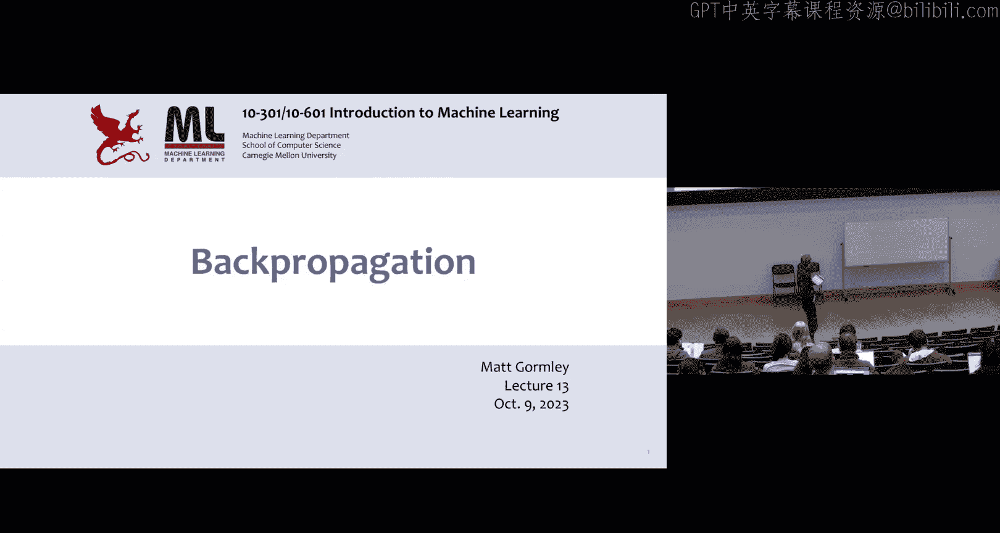
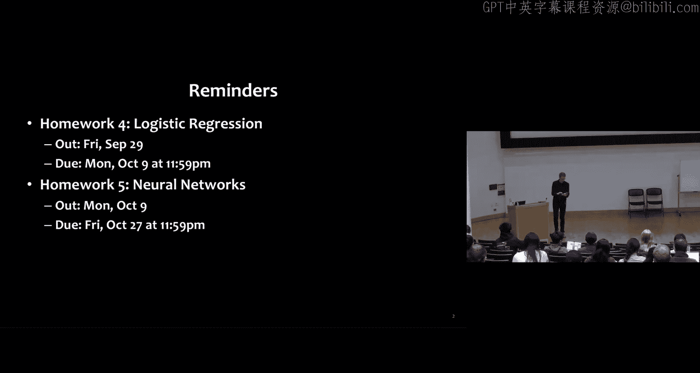
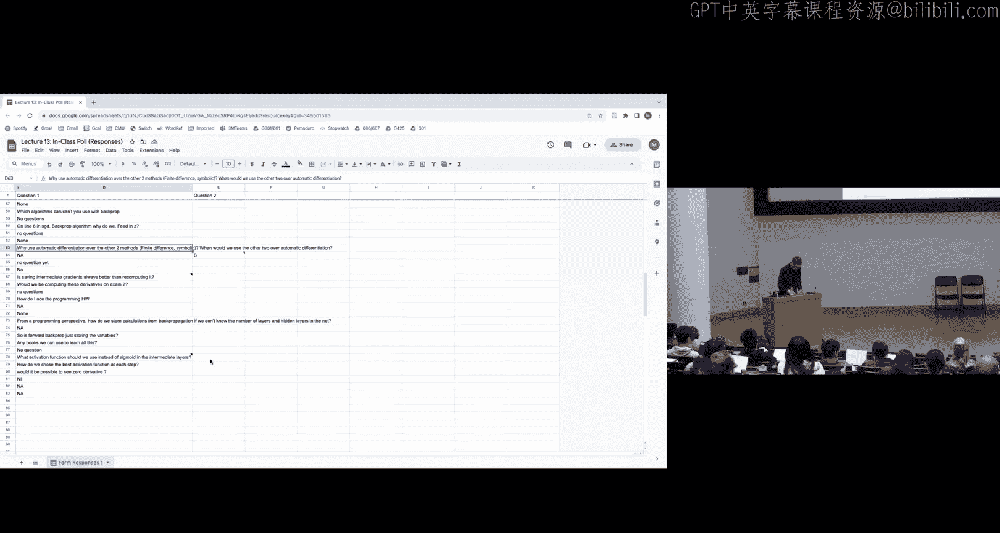
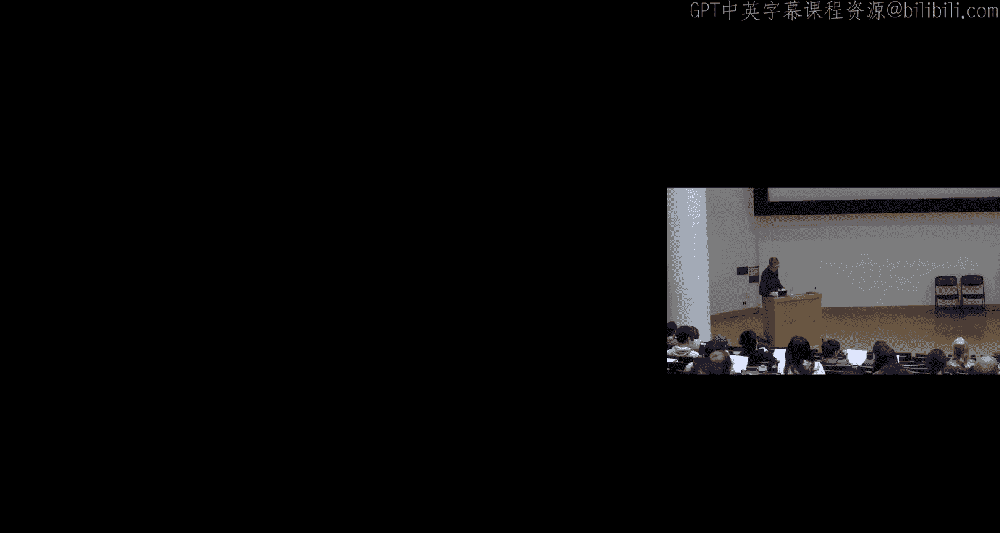
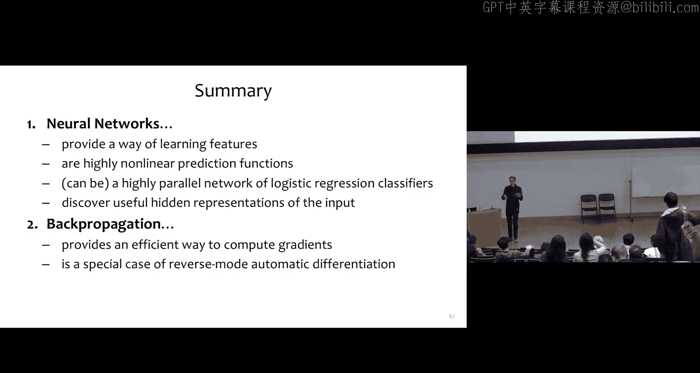

# CMU《机器学习导论｜Fall 2023 10-301⧸601 Introduction to Machine Learning》中英字幕（deepseek p13 Lecture_13_Backpropagation_II.zh_en -BV1Z2cUefE4A_p13-

## 1. 回顾与概述

**Good morning**。Let's get started。Today. We're going to be thinking a bit more about back propagation。

**今天我们将更深入地探讨反向传播**。

And。嗯。And so we'll use。This lecture to kind of follow up on what Henry started last time。

**我们将利用这次讲座来继续探讨亨利上次开始的内容**。

 kind of exploring this polynomial time algorithm。For efficiently computing gradients of differentiable functions for which you have an algorithm to compute the function itself。

**探索一种多项式时间算法，用于高效地计算可微函数的梯度，而对于这些函数，您已经有了计算函数本身的算法**。

And so we'll look at a bunch of different examples。

**我们将查看一些不同的示例**。

 we'll go almost to the point of showing you how you could efficiently implement sort of line by line。

**我们将几乎展示如何高效地逐行实现一个具有两个隐藏层的神经网络**，但然后我们将停止，因为我们必须留一些东西供你在作业中完成，所以我们将带你走到那里的大部分，然后你将有机会自己探索最后一步。

嗯。

## 2. 作业与课程安排

So before we jump in any further。Let's see， we have homework four。

**在我们进一步深入之前，让我们看看，我们有作业四**。

Do today and then homework five out today in which you actually implement a neural net one note about homework5 so the timing of homework5 is sort of expecting you not to be working on it during fall break that means we are expecting you to be working on it this week so we strongly encourage you to get started early this is a challenging homework assignment but many people have accomplished it in the past before you but it's important that you you don't wait until after fall break to get started.

**今天做作业四，然后今天发布作业五，其中你需要实际实现一个神经网络。关于作业五的注意事项：作业五的时间安排是希望你在秋季假期期间不要工作，这意味着我们希望你在本周开始工作，所以我们强烈建议你尽早开始，这是一项具有挑战性的作业，但许多人已经在你之前完成了它，但重要的是你不要等到秋季假期之后才开始**。

## 3. 原住民人民日

Okay， also happy Indigenous People's Day。So oh， I guess I should probably switch here Sakarri。

**好的，也祝原住民人民节快乐。所以，我想我可能应该在这里切换到Sakarri**。

 let's see how lette Hobel。😊，And you all say cheerie， Okay， ready， let's try again。

**让我们看看lette Hobel。😊，你们大家说cheerie，好的，准备好了，让我们再试一次**。

How we like tick Oval。😊，very good you're learning Kiche Oh okay so my family would be proud so what do indigenous people have to say about AI and machine learning。

**你们喜欢tick Oval。😊，非常好，你们在学习基切哦，好的，所以我的家人会为我感到骄傲，那么原住民人民对人工智能和机器学习有什么看法**。

it turns out there's actually like a working group on this very topic you can go read this AI and indigenous critical position paper there's been a lot of people thinking about what does it mean to sort of preserve indigenous art in the face of something like these generative models that are capable of preserving art。

**事实上，确实有一个关于这个主题的工作组，你可以阅读这份AI和原住民批判性立场论文，很多人在思考面对像这些能够保存艺术的生成模型时，如何保存原住民艺术**。

there's been a lot of like white people have a long history of misattributing styles of indigenous art or just outright stealing their style and then not attributing them at all so I think we're already now facing in AI kind of this renaissance of artwork being stolen without attribution and so I think there's。

**白人长期以来一直有误归因原住民艺术风格或直接窃取他们的风格而不归因于他们的历史，所以我认为我们现在已经在AI中面临了一种文艺复兴，即未经归因就被窃取的艺术作品，所以我认为有很多机会可以从原住民在这个空间中经历数百年的挑战中学习**。

There's lots of opportunities to kind of learn from the challenges that indigenous people have gone through in this space for centuries and so now I think that has become a part of sort of the public discourse so anyway。

**有很多机会可以从原住民在这个空间中经历数百年的挑战中学习，所以现在我认为这已经成为公众话语的一部分，无论如何**。

 happy indigenous people say okay so let's