# CMU《机器学习导论｜Fall 2023 10-301⧸601 Introduction to Machine Learning》中英字幕（deepseek p14 Lecture_14_PAC_Learning.zh_en -BV1Z2cUefE4A_p14-

Good morning。So。Today is a little bit of a change for us。 you see。

 like we've been really focused on a lot of the practical aspects of。

How do you actually take a problem that you want to solve and write it down as a machine learning problem？

How do you？Conceptualize different ways of actually sort solving those problems and in particular we've been diving into both some classical and some sort of modern algorithms for actually learning in these different settings。

But pretty much， aside from some like minor offshoots where we mentioned something about the perceptron mistake bound and something about。

 you know， sort of how well Can nearestris neighbor could do， we haven't really said a whole lot。

 about why it is that these algorithms work， or at least why it is that we should believe that by training one of these algorithms on a collection of data of samples from some distribution。

 that we should actually trust that it will perform well on some unseen examples。RightI mean。

 there's this weird sense in which you know， you start to get caught up in。

Sort of the excitement of building machine learning systems and then you have to pause and say wait a second。

 why on earth are we doing gradient disscent， why on earth is it that we're trying to optimize these objective functions。

 what if everything that we're doing actually doesn't guarantee anything about what we actually care about which is good performance on unseen examples。

So what we're going to talk about today and next lecture on the other side of fall break is a theoretical framework。

For justifying why it is， we're doing what we're doing。And that is packlink。Okay。

 so before we get into pack learning I just want to address this question that has been coming up as we've been talking to you guys。

 which is what is bias so this word is super overused in machine learning so one definition that is probably most commonly used is that it's the additive term in a linear model meaning like B and W transpose X+ B we've been trying to use the words intercept term whenever B comes up but we've probably let slip bias term as well。

 as well we've been talking about inductive bias that those two words together are a technical term that means the principle by which a learning algorithm generalizes to unseen examples。

we've not really talked about this much yet， but we'll continue to explore this later in the course。

 where the bias of a model could have a societal sense that refers to racial。

 socioeconomic or gender biases that exist when your model is actually making predictions。

And then there's a fourth definition that if you took a statistics class on regression you would have talked about the difference between the expected predictions of your model and the ground truth。

 this is the bias variance trade off and so there's lots of different ways that this word is used and they all have like wildly different meanings so this is in some sense a caution just to like when you hear the word bias you should immediately ask yourself which sense of the word bias are we talking about here okay？

Homework five you guys know about let's talk about learning theory and to do that I think it's useful to have some sort of running example in mind so let's talk about。

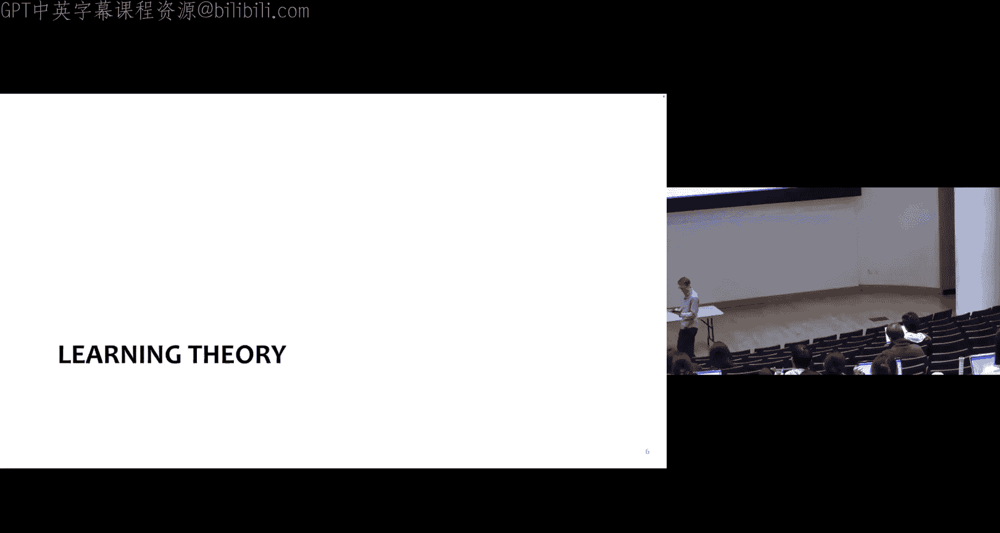

Fact learning and you know， actually to this this class today， you know。

 I take you know my job really seriously and I and I worked really hard to prepare for this class and。

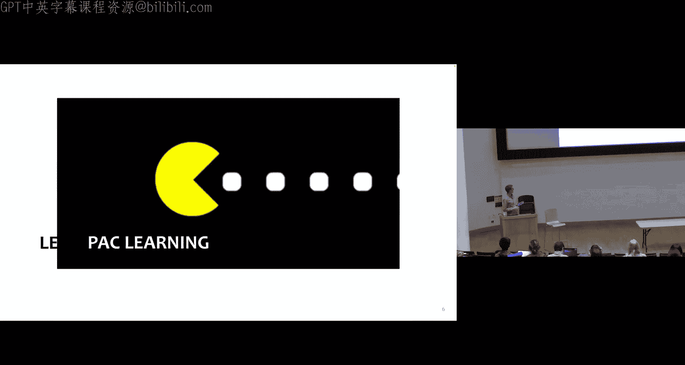

You know， that that means like I practiced a lot to really get good at you know。

 presenting this to you guys， so what I'm going to give you is a picture of my own performance at PAman。

And。And so what you can think about， though， is that I am going to offer to you essentially like an empirical picture of how good I am。

And so we could ask a question like this， what is the probability that I would get a game over in PAacman？

Right。90%， 50%， 10% or we could flip that and we could ask a question like what is the expected number of PACman levels that all all'll complete before a game over right these are good questions what but you guys don't have any training data yet so so let me give you a little bit of training data here that'll that'll kind of help solidify things。

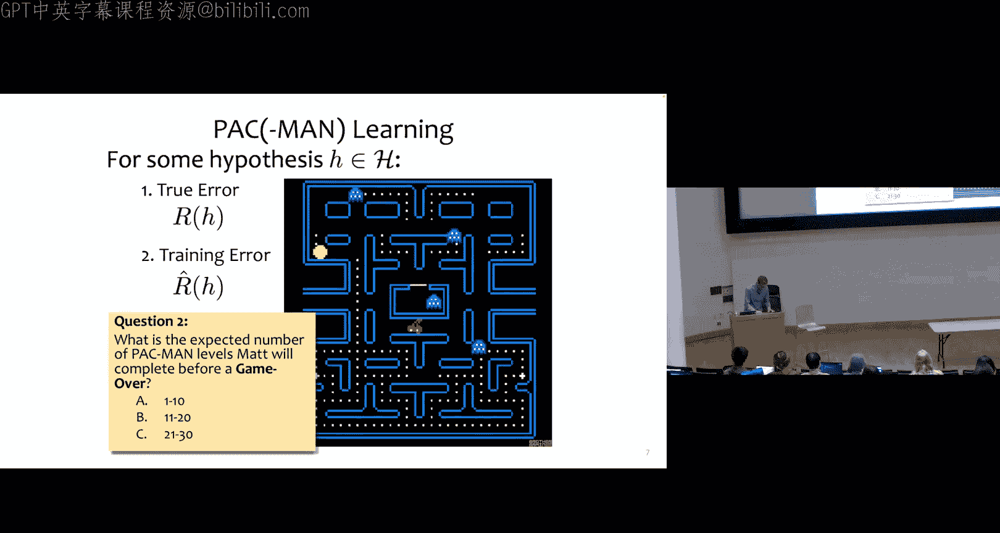

And okay， so。Let'sYeah。

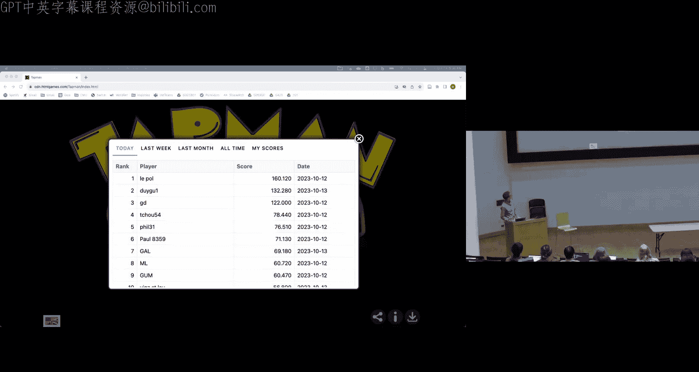

Right。Okay。So like I said， practice a lot， let's see how it goes if you haven't， oh。

 seriously advertising。

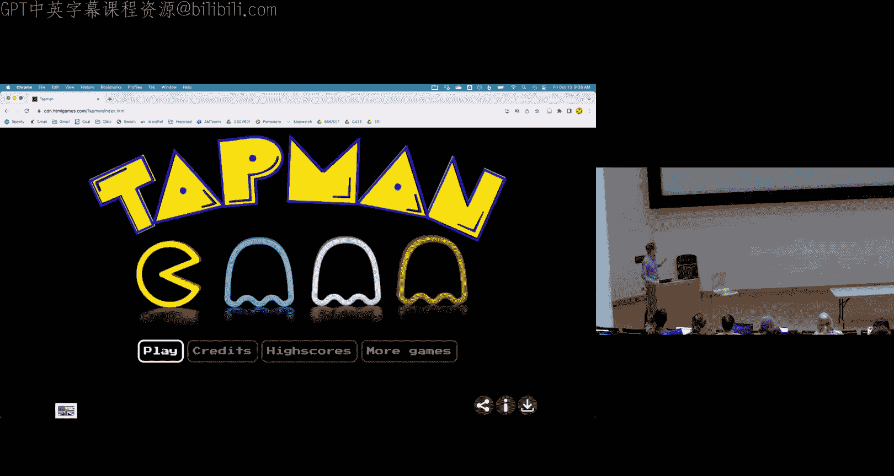

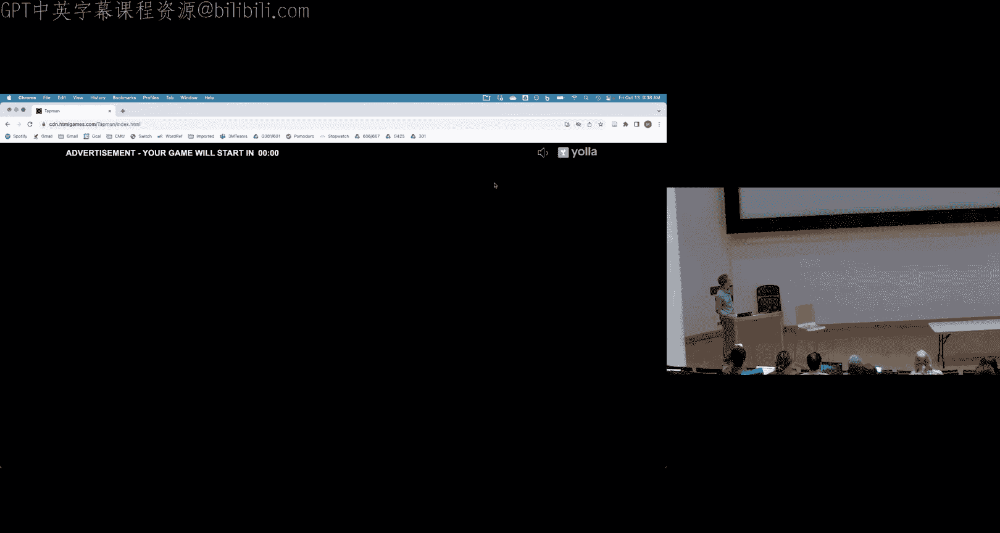

I'm on internet。Now that we're getting hybrid cloud right we know who's AI right Well Well at least it's about AI。

 I mean like， you know， like the the advertising it was probably like you know。

 watching what I read and talking， is this really going to be 17 seconds long？

Oh my gosh。This is the worst。Luckily， like once you're in the game。

 you don't have to keep watching ads and you know I'm so good at this game that basically like I never have to watch just watch ads okay so so the goal here is to equally zero white do and you want to avoid there growth。

And， I got this oh， yeah。就是个。Okay， that was a fluke me let me just give it another guy。

 let me really show you how good I so when we can see one of these little things we can getting a bit incredible in let me oh shit know。

You can actually， a， a man。す分。Just so much okay hold on but guys I'll just shake it out this time we're going get all the way in like level 30 you'll speak okay we really we want to leave now as we getting like yeah so we get we have to escape again before。

And then get one again okay， and so now。Ah， team over already。

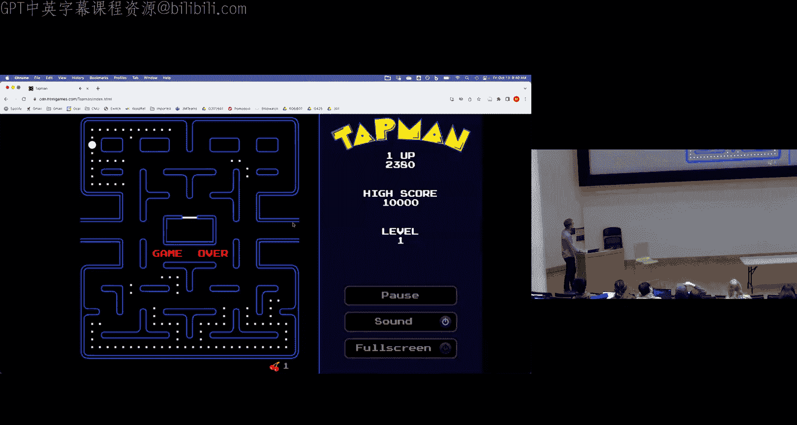

Oh， I can't watch another advertisement。I mean， they were just so exhausting。A a。

 over and over again。Okay， well， what were we doing？Andan， it was something。Something about PACman。嗯。

Oh， that's right。 I think I had a question for you guys okay， well now that。

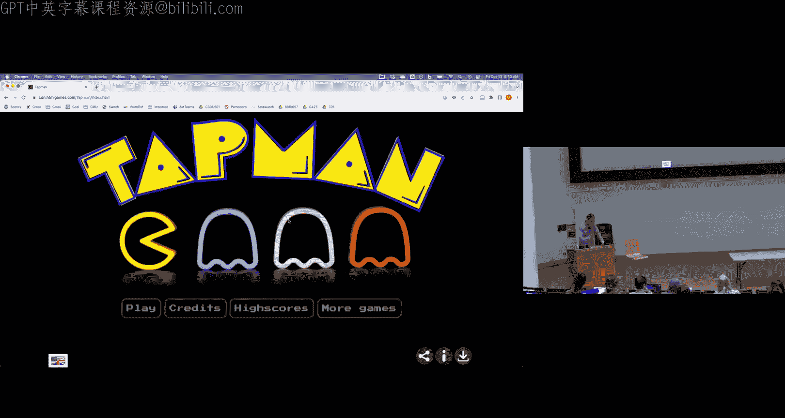

We've we've gone a little bit further here， what we want is to actually see。What it is that。嗯。

Make sure this is working。we get too far。

嗯。

We'll trust that it'll start working by the time I actually need。

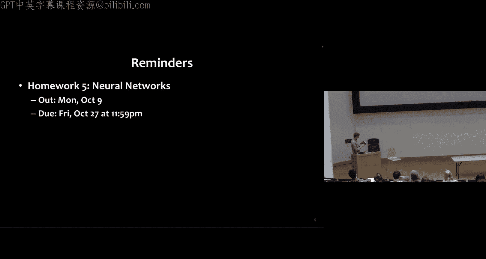

Here's the question。What is the expected number of pCman levels that I could complete before a game over okay so this is not a poll question we don't need this you know permanently inscribed in your record let's just do it by show of hands okay so how many of you for option C 21 to 30 levels？

呃，我。As in。Oh， let's say I'm playing like a normal person。 Yeah， yeah， no。

 like no handicap here like I had just now it probably really threw me off Okay。

 so how many per option C， Okay， one， two generous people Thank you option B。😊，Most of you right。

 well， okay， two more。Option A。Oh。Eyes and。You know， I have self esteem too。You can build me up。

 gosh。That's hard being an instructor anyway， so I guess what is the point of this slide anyway besides demeaning me well。

The point is that you all have some training date， you have some examples of my performance at TckM。

And you get some sense of my error on those training samples。

 this is like what you see when you see training error what I'm asking you to do is that I want you to give me some sort of information about the future。

 an expectation if I played this game many times， what would my true error actually look like？😡，Okay。

So。This is actually exactly the question that we want to address today。

How is it that we could use some picture of training error to inform us about what our true error will be Okay。

 so more generally we're going to say given a classifier with zero training error。

 what can we say about true error then we'll ask given a classifier with low training error。

 what can we say about true error？

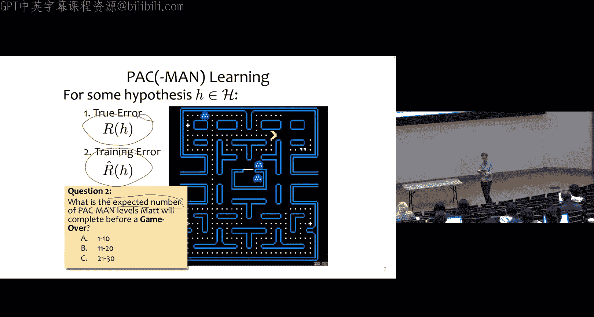

And finally， next time， we'll think about is there some theoretical justification for regularization to avoid overfitting。

 it might feel like this is sort of an unrelated question， but they're actually intimately tied。

Okay so the model that we're going build off of here is the same one that we've been using all along。

 but now we can give it the name， the PAC model or the statistical learning theory model for supervised machine learning where we assume that we had some x's come in that were sampled from some distribution and then labeled by some C star to get our Ys so the crucial change here is that we're explicitly saying that these Xs were sampled from some distribution right and independently and identically distributed we feed those training examples to our learning algorithm to get some hypothesis and you know the problem setting more generally is that we have this unknown target function C star and we have our calligraphic H which is the set of possible hypothesis functions and our learner is given access to the distribution P star and the function C star only through the training examples and now we want to。

Use a hypothesis function H that best approximates C star， that's the goal。

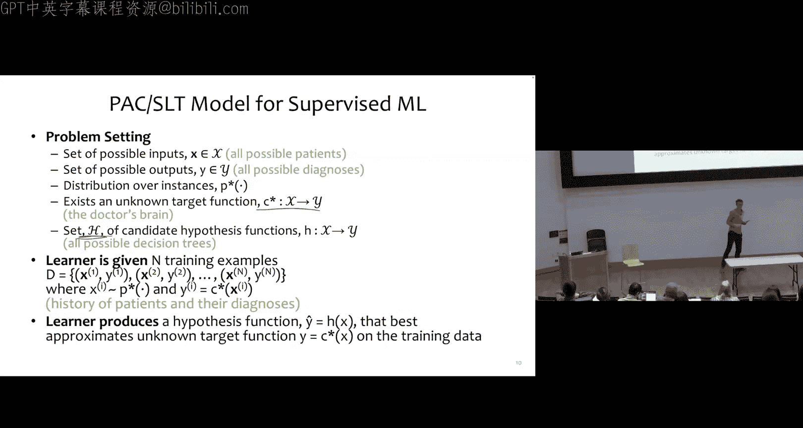

Okay so in our discussion of PA learning we are only going to be concerned with binary classification so it turns out there are lots of other theoretical frameworks。

 including PA learning that can handle other learning settings but we're just going to focus in on binary classification because with it we'll actually be able to like go all the way through a proof of kind of a key theorem in the space by keeping it by restricting it to this case okay so as usual what we're sort of usually thinking about in practice is we have this test data and we make predictions and compare them to the truths to get our test error rate but I want to talk about two very specific kinds of error today neither of which is test error one of them is training error and the other true error so let's start with training error because I've written it in a sort of a careful way that's a little bit different than how we've been writing so。

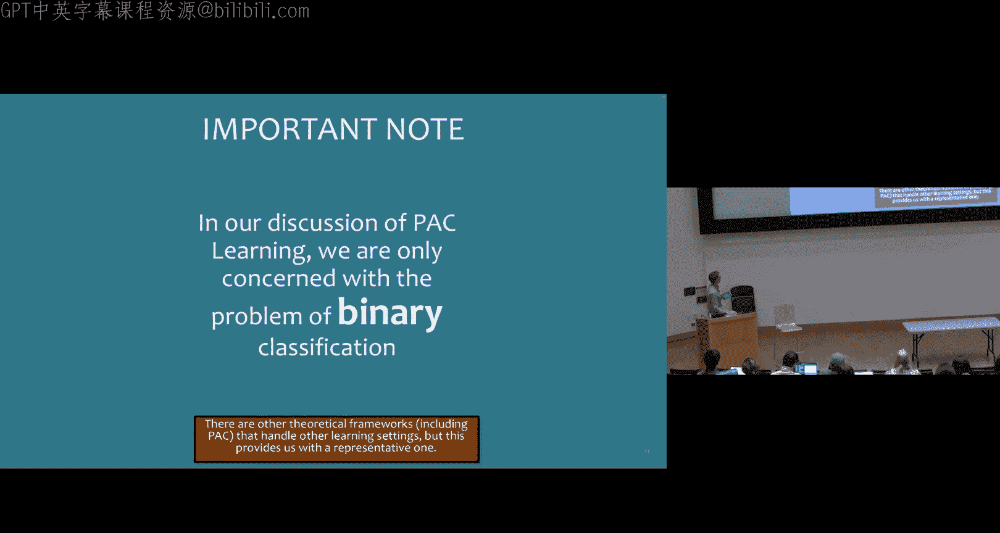

Maybe this is actually， let's start at the very bottom。

 this is actually kind of how we've been thinking about training error， our hat of H。

And the idea here is that we sum over all of our training samples， I equals1 to n， and for each one。

 we check if we made an error does Y I not equal our prediction H of XI。If so。

 we include a penalty of one， if not， no penalty zero。

And then we'd take an average over that to get our error rate。Okay。

 so the first thing that we could do is going backwards here， we could say， well。

 why I is actually just C star。Of exile。Right。That's what it is by definition。

 so let's replace that there and then we could say。

 well conceptually if you think about our training set。

As a set of instances x consists so now there's no y pairs here， this is just x1 through x N。Okay。

 and if we let x tilde s mean that that now x is sampled from a uniform distribution over that empirical set of samples。

Then we could rewrite this second line as this first line。By writing the probability。Of C star of x。

 not equaling H of x under the empirical distribution given by S。

That's exactly what the second line is if we defined this S to be a uniform distribution over the empirical set。

And so。What we have here is now a different way of thinking about the training error。

 right it's the probability of making a mistake on a randomly chosen example from our training set。😡。

And this leads us to a clearer picture of what true error is。

 because true error we can say is the probability of making a mistake。

 C star not equaling H on some x， where now the x's are sampled from that unknown distribution p star over all examples x。

So these are the two kinds of error that we want to think about， we can measure training error。

 we don't know what true error is， it's always unknown。But。

Today we're going to see that we can actually come up with a bound for true error in terms of training error。

So okay， so here's then the full sort of PA SLT model where we generate instances Xi from P star。

 we label them with C star and the learning algorithm chooses a hypothesis H that minimizes the training error。

 okay。This might be like an overspecation of how we actually learn right usually when we run gradient descent。

 we don't necessarily find something that minimizes training error。

 we might be minimizing some other cost function or loss objective function。

 but this is a fine assumption， and our goal is then to choose an H with the lowest generalization error R of H。

Okay。So we have three hypotheses of interest here。And the three hypotheses are first。

 the true function， that's the C star。Second， and so that's where we actually get our training data from。

Second， we have the expected risk minimizer。Which is going to be the H star that minimizes。

The true error。Okay， so in general。We can't compute this one because in practice。

We can't compute the true error。And then there's what we get from training。

 which is the empirical risk minimizer， and that would be。啊，H that has lowest training error。And so。

So now what I want us to think about。Is our first poll question for the day， so this is question one。

And we have three options。诶。Is toxic， so don't pick A。B is true。And C is false。

And the statement here is that。Each star。And C star are always equal。系。So H star。

The hypothesis that minimize this true error。R of H and C star the true unknown function。

Are always equal， true or false。Oh， and then as well， there's some questions about homework four。

We'd love your feedback on that， so I'll give you an extra minute to answer about homework4 and then take a minute to talk to your neighbor once you've done that about question one。

Oh by the way， some of you guys as are giving great feedback like just say for example。

 like that there are things that were not worded clearly。

 if you tell us what was not worded clearly we'll actually fix it for next time。

 but if we don't know what was not worded clearly we might not fix it so if you're able to to give us specific。

😊，Specific feedback it's really helpful， we actually do read through these things and then go and fix them。

Okay， so。You are're pretty confident here， something like 25%。B and 75% C false。I completely agree。

 The correct answer is false。 Does someone want to offer an explanation of why。

You think this is false？Justify your answer。Yeah。Ofbserving the。0ero。S or zero true error。

But it might not be the hypothesis。So it start化。That's a lovely answer， so C star has zero error。

Always。But H star might not be in the hypothesis space， so let's make this explicit。

 so suppose here H was the set of linear separators。And over here。H was the set of all。

Non nonlinear separators。Or or you could say more generally something like， you know。

 the set of all neural networks of depth three with。You know，100 hidden units or something like that。

 which could probably get this right and so you can see here that when H is the set of linear separators。

That。H star must be this grain decision now。And oh sorry， this is not true， sorry， let me fix that。

So let's assume H is the set of linear separators for both of these。But the in this case。

 C star came from the set of linear separators and in this case。

 C star did not come from the set of linear separators。And so on the left case， they can be equal。

And probably would be。On the right case， C star。Might actually。Be something that we cannot return。

For H star。Because it's not a valid linear separator。Okay， great answer。So。

What does PAC learning actually stand for it has nothing to do with PACM can we but it answers the question can we bound the true error in terms of the training error that's what we're trying to get at here the punchline is yes we can and PAC stands for probably approximately correct okay now this highly noncommittal statement is actually what we're going to spend a bunch of time thinking about today so we say that a PAC learner yields a hypothesis H that is approximately correct。

Meaning that。R of H is close to zero， so the true error is not necessarily exactly zero。

 but it's probably close。And we say that this happens with high probability， right。

 this is where the probability comes in。Okay。And。What do we mean by probably here。

 we mean that the probability that the true error is close to zero is about equal to one。So。

So when we think about this， what I want to actually work with is to look ahead to the PAC criterion that we're going to use that's sort of most general。

And this sort of most general packC criterion。Is。A setup where。We assume that。嗯。What we want。Is。

To find。嗯。Some。Hypoththis。Such that。The probability。Of。Not just for one hypothesis。

 but for all hypotheses， age。We have that the absolute value of the difference between。

The true error。And the training error。Is less than epsilon。

Is itself greater than or equal to one minus delta？Okay， now this epsilon is some small constant。

And this delta is going to be some small constant。And so when you think about this。

What we're really saying is。That。You know， if we thought about it on the real line。

There's some point here。That is。Our true error。And we're saying that。

If you went down epsilon in this direction。And you went up epsilon in that direction。

 so this is like plus epsilon and minus epsilon that would give you two。New points on the real line。

And we're saying that somewhere in this region。You will find the training arm。嗯。So。

Maybe the interesting question here。Is you know， we're saying that there's some probability。

That this difference is less than some small number。

And the probability of that occurring is one minus some small number。

 right one minus a small number like you know， 0。01 is actually a high probability。

 that's what we want。And so the question is。U。What is random here？I mean。

 I'm talking about the probability that for all hypotheses。This property holds。But like what。

 where is the randomness appearing？See if someone else can get it。第二。Can you say more？Exactly right。

 so we said that our training data was sampled from this unknown distribution P star。

And so the randomness is showing up。When we say that when we talk about our hat of H。

 you could think of it like a random variable because it is based。On a random sample。From。

The unknown distributions。P star of X。Okay。So。So this。Little R hat of H。

Is actually what we find to be random。Okay， so。What we're going to be interested in。

Are called sample complexity bound。So we say that we can actually define sample complexity。

 so the sample complexity。Is。The minimum。Number。Of training examples。We'll call this N。Such that。

The PAC criterion。Is satisfied。For some。Epsilon and Delta。可以。

And then the other definition that we want when so we're going to be looking not just at， you know。

 how do we satisfy the pack criterion， but we want to know how many training examples do you need to satisfy the packC criterion at a certain level of like small error and at a certain level of high probability。

Okay， so the other definition that's going to be useful is we say that。A hypothesis。Is consistent。

With。The with。The training data。Or really with any training with any data set。

 but we'll just talk about the training data。嗯。If our hat。Of H is0。Okay。

So this is just a useful word to have in our vocabulary， we can say， yes。

 this hypothesis is consistent。And that just means that our hat of H is zero。Okay。

So this is the framework that we're going to be working under。

 we're actually going to look at sort of different flavors of this tax criterion as we build up to this version。

Okay， so in fact， we won't just look at sort of one theorem， we'll actually think about four。And。

We'll start with a special case， which is where we assume that the size。Of H， this is the size。

Of the hypothesis space。You know， it's a set and we're taking its size。

 so when the size of the hypothesis space is finite。Then。

We're going to think about sort of these two cases the realizable case and the agnostic case okay so so what is realizable versus agnostic so realizable just means that。

Here in realizable， we assume that C star。Is in the hypothesis class H。The agnostic case。

Is where we assume that。C star is not necessarily in H。That is。C star is either not in H or。

C star is in calligraphic H。And we're just not sure which one it is。

So the second case is the more general one。Maybe the more powerful one。

 but the first one will make our proof a little bit simpler。

 and so we want to focus in this first top left corner box。Okay。

 so what can we actually say about sample complexity in this case and the answer is we're going to say that。

So if。You have。N， greater than or equal to。Or let's say end training examples。Where？

N is greater than or equal to。One over epsilon。Times。The log。

 the natural log of the size of the hypothesis space。Plus the log of one over Dlta。

If you have that many。Labeled examples。Or， yeah， sorry， so if you have N training examples。Labeled。

Obviously， examples。Where n is greater than or equal to this quantity。嗯。This is sufficient。嗯。

To ensure。With probability。1 minus Delta。That。For all hypotheses H。In calligraphic H。呃。With。

Training error zero。We have。Or know that。The true error。Is less than epsilon。O。

This is a long statement。Let's try to actually unpack what it is that we just wrote down。

What we're trying to get ourselves is basically a statement that says。

 if I pick a value of epsilon and a value of delta。

And I want to know how many training examples do I need？So that whenever I train my classifier。

 if it has zero training error。Then I know。That with probability 1 minus delta。

 let's say deelta is 0。01， so with 99% probability。I have error， I have true error less than epsilon。

 let's say epsilon is。5%。Then if I want with 99% probability。

A zero training error classifier to have less than 5% true error that I'm going to need that many training examples。

Okay。So this is the statement that we're going to prove today。

m and here it is written down in sort of a more compact form。

 right where we just say and greater than or equal to this many labeled examples are sufficient so that with probability one might to all H and H with this hubback。

嗯。So now what I want you to do is look at poll question two here together。

And actually apply this theorem in a real case， okay？So suppose that age。

Is the class of conjunctions over binary feature vectors？Of length M。Okay， so your feature vectors。

 they can only have zeros and ones in them， and you have capital M features。Okay。

 now what what is the class of conjunctions， so these are this are two examples of conjunctions。

Right， so let's say m is equal to seven here Okay， so you have seven features the first example。

Example one would be a hypothesis that only returns one。If。X1 is one。X3 is0 and x5 is1。

Another way of writing this， you if you've kind of studied prepositional logic would be x1 and not。

X3 and x5。Okay。Example number two here is saying we only return one if x1 and not x2 and。

X4 and not x5。Okay。So if n is equal to 10。Epsilon is equal to 0。1， delta is equal to 0。01。

How many examples suffice to ensure that a zero training error classifier will have less than 0。

1 error？OkayAnd your options are A through G， don't pick option H。Which is the toxic options。

All right， so talk to your neighbor， you'll need to figure out。

A couple things to answer the question and then go ahead and submit your answer。Okay。

 most of you have got an answer in here it looks like。We're rolling in around 19% A。

I'll just kind of highlight the top choices， 36% C。20% D。Okay， so。So I think let's first talk about。

嗯。Yeah so this is an interesting case so so in fact。

 I think and then all the way down this is like 10% to B。

and then not too many people answered the the lower options so okay。

 so what we need first here is to figure out what is。The size of the hypothesis space H。

That's the first sort of crucial question here。So。I think the majority of you got this wrong。

 it looks far well。Oh no again， no， the majority we got this wrong， that's okay， is this is tricky。

So。呃。Does anyone feel very confident in their answer do you want me to tell you what the answer is so you feel more confident yeah do you want to？

系搞啲咩。他的比较款。Right， okay， so the correct answer is three。I'm going to write it as M。

Though for our case， that is three to the 10。And the explanation here。

 I'll just repeat it back was that for each variable， you actually have three options， not two。

The variable can either be included as like x1 in both of these。

Let's look at the first example in x1 is included。But x2 does not appear right it's kind of like saying we don't care what the value of x2 is that's an option and then the third option is you include its negation that's what we did with x3 in that first example。

😡，So you can either include it。Include its negation or not included。

And so we have three options for the first variable， three options for the second variable。

 and so on 10 times， and we get three to the power 10。Okay， what that means for us。

Is that crucially the log of the size of the hypothesis space？Is only 10 times the log of three。Okay。

And so if we look now at our answer， I think everybody kind of latched onto the fact that the log of one over Delta was。

Was log of 100。And here is the log of the size of the hypothesis space。

 and then we have one over epsilon out in front， and so D is our correct answer。

The takeaway here though， is maybe more important than the actual arithmetic or figuring out what the size of the hypothesis space is。

So the takeaway here。Is that the number？Of examples needed。Is。Something。In。😔，The number。Of features。

Even though。Size of H。M is something else。In em。How do I fill these two blanks in？

I want computational complexity here。Or not computational complexity。

 but rather just complexity here， biggo notation。Yeah。Exactly， right？So in the first case。

 we're seeing that that the number of examples that we need is linear in M。

 even though the size of the hypothesis space。Is exponential in EM。Okay。

 and that is a great property of this theorem right it's sort of what makes this theorem like useful at all can someone someone want to let's see what do we do if we oh I have this number already so it's 156 examples。

😊，So that's kind of remarkable we're saying if you have 10 features。

 there's three to the  tenth0th possible hypothesis。

 but if you have 156 examples and you get a conjunction that has zero training error on those。

 then with probability 99% your generalization error。Is less than 10%。That's what we just said。Okay。

Okay， so now we want to actually go in and prove theorem one。Okay。To do that。

 I just want to give a little bit of background here， the contrapositive。

 maybe you've seen this before or maybe it's been a while。

 so the contrapoitive of the statement A implies B is the statement not B implies not a。

And the two are logically equivalent， meaning that they share all the same truth values in the truth table。

 and so you can do a proof by contraposition。Or proof by contrapositive。

 if you want to prove A implies B， you can instead first prove not B implies not a。

 and that would allow you to conclude that A implies B because they're logically equivalent。

And basically sometimes like negating something that's just like B is easy。

 you're just writing negation in front of it， negating a statement is sometimes easier said than done。

 so let's just be careful as we use this as we're going through so to prove theorem one。

What we're going to do is。We're going to start。By assuming。That we have。He。Bad hypotheses。嗯。

Or rather， assume that there exists K bad hypotheses。In H。We'll call them H1。H2。H K。诶。

That have true error R of H。Greater than Epsilon。So in what sense are these bad， well。

 they're bad in that we're going to pick some epsilon。That we want to have lower true error then。

 and I'm saying， well， let's assume that there's K hypotheses that don't have that that low that good low true error okay。

So。What I want to do then is。Is actually pick。One of these bad hypotheses。So we pick a bad H。

And now we want a reason about it， we want to ask， what is the probability？Of H。being consistent。

With。The first training example。So if you had a training set of size one。

Or if you just took the first training example。Then what is the probability？

Of H having zero training error on that one example。That's what consistent actually means here。

So can anyone think that through or could you， maybe we don't know exactly what it is。

 but can we bound？This probability or say something about it。

The probability of H being consistent with the first training example。

What can we say about that probability？Yeah。一的。Yeah， that's right， so we would say。

This is less than or equal to。1 minus epsilon。Okay， why is that well， so what we're saying here。

Is the first training example。It's some example x1， and it was sampled from P star。star of x。Okay。

 what does R of H greater than epsilon mean？It means that the probability of making a mistake on a randomly sampled example is greater than epsilon。

Okay。So the probability that we would not make a mistake。Must be less than one minus episode。O。

So here's our next question。What is the probability？Of。HI being consistent。With the first。With。Well。

 we don't even need the word first here with all N training examples。

What can we say about that probability？So we know that the probability of it being consistent with one example minus is less than one minus epsilon。

So what's the probability that it's？That it gets the correct label for end training examples。Yeah。

 that's right， so we could say this must be less than or equal to。One minus epsilon。

Raised to the power end。Okay， why， why can we do that so。

 so when we say H being consistent with the first end training examples。

 what we're asking is basically what's the probability of。

R hat of h equaling zero and here what we're saying is the answer is that it's the probability of getting the first example right。

 which is one minus epsilon。Times the probability of getting the second example， right。

 which is one minus epsilon。Times and so on down the line all the way to the last example。

 which has probability of getting that one right one minus epsilon or less than that。

 and if we multiply all of those probabilities together。

Then that would give us one minus epsilon raised to the power N。O。So now we want to ask。What is？

What is the probability？So we could even， let's just sketch that out so this is just。

One minus epsilon。Times one minus epsilon， this thing multiplied together n times。

OneOnce for each example。嗯。Okay， so now what I want to think about is what is the probability？That。

At least。1。Bad H。Is consistent。With the first end。Training examples。Or all in training examples。Okay。

 so this one's a little trickier。嗯。Does anyone have any ideas here？

The probability that at least one of those K bad hypotheses。

Is consistent with the first end training examples。Yeah。ItEpsilent to the power。😔，So what power？So。

I think it has to be more than that so so here what we said is。嗯。

The probability of one H being consistent with those is one minus epsilon to the M。So。Oh。

 say it again。Yeah times k okay， so why is it that we can do this why is it that k times one minus epsilon to the power n would give us an upper bound the answer is something called the union bound。

举道。Recall this， the union bound。Is a useful tool in probability it says that that the probability。

Of a union B is less than or equal to the probability of a。Plus， the probability of B。

 where A and B are two different events。Okay， and we're using the union bound。

To get this K term out in front。Okay， so。um。So what we're saying here is that there's actually K different events the first event is that。

The first event is that。The first hypothesis H1。Is consistent with the first end training examples。

 that has probability one minuspsil to the end。The second event is the second that hypothesis is consistent。

And then all the way down to the k of hypothesis being consistent。

And so we know the probability of each of those happening independently。

 it might be that there's some overlap in those events right， but the union bound is saying， well。

 if there's overlap， at least you can up bound what the union of those probabilities would be。Okay。

 so。Here we could make another comment， which is that。This long phrase。Right。

What it's actually saying is。Is the following it's saying there exists。An H。In calligraphic H。

Such that。The training error is zero， our hat of age is zero。And。The true error。

Is greater than epsilon。对。So that's the bad scenario that we are trying to avoid。Right。Um。

 because if that happens， then when we get that。That training error of zero， we're going to think。

 oh， this is a good one， but actually it's not， it's one of the ones that has high true error。Okay。

 so here's my next question for you suppose I compare k times1 minus epsilon to size of H。

1 minus epsilon。My question for you is。Between K and size of H。Which one is larger？Okay。Or size of H。

Why is size of H larger？Yeah， exactly so we know that。Hay is just the number of bad hypotheses。

And you can't have more bad hypotheses than there are hypotheses， right？

So it must be that the number of bad hypotheses is less than or equal to the size of the hypothesis space Okay。

 so that means that we can upper bound k times1 minus epsilon to the n with size of h times1 minus epsilon to the n Okay。

 now I'm going to give you a。Fact here。Right。So this is just a useful algebraic expression。

 so for one minus x is less than or equal to。X of negative x。对。What does that mean for us？

So what that means for us is that。We can take this size of H。Times1 minus epsilon。

Raised to the power N， and we can say that this must be less than or equal to size of H。Times X。

Of negative epsilon。Raised to the power end。嗯。That's a useful little fact and we could rewrite that as size of H times x of。

Negative epsilon time zone。Okay。So now the next thing we want to do。Is。We want to。嗯。

We want to actually choose。Or Delta。Such that。嗯。It upper bounds。Whatever this。

Little quantity we came up with here size of H times xonent。Negative epsilon n。

 let's choose Delta so that it's an upper bound on。Okay， and in essence， what we're saying here is。

This thing on the left。Is an upper bound on the probability of a bad event， what is that bad event。

 it's that there exists one of these hypotheses that tricks us。Right？

And so if we say Delta is greater than that probability。For some deelta。

 that's like saying we want that probability to be less than Delta。Okay。Now。We're going to。呃。

Probably need more space， let's see， yeah， let's move over over here。So we'll get step six here。

Actually， we can do step six right here。So now I want to solve for N。Okay。

Since what we're after is actually a complexity bomb。Okay， so if we solve for N。

Then we're going to get that the size of H。Times。One one over deelta must be less than or equal to。

1 over。X of negative epsilon N。So I just swapped sides divided by Delta。

Wwhich we know is a probability， so it doesn't flip the inequality and epsilon x of negative epsilon N。

 we know that's positive so that doesn't flip it when we multiply both sides by one over that。Okay。

Now let's take the log of both sides。So taking the log， we get the log。

Of the size of the hypothesis space。Plus， the log。Of one over Delta。Is less than or equal to？

The log of the numerator here， which is one。Minus the log of the denominator， which is log。Of ex。

Of negative epsilon times n。Okay以。😊，嗯。What is the log of one？0。What is？The log of X of anything。

anythinging， where that， that sounds terrible。The log of X of negative epsilon n is just negative epsilon N that was negated。

 so this whole thing is just epsilon times N。😊，Okay。So that means if we divide both sides by epsilon。

We get back one over Epsilon。Times the log of the size of the hypothesis space。Plus。

The log of one over Delta。Is less than or equal to。N。Okay， so what we have here。Is。嗯。This thing。

Let's call this。Statement1。And what Stephen won is telling us。Is that？

If you've chosen an epsilon in a deelta。Where Delta is the probability that you want to upper bound our bad event with。

That some bad hypothesis sneaks in。And Epsilon is the error that you want to avoid。

Then if you have n， grade of n or equal to。That many examples。Then。啊。We could， well。

 let me write this down for a little。So now let's go over here。And。

Let's actually assume statement one。So if we assume statement one。Then。What we're saying is。

So if we have that many examples that with probability Delta。There exists。An H in H。Such that。呃。

R of H is greater than epsilon。And the training error is zero。Okay， so。So in essence。

 what we're saying is is that。This is sort of our bad situation。Okay。

 the fact that it happens with cr delta is actually like not too bad。Okay。

 so we can look at then what happens with probability one minus delta。Right。

So with probability1 minus delta。The reverse of this happens。

 it means that with probability 1 minus delta。For all H and H。呃。

Those that have true error greater than epsilon。Have training error。Greater than zero。Okay。

 this is a not so bad situation， this is actually a good situation。Not bad at all。Okay。

 because if we could。Get this situation to occur。Then。嗯。Then it would say that。For all hypotheses。

 whenever they have bad training a true error， they also have bad training error。

That would be a great situation for us。Okay， so here we need to just sort of remind ourselves of the contra positiveitive。

So the contrapoitive said。That A implies B。Is equivalent？To not be implies not a。Okay。

 so what I want to sketch out for us is。A are A's and Bs so here。This is our A， and this is our B。

Okay， so a is that the true error is greater than nepsilon。

 B is that the training error is greater than zero。Okay， so by the contra positiveitive。We have that。

For all H。In H。We should with。Not be。We have not a。Okay， so what on earth do we put in here？

So this should be not be。And this should be not a。So what is not B？How do we flip that statement？

Andgate that stigma。So B is that R hat of H is greater than zero， what's not B？好。Oh。

 probabilities aren't in play here because we're saying with probability  one minus Dlta。

 some statement holds， that's the blue statement。And now we're trying to come up with an equivalent statement。

Rewritten。So we can actually ignore the probability in here。

 which actually makes this like like we can actually wrap our head around what's happening。

That's a great point to make though。Okay， thank you。Thats。Yeah， so not B is with r is R of H。

Equals zero， ink is doing something weird。Yeah， I ran out I think， look at that。I was so wacky。

Look at this。嗯。Just like come off， oh， it actually did start to come off， look at that， okay。

All right， more ink。嗯。So if whenever we have all H andH that have zero training error。

Then then or all of the Hs that have zero training error must have the property not a， which is。

True error being less than epsilon。嗯。🤢，So。So this is the or sorry， less than or equal to。Okay， so。

What did we accomplish here？Okay， we use the contrapoitive now and we have the statement that says。

If the learner。Returns。A hypothesis in H。With zero training error。Then。With probability。

1 minus delta。We know。H。Has less than or equal to epsilon true error。对。

And this is actually kind of a remarkable statement to get to。We're basically saying that。

There's this unknowable quantity， the true error。And yet。

 if we can train our classifiers such that we get zero training error。

 we can actually bound that true error with high probability。Okay。

 so this proves for us that theorem1 holds now I want to state for you theorem two without proof。

Theorem2 says， if you have n greater n or equal to one over two epsilon squared examples。

Times the log of the size of the hypothesis space， but the plus the log of two over delta that if you have that many labeled examples。

 they're sufficient so that with probability one minus delta for all H and H， we have that。

The distance between the true error and the training error is less than or equal to epsilon。

So in fact， if you look back at theorem1。It was also saying that the distance between the true and the training error is less than or equal to epsilon。

But it was also adding that that holds not for all age， but for all age that has zero training error。

は。Okay， so what is different about these statements is because in some sense it feels like the the second one is。

 oh， sorry， so let let me remind you first that the realizable case is where C star is in assumed to be N H and the agnostic case is C star。

sortrt of。Not necessarily。In H might be N might not be， okay？

So so this is a weaker assumption and it's a better assumption right because like in the real world we might be learning decision trees。

 but you know that your real function， C star isn't exactly a decision tree or something like that。

Okay， so what these bounds tell us is actually a little bit different though and that's how we were able to accomplish this this more general bound so here the bound is inversely linear in epsilon。

Meaning that。呃。It's in verse this that we have this one over epsilon term。

And then the second thing is that the bound is only logarithmic in the size of H。

 we already saw the power of that right that if the size of the hypothesis space is like exponential in the number of your features。

 but your bound is logarithmic in the size of H， it might still mean that you're linear in the number of features。

Okay on the other side， the bound is inversely quadratic in epsilon right so this is worse。

 meaning we have a one over two epsilon squared term， and then the bound is still logarithmicically。

😊，So it's basically like a weaker bound， but we get a more general case covered here。Okay。

Now we come back to this whole finite versus infinite age thing because I've kind of been ignoring this。

A finite H does come up in this class， right， an example would be the set of all decision trees over of depth D over binary feature vectors of lengthham。

😡，Right。Or the set of all conjunctions over binary feature vectors。

But the case that we maybe more care about is actually infinite H， which is more general。

 because that would include things like H being the set of all linear decision boundaries in M dimensions。

Or the set of all neural networks with one hidden layer。可以。

And so if we come back to these complexity results。

 you should immediately notice that theorem one is a big problem because the log of infinity。

If the size of the hypothesis space is infinity is still infinity， right？

So how is it that we can come up with？Complexity bounds for this case of infinite H。

And the answer is going to be something called the VC dimension。And it will allow us。

 so what we were using when we said the log of the size of the hypothesis space。

 was we were using that as a measure of how complex our hypothesis space is。

The VC dimension is going to be another way of actually measuring the complexity of our hypothesis。

And so when we come back next time。We。都不。😔，When we come back next time。

 we'll actually define what this VC dimension is and we'll actually reason about what these theorems give us so we'll do that on Monday on the other side of fall break in the meantime I hope you guys actually take a good long rest and you come back ready to jump back in with us。

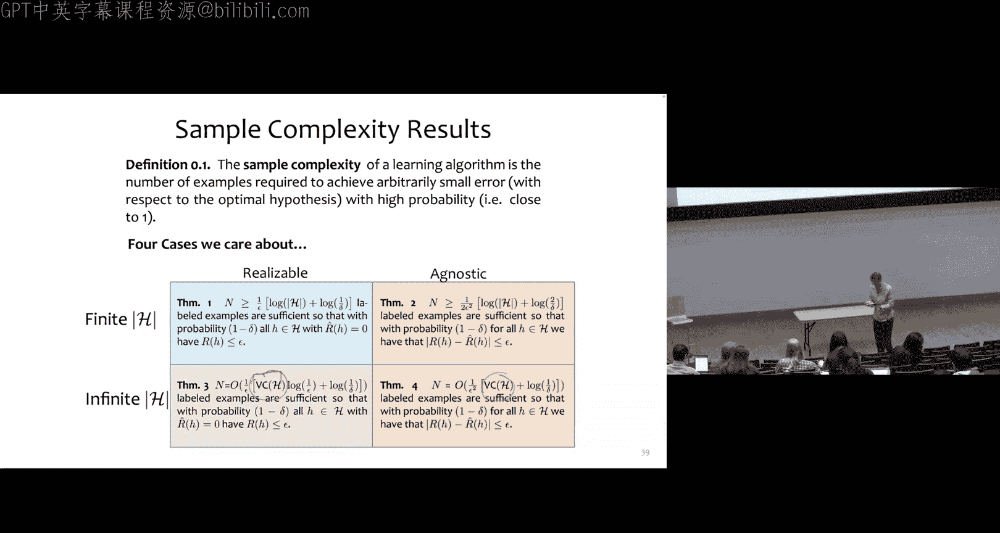