# CMU《机器学习导论｜Fall 2023 10-301⧸601 Introduction to Machine Learning》中英字幕（deepseek p15 Lecture_15_PAC_Learning_MLE+MAP.zh_en -BV1Z2cUefE4A_p15-

All right， good morning everyone。Happy Monday， hope we all had a great break， welcome back。

Today， we're going to be picking up where we left off before the break and continuing our discussion of。

😊。

Learning theory， and today we're going to handle the much more interesting case that is when our hypothesis sets or hypothesis spaces are infinite。

😊。

That's much more common in machine learning than the sort of like contrived finite hypothesis sets that Matt was talking about before we left for break。

Before we dive in a few announcements， don't forget you have a homework it's due this Friday I really hope you didn't spend your break working on it but if you didn't spend your break working on it。

 you should probably start working on it now this is much much further down the road but because some of you might not have seen this the final exam has been scheduled by the registrar during the final exam period that's the date you will be expected to be here in person it's actually better than usual usually we get like the last date of exam period and we get a bunch of complaints about that this is like near the beginning and peer tutoring I jump the gun a little bit on this one we are going to get that set up eventually it is not yet on piazza but basically you will have the opportunity to sign up to be either a tutor or receive tutoring based on your performance at the midsmester grades。

One thing that is not on here mostly because I literally just put it up one thing that's not on here I just put up the exam one exit poll some of you have been asking like what the heck is this this is the poll for us to like collect feedback from you on the exam but also a poll for you all to like take you know two minutes and reflect on how you did on the exam and like what you would change about your study habits to improve on future exams there's also some questions about like the background test and your general study habits as well。

All right so。Let me just add that bullet here。Exam 1。Exit poll。Also on Piazza。All right。

WeGive you guys a chance to settle in any logistics questions before we move on to content for today。

All right， so this is where we left off on Friday before the break。

 that is Matt and you all spent a pretty lengthy amount of lecture proving this result here。

 which says for a finite hypothesis set in which you know。

 the true target generating function C star lives， the realizable setting if you will。😡，In this case。

😡，Having M labeled training data points where M is greater than that stuff over there on the right means that all。

😡，I hate trying to say this out loud， all hypotheses with zero training error or zero empirical risk。

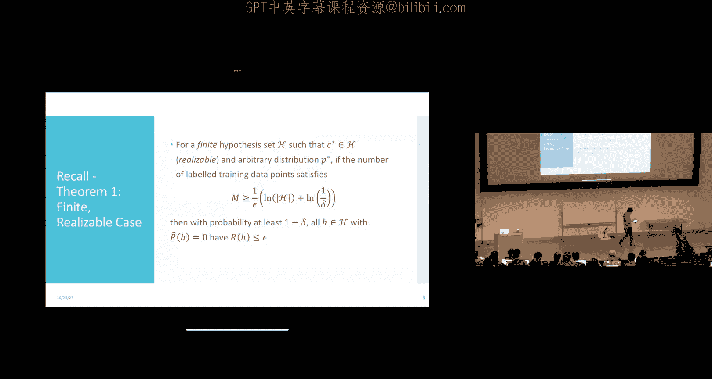

Have bounded true error with high probability， with probability。

 at least one minus delta and so this is a really cool assertion that we can make without having sort of any statement about what the model is or like what our data looks like as long as we have sort of enough of it and it all comes from this distribution P star。

 we can make some nice guarantees about how well our algorithms。

 how well the classifiers that we've trained will do in practice。😡。

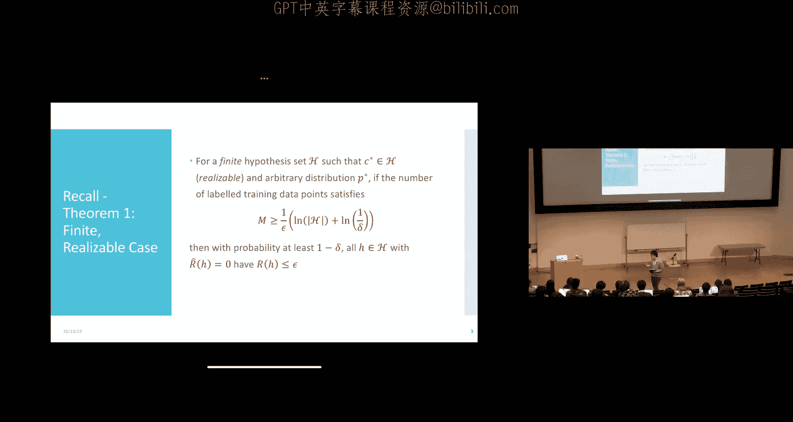

But this is sort of a weird assertion， right， because what this。

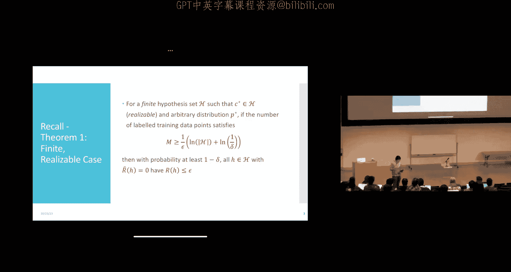

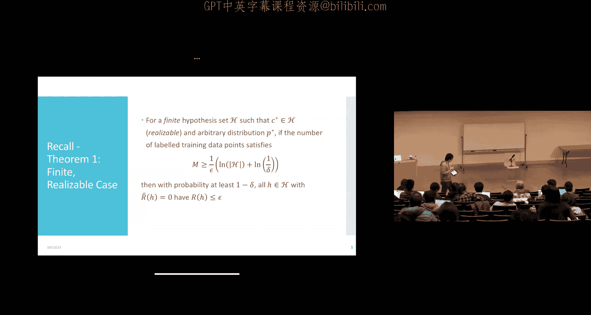

What this theorem is saying is that if you have this many data points， you can say some stuff， right？

😡。

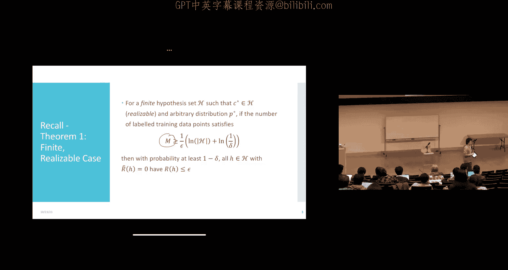

But what if you don't have that many data points right in machine learning in you know a lot of the common settings that we work in。

 we're just sort of given a data set that's of some size and sure it would be great if we could go out and get more data。

 but sometimes we can't right if I just have a certain amount of data well then what can I say about how well my models will do Well we can actually sort of derive what we'll call a statistical learning theory corollary from this theorem and what I'm going to do is I'm going to first make this bound type here So I just replace that greater than or equal to with an equal to and this is still a true statement right this is still just saying like I'm just picking the sort of tightest possible value or the smallest number of data points where I could still make this assertion be true So if I make this bound type and then I solve for epsilon that'll allow me to plug in。

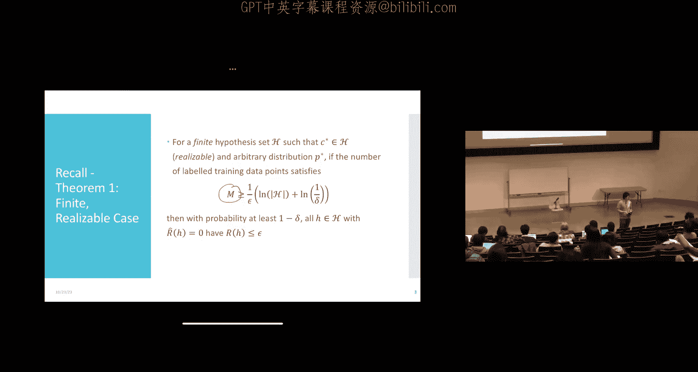

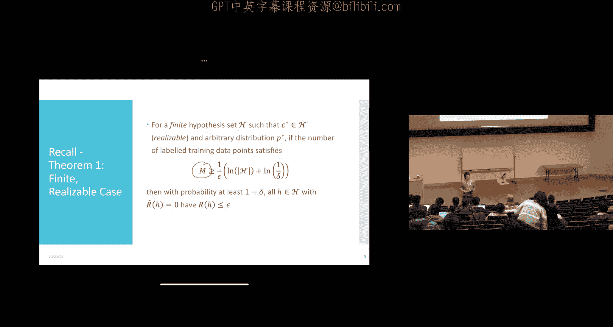

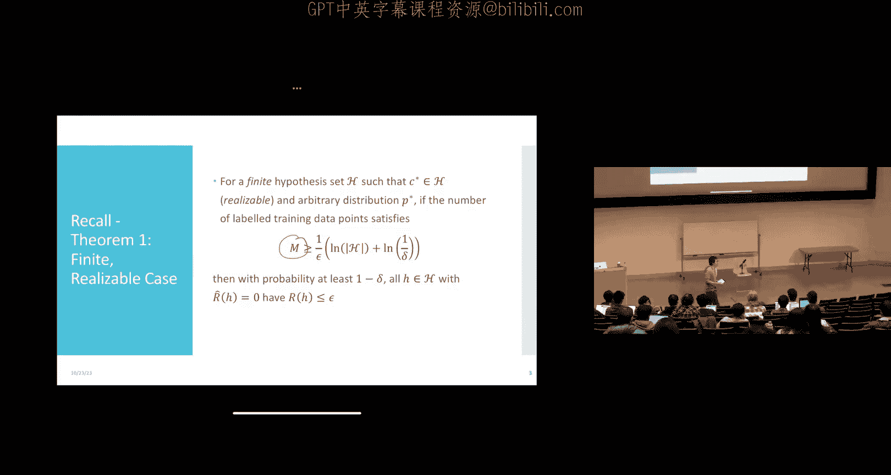

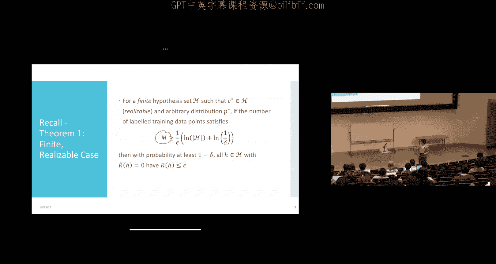

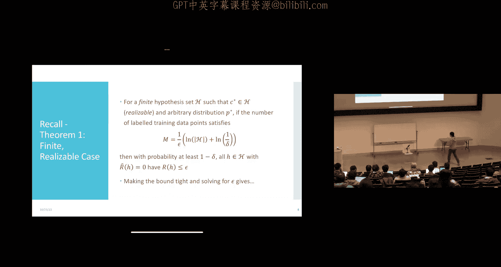

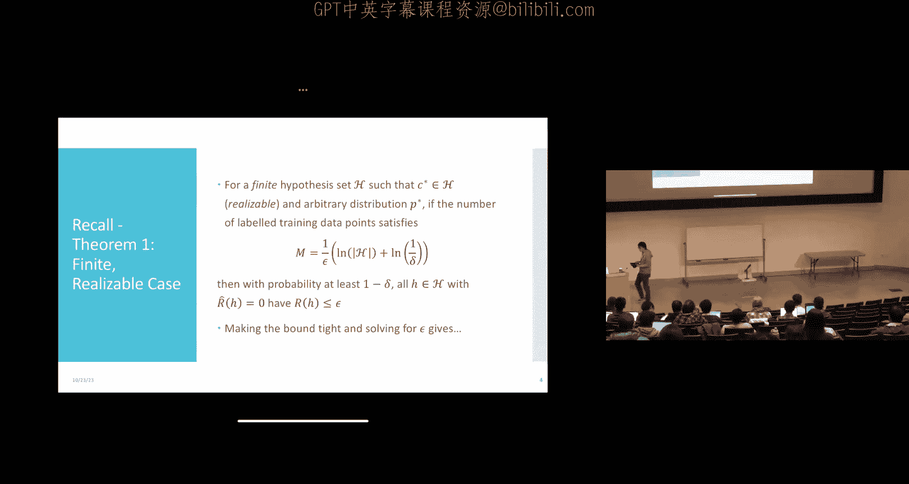

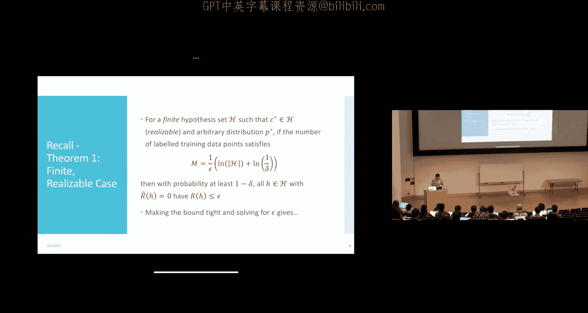

My solution， my expression for epsilon into that inequality there。😡，And this will give me。

What we call the statistical learning theory corollary。 And this is sort of a much more like。

Tractical， in some sense。Result for the traditional machine learning theory setting。

 which says that if I have a data set of size M。 So a data set S with M labeled training data points。

 then this is the guarantee that I can make。 So I'm given my fixed sized data， you know。

 here's 1000 data points you've trained your model and you find that it has zero training error。

 That's great。 Now， if you know that the true target generating function lives inside your hypothesis space。

 you can make this guarantee on the true error of your model。

 And so in some sense iss a much more practical result that says， okay。

 given a fixed number of data points what can I say， as opposed to， all right。

 if I need to guarantee。 So this。😊，Learning theory here says if I need to guarantee that my models will do at least so well in practice。

 if I have some target true error bound， how many data points do I need。

 that's you what this theorem is saying and it's not always applicable and so we derive these statistical learning theory corollaries。

😡，Okay， let me stop here， what questions do you have before I move on？All right。

 so my assertion is that this was a sort of more useful statement than the learning theorem that you and Matt derived on Friday。

 oh yeah， go ahead。😊。

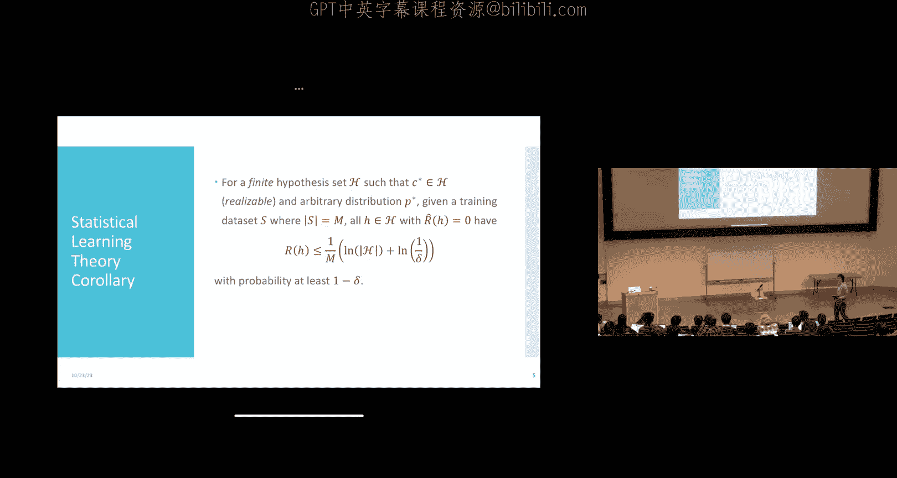

Yes。It that to be de building。Have this。I this true error into my。

 how do we take the same hypothesis to actually use？

So amongst all of the hypotheses with zero training error， how should we select between them。

 unfortunately this theorem can't give us any sort of guidance towards that that we need to rely on you know the inductive biases of our learning algorithms like our learning algorithms will typically pick out which specific single hypothesis to return。

 you could also imagine doing some sort of like validation to select between you know equally good hypotheses。

 hypotheses with zero training error。

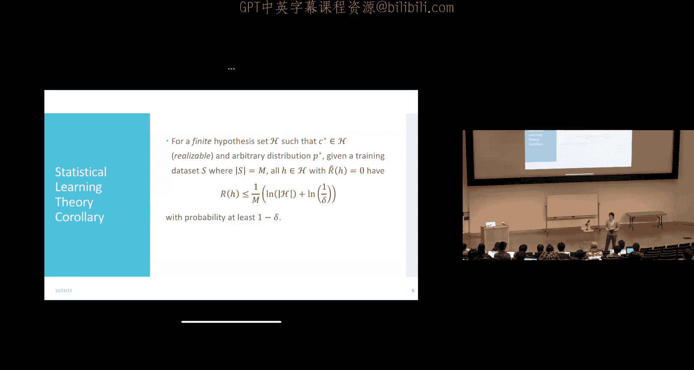

But from the standpoint of the theorem， all hypotheses with zero training error are sort of equally good。

 they have an equal guarantee。

All right， so。My claim was， you know， that's a more useful result than the sort of learning theory style theorems that you proved with Matt。

 but this is。Maybe the like least useful setting in some sense right this is a setting in which you have a finite hypothesis set and you know somehow somehow you know that C star。

 the true target generating function lives inside your hypothesis space which is like a ridiculous thing to possibly know and so a much more reasonable sort of assumption or a much more reasonable theory to fall back on is the finite agnostic case here。

 and I think Matt also might have thrown this up on the slide briefly。

 but this is just saying if I'm not making any assumptions about C star。

 if I don't know whether or not C star lives in my hypothesis space。

 what can I say turns out I can make a sort of very similar guarantee maybe the one thing to note here is that now this bound is inversely quadratic in epsilon and so the way to think about this is like okay if I want to have a tighter sort of error bound if I want to you know have my tolerance for。

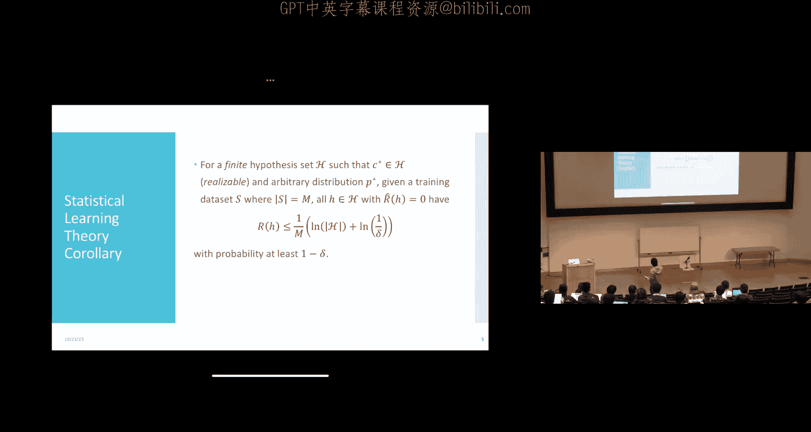

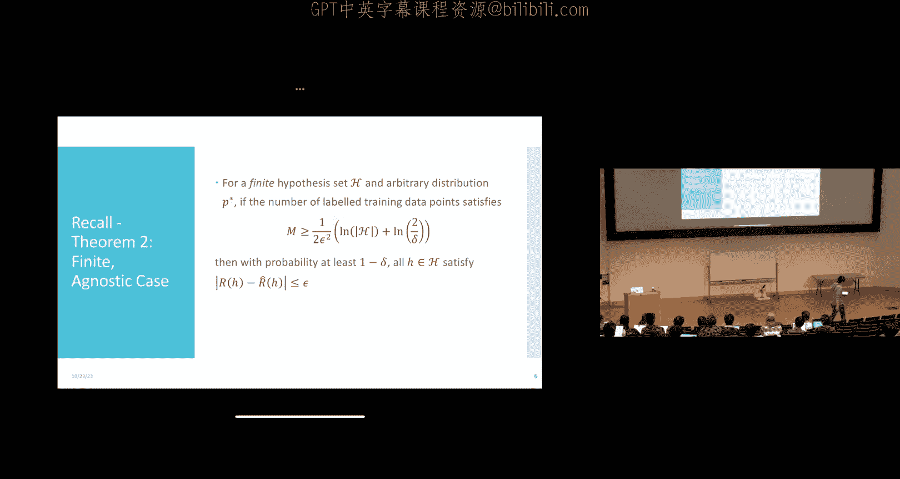

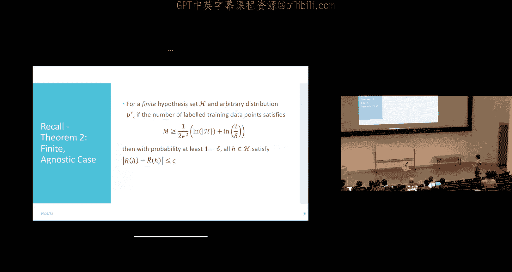

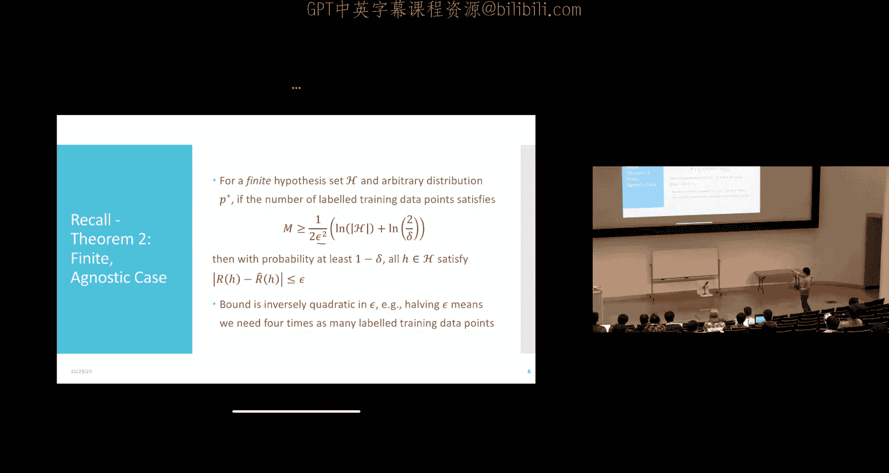

The true error of my hypotheses， then I need four times as many data points and that's sort of the relationship between epsilon and M。

 the number of data points you need here using the similar approach that what we just saw。

 we can also solve for a statistical learning theory corollary here again。

 we're just making the original bound type with respect to M and then solving for epsilon and that gives me this sort of guarantee or this sort of result that says the true error is bounded by。

Now the training error plus some term that depends on the size of my hypothesis at age。😡。

And this is where we sort of left off on Friday， the big question here is。

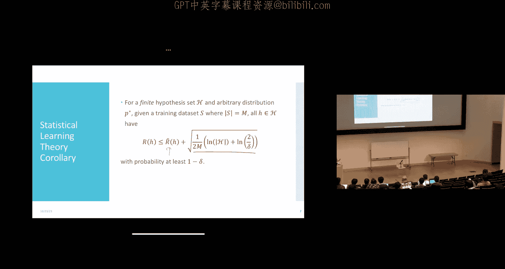

What can we do in either of these results when the size of H is infinite right if the size of H is infinite。

 then these bounds become well true， trivially true though right because what we're saying is that the true error is going to be less than infinity。

😡，We could just sort of take that to the bank and you know walk home happy。

 but I think we can do a little bit better and to do a little bit better。

 we're gonna to have to introduce a new notion that is this other measure of the complexity of our hypothesis set so the way to think about size of H here size of H is standing in for like how complex or how rich your hypothesis set is right the bigger the hypothesis set。

 the more kinds of functions it could possibly model and so for infinite hypothesis sets。

 we're just going to develop another sort of definition of how complex it is how many different kinds of functions this infinite collection of hypotheses could model in in order to do that I have to define a few terms here so bear with me remember in this sort of statistical learning theory setting we're only considering binary classification problems there are versions of this。

Thesese theoretical results that extend to regression and multiclass classification。

 but right now we're just thinking of binary classification and so in this binary classification setting。

 you can imagine you have some hypothesis and you have a data set S， right？😊。

You could apply this hypothesis H to each of your data points in S and that will give you what we call a labeling of S that is what does H predict about each data point and S and because we have a sort of binary classification setting this is going to be some vector of plus ones and minus ones plus ones or zeros or ones if you prefer I think my presentation uses plus ones and minus ones。

 so each hypothesis applied to a data set S will give us some labeling it'll give us some vector of plus ones and minus ones。

 but here's the big idea。😡，If I take sort of every hypothesis in an infinite hypothesis at H。

 you could imagine applying each hypothesis to this data set S to get a labeling。

 and that will give you infinitely many labelings of course。

 but they won't all necessarily be distinct， in fact， as long as sort of M is finite。

 they're guaranteed to be some amount of overlap。😡，So we'll say the set。

 so the set here represents all distinct labelings that the capital H hypothesis set could generate on my data S。

😡，All right， this is a bit abstract， so let's go through a quick example and then I'll stop and take some questions。

 suppose we have four data points right so this set of labelings。

 it's going to have two components it's going to have the data set s that I am actively labeling and the hypothesis space H that contains all of my hypothesistheses all right so here I'm kind of cheating here I have a finite hypothesis set but you can imagine doing this for an infinite one as well So my finite hypothesis set consists of these three linear decision boundaries and I have four data points x1 through x4 right so all I'm going to do is I'm just going to apply each one in order to these four data points。

 So if I use H1 that gives me this vector minus1 plus1 minus1 plus1 if I do H2 I get the same vector look at that if I do H3 I get plus1 plus1 minus1 minus1 and so the set of all possible labelings that H induces on S contains just two vectors。

😊。

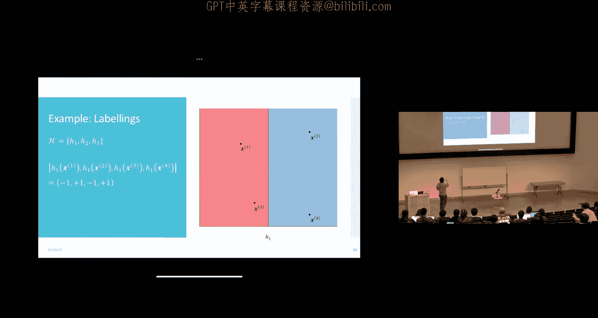

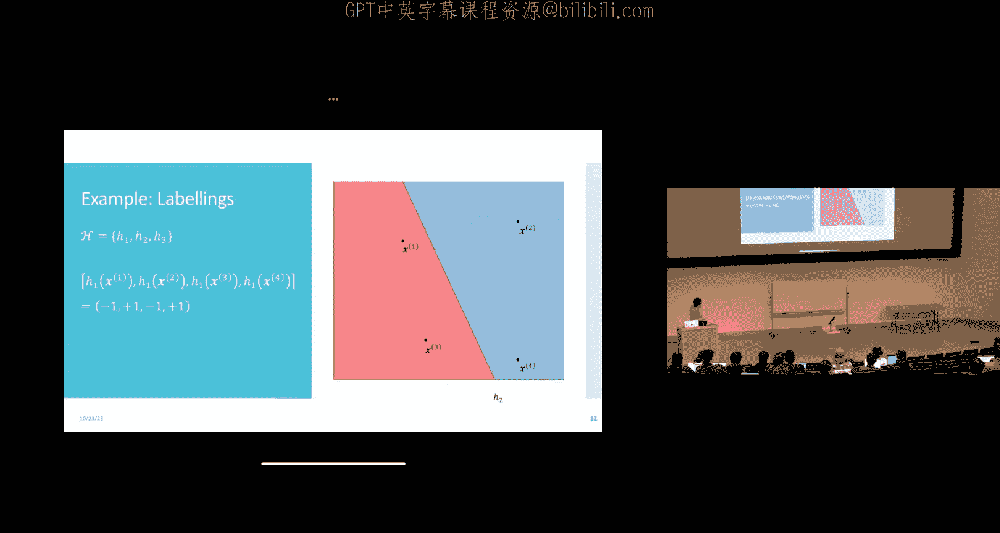

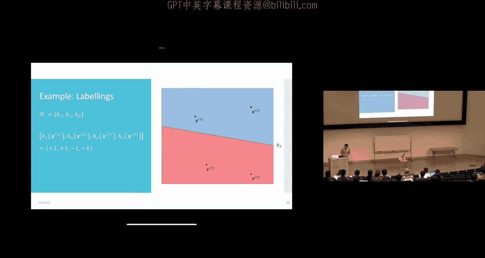

There was one that was duplicated right so the size of this set， the size of H of S is just two。😡。

And if I wanted to， I could sort of make this even more extreme， right， I could say。😡。

If I shift these data points around， so I have now x1。

 x2 in the top right and x3 and x4 in the bottom left。

 now all three of these hypotheses generate the same labeling on this data set S。

 and here's the big point。😡，Even though。H seems like it's more complex in the sense that it has three distinct hypotheses from the perspective of this data set that might as well be one the size of this hypothesis set might as well be one relative to this data S because it they all look the same they all generate the same labeling and that's going to be the intuition behind what we're going to define as the VC dimension we can have infinitely many hypothesis sets or sorry。

 infinitely many hypothesistheses right you can imagine infinitely many lines in between H1 and H3。

 but they all sort of behave very similarly， they're not adding any like complexity or any expressivity to my hypothesis at H and so we're going to think about these infinite hypothesis sets。

😡，From the perspective of how many labelings they can generate on some data set。

 and that's going to be our measure of complexity for these infinite hypothesis sets。😡，All right。

 we'll formalize that in just a sec， let me again stop here。

 what questions do you all have before I move on？😡，嗯。

Yeah the size of this set is definitely upper bounded by the number of distinct labelings that exist we'll get to that in just a second that's going to be really crucial。

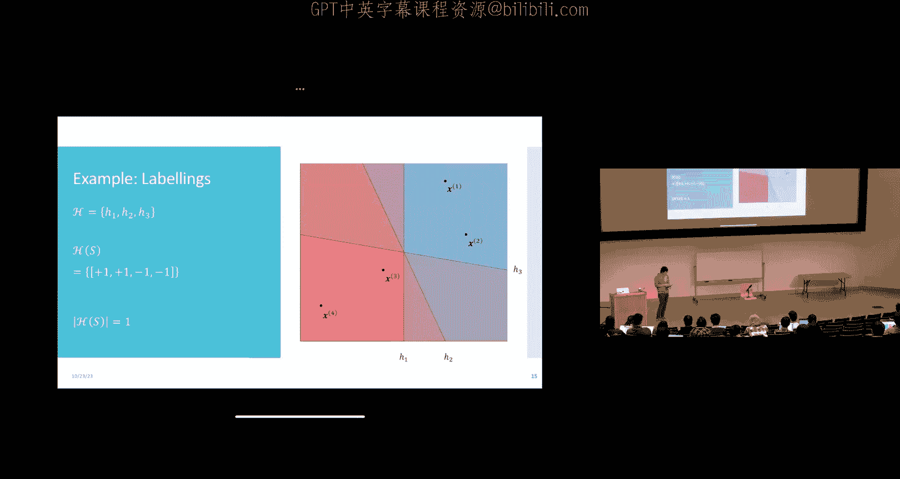

All right， so like I said， we're going to talk about a new measure of complexity for these infinite dimension these infinite hypothesis sets。

 and that's going to be called this VC dimension。😊，啊。Short for Vapnik。

 Chrvo Nkis or something like that。 I think I actually have it on a later slide。

 We'll get to that in just a second。 So we have this set of all possible labelings induced by my hypothesis at H。

 my infinite hypothesis at H。😊。

So here are some observations， one that was just correctly noted， if I have M points。

 there's a finite number of possible labelings I can generate right I can generate every possible labeling。

 which would just be2 to the M。😡，Every data point is either a plus 1 or minus1。

 two possibilities for endpoints。So we'll say that this is a very special case。😡，We'll say。

If I can generate all possible labelings on some set S using my hypothesis set H。

 then H shatters S is。😡，In some sense， sort of the bad case right what this is saying is given some data set of S points。

 if I can generate every possible labeling on it， that means I could fit every possible training data set over those points。

 regardless of what the labels are what the true labels from C star R my hypothesis can generate my hypothesis set can generate those。

 so it will always be able to achieve zero training error。😡。

I know it's been a minute since we know had this sort of lesson。

 but it really is important when someone says zero training error， alarm bells， that's the bad case。

 right， that's indicative of the potential for overfitting。

And so we'll say that the VC dimension for some hypothesis set H is the largest set S。

 the size of the largest set S that can be shattered by H。😡。

So if H can shatter sort of really big sets， if H can generate all possible labelings on， you know。

 let's say 100 data points， that's really bad， that means that it's like sort of really。

 really complex and I need more data in order to avoid overfitting with this hypothesis set H。😡。

Some technical definitions that or some like loopholes that come out of that。

 if it turns out H can shatter arbitrarily large sets， then its VC dimension is infinite。

 we've actually already seen an instance of this， the VC dimension of neural network is infinite。😊。

And so we're going to go through some exercises here because I do think this is a valuable exercise。

 we're going to go through a few examples of showing how to compute VC dimensions for set or for hypothesis sets and basically you have to show two steps right we're trying to find the size of the largest set that H can shatter so I have to find some set that H can shatter some set of let's say D points right I'm trying to show the VC dimension of this hypothesis set is D well there better exist a set of d points that can be shattered by H and there cannot exist a set of d plus1 points otherwise the VC dimension would be at least d plus points。

😡，Okay， so we're going to go through these bottom few steps for a few again， somewhat contrived。

 well actually not the first one， but a few somewhat contrived hypothesis sets that are infinite before we do that。

 let me again stop here What questions do you have before I move on yeah。😡，It said neural networks。

 theV damage has infiniteence。That's because the hypothesis space would be all neural network that there is a neural network that thats critical or data Yeah this is a good point I'm getting a little lax here right for a fixed architecture depending on what that architecture might be。

 it might not have an infinite VC dimension， but if you're considering the sort of space of all possible architectures of neural networks then yes you would have you would then be able to apply the universal approximator theorem or whatever that Matt covered。

Actually， we haven't covered that yet， have we， we'll get to that in a little bit。

Anything else here before I move on？

All right so let's look at our first example here Now this is something that we've seen sort of a bunch of times It's a nice sort of pictorial example。

 if you will。 We're gonna to think of the set of all 2D linear separators so just like what I had a few slides ago when I was defining labelings except now instead of just three we're considering all possible linear decision boundaries in some 2D space and so the question that we're going walk through together is what is the VC dimension of this clearly infinite hypothesis set right there are infinitely many lines that I can draw in some 2D space and so the way we're going to do this is incrementally what we're going to show is that there exists a set of one point that can be shattered by H there exists a set of two points that can be shattered by H and so on and so forth so we're just going to start from the bottom here right and。

😊，For the sake of completeness， can H shatter some set of one point。

 Let's do this by a show of hands。 Can H shatter this point。Yes。

 absolutely right I can just sort of draw a line on here。

 let's say and now the point is classified as plus one and then I can pick this line now the point is classified as minus one oh the arrow indicates which side is positive and which side is not positive so here are two lines that shater this single data point I'm generating all possible labelings plus one and minus one for this one set this set of one data point。

😡，Great。All right。Can H shatter some set of two points。

 I think we'll just do this again by a show of hands， who here thinks yes？😡，Hey， good。

 you're with me。 Alright， good， good。So again， I can just， I don't know， let's draw some。

hororizontal lines this time So that's all points as plus one all points as -1 and then I don't know。

 I'll just draw the same line and point the arrows in the different directions。

 Now I can generate all four possible labelings on these two data points right so plus one plus1 plus1 minus11 plus one and 1 minus1 great Okay so far so good Here where things get a little more interesting。

😊，So can H shatter some set of three points？😡，Can H shatter this set of three points？

Seeing a lot of head shaking， why is that？Anyone care to share what they're thinking here。Yeah。

 right here。You wouldn't be able to classify the edge points as something and yeah that's exactly right right if we're using these like blue and red colors to indicate plus one and minus one no single linear decision boundary can generate this labeling plus one minus1 plus one or this labeling minus1 plus one minus one。

All right， so we did it right we showed that H can shatter two points but it can't shatter three points。

 so we're done， right？😡。

Being some head shaking and some thumbs up， does anyone care to share whether or not they're done and why。

 yeah， way in the back there in the black hoodie？Yeah。

 that' is exactly right I think this is a very sort of bad example but the point here is that this is the operative word in this question can H shatter some set of three points and here this is the sort of key when you're proving or when you're computing Vc dimensions you are the sort of arbiter of the set S you get to pick whatever set s sort of makes your case the best in some sense you don't want to pick hard to shatter data sets like this this one is sort of arbitrarily difficult to shatter when I could have just picked you know frankly any noncolinear points in this space here say S2 and now gosh。

 am I going to draw eight lines Sure let's draw eight lines so that's all pluses that's all minuses that's that one plus that's that one plus。

I guess I don't need to draw eight lines because I can just sort of。Shift。The point of the arrow。

All right this figure is really gross， I encourage you to sort of draw it out on your own。

 but you can just sort of take my word for it， you can generate all eight possible labelings on data points on data sets that are not colon on you know say this set of three points here and so what that means if we're sort of going back to our definitions here is that。

😡，The size of the set of labelings on these two data sets is different。

 so I have six possible labelings， that's eight minus the two unachievable ones。

 so I have six possible labelings for this set S1 and eight possible labelings for this set S2 here。

😡，And so the answer， however， is yes。All right， here's my next question。Why just two points？

Can H shatter some set of four points， here are some sets， what do we think here？😡，Can H shatter。

 can these linear decision boundaries generate all 16 possible labelings on these。Either of these。

Data sets here。Anyone care to share what they think on this？Okay。How agree to because first one。

 you not get a single nine to celebrate of the Melu two and for the second one just the Melu one alone the independent。

That's exactly right， right Let me see if I I do do the colors great。 So I can't generate。

 you know the two opposite corners of the set S1 as different labels from the two other corners。

 So either that or come on。 That one is unachievable。 And then like you said for S2。

 I can't get out just that one middle point， I can't make that one middle point have a different label from the other two right。

 And so for both of these two sets。😊，The number of distinct labelings that I can get is just 14。

 which is less than 16。 So H isn't shattering either of these sets。

 And here's the part of the proof where I start waving my hands a little bit。

You can show that all sets of four points fall into one of these two categories that all sets of four points are isomorphic with these two sets here。

 either all of the points lie on the convexhull that is they're all on the outside of some quadrilateral there's nothing on the inside or at least one point is on the inside that also covers the case where all four points are on a line then two points are on the inside of the convexhull but regardless in either of those cases there are going to be some number of labelings that you can't generate So what we showed here。

😡，Very loosely， what we showed is that all data points or all sets of four data points cannot be shattered by my hypothesis set H。

 that is all sets of four data points fall into one of these two categories and my hypothesis set H can't shatter any data set from either category。

😡，That would be the structure of a more formal proof， regardless。

 what we've just shown now is there does not exist a set of size 4 that can be shattered by H。

 and so the conclusion here。😡。

Is that the VC dimension of these 2D linear separators is three。

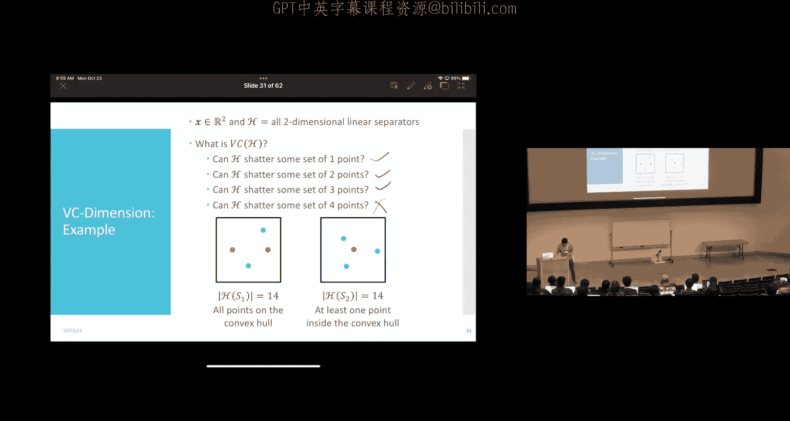

All right， let me again stop here because this is going to be very important for you all what questions do you have about this procedure before we move on to another much simpler example？

😊。

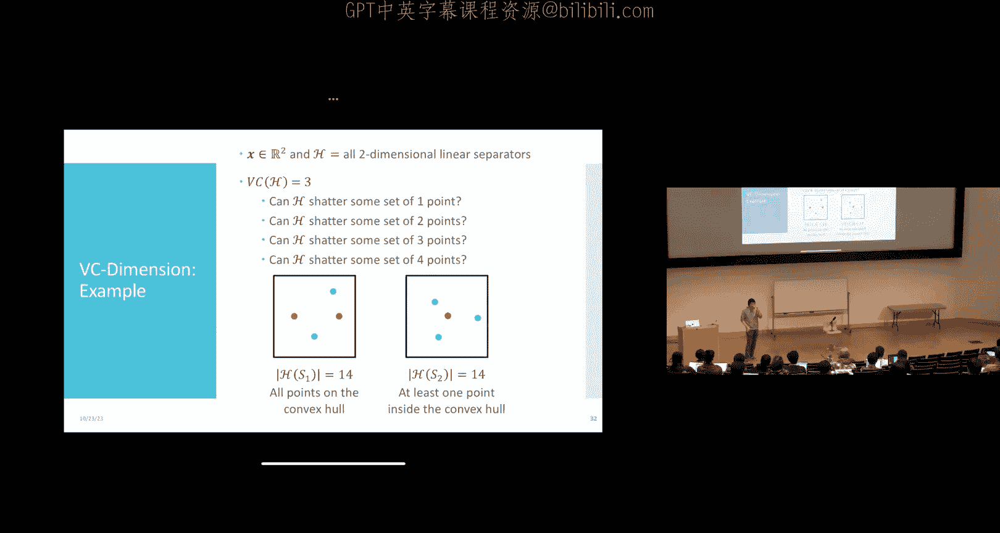

嗯？That just because we cant shuttters instead of four points that we can also not shut up into the five this is a really great question。

 So the question was why does it follow that if we cannot shatter some set of four points。

That we can guarantee that we can't shatter some set of five points why do I not need to check five and six and seven and so on right well in order to shatter five points that would require that I would be able to generate all possible labelings on all subsets of those five points as well。

😡，So inherent in being able to shatter。😡，N points is the ability to shatter n minus one points。

 and so I can stop as soon as I've hit the smallest possible number of points that I can't shatter。😡。

Yeah。😊，I general patient for giving having any dimensional witness so greater on listening each other yes。

Anything else？Intuitively， this one kind of makes you can think of this as being like。

I'm always a little wary to say this because like people take this to sort of the wrong idea。

 but basically in my D dimensionsional linear separators I have d plus one parameters including the sort of intercept term and so those are my like D plus one degrees of freedom of my hypothesis set H that's not always a one to one translation that is the number of parameters in my model is not always equal to the VC dimension。

😡，But it works out for these linear separators， and that's the reason why。

Anything else here before I move on？Yeah， nice is deep。Because I forgot to change my slides。

Good catch。I too have a case of the Mondays after fall break。Yeah。😊。

G way to find the Vs dimension in more complicated levels。Not in like an absolute generality。

 like this is sort of the most general way you start with maybe you don't have to start with one。

 but you start with some number and you just keep going up， right？For other kinds of hypothesis sets。

 you can exploit your sort of knowledge of their behavior to try and。

Like skip a few steps like in particular if you're trying to prove that the VC dimension of some hypothesis set is infinity。

 you should not do this， you should not start with one and try and make your way up to infinity。

 rather what you should show is that for an arbitrary data set of size N like an arbitrary data you can always shatter it right and if that's true or if it's not true you can sort of do a proof by contradiction to prove VC dimension of infinity。

 however for any finite number， this is sort of the most general way。😡，All right。

 let's come up with an even more contrived example。 This one is just like comically silly。

 but it gives you like a sort of。😡，I think another perspective on how you can compute these VC dimensions。

So what we're considering here are 1 d data points。

 so just some real value x and my hypotheses are what we call positive rays。

 so I picked some threshold a。😡，And everything to the right of a is positive and everything to the left of a is negative right and so again。

 we can just sort of step through this procedure here。😡，For those of you following along。

 this is like the idea of a 1D linear decision boundary。

 So we already should know what the answer is here。

 but we can sort of visualize this right here we have。One data point。Arbitrarily defined to be x1。

 and I can generate both labelings on it by just sort of shifting where I put this threshold A。

 great。

2。😡，So I can generate both plus。I can generate both minus， I can generate minus plus。

 but because of this sort of ridiculous hypothesis set and how I've defined it。

 I cannot generate a labeling where the data point to the left is negative and the data point to the right is positive and so what we just showed is that there exists a set of size1 that my hypothesis set can shatter。

 but there does not exist any set of size2 that my hypothesis set can shatter because any two data points like sort of in general will have one point to the left and one point to the right。

😡，Okay。Ridiculously comical example， again， like I said。

 we sort of knew the answer because this is what a 1D linear decision boundary would look like。

 so the V dimension should be one plus one hand。😡，What am I saying here？Oh。

 this is not quite the generalization of a 1D decision boundary。Regardless， anyway。

 that's the procedure you would take to compute the VC dimension for this simple positive ray hypothesis set。

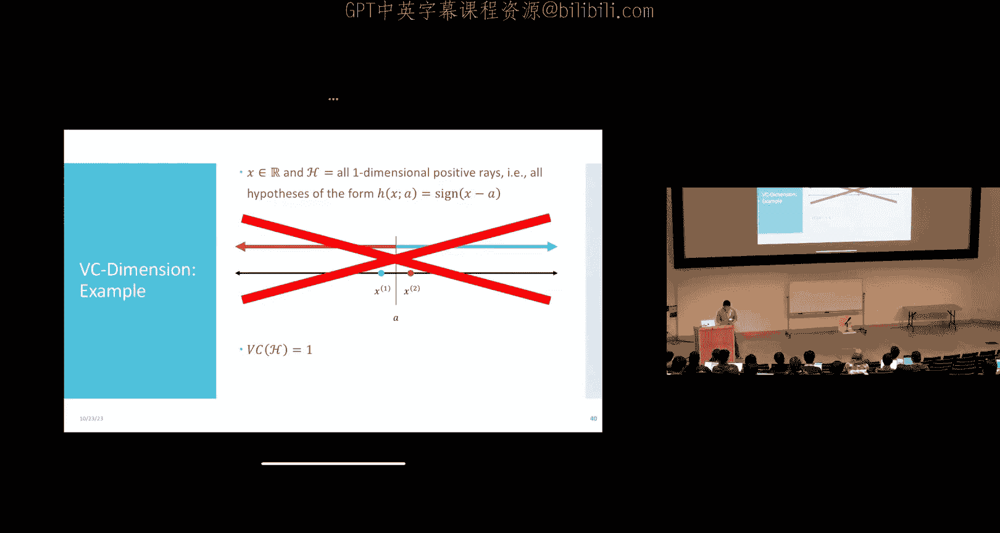

Next， I'm going to give you guys a chance to practice this I want you to think about。😡。

VC dimension for。1D positive intervals， so this is your first whole question here。😡，Poll。mlcoursese。

org as always， for those of you who have forgotten these are your options here。

 the VC dimension can never be a nonineg number so 1。

5 right out don't answer C otherwise just sort of step through the procedure that we've outlined here。

 start with the one see if you can shatter it go to two so on and so forth and crucially note that much like how we defined positive rays these are strictly positive intervals so the stuff on the inside is always positive the stuff on the outside is always negative all right I'll give you guys oh I don't know let's say three minutes talk this over with your neighbor see if you can figure out what the answer should be and then we'll reconvene and see what you all have to say about this。

All right， let' let's go ahead and reconvene， go ahead and put in your best guess if you haven't yet had a chance。

 also go ahead and change your answer from C if that one person is you otherwise I'm pleased to see that the majority of you have converged to the correct answer here so the correct answer is in fact well that was a really bad circle。

 it is in fact D。😊。

2 so let's see how that is actually sorry I'm gonna to skip a lot of steps here basically it's pretty easy to show that if there's one data point you either put it in the interval or you don't that gives you both labelings for two data points you can shift the interval around the two data points to get all possible labelings。

 but with three there exists this sort of labeling here where again we have this point in the middle that we can't separate out。

 that we can't classify in this case as negative with the other two points on the outside being positive。

😡。

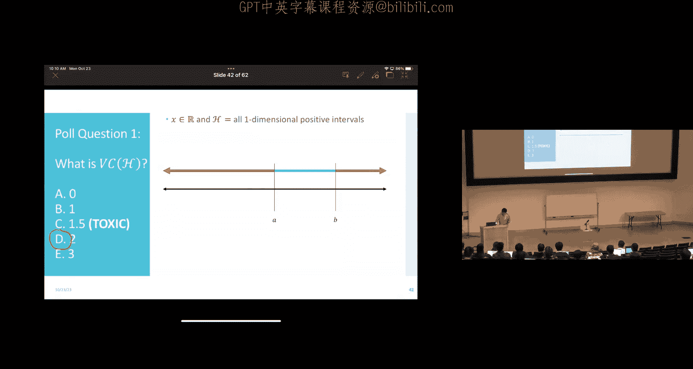

So this is the one labeling that we can't generate on any set of three points。

 so there are no sets of three points that this， again。

 ridiculously contrived hypothesis set can shatter， so the VC dimension here is two。😡，All right。Next。

 all right。So。We've actually gone pretty deep down the rabbit hole we started by defining this notion of VC dimension as like a stand in for the complexity of our hypothesis set and then we just spent a long chunk of time computing these VC dimensions next we're going to go back and actually see how we can plug in these VC dimensions to replace the you know problematic size of my hypothesis set from the first two theorems and that's going to give us the final two settings for our learning theory theorems here before I move on。

😡。

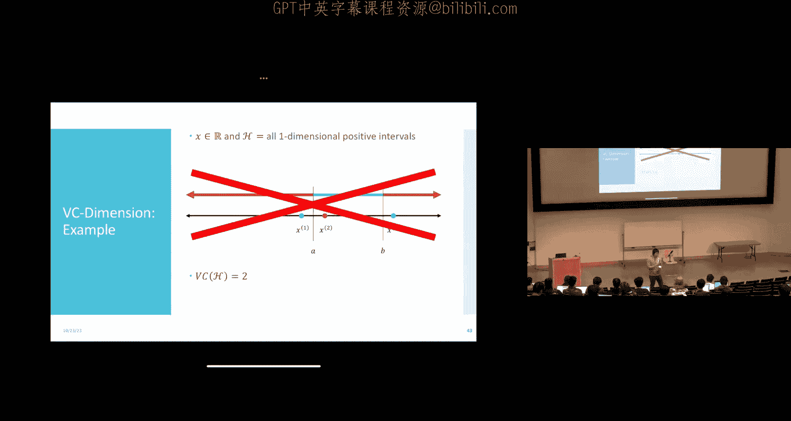

Let me stop here， what questions do you have about computing VC dimensions？

Yeah go ahead there is this sort of notion here that so this this one dimensional interval at least is like as expressive as one dimensional rays and so it has to be at least as like large。

Yeah， that's absolutely right。 Like if any hypothesis set， even in these infinite hypothesis sets。

 if any hypothesis set is a strict。Subset of another。

 then you can sort of prove that the V dimension is going to be at least that large for the larger one。

You can do this with like， you know， polynomial decision boundaries versus linear decision boundaries or something like that。

You guys are being so patient with those coins， I really appreciate it。

 we're going to get to those in just a second。

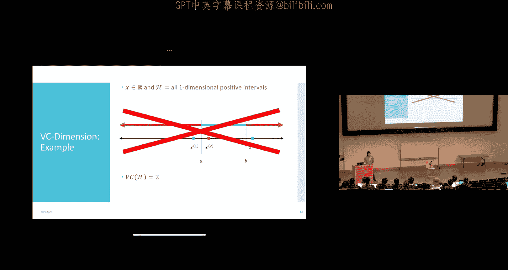

All right， so like I said。We have the VC dimension and now we have the VC bound。

 It is in fact I got it right， Banik Chavinenkis， great。

 So like before we have two cases for the infinite setting。

 we have the realizable case where C star is in my infinite hypothesis set H and if we know again。

 somehow if we know that C star is in my infinite hypothesis at H。

 this is actually much more noable because you can sort of use those kinds of universal appator theorems。

 but if we do know this， then we can make this sort of guarantee in big O space。

 So I'm askinging some number of constants here， I think you can actually figure out exactly what those constants are。

 it's not super like large， but regardless， this is usually presented as a big O statement that says as long as you have one over epsilon times this VC dimension。

😊，Oh， and these are for those of you following along at home， these are also natural logs。

 as long as you have this Vc dimension times log1 over epsilon plus log1 over Dlta number of data points。

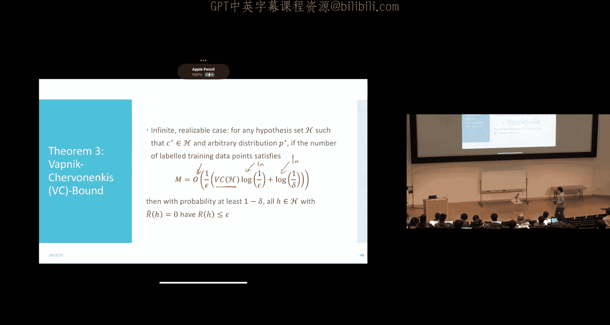

Then you can make a very similar guarantee that says。😡。

For all of my hypotheses with zero training error。Their true error will be bounded by whatever tolerance epsilon you care to set here。

😡，And so again， this is some assertion about given however many data points， M， or sorry， rather。

 this is some assertion about the minimum number or the order of the number of data points you need in order to make guarantee about how well your models will do in practice。

 how low their true errors will be。😡，You can derive statistical learning theory corollaries to these theorems as well。

They look something like this， so again， all we're doing is we're solving。

 we're solving in a big O sense now， we're solving for epsilon when these bounds are tight。😡。

And we get a similar looking result， right that says the。Given M labeled data points。

 so now you have some fixed set of training data， given however many training data points you have。😡。

The true error of your hypotheses is bounded as some function of your VC dimension。All right。

 so we have one more。Setting， which is the agnostic case。 And so now what we're saying is。

Regardless of whether or not C star lives inside my hypothesis set H。

 I can make this sort of guarantee about how well my。

Returned hypothesis will do in practice and again it looks sort of very similar note that we also again have this quadratic inversely quadratic dependence on epsilon and so that same relationship about having epsilon resulting in four times as many required data points still exists here。

And one last time we can also solve for a statistical learning theory corollary in a big O sense。

 and I want to spend a little bit more time analyzing this particular expression here because this。

Like entity here tells us something sort of very interesting， right， You can break down this。

Inequality in this statistical learning theorem into a very sort of fundamental trade off in machine learning that you all have already sort of very tangentially experienced。

 which is that if my true error， R of H is the thing that I care about my。My expected risk。

 if that's the thing that I care about， well I can break this bound into two components that I can you know reason about right this is sort of the true or sorry the training error or the empirical risk and it's a measure of how well H approximates C star in the training data S that you saw right？

😡，And this other term you can think of as like the generalization penalty that as this VC dimension VC of H goes up。

 then my hypotheses， they'll tend to sort of generalize worse and worse right they're getting more and more complex and so there's this tradeoff here right how well could my hypothesis said H approximate C star well that tends to go sorry that approximation tends to get better as my VC dimension increases as I get sort of more and more complex hypothesis sets。

Well then you know the probability or the sort of likelihood that any sort of function C star can be approximated by h goes up and so that'll tend to drive my training error down however。

 there's sort of very directly there's this square root dependence on this other term between。😡。

My generalization error and the VC dimension of my hypothesis set here。

And so there's this tension right I want to use more complex models to better fit my training data。

 but I run the risk of overfitting my training data and not being able to generalize well so this is what we would call the approximation generalization tradeoff and we'll see an example of how this like you works practically for a use case that we've already explored in this class that's coming up in just a sec let me again stop here what questions do you have before I move on。

😡，嗯。😊，What exactly is the O notation on the second tone here is it big complex Yeah it's a big like of a function so。

We typically see big O in complexity when we're computing like algorithmic complexity。

 but we can also use it to just say that like。This is some constant value times the expression on the inside of the biggo。

 where I don't care what that constant is。え。Lets that RH Rcapation were sort of comparable。嗯9 two个。

Is it necessary？I guess I don't necessarily know what you mean。 So like there is a value。

 There is some like true value that is being masked by that big O notation。

 I forget exactly what it is。 I think it might be like。

70 something or like 20 something maybe like I don't exactly remember what that is。

I'm sure you could go read a paper about it， but regardless the I don't get to pick it， right。

 I don't get to like tune it to be in the same range as my true and training errors。😡，嗯。😊。

This is related to the notion of a bias variance trade off we typically think of。

Bias variance in a regression setting that is。So for those of you who not familiar。

 bias variance is basically another way of measuring like。Well。

 you can actually think of it as sort of how well my hypothesis at H approximates my target function that's the bias and how variable it is is like how well it could approximate anything or like how large in some sense it is。

 and that's well approximated by the other term so this is analogous to the bias variance tradeoff。

 but we typically think of bias variance computations for regression models。

 whereas this is for classification。😡，All right， and so we're going to look at this result one last time。

 We're going to look at this statistical learning theory corollary。

 and we're going to try and ask this question of。Can we use this to sort of inform model selection and the answer is yes。

 right like what we just looked at is how these two terms sort of。😡。

Interplay as I change my model as I change my hypothesis set right and so that might in a very cartoonish sense look something like this right so you can imagine I'm considering sort of many different models that all have varying complexities that have sort of increasing VC dimensions if you will right and so in a very cartoonish sense a typical behavior will be something like as you increase the complexity of your model。

 the training error should go down eventually you know as you hit more and more complex models。

 you'll get better and better approximations to your training data set to the true target function C star。

😡，And so that's the training error our curve as a function of this VC dimension， right？😊，And well。

 I just sort of said it on the other slide， this generalization term here。

 this has some square root dependence on the VC dimension H again。

 I'm just sort of masking that constant， but regardless of what that constant is。

 this will be the general shape， it'll be like square root of x。😡。

And so if we add those two things together， we get this sort of bound on the true error R of H right so this is just these two curves added together vaguely speaking right and so what I can assert here is that。

😡。

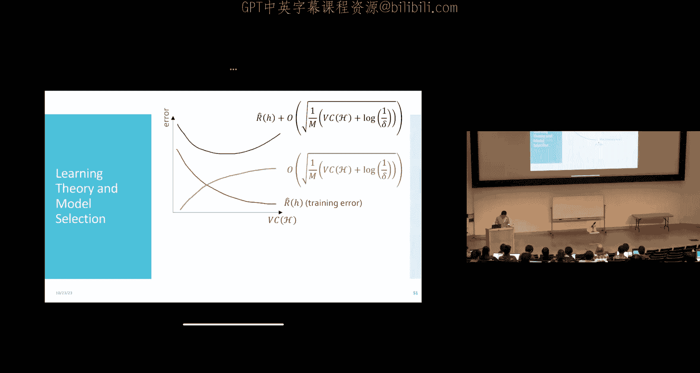

The statistical learninging theory corollary on the previous slide says that the true error of my model will always be below that black curve。

😡，But。It doesn't tend to narrow it down very much， right like in theory。😡，It could look like this。

At least as far as the theorem is concerned right that is a valid case that's pretty atypical though that's not what we would expect right This is saying oh。

 the true error just keeps getting lower and lower and lower as I use more complex models that's not what we empirically observe in practice right you know there's lots of other curves that would obey this。

😡，Maybe just a flat line too， there's lots of possible curves here that obey this inequality that the statistical learning theory corollary suggests。

 however。In practice empirically， what we tend to observe is that the true error behaves very similarly to this bound that it's not quite tight。

 but it has a similar trend that initially as I increase model complexity my true error will decrease until I hit sort of the optimal value at which point increasing model complexity tends to increase my true error sort of forever and I think you guys have experimented this experimented with this in some of your homeworks already or if not you will that like as you sort of tinker with hyperparameter to get more and more complex models you tend to see this sort of ushaped behavior so the question becomes。

😡，How do we go about finding this best trade off， how do we go about finding？

Where or which model to use right and you know what I realized I was going to pose this as a question turns out the answer right on the slide。

 you do model selection you find， I don't know like the optimal level of regularization to use by doing hyperparameter optimization on your regularization constant so the analogy here is that as I increase the amount of regularization as I increase the sort of coefficient in front of my regularizer I'm effectively making my linear models lower VC dimension by penalizing increased complexity and so I can do sort of this automatic。

😡。

Model selection or this automatic like searching for this best tradeoff of VC dimension by doing you know hyperparameter to it。

 what we've seen before in class effectively what we're doing is we're looking for this sweet spot of the you know minimum true error。

 which we tend to approximate with a validation data set。All right。

 so this is how the like empirical practice of performing model selection is related to these theoretical results that we've just been exploring for the past few lectures here。

All right again I'll stop here next we're going to transition to a sort of fundamentally different topic it's actually a bit of a revisiting of something we've seen already so this is going to be the end of our learning theory section I'll stop here though what questions do you have before I move on？

😊，Yes， how do you observe to error， Are you able to log to error。Yeah， so in practice。

 what we do is we approximate this with sort of test data。

 you can actually sort of run experiments in a contrived setting where you pick a C star right if you know what the true target generating function C star is。

 then you can run experiments where you sort of compute directly what the true error is and you'll see behavior that looks a lot like this。

at least twoium can approximate any function so in that caseYeah。

 so you're getting at the universal approximator theorem。

 which is like neural networks with at least two hidden layers。

 I think are universal approximators and so yes。😊，This is this is where we were getting a little bit technical in the discussion right you don't exactly know how many nodes in each layer you need in order for them to perfectly model some target function and so if you accept that the set of all neural networks with two hidden layers and arbitrarily many nodes is a valid hypothesis set then yes that hypothesis set has infinite VC dimension it's sort of a weird hypothesis set but for sure you can make assertions like that for non nonlinearar models for you know some of the things that we've seen in class already。

Well， you know what， I'll maybe leave this as an exercise for you all like you can think about what the VC dimension of like。

A decision tree is or the Vc dimension of like。A KNN model would be for various values of K。

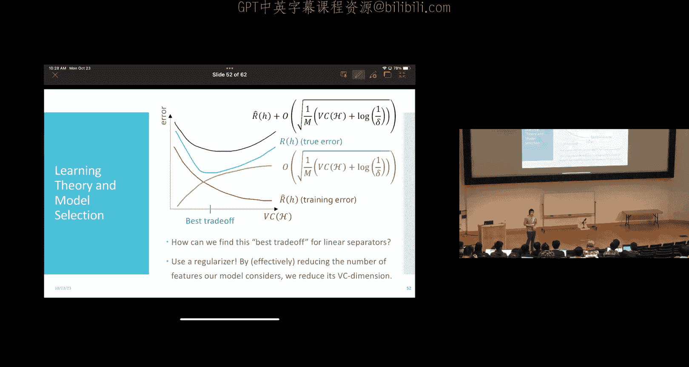

Anything else here before I move on？🤧嗯。All right， so we're going to revisit probabilistic learning because we're going to talk about a new probabilistic classifier in lecture on Wednesday because I just wanted to refresh our memories here a little bit so previously in our sort of learning theory discussion what we were focusing on is there's some deterministic target function C star that every time I observe some data point at feature vector X I'm always going to get the same label Y and this is a bit of an unrealistic assumption and so when we were talking about logistic regression we instead considered modeling these target distributions。

 p star that is for some input X there's a probability that the label will be plus1 and there's a corresponding probability that the label will be minus one and so we're trying to learn these optimal or these good distributions that approximate p star sort of everywhere and to do that we talked about this principle。

😊。

This approach known as maximum likelihood estimation。

 and so we talked about this kind of quickly from the context of logistic regression。

 specifically we were maximizing some like conditional log likelihood， yada yada yada。

 it turns out we can do this in a sort of more general sense。

 where given some independent observations from this distribution XI， so going from X1 to XN。😊。

If this distribution has you know some parameters， right。

 most interesting probability distributions have parameters like your Gaussian distribution will have some sort of mean and variance parameter。

 the distribution we're going to consider in just a moment will also have parameters。

We need to figure out。How to set those parameters in order to be able to use them for machine learning。

 right these are equivalent to like the parameters of your linear regression model or your you know linear decision boundaries。

 we have to learn these parameters and one way to do that。😡。

woWouldd be to set them so that the probability of the data that you observed is as high as possible this is what we call maximum likelihood maximum likelihood estimation so these parameters these would be the maximum likelihood estimates and what we're doing intuitively is that we're assigning as much probability mass to the data as possible at the expense of data that we didn't observe things that are outside of our data D here right okay so let's take a look at an example that is slightly more approachable than this Oh one thing to note here。

😡，We do think about this in terms of the log likelihood a lot of the time。

 This is just because we like optimizing sums of things。 So note that if I take the log of this。

Product。Actually， let me back up a little bit here because our data points are independent I can decompose the probability of my entire data set into the product of each individual data points probabilities so P of this calligraphic D here is just the product of each of my individual data points that comes about from the independence assumption。

 but maximizing this product is kind of gross so instead we can equivalently maximize the log of the likelihood this is because the log is a monotonic function that if I find the max of the log of something that's the same as the max of the thing itself and this allows me to maximize a sum of log probabilities and this is going to be a lot friendlier than maximizing that big product of probabilities。

😡，Okay so this is going to be the approach that we take to learn the parameters for these probability distributions this' is all a bit abstract so let's take a look at an example right so one of the most you know universal and simple probability distributions that we might care about are Bully distributions right and so they have this behavior where there are two possible outcomes you know like either a zero or a one or like a heads or a tails for instance。

 and so we can actually reason about what the optimal parameter for this distribution is。😡。

Given some data， so there's one parameter for these burn woolly distributions。

 we'll call that phi and it's the probability that I don't know。

 some hypothetical chocolate coin comes up as heads， right？😡，So given this。Parameter phi here。

 we can actually compute what's known as the or rather we can express the probability mass function for this Bernoulli distribution in a somewhat clever way So this is a bit strange but again actually when we were talking about the cross entropy loss we did a very similar thing right where we were playing clever tricks with these exponents because what we're saying here is。

😡，I don't know in general what x is x is going to be either a0 or a1。

 but I want to model the probability of x as generally as I can without having to use like if statements so the way I can do that is by saying okay if x is a1 well then the probability of that happening is just phi and so by raising phi to the x I get one copy of that and by raising one minus phi to the1 minus x I get no copies of that and when x is1 and conversely when x is0。

 I get the corresponding probability of seeing a0，1 minus phi so this is just a compact way of expressing the probability of seeing any particular outcome here。

😡，Okay， so from here， what we can say is given some number of samples from a Bernoulli distribution。

 what is the log likelihood， so remember the intuitive way to think about this。😡。

The log likelihood is always some function of the parameters of our distribution here and so from before what we had is that this is a sum from I equals 1 to n of the probabilities。

😡，Of Xi， given phi， so notally。😡，We're thinking of Phi as like a random variable that we're told we'll expand on that in a little bit。

 but for right now you can think of this as just like some value that you're trying to figure out what the best setting for is。

 some variable phi that we're trying to optimize。😡，Okay， and so if I just plug in。😡。

Oops， sorry， this is supposed to be。A log。Log。Well， I'll just write it now， log Phi of Xi。

Times 1 minus phi to the 1 minus。Xi。And right away， we can sort of see。

That this log is going to pay dividends because working with like x's in the exponent was going to get really ugly。

 but now because I'm taking the log of this probability mass function here。

 I can apply log identities to decompose this into Xi times log phi plus1 minus X。😡，Times log。

1 minus5。So here I'm saying。Log A to the B， B， log A， just log identities here。Okay。

 and what this is going to allow me to do is， well， if I rewrite this。

 let me just break this into two sums here。😡，1， to end。Si log， by， plus some。1 minus。s hug。1 minus5。

What we see here is that we're basically sort of counting two things in these two songs。😡。

Every time Xi is1， I'm going to get one additional copy of log phi and every time Xi is0。

 I'm going to get one additional copy of log 1 minus phi and those are the two possibilities right so I can rewrite this sum。

😡，As。Let's say some n1 times log phi plus n0 log 1 minus phi。Where。We'll say N I。

Is equal to the number of eyess。In my dataset V here。😡。

So really what I'm doing is I'm just sort of counting the number of times that I saw either a one or a zero。

 and those are the terms that end up in my log likelihood here。😡，Okay。

 so this is my expression for the log likelihood I'm going to give you guys a second here just to catch up。

😡，What questions do you have before I move on？一。Yeah。Probably could， I'm not going to。

 but probably could。All right， so why do I care about this right I went through and I derive this expression for the log likelihood as some function of phi and crucially it's maybe not as simple as it could be to your point but it's simple enough where if I needed to figure out what the optimal value of phi using this expression is I can do that very easily I can do that using something that we've seen before because what I have is I have some function of just one variable that I'm trying to optimize and way I can do that is our old friend closed form optimization right I can just take the partial derivative of。

😡。

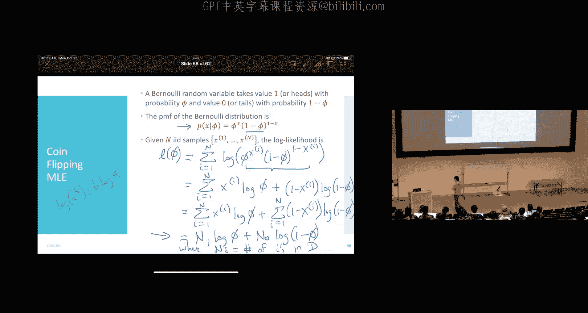

This log likelihood， so let me just rewrite this again。😡。

If this is my expression for the log likelihood。😡。

And then I can just take the partial derivative。😡，Of this thing with respect to phi set equal to0 and solve。

 and what that's going to give me is going to be something like n1 over phi plus。😡。

Let me see here n0 over 1 minus5hi times a minus1。And then。I know。That at optimality。

 so note these little hats。At optimality， this condition needs to be true that this partial derivative needs to be equal to zero。

 and so I don't know。😡，Okay， let's not skip any steps here n0 over one minus。I have。

It's n1 times1 minus by hat equals and zero times by hat。Which means。N1 equals N0 plus N1。I'm my hat。

Wch gives me。Maybe the results that many of you sort of。New intuitively ahead of time， oops。

 don't do that。That the optimal value to set phi to my sort of best guess given the data。

 my best guess for the probability of this coin coming up heads is just the number of heads I saw divided by the number of flips I made n0 plus n1 is just the number of flips I made right and so like if you were given。

 I don't know say like a hypothetical chocolate coin to flip some number of times and then guess what the probability of it coming up heads would be this would be a pretty reasonable place to start。

😡，Now， I know many of you are probably like looking at me like I'm insane because like I keep mentioning these hypothetical chocolate coins。

 but some of your peers showed up to class early and they got hypothetical chocolate coins。

 how many of you don't have a chocolate coin right now？All right。

 I will come around slowly for those of you who did show up to class early。

 congratulations you get to start on your poll question。

 which is I'm going to ask you to flip your chocolate coin。Oh， I say here five times。

Man I should have asked you to do it more， so pick whatever side do you want to be heads。

 I don't care if you want to use the other side to be heads okay catch。😡，Alrighty。

 pick whatever side you want to be heads， flip your coin five times and then。😡，Report back to me， oh。

 you don't want the broken one。😡，Pt back to me what the maximum likelihood estimate for your coin coming up heads is you go。

 course， yeah， got one already， I'll come back up there， I'll take another one。

We'll see if there's enough leftover at the end。You'll flip it twice， okay， okay， is coins any good。

 I was always told these coins were not very tasty。😊，Allrighty， oh man。

See this is the problem with doing this sort of late in lecture， everyone shows up here you go。😊。

Al right， of course， nice bow tie。Okay， ready， catch。Uh guys， are really。U， nice， good catch， ready？

Heo， alrighty。Oh man， I hope I have enough coins。Al right。

 here you go and once you flip these of course you may go ahead and eat them actually， well。

 that's probably too late， but you can go ahead and need them。And just here you go， ready， hey go。

 this is your second poll question， of course， do not pick pi over five unless somehow you end up with 0。

1 fourth of a head。

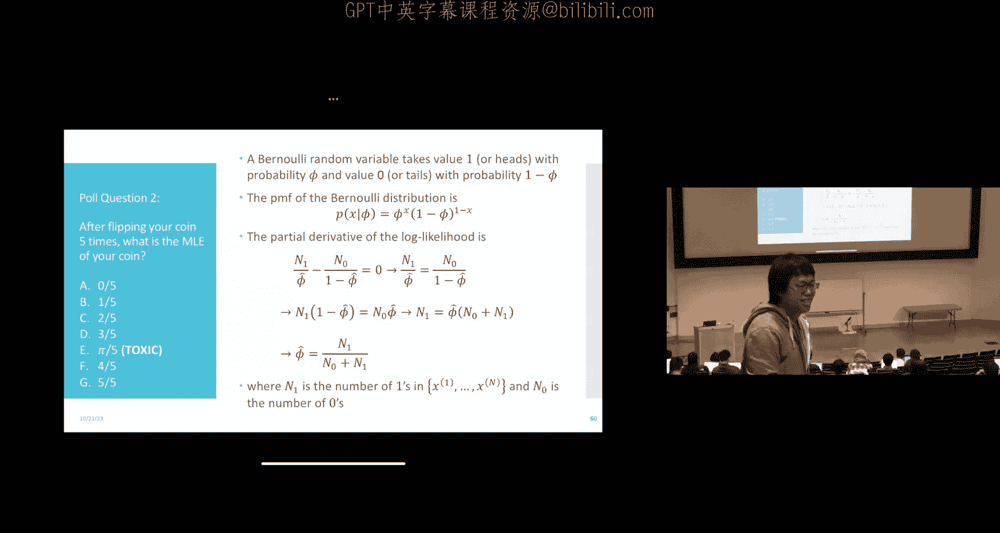

In which case， go ahead。Tell me all about it， anyone else need a chocolate coin here， there you go。

All right， right here。Guys all got one back here。Need one， oh， sorry。哎呦。Oh， max。

There's barely enough， it seems。Okay。Here go。😊，Yep， of course。Anyone else back here， anyone。

 everyone got one， you got one， yeah， of course。Okay。

Go ahead and flip your coin five times when you're done， report your results。

And I will take a look here， oh， good。Perfect。All right。I am never sure like if。

You know basically I'm never sure how many people are going to attend this lecture。

 so I'm never sure like what the right number of flips to ask you guys to do to make this example work is turns out this was just barely enough so based on your current reporting。

😡，I know。That two of you had coins that came up heads five times。

Can you just raise your hand if that was you？Who got five heads， You got five heads， man。

 I should have given you a second coin， Okay， did you eat your coin already？ Oh darn， all right。

 well let me ask you this， So your estimate， your best guess for the probability of the coin coming up heads is one。

😡，Does that jive with you， does that seem reasonable that there wasn't some like special way you were flipping it or like your coin wasn't like weirdly skewed towards like。

 so why was this your maximum like estimate， like what happened here？😡，You got lucky right， I mean。

 let's play hypothetical if you would flip the coin one more time。😡。

Do you think it would have come up heads again？Maybe， right。

 your like belief about it has been affected。By the data that you observed。But like。

 maybe not to the extreme of believing that it should always come up heads， right。

 If you would flip it， you know， a few more times， maybe the sample size was too small。

 you would have gotten。maybe a more reasonable result， but at the same time。

 you're like starting to be a little skeptical， right。

 like maybe there's something fundamentally like weird about these coins that makes it so that I don't know the head side。

😡，Actually， weirdly， I kind of think the head side has more mass。

 so maybe the tail side should come up more often， but regardless。

 maybe there's something about this coin that doesn't behave like a normal coin。😡。

And so what we're getting at here。😡，Is that？Maximum likelihood estimation。

 well it tells us one thing， right， it tells us given the data that we saw。

 what the best guess for our parameters are， what the best。😡。

Value of the probability of coming up heads， the best value of Phi to use is。😡，But oftentimes。

We have some sort of knowledge， some modeling beliefs， some， I don't know。

 you can call them inductive biases about how。The phenomena that we're trying to model behave in real life。

 right， we have some experience flipping coins， we believe that coins tend to come up heads and tails roughly equally often。

😡，And so what we can do is instead of just sort of blindly you know following the data。

 blindly just going off of the values of Phi that we observed。

 we can actually incorporate some of that modeling into our parameter estimation。

 and that's going to give us what we call maximum posteri estimation here， so what do I mean by that。

😡，Well。What we just computed。Is that the MLE for a parameter， it finds this value。

 let's call it theta hat that maximizes。The likelihood of my data。Given this parameter phi。😡。

Alternatively。Instead of asking what our parameter tells us about the data。😡。

You could imagine asking。What is my data？😡，Tell me about my parameter。How does my observation of。

 let's say， five heads affect my belief about what the probability that this coin comes up heads should be？

😡，And so we can reason about this quantity。Using。Phase rule， which is for this probability oops。P of。

 let's see。D given theta times P of theta。Over P of D。And。All right。

 this term here it's very interesting in its own right。

 but it doesn't actually depend on theta so turns out I can just drop this from the optimization right and so this gives me。

😡，A very sort of。Familiar looking form。Map tries to optimize this product of two probabilities。

 this one we've already seen before， this is the likelihood。

 this is the same thing that is being maximized by maximum likelihood estimation。

 but this other term here。😡，This is what we would call the prior probability over theta so that is in each of your minds presumably there is some prior belief about how the coin should behave what the probability of this coin coming up heads should be many of you I expect believe it to be close to 0。

5 but maybe there's some wiggle， maybe there's some ambiguity， maybe you think， oh it could be 0。6。

 it could be 0。4 right what you're implicitly defining is a distribution over that parameter and so you can incorporate that into this maximum posttei estimation to get a sort of less extreme results than what maximum likelihood estimation would tell you and so we're going to explore this sort of procedure for maximum postii estimation when we return on Wednesday and we'll see how both of these methods for parameter estimation can be used to learn a probabilistic class。

😡，That'll be the naive Bay model， which you all can look forward to on Wednesday。All right。

 that's all I had for you， I'll see you guys back here on Wednesday。

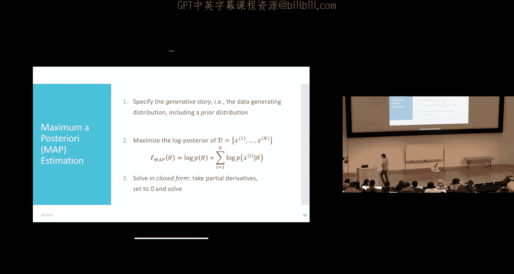