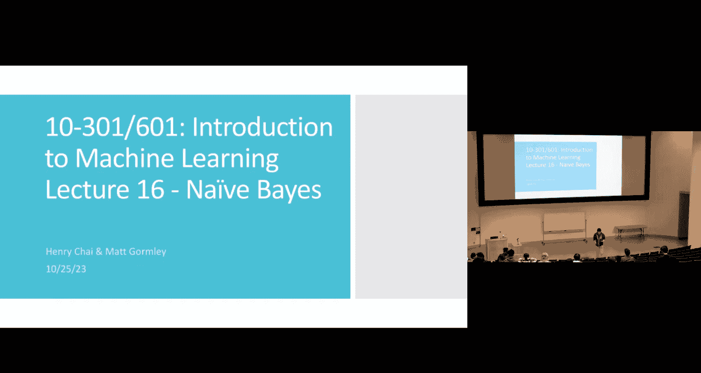
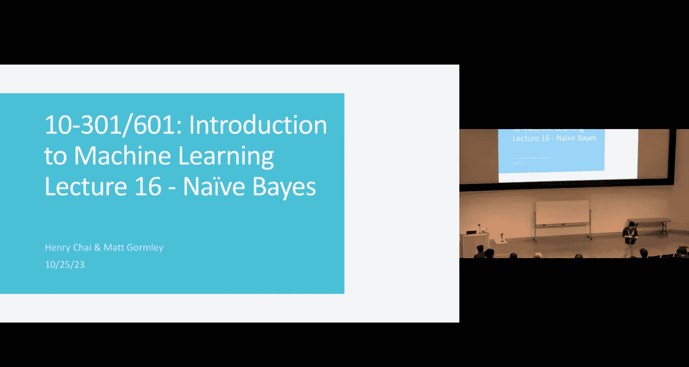
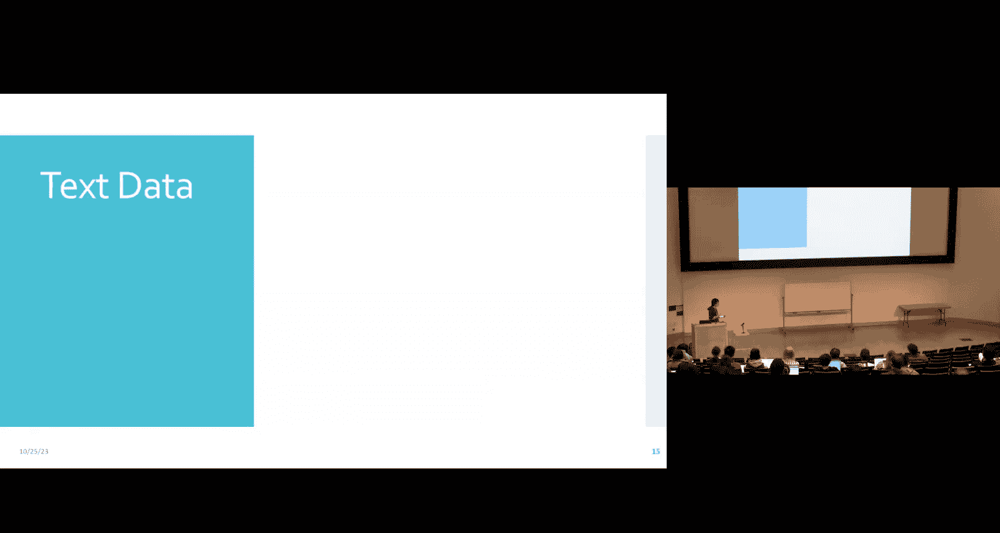
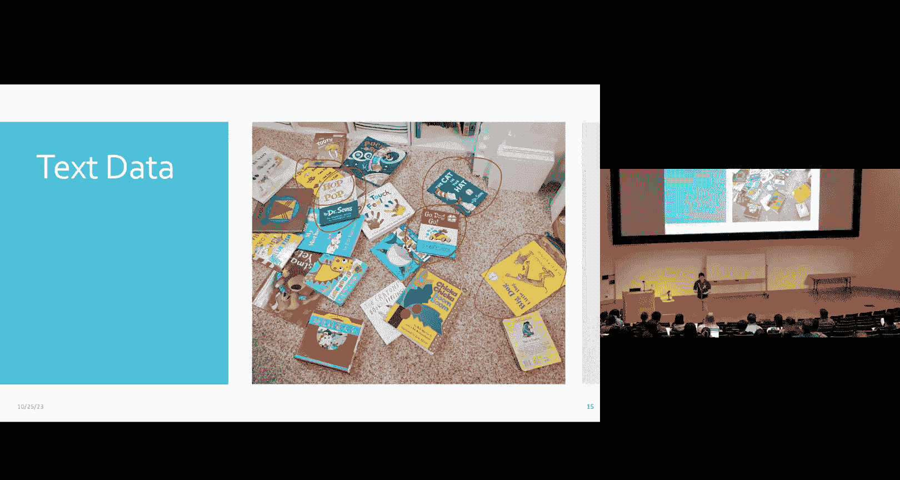
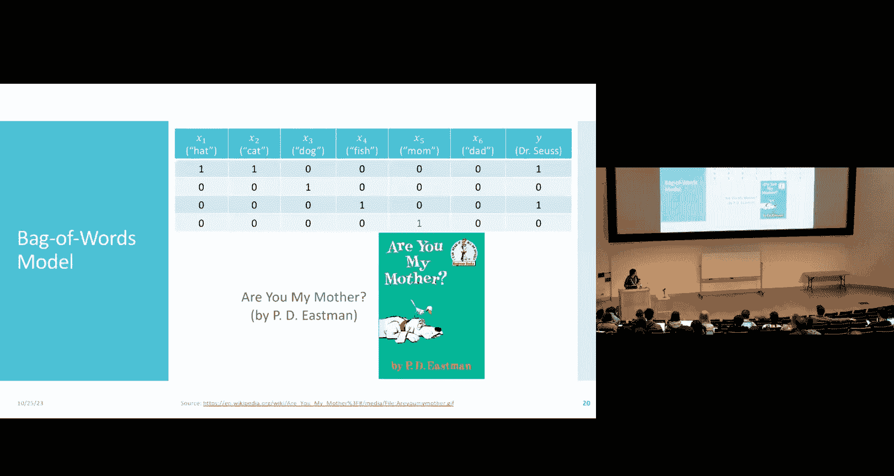
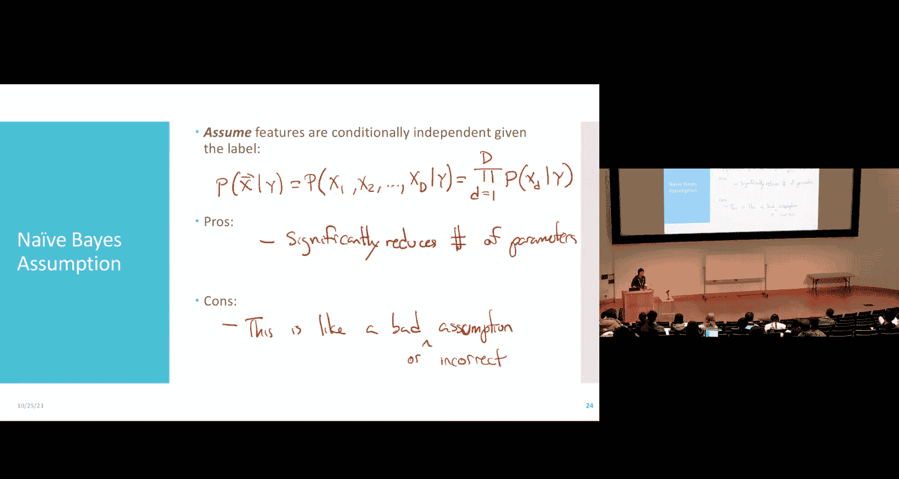
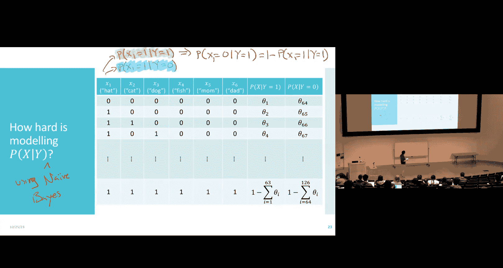
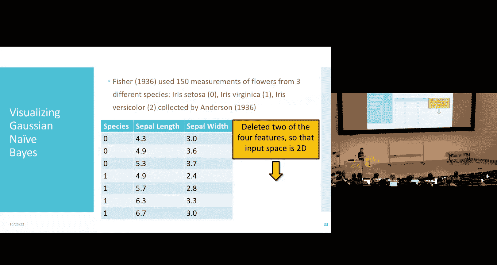
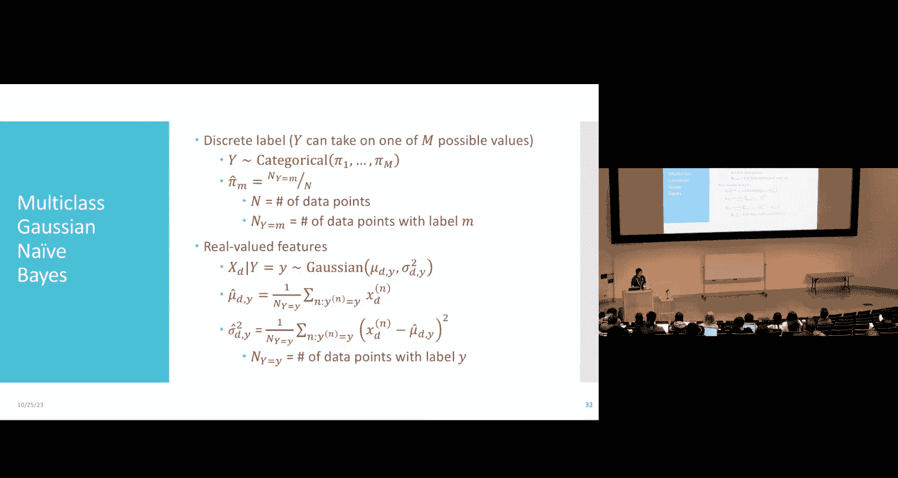
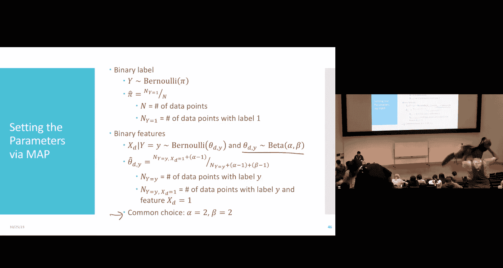

# CMU《机器学习导论｜Fall 2023 10-301⧸601 Introduction to Machine Learning》中英字幕（deepseek p16 Lecture_16_Naive_Bayes.zh_en -BV1Z2cUefE4A_p16-

All right。Good morning， everyone。We are going to get started for today。

 so today we're going to pick up where we left off on Monday and finish up our discussion of MLE and maximum of postii estimation。

 two different ways for learning the parameters of probabilistic classifiers and then we're going to apply those to our。

 I guess our second probabilistic classifier the naive Bayes method。😊。

A bunch of announcements today you have a homework to do on Friday。

 you have another homework coming out on Friday because the wheel keeps turning in this class homework six much like homework  three is a written homework so you may only use most two late days on homework six this is so that we can get you your grades back before your second exam which is in a couple weeks from now big thing to note about the exam today is the last lecture that is in scope for exam two you are responsible for the material from today's lecture for this exam you will not be responsible for the material starting next week until we get to exam three。

I mentioned this on Monday it is now actually up on Piazza you have now the opportunity to sign up for peer tutoring either to receive tutoring or to be a tutor again I really think this is one of the great things about this class I love seeing how many of you guys are enthusiastic about helping your peers so please do sign up。

And we have one more announcement， not on this slide。

 one of your peers from Engines Without Borders is here to try and recruit some of you to help out with the project。

 so I'll turn it over to Michael here。Turn on your mic and just hold a little pointedy bit up to your mouth so the people online can hear you。

Oh here， let me help you。嗯嗯嗯 yeah。So yeah， I'm Michael。

 I'm from Engineers Without Borders are drones project。

So our whole goal is to have an automated mapping system。

 we wanted to reach out to machine learning students。

See if anyone's interested on the software side or have people on the hardware they're building a drone and then our whole goal is to do road segmentation to get roadmap so we're partnered with a professor at CMU Rwanda our whole goal is to map out any unmapped areas there or areas that don't have like up to date maps the whole point of that is to help with emergency response disaster relief resource resource allocation and exploration there。

Our current data set that we're working with is from like Thailand Indonesia Indonesia and India。

 so we wanted to find a method that'll help us。With the data in Rwanda。

 there's research papers out there that had data from like rural parts of Africa tropical parts。

 they haven't released their data sets。We tried emailing them but day and I haven't responded so。

All right whole goal is to use active learning now so we would only have to use if we have a whole data set we would only have to use like 10%。

 20% of the data， but used to take the images that it's most uncertain about and use that to train the model。

And then for the overall architecture， for the road segmentation。

 we want to use a transformer model from a paper that came out recently。So if anyone's interested。

 our meetings are from five to six on Thursdays in T Sp。

 so that's like the sea level of An Hall by Port and Hamish flaglag。

We'll have a piazza that good about it for how to join。哦。That's some pretty exciting stuff。

 I guess say。Active learning was like what I did in grad school so I'm really interested in that and we'll be talking about transformers pretty soon now。

 so like you said， we'll post something on piazza if that does sound interesting to you and you can follow up there。

😊，Okay， where do we leave off So on Monday Well， we had this like fun little experiment with the coin flipping you'll recall and that led to some sort of idiosyncratic or strange behavior right some number of you ended up concluding or at least reporting that the most likely value for your chocolate coin coming up heads was one the most likely value for that probability was one for some of you it was zero but that seems a bit nonsensical that didn't align with what we believe you know the reality of the situation to be because we have some prior belief about how those coins should behave and we can encode that into our inference directly or into our learning directly using a prior distribution over that parameter。

 a prior distribution over the probability of the coin coming up heads so here's the terminology。

That we ended Monday's lecture with， we have these two distributions。

 the likelihood which both maximum likelihood estimation and maximum posterii estimation care about and then this new distribution the prior and it turns out when you sort of combine them both this whoops this term right here is what we would call the posterior distribution it's the distribution over theta after having seen the data D and then you know we can play the same trick of taking the log of that posterior and maximizing that to end up with the objective function for maximum posterior estimation。

Okay， so this is a bit abstract， let's take a look at what this looks like from the example from Monday of coin flipping。

The approach that we're going to take is going to be a lot like。What we did。

On Monday for maximum likelihood estimation， again。

 we're going to be solving for these parameters in closed form。

 but now instead of just sort of defining the likelihood。

 we have to define what we would call the entire generative story that means how did our data come to be what is the distribution that generated that data including this prior distribution over my parameters？

😡，But of course， this leaves a very big question。😡，Which is， how on earth should we pick this prior？

And the real answer here is you should pick your prior based on what actually reflects your beliefs about the world。

Now the answer that I'm about to show you maybe the right or a different answer to this question is you should pick a convenient prior。

 one that makes your life easy， one that makes the math easy and that's what we're going to do that being said frequently those two things will overlap that's the hope at least that the convenient prior will also be able to sort of accurately model your beliefs about the system and in the case of coin flipping it turns out that there is a sort of convenient and flexible choice here so remember we modeled our coins as Bnoulli distributions where the outcomes are either zero or one tails or heads here and we have this sort of funky looking expression for the probability mass function written out this way。

😊，A reasonable choice of prior distribution is this wild looking thing it's called a beta distribution and if we put the beta distribution over the parameter phi。

 we end up with what's known as a conjugate prior we'll talk about that in just a second here's the expression intuitively if you sort of squint at it。

😡，You'll see that the numerator here in this expression looks a lot like the PMF of the vernoli distribution and that's going to be really important in just a second The other sort of important thing here is that we have this normalizing term This is just a thing that makes the beta distribution of valid probability it's actually not going to come up again but you know people ask me what that is all the time for the most part we can safely ignore it and we'll see why。

😡，Okay， so this is the beta prior， it has this weird looking formula so why on earth would we use it Well。

 like I mentioned， two factors， one it's actually very flexible， so here's an example， right。😡。

This beta prior has two parameters that control what it looks like you might call these hyperparameter in fact these are the alpha and beta parameters here and depending on how you set them for instance。

 if you set them both equal to1， you can end up with different looking distributions that encode different prior beliefs about how this parameter phi behaves so here's maybe the most basic one what we're saying here with alpha and beta both equal to1 is that I have a uniform distribution over my parameter5hi that means I was born yesterday。

 I've never flipped a coin in my life all I know is that this is a valid probability so it has to be between zero and1 but any value between zero and1 equally likely。

😡，Strange belief to hold， but certainly one that you could and one that you can model with a beta distribution。

 maybe a bit more of a reasonable belief， one that aligns with what you all believed would be something like this with alpha and beta equal to 2 where now what you're saying is the most likely value for this coin to come up heads is 0。

5， but I'm not know 100% certain about it。😡，Or I don't know maybe you are very。

 very certain about it right the sort of larger you set alpha beta here。

 the sort of like more probability you can assign to that coin coming up heads exactly 50% of the time and here under this sort of upper right belief well there's almost no probability there's almost no chance that the coin comes up heads like less than 20% of the time or more than 80% of time also totally reasonable belief。

😡，Here's some more weird ones just to mix it up a little bit。 You know。

 maybe you really did look at that coin very closely and think。

 a there's like a little more chocolate on one side or a little more chocolate on the other。

 You can skew this belief towards， you know one。side being more likely than the other just by making alpha and beta unequal to one another and of course。

 you can even do something really extreme wherere like now you're saying the most likely value for this coin coming up heads is one maybe you believe it's like some sort of weird trick coin that like no matter how you flip it it's like a magician's coin it always comes up heads。

Okay， so this beta distribution incredibly flexible， that's a good thing。 but if I'm being honest。

 the real reason we're using the beta distribution here is because it's what's known as the conjugate prior for the Bernoulli distribution。

 This is a fancy term for saying it makes the math really convenient the technical understanding of this is that like if you start with a beta prior over your parameter phi and you use the Bernoulli likelihood。

 it turns out just because of the way the math works out。

 your posterior distribution is just a different beta distribution。

 it's a beta distribution with updated parameters。😡。

What that means practically for us is that it's very easy to perform maximum posti estimation using this conjugate prior likelihood pair。

 So if I pick a likelihood like the Bernoulli likelihood。

 there's usually one or sometimes maybe two convenient conjugate prior choices and the beta distribution is exactly that for。

😡，The Bernoli likelihood。Okay， so we're going to show that relatively quickly here and then we'll see some examples and then we'll stop and take some questions。

 so I apologize I'm moving a little quickly， but it's because I want to get to the good stuff here。😊。

All right， so like I said， we're going to approach solving the maximum postiri parameter estimation problem exactly the same way we solved the MLE problem。

 which is by sort of writing out this log objective function here。

 the log posterior and then solving for the value of the parameter phi that maximizes that log posterior in closed form。

😡，So what that looks like is。Here， the log posterior Phi。 Well， this is the log of。My。Prameter phi。

 given this data here， which again， I'm just sort of writing this out for completeness。

 you can remember is decomposed into two components。

 the log of my prior plus the log oh rather I should say this is，Being totally honest。

 youre proportional too。The log of my likelihood by here， close that， close that。All right。

 and so what this gives me is。😊，My prior distribution， I'm going to plug that in here。

 looks like this sort of crazy looking beta distribution。Phi to the alpha minus1。

 1 minus phi to the beta minus1 over this normalizing constant。

That's going to go away in just a second。Plus， my log likelihood term。

 I'm just going to copy this down from what we had yesterday。

 remember this log log likelihood term was just counting instances of Phis。And。

One minus phis based on how many heads or tails I saw in my flip。AlrightAnd again。

 this just sort of comes from Monday's content Now I can apply my log identities to this prior and end up with。

 well， something that should look very familiar， this will be something like alpha minus1 times log phi plus beta minus1 times log1 minus phi minus okay。

Still have this log normalizing constant here， don't worry that's going to go away very soon。Plus。

 let me maybe write it like this and one log phi plus and0， log1 minus phi。

And now you can sort of see why the math is convenient here。

 why the beta prior is a nice convenient choice。 It's because we can group these like terms here。

 So that is something like these terms both having log P。😡，And see this color。 these terms。

 both having。Log 1 minus 5。So that gives me。Alpha -1 plus n1。Pins log5。Plus。Beta minus1 plus and0。

Log1 minus5。And then I still have mine annoying。Normalizing constant。There。Okay。

 so this is going to be my final expression for the objective function and sort of immediately off the bat。

 you can see that it looks a lot like the objective function for maximum likelihood estimation that we explored yesterday。

 it's just some stuff times log p plus some stuff times log 1 minus phi plus this constant that I promise is going to go away when we do the next step。

😡，Which is。When we take the partial derivatives here。Well， it looks something like this， right。

 that last term here。😡，Disappears because it doesn't depend on phi crucially。

 it doesn't depend on phi。 So when I take the partial derivative， that goes to zero。

 and I'm left with something that looks a heck of a lot like what we had on。Monday， so much so that。

I'm going to skip all the relevant steps here and tell you that the MA estimate for Phi has a very similar form to what we had on Monday that is it's。

😡，Something plus N1 divided by something plus n0 plus something plus n1。

 so we're still looking at the number of heads divided by the total number of flips。

 but with some added additional terms。😡，And those additional terms you can think of as being like very interpretable in some sense。

 these are imagined or maybe actual instances of heads and tails that you've observed from all of your prior experience flipping coins。

 as I'm sure we have， you know。😡，Countless experience flipping coins so you can imagine you like flip some number of coins in your life and you want to incorporate those into any future coin flipping experiments you can just sort of keep a tally of how many heads you've observed and how many tails you've observed from coins that you've flipped previously and if those two values are roughly equal to one another。

 you can translate that into the alpha and beta terms in the beta prior here。All right， so again。

The choice of prior is motivated by the fact that it's very flexible and it has this convenient and interpretable set of parameters that lead to sort of really easy and frankly like very elegant estimation with a prior distribution okay so we'll see some examples of how this plays out in just a second let me stop here give you guys a chance to catch up what questions do you have before I move on。

😡，Yeah， think this is。I could be more lecture， but why are we using the Bno way distribution if we put one multiple times。

 why not。So the monoial distribution would be like。

If you had many sequences of flips right like I would model the entire classes distribution of the number of heads using a binomial distribution。

 but for any individual coin， what you're interested in is what is the probability of that coin coming up heads not say what is the number of。

😡，Heads I would get if I flip that coin 10 times right。

 we're modeling sort of a different parameter there。

So I confess a lot of that is maybe outside the scope of this class。

 I'll just restate the result again， which is that if you have a conjugate prior。

 you start with a beta prior over phi right here's a beta prior or beta distribution over phi。

 after performing the sort of update with the likelihood of a Bernoulli likelihood the resulting distribution is still a beta distribution just with different parameters like alpha prime and beta prime and that's the key result。

Bnoulli with this mathematical so we're not replacing the Bernoulli the Bernoulli is still the likelihood function。

 it's still describing what the probability of you know the actual heads or tails are really you can think of like the conjugate prior as like something that we update with data we're updating the prior using our Bernoulli likelihood to get a beta posterior。

 that's why it's a conjugate prior。😡，Again， I think like the more relevant interpretation for this class is that it makes the math nice。

 it makes the math worked out， yeah。I mean， what exactly does like beta P represent here？

So a beta prior represents your belief about what the probability of the coin coming up heads is。

 it can be sort of any number of pictures that look like this。

 just depending on how you set alpha and beta， it's a way of encoding what you believe to be true about this coin。

😡，Could you say that like咁 there to。The maximum like estimation and the I that was discussed last class it is a way to bias that。

 given our beliefs。 That's exactly right。 This is a really great interpretation。 And in fact。

 I think maybe seeing a few examples might help。Make that idea a little bit more concrete。

 So let's say okay instead of flipping your coin five times。

 let's say I asked you to flip your coin 12 times and it just so happened that you got 10 heads and two tails right So the maximum likelihood estimation under that scenario would tell you that the parameter should be set to 5。

6 or 1012s but much like you know this sort of extreme beliefs or the extreme outcomes that happened on Monday's lecture。

 this is sort of a bit extreme like this is like saying yes。

 I believe this coin will come up heads five out of six times and that's maybe a bit unrealistic and so we might want to re that in or constrain that with our prior beliefs here。

 if you used a sort of weird prior one that says no in fact。

Just sort of interpreting these alpha beta parameters。😡，This prior is saying。

Tils should be much more likely than heads This is saying like in the past when I've flipped coins like this。

 I've seen， I guess one head and four tails with those pseudo count interpretations right and if I do that well what we get is sort of a much more well balanced out in some sense。

 belief or rather a much more balanced out estimate for the parameter， 11，17s which is I don't know。

 also kind of a weird belief， but sure， maybe a little bit more reasonable than 1012s。😡。

Here's a much more extreme version and again， probably similar to what you guys had in your minds。

Now， what I'm saying is like I've seen 100 tails and 100 heads before。

 the magnitude of my prior parameters is much， much larger and what that means is。

 well if you look at the sort of effect of the 10 heads and two tails that I saw in this one experiment。

 they're sort of being washed out by the magnitude of my prior right my prior is sort of dictating what the MA estimate here is。

 and so my final estimate110 over tone and 12， that's basically one half。

 it's slightly more than one half because I saw slightly more heads than tails。

 but if you think about what the scale of these parameters is saying it's saying I'm going to need a heck of a lot more actual data。

😡，To sort of move me off of my prior， like if I flip this coin， I don't know。

200 times and I had seen 150 heads， well now all of a sudden that's some very compelling evidence that's some very compelling evidence for me to update my prior or use a more sort of skewed estimate for the probability of this coin coming up heads So what I'm trying to highlight here with these two examples is that not only do the parameters affect the like shape of your belief but they also can be used to represent some sort of like strength in your convictions like if you really believe the coin behaves a particular way。

 you can set your parameter values to be larger or。😡，Again， in the extreme scenario。

 if you don't believe them， if you really don't believe anything about the coin。

 you can set the parameters to be very small， you can use this uniform distribution。

 and when you use this uniform distribution， the way the math works out。

 you actually end up back with the MLE estimate， which is sort of a nice trait of this framework。

 which is that you have such a flexible prior that you can encode even this uninformed or uninformative belief here。

😡，Okay so that's all I had about MLE MAP estimation next we're actually going to use this to try and learn a probabilistic classifier and we'll again see how that MA estimation has this like tempering effect on extreme parameter values we'll see what that looks like in a few slides here。

 but let me again stop and take some questions that you might have about this。😡，Yeah。All right。

 let's talk about text data so you guys have already worked with some instances of text data you're going to be working with。

Maybe the same instance or maybe a different instance in Home7 spoilers you're going to be working with more text data there。

 but today I want to talk about a very particular kind of text data。

 a very simple kind of text data because it'll lead to a nice sort of discussion about naive Bayes here。

And I want to talk about children's literature。This is a picture from my actual floor here I have a three year old and a one year old three year old loves books the one year old also loves books but he can't read he loves to chew on books and he loves to chew on books by Dr。

 Seus right so we got a lot of books by Dr。 Seus in here we got this one and here's one oh one fish two fishes back here and we got a lot of books that aren't by Dr。

 Seus right like I don't know for the longest time I used to think this book godog go is by Dr Seus turns out it's not same thing with big dog Little dogg and you're probably noticing there's like a trend in the names of these books they have a lot of like similar words in common right and so。

In order to build our naive based classifier， we have to take these book titles we're going to learn to classify books as Dr。

 Sous or not Dr。 Seus's books based on their titles but we have to figure out some way to encode these titles in a way that our machine learning classifiers can work with right so I think in homework4 you guys worked with a particular kind of word embedding。

 a particular kind of word encoding Today I'm going to just briefly go through a very simple one and this is what's known as the bag of words model What I'm going to do is I'm just going to define a very small vocabulary it contains six words。

 very common in children's books titles， hat cat dogfish mom and dad and the label that I'm going to try and predict is whether or not the book is by Dr。

 Seusus。

All right， and so the way this bag of words encoding goes is I just look at my title。

 the cat in the Ha， and if the vocabulary word of peers in the title。

 I put a one in that feature and if it doesn't I put a zero so that cat in the hat， great book。

 great book that gets encoded as1100，0，0，1 because the book is by Dr。 Seus。😡。

Go dog go well that's just the only word that appears is dog and so all of the other values are zero and this book is by PD Eastman。

😡，Here's an interesting one， one fish， two fish， red fish， blue fish， this gets encoded as 00，0，100。

And another sort of well hack that I'm doing here， I'm implicitly doing some word stemming。

 so are you my mother， I'm sort of mapping the word mother to the word mom。

 this is a very common preprocessing step in natural language tasks so this gets encoded as000010 and this is another book by PD Eastman。

😡，Okay， so let's stop and take a moment here and reflect a little bit on this particular embedding。😡。

What do we like about it， What are some。Fros， and what are some cons of this particular way of representing text data？

Yeah， right here。You don't the， ordering of words。 You might think that should matter。 absolutely。

 none of that information here。 Yeah， frequency is also lost frequency is also lost。

 absolutelysolutely， I could update this to you know， keep track of count instead of just occurrence。

 but that's not what I'm doing here。Yeah。😊，can be very sparse Sure。

 is that a good thing or a bad thing？Depend， okay， I like that。

 I think it can be argued to both be good and bad that you could have a very sparse representation。

 but that could be very problematic if you don't have sort of enough features to learn from。

Anything else here， yeah。Relationship clean words if something I that exists。

Not really considering the relationship between words。

Can you elaborate a little bit more on what you mean by that So in this case you are taking mom and mother to be the same word。

 but say you did it then mom and mother would be too completely okay okay。

 so this is maybe like a like a bigger problem that's like I have to pick my vocabulary somehow in order to use this model for sure Yeah。

 like what if I pick like a really insufficient vocabulary Like there's a lot of words or like you know。

 I'm doing stemming wrong Like I should have mom and mother be separate。Yeah。😊。

features might not be independent。啊。Are you viewing that as a pro or a con。Event。Okay， fair enough。

 yeah， I mean， I think that that is。Definitely something that can be。I guess like。In general。

 in the real world， the features might not be independent and so like that's not necessarily like a particular issue with this model。

 I would say。😡，It's okay for your features to depend on one another Yeah can be general like for example' oh the places you'll go sure yeah we could also easily find the book that also has beside my pile of books actually don't know if I have a copy of that regardless I think this is related to the issue of having to pick a vocabulary right like if my vocabulary is based on some training data like this one here and then I encounter test words that aren't in my vocabulary I got to figure out what to do with them for sure。

Yeah， one more back here。So this could be a con here so like we lose semantic meaning so like in from just the picture it looks like the you is referring to a dog。

 but we're not capturing dog as part of the you。Oh， that's a really interesting。Observation， sure。

 yeah， there's， there's a lot of meaning not being captured in this。 Do you have another one。

 Can we get something positive， guys， Like， I hate to start out my more like guys are just really bragging on this model。

 What do we like about it。It's simple what do you mean by simple here like how in what ways is that simple it's very like either and then also it's easy like even。

This new title that you like as like a title that you've already seen then you can just predict okay hang on so I like what you said it's very simple it's very easy to compute for sure like I can just sort of like run through my title and fill it in like this is that an interesting thing which is like if my title just contains the same words as a book that I've seen before like I can just sort of know what the label is that's a little tricky here with this representation right like there are lots of books that could get mapped to you know the same mapping as are you my mother some of which are actually by doctors right like if the only word in there that is in my vocabulary is some stem or root word of mom then。

😊，I could end up with some issues here。 So I like the first things that you said， and I actually。

 I also think that you made an interesting observation here， Anything else。😊，Yeah。

 one more It's really interpretable It's interpretable。 Yeah。

 I think you might have mentioned that too I agree it's very interpretable I'll just throw out one more thing that we're gonna to make use of in just a second。

 It's very nice that this is a binary sort of representation like that's going to be very useful for the particular model that we're going to develop in just a second but can be sort of nice for storage issues related to the idea that this is a very sparse representation as well。

It's not all bad this is actually like a really reasonable model to start with and so we're going to use this representation of data to learn a probabilistic classifier just as a reminder here。

 so when we're building a probabilistic classifier。

 the sort of entity of interest the quantity that we're trying to model is I know this terminology that gets a little overloaded。

 we're going to be modeling a different posterior distribution。😡。

That is the distribution over the label， given the feature values X。

 so given the feature values that I see， what do I believe the label should be。

 what do I believe the distribution of the label is between sort of books by Dr。

 Zeus and books not by Dr。 Zeus。😡，So we're going to model this posterior distribution and then once we've done that。

 well there's lots of different ways we could use that posterior distribution to make predictions。

 maybe the most common choice is just predicting whatever the most likely class is。

 so if you know the probability of the book being by Dr。 Seus is 0。7。

 I'm going to predict that the book is by Dr。 Seusus。

So the question becomes how do we model this posterior distribution and in fact we've already seen one way for doing this right this is the choice made by logistic regression where we directly model this posterior distribution P of y given x。

 but we called the conditional likelihood， we directly model this as some parametric function of x in this case like a linear function pushed through a sigmoid。

😡，Today we're going to consider an alternative， which is using our old friend Bay's rule here。

 which says that this posterior distribution， p of y given x。

 well this is proportional to p of x given y times p of y。

 and so if I can come up with two distributions for p of x given y and p of y。😊。

If I can come up with a distribution over book titles given their author and then come up with some distribution over authors。

 I can use that instead to model this posterior distribution， yeah。😡。

In this case would you apply be probability the probability of in this case， Dr。

s being the author of one of the books in the set or of all potential books have so the way to think about this is like you get one testbook like some book that you haven't seen in training and you have to predict whether it's by Dr。

 Seus or not， so why here is the probability or rather we're trying to learn the probability that some book is by Dr。

 Seus like a book。Okay， so this is the choice for today。

 we're going to be modeling these two distributions。😡。

But I want to sort of motivate where we're going with this question， which is。😡。

How hard is modeling these distributions， right？For logistic regression。

 we just sort of assumed a parametric form for p of y given x here we're actually going to think about learning P of x given y directly from the data。

😡，And what do I mean when I say how hard is this really what I'm asking is how many parameters do I need to learn all right。

 let's go back to our little example here right？😡，So in this setting。

 I have six binary features and a binary label。😡，When we think about learning this distribution。

 P of x given y， what that means is you need to be able to tell me for any combination of the x's for the vector 0。

0，0，000， you need to tell me what the probability of that is given the book is by Dr。 Ses。😡。

And you need to tell me what the probability of 10，00，00 is， given the book is by Doctor Seus。So。

My question is。How many parameters do you need to learn？

And although you have is it two to the power of M not quite you're close that's a good first yes so you are right in that I am going to have to learn well。

 almost a parameter for every row a little bit of a。I don't know， technicality here。

 which is that like I technically don't need to learn the last parameter because it's going to be one minus all of the other previous。

63 parameters right that's a valid probability distribution it has to sum to one。

 and so I only have to learn 63 parameters here。😡，Am I done？What。Else could I need to learn here？

I do need to learn probability of why that's just going to be one parameter that's like so trivial I'm not even counting it there's actually another whole set of parameters here that I'm asking what else do I need to learn here？

😡，PYes， that's exactly right。 So why my label is a binary binary label。

 So what I've done here is I've specified the distribution over book titles。Four books by Dr。 Seus。

But if I want to learn about books that aren't by Dr。 Seus， well。

 I'm going to need basically a carbon copy of this distribution。😡，So let's think about this， oh。

 yeah。😡，The 63 is coming from it's to。Two to the six， minus one。😡，I think。Yeah。😊。

It's2 to the six minus1 and I need to learn another 63 parameters for this other distribution and so what that gives me is something like two times2 to the M minus1 where m is the number of features。

😡，That's a heck of a lot of parameters for six。Stupid binary features， right。

 like this ridiculously simple model， you're telling me in order to learn this， I would need。😡。

At a minimum， I would need like 126 children's books， one for each possible combination of this。

 but really what I would want is I would want like many。

 many copies of all of the possible combinations of words and book authors to actually get good distribution estimates。

😡，So I would need many， many times 126 children children's books。

 and I don't have that many children's books。Thank God you've already seen my floor couldn't take it so instead we're gonna to come up with a simpler model。

 one that sort of makes some simplifying assumptions about this distribution P of x given Y that's going to make learning a lot more tractable and I think this is maybe what you were getting at earlier when someone mentioned independence but we're going to assume this is like a really strange usually wrong assumption。

 but it's going to make learning easier， so you can think of this as like you know when we did linear regression。

 we assumed that the target was a linear combination of the features it's typically a bad or incorrect assumption。

 but it makes learning easier same thing here， we're going to assume the features。

 our conditionally independent of each other given the label。😡，In math。What that looks like is。

The labels， P of x given Y here。Well， if we're assuming they're independent， that means I can write。

😡，This distribution， let me actually sort of maybe make clear what it is that I'm writing。

We're saying。That。Here the features， remember， the features are some vector x given this label Y。

 So really this is like a distribution over x1 and x2 all the way up to x capital D， given y。

 and our assumption is saying that all of these are conditionally independent。

Once I tell you the label， so this joint probability decomposes into a bunch of smaller individual probabilities。

 that is I have a probability distribution for each feature XD。😡，Okay。So let's again take a minute。

 think about this from a pros and cons perspective like we did with the bag of words model。

 there's a bit of a weird assumption to wrap your mind around。

 but take a minute here and let's think about what we like and what we don't like about。😡。

This particular modeling choice， if you will， what are some things that are good about it and what are some things that are bad。

I think the number of parameters which seems drastic so you probably just need the order of number of inches Yeah this is exactly right in fact。

 let's go back and look at this in just a second， but this makes the。

Computational complexity of this problem， much easier， so we'll say it significantly reduces number。

😡，Of parameters that we need to learn here。We'll go back and explore that in just a second。

 what else do we like about this？😡，Or don't like。Guys are feeling particularly negative this morning so。

Oh。What do we like here？Worse in what way？And it's accuracy， okay， yeah。

I'll just come out and say it。This is。Like。A bad assumption a lot of the times。In that。

 it's incorrect， right？It doesn't actually reflect how the features relate to one another。

 right if we go back and look at you know our really simple feature set。😡。

What we're saying is the probability of seeing the word hat is independent of the probability or independent of seeing the word cat。

😡，Not in children's books as it turns out， like those two words are highly correlated in children's book books。

 especially once you know they're by Dr Seus actually while we're here on the slide。

 maybe we can spend a minute you mentioned that you think the number of parameters you need to learn under this assumption is the order of the number of dimensions I think that's right but let's try and get a little bit more specific What are the parameters that I need to learn under my naive Bayes assumption how hard is modeling P of x given y using。

😊，Nive Bay here。What are the parameters that I need to learn？

Word will probably be word for each document。Probability of each word for each document。

Not quite we're still thinking about like。The probability of words given their label。

 so I'm still trying to learn p of x given y， so what are the various parameters that I need to learn？

😡，嗯。Each。Each feature for each。Yeah， that's exactly right。 but crucially my features are。And binary。

 right， And so let's start with x1。 I need to learn something like P of x1 equals1。

 given the label is。One， right， I need to learn like the probability that I see the word hat given the book is by Dr。

 Seus。And I need to learn something like the probability。

The word hat appears given the book is not by Dr。 Seus， crucially though， once I've learned these。

I can use these to compute。😡，The sort of other parameters that I need， right because this is sort of。

1 minus。The probability that the word hat appears， the probability that the word hat doesn't appear。

Is just one minus that。 And so really， what I'm learning is for each feature。

I have to now learn two parameters， one that corresponds to the label y equals 1 and one that corresponds to the label y equals0。

 so the actual sort of explicit number is something like2 to the two times D number of parameters where G is the number of features that I have here。

😡，And that is much， much smaller than the exponential dependence that I had if I was learning the full likelihood here。

 that is a huge saving。

I'll just add one more here， whoops。So it significantly reduces the number of parameters。

 and relatedly。This can help combat overfitting。Oops。Over。Fitting。

By making this sort of drastically simplifying assumption。

 I'm reducing my model complexity and that can address you know all of these issues that we have with like overfitting to our training data。

 our models being too complex and not generalizing well。

 yeah so this is in some sense a plus for making these sorts of simplifying assumptions right it's related again to the idea that like when we make a linear assumption for linear regression Sure it might not be the best like actual fit to our training data。

 but it gives us these sort of nice simple models that are not liable or less liable to overfit。😡。

Yeah。Like reason to believe that a subset of your data or a subset of your features independent makes two yeah absolutely so you can encode sort of arbitrary or not arbitrary but like more complex relationships between subsets of your features that say like these features are dependent on one another but this group is independent from other ones you can sort of。

We can relax this assumption。And that gives rise to something which。

I guess we're not exploring this semester weird， we typically cover this， but this is gone well。

 maybe not the way of the dinosaur， but we're prioritizing other content over Bayesian networks so if you want to read up a little bit more on this。

 that's the term that you should Google。Yeah。If non naive is the same as a meor。

Because we just calculate the probability of this exact set of data。In the training。

So it's an interesting assert。Does it behave， I would say its behavior is maybe like the memorizer。

 But the fact that we're allowing for like probabilistic classification gives it a little bit of like。

Gives it an out in some sense that the memorizer doesn't necessarily have like we're instead of memorizing like exact feature label duplicates。

 we're memorizing probability distributions， which。They have some potential to not be wildly overfit。

 I guess。It's an interesting parallel though， I like that idea。Okay。

 so we had this slide for a few of our earlier models I'll just revisit this for naive B。

 the approach that we're going to take is basically very similar to what we've done the past few lectures here with MLE MAP estimation we're going to sort of make。

😡，This naive base assumption。And then。What that gives me are oh， crucially。

 we also need to like we've been doing assume independent and identically distributed data。

 so our data is still going to be these like。😡，X IY I pairs here。

 but I'm going to assume that all of these X IYI pairs are independent from one another。

 that's going to allow me to do maximum likelihood estimation。

And then we saw this briefly a second ago， but I'll just write this down for the setting that we are considering where we sort of have binary features and binary labels。

 the parameters I need to learn are well let's call this some theta dy this is the probability that Xd is equal to one。

 given the label is equal to either zero or one that represents all of those per feature distributions that I need to learn and just for completeness I do need to learn。

😡，A distribution over the labels my sort of prior p of y equaling1。😡，For an objective function。

 we're going to start by maximizing。The log likelihood and we'll talk about log posteriors in a little bit here。

 but we're going to start with maximum likelihood estimation and much like before we can solve for these。

Enclosed form。Because。The way that we've made these two sort of modeling choices because of our IID assumption and this conditional independence of the features given the label。

😡，We're going to work through the example on the next slide that shows。😡。

These parameters decompose sort of really cleanly in the log likelihood expression what that means is when I need to compute the maximum likelihood estimate for any one of these parameter here。

 I can do that sort of very easily in isolation it's going to have its own little term inside the log likelihood so that when I take the partial derivative with respect to just one parameter all of the other things in that sum will go to zero。

 they won't depend on that one parameter and I'll just be able to solve for each individual one en closed form sort of very cleanly。

😡，Okay， that's a bit abstract， let's take a look at what I mean when I say that。😡。

Here is the log likelihood that I'm interested in maximizing。

 I'm interested in maximizing the likelihood of my data， given these two parameter sets， pi。

 and I'm using theta here to represent all of the individual per feature distributions， right？😡。

So that's the log likelihood of this big data set， and the first thing that I can do is I can imply this IID assumption that says the likelihood of my data boils down into these sort of point wise。

😡，Distributions multiplied together， so the probability of some X I， Y I pair。

Times all of the other X IY I pairs in my dataset。Now this。Let's see。

 Let me leave this as a log product for the time being。

 and then I'll sort of collapse this all at once this I can apply phase rule to that says this is P of。

X I given， Y I and my parameters for the time being。Actually， let me make a slight modification here。

P of X I given Y I and just theta， I'm dropping the pi parameter here because this distribution。

 P of x given Y I， that doesn't depend on pi， the probability of my label Y。

 so I'm just going to remove it from the conditional side instead over here。😡，P of Y I given pi。

 that does depend on this other parameter pi。 It doesn't depend on theta， though。

 So already we're sort of seeing how our parameters are getting separated out。

 Like if I just needed to learn pi， well， I only need to worry about that second term there。

 the probability of each of my labels given。Or rather just the probability of each of my labels here。

😡，All right， so this is just bayes rule or rather the conditional probability definition now I'm going to apply my naive Bayes assumption to this term because remember。

 it sort of not well represented in my handwriting， these X's are still feature vectors。

 which I'm assuming are conditionally independent。😡。

So I get something like log high of now a product over each of my features。P of X， I sub D， given Y。

 I。 And now I can again sort of decouple more and more。Of my parameters out。Because。

This inner probability here， well， this only depends on。My feature specific parameters。

 theta d1 and theta d0。And just for completeness， I still have。

This distribution over my labels out here。Okay， now it's time now I'm going to start pushing this log into these products。

 so that's going to give me two sums， a sum from I equals1 to n。😡。

And a sum from d equals1 to d of this log probability。XDI， given Y I。Theta d1， theta d0， close that。

 close that plus。Log p。Why I given pi。All right， and now what we have。Is。

A bunch of log Bernoulli distributions。Remember these。Features， XDI。

 they're all binary random variables that are either zero or one if the word D appears in the Ith book title。

😡，And so what I have inside here。😡，It's a bunch of。

Sort of really ugly looking Bernoulli distributions， but you'll note。That each one is its own sum。

Theta D1 to the Xdi。Times 1 minus theta。1。To the。XDI， here's the wild thing。

 I'm actually raising this to the Yi power here。Times。哎。Data D0。X D， I。Oh， hang on， sorry。

It's a bit more nuanced than this。What we actually have to do here。Is we have to break out this sum。

Into two cases， what we're going to say is this is actually going to be a sum over all data points where Y I is equal to one and plus sum sum over data points where Y I is equal to 0 and what that's going to allow me to do。

Maybe I'll write this out just for completeness。This is going to allow me to use just the right parameters here that I care about。

 So now this is the log of the probability of XDI。😡，Given just theta D1 here， close that。

 close that plus。三 d。E of X D。I given theta d0。Close that， close that， and I saw my log。Eat Y I。

 given pie。All right。And now inside each of these terms。

 I'm not going to write them out because I've unfortunately run out of space。

 but inside each of these terms， we have our old Bernoulli likelihoods。

 these are just Bernoulli likelihoods controlled by the parameters theta D1 and theta D0 respectively。

😡，The key here， the thing that I'm really trying to illustrate with this last slide。

 is that if you look at each term in that sum， each term in that sum only depends on one of my parameters。

 it depends on theta 11 theta 10， theta 51 theta 50 so for each of the various parameters that I need to learn if I'm setting them by maximizing this log likelihood。

 I just take the partial derivative and a whole bunch of stuff goes to zero most of the terms in this sum will go to0 and I'm left with just one simple Bnoulli distribution that I can solve for so this is the key takeaway from this slide that all of these parameters are decoupled in the log likelihood。

😡，All right， so I'm going to stop here， give you guys a chance to catch up。

 what questions about this do you have before I move on？😡，Yeah， so in the last step。

 how come the Yi on the right side is okay。The Y eye on the。系。

Given dataI and the conditional probability。Sorry， X D， I given data D1。 Yes， so data D。 Yeah。

 so what I'm saying here is this thumb。Over all of my data points here。Oops。

 I'm decomposing that into two separate sums。The sum over all of the data points where my label is one and sum over of my data points where the label is zero。

 and given that I know what the label is， I can use the right。Theta parameter。

 either theta D1 or theta de， but why the other theta parameter disappears， but how come to Y？Oh。

 because these parameters only depend on what the label are right if the label is1。

 I use the theta D1 parameter， I no longer care what the theta D0 is crucially for data points where the label is one。

 my distribution over the features doesn't depend on the other parameter theta d0。😡。

why you get apply？I guess I'm sort of baking in the Y I here， like if I were being， its fair。

 if I were being really rigorous， I would say like given。Also that Yi is equal to1。

And given over here that Yi is equal to zero， but I'm sort of just dropping that for notational convenience。

Yeah in the back as pi is defined here it's just the probability that the label is one in some sense this is like。

What proportion of my books are by doctor Ses？A strikingly large number。Another question here。

I was going to ask about the summation for the law like the last starting but so that would be over why my Yeah you're right so this still has a。

Kind of get a little sloppy with my map， but you guys， you're too sharp for me here。

 this still does have a sum over all data points here。I'm indexing by。All right。

 the key takeaway from this slide is that all of these parameters decouple into their own little Bernoulli distributions。

😡，Well here's the thing， we already know how to learn Bnoully distributions with maximum likelihood estimation。

😡，We just take counts right and intuitively this is how you would set these parameters without doing all that math what you would do is if you have this sort of completely binary setting。

 well for the parameter pi you would do what I just said， count the number of books you have by Dr。

 Seus divide that by the total number of books and that gives you your maximum length estimate for pi。

😡，For each of these theta parameters， well it gets a little bit more complicated。

 but again what you're doing is you're counting the number of times some feature Xd was equal to1 dividing by the sort of number of times sorry you're counting the number of times that feature was equal to one and the label was either zero or1 and you're dividing that by the total number of times the label is either zero or1 so what you're doing is you're counting let's say the number of times the word cat appears in books by Dr。

 Seus and dividing that by the number of books by Dr。

 Seus you have so these are just again the sort of very intuitive estimates for these parameters that you would use if you were just sort of doing your best guess for what these probabilityba should be。

😡，And this well we can take a minute and see if we can apply this to a couple of poll questions here these are your first two poll questions in fact what we're asking here is given this completely binary dataset over here what is the MLE of pi and what is the MLE of theta 31 so here's a bit of a like notational challenge for you all if you will as always this poll is up at poll。

m coursese。org。😊，These probabilities can't be greater than one， it's not seven cents。All right。

 so let's go ahead and take， I don't know， three minutes here。

 go ahead and talk this over with your neighbor， put in your best guess and we'll see what you all ought to say when we reconvene。

All right， go ahead and put in your best guess if you haven't had a chance yet for poll question one。

 I'm pleased to see many of you have converged on the correct answer here so the correct answer for poll question one is36 it's relatively easy to see There are three instances of ones and three instances of zeros So the maximum likelihood estimate for the label is going to be three6 for this other parameter。

 Well， there's a lot more。😊，Let's say disagreement the plurality of you have still settled on the correct answer here。

 which should be four/6s， but it's a slim plurality。 The way you see this is well。

 this index one here is telling you to just look at data points where the label is one。

 So I'm looking at the distribution over this third feature when the label y is equal to one。

 and in that setting I have。Let's say two instances of one and one instance of0。

 so that should give me an estimate of two/ thirds or4/6s。All right。

 so that's how you would go about setting these parameters and the thing that I want to note is that like learning these parameters for what we would call a Bernoulli naive Bay model is incredibly efficient all you have to do is sort of loop over your data set you can imagine sort of looping by the rows and then going column by column through each row and just taking these counts so learning these parameters is incredibly efficient。

😡，So this gives us one like flavor of naive bays， if you will。

 depending on the features that you have and the kinds of labels you're working with。

 the distributions you use might be different and those could give rise to differentvari of the naive Bayes model。

 so this is what we would call like the multinoial naive Bayes model。

 you can imagine like if instead of just doing word occurrence， we were doing word counts。

 we could use something like this where now we have a categorical distribution over our features instead of a binary distribution。

😡，You could even imagine like if you had real valued features using Gaussian distributions to model your per feature conditional distributions and now you're sort of learning two parameters for each of these features you're learning the mean of a Gausian and the variance。

 I have the MLE estimates here， I'll let you guys work those out on your own。

 but if you do this you can get sort of really interesting results which is if we're using real valued features。

 remember way back when when we first introduced real valued features with a KNN model。

 one of the things that that allowed us to do was it allowed us to visualize oh sorry we can also do this with multiple classes。

 not just binary classes like what we have in the Fisher iris data set right so with these real valued features in our new naive Bayase model。

 our new Gaussian naive Bayase model， we can actually sort of visualize what kinds of decision boundaries。

Learning using these Gaussian distributions right so here is just the two classes from this Fisher iris data set。

 And what we're saying is we're fitting two different Gaussian distributions。

 One for each of the two labels here。 And so this sort of long wide Gaussian distribution is fit to the red class and this sort of narrow。

 tall distribution is fit to the blue class and what we're looking for is the intersection or rather where these two classes sort of meet one another。

 where these two Gaussian distributions meet one another is where the probabilities。😊。

Are going to be。5050 split between what the label should be。😡。

And that's going to give rise to two instances。 What we'll say is that。

If we don't learn the variance parameters for these Gaussians， if we fix the variances to be equal。

 because that's you know how we believe these feature distributions work and all we're learning are the means for these two or many Gaussian distributions。

😡，Well then we can actually show， I think you actually will show this in your homework maybe what we can actually show is that the decision boundary you learn in this setting is linear and that's kind of cool we're sort of back to our old familiar friend linear separators。

😊，And linear decision boundaries， however。Naive B can go a little further。

Which is that if we allow the variances to be learned instead of linear decision boundaries。

 we can actually get quadratic decision boundaries， things that look like parabos or ellipses。

 circles and so depending on what your data looks like， again， if even in the multiclass setting。

 if we have three Gaussians now， but all of these Gaussians have equal variances。

 we're going to learn many intersecting linear decision boundaries like this。

Or if we allow the variances to be learned， we can learn these sort of。

Curved second order decision boundaries。Here's one more interesting example that I want to spend a little time thinking about。

 what if your data look like this， I think we saw this instance from our neural network model。

 we call this like the pocket data set right here again。

 we're saying these classes have equal variance。😡，Its sort of a weird one， though。

Here we learn this particular decision boundary between the red and the blue points。😡。

What happened here， what would you say has gone， maybe awry？Between。Our red and our blue data points。

I guess。😡，Collectively， we should establish， maybe we don't like this classifier so much。

 maybe this decision boundary doesn't necessarily reflect what the data says， maybe it does。😡。

What do we think happened here？Why is the blue region so small？Why does our model sort of believe？

That the blue points have to be like really， really close to the center in order for them to be blue。

😡，We assumed the variance were equal that's not quite right so we've been spending a lot of time thinking about the variances and the mean parameters。

 but there are other parameters or there's at least one other parameter for our naive Bayes model yeah。

Not quite the spread。What else could go wrong here？They do have the same need。

 I guess actually here this is probably not polarvari case that's maybe a typo from the previous slide。

😊，I think they are learning different variances。My bad。Fix that and post they do have the same mean。

 so if you have two gaptions centered at the same location， one is more spread out than the other。😡。

But like what is the other factor that sort of drives？These predictions。

That's exactly right so one of the things that we've been masking or one of the things that was sort of implicit in these previous examples is that the prior distribution over these three classes is uniform。

 I have the same number of irisees， same number of species of iris in each of my data sets or in each of these classes here I have way more red points and so my prior distribution is now having an outsized impact on my decision boundary it's saying that I need to be sort of very very high probability blue in order for that sort of likelihood model in order for the probability of my features given blue to overcome that prior distribution between red and blue points。

so this is just something to be careful of when you're working with imbalanced data sets。

 when you have sort of many more instances of one class than another。

 you might need to adjust how your naive Bay model handles that kind of situation。So relatedly。

 one thing that I wanted to highlight， which I actually haven't made explicit is how do we make predictions with ourIive Bayase model。

 how do we go about sort computing decision boundaries like that？ Well。

 remember our decision rule Y hat was just going to be the Rrg max over this posterior distribution P of y given some feature vector X prime here right so this is what we started with this is how we're going to。

Build our probabilistic classifier and make predictions。 So in order to do this。

 we actually need to compute these two possibilities。 We need to compute P of y， equaling 1。

Given my feature vector x prime， and we need to compute p of y equaling 0。

Given my feature vector x prime。And using our naive Bayes model， using our sort of assumption here。

 we said that these two things were both proportional to。 I'm sort of using Bay's rule here。

 but ignoring the。Probability of the feature vector x in the denominator。

We have these two terms that we can compute using the parameters that we fit to our naive Bayes model。

 right P of y equaling1， well， this is just pi， maybe pi hat if we've learned this using maximum likelihood estimation。

😡，And this second term， well， this is just the probability of seeing this exact feature vector x prime。

 and I can write this as。😡，A product of a bunch of these。Individual Bernoulli PMmfs。

 so 1 minus theta d1。To the1 minus xd prime。And similarly， down here。This。

Is just going to be one minus pi hat times。D equaling 1 to D of theta hat D0 now。

 because my I'm predicting whether or not the label should be 0。1 minus theta d at。

0 to the 1 minus x d prime。Close all of that。And then I would just sort of compare these to my final prediction is going to be one if let's say py equaling1。

 given x prime is greater than or equal to py equaling0， given x prime and0 otherwise。

 just sort of breaking the tie arbitrarily here。All right， so I have one last point that I。Wow。

 why did that happen？what the。Weird。All right， well。What I'm saying， Oh， no， oh just disappeared。

 All right， what I'm saying is you can compare these two quantities。

 You can compare p of y equaling 1 and p of y equaling0 and whichever one is higher。

 that's the thing that you predict。All right， I have one last point that I want to make very briefly I apologize if you need to leave go ahead I won't be offended here's the big question and I realized we started this lecture by talking about maximum odd posteri estimation we haven't actually talked about that in the context of naive Bayes yet right so here's the motivating question for MA estimation which is what happens if some word label pair never occurs in my data right so here's my training data and a book comes along that says let's say the title is the cat in the Ha gets a dog right？

😡，The presence of the word cat and the presence of the wordha strongly。

 strongly suggest this book is by Dr。 Seus。But because I didn't see any Dr。

 Seus's books with the word dog in their title， I'm just going to predict this book or the probability of this book being by Dr。

 Seus under my model is zero， right， There's some term inside this sort of posterior prediction。

 One of these theta hat D Ys is just zero。😡，This is like。

 you you flipped your coin and it never came up heads， so regardless of what all of the other terms。

 all of the other terms could be strongly indicating that the label is one thing but just because one of these word label pairs didn't appear every other term is going to get zeroed out and so to combat this sort of extreme belief。

 we can just use prior distributions over these theta parameters here。

 and because these theta parameters are Bernoulli distributions I can just put beta priors over them and this is going to have that effect of tempering out extreme results or extreme beliefs that we saw earlier in the lecture and so this is a very common thing known as laplace smoothing a common choice is just using the sort of like least biasing prior possible that still will avoid these extreme 01 probably。

😡，Bilities。All right， thank you all that's all I had for you today。

 I'll see you all back here or I won't see you， but please do come back for a recitation on Friday。

