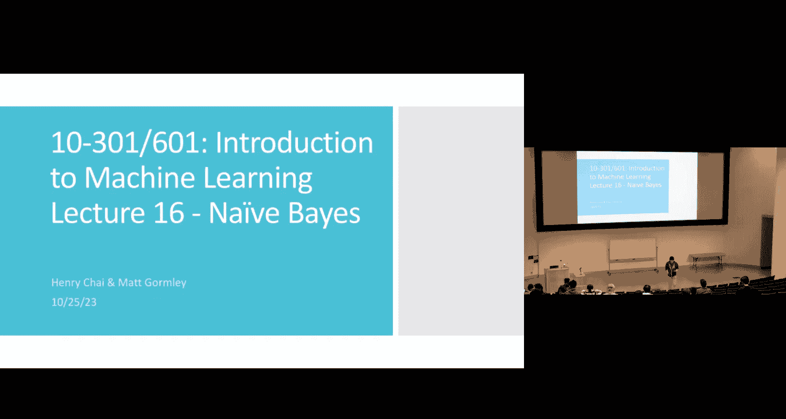
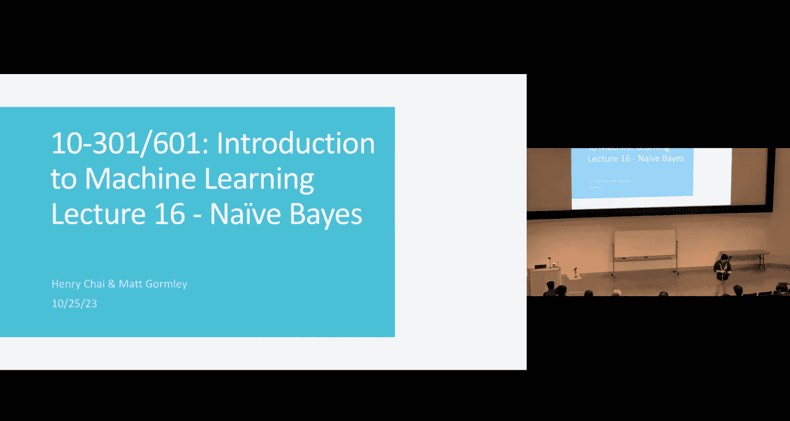
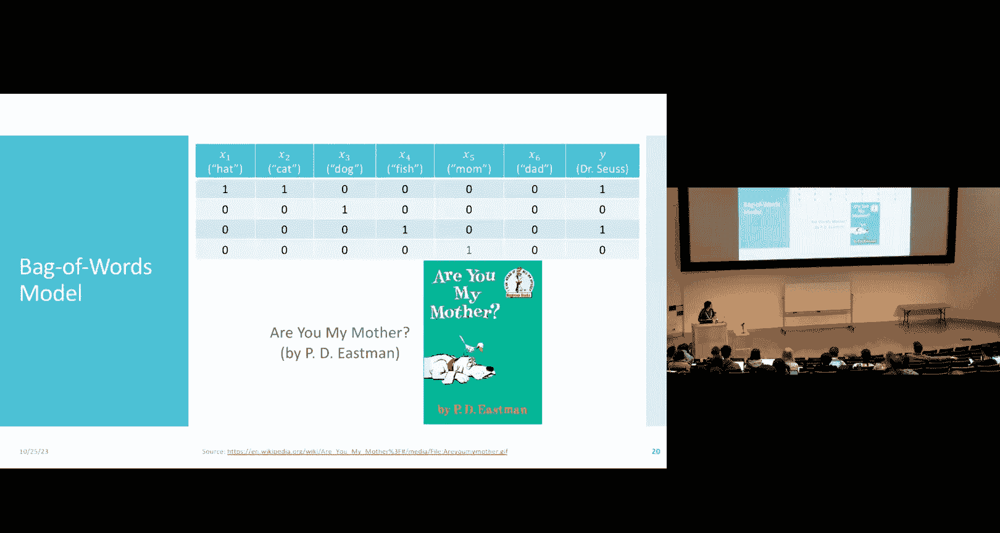
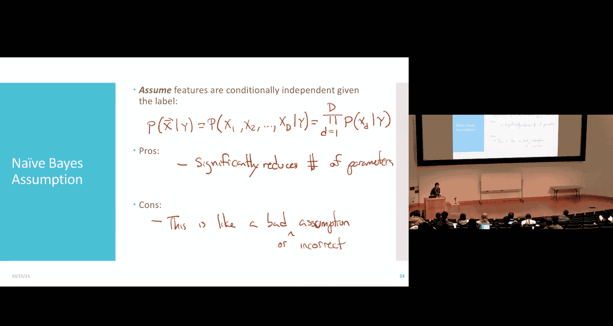
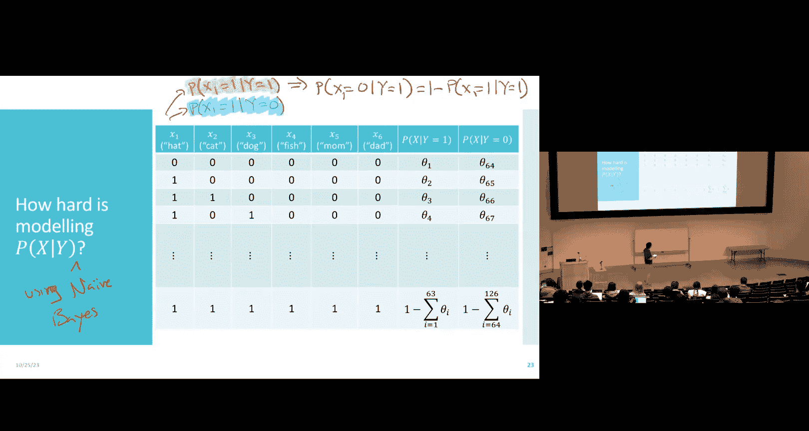
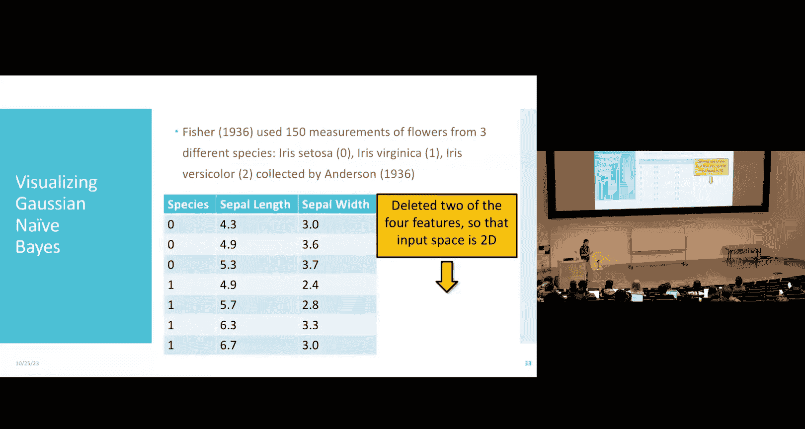
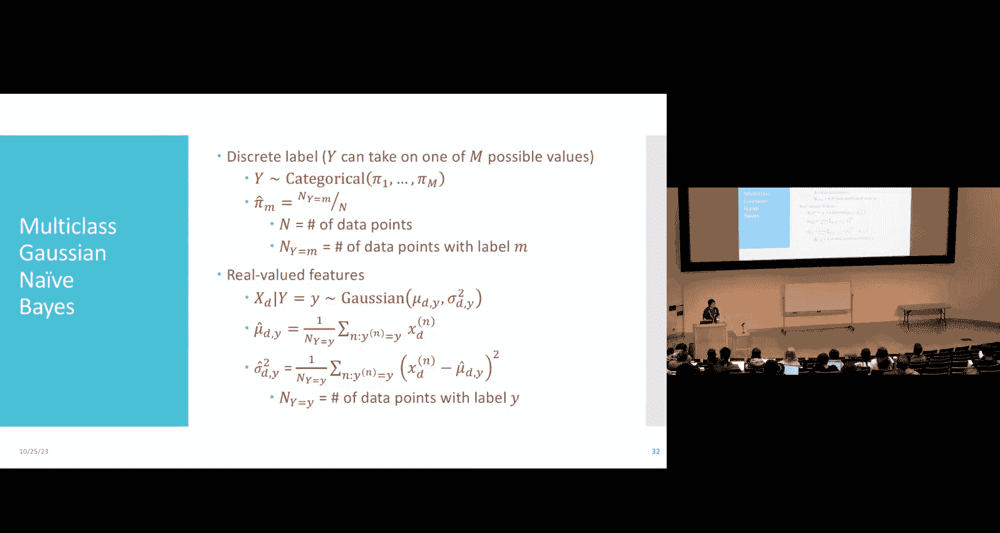
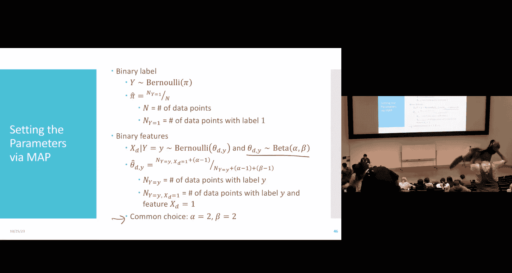

# CMU《机器学习导论｜Fall 2023 10-301⧸601 Introduction to Machine Learning》中英字幕（deepseek p16 Lecture_16_Naive_Bayes.zh_en -BV1Z2cUefE4A_p16-





## 1. 引言

在本节课中，我们将继续学习机器学习中的贝叶斯方法，重点关注朴素贝叶斯分类器。我们将从最大似然估计（MLE）和最大后验估计（MAP）开始，然后将其应用于朴素贝叶斯方法。

## 2. 最大后验估计（MAP）

在最大似然估计中，我们假设先验分布是均匀的。然而，在现实世界中，我们通常对参数有一定的先验知识。最大后验估计（MAP）考虑了先验分布，并试图找到使似然函数和先验分布的乘积最大的参数值。

**公式**：

$$
\theta_{MAP} = \arg\max_{\theta} P(D|\theta)P(\theta)
$$

其中，$P(D|\theta)$ 是似然函数，$P(\theta)$ 是先验分布。


## 3. 贝塔先验分布


贝塔先验分布是一种常用的先验分布，因为它可以灵活地表示我们对参数的先验知识。贝塔分布由两个参数 $\alpha$ 和 $\beta$ 控制，可以表示参数的先验信念。

**公式**：



$$
P(\theta|\alpha, \beta) = \frac{\Gamma(\alpha + \beta)}{\Gamma(\alpha)\Gamma(\beta)}\theta^{\alpha-1}(1-\theta)^{\beta-1}
$$

其中，$\Gamma(\cdot)$ 是伽马函数。

## 4. 朴素贝叶斯分类器



朴素贝叶斯分类器是一种基于贝叶斯定理的分类器，它假设特征之间是条件独立的。朴素贝叶斯分类器可以用于处理各种类型的特征，包括文本、图像和声音。



**公式**：

$$
P(y|x) = \frac{P(x|y)P(y)}{P(x)}
$$

其中，$P(y|x)$ 是给定特征 $x$ 的标签 $y$ 的概率，$P(x|y)$ 是给定标签 $y$ 的特征 $x$ 的概率，$P(y)$ 是标签 $y$ 的概率。

## 5. 朴素贝叶斯分类器的实现

朴素贝叶斯分类器的实现非常简单，只需要计算概率即可。以下是一个简单的朴素贝叶斯分类器的实现：

```python
def naive_bayes_classifier(x, theta, pi):
  """
  使用朴素贝叶斯分类器进行预测。

  Args:
    x: 特征向量。
    theta: 特征分布参数。
    pi: 标签分布参数。

  Returns:
    预测的标签。
  """
  p_y_given_x = 1 / (1 + math.exp(-np.dot(theta, x) - np.log(pi)))
  return 1 if p_y_given_x > 0.5 else 0
```







## 6. 总结

在本节课中，我们学习了朴素贝叶斯分类器，包括其原理、公式和实现。朴素贝叶斯分类器是一种简单而有效的分类器，可以用于处理各种类型的特征。

**本节课中我们一起学习了**：



* 最大后验估计（MAP）
* 贝塔先验分布
* 朴素贝叶斯分类器
* 朴素贝叶斯分类器的实现