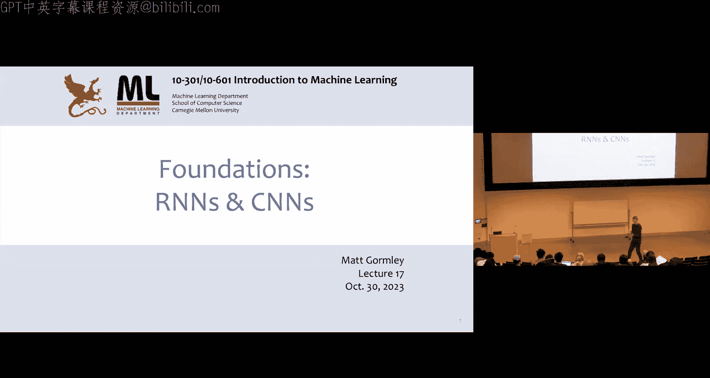
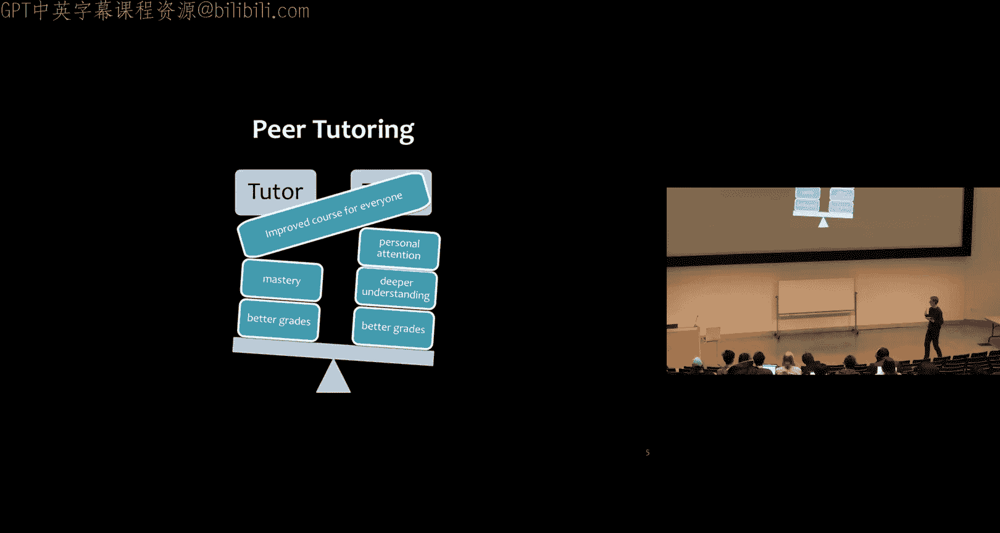
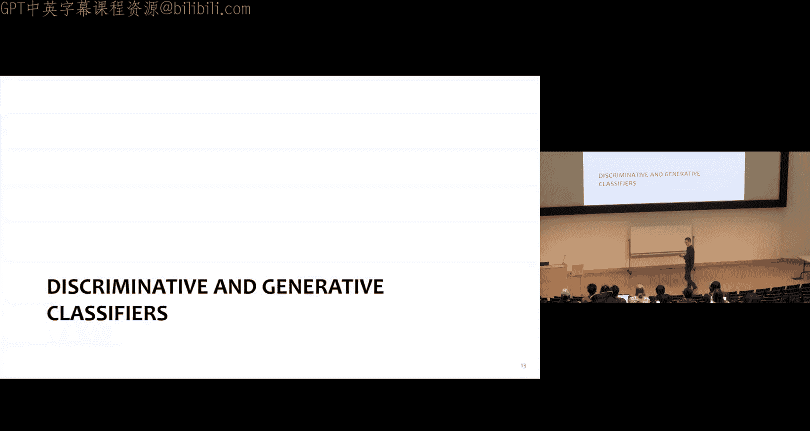
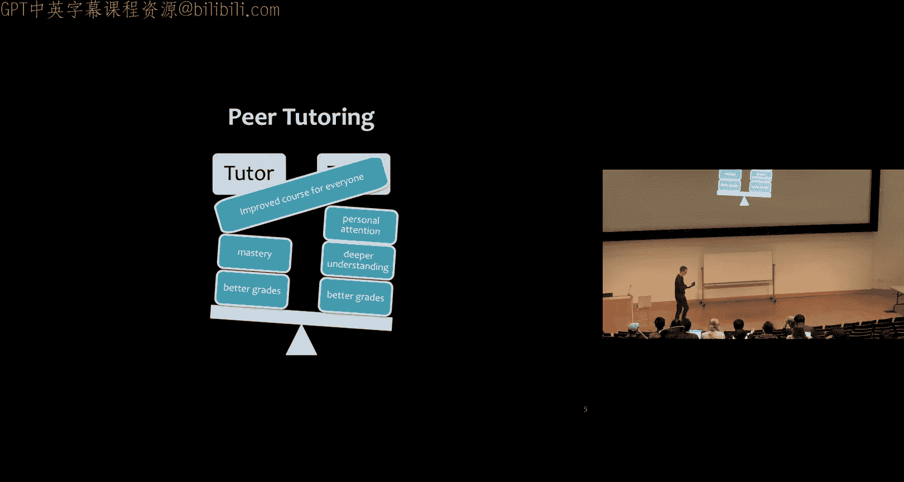
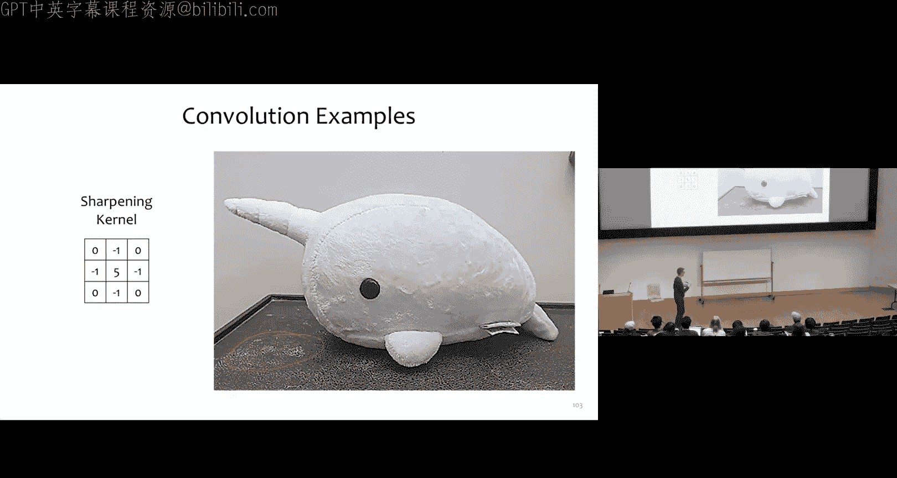
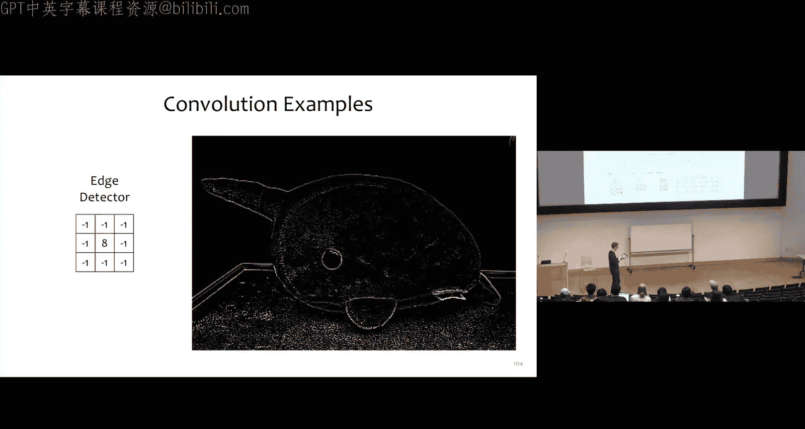
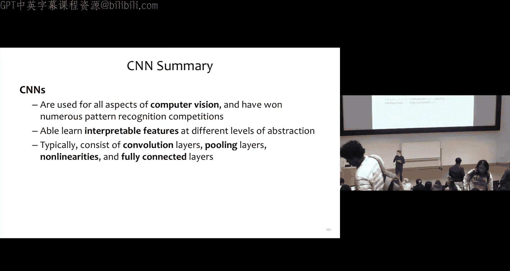

# CMU《机器学习导论｜Fall 2023 10-301⧸601 Introduction to Machine Learning》中英字幕（deepseek p17 Lecture_17_Foundations_RNNs_and_CNNs.zh_en -BV1Z2cUefE4A_p17-

Yeah she'll get it welcome so today' we're going to do just like one quick wrap up topic that Henry just didn't have time to cover on Wednesday of last week which is generative versus discriminative models and then we'll launch into a totally new sort of module for the course which is deep learning and willll pick up by thinking about RNNs and CNNNs which for many years sort of formed the critical backbone of deep learning for natural language processing and computer vision respectively okay so。

😊。

Just a reminder about homework6 and also I wanted to highlight peer tutoring today's the last possible day to say sign up or is that right so sign up by 230 we tend to think this like helps everyone hopefully the2 T is getting better grades hopefully the2t is getting better grades I think that tutoring is this spectacular way both to deepen the understanding of the person who's learning and also the person who's teaching and so I think in such a large course this program has has really been a really a real asset for everyone involved I think it's kind of a great mechanism for having a study group with people that you don't know in the class right like even if you already know a couple people here it's great to be interacting with those from different backgrounds and this is a wonderful opportunity to do that so we strongly encourage you to participate。

Oh and specifically right now we need your help because we need more tutors to sign up so we can't launch the program unless we kind of have that right ratio so so sign up we really need your help and we've seen that like tons of our TAs and future semesters have done this people have literally like put on their resumes I've seen when they're like applying a grad school that they were up here tutor for this class and so on so。

Okay， let's launch into generative versus discriminative classifiers。

 so a generative classifier is one that models a joint distribution P of x and y。😊。

And the canonical example we have of that is the naive Bays classifier。

 using a generative classifier， you typically maximize the joint likelihood of your training data。

 those XY pairs。A discriminative classifier。Is one that models P of y given x？And typically。

 it learns by maximizing the conditional likelihood。And so the key difference here。

Is that the generative classifier actually provides a full story for where all of the data came from。

 whereas the discriminative classifier can only take in an X and discriminate between which labels Y are better。

So one thing that is important to understand is the distinction between generative and discriminative as it differs from Emily and Ma。

So MLE is all about maximizing a likelihood， either a conditional or a joint likelihood。

 the thing that sets map apart is that it includes a prior some P theta or some F theta if it's a density。

And。啊。And so， the。The difference then between generative discriminative in both of these cases is just whether or not you're maximizing the joint likelihood or the conditional likelihood。

Okay， so。Here also is a good moment just to mention map estimation and regularization to topics that we've spent some time thinking about so map estimation。

4。嗯。Say any some classifier like。Like a night base or let's say a logistic regression classifier let's think about logistic regression you would maximize。

The log of the probability of the data given your parameters。😡，Plus， the log of your prior。And。嗯。If。

We then said。You want to say you took that。Log probability of the data。

 If you negated that and the prior， then you'd have that you're minimizing over the negative。

Likelihood and the negative prior。And what's interesting is if you then think about this。

As some objective function， J。And you think about this as some regularizer are。

Now we're actually back to the very regularization setup that we had a couple weeks ago。

And so as an example of this， L2 regularization is equivalent to a Gaussian prior。😊。

So there's lots of fun connections here， I also wanted to just sort of highlight a little bit more about this generative discriminative distinction。

😊，If your model assumptions are correct。And say you wanted to actually sorry。

 let me let me step back， so suppose we wanted to compare Gaussian knifeive bayes and logistic regression。

So both of these models can model continuous valued features。And。诶。

And what's interesting is that if you look at the two models in a finite sample analysis。

 which is where we assume that you have a finite training data set。

Then as the amount of training data increases， Gaussian naive Bay and logistic regression approach the same decision number。

This is assuming some conditions on。On the Gaussian naive Bay variant that you'll think about in the homework。

嗯。😊，So and what's interesting about this is that Gaussian night Bays and logistic regressionggress form this generative discriminative pair。

You can sort of show that。When you take。The distribution P of Y given x induced by the Gaussian knifeive Bayase model。

 it's equivalent to a logistic regression model。Okay， so。As well。

 what we can take away from a finite sample analysis is that Gaussian IBase is actually a more efficient learner requiring fewer samples than logistic regression and you can actually prove this。

Okay， however， it's not usually the case that the model assumptions are correct。

Usually it's the case that the model assumptions are incorrect， and in that case。

 if you do an infinite sample analysis where you assume an infinite training is set。

 then logistic regression actually has lower asymptotic error and does better than Gaussian naive base。

😊，Okay， so。What that means is that as the size of the training set is growing。

 logistic regression will sort of overtake Gaussian naive Bayase in its performance。And so in fact。

 if you run some experiments， you can actually see this playing out。

 here's five different datas on which Gaussian naive Bayes or sorry the solid line and linear regression were trained where the number of examples is on the horizontal axis and the error is on the vertical axis and you can see what kind of keeps on repeating is that at first as you have a small number of training examples。

 Gaussian naive Bayes is doing better。But then after a while。

 you get enough examples and now logistic regression starts winning。A tester。

And this happens in sort of all of these where we see this crossing occur now if you take these two data sets。

 that crossing does not occur and maybe on this one it actually looks like if we just had more data they would eventually cross。

 but this one actually looks like， yeah， maybe even if you did have more data they wouldn't cross。

And so possibly the reason for that is that on this one data set。

Maybe your model assumptions about naive Bays are mostly correct。

What are the model assumptions of naive face and what would it mean for them to be incorrect？Yeah。

We assume that the features are conditionally independent。And in most data sets。

 that's probably not the case， that's why we see this behavior。

 but here maybe the features actually were conditionally independent， and so the model is doing well。

Okay， so。Nowve Bay's features are assumed to becondally independent， whereas in logistic regression。

 there are no assumptions being made about the form of those features。

 and so they can be dependent and correlated。When you're learning with naive Bays。

 once you take that log of the likelihood， the parameters are decoupled and you can get a really simple closed form solution。

For maximum likelihood estimation， but by contrast。

 logistic regression has the sigmoid function wrapped around its parameters。

 such that even if you take a log， the parameters are still kind of coupled together inside this nonlinear function and there's no closed form solution for it。

😊，嗯。So if we think about map estimation for these two models。

 we typically think about a beta prior for naive Bayes。

 which is trying to push the probabilities away from the01 extremes sort of back to the center back to sort of。

Either something closer to 0。5 probability。By contrast， logistic regression。

 the parameters are not probabilities， right they can range from negative infinity to positive infinity。

And so we typically put a Gaussian prior that encourages the parameters to be close to zero。

But the actual behavior of both of these priors is essentially the same。

Because if you're pushing your。Legistic regression probabilities toward zero。

Then you're pushing the sigmoid of that dot product close to 0。5。

And so these are kind of behaving in the same way。Okay。

 so question one on your poll here is you just started working。😊。

At a new company that manufactures comically large pennies。

 And your manager asks you to build a binary classifier that takes an image of a penny on the factory assembly line and predicts whether or not it has a defect。

 Okay， so what follow up questions would you pose to your manager in order to decide between using a nice base classifier and a logistic regression classifier。

Okay。Lots of great questions coming in。many。Training pennies。Do we have is a good one。

Maybe if we have a small number， we should prefer naive bays a lot。

 maybe we should prefer logistic regression。U。呃。What features can we use to even detect？

A defective penny。And。Moreover。Are those features conditionally independent？

Maybe that's actually a question for you to answer rather than your' a manager here。嗯。

And another good question is。What is the。Partrt of the base probability。Of a defect。

So we saw these cases where naive bes can perform not so well in。In cases where。嗯。Where we have it。

Sort of a skewed distribution over the labels。嗯。And。Oh， and then this is just maybe this doesn't。

 I don't know how much this applies to this particular one， but。How fast do we need to be？

When training this model。Now you phases really fast to train。

Whereas logistic regression can be quite slow by comparison。Okay， lots of good questions。Okay， so。

We've seen this big picture slide before， we've sort of seen a lot of different learning paradigms up until now。

But actually， I wanted to give you a different big picture slide here。

 which is sort of about classification and regression since we're kind of moving on to some other things。

In the top， you know we have our typical recipe for machine learning right given data。

 choose a decision function and an objective function。

 learn by optimizing that objective function and then predict using the parameters that you learned。

There's lots of different options for your decision function， it could be a perceptron。

 a linear regression， a discriminative model like logistic regression or a neural network or a generative model like naive Bayase。

If it's a discriminative model， then。Your H theta of x is actually choosing the。

P theta y that maximizes probability， whereas if it's generative。

 you're picking the one that maximizes the joint， though the two are equivalent。

And there's differences in how you actually define those probabilities。嗯。As for。

Your objective function， Well， this is maybe to some extent， dictated by your model。

But conditional likelihood or joint likelihoods are good options。

 you could also add an L2 or L1 regularizer， which could be equivalent to some map estimation technique with a prior。

And there's also lots of options for your optimization method， right you could use gradient descent。

 SGD， mini batch SGD， maybe with certain models you can solve it in closed form if you're lucky。😊。

And so the point is that this recipe that we've seen comes to play over and over in machine learning。

Okay， so what we're about to do is think about some new decision。Some new decision functions and。

Those decision functions are going to look a little more complicated than the ones that we've seen up until now。

 but the recipe that we're using to train these models is going to remain exactly the same。

The only thing that's going to differ is how we actually define some decision function。

 some big and we're essentially going to take what we were doing with neural networks and expand upon that to some new deep neural networks。

Okay。So the examples that we're going to look at are convolutional neural nets and recurrent neural networks。

And the key algorithmic technique that we'll rely on is the back propagation algorithm。

 which can compute a gradient for any arbitrary computation graph。Okay。

 so let's start with RNNs if you get there， I just want you to kind of have in mind a couple human language technologies tasks like speech recognition where you take in an acoustic signal and you output a transcript to say of a conversation。

Machine translation where you take in a sentence in one language and then output a sentence in another。

 and summarization where you take in a collection of documents and then output， say。

 a summary of those documents。So RNNs are now sort of a commonplace backbone in deep learning approaches to natural language processing。

 though we're going to talk about transformers which are sort of a very rapidly replacing them as sort of the state of the art for a lot of these tasks。

 that said， understanding how this RNN works is going to allow us to better understand what that transformer is doing。

Okay， so to get there， I want to start with this idea of an Ngram language model。

 Okay so this is not a deep model。 The goal here is to generate realistic looking sentences in a human language and the key idea is that we're going to condition on the last n minus words to sample the Nith word Okay so I want you to imagine that I have a whole wall of enormous 50000 sided die and so many。

 many dice and so what I do is I actually pick off one of these and I set it on the ground and then I roll it and it like rolls and maybe it like rolls up the chairs a bit and then it comes rolling back down and it stops here and I look at the top and I see that the top word on that die is the word。

😊，是。Okay， so I've just generated a word。prettyty epic now if I want to generate a second word。

 I put this one back on the shelf and I get a different word sorry a different die that is specifically formulated to have the probabilities over words that come after the word the so I take that one off the shelf and I roll it and it comes back and I check the word on the top and it is bat。

So now we put that one on the shelf again， and now we pick the dye for the bat and we roll that one and the word on the top comes back made。

O。Soum。So here we would continue this process generating words。

And until maybe we generate some special end token that tells us to end the sentence or something like that。

对。So this is a way of actually sampling from the model， but we can also ask the model。

 how does it define the probability of a given sequence？So given a sequence of length t words w1，w2。

w3， up to W6， what is the probability under the model of that sentence？Okay。

And what it says is what we just multiply the probabilities together。One from each of those die Okay。

 so the joint probability of W1 through W6 is going to be the probability of word one。

Times the probability of word 2 given word 1， times 3， given word 2 all the way down to 6 given 5。

And if we multiply those together， then this gives us back the joint probability and this is just generalizing it to the case of a length t sequence。

Okay， so if instead we wanted an ngram model with n equals three。

Now we could condition on the previous two words。So we'd multiply together P of W1， then P of W1。

 given W2， that's the same as before， but now we can get to P of W3， given W2 and1。

And so on down the line where each successive probability conditions on two words。Okay。

 so this is called a model because we're making some assumptions about how many previous words to condition on。

Or really how to actually tell a story for how we generated the data。

 this is another generative model。So。If we want to learn an Ngram model like this。

 then we could actually build up， say a table that represents each of these these giant die right so that each of these tables has 50000 rows and you know the first table is for the bat coming before and it tells us that you know there's lots of different words that could come after it。

 the bat eight is pretty high probability， the bat flies is pretty high probability， the bat zebra。

Would make like a cool superhero， but。Is not actually， I think， besides this slide。

 a very high probability sequence of words， so it has probability zero。Okay。

 so where do these tables come from？😡，You could just go out to Wikipedia and take a massive pile of。

 say， some English data。And you could just count Ngram frequencies。 So for example。

 here we could find for if we want the probabilities for what words are likely to follow cows eat。😡。

We could go get examples like cowsy grass， cow eat hay， cowsy corn。

 And each time we find a different example， we could take put a little tally mark next to which word follows right So it looks like cowy corn4 out of 11 times cow eat grass only three out of 11 times That's depressing。

 cows eat hay，2 out of 11。 I guess there's a lot of factoryies farm cows or something here。

 anyway so。Here， this little data set of these 11 examples now gives us a distribution。

 a probability distribution over the likely next words， right？😡，Okay。

 now I said that these cables have 50，000 rows。😡，So what's the probability of cows eat zebra？Yes。

Yeah。对。没有。0 that's right and we can do a little bit better than guests， we can add up four11s，311s。

 to11s and realize that those probabilities sum to one。

So the probability of any other word must be zero because otherwise we would have an invalid probability distribution。

So maybe we don't need to write down all the zero probability words just because that would be a waste of space。

😡，Okay， so now after we've learned those probabilities。

 you can go back and you can resample a sentence using the probabilities that you learned and you could actually generate some data。

Okay， so I did that， I actually generated some some data and the way that I trained the Ngram model is by taking in the complete works of Shakespeare。

 here's a little snippet of that on the left and then I trained a five gra model and generated from that five gra model let's see how it did Appeth Dennay Dunungee thither。

 Julius think Grant O Y linen's sheeps ancient agreed Pearch， this is terrible。Wow， oh man。I mean。

 honestly， it feels like a failure of the model， you know？It doesn't look realistic at all， I mean。

 don't get me wrong。 Shakespeare is hard to read， but this is complete gibberish， right？Okay。

 so could we do better？Could we actually generate realistic looking text so to do that want I want to look at this recurrent neural network。

The idea of a recurrent neural network is that we're going to define a computation graph。

And entry in each little node in that computation graph is going to be a vector。

So x1 is one of our input vectors， so we have input vectors， x1， x2 up to xt。

One for each word in the sentence。And then we have hidden units that are also vectors or hidden layers。

And then output vectors y1 through Yt？And。The way that we define this recurrent neural network is that when we want to compute。

 say。H at time step。3。Like here。So to compute H sub3。We need to take x sub three。

That would be this one。And we need H sub2。That would be here。And what we do is we take x to x3。

 we multiply it by a big Wx H matrix， right This is the same matrix for for all XH pairs。

That we're interested in and then a WHH matrix that we multiply by H2。

And then we add some bias vector and pass the whole thing through our non nonlinear function。

Calligraph H。Okay， so having done so， we now get back this vector H3。Okay。

 now let's think about how to compute y3。So why three。Is going to take in。H3。As input right here。

And it's going to multiply it by another matrix that's for the HY computation。

And add another bias vector。And that gives us white。So when we go to compute H4 and y4。

 we're going to follow the exact same process， right we'll take in H3 and x4 to compute H4 and then to compute y4。

 we'll look at H4。So what's interesting here is that if we go back， if capital T was equal to1。

We actually recover。A one hidden layer neural network， just like we did before。

But there's a crucial difference of what we can now accomplish because before the one hidden layer neural network could only take a fixed sized input。

 right， whatever our you know I was right that's the dimensionality of our input that was as large as our input could be。

😡，But now with this recurrent neural network。We can have an arbitrarily long input。

And our computation graph produces one output for each input。Okay， so。

Let me circle back to the chain rule of probability here for a second， So the chain rule says that。嗯。

If you want to define the sequence or the probability of a sequence of length t。

 then you multiply together， save the probability of w1 times W2 given 1， times 3 given 2 1。

 all the way down to 6， given 54，32。Okay， and。We can do this for any order of the variables。

 this is not a model。😡，This chain rule is always true for every probability distribution。😡。

So the RNN language model。Uses the chain rule to define its joint probability over the sequence。😡。

But。😡，There's a key difference from how it works from the NG language model。

 which is that the Ngram language model depended on a fixed number of words that came before。

But we've broken that here now we depend on arbitrarily many words that come before。However。

 something is still fixed， namely。We take whatever words came before and we convert them all to a fixed length vector。

And that's what this function F theta is doing。And then， given that fixed length vector。Via F theta。

We define a probability distribution P of WT， given words WT minus1 down to W1 converted to a fixed length vector。

😡，Okay， so this。Is a powerful idea， and now all we need to do is come up with how do we get a fixed length vector for a sequence of words？

Well， ourcurrent neural network can do that， right？So if you want to， for example。

 construct a vector H0， then you would feed in W0。And if you wanted H1， you would feed in W1 and H0。

 and that would give you H1。Okay， and then to get H2， you'd feed in W2 H1 get H2。

 And so now from each of these little vectors， we can construct。A probability distribution。Right。

And that probability distribution， let's look more carefully at it。

 is giving us a probability distribution over the next word。

So here we're feeding in W1 and we're getting a probability distribution over the possible words for W2。

And we could actually sample one from that like。Thatat and then feed it back in as W2。So。

There's still a remaining question。Which is， how can we create a probability distribution？

P of WT given H。From a vector Ht。Okay， so this is question two in your poll。

So talk to your neighbor about this one。 It's a little tricky。 How could you create。

 how could you take in a vector H T and produce。A 50。

000 dimensional probability distribution over possible next words。

So I'm going to give you a partial answer here。That I like。

 which is treat as multi class classification。Okay。

 so a couple people actually came up with what I think is a great answer。

Which is that we could use a softm here。So imagine you take。Your H。And you multiply it by some。

You know， big matrix。W prime。And then you add to it some big bias vector of length 50，000。Okay。

 so if if H is a。AnM dimensional matrix。Then， W prime。Had better be a 50，000 by M。Matrix。

And B prime should be a 50，000 dimensional vector。So now we have a vector of length 50。

000 that is a function of Ht。😡，And if we pass that through。A softm。

We would get back a properly normalized probability distribution。And so in essence。

 we're treating this like。Like a multi class classification problem over 50，000 possibilities。Okay。

And that's how we can get this probability distribution for each time step。Okay。

 so eventually we would output some special token end and that means we should stop generating。

And essentially， what we've done is we've also created a way for us to。

Give a probability distribution of a particular sequence。😡。

So if you look at the probability of the word W1， the actual word W1， which was the。😡，Okay。

Then multiply that by the probability of the actual W2， which was bat and the actual W3。

 which was made and so on down the line， then you get back the probability of the sequence。

Now you need to be careful that you're also feeding in the actual sequence here as well。

So that when you get back， you know， the probability of。SayW7， given all the words that came before。

 it actually matches all the words that came before。Okay。

 so now if you wanted to sample from this RNN language model。

It's essentially the it's the exact same process as what we used before The only difference is that now the probability distributions over next words are not come they don't come from counting you know word occurrences in Wikipedia to form a big multi sided die they came from。

Taking a vector， feeding it through a linear layer and a softm to get the weights for that 50。

000 sideed dye。Okay。Okay， so now I generated some output from this model and then one of these is the real Shakespeare。

 so let me actually read to you a little bit of the actual Shakespeare's as you like it in case you don't know this play so Viola says。

 why Salisbury must find his flesh and thought that which I am not half。

 not a man and in fire to show the reigning of the raven and the wars to grace my hand reproach within and not a our hand。

That's Caesar and my goodly father's world。Yeah I mean， it's it's pretty good stuff， right， I mean。

 you know， Shakespeare knew what he was doing master of language。嗯。But now that I'm。Looking at these。

Which way was it？Ah， man。Which ones the R&N？Okay， well' spoil the surprise。

 This is the actual labeling。 If you look at the right touchstone has this beautiful statement at the end。

 he says， for my part， I had rather bear with you than bear you yet I should bear no cross if I did bear you for I think you have no money in your purse。

😊，I mean， this play on words is just quintessential Shakespeare。

 and it seems like the R&N language model isn't doing quite so good a job at wordplay。

But it's not bad， right， not it's a lot better than the F gra model。Okay， so once we have an RN。

 now we can actually think about an RN language model。

 we can actually think about how to build a sequence to sequence model。

So and this actually allows us to solve the kinds of tasks that we were just thinking about。

So here's the idea。So suppose you want to generate。A new sequence conditioned on another input。Okay。

 so you're going to use an encoder model to generate a vector representation of the input。

And then you're going to feed the output of that encoder to a decoder model which will generate the output。

😡，Okay， so what could you use for the encoder， well， you could use。An RN model。

And what could you use for the decoder model， what you could use an RNN language model？

And that would allow you to say take in the Spanish sentence Balmo out of Cafea， and you could then。

Take the final representation E4 of that full sentence。

And pass that as the initial state to another decoder model， which is an RNN language model。😡。

And that RNN language model could then condition on that E4 and start generating words and it would hopefully generate something like let's go to the cafe now。

喂。And this would work not just for translation， but also for summarization or speech recognition as well。

 you'd just be changing what your inputs and outputs are。

So if you actually wanted to train this thing。Then you wouldn't be training as we did before to just maximize the joint likelihood of a bunch of sentences in isolation now you would be maximizing a conditional likelihood for each pair you would condition on the input sentence that's like your big long sequence X and you would maximize the likelihood of your desired output Y。

We could follow the exact same recipe we did before。Okay， so now I want to switch gears。

And think about。Computer vision。So。We brought this example up way back when talking about logistic regressionion。

 ImageNet was this famous contest that ran for many years。

 and in 2011 it was set up as follows as a data set of 1。

2 million labeled images with100 different classes and you're given a new image and you're supposed to predict the correct class for that image。

And so， you know， you might be trying to label images as birds or irisees or courtyards or whatever these different thousand classes were。

And back in 2011， the way that a lot that many of the sort of best systems worked is they would do feature engineering right。

 they would you know build these complicated edge detection systems。

 canny edge detectors or they'd do Harris corner detection or sift features。

 they'd construct by hand these complicated functions that extracted features from images。

 and then they'd feed those into， you know a big logistic regression model that would make a prediction。

Okay， so in。2012， though， along came。A team that decided that they were going to build a convolutional neural network instead。

And convolutional neural nets had been around for a long time and had already been in use。

 but nobody had gotten them to actually win at a competition， they lagged behind in performance。

 they weren't as good as those shallow moms。But here they put together this rather deep at the time。

 convolutional neural network consisting of many different convolution and max pooling layers。

 and they were actually able to not just win the competition， but。

Obtain a dramatic improvement over the previous year's winner。In reduction in error。

 and they did so with a deep model， the previous models had all been sort of shallow neural networks or logistic regressions or things like this。

 but now they had this eight layers deep CNN that was winning。

And so the subsequent years saw a growth in the number of layers of the winning systems。

 which were all convolutional neural networks until Resnet came along with 152 layers dramatically beating all previous performers and getting an error rate that rivaled human performance。

Okay， so how was it that CNNs were able to do this？Well， essentially。

 they're just another big computation graph， right？And they were trained by backpro with SGD。

So what we need to understand is what does that computation graph actually look like？Okay。

 so first of all， what is convolution， a basic idea here is you pick a little matrix。

 let's say three by three of weights。And you slide this matrix over an image and compute the inner product of that matrix and the corresponding field of the image。

And then you replace the pixel in the center of the field with the output of the inner product operation。

So here， let's look at this tiny example。So if we have a two by two convolution。

 a three by3 input image， let's say it's gray scale okay so each of those x11。

 x12 those are the value of a gray scale pixel between zero and1。

And we're going to get a two by two output。😡，Here's how it works。

 So you take this convolution and you first set it in the top left corner。And to compute y11 here。

 you would compute Alpha 11， x1，1， Alpha 12， x12， alphapha 21， x21，2，1， alphapha 2， right。

 this is just like it's like like a vector dot product， but it's for two matrices。

 namely the little red matrix on the left of that top left corner of the input image and the actual convolution matrix。

To compute y12， you would now move the convolution over to the top right corner and do the exact same operation。

The parameters are the same， but now the underlying data has changed。Okay。

 and then you move it to the bottom left corner to get y21 and the bottom right corner to get y22。

So this is how you perform convolution。And let's see what it can actually do so if you're trying to do image processing。

 then you can actually accomplish a variety of things like edge detection blurring， sharpening。

 so here if our convolution is what's given in the center，Okay， so a one， a one， a one。

 and then everything else zero。And our input image is now actually just these pixels are all black and white。

 so one is white， zero is black。So we can take the convolution matrix and we could color the zeros now as blue。

And make the ones in the convolution matrix transparent。Okay。

 so that way we could see right through the convolution for the cells that are one。 Okay。

 so now we can take that convolution matrix。And we can actually move it across the input image。And。

And here's what that would look like， so it would start in the top left corner。And。

The underlying pixels， if we take the dot product of that convolution matrix with the underlying pixels is just like adding up what you can see through the matrix right which is one plus one plus one or three okay now we move it over and we add0 plus one plus one that gives us two now we move it over again。

0 plus one plus one another two and so on down the line and we kind of work our way through until we get the final convolved image and you know you can see that the actual output values if you normalize them back to grayscale actually seem to have preserved a lot of the information in the original image。

Okay， if we use an identity convolution instead， then we would get back the exact same image。Well。

 not exactly， we've actually lost an outer pixel along the edge。m。

You can get that back by doing something called padding。

 which is where you just pretend that the original image has an extra ring of zeros around the outside。

Okay， this is a blurring convolution where now you can see the center is 0。

2 and everything else is 0。1 and the convolved image will again preserve a lot of the information。

 but now it's kind of a blurred version of。Okay， so let's look at some actual examples on a real image and so here this is our original image and now if we pass it through a smoothing convolution。

😊，You can see it goes from kind of being this crisp image， if you look particularly at the black eye。

It kind of blurs out， right？There's these like little sort of white spots here that kind of fade a little bit。

If you use a Gaussian blur， this is a five by five Gaussian kernel。

 it's actually a little bit sharper than the previous smoothing blur。

 which was just a uniform distribution。😊，哦。This is a sharpening kernel now you can see goes from kind of being blurry to really sharp right those those little sort of marks on the table here the or the carpet kind of now really pop out it's almost like you can see each little。

Well， I think real narws don't have plush fur， but you get the idea can see the little feathery things on its。

This is an edge detector kernelel。And so you can see what it's doing is it's actually picking out sort of the boundaries of the image where it changes from some light color to some dark color。

嗯。嗯。

Okay。So this is what a convolution can do there's actually further things that you can do with convolution namely you can downs samplele。

 so if we take a convolution with say stride2，What this means is that now instead of moving the convolution one pixel at a time。

 we move it two pixels at a time， so in the top left corner， if our convolution is just 11，11。

 then we get convolved value three， now we jump over two pixels。

 not just one but two and now we put down another three and jump two more pixels and then we get a one and then jump not down one pixel but down two pixels right this is what stride of two means and eventually we fill in our full convolved image。

Now what you see happening here is essentially like a resizing of the original image right。

 it's like， you know， we've actually kind of preserved that little like triangle on the upper right corner。

 but it's been shrunken down into a smaller image。If we were to say。Instead use an averaging kernel。

 you would accomplish a very similar thing， though now with different scale。And。嗯。

There's another trick that we could play called Max pooling。Which is actually parameter free。

 so in max pooling all we do is we look at the underlying pixels。

And we just choose the value that is highest among them。So among 1，1，1 and0， the highest value is 1。

RightBut if we go down to the bottom left corner here。

 the highest value is zero and that's why we get a zero here。

So both of these are ways of taking the original image and shrinking it down to a smaller image。Okay。

 what does all this have to do with convolutional neural networks So you see。

 convolution was originally done by hand。 if you wanted an edge detector。

 you wrote down an edge detector convolution and then you've used it。

So the idea of a convolutional neural network is that you follow the same recipe that we kind of always like to follow。

But now you use as your decision function。Convolution， and you essentially take。啊。

What was traditionally a hand engineered convolution。

 and you treat those as each entry in that matrix as a parameter of your model。

 something to be learned。And now you give it a bunch of training examples and you hope that it will figure out its own idea of what a useful convolution is。

Maybe one of them it'll learn as a smoothing one， and one of them it'll learn as an edge detector and so on。

Okay， so back in。1998。There was a model called Lyette。

And Lyette was at the time this kind of beautiful example of one of the first convolutional neural networks。

 and it consisted of a bunch of different layers， convolutions， max pooling， fully connected layers。

 re， and softm， kind of these are the sorts of things that it was using。

U actually rells kind of came later， but so so what I want to convince you now is that each of the layers that it's using。

😊，Is essentially just some differentiable function。That we can learn parameters of。

And back propagate through。可以。So let's actually step through what those different layers look like and how we could。

Compute their partial derivatives。Okay。So。嗯。To do that propagation。

 we just need to understand how to compute partial derivatives for each layer。

Because if you know how to compute partial derivatives for each layer。

 you know how to repeatedly apply the chain rule and store intermediate values as we do in back prop。

Okay。So but let's think about what stochastic gradient descent would look like here。

So our architecture。Is going to be like this。 So we're going to take。As our input image X。

 and then we're going to have some label， like INe， one of the thousand classes， Y star。Okay。So。

At first， so this is the。The forward pass going from bottom to top。 So we take in our image X。

And we say we're going to have some convolution matrix， alpha。

That will give us back a new representation of the input Z1。

Then we'll take Z1 and we'll feed it in to a max pooling layer。

The max pooling layer doesn't have any parameters， but it gives us back a new representation。

 possibly smaller Z2。Then we take Z2 and another matrix of parameters beta。

And that's our second convolution layer。And that gives us back Z3。

We then pass Z3 through a re function， a non linearity。Applied element wise。

 but this time not to a vector to a matrix， right， or maybe a collection of matrices。

So we apply that value function to each pixel， and that gives us back Z4。Okay。

 now the next one's a little funny。So Z4 is either a matrix or maybe multiple matrices。

 I'll explain that in a second。Let's assume it's just a matrix， okay， so if Z4 is a matrix。

How do we do a linear layer？Well， it's actually kind of easy。

 we just take Z4 as a matrix and we stretch it out into a big long vector。

Now we take that vector and multiply it by some other parameter matrix W。

And that gives us back another vector Z5。Okay， finally。

 we assume here that Z5 has length 1000 if we're doing Iagenet。

And we apply a softm layer to get back a probability distribution y。

And then we pass y along with Y star into our objective function， which let's say is cross entropy。

Okay。So stochastic gradient descent is going to take in some initial set so we're going to sort of bundle our parameters together into some theta just like we did for the regular neural net and homework5。

 and so we're going to initialize those parameters theta right， an alpha convolution。

 a beta convolution and a matrix W。And then while we've not converged。

 we're going to sample some training example， we're going to do the feed forward computation that we just did to compute the probability distribution Y from image XI。

 and we'll compute the loss on the IF training example， JIF theta。

Then the backward computation will give us the gradient of JI of theta with respect to all of the parameters。

 alpha beta and W。And then we'll update all of our parameters using a step of stochastic gradient descent。

So this is stochastic gradient descent to train a convolutional neural network。

 and it's just like training， say the the neural network that you did in homework 5。

 which you were using for image classification， except that now these layers are just a little more complicated than the sort of。

Interspersing of linear and non linear layers that you had in homework found。Okay， so。So here now。

 let me convince you that that these layers are differentiable Okay。

 so the value layer actually we've seen this before so。It's actually not differentiable。

 but it's subdiiable， and so we compute it element wise by taking each element of the vector x and passing it through the max of 0 and a。

And so if you want to compute the derivative of Yi with respect to Xi。

 you would just return one if Xi is greater than 0 and 0 otherwise。

And the derivative of Y I with respect to xj is going to just be zero for all。啊。I not equal to J。

Since it's applied element wise。Okay， the softm layer， you've also seen this before right。

 so we're just taking in a vector x computing x above each element and then the sum of the x to get Yi and the partial derivatives that we need in the chain rule are just going to be dYI dxj。

 where it's Yi times 1 minus Y I equals J and negative YiYj otherwise the。Okay。😔，So。

The fully connected layer， if we suppose that the input to the fully connected layer is a three dimensional tensor x right。

 and it has some width。呃。And some height and some depth。

Then you could stretch that out into a big long vector。And then just do a standard linear layer。

 right multiply it by a matrix。Adibi。Okay。And that gives you back some other vector。

The convolutional layer we've seen this before as well。

 but I want to sort of expand on the idea by thinking about handling multiple output channels。

So namely， if you have a gray scale image coming in。

Then we could actually do two convolutions at once。

And we could do that just by having our original convolution superscripted by a one here and superscripted by a two down here。

So now we have two convolution matrices。Alpha superscript 1 and Alpha superscript 2 and the computation to get why superscript1 is exactly what we did up here。

 except that we're using Alpha superscript 1。And to get Y superscript 2。

 we're just using Alpha superscript 2。Okay， so what we would say now is we have one input channel like that gray scale image。

 but we get back to output channels。Okay， now the word channel here comes from the computer vision literature。

 where typically channels refer to the red， green and blue channels of a color image。

So in a color image， you don't just have one input， you have three。

So the idea of having multiple channels is already kind of very natural to a computer vision person and in fact。

 this is already how they were using convolutions when they were engineered by hand right maybe your first convolution would be a hand engineered edge detector and your second convolution would be a hand engineered blurring convolution。

😊，Right and。Or maybe the first one would be a horizontal edge detector and the second one would be a vertical edge detector。

And then you could take all of those features and feed them into a linear model that makes a classification decision。

Okay。So。呃。If we want to work with color images。Then our input needs to have multiple channels。😡，对。

Even if we don't want color images， if we're going to have a convolution that has multiple output channels。

 wed better be able to take them in as inputs in the next layer， okay。

 so if you want multiple input channels， then let's say we have say we want CI input channels and CO output channels。

诶y。So the idea here is that the input is now a three dimensional tensor， if it's a color image。

 it's depth three。With some specific height and width。And we're going to have。C zero convolutions。

Or C O convolutions。OkayOne for each output channel。

And the trick here is that now our convolutions have the same depth as the input。So as you slide。

 say take the let's say we just work with convolution1 here， we slide it over the input image。

But now it gets to look at it takes a dot product， not of just one matrix with another matrix。

 but of an entire tensor， three dimensional tensor。Over all of the values in the top left corner。

 looking at the full debt。Okay， so doing so would give us one slice of the output。Tcer。The first。

 the frontmost slice， okay and then if you go to the second convolution。

 that'll give you the second slice all the way to the last convolution will give you the last slice。

对。So。Okay， so is this differentiable Well， it turns out this is almost like trivially differentiable because what you're actually doing in the forward computation involves a bunch of complicated looking。

F loops or summations。But it's really just a linear function of the input X。

It's some very careful indexing so that you're like multiplying the right matrices or tensors with the right tensors。

 but all it is is a linear function of the parameters with the inputs。

And so the backward computation is also going to involve some complicated summations to make sure that your indexes are right。

 but the calculus itself is kind of trivial。Okay， a max pooling layer we've seen how this works here it's just kind of like the value where it's subdiiable and so。

It works via sub derivativeatives。好。然时。What like base the screen。explain sorryrry both in like。

 but you're just want the same like window or really the hand internet like paid everyone else on other。

So we were using the same windows that we do for regular convolution。

 like like where we slide across the input image， slide across the top， then move down。

 slide across the next。Like move down one pixel， keep sliding。呃1。できま。佢八十多啊。Yeah。

 so the point here is that the depth of colon number one is the same as the depth of your。

So now when you treat your。In the product。You're multiplying， you know。

 if there's like one number here， one number here， one number here and here。

 and then let's say it's depth three， so that means you have three such matrices。

Right now the outermost matrix that's closest to us is being multiplied by the is we're taking its in product with the red channel。

 the second matrix， we're taking its in product with the blue channel and the backmost matrix。

 we're taking its in product with the green channel。Exactly right。

 so each matrix can kind of use the colors differently。No， what。So well。

 the whole tensor is a bunch of parameters。And the design decision is。

 how many convolutions do you want？And how big should those convolutions be？

me answer'm using the same one across all values you see oh you could do that too yeah you could have the same convolution for all different incoming channels yeah that would just be a different thing that's not what a standard convolution player is。

But you could name that after yourself and go use it instead。Yeah。So。Yeah。

 I think the benefit is that there is actually benefit in having different parameters for each color。

 though， that's the lesson that computer vision people already knew this going in because they had engineer these things by hand and so。

 but the first convolutions that came out were having different parameters for each layer because people knew that was useful。

By hand or by learning。Those are the two options， so you can either write them down。

Exactly as you want to by hand。Or you treat the entries in those convolution tensors as parameters and you learn them by stochastic gradient center。

Yeah， so we're doing like how want you know when we're later college I a free I want to。

It really some point in note before they' supposed you have to squash into leg。你识佢嚟。要看这些。

Exactly where it is so you go from three channels down to one channel。

 so you just have one convolution。And but three input chains。

Then you would be taking three input channels and squashing them down to one chain。Well。

 it's multiplying by them by some numbers and then adding all those numbers together， but yeah。

 and it's really just linear functions of the pixels。Okay。

 and so the magic is happening when you intersperse those linear functions of the pixels with nonlinear areas。

 just as we do for a regular neural network。So we'll see that in a second。Okay。

 so Max pooling layer I won't really say much about this。

 these are sort of falling out of vogue but they're some differentiable let's look at the actual architecture of Lyette because I think it gives us some insight into what's happening here。

So the idea of this model was you take in a 32 by 32 pixel image and it's crazy。And now you have。

6 different convolutions。Each one is 28 by 28 so these are pretty big convolutions and oh sorry no that's actually not right the convolutions here are not shown they're probably four by four。

 but we have six of them。And they give us back a 28 by 28。Pixel image。

 one for each of the convolutions。And。And so that gives us six layers each of 28 by 28 in。Okay。

 then we do a little say max pooling here it's called subsampling。

 that's how they referred to it in 1998 to get back six， 14 by 14 images。Are they really images。

 well maybe not at this point， but there's some representation of the original image？Okay。

 then we do convolution again， this time with 16 convolutions to get back a bunch of 16 different 10 by 10 layers。

 10 by 10 images。Sub samplingantling again gets us down to 165 by fives and then we take。

 let's see what's 16 times times  five times  five， I don't know what 25 times 16 is。

 but that's a big long vector。Okay， stretch that out into a vector and do a。

Fully connected layer here to get back。A 120 dimensional vector。嗯。

And then do another fully connected to get down to 84 and then finally another fully connected layer to get back down to 10。

And it turns out this particular architecture was being used for MIS digit classification。

 there's 10 different digits，0 through9， and so you could put a softm on those 10 outputs to get a probability distribution over the possible digits。

Okay。So Alexnett is essentially a variant of that Lnette architecture。

With just a little more complex right like they kind of have these two stacks。

 right they took the whole image。and fed it off into this one stack that kind of built out ways and then crossed over。

 and they built out on another stack of convolutions and crossed over。

 and then they kind of kept building here and kept building here and then crossed over again so that they could share these。

Representations until they finally， in the end， got their 1 thousand dimensional output passed through at Soex。

So this is the model that was sort of able to beat everyone else back in 2012 and then as people kind of expanded on these ideas。

 some interesting trends kind of started to two come out of so here we see Alexnet which the input is at the top and it's showing the actual sort of sizes of the convolutions it started with the seven by seven this is the variant of the picture that I just showed because it's not view the two stacks and then a bunch of threex threes with some max pooling layers in there it's some fully connected layers then here this is VGG16 that came out some years later and again you actually see a lot of three by three convolutions where the nonlinear layer was a re。

呃。And then faster our CNN let's not talk about that one。

 so these sorts of trends kind of carried through such that here the FCN model again you see the prevalence of three by three convolutions like peoples kind of settled into like getting good performance with three by threes and used them a lot but now you notice that the depth of these things is getting much much higher right so here you can see that the model that this is the full debt。

But that it was also kind of sharing things so that you could kind of skip across depths within unit。

Resnet was 152 layers and it's so long that if you put it on a slide it doesn't look very good I think in this tutorial where it was first presented or this talker was first presented they actually just had it like scrolling up through the slide so that you could see all of the layers drifting by。

😊，So。I guess here we come to poll question number three。Which is why is it that many layers？

Used in oh you know what let me just answer this for you why didn't many because we're kind of two minutes away from end why do so many layers used in computer vision not have location specific parameters？

So。The answer is that for a lot of tasks， what we care is about something called sort of position invariance right so if you want to be able to detect that this is a three。

And that this is a。In two， say these are both 100 by100 pixel images。

That it's useful if your convolutions don't actually care about where the three is。😊。

They only care about， does it detect a three somewhere？

And so if the convolution then is able to at some point kind of look at the three。

 then it doesn't really care whether it's in the top right or the。The bottom right。

What it cares about is just that。It detects something that looks like a three。

Another question we could ask is， how do we pick the kernels？And here。

 I think that there's been a lot of empirical work on this。

 but intuitively you could kind of think of a small kernel as only seeing a very small amount of the image。

The advantage of that is that it's very fast to compute。By contrast， a larger kernel。

 say a four by four can see more of the image， but it's more expensive to compute。

So the real trick of downsampling was that even if you have a bunch of small three by three kernels。

 as the image gets shrunk down， a three by three kernel is getting to see a larger and larger part of the original image just through a different window。

Okay so we'll stop there for today that's kind of it for convolutional neural networks and when we come back we'll start thinking about oh actually let let me just point out some slides that i'm not going to go through there's all these cool visualizations of CNNs so there's like this。

😊，This one that shows you all how all the connections work and how like little animations of 3D convolution you can run a CNN in your browser。

 so I encourage you to actually go in and check some of those links out and just kind of play around with them to see how those work Okay and we'll come back next time and we'll start talking about transformers。

