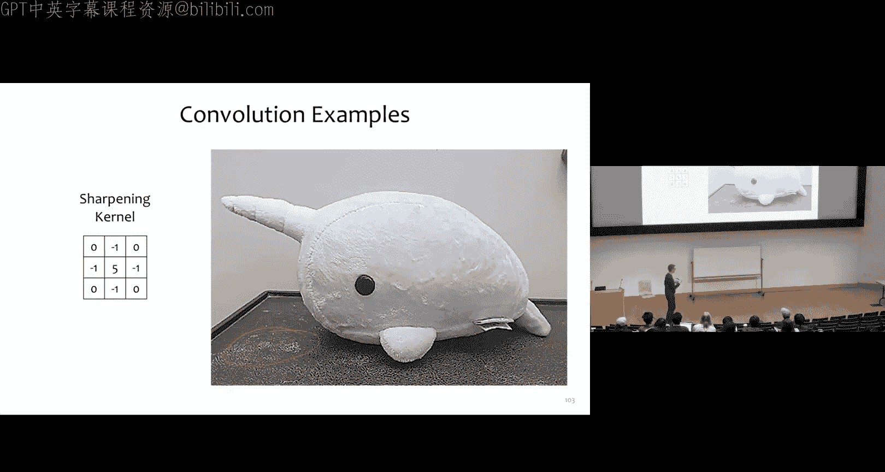
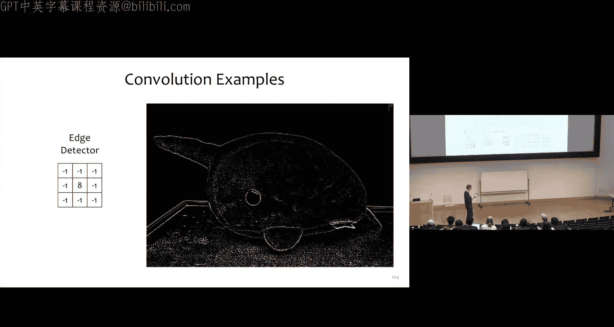
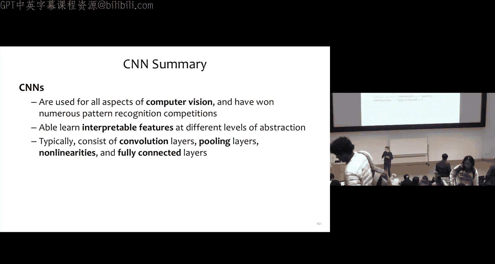

# CMU《机器学习导论｜Fall 2023 10-301⧸601 Introduction to Machine Learning》：生成模型与判别模型

## 概述

在本节课中，我们将学习生成模型与判别模型之间的区别，并探讨它们在机器学习中的应用。

## 生成模型与判别模型

### 生成模型

生成模型通过建模 x 和 y 的联合分布 P(x, y) 来工作。一个典型的例子是朴素贝叶斯分类器。使用生成模型，通常通过最大化训练数据中 XY 对的联合似然度来学习。

### 判别模型

判别模型通过建模 P(y|x) 来工作。通常通过最大化条件似然度来学习。

### 生成模型与判别模型之间的区别

- 生成模型提供了关于数据来源的完整故事，而判别模型只能根据 x 来区分哪些标签 y 更好。
- 生成模型通常用于生成数据，而判别模型通常用于分类。

## 最大似然估计与正则化

最大似然估计（MLE）是关于最大化似然度，无论是条件似然度还是联合似然度。MAP 估计与 MLE 的区别在于它包含一个先验，即 P(θ) 或 F(θ)（如果它是密度函数）。

## 生成模型与判别模型的比较

以下是生成模型与判别模型之间的比较：

| 特征 | 生成模型 | 判别模型 |
| --- | --- | --- |
| 目标 | 生成数据 | 分类 |
| 模型假设 | 联合分布 | 条件分布 |
| 优点 | 可以生成数据 | 通常更准确 |
| 缺点 | 训练数据需求量大 | 可能无法生成高质量的数据 |

## 生成模型与判别模型的应用

生成模型和判别模型在许多机器学习任务中都有应用，例如：

- 生成模型：图像生成、文本生成、语音合成
- 判别模型：图像分类、文本分类、语音识别

## 总结

在本节课中，我们学习了生成模型与判别模型之间的区别，并探讨了它们在机器学习中的应用。生成模型和判别模型在许多机器学习任务中都有应用，选择哪种模型取决于具体任务的需求。