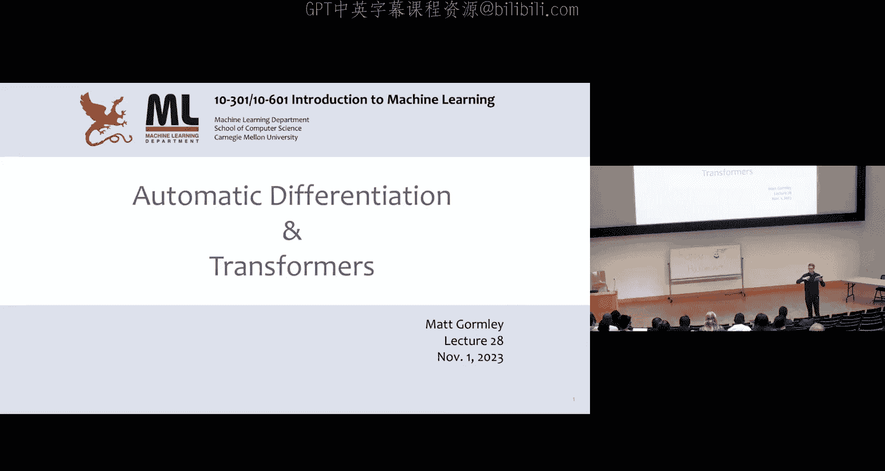
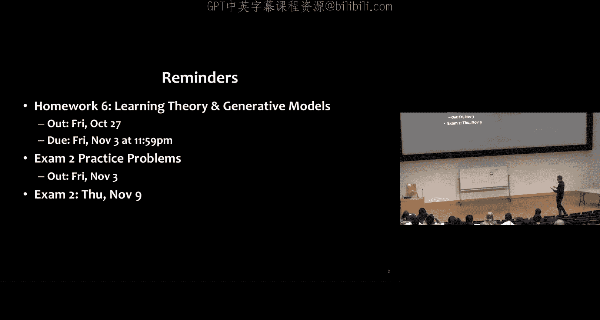
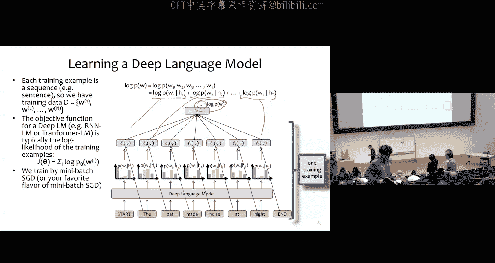

# CMU《机器学习导论｜Fall 2023 10-301⧸601 Introduction to Machine Learning》中英字幕（deepseek p18 Lecture_18_Transformers_and_Autodiff.zh_en -BV1Z2cUefE4A_p18-

All right， welcome back today we're going to be talking about。

Deep learning from a slightly different perspective。

 namely how would you actually go about building a deep learning library and that'll be the topic of I guess what we're calling here automatic differentiation。

Once we've kind of established this idea of how to modularize the computation graphs that we want to work with。

 we'll start looking at some more modules and transformers are going to be an example where we get to see like a bunch of different modules within modules within modules。

 Okay， so some reminders， kind of the usual stuff， homework six， exam two on Thursday。

 November 9th and we'll have some practice problems coming out as well。

Okay， so what is module based automatic differentiation？

So we talked about these two versions of the backpro algorithm or automatic differentiation in the reverse mode in one of them we talked about how you could accumulate all of。

The gradients that you need for a particular and here we were kind of thinking very specifically about nodes in our computation graph being scalrs and so we thought about how you could accumulate all of the partial derivatives that you need for a particular scalar node all at once。

By summing over all of the things that used that note。We talked about a different version though。

 where we said， well， instead of looking back， looking up at all the things that used a particular node。

 whenever a node，Actually as visited， we could take the contribution that it's going to make to all the things that it used。

And just sort of increment the sort of storage of these partial derivatives as we go through。

And so in practice， I said this is actually kind of how most。

Back propagation libraries are implemented， it kind of encapsulates all of the partial derivative information that is relevant to the forward computation that's being done at that node all in one place and so this is a really nice property and what we've written here although we wrote it sort of in terms of scrs here and scrs here。

 there's nothing specific to scrs about it， we could in the same way accumulate have a node gradually over time。

 accumulate all of its gradient information that is a partial derivative with respect to a vector。

 say or a matrix over time。Okay， so we said that back is efficient。

Because it reuses computation from the forward pass and the backward pass and it reusees partial derivatives throughout that backward pass and this reuse is coming from how you actually structure reuse in your forward pass。

Okay， so what we want to think about is how could we sort of generalize this this approach to backpro and。

So to get there， I want to think about。Sort of this。This picture of。

Say a simple feed forward neural network where we start by thinking about back propagation as a procedural algorithm。

so if we think about it that way， then the forward computation is doing something like a equals alpha x and z equals sigma A。

 B equals beta z y hat equals softmax of B， and then j equals the cross entropy loss。😊，Where here。

 why is the gold labels and why hat is the output of the neural。Okay。

 and then we go backwards through the computation by computing the partial derivative of。

Say DJ with respect to Y hat， and then we store that in GY hat。

And then we compute the partial derivative of J with respect to B and store that in GB。

 and then all of the other partial derivatives we need working backwards through the graph。

So this is。sortrt of one way of doing things and and probably in your homework five。

 you implemented something like this right where you actually you know had a forward method and it went in order you know one。

 two， three， four， five， six of those eight lines and then it returned all the things that you needed and then it passed those along to your backward procedure which did all of the things in the appropriate order until you had all of the gradients that you needed and you returned those。

Okay， so the thing about this is it's kind of hard to actually reuse code like this。For other models。

I mean， if you just sort of handed off this back propagation code to someone and said， here。

 why don't you convert this over to a two hidden layer neural network？

They'd have to stare at it for a while， they'd really need to understand the math before they could convert this over to two layers because honestly they may not even be able to tell very clearly if you didn't comment your code as I didn't hear what is a layer at all。

 right？Okay， so。Another detail here is it might actually be harder to make sort of the individual steps。

嗯。More efficient。Right， suppose。You know， there's actually like here。

 this is actually a rather careful sort of efficient way of computing the partial derivative of sigmoid where we use a diagonal matrix。

But you know， suppose you had implemented it at first with some for loops。Well。

 now converting those four loops over to this sort of matrix diagonal version of the computation。

 you'd have to be really careful that you kind of were slotting that in at the right place。嗯。Thirdly。

 if there's a bug in this code。It might be really hard to find where that bug is。

You could do a finite difference check like the test that we saw Henry do where it's only a couple lines of code you could write that finite difference test really easily。

 but you'd be evaluating this entire backward pass。

 whereas it'd be nice if you could sort of run those finite difference checks on smaller pieces of code。

Okay， so this is my case against implementing neural networks this way and so now I want to present to you module based automatic differentiation。

😊，Okay， so。There's this is sort of this module based approach is a technique that's been used to develop libraries for deep learning for a long time and you know when I was first sort of。

Watching deep learning unfold torch was kind of the。

The go to package for module based automatic differentiation。

 it was frequently competing with Tiano which。Was another module based approach？And but at the time。

 Torch kind of was losing the popularity battle because it was written in a language called Lua that nobody knew how to write and Tiano was written in Python。

 which for strange reasons everybody likes， even though it's a terrible language。

 horridly inefficient。But nonetheless popular， and so Teano started to take hold。

 but then people started to notice that there was a problem。Namely。

 the problem came from the fact that Teano was a static neural network library。

 meaning that you had to know exactly what your full computation graph was going to look like。

Before you actually ran it。There was no way to actually say adaptively create your computation graph so that on one training example。

 it had one shape and on another training example， it had another shape。😊。

So you could imagine this is important if say you wanted to do something with say syntactic parse trees right so if you have a sentence that has one syntactic parse tree and your computation is based on that tree。

 the structure of your computation graph for the next sentence because it's syntactic parse tree is going to be different is also going to be different。

Similarly， if you wanted to look at subsets of say social networks， right。

 the particular graph structure of one social network might differ from the next or at least one sort of sub graph might differ from the next subgraph。

And so Torch was offering the ability to work with these dynamic computation graphs that were created at runtime and then still could be efficiently run on a GPU。

😡，Okay， so it turns out that TensorFlow in its first version was also stuck in this static mode。

 and it wasn't until the 2。0 release that TensorFlow caught up with what torch was doing and actually allowed people to encode dynamic computation graphs。

😊，Okay， so now Pytorrch and TensorFlow are probably the two most popular neural network libraries。

 and they're both using this dynamic approach that was laid out sort of or at least popularized。

 I would say， by torch。Okay， so what is the what is the idea then of module based automatic differentiation we're going to be sort of specifically focused on this idea of a dynamic module based AutoDIF there's lots of other ways that you could do it。

 but this is what we're focused on。So the key idea is that you componentize the computation of the neural network into layers。

And each layer then is going to basically pull together many real valued nodes into one sort of node that does computation over vectors or matrices or other structured collections of real values。

😡，And。And so we call this node a module and rather let me be careful about that。

 we call this sort of structure a module and you can instantiate a module as a node in a computation graph many times over。

😡，Okay， so each module is capable of。Two actions。Forward computation and backward computation。

So here， let's get into the weeds of what that actual computation is。😡。

So the forward computation is this side right where it takes in some input A， which is a vector。

And it applies some function F to a。To return some output vector B。

So this should be not surprising to us at all。 We've already been kind of conceptualizing the layers of a neural network this way。

 Okay， the backward computation now we want to think about very carefully。

 So the backward computation is going to take in。GB。

Which is the gradient of so we're going to assume here that there's like a bunch more of the computation graph up here。

That you can't see right and it's big and complicated and。

And what it is is completely unimportant to this module。All it cares about is that at the very end。

 there's one number J。And that's your objective function for this training example。Or for this。

 it's the output of this computation graph。Okay， so GBB is going to be the gradient of J with respect to the output of our module B。

😡，And our goal is to compute。GA， which is the gradient of J with respect to the input to this module。

😡，嗯。And so。We can do this。By the chain rule。Where this is just sort of a standard application of the chain rule and what you notice here is that each of these terms in the chain rule。

Comes from an entry in GB， right， This is GJ。And each of these， well。

 this is actually a partial derivative of the function F。Right。

So DBj DAI is taking the partial derivative of the Jth output of the function F and taking its partial derivative with respect to the Ith input to the function F。

Okay。So we could actually think through what some modules look like。Okay。

 for say that same neural network example。So here， let's suppose we have some input A。呃。

For each module， some output B。Some。Graadian output， G， which is the gradient of the input。

And some gradient input， which is GB， which is the gradient of the output。So a sigmoid module。嗯。

It's maybe the simplest one that we could think about， so it has just one input vector a。

And here sigma is just element wise application of the sigmoid function。And。呃。

And here we're using this sort of O dot symbol to represent element wise multiplication of two vectors。

Okay， so now we have two procedures， a sigmoid forward that takes in a and computes B。

 which is sigmoid to a。And sigmoid backward， which takes in A and B。And uses them to compute GA。😡。

Okay， and how it does it well is kind of the obvious thing。

 it's GB element wise multiplication with B element wise multiplication with  one minus B。Okay。Okay。

 so that's the whole sigming module。 Okay， so now what about a softm module Well here。

The softm layer。Has。Only one input vector a。As did the sigmoid。And。

We write diga v to return a diagonal matrix whose entries are the actual vector V。

And whose non diagonal entries are zero Okay， so then we can write softmax forward as just Somax of a and softmax backward as Gb transpose di of B minus the outer product of B with itself。

so that's like taking the vector B as a column and the vector B as a row。

 multiplying them together as matrices so that you get back a matrix。

and then a linear module is sort of what you would expect this time though it has two inputs， a。

 which is the thing that you're taking a linear combination of and mega here。

 which is the actual parameters。😊，And the back is going to。Give you two gradients， G omega and G。

and then the crosscenttropy module， likewise it has it takes two vectors as input and one of them is assumed to be the actual sort of true gold one hot vector a and the other is the probability distribution a hat and so here I'm actually only returning GA hat。

Because。We just sort of assume that you don't need to back propagate into the gold output。Okay。

 so so now with this module based approach， we can take these procedures that we just wrote and we can actually write down our forward computation as the sequence of a bunch of sort of now specialized calls to forward and the backward computation is a bunch of specialized calls to these module specific backwards。

😊，Backwards operations and so you can see that as we would hope， we're able to essentially reuse。

The linear module multiple times。Okay， so what if instead you wanted a more object oriented implementation of this？

So now we're going to let each module not just define two procedures， but actually define an object。

 and then well actually allow the control flow of the program to dictate how we create the computation graph。

😊，可。And so now we're not going to need to implement。An explicit NN backward function at all。

Because the control flow of the forward call is actually going to tell us exactly how we should do a reverse topological computation through that forward computation。

Okay， so now our modules are going to look almost exactly as before。

 but notice that theyre now these classes that define class specific methods right these aren't static function calls。

 they're actually class methods and they have essentially the same signatures as before except that now the method names are always either forward or backward。

Okay， so what we can do then is we can define a neural network class， which is itself another module。

Okay， so these were all modules and now we're going to use a bunch of modules to create a new module。

 right？So here's the neural network module in its initialization method， it's going to create。😊。

In arbitrary order， all of the layers that it's going to need right so it creates one linear layer。

 a sigmoid layer， another linear layer， a softmax layer and a cross entropy layer。

And then the forward computation here。It takes in our training example， X Y。

 and our parameters alpha beta。And it simply calls linear one layer apply forward。

Then sigmoid layer apply forward， linear one， oh this should be linear two layer， apply forward。

 softmax layer apply forward and cross entropy layer apply forward and then finally at the end we get J and return its output its actual tensor representation。

Okay and here's the beautiful part， you see the backward call。

 all it's doing is it's calling tape backward， which is a special method that runs a tape recording of our forward computation in reverse。

Okay so how on earth could this work well first of all you'll notice that back here all of our modules were called forward right so what on earth is this apply forward thing well this is where the real sort of magic of Auto di happens and and it's actually why we call this automatic differentiation right there's nothing about homework five that felt very automatic right I mean you had to manually go in and very painstakingly write out each of these sort of procedural steps。

Okay， so here's what's automatic。So a module has its own sort of special initialization to say， okay。

 every module gets an output tensor and an output gradient。😊，When we call apply forward。

We take in a list of input modules。Like here， X and alpha。And then。

We construct a list of input tensors。Which is just looping through our input modules and grabbing the output tensor from each one。

Then we take this list of input tensors and we call。The forward method。

 our own forward method right so if this is the neural network module。

 this is our own forward method on that list of input modules or sorry input tensors。

And what it returns the forward call is an output tensor。Okay， and then。It actually takes this tape。

Which is a global variable used by all of the modules。So this is defined outside of our module class。

And it pushes the current module onto the tape。Okay。

 so let's actually think about sort of what this tape looks like as we run through it here， okay。

 so first the tape is empty。Or it's an empty stack， I'm going to draw it kind of like a list。

 but it's a stack。Okay， then after we call L one layer apply forward。

 the tape is going to consist of。Lin one layer。And then after we call here， Sig layer apply forward。

The tape will contain。This is a stack。We'll push it onto the front。It'll contain this sigmoid layer。

Followed by L1 layerir。now when we call。Here this is again a tyypo， this is  Lyn2。

 the tape now expands to include。Linin2 layer。Sigmoid layer。Andlin one layer。Okay。

 and then at the very end after calling this last row。The tape will consist of。Our CE layer。

In the very front。And thelin one layer at the very back。Okay。So now once we've built up this tape。

 this global variable， now when we call apply backward。It does something rather elegant， which is。嗯。

It's going to take。The actual。Backward method。Of our current module。And call that。And。It will。

So let's look at what that actually does here。So here。Our backward method。Is calling tape backwards。

Okay。And so what does tape backwards do well it。Repeatedly calls。Oh， actually， yeah。

 so when we call the neural net backward method， I should start there。Okay。

 so when we call the neural net backward method， right， it's going to call tape backward。ok。And。

And to run the tape backward， what it's going to do is while the length of the tape is greater than zero。

 it's going to pop off the front most module on the tape。And then call。

 apply backward on that module。Okay。So。So here， apply backward。

Calls take we already know what the input tensors and the output tensors are for this module right so when we call apply backward on the cross entropy layer。

 it knows what its input and output tensors and its output gradient are。

And so now it's going to run through all of its input modules and here's the automatic and sort of most beautiful part。

 it's going to say for each of my input modules。😊，I now have input gradients。

 one gradient per input module。And I'm going to go in and I'm actually going to increment。

The output gradient of the input module。😡，By whatever the input gradient is that I just computed for myself。

This is like the most beautiful part of this entire thing。

Because what it's allowing us to do is say at each node， we're going to automatically just。

Increment the gradients for all of the things that we used to compute our own value。

And then we'll finish this， apply backward and we'd come back out here and we'd pop the next thing off of the tape。

 which would be the softm layer， and we'd do the same thing there。

Accumulate gradients into its inputs， and then we keep going such that every time we arrive at a module。

We will have already computed。Everything we need in its output gradient。Okay。

 so what does this have to do with？Deep learning libraries， well it turns out that on homework seven。

 we're going to ask you to implement something in Pytorch。Okay， but when you implement it。

 if you hadn't seen this， it might look like there's all of there's so much automatic stuff happening that it would feel like like you have no idea what's actually going on underneath the hood。

 okay， because here is what Pythorch code looks like。So the neural network。

 all you do is you define a flattened layer and then a linear layer。

 and then a sigmoid and then another linear layer。Flatten is just taking your inputs and sort of stretching them out into a vector。

 I was running this on image data so I needed to make sure that my images were vectors。

And then the forward method is going to。To take flatten。And apply it to X to get back some。

 I guess I should have called this like x prime。And then x prime。

We're going to pass that into linear one to get A， and then A gets passed into sigmoid to get Z and then Z gets passed into linear2 to get B。

 and then we return B。Okay， that's the forward。You'll notice that we don't define a backward。

Because when we call forward， it's going to just add all these things to the tape and it'll figure it out for us。

Okay， so now if we want to take one step of stochastic gradient descent what do we do well you'll notice that the forward here for this neural network doesn't include the cross entropy loss it's conventional in pytorrch to keep that separate and for good reason so now we have our cross entropy loss is another module layer just like say a linear layer was so now we have this loss function here which is。

A loss layer。We define an optimizer to be stochastic gradient descent and we tell stochastic gradient descent。

 these are all the parameters that you're going to be working with model parameters is telling it。

 oh， the linear layer has some parameters and that other linear layer has some parameters and you should pay attention to those。

And here's our learning rate。Then we compute the actual loss for。Our training example which is X。

And so this is like one image。And this is a label of that image。And so here we call model of X。

Where oh， did I not define model？Oh。There's a bug in this code， let's fix it model equals。诶。

Neural network。Sort of the most fun part and I left it right out Okay so model is just an instance of the neural net class so we apply that to our input X and then we apply our loss to the output of the model。

 which is that vector B and the true label Y。And then to do back propagation。We tell our optimizer。

 okay， you're storing a gradient， make sure you zero that out。Okay， then。

Run the backward propagation， starting at the loss and following the tape backward through all the computation we just did。

When it's finished， it'll clear out the tape so that we know it's done。

And then we'll tell the optimizer take one gradient， one step opposite that gradient。O。So。

Does anyone notice anything strange about this code？Yeah。Exactly， I'm not calling backward。

'm on on a I'm not calling a backward function， I'm using a class as if it were a function。Right？

What on earth does it mean to instantiate a class called loss function？

And then to put parentheses with some arguments after it。

Right this this ist valid Python code I mean that would just be absurd oh actually it turns out it is valid Python code it's syntactic sugar okay so here's what I mean so the reason we're not calling the dot forward method is that there's a special method in Python。

😊，That you can define for a class and its name is underscore， underscore， call， underscore。

 underscore。And if you define that method， then if you were to treat an object as if it were a function。

😡，It would behave as if you use that special function， so in other words。

 running linear where linear is you know a linear layer， so here linear。😡，Equals NN dot linear。嗯。

Running this is exactly the same as running linear dot， underscore， underscore call， underscore。

 underscore x， which in pitorrch is nearly the same as running linear dot forward。

It's got some extra wrapper and such around it。嗯。And basically。

 every module's call method is something like call self self do forward。😡，Okay。

 so now this weird silliness where we're treating functions or treating classes like functions hopefully makes a little more sense。

 and it's purely just to clean up the code so that you don't have to write dot forward every time。

Okay so another question why don't we pass the parameters to a pytorrch module so you'll remember I was passing in alpha and beta to my modules and storing them externally well in Pytororch the parameters are actually stored inside the module and you just mark them as parameters that should contribute to the eventual gradient。

And so essentially what this allows us to do is just pass in sort of the inputs to a linear layer like x instead of having to pass in both X and alpha。

OkayAnd because the linear layer itself knows that it has a parameter matrix self。Ok。

That was that was a lot。So this is module based automatic differentiation。

 what questions do you have？I'm sorry what does the zero grand do good question so zero grand is because the optimizer is actually the object that stores the gradient。

So all of the gradient information is stored inside the optimizer object actually that's probably not that's not technically true。

 I think it's actually stored in the computation graph。

 but let's imagine that it is and when you call zero grad，😊，It goes in and it actually zeroes out。

The gradient of everything。And that's important because you'll remember if we go all the way back to。

Our definition of。Back propagation。We said that you need to initialize all the partial derivatives to zero。

Except For。The sort of DJ DJ or DY D， the derivative of the final output with respect to the final output。

 which initializes to one。So we're just making sure that the gradient information has been zero out。

That's all we're doing。Other questions？Yeah。So you give us the drawback of the procedural method。

 the advantages of Autods， are there any drawbacks to autod？Oh sure， absolutely I mean。

 so I think for。For one。The like like。So this is both an advantage and a disadvantage。

 so one advantage disadvantage of the module of sort of the module based approach is that typically it's written in a high level language okay so in practice that's usually something like。

Python。But all of the procedural code is typically written in some low level language。

 like C+ plus or fortran。And so if you actually care about how the matrix multiplication is being done。

You are actually many steps removed from that procedural computation。

 such that if you wanted to change it， not only would you have to know multiple languages。

 you'd have to know a lot about how the module based system works in order to inject some change to that procedural code。

So I think that there is a there's like a removal of as you build up this abstraction。

 you get so far away from the efficient， important code that sometimes it's hard to actually make changes that you might want。

That's also an advantage because， well， you're removed from the complicated procedural code。Yeah。

People the cross entrytropy laws layer out of the neural network Oh another so I haven't shown you。

 say how to do prediction at test time。But at test time。

 we don't want to involve the loss function at all。

All we want to do is we want to run the neural network forward to get a prediction。

And so it's nice to separate these two out so that the loss function is only used at training time。

 and then we have this encapsulated code that can be of the neural network that can be used both at training time and test。

Yeah。the stacks， the stack you used before I is worked for this new network structure that actually creates the output of previous layer is the input of next layer like this kind of structure。

 but both more complex structure like we mentioned black and must。

like legacy and it has some interleaving like does it also， so if you look at that code。

 it was very carefully written， there's probably still some bugs in it or something。

 but that pseudocode was carefully written so that it does accommodate arbitrary computation graphs。

And it's still going to give you a reverse topological order of the modules。有。

Okay so now I want to think about some modules and I want to do that in the context of large language models so we're going to be talking about a lot of the basis for what chatt GBT is today and then we'll continue that on Monday by actually thinking about how you would train chat something like chatGBT so chatGT is a large in the sense of having manual parameters language model fine tuneed to be a dialogue agent will define fine tuning next time the base language model is GT35 which was trained on a really large quantity of text okay so we talked last time about language modeling and we thought about the Ngram language model and how you could actually learn it by counting and we also thought about given a language model how you could draw samples from it。

So prior to 2017， which is when transformers came out。

 two tasks relied really heavily on language models， speech recognition and machine translation。

And the idea was you define this noisy channel model that combines a transduction model。

 which gives you a probability of converting y to x with a language model which gives you the probability of y。

And so for speech， x would be the acoustic signal， y would be the transcription for MT x is the sentence in the source language and y is the sentence in the target language。

And so。So people were already using large language models。

 but they were NgramM language models often。And or they were R&N language models。

 the NgramM language models were the largest ones though， and for example。

 in 2006 there was this release of Google Ngrams which was English only。

 but it was trained on1 trillion tokens of web textex。And it included one grams。

2 grams all the way up to five grams， so it's a five gram model。And then in that English model。

Oh and then sorry， in 2009，10， they released like a bunch of other languages ranging from Japanese to Czech。

But the English only model consisted of all of these different engrams。

 which was equivalent to about 3 billion parameters。Okay。

So I claim this not only at 2006 was a large language model， it's still a large language model today。

And not only that， the training set that they were using in 2006 was still today would be considered a large training set。

 okay， so GBBT2 was a model from 2019， its training data was only 10 billion tokens。

And its model size was about half that of the Google Engrams 1。5 billion。Flashing， or so GT3。

 which is about roughly what chat GT， the free version is based on， came out in 2020。

 it had still only 300 billion tokens， still not a trillion。

 but now it went up to 175 billion parameters。So like 50 times more than 50 times the number of parameters of those Google engrams。

Then it wasn't until 2022 with Chinchilla， where it was trained on 1。

4 trillion tokens of text that they kind of hit a point where they were outdoing the training data set size of these Google enGs and then G4 we don't really know any details about。

 but it's probably well over a trillion tokens and probably in the hundreds of billions of parameters。

Okay， so what we want to think about is what is this G model？

So what we're going to do today is think about the actual computation graph for GPT。

And roughly it's going to look very similar to our RNN language model。

But the level of complexity is going to be a bit higher right the backbone of this RNN language model was that we would say。

We had。H at time step T， as some say sigmoid activation applied to WHH times。

H at time step t minus1 plus。WHx of x at time step T plus some bias vector。Sorry， BH。Okay。

 and then we'd say that Yt was just maybe no， we'll just do the simple version WHY of HT plus。诶。

Be subli。Okay。And。So what's interesting about this model is we can actually think about what might happen。

If we were to say have a setting where we had two dimensional vectors。

And the first one was a one and a zero。And then the second one was zero zero， third one was。Z， zero。

All the way down。2。Yeah， something like this and so suppose we had a setup。Where。So we have some。

H0 here。Which is also zero， zero。Suppose we had some setup。That。That gave us a graph like this。

 so everything was these two dimensional embeddings。So in this setting。嗯。

We could actually define parameters。And I'll leave this as an exercise for you， such that。Whenever。嗯。

We saw， say， a vector。X1。It would kind of keep track of the fact that we saw a one。可。😔，And。And then。

So when we。Eventually Sa had seen a vector with a one on the top and a one on the bottom。

Then we would output a value for y， let's say， actually y is just one dimensional here。

So this is no longer two dimensional then y would flip to one。可以。

So you could pick some simple matrices that would do this。Here's the problem with RNNs。😊。

If we had many， many time steps。After a while。Say at some much later time step like x100。

If we had chosen our parameters。In a certain way。This might actually flip back to zero。喂。Essentially。

 it would forget that we had seen a one here and a one there。So it might be one for a while。

And remember the fact that we had seen those ones。But eventually。It might be that we get zeros。

And why would that occur？If you had chosen。WHH。To be something like。One half， one half。One half。

 one half。Then， oh， sorry， actually， let's make these zeros。Then as you ran your computation along。

The values in your hidden layer would be getting smaller and smaller and smaller。In fact。

 they'd be getting smaller， geometrically， fast。And so if it was really important for you to know that there had been a one early on。

You might forget about it Okay， so why might this matter Well， now suppose that x2 was0，0 as well。

And it wasn't until x100 that we got a01。Okay， at that point， we should flip y 100 to be one。

 but it might miss out and remain zero。Because it had forgotten。About this one。Okay。

 so attention is one way of actually solving this problem。Okay。

 here's how it works The idea is that the embedding at time step four。

Should be a linear combination of all of the embeddings that came before it。Okay， so we can say that。

Say x4 prime here is going to be。A linear combination of V1 through V4 where the weights of those linear combinations are given by A41。

 A42， A43 and A44。And each of these little weights， because they're the output of a softm。

 those are going to sum to one， so we're getting like a weighted combination of the Vs。

OkayAnd that means that if we had this situation where V1 was 100 and V4 was 001。

 and that was the thing that triggered us to do something right。

 then it doesn't matter that V1 is really far away because we can look directly at it。

All the way much later at time step four or at time step 400。Okay。

 so this actually happens at each time step so the idea is that x1 prime is a linear combination of all the embeddings that came before it。

 which is just V1， and then x2 prime is a linear combination of V1。

 V2 and then x3 prime is a linear combination of V12 and 3 and so on down the line。😊。

Now if you look carefully here， you'll notice also that the actual linear combination weights。

 those are changing with each time step right in the first step it's a1 J。And then it's A2 J。

And then a3 J right so here we have a31 a32， a33， there's that typo there and。

And these are based on some scores， S31， S32， S33， which are different from the scores when we're computing the linear combination for time step four。

So。This is cool， right， because now we can remember arbitrarily far back。

but where do these scores come from because the attention weights are just a soft max of some scores。

 but to get the actual scores， well， we need to figure out how to get those okay。

 so here's what we do。Let's assume that our input embeddings are x1， x2， x3， and x4。Okay。

And the things that we're going to take。A linear combination of。Those are R V1 through V4。

 and we get them just by multiplying each x vector by some matrix w。😡，Not just W。

 it's W subv indicating this is constructing the values。V of our。Attention computation。Okay。

 now we're also going to want some vectors that we're going to call keys and some vectors that we're going to call queries。

Okay， how do we get those same recipe， you take each of the x's， you multiply them by a key matrix。

To get K1 through K4。The key matrix is WK， and then to get the query vectors。

 you multiply each x vector by W subq or the query matrix。Okay。

 so this just allows us to get some transformation of our inputs so that we have queries， keys。

 and values， and they might be sort of slightly different vectors。

 but they're all built on the inputs axis。Okay， so how do we get the scores？Well。

 what we do at time step four。Is we say。The score。But we need one score for each time step。

 so when we're constructing x4 prime， we're creating the scores S4 J， right？And so S41。

Is going to be obtained by taking our current query vector， which is Q4。😡。

And computing the dot product of Q4 with key1， and that will give us S41。

Then we'll take the dot product of Q4 with key2 to get S42。And then Q4。

tproduct K3 to get S43 and the last one to get the last。Okay。

Now there's this additional detail that we actually divide by the square root of the dimension of the keys。

 this is just sort of a nice rescaling trick， that's why it's called scaled dot product attention and it has some nice properties that we're not going to talk about。

Okay， so。So then to get your attention weights， all you need to do is take those scores。

 pass them through a softm that gets you the vector A4。And then you take the linear combination of。

The vectors VJ。To get。Our final X4 prime。So this。Computation。

Is what we can think of as an attention module。And you could think of it as just another way of getting a hidden representation at time step four。

喂。So whereas the recurrent neural network did this recurrent thing where it looked at the previous hidden representation to get the next hidden representation here in attention。

 we're saying that you know， to get the hidden representation at time step four。

 you get to look back over all the previous time steps， inputs。

 and to get the hidden representation at time step three。

 you get to look back at these three inputs and to get the hidden representation of time step two。

 these two and so on。So this is the attention computation that is used in a GPT model。

A transformformer now you'll remember that when we were talking about convolutions last time。

 we said， well， you could actually have multiple output channels。Right？

Like you might want basically each channel。To represent like some different interesting features。

One channel is representing vertical edge detectors， one is representing horizontal edge detectors。

If you wanted to think about doing that for words， you could say， well。

 one channel is going to represent， you know whether or not the word is a noun and another channel is going to represent whether or not the word is a verb or something like that。

 right， or maybe whether it's a food， some semantic meaning。Okay。

 so this idea of having multiple output channels， we can actually replicate within attention。

It's called multi headed attention。And the idea is pretty simple。All you need to do。Is。

You say we have multiple attention heads and each head gets its own set of parameters。

So these are the parameters。For the first head。And these are the parameters for the second head。

And these are the parameters for the third head。And all we do is we run in parallel。

 three rounds of attention。Right， one round with these parameters and that gets us。The first。Output。

 right all of these are from the first。And then。We run with the second head parameters and that gives us another set of vectors here。

These are from the second head。And then we run with the third head parameters and that gets us another set of vectors。

From the third head。Okay。So now at this point， you could just concatenate all of these output vectors from the different heads together and you could call those the hidden representations。

Of your input。So in this case， the hidden representation went from a four dimensional input to a nine dimensional。

Hidden representation。Okay， here's the thing in practice in a transformer。

 so we're talking about generative pre trained transformers， GT。嗯。

It's going to be really convenient if for each of our layers。

The size of the input embedding is the same as the size of the output embedding。😡，Okay。

 and we can do that if we just choose the size of our W matrices appropriately。So here's what I mean。

嗯。So let's say that this dimension is called D submodel。

It's the dimension that we want all the layers of our model to have。Okay。

And then let's say this dimension， so here this is equal to four。And this dimension， this is D sub K。

 which is the dimension that comes from the keys。Okay。Or it's the dimension of each output。

So this is equal to two。Now， in our case， we have。Two heads。Right， so H。Is equal to two。

And so what you do is you just choose DK to be the model dimension divided by the number of heads。

And that way， when you cancateate all the outputs together。The concatenation here is going to have。

Have it so that。X1 is demo dimension and x2 is demo dimension and so on down the line。

All of these have the same。Input and output dimension。喂。

And so essentially all we were doing was making sure that these matrices had appropriate dimension so that this worked out。

Qu是。exampleYeah we always use the model to be a power of two and then H is almost always a power of two actually 12 is pretty popular so it's six okay I take that back H no way H number layers。

Yeah， no， actually H is usually also a power of  two and so when you divide some large power of two by some smaller power of  two。

 things work out nicely。Yeah， good question。Okay， so。

So that I can draw the computation graphs more clearly。嗯。I'm going to do what Pytororch does。

 which is I'm going to take our parameters， which we said should whenever you're drawing a computation graph。

 you should draw your parameters outside of your module right and if say on an exam we asked you to draw a computation graph you should do it that way。

Here though， I want to push those parameters inside the module because that's where they're actually stored in Pytorrch right。

 and it'll be a little more clean for our computation graph， which is about to get a little bit big。

Okay， so。The RNN language model you'll remember from before， this is its computation graph。

And and maybe I should have I should actually sort of almost scratch this part out this was like how you would actually sample from the model okay。

So the computation graph， if you were to define a class in Pytororch for an RNNLM。

 would stop when you define the probabilities。That would be the output of the neuro。Okay。So。

The transformer language model。Is going to basically look just like the。The RNN language model。

Except that each of these layers。Instead of having。You know， the。

Hidden representation at time step four， look back at H3 and x3。喂。

We have our setup where H4 gets to look back。At all of the previous hidden representations from the previous layer。

And H4 in the previous layer here gets to look back at all of these hidden representations。😊。

And H3 in this layer gets to look back at these hidden representations and so on。

So this is just repeated application。Of that attention that we just worked out， layer by layer。可以。

And then the language model part。This is exactly the same。As what we had in the RNN language model。

And we could draw samples from a model like this in the same way。

 you sample a word using those as the weights of your giant multisideed die， you get the。

 and then you feed that the back in， run some computation to get the next probability distribution to sample that and so on down the line。

Okay。Now here is an important problem， the RNN computation。

Its graph grows linearly with the number of inputs。Okay， unfortunately。

 this transformer language model computation graph grows quadraically with the number of input tokens。

😊，And so this can have some startlingly bad consequences。Namely。

 that whereas an RNN might easily be able to fit a sentence of， say， I don't know， 10。

000 words or sorry， not a sentence， but a document of 10，000 words in GPU memory。

The first transformer models that came out could only fit something like 512 words。

In memory at a time。Because of that quadratic growth。So if， for example。

 you wanted to do document summarization， well， good luck。

 your transformer can't actually read an entire document。😊，Okay， so there are benefits to these RNNs。

Let's talk a little bit more， though， about these transformer elementss。

So each of these layers is not actually just attention。😡。

It's actually a little more complicated it actually consists of several sublayers。

 and each of these sublayers contains not just attention， but a feed forward neural network。

 something called layer normalization， residual connections， all kind of crammed into one。

 so let's see how that is built up。So the idea of layer normalization。

Is that we can have something called internal Covariate shift。

 which is where a small change in the low layers of a network amplifies into a really large change in the high layers of a network。

And so one solution to this is called layer normalization where you just normalize each layer and learn an element wise gain and bias okay and so here's what I mean so say your input is a vector A and your output is a vector B。

😊，The first thing you do is you compute the mean of that vector A and store it in mute。😡。

Then compute the standard deviation of that vector A and store it in sigma。Okay。

And then the key part here is that you take a minus the mean divided by the standard deviation。

 so you normalize that vector a。😡，Okay， the trick and the thing that's sort of called layer normalization is that it's useful to be able to like scale and shift as well while you do this and so it's conventional to also include a vector gamma and a vector beta they're of the same size。

 gamma is multiplied element wise with each element of this rescaled vector and beta is added to each element of the rescaled vector。

And you get to learn a gamma and a beta for every time you use for every place that you use this layer normalization。

 each layer gets its own gamma beta。Okay， so why do we care about this well it turns out that this normalization allows you to use much higher learning rates and those can lead to much faster convergence so here is an example where they were training a deep LSTM that was trying to read sort of long inputs and and if you look at so sorry the LSTM we haven't talked about this is just an RNN a special kind of RNN。

And。You can basically do the regular RN and you get this blue curve。

Or you can do the RNN with layer normalization and you get this turquoisequoise curve。

 which converges much， much， much more quickly in terms of the number of training steps that you need。

So it's a dramatic improvement。Okay， so there's another important layer that we use which are called residual connections these actually came up in the context of convolutional neural networks in a model called ResNe and the problem was that as the network depth grew really large you would see this performance degradation that was not explained by overfitting so here's what I mean if you looked at the actual train and test error。

😊，If you went from an 18 layer model。Up to a 34 layer model。

You'd see that the error on the 34 layer model was worse than the 18 layer model。😡。

So somehow adding more layers wasn't actually helping。Okay。

 so along came this idea for residual connections， which was very simple。

 just pass along a copy of the input whenever you do some interesting。

 complicated nonlinear function。😊，Okay， so instead of just computing b equals F of a。😊。

You could compute。F of A first and then add to it。A copy of a。

And the result was that when you used these residual connections。

 now that 34 layers deep network was able to outperform the 18 layer deep one。Okay。

 so so here I've just rewritten what those residual connections look like。

 it's just b equals f of a plus a。😊，If you think of F as like one hidden layer for a neural network。

 a linear followed by some nonlinear function。Then what we're doing is essentially making it so that the F function doesn't need to learn a full transformation of A。

 it only needs to learn an additive modification of A。Or a residual。

 like some change to the vector a。And so that change can be at a smaller scale and it can just sort of have more desirable properties。

 it can be closer to the identity function early in training and then it can adapt later in training。

Okay。So now what I want to show you is the transformer layer， which is going to give us。

One tiny layer of this big complicated thing。Okay， so what goes into this transformer layer？嗯。Well。

 at the bottom， we have multihead attention， so it takes in our vectors x1 through x4。

 and it gives us back prime 1 through x prime4。Then we pass those into a residual connection module。

Which takes in the x primes and the x's。Okay。And then and adds them together。

Then we pass those into layer normalization。Right。So normalize each of those。

And then we take the normalized vectors here and feed them into a feed forward neural network。

This is literally just a one hidden layer neural network。

And then we follow that with another set of residual connections and another round of layer normalization。

😊，And in the end， we get back。Some vectors that are all the same size， and we call this whole thing。

 this collection of all of these one， two， three， four， five， six layers。A transformer layer。

And we can put them all together in a module。That you can reuse over and over。喂。😊，Okay， so。

Putting many of these transformer layers， one on top of the other。

Is what actually gives us a transformer language model。Ok。So I think we don't have time to。

To do this as an actual poll question。Let's see， did I do a poll question yet？No。

We need that homework five feedback all right i'm going to run i'm going to run a couple late couple minutes late so that we can do this poll okay so。

So go ahead and flip open your your poll the first couple questions are about homework five so go ahead and fill that out and。

And actually now that I think about it， we'll just say all of the other poll questions。

 questions one two and three， you can just completely ignore those we just want your feedback on homework five and we'll skip all of the poll questions。

😊，Okay， so here's， here's my。My lead in to the next topic。

 which is suppose we have the following input embeddings and attention weights x1 has a one followed by zeros x2 is a0100 x3 is0020 and x4 is0001。

And our attention ratess are 0。1。2。6 and 0。1。Okay， and assume that WV。

 which converts an x to a V vector， is just the identity matrix。

Then we could compute x4 prime very easily， right， it would just be the linear combination of these 0。

1 times x1 plus 0。2 times x2 plus 0。6 times x3 plus 0。1 times x4。Okay。Okay。

 so now suppose we swap the embeddings。Of x2 and x3。

 such that now x2 has the two in the third position and an x3 has the one in the second position。

What is the new value of x4 prime？Any guesses？The answer is。It's exactly。The same。

Because an attention module doesn't know anything about position。

And so if you swap the order of your inputs， this linear combination doesn't care。😡。

Because you're going to get the same attention weights just flipped into a different position and your linear combination because of commutivity will be exactly the same as what you got before。

Okay， so unlike the recurrent neural network， which inherently forces it to be aware of the order of the inputs。

 this attention module is just treating our inputs like a bag of completely unordered inputs。😡。

So how can we use this for something like learning about the structure of language。

 which is inherently ordered？The answer is something called position embeddings。

 and they're rather simple。So the problem that we're solving is that attention is position invariant and the solution is you just use or learn a collection of position specific embedding where PT represents what it means to be in position T。

😊，And then you add this to the word emttting for WT。

And what that means is that every single word in any sentence that appears in position T is going to use the position embedding PT regardless of what that word is。

 if it's dog or cat， if it appears in the third position in the sentence。

It it's always going to include PT and the way that includes it is just additive。

 so you just take W1 and you add P1 W2 and you add P2 W3 and you add P3 and then these are what you actually feed in as x1 x2 x3 and x4 to your transformer layer at the very bottom。

😡，And there's lots of different ways that you could do this could learn you could actually have fixed position embeddings that are based on sine and cosine functions。

 you could learn the position embeddings， you could initialize them to random values and then learn what they should be。

 but just this simple trick allows you to ensure that the transformer can actually now know the difference between dog at position three in the sentence and dog at position five in the sentence。

Okay， so。So GPT stands for this generative pretrain transformer。

And it's just a transformer language model， but with a huge number of parameters。

 so this is just a quick picture， so the original GPT model had 12 layers， it states。

 so D model was 768。The interstates， that's the dimension of the hidden layer of the neural network was 3072。

 it had 12 attention heads and was something like 117 million parameters。Flash forward to GBT3。

 it was 96 layers， 12000 dimensional states， four times that for the interstates and 96 attention heads。

Okay， for a whopping 175 billion parameters， so this is a truly huge model。嗯。

So I think at this point。呃。We will I'll just make one more mention I'm going skip this matrix version which Henry will talk about next time and I want to leave off with just sort of a pointer to how you might actually learn these things so namely we're going to learn them just by taking our objective function to be the log likelihood given by the deep language model right and how do we compute the likelihood of。

😊，A sentence， will you just take the product of the probability of each word in the sentence？

If you want the log of that， then it's the sum of the log probabilities of each word。

 and so our objective function J is just computing this log probability at each time step。

And then adding them all up。To get your final probability of a sentence。

And the training that we do for a transformer language model like this is simply to。

 for each training example， choose the parameters that make the actual sentence itself that you observed as likely as possible。

Okay， so we'll talk more next time about how you can do this sort of pretraining at large scale and how you can do what's called fine tuning for a specific task and from there we'll actually have you guys go off and implement something like this in homework  seven。

