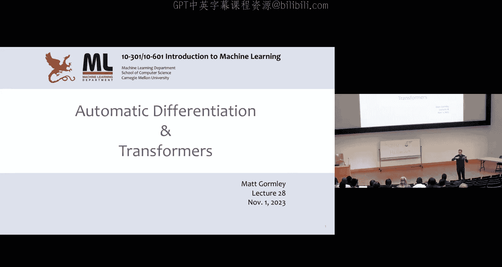
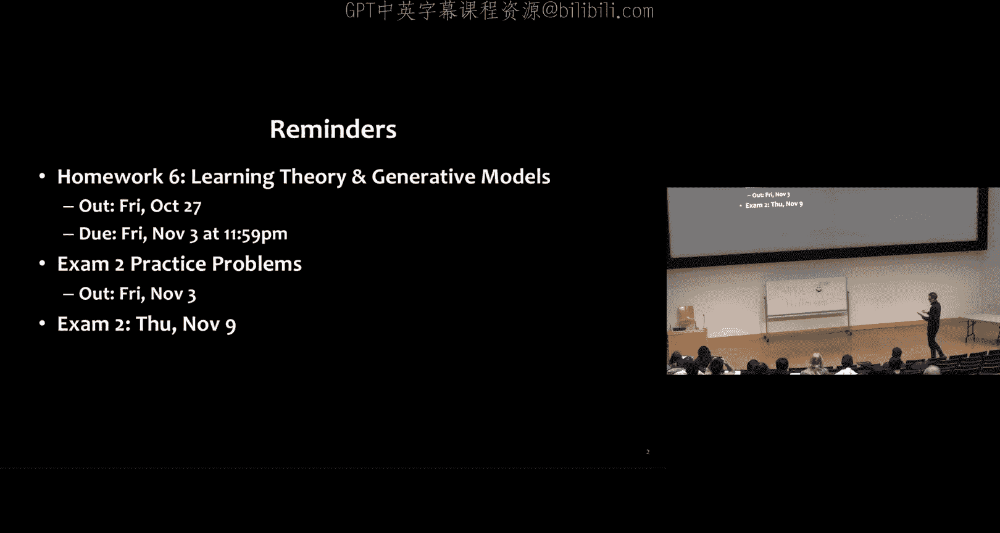
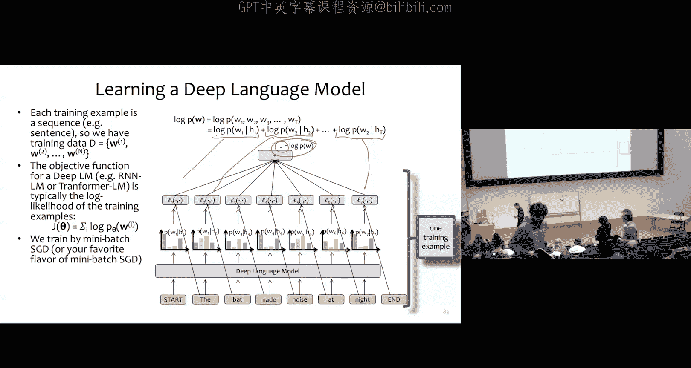

# CMU《机器学习导论｜Fall 2023 10-301⧸601 Introduction to Machine Learning》：自动微分与Transformer

## 概述

在本节课中，我们将探讨深度学习的不同视角，特别是如何构建深度学习库，以及自动微分的概念。我们将深入了解模块化计算图，并以此为基础，探讨Transformer及其在深度学习中的应用。

## 模块化自动微分

### 回顾反向传播算法

*   **反向传播算法**：一种自动微分技术，用于计算神经网络中每个参数的梯度。
*   **反向传播算法有两种版本**：
    *   **链式法则**：逐层计算梯度，从输出层开始，逐层向输入层传播。
    *   **累积梯度**：在正向传播过程中，累积每个节点的梯度信息，然后在反向传播过程中一次性计算。

### 模块化自动微分

*   **模块化自动微分**：将神经网络分解为多个模块，每个模块负责计算一部分梯度。
*   **模块化自动微分的优势**：
    *   **代码重用**：可以轻松地将模块应用于不同的模型。
    *   **代码效率**：可以优化每个模块的计算过程。
    *   **代码可读性**：代码结构清晰，易于理解。

## Transformer

### 注意力机制

*   **注意力机制**：一种用于捕捉序列中不同元素之间关系的机制。
*   **注意力计算**：
    *   **查询（Query）**：表示当前输入的向量。
    *   **键（Key）**：表示序列中所有元素的向量。
    *   **值（Value）**：表示序列中所有元素的向量。
    *   **注意力权重**：表示每个元素对当前输入的重要性。
    *   **注意力计算公式**：
        *   **分数**：计算查询和键之间的点积，并除以键的维度平方根。
        *   **softmax**：将分数转换为概率分布。
        *   **线性组合**：将值与注意力权重相乘，并求和。

### 多头注意力

*   **多头注意力**：将注意力机制应用于多个子空间，以捕捉更丰富的信息。
*   **多头注意力计算**：
    *   **多个查询、键和值**：每个子空间都有自己的查询、键和值。
    *   **多个注意力权重**：每个子空间都有自己的注意力权重。
    *   **多个线性组合**：将每个子空间的输出拼接起来。

### Transformer层

*   **Transformer层**：包含多头注意力、残差连接和层归一化等子层。
*   **Transformer层计算**：
    *   **多头注意力**：计算输入的注意力权重，并获取相应的值。
    *   **残差连接**：将输入与注意力机制的输出相加。
    *   **层归一化**：对输入进行归一化处理。
    *   **前馈神经网络**：对输入进行非线性变换。

### Transformer语言模型

*   **Transformer语言模型**：基于Transformer的序列生成模型。
*   **Transformer语言模型训练**：
    *   **目标函数**：计算序列的负对数似然。
    *   **优化器**：使用梯度下降法优化模型参数。

## 总结

在本节课中，我们学习了模块化自动微分和Transformer的概念。我们了解到，模块化自动微分可以提高代码重用性和效率，而Transformer则是一种强大的序列生成模型。