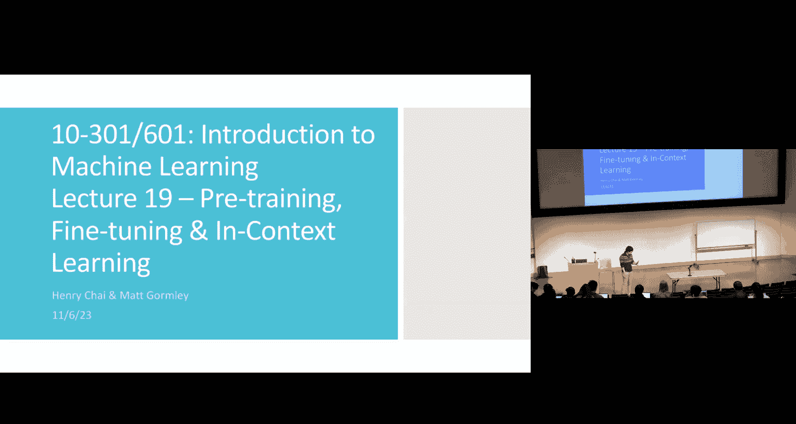
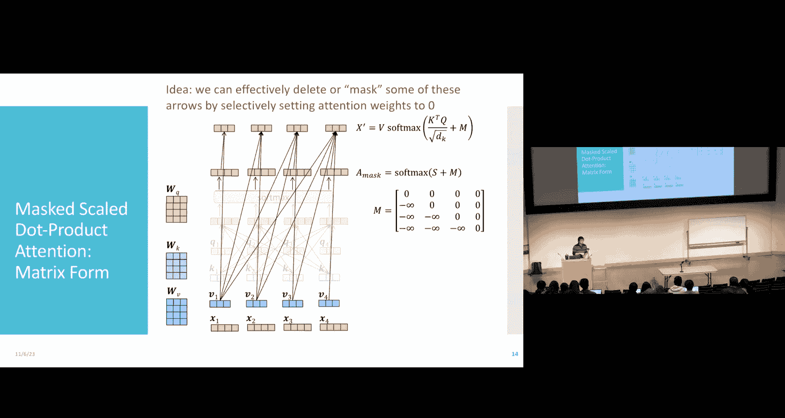
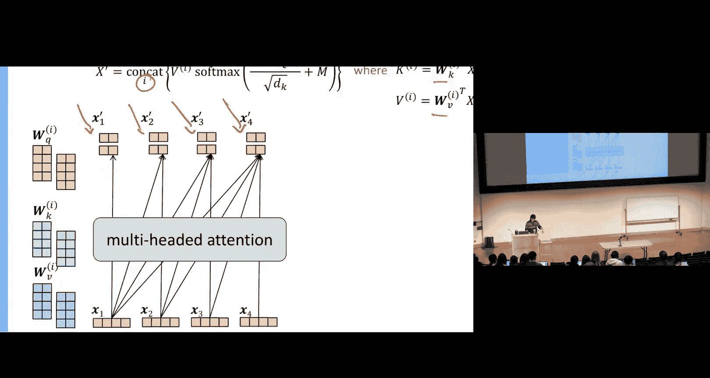
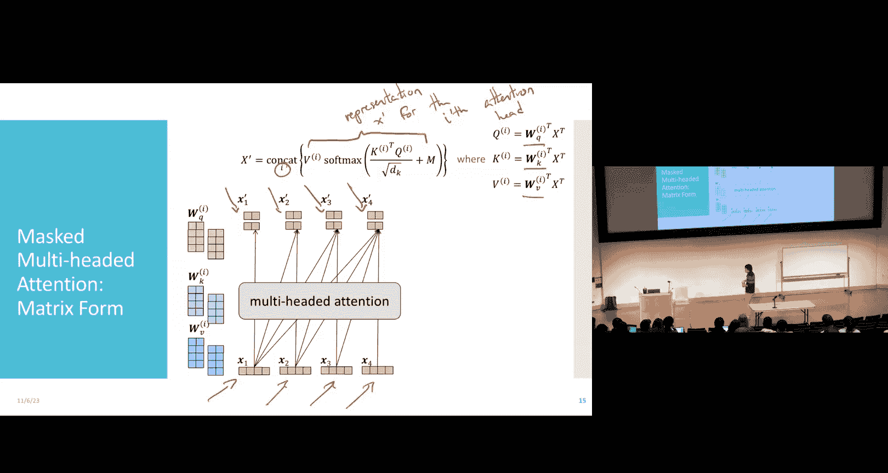
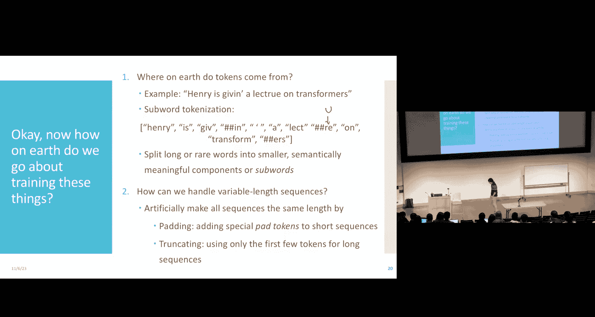
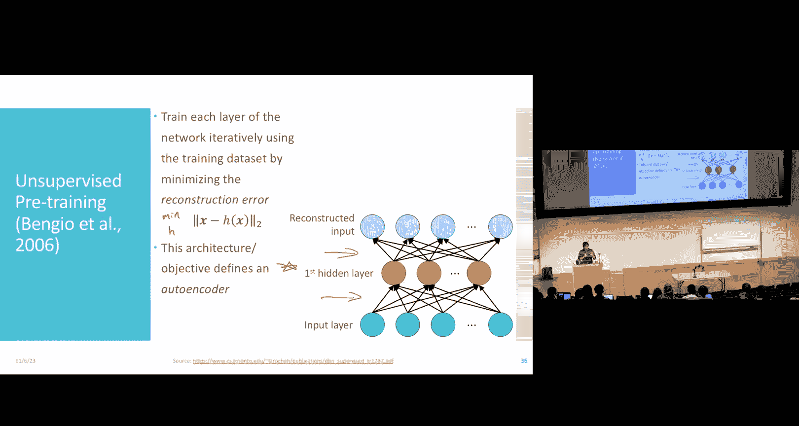
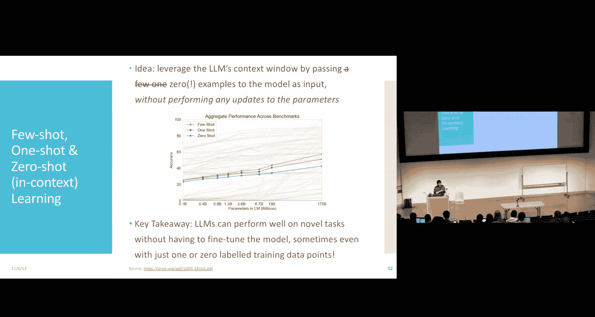
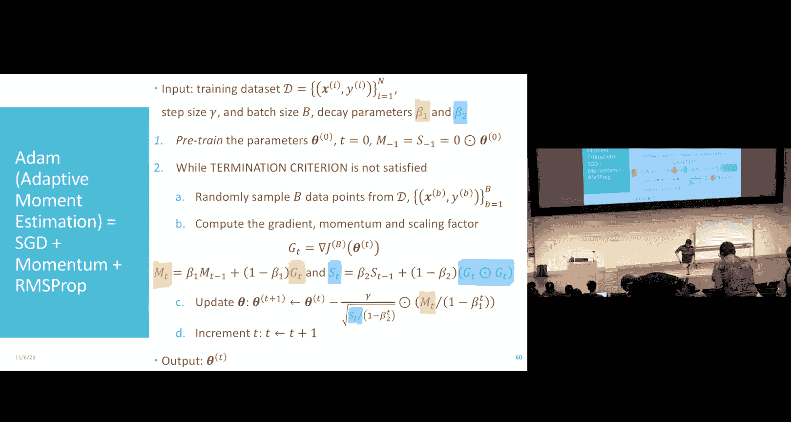
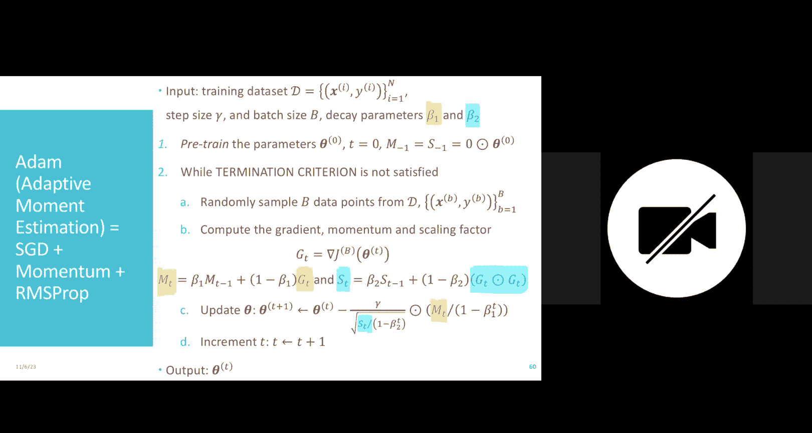

# CMU《机器学习导论｜Fall 2023 10-301⧸601 Introduction to Machine Learning》中英字幕（deepseek p19 Lecture_19_Pre-training_Fine-tuning_In-context_Learning.zh_en -BV1Z2cUefE4A_p19-

All right， good morning everyone。Happy Monday。Thank you all for joining me today we're going to pick up where we left off talking about sort of transformers and large language models。

 but today we're going to sort of think about。😊，Some more practical considerations when it comes to building and training these models。

 which is going to be very useful for you know your upcoming homework on this stuff before we get to that though between now and when your homework comes out you have something else to worry about you have an exam on Thursday。

😊。

The big things so logistically this is gonna to look a lot like your first exam you're going be split up across I think this time we're in five rooms believe it or not so keep an eye out for your room and seat assignments on Piazza other than that the big things to note the topics come from lectures 8 through 16 that was the last naive B lecture exam one content we get this question a lot we may reference it but it will not be the sort of like primary focus of any question do it that information what you will and you are also allowed to have a similar sized cheat sheet as exam one again you can put whatever you want on it don't ask us we don't care as long as it's just one sheet of letter a4 paper whatever you can get your hands on。

😊，Okay， so where do we leave off on Wednesday so last Wednesday we ended well not quite on this slide。

 but I want to revisit this because。😡，Matt spent a lot of time sort of deriving up this attention module or this attention function here。

 if you will， but if you sort of look at this picture。

 what's going on is like we've computed the representation for a single token right what we've computed is x4 prime here using sort of the sequence of tedious computations here。

😊，But that's only part of the picture， right， If you think about how you would actually go about implementing this。

 you'd have to。Write some sort of， I don't know， tedious4 loop to like compute what the representation for x1 is and compute x2 prime and compute x3 prime only there were an easier way。

Whi of course there is in the form of matrices right so first thing I'm going to step through here is how we can represent all of these operations for all of these attention representations。

 all of these new representations X prime how we can do all of those simultaneously using these matrices WQWK and WV here right and so that's going to start sort of right at the bottom this is relatively straightforward。

😊，Instead of having just sort of one vector X that we multiply each of these matrices with。

 we can easily compute sort of all the queries， all the keys and all the values for our input tokens x1 through xN here just by sort of doing these matrix multiplications right so what we're doing is we're stacking all of our excuse me we're stacking all of our input tokens x1 through xn here into some matrix now and computing a matrix of queries。

 a matrix of keys and a matrix of values all right。

 so that's the easy step right it's just replacing vector multiplications with matrix multiplications but now here's where things get a little tricky right because what we're noting here is that to get these attention weights in orange。

😊，What we did was we took this query representation for x4 and we took the dot product with all of the keys from x1 to x4 so really if you sort of look at what's going on in this picture。

 that's the sort of set of attention weights pushed through a softmax。

 that's the set of attention weights for token x4。😡，What we really need， though。Is。

All of the other attention weights here。😡，All right， so these arrows are getting a little crazy。

 first thing to note。You might recall from when we first talked about say a linear regression or something like that。

 that when we collect all of our inputs into some sort of matrix。

 we can call that like the design matrix here this is the design matrix transpose just because I'm representing the inputs as columns here but regardless it's the same idea X is some big matrix that holds all of our input tokens and now what we need is we need to be able to compute all of those orange vectors simultaneously。

😊，Well， that actually also sort of falls out very naturally from these matrices， so remember。

WeGo back a few slides here， the original equation for these attention weights was some。

Row vector Kj times our queryery representation Q4 here， and so that just comes out。😡。

In matrix form as k transpose the matrix now times the matrix of query representations Q。

 and here we're doing sort of element Y scaling， that's what that division there represents division by a scalar just means I'm dividing each element in that matrix by this squared of DK。

 the length of my representation length。😊，All right。

 so once we have this well that's relatively the next step is relatively easy as well。

 we just element wise or I guess sort of column wise push all of those matrices through a softm function crucially we're doing this sort of column wise because we're normalizing we're making each of those。

😊，Scores a valid probability distribution。And then the last step。

So let's sort of black out all of this in the middle here， remember。

 the last step now is we have some set of attention weights。For each。

Input location right we have some attention weights for x1， attention weights for x2。

 attention weights for x3， so on and so forth， and my final representation。😊。

Is to take those attention weights and multiply each of the values， each of the value vectors， V1。

 V2 by those attention weights。😡，All right， so really what I have now again。

 instead of just a single vector x4 prime， I'm learning or I'm computing the entire transformation。

 x prime， the matrix all at once， I'm computing the representation for all of my input tokens under this attention mechanism sort of all at once using matrix multiplication。

 Oh God， well that's a lot ofarrows， but bear with me here。😡。

What we're what we're going to do is just again， apply this intuition that we're just taking some。😡。

Linear combination of my value vectors V， and now I'm collecting my value vectors V into this matrix。

 capital V。Just to take a linear combination with the matrix of coefficients capital A。

 and this is sort of the canonical equation that you can find in the literature。

 basically the result says that my new representation x prime is my values v times this attention weight。

 these attention weights， the softmax of k transpose Q normalized or scaled by square root of DK。😡。

All right， it's a bit dry， but it's important that you know how to implement this like in matrix form so that you're not you know coding up like vectors and just trying to multiply stuff using four loops now when you're asked to implement。

 say I don't know a transformer layer or an attention layer。

 you can fall back to this matrix notation。Okay， so this is quite ugly and we're going to talk about some simplifications we can make to this in just a minute before I move on。

 let me stop here， what questions do you have？😡，Okay so I want to reiterate this slide is full of equations the big takeaway though is this is just like the matrix version of what you guys saw on Wednesday。

 this is just how you would compute all of these quantities sort of all at once for some given input some given sequence of tokens x1 through xN here we can compute their representation somewhat more efficiently using matrices but。

😊，All right。There's a lot of arrows here right I added a bunch of arrows connecting these value vectors to these attention weights and then sort of grayed out behind us Now there's a ton of like connections between。

My keys and my queries。All of that seems like。Sort of overkill and in particular。

Sometimes depending on the task， you might not actually want all of your representations to attend to all of the other value vectors right what do I mean by this well we'll think of one very specific application for these kinds of transformers or large language models which is known as decoding this is maybe like the most common task if you will and the idea is。

😡，You're trying to train your transformer to predict the next token to do some sort of like sentence completion or response to a query。

 or I shouldn't use the word query to like a prompt to some sort of question， right？😡。

If you are training your model to do this。Well， when you're training you sort of have the right answer。

 right， you need to know what comes after in order to do the prediction。But。

When you come to actually trying to evaluate your model， letting previous tokens attend to。

 I don't know the thing they're trying to predict the next token。😡，Well， that's kind of cheating。

 right， that's saying， okay， I give you some sentence and I need you to complete it。

 I need you to know the next word， by the way， the next word is this。😡，So I don't know。

 I would hope that your model first of all does really well there。

 but I would also suspect that your model wouldn't necessarily generalize well to sort of unseen or instances where it doesn't know what the continuation of that sentence is right and so here's the idea that attending to tokens that come after my current token is in some sense cheating right so when I'm learning the representation for X2。

 I don't want it if I'm using the transformer for the decoding task。

 I don't want it to be attending to x3 and x4。😡，All right， so big idea here known as masking。

 the idea is that we can effectively delete or mask some of these edges。

 the edges connecting my value vectors to these attention weights。

 we can mask or sort of not let the representation depend on those vectors。

 just by setting some of the attention weights to zero。😡，So ideally。

 this might be the sort of representation we want to learn here where。😡，X4。

 let's start here on the right， x prime4， that depends on V1， V2， V3 and V4。😡，Then moving backwards。

 x prime 3 that depends on v1 v2 and V3， and then all the way at the beginning。

 the only vector that x1 is allowed to attend to my new representation x1 prime。

 the only vector of values that's allowed to attend to is just V1。All right。

 so if I set some of my attention weights to zero， well。

 then I can achieve this sort of desirable behavior of effectively cutting my dependencies。😡。

Here's another idea。If you think about what the softmax equation looks like the softmax looks like E to the something normalized over a vector right well if I make that something minus infinity effectively e to the minus infinity is0 and that sets this attention weight that corresponding element that I set to minus infinity that makes the corresponding attention weight after the softmax zero so I can just sort of selectively add some matrix M to my softmax to the input of my softmax to x out some of these weights。

😡，But。What do I add？This is in fact your first poll question， you can go through poll。mlC。org。

 you'll see some questions about homework 6。😊，Why don't you leave those for well later and right now I want you to just think about the actual poll question here should have four options which of these matrices corresponds to the correct masking matrix for the encoding task which set of sort of attention weights are you trying to zero out here is is sort of a。

😊，hoops。That D option is a typo that should be。Sort of zeros on the diagonals and minus infinities everywhere else so switch those last two elements there this is sort of an exercise and basically just like index tracking it may be helpful to go back to some of the previous slides just so you make sure you understand which elements in this matrix M correspond to the。

😊，Value vectors in which correspond to the attention weights。

 otherwise go ahead and take oh I don't know， two minutes here。

 see if you can puzzle this one out and we'll come back and see what you'll have to say。😊，All right。

 if you haven't had a chance to submit your answers yet， go ahead and give it your best guess here。

And we'll talk about this one because this one is quite contentious。

I I got to admit like every time I come up with one of these poll questions and like a majority。

 a majority of you don't get the right answer， I'm always like a little confused I'm always like did I do this right so let's walk through this one together first off。

Let's talk about the obvious。Well， I don't want to say obvious。

 Let's talk about the sort of one that stands out here， right， M option D here。

M has zeros along diagonals and minus infinities everywhere else in words。

 can anyone tell me what that masking relationship describes Yeah right here in the black hoodie or red hoodie。

 sorry。That's exactly right， so that that would mean that each location is only allowed to depend on or only its to its own value representation that's sort of what the diagonal elements of imply here that those are the same values as the location that I'm computing the input for。

Computing the representation for rather。 So my claim here is that the correct answer should be a。

 And so let's take a look at this right， the value matrix v here consists of these vector column vector crucially column vector representations V1 through Vn right And so when I do this multiplication。

 what I'm saying is let me multiply this first row with this column Let me multiply this second row with this column again and that。

😊，Sort of just stepping through each of these columns that's going to give me。Ch。My representation。

For x1 prime， right， and what I'm saying there is that when I do this multiplication。😡。

The only elements。The only elements in each of these rows。That don't get zeroed out。

 that don't have their attention weights set to zero by these infinities in the mask are the elements in the first column well those are exactly the elements that correspond to V1 and so my representation for x1 only depends on the values in V1。

😡，Similarly， if I were to go to this next column here to compute my representation for x2 prime。

 well now the vectors V1 and V2。😊，Have their sort of same attention weights。

 but all of the other columns have their attention weights zeroed out by these negative infinities and so in fact。

😡，This is the correct representation for what we would call this masked scaled dot product attention mechanism here and again。

 this is going to be really useful for various kinds of natural language tasks。

 not even just like this very common task of say like sentence completion or next word prediction but there's all sorts of other kinds of masks that you might want to use right like if you're doing some sort of like fill in the blank exercises where you have context both before and after some word it might make sense to do some sort of more complex masking even like random masking is a valid way of training these things if you want it to get good at sort of predicting just sort of words in the middle of a sentence given context around it。

So masking is a really big part of how these attention mechanisms and how these transformers are built up the other big part that Matt also mentioned excuse me that Matt also mentioned on Wednesday is the fact that we can stack lots of these attention mechanisms together to get this so-called multiheaded attention and the thing that I'm highlighting here is that。

Stacking multi stacking multiple attention units together can also be done in matrix form if you kind of like cheat a little bit and define like a concatenation operation。

 but that's no big deal， really what I'm saying is that you can just do the matrix operation for each of your attention heads and then take the results。

 stack them together， ideally， as Matt mentioned to try and get representations here that are the same dimension as the corresponding input tokens。

😊，Okay。So let me stop here next we're going to think about some more。

 I guess I'm calling them practical considerations about how these models are defined。

 and then we're going to spend a lot of time thinking about how we can actually train these things before I move on。

 what questions do you all have here？😊，Yes， I'm on to say neural networks when you want the ways to be sparse or something with it can impose something like a regularization parameter to the backdrop the ways I learned that way that you get smaller ways similarly can we impose some kind of。

你 something you know。Ojective function or computer function。

 So that the ways are learned in such a way that the mask is important。

This is an interesting question， can we learn what would sort of be like an optimal mask in some sense？

Is that your question？😊，诶多清呢个诶。The mask into the page that I been the soft Max。

Is that any way we could you must be doing directly。And forcing the conditional。

So basically you're asking， is there any other way that we can sort of like learn some attention weights to be zero？

I guess。So let let me back up to where you started this question。

 regularization is definitely still used in training these things。

 like you can even do some sort of naive version of like L2 regularization on the weights that's not typically what's done。

 but you can try and enforce that the weights are small or something like that。That won't。

Necessarily enforce the constraint to the degree that we wanted to right like you could learn some sort of very small weights on some of those attention mechanisms that drive the representations drive the attention weights to very close to zero。

 but it's almost an impossibility that you would learn sort of exactly zero for those weights and that's actually a necessity for some tasks and so we might as well bake that into the model and that's the idea behind masking。

Yeah。😊，为什么？Yeah， so the formula at the top here， all that we're saying is that this。😡，This is the。

Representation。Like x prime。For the。Ithe attention head， so we're just using。The matrices WQI。

 WKI and WVI to compute this thing， and that's going to give me some vector。

 some vector X prime for each of my input tokens， and then I do this for each of my attention heads and then I just sort of glue them together and that's going to give me my sort of concatenated or my actual multiheaded attention representation。

😡，Yeah， this notation here is a little weird， I'm definitely like making up an operation。

 but what I'm saying is I have a bunch of these vectors here of length two。

 and then I cancatenate them over all of the heads by just sort of stacking them on top of each other。

All right， so I have two practical considerations， things that you're definitely going to have to worry about when it comes to implementing these sorts of things。

 one， where on earth do tokens come from and two， how can we handle variable length inputs。

 how can we handle variable length variable number of tokens in our input sequences here， All right。

 so let's start with the first one。😊，Suppose you have some sentence that looks like this I'm giving a lecture on transformers and I want to tokenize this sentence right well a very natural and very common approach would be to do what's called wordbased tokenization where you split on spaces or you know if you're being very clever you can split on like punctuation marks as well there's nuances here but the high levell ideas that I can sort of split on words and you know that's like all well and good to give me these tokens and then I can use some sort of embedding to compute the representation for these tokens that's like all well and good for normal sentences that look something like this but here's the issue lots of sentences don't look like this lots of sentences that you might want to train your model on come from the internet and you know the internet is a beautiful place maybe you get some sentence it looks like this。

Henry is given a lecture on transformers you got typos。

 you got you know weird diacritics here like what are we going to do if we were to do strict sort of word based tokenization we would have what are known as a lot of these out of vocabulary words or out of vocabulary issues right where the specific sequence of characters given and this misspelling of lecture。

😊，Those of you who might not notice this these words。

 these letters got switch misspelling of the word lecture here。

 right those have no sort of representation in my normal English vocabulary， right？😡。

So there are a few options I could， I don't know， expand my vocabulary to account for all possible misspellings of words。

 maybe I'm just using like the common misspellings like switching R and subsequent vowels that happens a lot。

 but eventually this is going to cause some issues I'm not going to be able to account for every possible weird word or like niche slang that exists in some like input or some training sequence。

😡，Here's another issue that like when I do this sort of representation。

Similar words might get represented completely differently right I'm going to have in my vocabulary。

 if I do this sort of strict wordbased tokenization。

 I'm going to have some representation for the word transformer and some representation for the word transformers and some representation for the word transform and so these can get mapped to sort of completely disparate representations whereas in reality we might want those to sort of have some similar semantic meaning in our system here。

😡，And then this notion of typos being out of vocabulary， that'll definitely be an issue。😊。

So here's some alternatives。Maybe a very naive alternative is okay if I can't break on words。

 what's another natural breaking point， at least for the English language that would be characters right so I could maybe instead of splitting on spaces now split on every distinct character and this will solve a lot of those issues right like now I'll be able to handle misspellings Certainly I'll just sort of break them up into their weird sequence of letters and I can even capture sort of these。

😊，Punctuation marks like the apostrophe sign here as distinct tokens。

 this has some nice benefits right like there are just some finite number of characters that I can encounter in the English language。

 In fact， a lot of these character based tokenizations they go so far as to include like。😊。

Emoji libraries because they have space， they can fit sort of all the various emojis that you can get on your like I don't know iPhone keyboards or whatever。

 but here's another issue right？😡，Under this representation。

I don't know like this n in the middle of my name here and that n in the middle at the end of the word giving。

 those are going to have the exact same representation when really they have sort of very different functions in this sentence right we're losing a lot of what we would call semantic meaning in this representation。

😡，There's also another tradeoff here， which is that character based representations are going to make my input sequences very long。

 like if I have an individual token for every letter that might make you know some parts of my sentence like fall out of the context of my transformer。

 my transformer might not be able to take in an entire sentence of letters。

 whereas it could certainly handle like a short sentence of words， right？😡，I will say that like。

I'm painting this as sort of an extreme sort of like a comically bad tokenization。

 but there are definitely settings what are called。LoA graphic languages。

I got really deep on like linguistics， Wikipedia putting this together anyway， things like。

Things that are commonly called ideographic languages， but are actually logographic languages。

 like Kanji can do very well with this sort of character based representation。Okay。

 that's more of an aside here really though what we want is some sort of nice compromise between character based and word based tokenization and that's where we get what's known as this subword tokenization where the idea is that I break down some sequence of full words into smaller words that retain some semantic meaning right so what I'm doing here is like this subword tokenization and we can talk about like well you don't need to worry about how exactly it's trained sort of very complex process。

 but the idea is that it can identify what parts of a word have sort of。😡。

Commonalities with other parts or with other words that it's encountered in its training corpus right so you'll notice here that it sort of split out the IN apostrophe construction from the word given right and the idea is that in English I can tack sort of IN G or IN apostrophe onto lots of words to change its tense to change sort of the verb give into。

All right， I'm not an English major I don't like into like a thing that I'm doing into an action right and so that construction I apostrophe as a token has some separate meaning。

 similarly at the ends of many sort of verbs like transform if I tack an ERRS onto those kinds of words。

 well then that token has some common construction across many words that this tokenization might have seen during training that turns some verb into a noun that does that verb。

And so。Using this sort of sub word tokenization， I can trade off between having like。You know。

 semantic meaning still captured in。These representations without having to come up with a different you know token for transformer and transformers or transformer and transformers with an S I can have sort of these useful sub wordss ES or ING for instance that still capture some semantic meaning without exploding my vocabulary and so this is a very common tokenization this is a very common input scheme for these kinds of large language models。

 let me next handle this question about variable length sequences and then I'll stop and take some questions for both here because what we have now is a way of converting sort of English sentences into sequences of tokens to pass into my model but my model as I've defined it requires sort of fixed length inputs I have sort of x1 x2 x3 and x4 as the possible inputs to my model but my sentences could be I don't know two token。

longong 100 tokens long what am I going to do here well here I'm going to do the really naive thing I'm just going to artificially make all of my sequences the same length by making the short ones longer and making the long ones short I'm going to add sort of these special pad tokens these have no sort of English meaning they're just some unique representation under my tokenization that says my sentence ended so I'm just going to add some number of these pad tokens to make sure that the short sentences reach some max length and then I'm going to truncate sentences that are longer than max length to max length number of tokens and again this is just some parameter hyperparameter I guess that you specify for your transformer model All right so this is called padding and truncation again really sort of naive hacks but they do well in practice and this is what many of these models are trained with。

Okay， so let me stop here next we're actually going to talk about how you can train one of these bad boys。

 but before I move on， what questions do you have？W the type of en natural is being corrected。Oh。

 whatops啊。Sorry， I forgot。啊。That should probably have a。You there， is that what you're asking。

 I dropped a character， yeah that's my bad。Yep。I guess maybe I still remember this that well。

 but when you're like making representation from a token。

 is it like more a painful to like mapping like the words to vectors or is it like performing a trans like a function on character？

啊。So there are lots of different ways that you can transform your tokens into a sort of vector representation this is like。

Think of like the word embeddings you guys used for homework homework4 I believe it was the idea here is that we can do token embeddings now instead of just for each word there's some vector I can have for each token there's some vector and those are typically you know trained using like some deep neural network but you could do like even a naive like one hot representation where if your vocabulary is not super super long。

 you just have a vector that has a one in the position corresponding to your token。Yeah。

For part two I sure what the ideal length should you do just take the mean of the length of all of them and around I mean that's certainly one approach depending on your computational resources it might be feasible to just use the actual longest token as your sort of max length this is all is sort of a function of like basically how many。

Words you can hold in your context window here at the bottom and like the real magic of these sort of large language models。

 not the real magic， like a part of the magic is that they have sort of huge context windows。

 which blows up the number of parameters， but allows them to represent sort of tons and tons of tokens。

And so I would say that's the primary consideration。

 which is like how big can your model possibly be？😊，There are maybe some other considerations though。

 like you said， like if I use the mean， maybe I'm getting some like good overall representation of my data。

 if I use the max length of my input over my training sequences as the max length。

 I'm probably doing a lot of padding which might be problematic。

 so there's some considerations there， but I would say the primary one is computational cost。😊。

All right， so。哦。How on earth are we going to train these things？

Well we're just going to do SGD right， we're just going to do our you know favorite mini batch tocatic gradient descent thing where we you know sample batches of points。

 take the gradient with respect to them and then move in some direction opposite that gradient。

 some step size。😊，All right。I wish Matt were here。Right now it looks like I have a confession。

 really we as a collective have a confession for you。

This is a lie this is like some fiction propagated by big stochastic gradient like this is not how things are trained in the real world right and this is really the focus of today's lecture。

I want to talk about。Sort of three primary issues with this like cartoonish sketch of how SGD is trained。

The big one thing that we're going to spend a lot of time on is like thinking about how we initialize these training procedures。

 but then we're also going to spend some time thinking about like。😡。

Just moving in the direction opposite the gradient。 is that really the best thing to do。

 but let's start， as I said， with randomly initializing the parameters。 Also。

 I do want to highlight this like。😊，I'm being a little facetious here when I say that it's a lie in spirit。

 you're still training these things with SGD， but it's a little bit more nuanced than that All right。

 so what do I mean？So here's like a traditional supervised machine learning routine right you have some task that you want to apply machine learning to and you have some data great right and so you I don't know come up with some deep neural network architecture。

😡，To try and model this data set with。That's like a cute picture and all。

 but like really in practice。What happens is。You have some like niche task right like some very specific task that only maybe you care about like I don't know predicting what the author of your children's books are and you have like a tiny data set。

 you know， I've got like 100 books at home like maybe even less right100 be generous I've probably like。

50 books at home， let's say。And I like took some class on machine learning so I care a lot about like these deep neural networks and I want to use them。

 so I want to train like a massive here I use that word generous generously。

 I just want to train like a normal deep model to do this task， right？😡。

What do you think is going to happen， Of course you're going to overfit， right？In fact。This is。

This was such a like big problem in the like early 2000s。

 late 90s that like neural networks were kind of laughed out of like machine learning conferences。

 like no one took them seriously right because results like this so this like MNIS data set that you've seen some examples of already for handwritten digits right like maybe the simplest not the simplest a very simple image classification tasks。

 take some handwritten digit， predict whether it's a01 two up to nine right？

So here's a very classic result。😡，Using a shallow network， using just a one layer neural network。😡。

I can get better classification error here classification error shown on the Y axis lower is better。

 I can get like a classification error under 2% using just a one layer neural network。

 but as soon as I go up to like a deep neural network and here I'm using this word generously because I'm pretty sure this is like a three layer neural network that they're experimenting with as soon as I go up to three layers。

😡，My test error well it doesn't get out of hand， but it starts doing worse right which is ridiculous like if you're telling me I have to do more work and build a larger model just to get worse results。

 why would I ever do that No I'm going to go and use my like SVMs or my like Bayesian nonparmetrics these things were all the rage when you know before you were born I guess but。

😡，Some people。Some people like。I think the citation is on the next page。

 some people like the authors of this next paper were like， no。

 I'm not willing to give up on my neural networks quite yet， and they had this this insight， right？😡。

Gradient based optimization for these deep neural networks with hundreds or thousands or even hundreds of thousands millions。

 however many parameters you have， gradient based optimization using random initializations。

Can do really， really badly， right， And that's the myth that like we're propagating on these slides when we say。

 just do random initialization。 You'll be fine。 Turns out you won't be fine， but。Here's the big idea。

If a shallow network。Can be trained sort of easily using these smaller data sets and here I want to highlight like the MNIS data set they're using in this experiment that has 60。

000 data points， so it's not even that small， right？😡。

So if I can train a shallow neural network using these kinds of data sets。

 well my deep neural network is really just like a collection of shallow neural networks right。

 can I train them， can I train each individual shallow network， each individual layer one at a time。

😡，And then at the end， maybe fine tune my results。😡，All right， what do I mean by that。

 So here's the big idea， Benjiio， that's the author。

 So here's the big idea behind what we'll call pre training。😡。

You have some deep neural network model。😡，And what you're going to do is you're going to train each layer iteratively。

 starting with the input and moving towards the output。

 you're going to train each layer to do the task。😡。

To do digit classification or to do sort of author prediction whatever the task might be and then once you've trained some layer。

 you fix those weights and you use that layer as the input to the next layer that you're going to train all right so that's a bit abstract here's my little cartoon Here's a three layer neural network right the idea is。

😡，I pretend。Like I'm I have a shallow neural network again I'm just going to train the first layer of weights。

 so here in this iteration I'm learning this matrix here。😡。

I'm going to do this using you backpro SGD， whatever you want。

 you train this layer of weights and what that gives you is it gives you some sort of representation it gives you effectively like an embedding right this is going to be some the orange dots here this is going to be some representation for every possible input that I have and the idea intuitively is that that is a useful representation right it is good at predicting or it's helpful for predicting what the digit the image represents it's helpful for the task at hand。

😡，And so if that's the case， well， maybe I can just use those as my inputs to some other neural network。

 some other shallow neural network， so now the great outwes have been trained。😡。

They've been pre traineded， I'm going to leave those fixed and I'm going to train this next set of weights going into the second layer。

And once I've done that， I'm going to do the same thing finally for the third layer。😡。

And now what I have is a set of weights that have been trained sort of iteratively。

 hopefully because each one just corresponded to some like nice shallow model， there was no。

 there was less potential for overfitting and each of those individual sets of weights。

 each of those weight and matrices is hopefully learning a good representation on its own for predicting the label for predicting these digits。

😡，But we can even go a little further， right， which is now。😡，You can treat。

These pre traineded weights。As a good initialization or a better initialization。

 certainly than just randomly guessing， right like each of these weight matrices has some demonstrated ability to like be good at the thing that I care about。

 to be good at predicting digits。😡，And so now let me start with those weights as my initialization and hopefully the optimal set of weights for all three is not too far from my initialization。

😡，That's the idea behind pretraining after I pretrain my weights。

 I use them as an initialization for full back prop and I fine tune them sort of all the way through now so this last step known as fine tuning says now I'm allowing all of my weights to sort of be trained collectively whereas before I was fixing various sets of weights and just training one matrix now I'm sort of fine tuning them all collectively using SGD but hopefully starting from a better initialization right okay？

😡，So we did all this work， we sort of broke our matrix down into these smaller shallow networks。

 sorry we broke our deep neural network down into these shallow networks and where did that get us？😡。

Right back to where we started actually even slightly worse， right， like this is， I guess。

 probably at exactly 2%。Whereas this shallow network。Still does better than my pre traineded。

ADeep network。Crap。All right， what went wrong here， right well intuitively。

What we were doing with what we would call supervise pre training is we were using。😡。

Each of these shallow networks for the task， right。

 we were using each of these shallow networks to predict the label still。😡。

And the claim here is that。While these shallow networks might help with overfitting。

Each layer is still potentially overfitting to the task at H。

 right especially if I don't have a ton of data， even if I just use a shallow network。😡，Well。

 I still have the potential to overfit if my data isn't large enough， right。

 And so instead of trying to fit the。😡，Lairwise weights to the task instead of trying to use those matrices to predict the label。

😡，What if I did something else with my training data right and here's the high levell intuition my claim when we were doing this sort of layerwise training was that each layer is learning a useful representation right it's learning some intermediate representation that is good at predicting the label。

😡，Well， what if I just extended that intuition and said， I just want to learn useful representations。

 things that are like helpful for， I don't know， any potential task that way I'm not overfitting to my specific task of digit prediction？

Okay。That sounds great and all。What is a useful representation？

There's lots of different ways that you might be able to define this。

 a very common one is a good representation captures a lot of the information in my input so that if I ever needed to like take that representation and recreate the input。

 well， if there was a lot of information in that intermediate embedding or in that intermediate representation。

 then it would be easy to recreate the inputs， and so that would be one way of thinking about what a good representation is。

😡，that is a big idea behind what we would call unsupervised machine learning what the heck is unsupervised machine learning we will talk about that much later in the semester for right now all you need to know is that these sort of。

😡，Pre training。Methods come in two flavors What we talked about was supervised pre training and now we're going to talk about unsupervised pre training where the objective function。

Is instead of minimizing classification error， instead of doing really good at my sort of goal task。

😡，I'm going to minimize a different objective function。

 this is what's called the reconstruction error and the idea is I want the predictions。😡。

For my neural network， H of x to be very， very close to the inputs。

 that would mean that my intermediate representations， something like this here。😡。

Captured enough information about the input that the output layer could accurately recreate the inputs。

😡，And so this is the whole idea behind a good or a useful intermediate representation。

And this architecture， this is a really sort of famous architecture。

 this is like the prototypical or canonical what we would call autoencoder。

 you can think of this as sort of having like two layers， two tasks。

 if you will this first set of weights， the ones that we're learning in pre-training this is learning and em it's what we call an encoder network。

 it's learning some intermediate representation for my inputs and it's coupled with a decoder network so here we're taking those inputs and we're decoding them back hopefully into our original inputs。

😊，Okay， we're not going to worry too much about that top layer because for pre training。😡。

All we care about are learning these useful intermediate representations， so I'm going to train this。

😡，Spial kind of neural network still just a neural network， though， it's actually even easier。

 It's just a fully connected feed forward neural network。

 I'm going to train this fully connected feed forward neural network using。😊。

SGD backpro and the idea here is it's still a shallow network so it's easy to train and it's not being fit to my specific task you'll note in this objective function there's no label information it's almost like i'm just throwing out why all I care about is learning a good representation from my inputs X。

😡，And so I can do this again layer by layer， so this would be the weights for my first set of for my first layer in my deep neural network and once I've learned that good intermediate representation。

 I'm going to fix that intermediate representation and build another autoencor on top of it so now what I'm learning is this set of weights again hopefully that set of weights should have enough or should retain enough of the information so that I can you know reconstruct the first hidden layer or something like that。

😡，And then I can do this one more time and again， this is still the same intuition as before for supervised pretrain。

 I'm still doing this training layer by layer， I'm fixing each of the previous layers pretrained weights to just learn the next layer's weights here。

😡，And then this last step， well we still， once we've done that。

 now we really have to do fine tuning because like the output here。😡。

That has no correspondence with my task at all So I still care about my task at the end of the day what we can think of when we're doing fine training is this is a very common sort of interpretation or very common vernacular you might hear this like called like swapping out neural heads the idea is I'm taking that last layer and'm taking sort of this whole pretrained network that was good at learning representations and I'm swapping out that last layer to do the task that I care about to do digit prediction to do you know book author prediction or whatever right I'm just taking out and it doesn't have to be a single layer could be some number of layers that I add on top of it but the idea is。

😡，When I go to fine tuning， I swap out that last layer for my task specific layer。

 and then I finet the whole network again， allowing sort of all of these learned weights to vary using Back or something like that and now I'm using the actual training data set with labels to predict the task。

😡，Okay， let me just get to the punchline here and then i'll stop and take some questions because that was a lot here's the punchline it works and this is the whole revolution behind neural networks like I mean you can basically trace like the explosion in publications around neural networks starting back to like this paper and a few of the other contemporaries the one about autoenrs is definitely also a landmark paper but like all of this stuff sort of allowed for the boom in deep learning the fact that like you can pretrain neural networks on。

😡，Well， not just data for your task， we're going to get to that in a second。

 but basically on anything and that allows you to have sort of this really incredible performance and this is really the takeoff for the deep learning revolution。

😡，Okay， that was a lot， let me stop here， what questions about free training do you have before I move on？

Yeah so the idea is the objective function， it depends on if you're doing supervised or unsupervised pre traininging for unsupervised pre traininging the layerwise objective function is minimizing this。

😊，Reconstruction error。We're minimizing this over all of neural networks H or all sets of weights， W。

 but we're doing this for just。Technically we're doing this for both weights， both weight matrices。

 both the encodeder weights and the decoder weights。

 just turns out we don't care about the decoder weights。

 so we just throw those out when we go to the next iteration。😡。

So that's the objective function here for supervised pretraining。

 the objective function is just minimizing you cross entropy loss or whatever it might be for your specific task。

😡，Here I'm just training us shallow one layer neural network。Yeah， yeah。

 what does fine tuning when we swap out the last aren't you changing wayss for elderly？

So when I say swapwab out the last layer， I mean I'm changing the architecture in my last layer I'm not I am learning the weights for all of them but like if you look at sort of the last layer here that has no correspondent like that has no ability to predict my like digits so I just throw out that last layer and replace it with the thing that I actually care about。

😡，How would you do the unsupervised pay training with models that are more complex。

 Like their parallel layers， like the ones that we saw like last week。Like for the computer vision。

There's。Honestly， there's nothing really special about like more complex architectures。

 like even for like you know vision inputs， your reconstruction error could be to try and recreate the original input image as well as possible and you can sort of embed convolutions and you know attention。

 you can sort of put whatever you want in these intervening layers。

As long as your objective is still to try and recreate the input。Theys that are running in parallel。

 how you decide to， how do you get them them。啊り我で。Have the final save output there。 That makes。

Like cause for the intermediate layers of like the convol， Yeah they have like for that。

They aren't one vector long。 They have multiple channels。 like okay， yeah。

 and sometimes they have like multiple。Layers like different layers， and then they are concaten。

 right， They are multiple convolutions and stuff like that。 Yeah， So how you do like this for Yeah。

 so I mean， I think there are a lot of like heuristic。

 I don't think there's like one universal way to do this sort of pre training。

 Like one thing would be like。Decompose that like multichannel multiconvolution network into a specific like convolution for each channel and ideally hopefully if you're starting each of those convolution sub networks at a different random initialization then they'll all converge to different convolutional filters and that can be used again as a set of initialization filters for the ultimate task。

 that's not to say that those will be like the end all be all but they might be useful as an initialization and then for all of the various like intermediate layers like pooling or like。

you don't really need to train cooling layers， I guess is a big idea。

 and so there's lots of things that you don't need to worry about pre training。

Try to preserve information I feel like it's not necessarily going to be preserving information that may be useful to the task So what if you I don't know if this is actually an issue at all。

 but what if you tried to do something like weight the reconstruction error along with still evaluating the objective function and saying okay。

 try to go closer to the objective function while simultaneously preserving information the way。

I mean it's certainly an interesting idea like I like what you're thinking like you could do you could almost treat this as like some sort of regularization term in some sense right like you cancatemate objective or you augment your objective function I don't know if there's any work that's been done on that but it's certainly a creative idea。

Yeah， oh I have a question about the reconstruction Gary。Maybe I'm misunderstanding。

 but let's say like that age vector there， can we just map like each of the inputs back like directly Yeah。

 this is a really great this is a really great insight autoenrs， this sort of architecture here。

 especially all right so in this cartoon here the hidden layer is a lower dimension than the input layer and so in that sense。

 I can't just map each input layer to a given node and have it return itself so I'm safe there。😊。

Here there is a bit of an issue where like if my hidden intermediate layers are the same dimensionality。

 autoenrs do have this issue of learning the identity function。

 I can regularize my autoenrs or I can there are like heuristics like different initialization tricks to get them to not learn the initialization to not learn the identity function basically。

😡，But that's a really great observation。ringer changes the layer size Yeah。

 that's a well I wouldn't say that's like the reason like this is not the reason we do that。

 but that is shrinking layer sizes as you get deeper in the network helps pre training helps unsupervised pre training certainly。

Really great observation， yeah。Okay。I please。So the reconstructed input from the hidden layer that's just defined as like some linear transformation of my inputs pushed through an activation function。

 This is just a neural network， So I take my hidden layer， I multiply it by some weight matrix。

 and that gives me some。Vector the same size as my input， I take that vector。

 I push it through a sigmoid or something。All the idea is I'm just trying to learn those weights。

Okay， these are really great questions I love this in the interest of time unfortunately I have to move on。

 but I really like where your head's at I think you guys are asking like really insightful questions that show you have a good understanding of what we're talking about here。

This is a really powerful idea， though I can't sort of like drive this idea home and like hard enough。

Even when。Your data set is so small that you can't like reliably fine tune a network or you can't even like reliably train these one layer shallow neural networks。

😡，Bre training is so powerful because。You can pretrain on basically anything you want。

 especially if you're doing this unsupervised version， even if you're doing the superupvised version。

 we'll talk about that， but if you're doing this unsupervised version。

 effectively all you need is just a collection of I don't know pictures。

 a collection of sentences you don't even have to be related to the thing you're actually trying to predict if all you're interested in learning about are these sort of useful representations for images or useful representations or words now。

😡，That having been said， ideally you want you know your data to be at least tangentially related to your task right and so like if I'm training this like book classification data set。

 maybe actually should train on other book titles but they don't just have to be book titles in my house I could go to like the Library of Congress and collect all those book titles or something like that right so we want some large data set that is related to the task and that hopefully will allow me to learn sort of a useful representation this is just to give you an idea here GP3 is pretrained on sort of these massive text corpusees from just like a whole bunch of sources。

 this common crawl thing like even if you dig into this paper you'll find that it like has a bunch of like archive papers so those are journal papers and like like pubmed papers like just a whole disparate source of online text Reddit is somewhere in there too God forbid and they're massive。

You can look at sort of the size of these tokens and then you can also read about how they're weighted it's just a huge data set of words and there's no like label for any of those data sets it's not like oh this is a sentiment classification data that no it's just like here's a Wikipedia argument here's another Wikipedia right so even in the absence of labels pretraining can be and is incredibly helpful。

😡，Okay， so that's great for pre training and all that， but like。

We're going to consider two sort of very like niche applications that give rise to Cha GPT effectively and the idea is like okay。

😡，This is great， I can precha my model on sort of any large data set right。

 but now I need to actually fine tune my model to some task。😡。

There are lots of tasks in machine learning that don't necessarily lend themselves to this like very tidy。

 supervised framework where like every input has some right answer， right， you know。

 every handwritten digit will correspond to some 0，1，2，3，4， whatever， but you know。

 not every like question I ask chat GT will' have one universally right answer。

 Maybe if I'm asking it a fact， Sure， But if I'm asking it to like give me recommendations about something。

 should I do all the time， like。It's not going to have like a label right。

 so how can I learn in that setting？😡，And。What if I still don't have enough data to fine tune my model that is really the crux of you know the problem that I was using to motivate this we'll talk about that in just a second let's talk about that first issue though right？

😡，In many problems， there's no like ground truth， all there is is some like notion of good or bad。

 better or worse and this is a whole field of machine learning that we're actually going to talk about on Wednesday known as reinforcement learning。

 but before we even talk about reinforcement learning。

 we can understand this idea that like for many tasks。

 what I care about is not like you know getting the right answer。

 what I care about is making the customer happy， what I care about is making the user happy right what I care about is like how you feel about the input。

 how you feel about the predictions rather。😡，And so I can just gather some collection of human annotators to sort of tell me whether this is a good or a bad response。

 right？Okay， there's a problem with that though， like if you think about trying to train。

 let's say chat GPT right， what would your training examples look like well there would be some prompt。

 there would be some response。😡，And then you would have to have a human， say， you know。

 my 3016 in one class， you'd have to have some human give that prompt response pair a score。😡。

And then you have to do it again for a different response。

 you have to do it again for a different response， and you have to do it again for a different response。

 and then you'd have to do it again for a different prompt and all of the possible responses that chatGT could give to that prompt。

😡，So gathering enough sort of training data to train models like this is you know ridiculous like it's not just sort of expensive but potentially infeasible right so what are we going to do well we're just going to do more machine learning we're going learn how the human would rate these prompt response pairs and then use that reward model to sort of feed back into chat GT and that's exactly what this notion of reinforcement learning from human feedback is here's this cute picture the idea is basically what I said though you start with your pretrained GT 3。

5 model you get a human annotator to label a few just like a small number of prompt response pairs you tell me how good is this response for like 10 or 20 things and I use that small data set to build a reward model that's what's going on in this middle column and then I use this reward model to evaluate all you know。

Any possible pair of prompt and responses。 And I use that reward model to do fine tuning basically。

 like if you think about what SGD would do here， it would generate some。

Prompt response and then I would go to my model and I would say is that a good response to that prompt and if the score is low。

 I would update my weights to try and sort of maximize that score。😡。

All right so that's a bit abstract The thing that I want you to take away from this slide is that reinforcement learning with human feedback is just a special sort of fine tuning All I'm doing now in this third column here is I'm fine tuning a pretrained model a model that was pretrained on you know the entirety of the internet but not specifically for the task of chat responding so now I'm fine tuning it for a very specific task and that's what gives rise to chat GBT amongst a whole other set of things but this is like the big innovation that makes chat GBT。

Not just able， but like good at responding to human text。Okay。

So this is what we can do if our problem is sort of subjective in nature。 But again。

 let's return to this root issue of。When my training data is scarce， as it is for so many tasks。

 what can I do？😡，And here's where。I don't know， I'm going to wave my hands a lot and talk about emergent properties。

 but like the key isn't so much that you understand why this happens。

Key is that you understand that it can happen。The idea here。

Is that let's say I want to use chat GBT to do some task， right？😡，GPT 3。5 is huge。

 It's like 170 some odd billion parameters， right， So if I wanted to think about fine tuning that kind of a model。

 you know， the authors in this paper themselves， they say like。

Fine tuning would require something like at least 100，000 label training data points。

 right that's a massive data set。 And then you actually have to go through the whole like riggamarole of doing SGD over 175 billion parameters。

😡，So instead of doing that。What if？I just sort of used the ability of these large language models to hold lots of examples in input。

😡，In the context window。😡，And I use my tiny。Data set as like a set of demonstrations or a set of examples to my large language model and without performing any sort of parameter updates without doing any sort of gradient descent thing。

 just have it try and fill in the blank， just have it try and complete the prompts using the small set of examples I give it a few examples here。

 right？😡，And I think a lot of people have spent a lot of ink trying to think about why this works here's an explanation that I like but again。

 is at a very high level， the idea is that if I trained if I pre-trained chat GT on a big enough data the entirety of the internet。

 then somewhere buried deep deep in the recesses of Wikipedia or read it or whatever there were probably instances there were probably examples of the task that I cared about there were probably you know a list of children's authors of children's books with their authors in some table on Wikipedia right and so by giving it。

By giving my large language model some number of examples。

 all I'm doing is I'm manipulating the parameters so that the prediction that I care about is more likely under the language model。

 remember the language model is just giving you sort of a set of probabilities and I can condition those probabilities to give me the output that I want。

😡，If I can provide it with some sort of context， some ability to locate what's called concepts。

 latent ideas about text。😡，Like I said lots of hand waving here there is some really interesting analysis in this paper though so if you do care more about it you can dive into it。

 they make some compelling arguments anyway the idea here is this gives rise to what are known as few shot one shot and amazingly zero shot in context learning so the idea behind in context learning is that I don't need to change any of the parameters I can just use the context window of my large language model to perform some sort of inference on novel tasks right all right so。

😡，In traditional fine tuning， what we've talked about before， the idea would be you have some。

Labeled data set like English to French translations right so I would take some English word and its French translation pass that into my model and that would be one training data point I could update all of my parameters using that one training data point and I could then go to the next one。

😡，Each of those gradient updates is ridiculously expensive for large language models。

 right so instead。😡，For in context learning， I'm just going to like。

Put all of those examples into chat GBT and I' just like type up some like text document and be like here。

 read this text document and then tell me what the French translation for the word cheese is and amazingly it can do this。

This is maybe not so amazing because it definitely is seen like instances of English and French translations。

 but it can do this for a whole host of very sort of niche tasks。

 it can do this when you give it just one example it can do this when you tell it what to do with no examples so this is what we would call zero shot learning sorry with just one example this is very obviously called one shot learning and just to drive the point home here。

This effect。😡，It's not perfect。 sorry， this figure isn't rendering great。

 but the idea here is that at the largest size for G 3。5，175 billion parameters。😡。

On a whole host of tasks， so that's what the great outlines are behind the sort of darker lines on a whole host of tasks。

The average performance of no examples， just sort of like a description of the task is still like 40 plus accuracy or something like that。

😡，And it gets a little bit better as you give it sort of more and more data。

 but remarkably it can do really well without having to perform any sort of updates just with a natural English language description of the task and this is what we would call in context learning and it's one of the like you。

😡，Again， emergent properties are like the big deal why people care so much about large language models and you know this is just sort of scratching the surface here。

Thought about talking about something like instruction fine tuning。

 which is basically like how can I， you know， change my prompts or stack multiple prompts to like。

Effectively make models that just see prompts even better at zero shot learning so there's a whole host of innovation going on in this space as well。

 but this is one of those really cool things that you can do with sort of large language models with crucially large context windows。

😡，Okay， that was a lot。 Let me stop here， Let me take some questions and then I'm going to。

I'm going to show you what I have on the next slides and then we may or may not talk about it on Wednesday if we have time。

 I just want to make sure you've seen some of these words before。

 but before I move on what questions do you have？😡，对呀。😊。

I think it was kind of confused like what is the point of introducing these label training points。

 if it's not adjusting。So the idea is that like。If you think about what the next word prediction depends on。

 right， like a lot of these。😡，In context learning tasks。

 you can phrase them as predict the next word after this sentence， predict， you know。

 cheese is translated into。I think it's frommage anyone， so predict that next word， right？

If I give you more context that improves the hopefully improves the prediction of the next word and so that's really all the previous labeled examples are。

 here's some context， here's the idea that the word sea otter is translated into not even going bother and then here's some more context so I'm just sort of updating the distribution over that next word to hopefully being more accurate。

😡，Yeah。There was an industry where you're want these zero shots specifically。I mean。

 I don't know why it's industry specific， but the idea is like if you don't have a lot of label training data or if you don't have the computational resources to fine tune a large language model。

 then in context learning can be your friend I would say for the most part like。

Your average human being， you or I， we definitely do not have the ability to fine tune 175 billion parameters that's just not going to be feasible So your choices in that case are use the 175 billion parameter version and just do in context learning or fine tune a smaller version of the model like this thing here can probably fine tune。

😡，Maybe the 1。3 billion parameter model。Probably not actually maybe just the 800 million parameter model。

 and so there's some trade off there between like can I actually make the model more specific to my task versus can I leverage just a bigger model？

😡，Yeah。One short or the zero shorter4 with the vision cards because like。

 they don't take in the tunnel description。So you can。It's an interesting question。

I would maybe try and give it like image pairs or like if I guess it depends on what your task is right like if your task is doing some sort of image to image prediction or image to image transformation you can certainly embed image pairs。

 otherwise there's you know there's a whole class on multimodal learning where you can basically combine like image and text embeddings to learn some。

😡，Useful representations or perform some task。All right。

 the last thing and you can either think of this， I'm not sure if we're gonna do this on Wednesday depends on what Matt has planned so you can think of this as either a preview for Wednesday or a very quick summary the idea is that this stochastic gradient descent update here this is pretty naive and not at all like what's done in practice there are lots of adaptations or extensions to stochastic gradient descent some of which have this nice like physical interpretation so for instance here's one called momentum or effectively you're remembering previous gradients with the hope that like if your previous gradient was very steep and you were I don't know about to get stuck in some local minima that you can carry some of that momentum and help you roll over hills to find better local or even global minima there's another adaptation which says。

It's kind of weird that I have the same step size for all of my parameters。

 my step size for you know parameters that are very large should maybe be bigger and my step size for parameters that should be very small should probably be smaller let me make sort of step size。

 sorry parameter specific step sizes that's the intuition behind RMS Pro here and it turns out if you stack both of those things together momentum and RMS Pro you get the very infamous atom optimizer and that is actually what is used to train or pre-train most of these large language models。

😡，So again， I went through that kind of quickly， we may or may not spend some more time on that on Wednesday。

 otherwise yeah that's all we had for you today， we will see you all back here on Wednesday for a discussion of reinforcement learning don't forget about your exam on Thursday。

😊。

