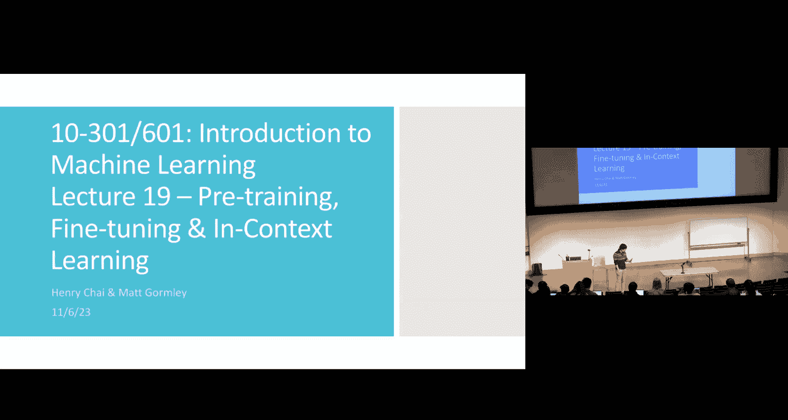
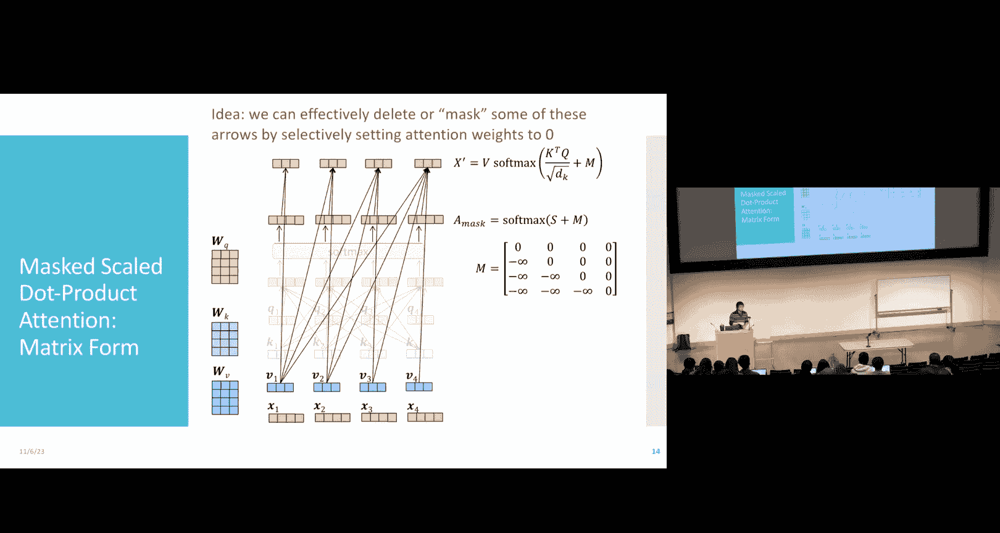
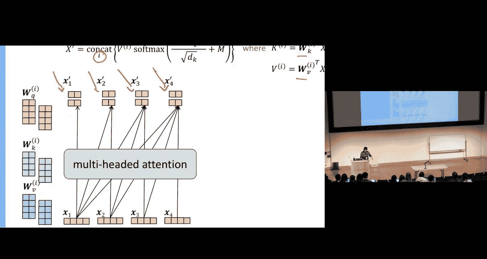
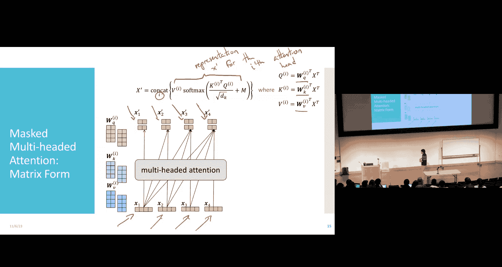
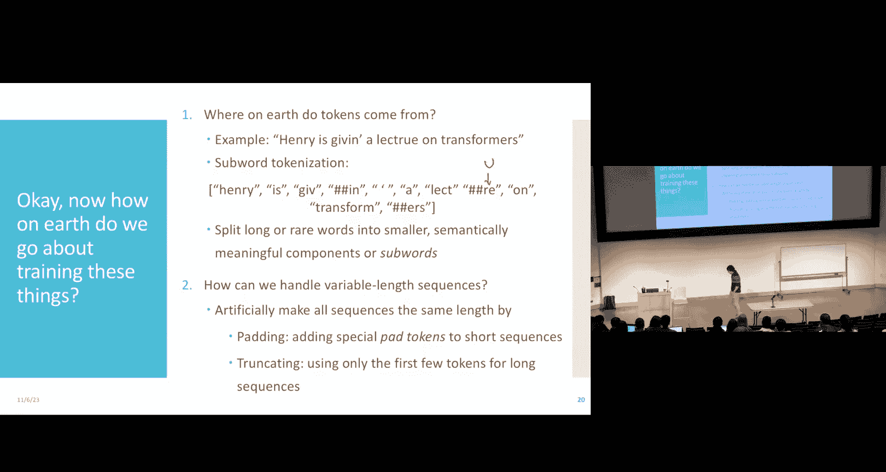
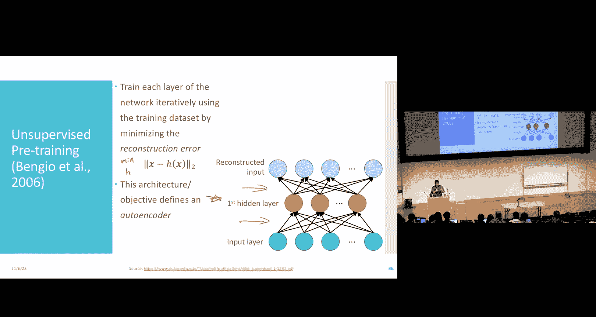
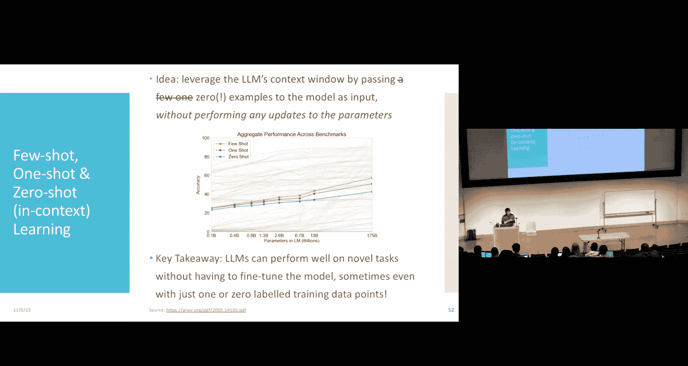
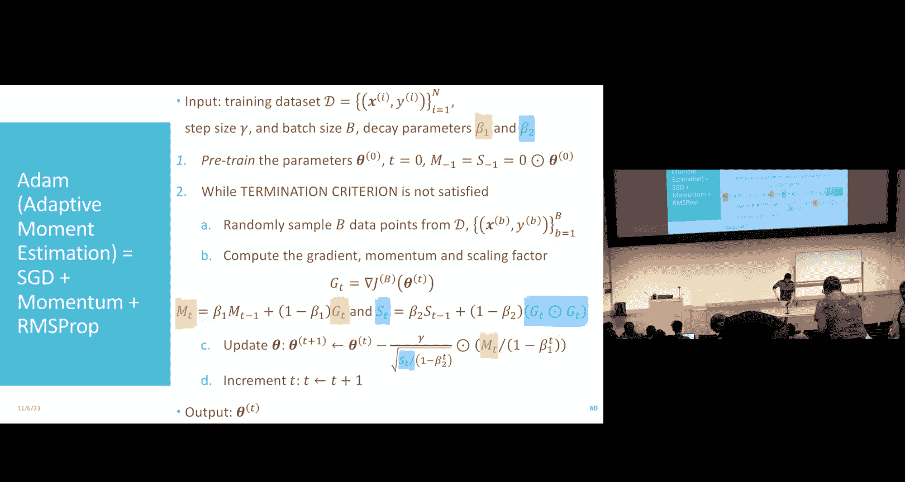
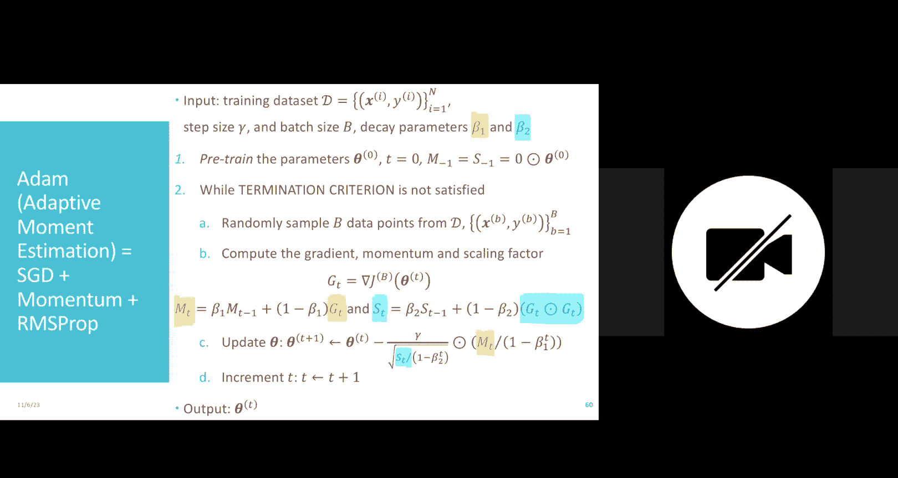

# CMU《机器学习导论｜Fall 2023 10-301⧸601 Introduction to Machine Learning》中英字幕（deepseek p19 Lecture_19_Pre-training_Fine-tuning_In-context_Learning.zh_en -BV1Z2cUefE4A_p19-

## 1. 引言

在本节课中，我们将继续探讨机器学习中的预训练、微调和情境学习等概念。这些概念对于理解和应用大型语言模型至关重要。

## 2. 注意力机制

### 2.1 注意力函数

注意力机制是Transformer模型的核心。它通过计算每个输入token与所有其他token之间的关联度来工作。

**公式**：

$$
\text{Attention}(Q, K, V) = \text{softmax}(\frac{QK^T}{\sqrt{d_k}})V
$$

其中，$Q$ 是查询向量，$K$ 是键向量，$V$ 是值向量，$d_k$ 是键向量的维度。

### 2.2 多头注意力

多头注意力通过将多个注意力机制堆叠起来，从而学习到更丰富的表示。

**公式**：

$$
\text{MultiHeadAttention}(Q, K, V) = \text{Concat}(\text{Head}_1, \text{Head}_2, ..., \text{Head}_h)W^O
$$

其中，$\text{Head}_i$ 是第 $i$ 个注意力头，$W^O$ 是输出投影矩阵。

### 2.3 掩码

为了防止模型在解码任务中查看未来的token，我们可以使用掩码来屏蔽一些注意力权重。

**公式**：

$$
M = \text{diag}(\text{ones}(n) \times -\infty)
$$

其中，$n$ 是token的数量。

## 3. 预训练

预训练是一种在特定任务之前对模型进行训练的方法。它可以帮助模型学习到有用的表示，并提高其在特定任务上的性能。

### 3.1 监督预训练

在监督预训练中，我们使用带有标签的数据集来训练模型。

**公式**：

$$
\text{Loss} = \text{CrossEntropy}(H(x), y)
$$

其中，$H(x)$ 是模型的预测，$y$ 是真实标签。

### 3.2 无监督预训练

在无监督预训练中，我们使用无标签的数据集来训练模型。

**公式**：

$$
\text{Loss} = \text{ReconstructionError}(H(x), x)
$$

其中，$H(x)$ 是模型的预测，$x$ 是输入。

## 4. 微调

微调是在预训练之后，使用特定任务的数据集对模型进行进一步训练的方法。

**公式**：

$$
\text{Loss} = \text{CrossEntropy}(H(x), y)
$$

其中，$H(x)$ 是模型的预测，$y$ 是真实标签。

## 5. 情境学习

情境学习是一种无需进行参数更新的学习方法。它利用大型语言模型的上下文窗口来执行推理。

**公式**：

$$
\text{Output} = \text{Model}(x, \text{Context})
$$

其中，$x$ 是输入，$\text{Context}$ 是上下文。

## 6. 总结

本节课介绍了预训练、微调和情境学习等概念，这些概念对于理解和应用大型语言模型至关重要。通过学习这些概念，我们可以更好地理解模型的原理，并提高其在特定任务上的性能。