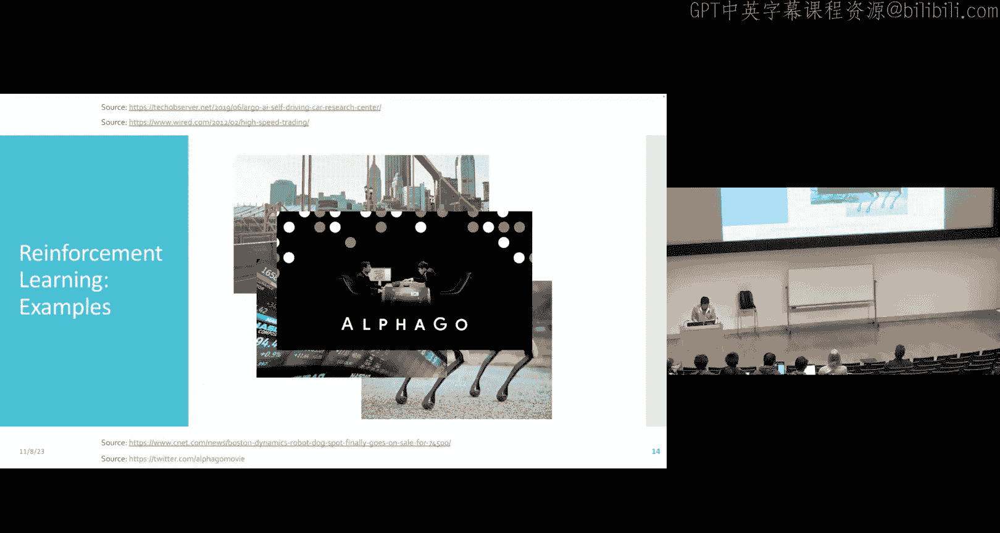
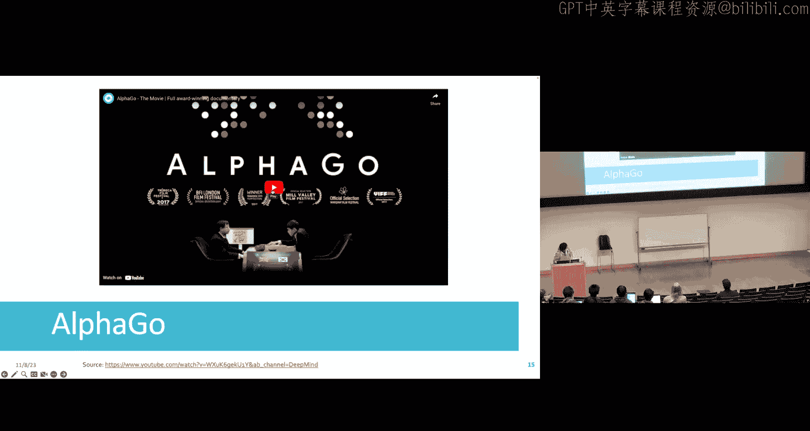
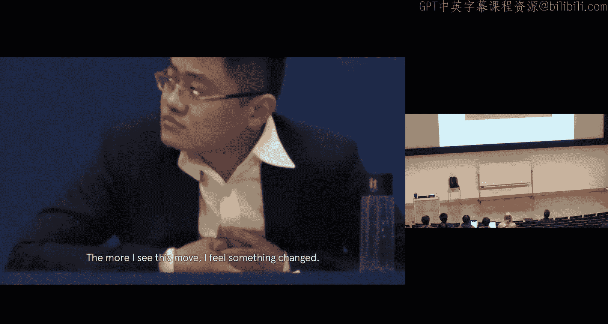
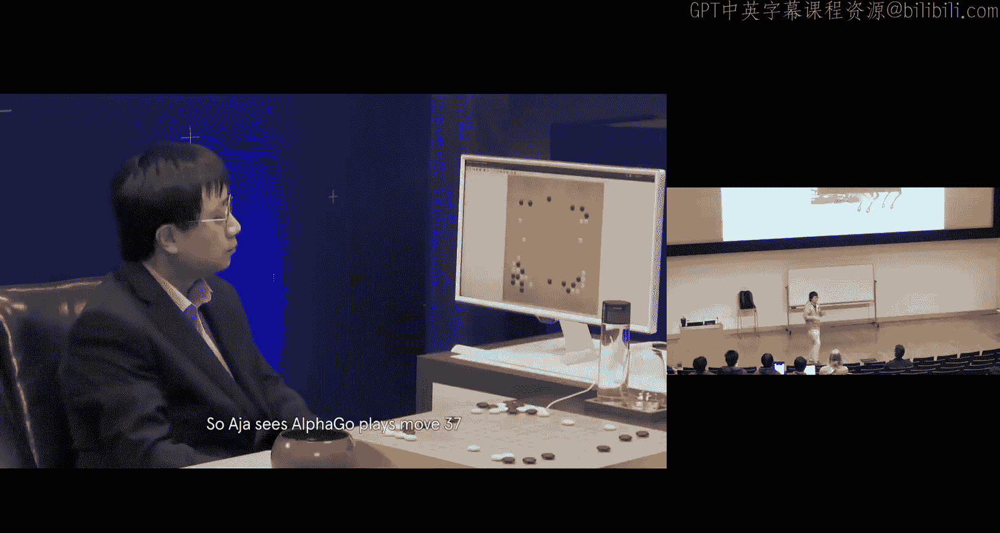
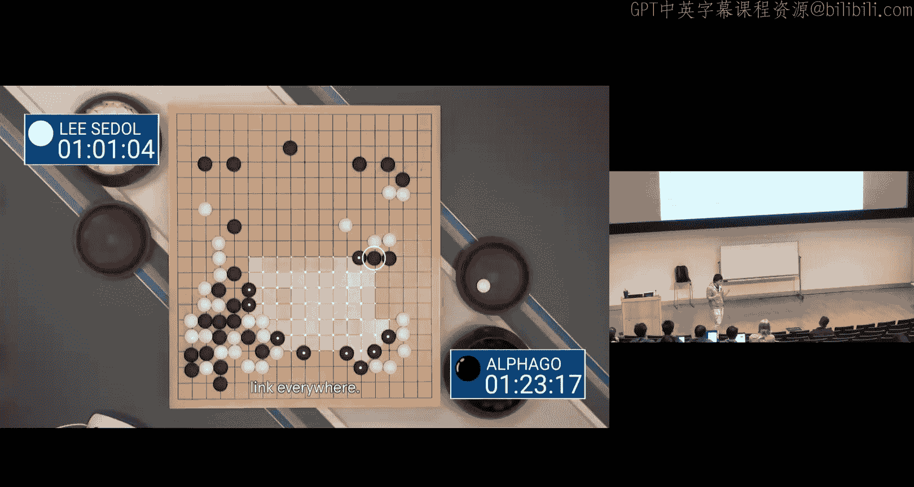
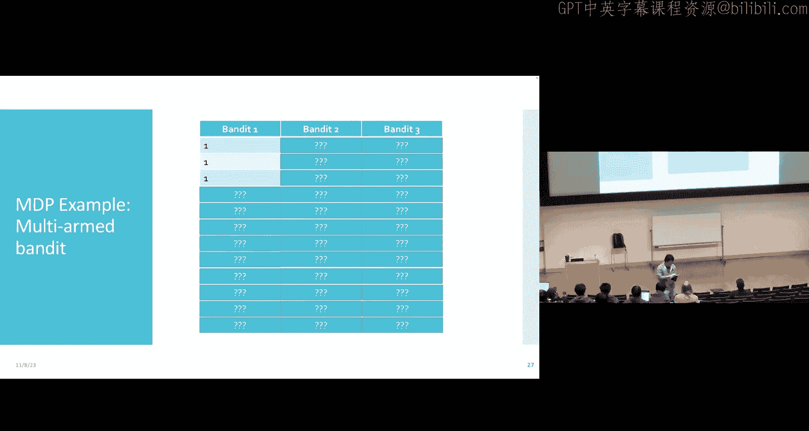
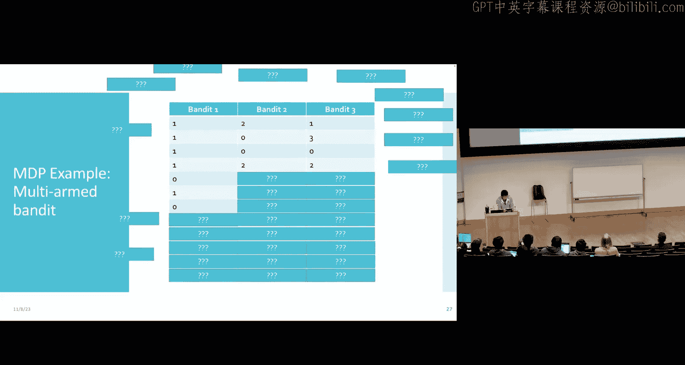
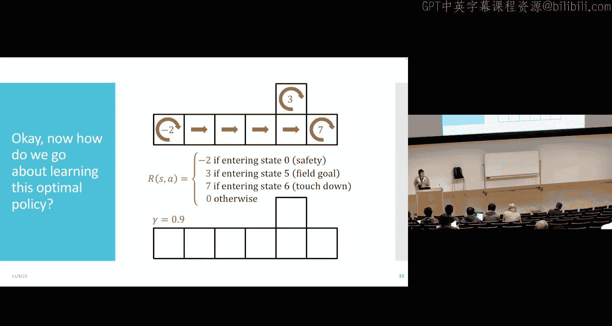

# CMU《机器学习导论｜Fall 2023 10-301⧸601 Introduction to Machine Learning》：强化学习与马尔可夫决策过程

## 概述

在本节课中，我们将探讨强化学习，这是一种全新的机器学习类型。我们将从强化学习的基本概念开始，并深入探讨马尔可夫决策过程（MDP），这是强化学习的基础。

## 强化学习简介

强化学习是一种机器学习方法，其中算法通过与环境交互来学习最佳策略。与监督学习不同，强化学习算法需要与环境进行交互以获取数据。

### 强化学习的关键组件

* **状态空间**：描述环境状态的集合。
* **动作空间**：算法可以采取的动作集合。
* **奖励函数**：根据动作和状态决定奖励的函数。
* **策略**：将状态映射到动作的函数。
* **价值函数**：评估策略在特定状态下的预期回报。

## 马尔可夫决策过程（MDP）

MDP 是一种数学模型，用于描述强化学习问题。它由以下组件组成：

* **状态空间**：描述环境状态的集合。
* **动作空间**：算法可以采取的动作集合。
* **奖励函数**：根据动作和状态决定奖励的函数。
* **转移函数**：描述从当前状态到下一个状态的转换概率。
* **折扣因子**：用于计算未来奖励的折扣。

### MDP 的数学表示

**状态空间**：\( S \)

**动作空间**：\( A \)

**奖励函数**：\( R(s, a) \)

**转移函数**：\( P(s', s, a) \)

**折扣因子**：\( \gamma \)

### MDP 的目标

MDP 的目标是找到最优策略，该策略最大化预期回报。

## 探索与利用

在强化学习中，存在一个经典的权衡：探索与利用。

* **探索**：尝试新的动作以获取更多信息。
* **利用**：使用已知信息采取最佳动作。

### 探索与利用的权衡

* **ε-贪婪策略**：以概率 \( \epsilon \) 探索，以 \( 1-\epsilon \) 利用。
* **UCB 策略**：基于置信度上限进行探索。

## 价值函数

价值函数评估策略在特定状态下的预期回报。

### 确定性价值函数

**确定性价值函数**：在确定性环境中，价值函数可以表示为：

\[ V(s) = \sum_{t=0}^{\infty} \gamma^t R(s_t, a_t) \]

### 随机性价值函数

**随机性价值函数**：在随机环境中，价值函数可以表示为：

\[ V(s) = \sum_{t=0}^{\infty} \gamma^t \mathbb{E}[R(s_t, a_t)] \]

## 总结

在本节课中，我们介绍了强化学习的基本概念和马尔可夫决策过程。我们讨论了强化学习的关键组件，包括状态空间、动作空间、奖励函数、策略和价值函数。我们还探讨了探索与利用的权衡，并介绍了价值函数的计算方法。

**本节课中我们一起学习了**：

* 强化学习的基本概念
* 马尔可夫决策过程
* 探索与利用的权衡
* 价值函数的计算方法