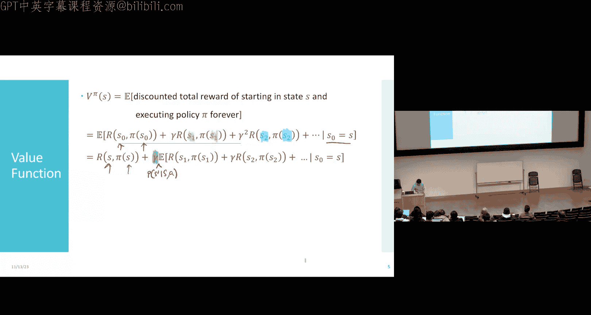
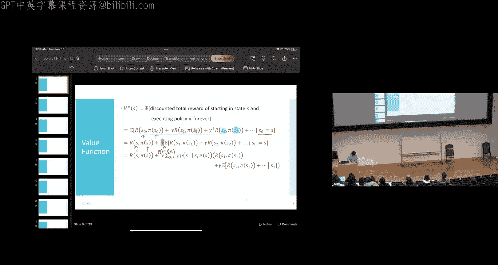
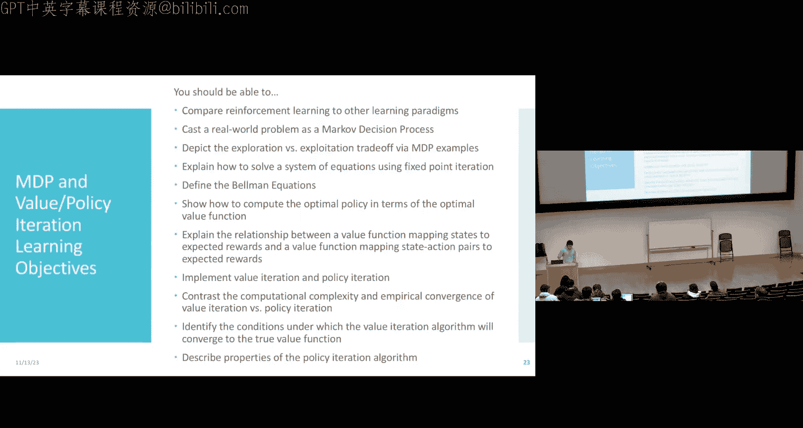

# CMU《机器学习导论｜Fall 2023 10-301⧸601 Introduction to Machine Learning》中英字幕（deepseek p21 Lecture_21_Reinforcement_Learning_Value_Policy_Iteration.zh_en -BV1Z2cUefE4A_p21-

Good morning everyone so we are gonna go ahead and get started for today Happy Monday Thank you all for joining me。

 So today we're gonna pick up where we left off and actually do some reinforcement learning today so we spent most of Wednesday kind of just having some fun games talking about what reinforcement learning is Today we're actually going solve the reinforcement learning problem as posed on Wednesday。

😊，Before we get started for today。I should address the elephant in the room。

 Home7 was out over the weekend， a couple hours， about a full 24 hours later than we had originally intended。

 I want to assure you that while we were trying to finish up homework  seven。

 we were also changing its length accordingly so that we are keeping the due date the same because we don't want you to have to work over Thanksgiving but it is not the length that we normally would have made it to accommodate for the day lost here。

Again， be mindful of your grace days。Okay， so where do we leave off？

On Wednesday we introduced the reinforcement learning problem and specifically we spent a lot of time thinking about this entity。

 which we call the value function， and we're going to spend a lot more time thinking about it today and we're going to spend some amount of time thinking about it on Wednesday as well so heres one formulation for the value function as we derived it on Wednesday where you can think of it as this sort of infinite sum of expectations where each individual term inside this sum is the reward you're getting in some future time step crucially discounted by some discount factor gamma right and so this was the version of the value function with random or stochastic transitions and deterministic rewards This was one of two settings that we explored and。

😊，You know， we spent some amount of time sort of thinking about the value function in this form。

 but then when we went through our sort of final example and I apologize。

 we went through that final example somewhat quickly。

 but when we were going through our final example of computing the value function for this game of football。

You might remember that's not how we actually computed the value for these states right I wasn't out here sort of working out some infinite sum in fact I used a rather convenient shortcut and one that is going to come up very very soon。

 which is that you can compute the value of some state。😡。

based on the value of other states specifically based on the value of states where your policy will take you right and so again I walked through this very quickly。

 but the idea behind computing this value function in gold here，😡。

Was that I know the value of being in that state right before I get a touchdown that's going to be seven and if I know the value of that state is seven。

 well then the value of the state right before it， the value of the state right before I get some immediate reward of7。

 that's just going to be one discount factor of 0。9 times that seven and then just sort of working backwards。

 I'm adding in more and more discount factors of 0。9， but the intuition。😡，Here。

 and we're going to drive this in math in just a second。

 But the intuition that I want you to take from this is that。

You can use the value of other states to compute the value of your current state。

 and it's all related to sort of this policy as well， and we'll see how in just a minute。Okay。

 so that was all recap from Wednesday， I guess before we get started in earnest， let me stop here。

 are there any questions at this point？😊，嗯。😊，like why the other three boxes are in Europe Yeah sure so this is always a bit of a tricky like bookkeeping thing the other three states here that are zeros correspond to terminal states and the idea is that once you hit a terminal state the you can think of it in one of two ways the game ends in which case there's no way for you to get future rewards at least for this particular run。

😊，Or the way that I have it represented here is that the only valid action in a terminal state is to remain in that terminal state forever。

 and that is also a zero reward action。So。You get zero reward indefinitely or you get no opportunities to get more reward。

 either way， zero value。Yeah， so little you。Either get a touchdown or which you have some of chance that you've got to settle for billable。

 how do we model that here？That's a really great question right so in real football you don't necessarily have deterministic transitions in real football you might take an action like try and run forward and accidentally fumble the football and move backwards you might try and score a touchdown and miss so I think the appropriate way to model that would be with stochastic transitions and you'd have to have sort of a lot more granularity in your state space as well but I think you could probably come up with something。

All right， so like I said， we're going to spend a lot more time today thinking about this value function expression and again。

 I'm going to start with this sort of assumption of stochastic transitions and deterministic rewards and I'm going to write it out as this infinite sum。

 but we're going to simplify that in just a second here。😊。

So here it is expressed as this infinite sum of this expectation of an infinite sum of rewards that are decaying over time using this multiplicative factor of gamma here first things first I have this written out kind of weird I'm saying that like my initial state S not is。

😊，The state that I'm evaluating this value function at， whatever state S that might be。

 so I'm just going to plug that in to this random variable here。

So the way to think about this is that all of these states。In principle。Our random variables。

 including technically S not in this representation。

 I'm just instantiating S not to be my desired state S here。

 And that's going to give me this expression here。 So all I did was I plugged。

S in for S not here and then because it's no longer a random variable。

 I can pull it outside of the expectation and now you'll note something interesting。😊。

Each other term inside that expectation， each of the remaining terms inside that expectation that has one factor。

 at least one factor of gamma in front of it， so I can pull one factor of gamma outside each of those terms and now I just have sort of an expectation multiplied by this discount factor gamma here。

😡，Whoops。Okay。Here's where things are going to get a little wild。I'm going to rewrite。

This expectation。As a sum， so remember， if I have discrete random variables。

 the expectation of some discrete random variable。😡。

Is the probability distribution of that variable times that variable itself， right？So。

This expectation is with respect to my stochastic transitions。

 it's with respect to the distribution P of s prime。

 the next state given my current state in action right， and so I can rewrite that oops。

No， I don't want to practice， thank you though。

All right。So I can rewrite that as this sum over all possible next states。

 this sum over all next states， S1 in my state space， calligraphic x， calligraphic S here。😡，And what？

As I mentioned before， I have to introduce。A distribution term so this is the probability of ending up at each one of those next states S1 and once I've sort of specified what next state I'm going to end up at。

 well I can pull R of S1。😡，Pi of S1 outside of this expectation。

 it's no longer sort of a random variable inside this sum。 Sorry。

 this is getting a little messy just because I ran space on this slide here， but this。

All of this stuff。Is inside the sum here。And I'm going to try and erase this。come on。嗯。

Does't seem to be working。 All right， well， regardless。

 the idea here is I've just taken this expectation with respect to my first term。

 the reward I'm going to get in the next time step， the reward for being in some。Variable state S1。

And I'm rewriting that as a sum of that all possible rewards I could get weighted by the probability that I actually end up in that next state S1。

😡，So once I pull that first term outside of that expectation。

 I still have all of these other terms here。😡，And again。

 the one thing here that I'm doing that's bookkeeping is that I pulled a gamma factor out from each of those terms inside that sort of smaller expectation now。

 and now you'll note one other interesting thing。My initial state here inside this new expectation。

 my initial state here you can think of as。😡，Let's go with this color and it's probably not going to work well。

 let's go with this color is now S1。😊，So。There's a lot going on on this slide。

 I'm going to try and tidy this up in just a second。 Let's draw some parallels here， right。

 So what we're saying。Is that？Going from that second line to that third line， I'm converting。😡。

That expectation of that first term。R of S1 pi of S1。 That's a random variable。

 I'm rewriting that expectation as this sum over all possible next states。

 S1 and just multiplying each of the possible rewards I could see by the probability that I see those rewards。

😡，And then everything else just sort of lives still inside some expectation。

I'm not talking about what's going to happen with S2 yet right now I'm just thinking about what is the next state S1 going to be and here's the sort of magic and I think again。

 the intuition we all saw when we were computing the value for the tiny football grid world。

 but these two lines here， they have a remarkable parallel， right？😡。

What we're saying here is that the value for being in some state S。

The value for being in some state S here。Is the immediate reward I get for being in S and taking the action dictated by my policy plus some discounted expectation over all the future rewards I'll get。

 right。Well， what's going on inside this sum？😡，Inside this sum here。😡。

I have the immediate reward for being in some different state S1。

And taking the action dictated by my policy pi of S1 plus some discounted expectation over all future rewards that I could possibly get starting from S1。

So if this second line。Is my definition for V pi of S。 Well， it turns out everything inside this sum。

 well， that's not true。 Everything that is not this probability term out here。😡，Inside this sum。

Is just V Pi of S1。So。Again， what is the intuition here。

 The value of being in some current state is equal to the immediate reward I get for being in that state and taking whatever action my policy says plus some function of next states that I could end up in。

If my if my transitions were deterministic， if I knew 100% of the time。

 as I did in that football game， what next state I was going to end up in。

I don't need to worry about this sum I can just sort of replace that sum with the value of the next state that I know I'm going to be in。

 but here's the wrinkle when I have stochastic transitions。

 I don't know what the next state that I'm going to end up in is and so I have to treat that as a random variable and instead take an expectation。

😡，Over the value of the next state that I could end up in and again， that's really all this is。

 this is just an expectation over。😡，The next state， the value of the next state S1。

 and of course we can't forget。We have our discount factor of gamma out front here。Okay。

 that's a whole heck of a lot of math to explain something that again。

 I think is maybe more intuitive， but I'll stop here， give you guys a chance to catch up。

 what questions do you have before I move on。Yeah， I was wondering。From my understanding。

 eye of us is stoasm right。The pi is the state we go the state S is the state pi is the action that we take in that state S yeah that's exactly right pi of S you can also think of。

As a random variable sure， there's no expectation around or as comma items of the story。

This first term here， because I know what S is I'm saying I want to compute the value for this particular state so I know what state I'm in and once I know what state I'm in the policy at least as far as we've defined policy is deterministic the policy maps every state to one action now there is a very reasonable extension of this that is like stochastic policies we're not going to touch on that in this class。

😡，Yeah， sorry， the only thing stochastic about the policy is not knowing in any of the subsequent steps what state we're going to end up in。

嗯。😮，space and then just yes， it is technically possible to have a continuous state space。

You can rewrite all of these expectations with respect to like integrals and probability density functions as opposed to probability mass functions。

 that is going to make what comes next a little bit tricky。

 so for right now we're going to assume discrete and very small finite state spaces yeah。😊，Yes。

So time you say like six possible things that are the one you would need like six the best one multily in your no。

 so what you're saying is that like。If there are six possible states that I could reach from my current state。

 like if there are six possible candidates for S1， then this term right here。

 this is going to be sum over all six of those states。

And then if I could reach six states from any of those states。

 well now I have you know sort of branching possibilities， but regardless。

 all of those branching possibilities are encompassed by this sum here。

 like somewhere buried inside the value of S1 is a sum over all of the possible next states that I could reach from S1 and so on and so forth。

😡，And that's what really makes us elegant， right that I can sort of capture all of the possible downstream actions and all of the possible like values and rewards that I could be seeing in future time stepss。

Just in that one term， the value of S1 says this is the best possible you know set of rewards that you could get starting from S1 I don't have to worry about what they are。

 I have a nice convenient expression for them and in fact what this gives me。

This whole equation right here this has this is you know so famous that it gets to be named after someone these are called the Belllman equations and crucially。

😊，The big takeaway from this。Is that？This。S here is not a typo this is actually a system or a set of size of calligraphic S equations I have one of these equations for every state in my state space right V pi of you know my start state I can write like this V pi of any state in my state space I can write using this equation and that is going to be very helpful because it's going to allow me to solve for all of these values sort of simultaneously right。

😡，What do I mean by that？Let's talk about optimality first。

 and then we'll talk about how we can solve for the optimal。😡，啊。Value function， The idea here。

 though， is that。This equation is true。For any policy pot。

But I don't really care about any random policy pi right I can come up with an arbitrarily bad policy and yes。

 this will still be true but what I care about is the best possible policy right the optimal policy and so for that I have an optimal value function and what this is saying is I'm in some state S right and I want to figure out what the best action to take in that state is well I can say the value。

 the optimal value v star of being in this state is I consider every possible action available to me so I take a max over all actions in my action space and I look at what maximizes this sum I look at what maximizes my immediate reward are of S and A。

Plus。This expectation over the value of the next state that I end up in。😡。

Cruciialally the optimal value v star of the next state S prime。

 and so I'm considering not just how a affects my immediate reward。

 but also how it could affect any of the potential rewards that I received going forward。😡，是。

And again。I have one such equation。😡，For every state in my state space。

 and it's like kind of defined recursively in some sense， right the value of my current state S。

The optimal value v star of my current state S depends on the optimal value of all of my other states。

 v star of S prime here。Okay， so this is the optimal value function just sort of very quickly， very。

😡，诶。Briefly， what we mentioned on Wednesday still holds here。

 which is that once I've solved for the optimal value function。

 it's very easy for me to reverse engineer what the optimal policy is。

 I just look at what the best action is in every state。

 I look at what A inside my actions space maximized this reward plus discounted future values。

All right so again， here is how you can view this sum。

 we have some discounted future reward sorry and some immediate reward and that adds up to the value of my current state。

And so this is the connection that we drew intuitively on Wednesday。

 I'm just making that statement explicit here once you've solved for this optimal value function v star。

 you can kind of just，😡，Take these values。Plug them in here and that will allow you to solve for the optimal policy pi star and that is crucially what we want to solve for in the end。

All right， so back to solving for this optimal value function。As I mentioned。

 what we have for any policy， also for the optimal policy， but for any policy。

The beman equations defined a set of equations， a system of size of S equations with size of S variables。

 it's just the right amount of variables right so we're going to be able to solve this system of equations。

😡，But there's a bit of a wrinkle here。😊，I think if I told you， hey。

 this is a system of linear equations， you could all go to your favorite linear algebra textbook or go to。

 I don't know your favorite linear algebra library or whatever do like。

Like probably  Lynalg dotolve or something and move on with your lives， but unfortunately。

Because of this。Annoying max term out front。 We have nonline equations， right。

 If we didn't have that max， this is actually a useful insight。 If we didn't have that max out front。

 then this would be a system of linear equations。 I just have each of my variables V star of S prime multiplied by some stuff。

 and then added together。 That's a linear equation。 However。

 that max out front is going to complicate things a little bit。

 And so I'm going introduce a very useful general purpose technique for solving systems of arbitrary equations。

 And then we're gonna apply it to。😊，Excuse me， and then we're going to apply it to reinforcement learning here。

All right， so the technique。😡，Here's another optimization technique or I don't know。

 maybe more about just general purpose math technique that you can add to your tool bag。

 it's what's known as fixed point iteration and it's like weirdly simple but pretty effective。

Here's the idea， you have some system of equations。

 system of arbitrary equations in n variables here。

 so x1 is defined as some function of x1 through xn。

 x2 is some other function of x1 through xn so on and so forth， and we're given some initial value。

 so this is x10， x20 all the way up through xn0。😊，You can think of this as like a first guess at what you think the solution should be so all I'm going to do is I'm going take those I'm going to take those values iteratively I'm going plug them into these equations so I'm going to start by plugging in x10 x20 all the way up to xn0 I'm going plug those into that equation for x1 it's going give me a new value and going do that again for x2 so on and so forth and it's going to give me a new set of values functionally a new guess for what the solution is to this system of equations。

😡，And then I'm going to do it again and I'm going to do it again， and I'm going to do it again。

 and I'm really just going to cross my fingers and hope that this works。😡，It's a little strange。

 I don't necessarily have any reason to believe this will work。

 but let me give you an example right Here's a very simple system of nonlinear equations。

 it's nonlinear because x1 is defined as x1 times x2 that's a nonlinear combination of my variables here so x1 is x1 times x2 plus1 half x2 is minus3 hals x1 here I'm gonna to start with some initial guess00 and before we actually see it that this works here's the optimal solution let me just double check this really quick so if I plug in。

😊，One third here that gives me。Minus1 half， that's right。 And if I plug in one third。Minus。

One half here。I don't know why he keeps doing that that gives me what。Pluss one half。

Minus 16 plus1 half。Is。2，6。One， third， great， okay， so this down here。X1 equaling 1 third。

 x2 equaling negative12， that's what I'm hoping that this converges to so let's start right。

Add initialization， I have 0，0。 Okay， let's see here。

 So I plug0 times 0 plus one half that gives me one half for my first guess of x1。 And then for x2。

 I get。😊，Something time zero which is zero great Okay， so next I'm going to take 0。

5 0 and plug it into those equations who wants to help me， who wants to do this next。😊，Yeah。

 I mean I know that's fair Okay， so after some number of iterations。

 we can see that we get pretty close right 15 iterations later。

 X1 is basically one third here next to it's po up within error of minus 0。5 right？😊。

So here's the dirty little secret behind this particular slide。

 how I came up with the system of equations is I generated sort of algorithmically like，😊。

I don't know， maybe like a thousand of these sort of polynomial combinations of x1 and x2 and just tried to see which one's fixed point iteration worked for。

 it worked for not very many of them。Even with sort of a zero zero initialization。

 fixed point iteration has this like annoying habit of like divergence right if you think of like how you're reusing previous values if these guesses ever got。

 let's say above one for one reason or another， then I would start multiplying like X1 and x2 both being larger than one。

 I would give me some number bigger and bigger and bigger and bigger and so。😊。

Fix point iteration because of this sort of like dependency on itself。The values， the guesses。

 have this annoying。Tendency to run off to either plus infinity or minus infinity and so it took me took me a really long time to come up with this particular example and so why should we believe that it could do something reasonable for reinforcement learning well it's because our reinforcement learning problems have a very specific structure to them crucially。

😊，The dependence。On。Other values is always being discounted by some value less than one。

 so I mentioned on Wednesday that we tend to like multiplicative discount factors because they make the math nice。

 this is one example of them making the math nice， you can sort of prove that as long as you're sort of multiplying out front。

😡，The values of other states by some discount factor strictly less than one。

That fixed point iteration will converge in general， you cannot guarantee that。

 I encourage you to try and have fun banging your head against Excel for an hour。

 but we don't have to worry about that for the context of reinforcement learning。

Okay so next we're actually just going to take this algorithm and basically apply it as written straight on to our reinforcement learning setting and that's going to give us actually two reinforcement learning algorithms for solving the reinforcement learning problem before I move on let me again stop here what questions do you have yeah。

😊，This is a local optimization as well。 So it's kind of a weird assertion。

 This isn't an optimization algorithm， right， This is just solving for。A particular solution。Now。

 that being said， if。A system of equations has multiple solutions。

 it will converge to one of them right and so in that sense it's local it won't give you like sort of a set of solutions。

Yeah， I think that's the right way to think about this， it's not optimizing something。

 it's just solving for some numbers here。Yeah。the more common generation effort for solving systems and model your is like usage codean like that said in this case derivative with thought one。

So the Jacobian。Hang on， I think you're getting Jacobians and Hessians conflated。

 It's not that like again， we're not。Solving for some optimal solution， right。

 we can use the Jacobian when we're solving for a system of linear equations that's。

Thats like the slope， right？So again。That's for like trying to optimize like some objective function。

 like Newton's method moves you using the second order partial derivatives like faster than just looking at the gradient here we're not trying to optimize something there is no like objective function。

 there is the right answer and I am trying to find the right answer。😡，I realize this is my fault。

 I like started by maybe saying this is like an optimization method， it's not。

 it's just a method for solving a system of equations。😡，Anything else here？え？😊。

ning is there like a guarantee that the pro has one solution or does it not matter which solution you find that's it that's exactly right it doesn't matter whether or not we thought so okay。

We're going to use this algorithm to solve for the optimal value function。

 The optimal value function is unique。😡，But there could be multiple policies that get me to that optimal value。

 those are not necessarily unique and as we've defined our problem。

 we're sort of indifferent between optimal policies。😡，There is， however。

 just one unique optimal value for each state， and that's what this is going to allow us to solve for。

对呀。No， I'm just following that algorithm， so to get x12 and x22。

 I take the values of x11 and x21 and plug them into those equations and just keep going。

 feel free to double check my math。😡，It's actually very easy to do in Excel， yeah。Okay。Yeah。No。

 and so this is again one of the great things about applying this algorithm to reinforcement learning settings。

As long as you're using like a。Okay， I should clarify as long as you don't initialize your values to something insane。

 like positive or negative infinity， as long as you start with finite values and you have a discount factor strictly less than one。

 you can avoid the divergence issue， you sort of can guarantee convergence because of the structure of our value function equations。

So let's take a look at that and hopefully the actual implementation of what we'll call value iteration will give you some idea of like how this algorithm is being used。

 how this like intuition of finite point iteration is being used to give rise to what we'll call value iteration。

 so this is our first sort of real reinforcement learning algorithm。😊，And。

Here's a crucial thing that I want you to keep in the back of your mind for right now。

To implement value iteration， you need to know both the reward function and the transition function or here the transition probabilities。

 so more on that later， but for value iteration those two functions are taking as input and what we're going to do is we're just going to follow the fixed point iteration recipe if you will。

 we're going to initialize all of our variables here。

 we're going to initialize all of our values for every state somehow either to be zero or just like small normally distributed numbers and we're going to set t equal to zero。

😡，And then while not converged。😡，We'll talk about what that means in just a second while we haven't converged。

 I'm just going to take my current guesses for each of my state's value that is VT of s prime。

 I'm going to take my current guess， plug it into this equation。

 and that's going to give me some new guess， VT plus1 of S。

 that's going to give me some new guess for the value of every state S in my state space。😡。

And so here again。😡，As long as。My rewards and values here are not infinite。

 I'm taking a bunch of not infinite things and multiplying them by values strictly less than one right my probabilities at least in this finite discrete state space。

 my probabilities are going to be less than one and my discount factor is going to be less than one oh you know what actually should have specified。

😡，You also need to specify。The discount factor as an input to this algorithm here。

And so that is going to be the key to keep this whole equation from diverging that basically my dependence on the other random or the other variables。

 my dependence on VTS prime in all of these equations is always going to be multiplied by something less than one。

 and that's what prevents me from diverging in this algorithm。😡，And then rather simple from here。

 once I've converged， I'm just going to， you know， say at convergence。

 once I've exited that while loop。😡，That sort of vector or those variables， Vt plus1 of s。

 those are just holding the optimal value function， V star。😡，Basically， at convergence。

 you can assume that you've solved for the optimal values and once you've done that。😡，As we said。

 you can just take。😡，Now the optimal value function， VT of S。

 and use it to reverse engineer the optimal policy。😡，Okay。

 so we're going to spend some time thinking about this， but again。😡。

This is just fixed point iteration applied to the concept or applied to the context of reinforcement learning。

😡，We're going to make a few modifications the first one is and this is going to seem weird。

 this is going to seem like bookkeeping， but it is going to be really important on Wednesday the first modification is。

😊，This sort of immediate reward plus future discounted reward for taking action A。

 this is gonna to be a really important quantity so much so that it gets its own nameops sorry some more bookkeeping。

 you have to increment your counter to return the Op policy at the end I'm going to call the stuff inside that max so note that like this is a max over all possible actions of each of these terms here right every action A gives me a new what will end up calling。

😡，I always like run out of， this is like the quality function， if you will， Q stands for quality。

 it's the quality of being in state S and taking action A。

So every possible action is going to give me a different term inside that max and I'm just going to give that a name because it is going to be very important。

 not so much today as I mentioned on Wednesday and what I'm going to do is now I'm going to nest a sort of double for loop here and say the first step is to compute this quality function for every possible state action pair and that makes my。

😡，My update for the value function relatively easy。

 now I'm just taking a max over all of the actions in this state。

 I look at what the highest quality action is and that defines the value for VT plus1 of S。😡，Okay。

Here's another interesting twist。You'll note that like。

What I'm doing here is sort of a design choice， if you will。What I'm saying is。😡。

I'm keeping track of time steps using this counter T。😡，And。In each。Iteration of value iteration。

I'm always using the previous time steps， guesses， I'm always using VT to compute VT plus one。

 there's sort of no crossta within a given iteration。😡，And that's certainly a valid thing to do。

 this is what's known as synchronous value iteration。

 and one way to think about this is you can imagine storing。😊，Like。The value function。

As some vector or array， right， this is。VT， the value function at time T and what you're doing in synchronous value iteration is you're using the values inside。

That array。To compute。You know， you're sort of using all of them。

To compute the value of the first date， and you're using。

All of them pick a different color to compute the value of the next state。so on and so forth， right？

So。stally valid thing to do some sense you're maybe wasting a little bit of memory because you're maintaining sort of two copies of this potentially very long array right if you have lots and lots of states。

 this could be a really really long vector。😡，So， instead。

An alternative for those of us who hate bookkeeping is I can just sort of drop。This index here。

 I can just sort of drop all of these counters， if you will。

 and just say I'm going to maintain one asynchronous or one array that doesn't care about what time step it is and I'm just going to always use the values inside that array to compute the value for the next state。

😡，So what might that look like， Well， now we just have some。Vectctor V。

 no time step that looks like this again。With one。Sell for every state and when I want to compute。

 say the value of this state， I just reuse。😡，All of the values inside this array。

And then when it comes time to compute， say the next。State inside this while loop。

 I'm again now reusing from this sort of same iteration， if you will。

 the value of that first state as well as。All of these other values here。All right， so again。

 this is just sort of two different ways of implementing the same algorithm。

 the reason I'm presenting them here is because you see them both in the literature with frankly roughly equal frequency and so I want to make sure that you're familiar with both synchronous and asynchronous value iteration at the end of the day。

 these are both just doing fixed point iteration on the beelllman equations on the optimal Belelman equations。

😡，Okay， that was kind of a lot， let me stop here， give you guys a chance to catch up。

 what questions do you have before I move on， yes。😡，嗯。😊，To infinity， not quite。 So again。

 if this is my value function represented in memory represented in like some computer。

 you can think of。Hi as being。A vector of the same length。That just says for every state。

 here is the action that I take， you know， maybe in this state I go up。

 maybe in this state I go down， maybe this is some terminal state， so on and so forth。

 it's just a list of actions for every state。Do over what asynchronous value。So yeah。

 asynchronous is just saying I don't care about time。

 so it's the exact same algorithm if you look at the update rule。😡。

It's sort of exactly the same here。I'm just dropping everywhere that I see it。This little index T。

So I'm just maintaining one vector V， instead of maintaining both VT and VT plus1 here。

 I just have one vector V that I'm recycling in some sense for update making。😡，あ声い。Yes。Yep。嗯，好。都是有办。

然后我。So this notion of time steps is like a construct in synchronous value iteration。

 This notion of time steps is not related to the notion of time steps in the actual reinforcement learning setting。

 This notion of time steps here is just used as like bookkeeping for solving fixed point iteration。

 It has no sort of like corollary to my reinforcement learning problem。And because of that。

 I don't really care about it。So again， what I'm computing here in both synchronous and asynchronous value iteration is the optimal value of a state。

 it's not the value of the state after some number of time steps。

 it's just what is the best possible value I could get in this state and these are just two different ways of computing it。

😡，In the back there， yeah。No sorry sorry in the jacketIs there any difference in the rate of convergence。

 I think it really depends on the context of your problem。

 frankly if your state space is large enough the difference between these two is like very negligible we'll talk about convergence in a few slides。

 but the convergence the main convergence results we have apply to both variants。😊，Yeah。

 question right here。Oh each other every single state that true's restricted this is a really big question in general。

 this is not necessarily true right like the value of any given state S only depends on the states that I can reach from S in some problems I might be able to reach every state from every other state but that's not always going to be the case in fact in most of the simple grid worlds we've considered that's not the case I'm sort of very restricted on what states I am allowed to depend on yeah。

这 case。It's important important that。Strictly more performant in terms of like computational costs class。

Yeah， I mean， like it's depending on how you implement it， you can sort of use less memory。

 that is maybe the one big draw here， it's not any more like time efficient。

 like the big O of both of these algorithms is going to be the same。

They're doing the exact same operations right like if you look through what these algorithms are doing and we'll talk about that actually in just a sec here。

 but if you look at what the steps each of these algorithms are doing。

 they both have to compute these Q functions for every state and action and then take a max over them so all that is changing is where the values I use to compute those entities come from and in one setting I have actually technically big O if we're talking Big O these are also big O like the same memory usage as well but you know in some settings that constant that I'm masking with the Big O can matter and so that is maybe the one advantage asynchronous value iteration has over synchronous that I can do this maintaining just one copy of the value array。

😊，Yeah， right here。We'll talk about that in just a second these do have very nice convergence properties though。

 and a very sort of intuitive definition for what convergence means here。Inence。找到。

Is it important to shuffle the values？And like one of the movie based on。They gets more and older。

NoSo again， there's some notion of like in this diagram that I'm drawing every state depends on every other state。

 that's not necessarily realistic in certain reinforcement learning problems and so you're like dependence on previous values might not be as extreme as this diagram is representing。

 but also no， in general we don't need to do that to like sort of improve performance regardless of whether or not you I suppose you could shuffle。

 there's no reason to say that like I always need to be iterating through the states in the same order。

 but it won't affect convergence or anything like that。Anything else， yeah。啊六回。あた。出して。可造这。

research no， this is a really great intuition， so this is sort of the whole beauty behind the beman equations and fixed point iteration。

 regardless of how many actions I could take or regardless of how many subsequent states that I can end up in after the next state。

😊，All of that information is baked into that variable V here。

 so it's sort of already doing all of that computation for all of the like branching possibilities downstream for you as long as you know you're going to end up in some next state S prime I can tell you how good being in that state is or the value function can tell you how good being in that next state is。

😡，And again， that sort of is borne out in this algorithm right I don't have to sort of view any look ahead。

 which is what you're proposing， I don't have to like look at how taking this action in this state will have downstream effects all I have to know is if I take this action in this state。

 what next state X prime S prime could I end up in。😡，Nope。

 the idea here is that I can compute this value function for every state。

 in fact I don't even need to have a defined end state。

 that's one of the key benefits of this approach here。😡，Yeah， one more。

And it's kind of like dynamic programming storing that's exactly right and I think I had this on one of my slides on Wednesday。

😊，Both variants value iteration as a whole is just dynamic program I'm just storing。

Intermediate variables。My values V here to be reused over and over and over again so a really great intuition this is just dynamic programming okay these are really great questions I think we've really gotten a lot of sort of insight a lot of juice out of these slides here I have a question for you related to what we were talking about before。

I want to think about how expensive this is and this is your first poll question specifically I want you to think about what is the big O runtime of one loop through that wow statement there here are your options it's not constant time everything else on the table feel free to talk amongst your。

😡，Hot neighborighs try and come to some consensus here。

 let's take two minutes and then we'll reconverge and see what you all say about this。All right。

 let's go ahead and reconvene if you haven't yet had a chance to put your answer in。

 go ahead and just give it your best guess here， looks like a slight。

 but nevertheless a majority of you have converged on the correct answer here， which is C。

So we don't spend a lot of time analyzing algorithms in this class。

 but I think it is maybe a little insightful here， we are about to compare this to an alternative reinforcement learning algorithm and so it's nice to think about what the computational costs are the way to see this。

 so the big thing is we're doing sort of a nested for loop。😡，Always a little dicey。

 But for right now， we're going to assume this is okay。 We're doing a nested for loop。

 So right off the bat， you know that you're going to have to execute that line inside that nested for loop a bunch of times。

 specifically， you're going to have to。Execute that line size of s times size of a times so then the question becomes how expensive is computing that line and the big thing in that computation is this sum right here。

 which is a sum over size of S terms so collecting all the factors that gives me two factors of size of S。

😡，Times one factor of size of a。 So this is a big O size of S squared times size of a operation。

 The thing to note here is that。😊，This line is just inside the size of S loop。

 so I'm only executing that line， size of S times and computing a max is a size of a operation。

 so that line is dominated by the computation required to compute the inner four loop there。😡，Okay。

 so。What does all of this get me？Well， once I've sort of run all of this。Or rather。

 what can I say about whoops how good this algorithm is right I just talked a little bit about how expensive it is how do we know that it's going to do the right thing Well。

 you can just sort of take my word for it here or rather you can take this guy's word for it here we're not going to prove these results but there are some really nice theoretical results around value iteration specifically both variants of value iteration both asynchronous and asynchronous versions have these nice convergence results which is。

😡，If you visit each state infinitely often visiting a state here in the value iteration algorithm just means updating its value。

 so as long as you're doing this step sort of infinitely often for every state。

 you're not randomly neglecting some state for some reason as long as you're visiting every state infinitely often。

 you will converge， that is we will approach。😡，The optimal value function V star， excuse me。

Specifically， we can say how close v will get to v star， what do I mean by that if？😡。

And this is using the synchronous notation， but again。

 it actually applies to both synchronous and asynchronous value duration。😊。

If the absolute difference。In your estimate。For all of the states is not changing by very much。

 so what that means is you update all of your states。

You update the value for all of your states and then you compare how much that value changed from one iteration to the next。

 if the most that it changed is small， if the maximum over all states of this change in your algorithm's estimate of its value is less than epsilon。

 well then you can say how close you are to the optimal value function。

 which is really cool you can guarantee that each of your current estimates is no more than。😡。

Something that depends on the discount factor away from the true optimal value v star and so this is actually a very natural definition of convergence you tell me how close you want the value function to be you want your value function estimates to be within 0。

001 of their true value v star and then given whatever value of gamma you want you reverse engineer the epsilon you need to see and then you just run value iteration until the value don't change by more than epsilon。

😡，All right， but like。0010。001， that's like a really small difference in value。

 right that could take a really long time。😡，Here's an interesting insight。😡。

The policy as we've defined it。Is like a discrete entity right in every state I need to be picking one action。

 either up down， left， right， you know turn my blinkers on， whatever， I'm picking some action。

So if the value for all of my states changes by 0。001。It is very。

 very unlikely that the optimal action changes at all。

And so the observation here is that the optimal policy， the greedy policy。

 the thing that just says take the best action in every state。

 it turns out that that will converge to the optimal policy much。

 much faster than your value functions have converged。

 your values can like spend their time twiddling like plus or minus 0。1， even like you know 0。5。

 but like as long as your actions aren't changing。It's probably converged to the optimal policy。😡。

But that's an interesting observation， right？The whole time we've been saying the thing that I care about in reinforcement learning is the policy function right so it was the policy so I just spent like this whole lecture kind of talking about the value function and how we can use the value function to solve for the optimal policy what if we could solve for the policy directly the answer is we can。

😡，And that's what's going to give rise to our second。😡，Well。

 maybe our third technically reinforcement learning algorithm。

 if you count synchronous and asynchronous value iteration is separate whatever this is called policy iteration and again the idea is we can apply。

😊，Fixed point iteration to solve a system of equations。 however。

 here's where things get wild now instead of the values being。

Are sort of variables in the system of equations？😡。

The variables here are going to be the actions we take in every state the policy itself is going to be the variable that we fixed point iterate over what do I mean by that what does that look like so here。

😡，Instead of initializing our value function。😡，Before in value iteration。

 when the value function were the variables， now we're going to initialize our policy randomly。

 so the policy itself is going to be the like variables in my systems of equations here。😡。

You can just sort of pick a random action in every state that gives rise to a random policy pi。

 and what I'm going to do in every iteration is remember。

 the policy pi defines a system of equations。😡，It can be definitely a suboptimal system of equations。

 but regardless， it gives me a system of equations for the value function v pi of s now。

 not the optimal value， not v star of s is just the value function for this particular policy pi and note。

😡，There's no max here， right？This is actually now a system of linear equations。

 it's a system of size of S linear equations in size of S variables this we all have our favorite way of solving it involves。

😡，I don't know like the determinant of some matrix or something， regardless。

 you can very efficiently and easily solve systems of linear equations using whatever linear algebra technique you want and that's going to give you a set of values for every state。

So we're just going to take the greedy policy for those values and call that my new policy。

 so this is the fixed point iteration I started with some initial guess pi for what the optimal action to take in every policy is and at the end of this loop I'm updating that guess with a new set of actions。

😡，To take in every state， so a new policy pie that is based on sort of what the previous guess was。

 that's the fixed point iteration nature of this algorithm。😡，And again。

 I'm just going to keep doing this， I'm just going to loop now that I have a new policy at the end of the iteration that's going to give me a new set of value functions。

 a new system， a new set of Belman equations， V pi of S here。

 it's going to allow me to solve for it and give me a new policy， so on and so forth。

 and then at the end， my claim， is that once this has converged， I have an optimal policy。

So that's kind of wild， before we move on， let's talk about convergence here。😡。

Convergence here is a lot easier to define than on the previous slide。😡。

What do we think it means when policy iteration has converged？Right here in the pink jacket。

That's exactly right， the policy itself doesn't change if the policy pi of s is the same for every state from one iteration to the next。

😡，Well， then my value function equations are going to be the same。

 which means the optimal or greedy policy is going to be the same and so on and so forth。

So conversionver， it very easy to find， let's again take a minute here。And think about， okay。

 so we're not going think about。Computational cost quite yet we'll get to that in a second instead what I want to think about is what sort of convergence guarantees we can make around this algorithm and the way that I want to approach this problem for that question rather is by thinking about an upper bound on the number of possible policies so you have size of S states and you have size of a actions how many possible policies could you define in this setting。

😡，It's not five。So let's go ahead and take two minutes again。

 talk about this question amongst yourselves， and we'll see what you all have to say about this。

All right， if you haven't had a chance to submit your answer， go ahead and do so now。

 this one is very contentious it's like a three way tie between B C and D and so。😊。

I will just go ahead and explain here my contention hopefully is that D here is the correct answer。

 the way to think about this， how many possible policies are there well a policy defines an action for every state right so I'm in state one。

😊，I have。Size of a possible actions I could take great。

 I take one of them moves me to some state too here right now I'm in a new state。I again。

 have as an upper bound。Size of a possible actions I could take This is in the general case I might not always be able to take every action in every state。

 but right now let's imagine I can so again I'm in state two I have size of a possible actions I can take same with size3 state3。

 so on and so forth and so for every state I have another copy of size of a actions that I can take and so that gives me number of policies。

😡，It should be less than or equal to size of a times why does that keep happening？Size of a times。

 size of a， oh， wow times。Size of A， so on and so forth。hi is size of a to the size of S。All right。

So why do I care about the number of possible policies？ Well， here's my claim。 again。

 not going improve this。 You can just sort of take my word for it， but。

In each iteration of policy iteration。There's actually two possibilities。

 the policy either doesn't change or the policy improves in each iteration。

 where improves means that at least one state's value goes up。So if this is true and again。

 you can just sort of take my word for it， but if this is true。

 then in the worst case I start out with the worst policy and then I move to the next policy that does a little bit better and I move to the next policy and so on and so forth。

 so as long as I have finitely many states and finitely many actions。

Then this algorithm is guaranteed to converge just by sort of the really naive limit of I hit every possible policy。

 I'm always getting better， eventually I hit one of the optimal policies。😡。

In practice this tends to do a lot better than that thankfully here's an interesting tradeoff though right so we computed this on previous in the previous section where we were talking about value iteration valueeration takes size of S squared time size of a time per iteration。

😊，For policy iteration， here's where things get a little bit more complicated。

 we have an additional factor of size of S cubed and this is a bit naive but。

The simplest way of solving Belman equations involves sort of taking like the determinant of the coefficient matrix。

 dividing that by some stuff regardless。Finding that determinant is a size of S cubed operation where you have sort of size of S variables and size of S equations。

😡，The naive approach for solving such a system is a big O size of S cubed operation。And so。😊。

Policy duration。Per iteration is much much more expensive。

 but our intuition from the previous section， the previous theoretical guarantees is that the optimal policy tends to converge much faster right and so hopefully I need many fewer iterations and this is what is borne out sort of empirically you need many fewer iterations of policy iteration to actually converge。

😡，Okay， let me again stop here， what questions do you have before I move on yeah right here。嗯。

So are we initializing like V pi of Sops nope we're not initializing v pi of S at all。

 all we're doing is initializing the policy once we've defined a policy。

You can almost think of that as like inducing a set of values。

Policy defines what the value of each state is under that specific policy。

It truee that the value function in policy a optimal that's exactly right that's the relationship the optimal policy I star will induce the value of each state to be as high as possible the star of s is the value for each state under the optimal policy。

对啊。to the same value if the value， yes， these two will always converge to the same value function。

 but as we mentioned before， there can be multiple optimal policies that give rise to the same value function。

Yeah。To。It is not strictly， it can stay the same right and that is how we sort of define convergence here if the value function doesn't change from one iteration to the next。

 then that implies the policy isn't changing as well， so it will never decrease is the claim here。

I should say the policy improves。Or stays fixed。What else？

Can it stay fixed with important groups because there's multiple policies that could not have the same that？

So。If it ever converges if you ever， sorry， let me say this in the negative。

 if your policy ever changes from one iteration to the next。

 then at least one state's value will have gone up。That's the implication。Yeah。

This one just says empirically the policy converges faster so the idea is much like the intuition we said before。

 the policy is like this discrete thing right in order for me to decide it's actually a lot better for me to go down here instead of go up like a lot will have needed to change in order for that to be true and so in practice what happens is the policy sort of reaches a point where it doesn't need to change anymore much much faster than the value of those functions the value of those states says and you know I'm good here and so that's the big intuition behind that last bullet。

Yeah。By。Its。She。think there's no over that's right we are making the markov assumption the next state and reward that you get only depend on your current state and current action that is。

In some sense， a fundamental limitation of all of the algorithms we're going to see， like I said。

 there are ways that you can sort of cheat that idea by baking in historical information into your representation of the state space。

😊，But yeah， for these simple algorithms， that is a requirement。

All right so that is basically all I had for you， I want to pose sort of two motivating questions for what we'll talk about on Wednesday if you'll know both of these algorithms have two sort of very fundamental limitations right they require you to be able to fully specify the reward and transition functions or distributions for both value and policy iteration and that can be incredibly problematic if like let's say you don't know how good some action is right that comes up a lot in real reinforcement learning you don't know what the reward for taking some specific action is or you don't know where that action will take you。

 you don't know what the next state will be you think maybe you have some belief that it's good or bad or you know will lead you to more or less desirable states but there's just sort of an inability to specify those functions or distributions and another sort of thing。

Comes up a lot something that might lead you to be able to not be able to specify the reward and transition functions is what if your state and action spaces are really big right or infinite we've just showed that both of those algorithms have some dependence on the size of your state and action space fundamentally you can't even like write down what these set of equations are if you have infinitely many states right that is a really common setting for reinforcement learning and so on Wednesday we will think about how we can address both of these two things using well。

Our friend Q here。And that's all I had for you today， Matt will see you all back here on Wednesday。

