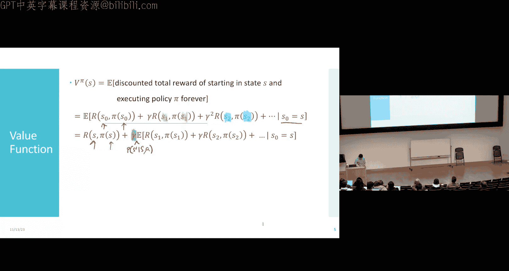
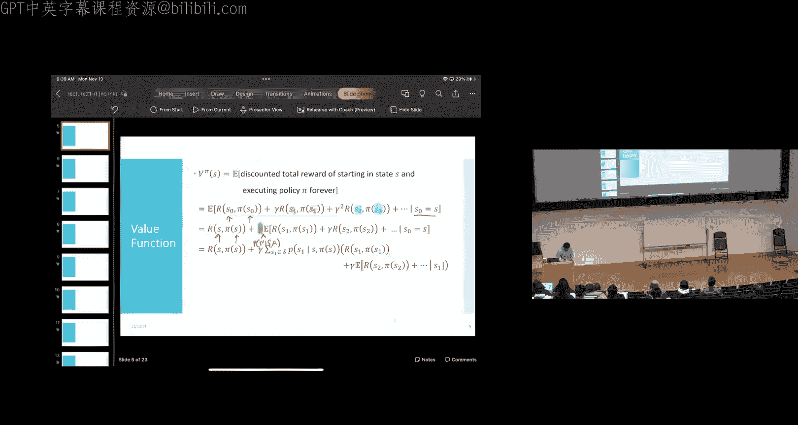
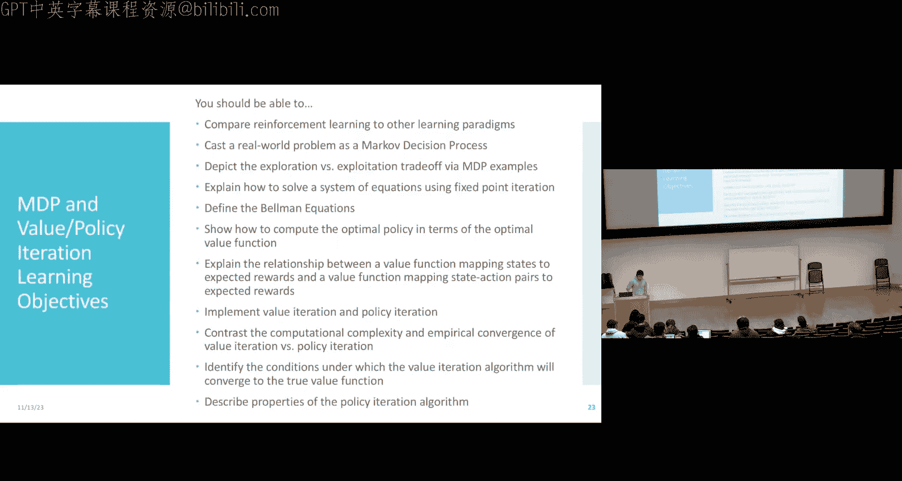

# CMU《机器学习导论｜Fall 2023 10-301⧸601 Introduction to Machine Learning》中英字幕（deepseek p21 Lecture_21_Reinforcement_Learning_Value_Policy_Iteration.zh_en -BV1Z2cUefE4A_p21-

## 🤖 CMU《机器学习导论｜Fall 2023 10-301⧸601 Introduction to Machine Learning》中英字幕（deepseek p21 Lecture_21_Reinforcement_Learning_Value_Policy_Iteration.zh_en -BV1Z2cUefE4A_p21-

### 概述

在本节课中，我们将学习强化学习中的值函数和策略迭代方法。我们将探讨如何使用值函数来评估状态的价值，并使用策略迭代来找到最优策略。

### 值函数

**定义**：值函数 \( V(s) \) 表示在状态 \( s \) 下采取最佳策略所能获得的最大累积奖励。

**公式**：

\[ V(s) = \sum_{s'} \gamma \cdot P(s' | s, a) \cdot R(s, a) + V(s') \]

其中：

* \( \gamma \) 是折扣因子，表示对未来奖励的重视程度。
* \( P(s' | s, a) \) 是在状态 \( s \) 下采取动作 \( a \) 后转移到状态 \( s' \) 的概率。
* \( R(s, a) \) 是在状态 \( s \) 下采取动作 \( a \) 后获得的即时奖励。
* \( V(s') \) 是状态 \( s' \) 的值函数。

### 策略迭代

**步骤**：

1. **初始化策略**：随机选择一个策略 \( \pi \)。
2. **计算值函数**：使用值函数公式计算每个状态的价值。
3. **更新策略**：使用贪婪策略更新策略 \( \pi \)，即在每个状态选择使值函数最大的动作。
4. **重复步骤 2 和 3**，直到策略收敛。

**公式**：

\[ \pi'(s) = \arg\max_{a} V(\pi, s) \]

其中：

* \( \pi' \) 是新的策略。
* \( V(\pi, s) \) 是在策略 \( \pi \) 下状态 \( s \) 的值函数。

### 价值迭代

**步骤**：

1. **初始化值函数**：将每个状态的价值初始化为 0。
2. **迭代更新值函数**：使用值函数公式迭代更新每个状态的价值。
3. **重复步骤 2**，直到值函数收敛。

**公式**：

\[ V_{t+1}(s) = \sum_{a} \pi(a | s) \cdot [R(s, a) + \gamma \cdot \sum_{s'} P(s' | s, a) \cdot V_t(s')] \]

其中：

* \( V_t(s) \) 是在时间步 \( t \) 时状态 \( s \) 的值函数。
* \( \pi(a | s) \) 是在状态 \( s \) 下采取动作 \( a \) 的概率。

### 总结

本节课中，我们学习了强化学习中的值函数和策略迭代方法。我们探讨了如何使用值函数来评估状态的价值，并使用策略迭代来找到最优策略。这些方法在解决强化学习问题中非常有用。

**本节课中我们一起学习了**：

* 值函数的定义和公式
* 策略迭代和值迭代的步骤
* 如何使用值函数和策略迭代来找到最优策略