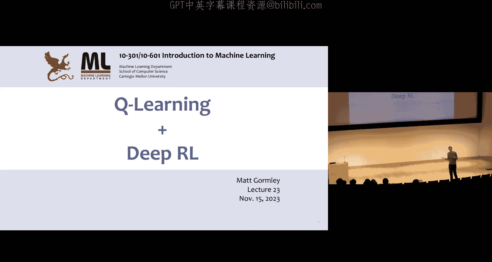
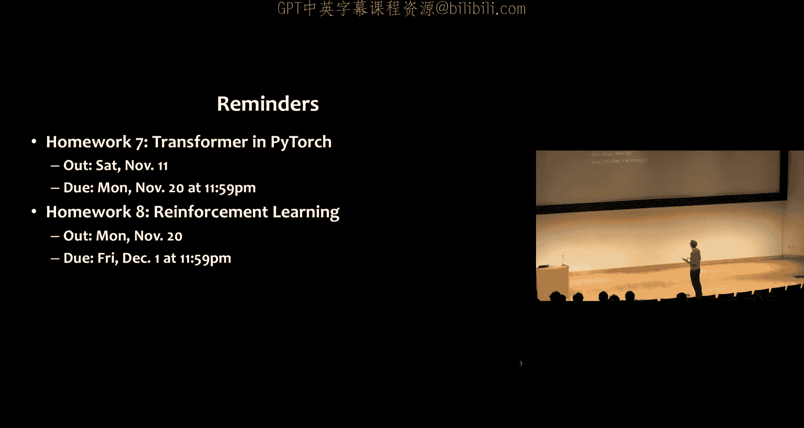
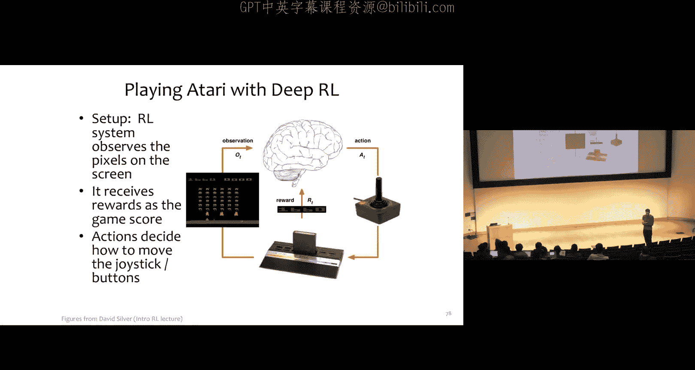
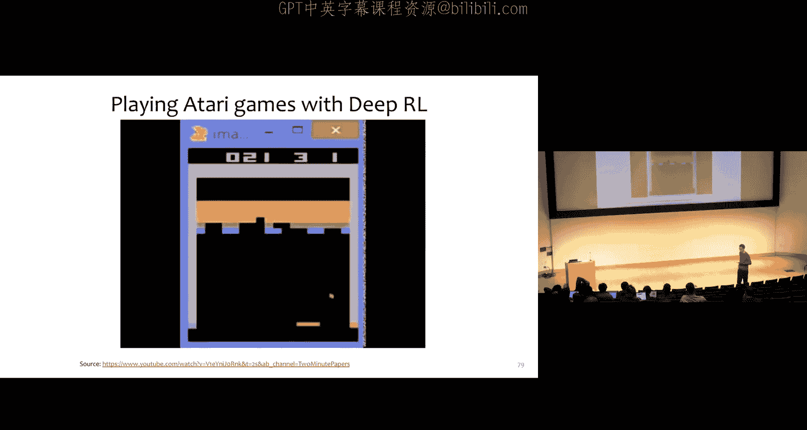
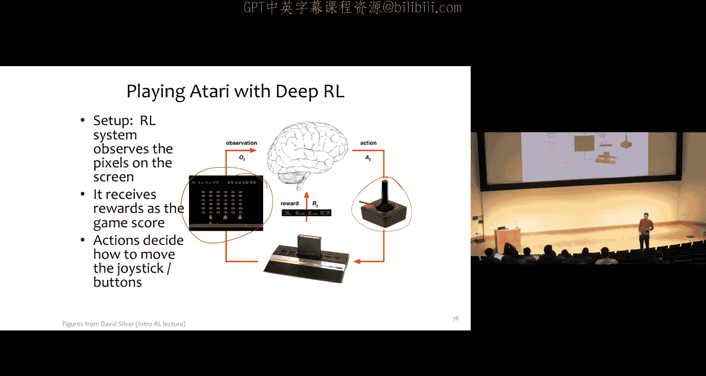

# CMU《机器学习导论｜Fall 2023 10-301⧸601 Introduction to Machine Learning》中英字幕（deepseek p22 Lecture_22_Reinforcement_Learning_Q-Learning_Deep_RL.zh_en -BV1Z2cUefE4A_p22-

Alright， welcomecom back。 Today， we are。😊，Going to take what we've been doing in reinforcement learning and expand upon it in a really cool way because we're going to essentially。

Look at these dynamic programming algorithms that we've seen up until now and make two really important changes one is we're going to adapt the dynamic programming so that it feels almost like we're doing like online learning right we're kind of adaptively updating these tables。

And then that's Q learning second， we're going to say， you know what。

 honestly keeping tables around is very old fashioned。😊。

Why don't we replace the table with a neural net？And that will give rise to deep Q learning。

 which is going to be our example of deep reinforcement learning。

Okay， here's the usual reminders。嗯。

So I think nothing to say there。So I want to just recap value iteration and policy iteration because that's where we left off so value iteration looks like this we initialized some big table of values right you could when when I say table I guess what I really mean is you know this is the。

It's like a giant vector and this is like V of state one。

 V of state two all the way down to V of state。Whatever the size of your state space is， okay。

 and basically at each step。So while we've not converged， we loop through all of the states。

And we do this update rule。To recompute v of S for each S。

And so it's the max overall all actions taking the immediate reward RF ofSA plus some discounting factor gamma times a sum over all possible next states。

Where we multiply together， the probability of transitioning to that state times the current value at that state v of S prime。

Once we've converged， that means the tables stop changing。

 we can return our policy pie as just the same as the update rule。

 but with an AG Max instead of a max。Okay， so we said we can also kind of write this algorithm by taking this entire thing inside the max and calling it Q of S and a and if we do that now you could see we're basically have an extra inner four loop at lines five and six that says for each action compute Q of SA as the immediate reward plus the discounting factor times this expected future value and now what was our previous update rule becomes v of s equals max over actions of Q of SA。

It's just like a rearrangement of variables， really。Okay， and then policy iteration。

 I'll just sort of briefly mention is doing this sort of back and forth between solving the Belman equations and improving the policy。

Okay。And so what I want to think about now is what about the case where you have stochastic rewards？

Okay， and we'll specifically think about this through the lens of value iteration okay。

If the rewards are stochastic right up until now， we've assumed that you know given a state action pair。

 there's like a fixed reward right， this would make sense in something like chess if you're in this state and you move your pondn too forward。

 there's a specific reward that you get for that maybe you know you know clean to E5 like takes a piece and that gets you a small reward。

 right？嗯。😊，So what we're saying now is what if instead the dynamics of the system are such that the rewards themselves are stochastic？

😡，So no problem because everything that we've been doing here still works。😡，In fact。

 the Q learning algorithm that we're going to look at doesn't need to change at all。😡。

But what we want to do here is consider how value iteration would look slightly different。Okay， so。

Before we were setting up are the sort of components of。

Our environment as consisting of a state space， an action space。诶。And a reward function here。

 so the only thing that I'm changing， and then we have transition probabilities。

 which if you have deterministic transitions would involve a transition function delta，So。

The only thing that I'm changing here is the reward function。😊，This used to be R of essay。

And now we've replaced it with R of SAS prime。Okay。

 and you can see now it actually mirrors sort of the arguments of the transition probabilities。

 so remember why we were doing this with transition probabilities。

 we were saying you know if you're if you're modeling a little robot and it's currently in state S。

Okay， and it takes an action， which is to move forward， right？So most of the time。

 it will move in this direction。But some of the time when it takess the action move forward。

 maybe it's on a hill and it's kind of gravelly and a little bit slippery and so when it tries to move forward。

 it moves forward and slides a little bit to the left， down the hill。Okay。

 that occurs with some probability and that new state that it lands in is S prime。

So now what we're saying is we're going to tie the reward to the state that it transitions to。

So now maybe if we extend our analogy so that it's not just on a hill but it's on a hill next to a cliff right so if it takes a step forward and with some probability it just moves forward that it gets reward of zero no cost。

 no benefit right but if it takes a step forward and it slides down the hill it might slide enough that it then falls off the cliff and now it gets negative $100 ward because you just broke $100 robot and it's sitting at the bottom of this little cliff right？

So this is the idea of stochastic rewards。And。And so。

Whereas before we had a Markov decision process that followed these steps nothing again really changes except where the reward comes from right so we're saying start in some initial state at zero for time steps T。

 the agent observes the state ST， it takes action AT， which is given by the policy pi。

It receives a reward RT， but now RT is given by。The the reward。

That involves the state that you transition to ST+1。

And the agent is going to transition to that state， ST plus one。With some probability。Okay， so。

So basically everything here is pretty much the same。

 but now we need to look at the optimal value function with this new stochastic reward built in。

And what we see is that so for the optimal policy function pi star。We can compute its value function。

Which would be。V of pi star。By。Taking an expectation。Over。诶。

The rewards that you would achieve by following that optimal policy， I star。

So this is the expected value of the reward at state zero。Taking whatever the optimal action。

 according to pi star at that state is。So this is like a0。And then transitioning to state S1。诶。

And here， the stochasticity comes in sort of。呃。Comes into play in the probability of sort of transitioning to a different state S1。

😡，So when we talk now about stochastic rewards， this function R is actually still deterministic for any given state action。

 state pair， you get back the same number。😊，But now because we're passing in S1 to the reward。

 there's some randomness involved in which function call you're making。

So it's the expected so the value function is telling us the expected total future reward。

 which is just the reward of following the policy， optimal policy from state zero。

 and then from state one， state two， and so on down the line。Okay。

 so what Henry did last time is he represented this optimal value function recursively。😊。

By writing it as。V star of S is a max over all possible actions A。

Summing over all possible next states as prime。Where we take。The probability。Of。S prime。Given S&A。

 times our immediate reward plus gamma times v star of S，So here it's saying， you know。

 for each state S prime， there's some probability of transitioning to it。

And what we want is sort of the expected future reward for each of those possible outcomes。

So if if there were just sort of two possible states in the summation， right。

 so say we're back to our robot and the two possible states where it moves directly forward or it moves forward and slightly to the left。

Okay， then let's say it moves forward with probability 0。7。

And it moves slightly to the left with probability 0。3。

 those are the two possible outcomes that we're taking this sort of expected future reward over。And。

What we were able to do last time was because the reward function did not involve S prime。

 it was just defined as R ofSA。Then we could actually take this term and move it outside this summation。

😡，That's the version of this that you saw last time。

 and that's why we had something that looked like this。

 which is V star of S equals max over a R of SA plus gamma times that summation。Okay。So the point is。

 point of all of this is that the value iteration algorithm looks exactly the same as before。

 it's just that we've moved the reward inside that summation。

 inside the multiplication of the probability。So this is our value iteration algorithm。

 it's just fixed point iteration applied to the recursive definition of the optimal value function。

 but now our optimal value function has just changed ever so slightly by pulling this reward inside。

😊，Okay， so。This is the story of how we can handle stochastic rewards。

 Let's actually see this in an example， Okay， so suppose。Com。We wanted to think about。

A state set up like this。Where。If we're。呃。Entering state zero。

 we get a safety and we have a reward of minus2。And if we are entering state five。

Then we get a field goal for three points and if we enter state six' or sorry enterstate yeah， six。

 then we get seven points for a touchdown。And every other possible movement that we make is going to get a reward of zero。

Okay， so。So this is like a simplified version of football。And basically。

We I guess we just like always kick the extra point I don't know it's close enough we mostly do so。

So here， the whole idea is that we can actually write down the optimal value function for this setting where we have deterministic rewards。

Okay， so what I want to do is think about how this changes if now we have stochastic rewards okay so it's the same example that you guys were doing last time except now。

We can see that I've put the rewards on arrows。All right so you can see that the rewards are effectively the same as before right。

 so this little arrow represents a reward of three for transitioning that direction。

 a reward of seven here and a reward of negative two there and everything else is zero。

And but now I want to suppose that。When we are in state four here。

The probability of getting a touchdown is 0。5 and the probability of a field goal is 0。5。

So now it's not that the optimal policy just guarantees that we can get a touchdown right there's some chance that you can't pull it off。

And so we can actually then evaluate。What would be？The optimal value function at state S4。And here。

 the way that we would do that。Is we would say。We're just going to。Compute。

This optimal value function based on what we know about the problem， so it's going to be。A max。

Over actions A。So our actions。呃A。Include。Going backwards。

For an immediate reward of zero going up or going to the right。

And what these probabilities are saying is that。Regardless of what action。We choose。

We're going to get oh， sorry， let's actually not let's say this is true for all a in。

Moving up or to the right。So basically if we're taking the action to try to get a field goal there's 50% chance we'll actually get a touchdown if we take the action to get a touchdown there's 50% chance we'll get a field goal Okay so in that case we could just say。

 well this max over a's it's actually going to be the same whether we go for a touchdown or field goal。

😊，So let's just assume that the max is going to pick touchdown。系。

And then we have a summation over possible next states。And。Those possible next states。Well。

 there's really only three options， we could end up in state， I guess， well， we didn't really say。

 but say three， four， five， and six。Right。Now， two of those states。

States three and four have zero probability。喂。Because if we have 0。5 probability of state 6 and 0。

5 probability of state5， then there's zero probability of transitioning to the other states。

And then we're going to have state probability of that state。Times immediate reward。Our SAS prime。

Plus， gamma times。V of S prime。So we can actually just work out exactly what this would be for this case。

By saying we're going to have。This probability， probability of S6， so that's 0。5。

Times the immediate reward of seven。Plus， the future reward， which is always going to be zero。Okay。

 plus。This probability。Of 0。5。Times three plus the future reward of zero。对定。

And the average of three and seven。Is just five， and that's what gets us our final answer here。是。

And if we assume that all other transitions。Or all other transitions occur deterministically like there's no other randomness here。

 then these would be the rest of the V star values based on that。

They're just discounting by a factor of game。Okay。Okay。

 so this kind of wraps up our picture of how we could do reinforcement learning by dynamic programming。

Now we want to think about how we could do this sort of in an online way。And to do that。

We want to think about one of the greatest letters in the alphabet。The letter Q。So。In fact， you know。

 there's a lot of things that start with the letter Q。

 there's like Broadway musicals involving puppets。There's characters from James Bond。嗯。

There's that crazy game from Harry Potter that you can actually go watch outside。

 well when the weather's nice， you can watch here at CMU。嗯。And not only that。

 there's the Q table that we had been talking about before。It also starts with Q。And it ends with Q。

 I guess。So this Q table。😊，Maybe it actually ends with E for。Be specific about it。

 but so this Q table。Is not just useful because it allows us to kind of like rearrange variables。

It turns out that this rearrangement of the value iteration algorithm where we incorporate this Q table actually kind of gives us insight into something really powerful。

Okay， so what this Q table actually means is it's a representation。Of。

The expected total discounted reward of taking an action A in state S。

Assuming all future actions are optimal， that's what Q star of essay would be。And。

And so we can actually write this down directly， this is what。呃。

What we would want if we want to represent this sort of optimal value function here。

 so it would be the immediate reward that you get for taking action A and state F。

You'll notice we're back to deterministic rewards here， but if you wanted to do the。

The stochastic rewards， you could just add that S prime back in and fold it back in on the other side of the probability multiplication。

Okay， so it's the immediate reward。Plus， the expected total future reward。

Which we get discounted by gamma， so again it's just a sum overall next states probability of the next state times the future reward in that state。

 according to V star。Okay， so。If we want to write down V star。In terms of Q star， we can do that。

 it's just v star of S prime as a max over all possible actions， a prime of Q star of S prime a。

So now we actually kind of have this circular thing。

 we're defining Q star instead of v star and v star instead of Q star。😊。

This is not good because what we were doing before when we came up with the value iteration algorithm was we said that we're。

呃。We're going to write down the star recursively。And then we're going to learn V star by fixed point iteration on that recursive definition。

So what we want is a recursive definition of Q star。And then we'll kind of do the same thing。

 And and so we could get that just by substituting in。

This Q star version of V star into the Q star definition。Okay。And if we did that。

 so if we take this bit and substitute it in here。Then our new definition of Q star。

Is exactly the same as the original， but now inside where we're multiplying the probability。

 we have a max over possible actions of Q star of S prime AP。2。So。呃。

So why are we going to all this trouble？嗯。We're going to this trouble。Because。

Q star gives us something that we couldn't get when we were working with V star。

When we were working with V star。And we wanted to compute the optimal policy。😡。

We had to know a bunch of things， we had to know the reward function and the transition function。

Okay。But now。We're seeing that if you know Q star， you can directly compute pi star。

Let's actually rate out what pi star of S。Would be if we were writing it in terms of V star。

So what would pi star of S be if I didn't have Q star， if I only had the table V star。

 how would I compute pi star of S， the optimal action？To take at state S。

A ground to wave prime of this comment。So the。ASt of。So remember， V star is just going to take an S。

So if I write it like this。Well， this is a problem because。Now what I have is for all A。

We get the same value。So that can't be it， we must be missing something。So this can't be right。Yeah。

 you can see something。Yeah， so if we look at that Q star definition。Right。😊，At the very top here。

This only involves V star。So pi star of S would be the immediate reward。Plus， discount factor times。

S prime in S。P of S prime given S and A。Times v star of S prime。Okay， so if we have V star。

 we can compute the optimal policy， but what but we also need the reward function capital R and。😡。

The state transition proba is P。Okay， let's go back to our robot example。Suppose our robot。Is。嗯。

Is currently at some state， and you have a V star table。Right suppose I just give you a， I like。

 I don't know you're you have some fairy godmother and she just hands you a V star table and says。

 look now you have a V star table， you can go， you know。

 solve that reinforcement learning problem you were trying to solve and you're like great， okay。

 so you take your robot and you look hard and you say， okay。

 I have a problem now I have this V star table。 I know the optimal value that I would get。If。

I end up in this state or if I end up in this state。

 or if I end up over here in this state right for any state。

 I can I can say what the optimal value would be。Okay。

But if I don't know these transition probabilities。

Then I won't be able to figure out what action to take， same with the immediate reports。Right。

So V star can't get us very far， but Q star can get us really far without R andP。Okay。

 and in general， it's not realistic to assume that in like a real world physical scenario that you would have access to R&P。

O。So。So here this。This transition here is just that， you know。

 this is sort of what we would have if all of our transitions were stochastic。So suppose instead。

 you had a deterministic transition function。Okay， then we would get everything looking like this。

Right。不。😡，We still， even if we had V star， even with deterministic transitions。

 we would still need R and Delta。To compute the optimal policy。So that's also unrealistic。Okay。

So the whole idea of Q learning。Is that。We can basically run something that looks very similar to value iteration。

But we can do it without。Access to R and P。Okay， and the whole idea is that we're actually going to allow our agent to go out into the real world and explore it's actually going to take real actions。

It's going to receive words and transition to actual states and we'll just use those。呃。

Sort of state action reward next state tus as training data。Okay。

 so let's look at this in greater detail。So we're going to assume the factor in an initial state S。

And we're going to initialize our Q table。Which is now it's not just a vector Now。

 it's actually it's actually， you know， a matrix， right， where it has one row。For each。State。So S1。

 S2 up to。You know， S size of s and one column for each action a2 up to a size of a。

And we initialized the whole thing to zeros。And then we say， okay， while we've not converged， well。

 while true， let's say we're going to take a random action A。

And then the environment is going to give us a reward。Okay， now you'll notice that on the slide。

 you can see capital R there。But the point is that you are not calling like the algorithm is not calling capital R。

It's the environment's job， like the real world looks at what happens when you take action A。

 and then it hands you a reward。So you don't actually need to know anything about this function R。😡。

Okay， then you observe some new state S prime， this is just delta of SA。Okay。And。

And finally now we can actually do our update rule， this is where the actual learning happens。

Where we say we're going to update the SAF entry of that Q table。To be whatever the reward are was。

Plus， gamma times the max over a prime of Q of S prime a prime。

And then we transition our current state。To the new state Sc。Okay， so。The first question is。

 where does this come from？What is that line？Yeah。Say it a little out。It's the next。

 it's not so yeah， so it it's looking over， it's looking over the possible。

 so let's say we're say our current state is S2， right？So we're currently in S2 and now。

We observe some new state S1。So what we're going to look at is for S1。

 we're going to look at all of these numbers。In the table。And we're going to pick。

The one that's biggest， right？And and then we'll just add to that the actual reward that we got and we'll multiply the。

The max of the row by gamma discounting， so row instead of called， but yeah。

 that's that's the key intuition。Okay， so the source of that update rule。

Is just fixed point iteration， right？This is the recursive definition of Q star。And it。

 so if we were running fixed point iteration， right。

 we would just update Q star of we would just update Q of SA to be RSA plus gamma times the max over Q star of s prime a prime。

Where S prime is just Delta SA。Okay， so S prime is just Delta SA， little R is just R of。

Capital R of SA， and so in our update rule。We're just doing one update。

According to fixed point iteration。Based on the actual reward we saw and the actual state we transitioned to。

Okay， so you can think of this as like the first many steps here are just sort of in an online way。

 we're gathering these training samples that consist of SA R and S prime。And。

Where S is the current state and S prime is what we're transitioning to。

And then for each of those samples， we're doing exactly what fixed point iteration would do with that data。

Okay， so。呃。This was with deterministic transitions。So if we want to instead。

Work with stochastic trends oh sorry actually let me。Jump here first so。

So the first oddity about this algorithm， this algorithm would actually work。

 so there's no problem with this algorithm。It's just that。You know。

 if your robot is really expensive。That you're trying to learn this for。

 you might feel a little uncomfortable with this algorithm。Because as we said， like， you know。

 maybe your robot is driving around potentially hazardous terrain with these little drop offs that that it could break when it falls off of。

And yet every time we're just taking a random action。So。For one。

 that means that we're not going to spend a lot of time wherever the high rewards are。

 because we'll only get there randomly every so often and for two， you know。

 if we're driving along the side the edge of a cliff，You know。

 there's just like a really high chance the robot is just going to drive right off the edge。Okay。

 so it would be better if instead of taking fully random actions。We did what's called。

An epsilon greedy action。Okay， here's the idea of an epsilon greedy action。So with probability。

One minus epsilon。We take the greedy action， meaning。呃，A。Is going to be the Arg max。

Over the current row of that table we're on。So if here， if our current row。

If our current state is S 2， then we're going to look at。hThe max over our current row。

 which would tell us， you know， what it thinks is the best possible action you could take from our current status us to。

Otherwise， with probability， Epsilon will take a random action。Okay。

 so this is nice because now there's always some chance that you're going to do some exploration。

Meaning you're going to take that random action but。

There's also a one minus epsilon probability that you'll take this greedy action。

Which is sort of probably a safer action and more likely to result in high reward。

And then all the rest of the algorithm stays exactly the same。

And what's beautiful about this is regardless of how you do this。

 random actions or epsilon greedy actions。As long as epsilon is not chosen to be zero。

 as long as you sometimes take random actions。Then we can guarantee convergence of this algorithm。

Okay， so。Here what we have is。The same algorithm， but now for the setting where we don't have deterministic transitions anymore。

Okay， so now we're going to think about what happens when we have。Sttochastic transitions。Okay。

So when we have stochastic transitions。嗯。We are。Doing。Almost exactly the same algorithm as before。

Okay， so let's let's just kind of look at all the steps so we initialize the Q table to all zeros just the same we take an epsilon greedy action that's the same。

We receive a reward R we observe our new state s prime this is really effectively the same right but on the previous slide this said S prime equals deelta SA now it just says we sample it or well。

 the environment samples it from a probability distribution。Great。The point is that。啊。

We don't actually care where that state S prime came from。

 It's the environment's job to give it to us。And we're just going to use it。

And now it happens to come from a random place。Okay， but the change here is actually how we update Q。

Okay。So the update to Q。Is。So the update that we were using before is on the right here in parenthesesis R plus gamma max a prime Q of S prime a prime。

 and that's r plus gamma times the max of the row of the state you're transitioning to。

But you see what we're actually doing is sort of this。This exponentially decaying average。

Of whatever your current value is。Or it's a running average of whatever your current value is in the table Q of SA。

With whatever you would have updated it to if you had deterministic transitions。😡，And so。嗯。

Why would we do this？Why not just take？The update， the R plus gama max a prime S prime A prime。

It was good enough before。Why shouldn't we use it again here？This is not obvious。

 why don't you take a minute， talk to your neighbor about this。See what you can come up with。

Then we'll try that again。So the question is， why not just do the update as we did before with deterministic transitions。

 what could go wrong？All right， I think you've had a chance to think about this a little bit。

 why not just do the deterministic update？Ideas， yeah。Yeah。

 so why does it matter so after multiple iterations we'll forget the previous update。

 why does that matter someone else？Why would it matter if we forgot the previous updates？对了。おか？Yeah。

 so remember that if we knew the P function， our update rule would sum over all possible next states S crime。

And multiply in the probability of each of those outcomes。Okay。

 so suppose you're playing a game like backing？This is actually a great algorithm for learning how to play back camon。

 so Ba cameon has's got these little white and black pieces， but there's dice involved。😊，And so。

 at a given state。You know， you can look at the board and you can say， well。

 I have this really aggressive action。And that I could take。

 and then I also have some sort of much more conservative action。

But I don't know what's going to happen in the next round， and so the action that I take。

Is going to lead to some other state with some probability。

So let's say that the aggressive action that you could take。Has really high reward。

With probability 0。01。Okay， the conservative action has a reward or has like， you know， zero reward。

Wai，Let's say not zero， but like some small reward， but with really high probability， 0。99。

So if you were to take the aggressive action。Okay， there's some chance that when you do that。

 you will。You will get some really high reward with probability 0。01。Okay。啊。So oh yeah。

 so let me let me actually let me narrow in on that specific aggressive action let's let's think only about the aggressive action so with probability 001 you get really high reward。

 but with probability 0。99 let's say you actually lose the game。So what that would mean is that。

If the last time you took that action。You got the really high reward and you updated with the deterministic transition only。

Then whatever cell was， whatever value you had before。

Um would be overwritten by a really high value saying we should always take this aggressive action because it seems really good。

Okay， the next time you come along。Okay， if your epsilon greedy procedure is going to say， well。

 we should definitely take that action because we're going to get this high reward， right？

But that's not really true， right， it's only going to occur with probability 0。01。With probability 0。

99， you lose the game and get a big negative reward。

So what we want to establish in Q of SA is sort of some representation of those probabilistic outcomes。

😡，And that's exactly what we're doing when we keep an average over these。

 so 99 times out of 100 you're going to lose the game。

And one out of 100 times you're going to get this high reward or maybe win the game。

And so we want Q of SA to keep an average over those possible outcomes。

And that's why we do it this way。So we can actually just do a sort of an algebraic rearrangement of what's here as being Q of SA becomes Q of SA plus alpha times the。

This is the deterministic update minus Q of essay。And so。What I like about this other way of。Is that？

U。It kind of makes it look sort of like something like a gradient based learning rule right that we're more to be or a perceptron style learning rule right。

 we're saying here's your current value， Q of SA。And we want to make some adjustment to the current value。

 right？How much of an adjustment， well， it would be the difference between what it would be if you did the deterministic update with what it currently is。

But we only want to make that adjustment， that's like a little gradient step。

According to some learning rate， alpha。So if alpha is large。

 we're going to overwrite what we remember about this state quickly， if alpha is small。

 we'll overwrite it slowly。Okay。And so in fact the。

The right side here in parenthesesis is called the temporal difference。

 and this way of doing learning is called temporal difference learning。And。

And so this actually kind of offers for us a picture of the first algorithm。😊，That was used to。

Play back in them。And it was the algorithm at the time was called TD Gammon。And。

And it basically provided a more effective way of learn。So。Okay。

 so now let's look at an example of this Okay so we're going to have this is not the stochastic rewards version。

 this is the deterministic rewards version Okay so you know the rewards function by now。😊。

And the question is。Which set of blue arrows？Roughly corresponds to Q star of SA。

And your options here for this poll question， this is poll question one。Are A the top option？B。

 don't pick that， that's the toxic option。C， the second one and D， the last one。Com。All right， so。

You guys have successfully ruled out option A。Option A is just showing you the exact reward function。

 right so that's not it。Q star of essay is going to be more interesting than that。Came in at 34% C。

 54% D， so let's actually going of look at this a little more carefully。So which of these is it？

So Q star。Is going to be R of Sa plus gamma times v star of deelta SA because we have deterministic transitions here。

And so we can actually look at。You know which of these actually makes sense？嗯。

By thinking about V star of us。Okay， because we already established that V star of s is going to be seven in state four and then it's going to just decrease by 0。

9 going to the left。Okay。So what we want to think about is。Which of these？

Makes sense as the answer for。For Q star， so let's just pick one number here。Here。

 these two numbers are different， 6。3 and 5。67。对。So should it be 6。3 or should it be 5。67？Well。

 if we look at how this actually works out when we're transitioning from state four to state three。

So we could write this down as Q of。S 4。And taking action。Move the left。对。

So what's our immediate reward， what's our of essay？Zero。Good。Okay， now we add to that。Gamma。

Which is 0。9。Times v star of Delta SA， so let's look at Delta SA， so Delta of S4。

 take action move left。Is what？State S3。Okay， so we're saying this should be V star。Of S3。

What's a v star of S3？Just read it off， right， 0。63 or 6。3 rather。

So what that means is that this should be 0。9 times 6。3， which is 5。67。So that means that。

D is the correct option。And you can see it discounting by that gamma 。9 going to the left。Okay。

That is how you would actually compute sort of Q star， Oh yeah， question。

So for the parameters for the traininginess and learning。

practice explore these typically and also for thes we typically like that time as well we're not constantly exploring even as our good questions so the questions are basically how do we choose epsilon and how do we choose alpha？

So in practice alpha， let me start with alpha， so alpha is actually。Typically chosen。To be。嗯。

LetsSee if I can。Double check what I write down here before I write it down。Yeah。

 so what we typically do for alpha。Is we we actually keep track of like time steps right。

 so here we could say。嗯。Alpha at time for so like say for a time step n equals one，2。3。Forever。

And then when we compute when we need an alpha， instead of using just the constant alpha here。

 we actually choose alpha n。And we set alpha N。To be。One over。1 plus。

The number of visits that we've made。To the state。And this particular state action pair by the NF iteration。

So what this is doing is it's basically saying。So if you choose alpha N in this way。

Now for state action pairs that you visit a lot。Alpha becomes smaller and smaller and so it's kind of like a decaying learning rate that we would use for say stochastic gradient descent or something where as we get closer and closer to the minimum we're kind of slowing down our learning that's essentially just what we're doing here and you can also view it as a way of keeping sort of a more careful running average。

Thank youSe。For excellent。So Epsilon， I think it actually kind of depends。On the problem。

 so we call this sort of choice of epsilon。The exploration exploitation trade off。嗯。And。

This exploration exploitation trade off。U。Is。Um。Is basically somewhat problem dependent。So often。

As in the robot example， like randomness comes with some actual cost。

And the cost could either be could be it could take one of two forms， one is that it could。呃。

It could have could actually lead to like failures that are monetarily costly in the real world。

The other is that it could sort of affect how quickly we learn。

And how it affects sort of speed of learning tends to be somewhat problem dependent。So basically。

It's the case that if epsilon is chosen to be too large。For certain problems。

 you might not really learn very effectively because you're just always moving around so randomly that you never find the high reward states。

And then。As a result， you don't make many meaningful updates to your Q table。呃。

Whereas if epsilon is too small， then you might find like one good reward state and just keep going back to it over and over again。

 and that can also be bad。So， so it ends up being a hyperparameter that you tune。

 you know in a problem specific way， depending on。Like on sort of empirical behavior。

my question is like would it change based on time dependent intuitively it's like first and then like after you kind of explore the entire state so you can decay epsilon you just need to choose your decay such that it doesn't go to zero so if it goes to zero then we have a problem with convergence but as long as you keep it positive you're fine。

哎。Okay。So。Let's see how this thing would work on this little example。 So suppose we are。

In some state， like state three， and we want to move to the right。Okay， so。

We could think about what the Q learning update would actually do in this case。

So if we're in state three and we move to the right。

 then the environment gives us an immediate reward of zero， you can read it off the arrow。

On the slide， though， in general， you wouldn't be able to see these arrows。

And then we have our discount factor 0。9 times the max over the row for the next state that we transitioned to which was state four。

 so we moved from state3 to state  four， and so we take the max over this row。

 which in the first integration of Q learning is just a bunch of zeros so we update Q3 to the right。

 which is this cell。With a zero， kind of uninteresting。Okay。

 so now let's suppose we're in state four and we take the action to move up okay。

 so now we receive an immediate reward of three discount factor of 0。

9 again the max over the row for state5 is zero， and so we update this cell here from a zero to a three。

Okay， so that's the end of the second iteration。Okay， so now let's go back。

 let's let's suppose the table looks like this， but now we're in state three again。

And we move to state we move to the right Okay so this time we again。

Are going to take the max over this row。系。O， sorry， not the max over that row。

 the max over this row four。And we're going to discount it by 09 and we're going to add reward 0。

 So this time Q3 move to the right， we're going to update from 0 to 2。7。Okay。

So you can see now like the reward is moving sort of back through the table。

And we would kind of work on this over and over and over again until gradually the table filled out with values。

Okay， so what about convergence here？The Q table in this algorithm will converge to Q star with probability one。

Assuming the following five conditions hold。The first one is that each state action pair is visited infinitely often。

So how do we guarantee that well one way is making sure that epsilon is between between zero and one exclusive because that way we're always taking some。

Some random action sometimes and as long as your state action pairs are set up such that random movement will eventually lead you to every possible state。

 then that first condition is preserved。The discount factor needs to be between zero and one。

 the rewards need to be bounded， meaning just that like there needs to be some maximum absolute value of a reward that you could achieve。

 otherwise things could get a little wonky if you， I think it go off to infinities。And then。呃。

The standard thing is to initialize the Q table to all zeros， but in fact。

 if you initialize the Q values in the table to any finite numbers， it'll actually still converge。😊。

And then the learning rate does actually need to follow some sort of schedule。

 so the schedule has to have these properties that the sum of the alphas doesn't diverge to infinity or sorry the sum of the alphas does need to diverge to infinity。

 the sum of the squares where the alphas needs to go to zero and so the one that we looked at that takes visits into it to count works also if you just did one over t+1 that would also work。

嗯。So。It's guaranteed to converge regardless of how you visited the states so long as you're satisfying those other properties。

And in practice， it can take a lot of iterations to converge。Okay， so。Here's the thing though。

 you can actually。If you know something about your problem。

 you might actually be able to exploit that。嗯。Or just exploit this property of the algorithm to make learning go fast。

And so here's the idea。So let's think about。This sort of easiest may as ever right so it's got four states ABCD and the arrows are showing our rewards。

 so everything is zero reward except for moving from state C to D which has reward 100。

So our actions are just to move east and west。And we're going to assume that our gamma is 0。

9 and that QSA starts at all zeros。So let's suppose。That we start in state A。And。

We just keep moving east。Let's think about what the Q table values would be after each update。

So the first one we'd be in state A， we'd take the action move east。And we'd get a reward of zero。

 we'd be in state B prime， so we would update QAe as zero。Okay now we're in state B。

 we move east again。We get reward zero， we update QbeE to zero。Finally， we're in state C。

 we move east to D。We get a reward of 100 and we update QCE to 100。可。😊，So along the way。

 we collected this table， right？So what if？Instead of doing the Q learning update rule immediately。

What if instead we just collected that table？Without doing any Q learning updates。

And then we just ran the table in reverse order。Which a robot can't do right like a robot can't it can't be in this state。

 move to this state and then suddenly transport two states over， right？

But that's essentially what we're going to do here right we're going to say we're starting in state E。

 we move to the east， we get a reward of 100 now we're in state D and we update QCE to 100。Okay。

 now jump two states。West， right， because that's where our table was。Okay and from state B。

 if you move east， you get reward of zero and you end up in state C。ok。😊，Now， if you do the update。

 though， you get QBE as 90。Because QCE was already set to 100。

Now go two steps to the West and when we do the QAE update， we get 81。

So just by reordering our experiences。We went from very inefficiently learning。诶。

The Q table to learning it fully in the first shot。对。And so in practice。

 this reordering of experiences doesn't affect convergence and in fact it often leads to much better convergence and further。

 if you just kind of keep these experiences around， then you can learn from them over and over again。

Okay， so one question that should come up is do we need to retrain ourL agent every time we change our state space and the answer is well。

 yes， but whether your state space changes from one setting to another is determined by how you represent it。

So let's suppose we were trying to play the game PAman。

 and you represented your state space as the XY position on the map。74 pixels。

 152 pixels right so over here we're at you know pixels 74 152 and we learn what action we should take at that position。

Okay。So now suppose I take you to a new PACman map。Well。

 the actions that you should take at Pixel 74 152 are actually different。

And so if instead the state space had been represented as a window of pixel colors centered at the current PACman location。

Then when we were learning in this original map， we would have learned something like， well。

 if there's a bunch of dots and no ghosts。Right in front of me。

 then I should go right in front of me， right？And。That idea。

 that information that you learn would actually translate when you move to a new map。At。

And so this is the kind of the whole idea of。Of our state space representation is that you need to choose your state space carefully so that learning can be efficient。

Okay。So this was going to be another poll question， but let's just this is。Ill just say。

 skip this one。This is just another example of kind of what Q star of SA is so I encourage you to go just try this out you could actually just try it out for yourself。

For example， in like a little Excel spreadsheet if you wanted。

 you can actually just write down the Q learning algorithm or the value iteration algorithm directly。

And the answer here is actually。What it ABCD， you know， E none of the above？So instead。

 what I want to do is jump into deepRL。So。呃。So the idea of reinforcement learning has been around a long time。

 we saw that it was used in the 90s for temporal difference learning to learn backcamon。

But when people wanted to try reinforcement learning for go。

 where the idea is that you have this 19 by 19 board and players are alternating playing black and white stones。

 the goal is to sort of fully encircle the largest region on the board。嗯。

ThatThe thing that came up was the state space is really large for go。In fact， so for chess。

 the state space is something like 35 to the power 80th。Okay。

 there's 10 to the 80th particles in the universe。Give or take。

Go has 250 to the 150th different states。So if you want a state table。

It's you're going to have to have like multiple universes worth of particles to represent your state table。

 so that's just not going to work。So the key idea of deep reinforcement learning and the idea driving Algo。

Was that you instead define a neural network。To approximate your value function。

And then you train by something called policy gradient。对。

So what we're going to do is think about using an neuralNe to approximate our Q table and learn by what's called deep Q learning。

Okay， and oh， and as it happens， this way of learning did incredibly well better than human performance in some cases。

Okay， so what is deep Q learning， the whole idea is if our state space S is too large to represent with a table。

Then we can instead use a parametric function to approximate those table entries and this comes up all over the place if your states are pixels of a video game or continuous values of sensors in a manufacturing robot or sensor output from a self-driving car all of these are examples where the state space would just be too large to represent and so instead we write down a neural network Q of SA given parameter theta。

😊，So this is a function now。That uses theta to approximate Q star of SA。

And then we just learn the parameters theta via stochastic gradient descent with training examples that consist of state action reward state tus。

😊，Okay。So。The idea here is。Let's represent our states using some feature vector。可以。

So you could think about this as like pixels in a window around your current PACman location。

And maybe they're zeros and ones if they're black and white pixels。And so this is some vector。ST。

 that's an M dimensional feature vector。Okay， so what we're going to do is you define a neural network。

That takes in your feature vector and your action。And。

Does a bunch of computation with a neural network to get back one number？

Which you call Q of STAT theta。And whatever that number is。

 it should hopefully be close to whatever Q star of STAT would have been。Okay， now in practice。

 what we actually do is you build a model like this， you just feed in the state。

And then have it output k different numbers where there's one Q value for each of the possible k actions。

Because in practice， we always are going to need all k of those numbers。

 so you might as well just have your neural network directly compute allK of them。

Where here K is the size of your action space。So if your actions are moved north， south。

 east and west， then you would get back four numbers one for each。Okay。

 so what you're going to do actually in homework eight is not define a neural network。

 but just define a linear regression model。Very， very shallow neural network that there you have one linear regression for each action。

 so here's how that would work。You basically say we have a parameter theta k that corresponds to the k of action。

And to get Q of SK， you're just going to take the dot product of your state vector s with theta K。

Okay。And so you could think of this as accomplishing something really great。Because。

As long as so imagine the size of your state table is。Size of calligraph S。You know。

 10 to the 80th or something。As long as k， the number of actions， times m。

 the number of features is less than that than we've gotten a huge space savings。😊。

Because you're only going to need k times M parameters for this model。Okay。

 and then the gradients are actually quite easy， the gradient with respect to theta J of SK。

Is going to be zero if j is not equal to k and S if j is equal to k。

So the other way of kind of thinking about what we're doing here is that the gradient with respect to the full theta。

 which is like a matrix one row per action， is going to be a bunch of rows that are zero vectors。

 and then the kth row， which is this one， is going to be the vector s。

Because it's the only one that actually used those parameters。Okay， so we could ask ourselves。

 why don't we just do a sort of Q learning ish update rule？Like Q of SA theta。Goes to。R plus gamma。

Max over actions a prime of Q of S prime a prime。Why wouldn't we just do this？

Because this doesn't make any sense whatsoever right on the left here， I've written a function。

 this is like a neural network。You can't just set the value of a neural network right it's not a table。

 you don't just fill in what the value of the neural network should be at QSA No we need a loss function right。

 we need a loss function that tries to move Q ofSA theta towards that value。Okay。

 so here's here's the true loss that we would work with we'd have a sum of all states a sum of all actions and we'd say Qs theta should be close as possible to  Q star of SA and then square the difference right so this is like a squared error loss where we're trying to push。

😊，The model as close as possible to Q star as possible。Okay， there's a ton of problems with this。

 one， we don't know what Q star is。Two， we can't sum over all possible states we said there's。

 you know。More than the number of particles in the universe states。Okay， so what we do instead。

Is we just use stochastic gradient descent and consider one state action pair per iteration。

One element of that massive summation。And then we use temporal difference learning， right。

 where we say given our current parameters theta。What we would want， we would say Q star of essay。

 it should be something like this update。喂。They should be something like R plus gamma max a prime QS prime a prime theta T。

So let's call that sort of our target， why？And the whole idea is we're going to then set the parameters in the next iteration。

 theta t plus1。So that Q of SA with theta p plus1 is close to y。That's what we want to do。Okay。

 so our loss function is really simple， it's just a loss function that says。😊。

We're going to choose our parameters theta T plus1。So that theta t is fixed。

 so that we minimize the squared error between what the Q table will be at theta t plus1 with what we want it to be。

 why。嗯。So the algorithm looks almost the same as Q learning。

 but just with this slight change that now， instead of directly updating a table entry。

 we're just taking a stochastic gradient step。So we gather our training samples in the usual way。

 this gives us an STAT， RRT， STT plus1。And then we update theta T by taking a step opposite the gradient。

So here， theta t is just a constant。And now we say theta t plus1 is going to be the current theta t minus a learning rate alpha。

Times the gradient of our loss。Where I lost。Is just the loss that we saw in the previous slide trying to drive them closer together。

And not surprisingly， thanks to back propagation or the chain rule， whatever you want to call it。

The gradient that we're computing here is actually quite simple。It's just。Two times y minus。

Q of S theta t times the gradient of Q of S theta t。

So as long as your Q function is some differentiable function。

You just have the gradient of that function times2 times y minusq。And。

Since y is just this simple thing that we compute r plus gamma times the max overall all possible actions。

 we can directly compute y it's just a constant， and then we're back propagating only through the queue for these two terms。

On the right。Okay， so the last detail here is。Experience replay so just like I was saying we could reorder experiences with online updates for deepQ learning。

 the whole learning process is not independently and identically distributed as SGD assumes and as well you kind of quickly forget rare experiences。

What you can do is keep what's called a replay buffer or a replay memory and。

This just consists of the N most recent examples。E1 through EN。

 where each E is just the state action reward next state tuple。

And then you alternate between these two steps， you repeat repeatedly sample。

Experiences from your data D and apply that deep Q learning update rule to them。

And then you select an action and use an Epsilon greedy policy to receive a new experience that's added to D and pushes out the oldest experience。

And you can also do kind of a thing like that where you prioritize experiences with higher error。

And this is sort of in practice what Alphago does。Okay， so。So we don't have time to watch this video。

 so maybe I'll see if we can throw it in at the beginning of the next time， but in short。

 this algorithm is kind of stunning to watch and it can actually learn you know how to play like aari breakout。

 for example， among many other games just by looking at the actual pixels on the screen and taking actions as a human would with a joystick without any additional information about what's going on in the game。

So not only is it able to play alphaphago， it can also play your favorite classic video game。Okay。

 so we'll stop there， see you next time。

