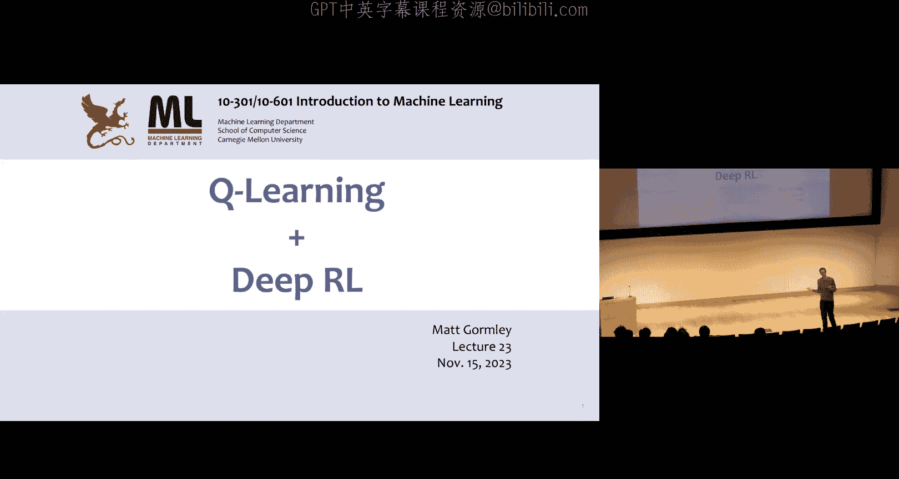
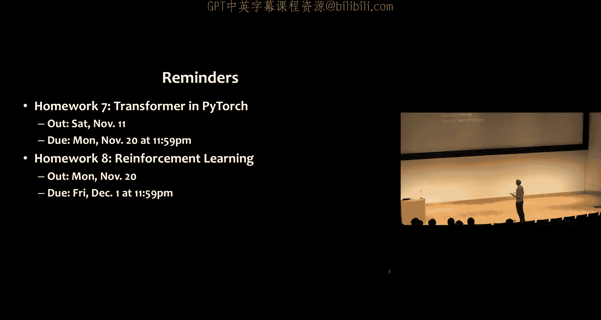
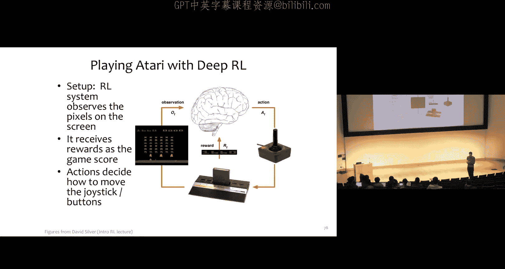
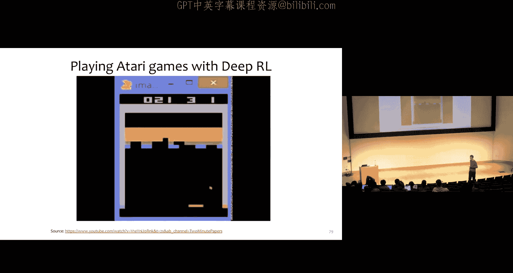
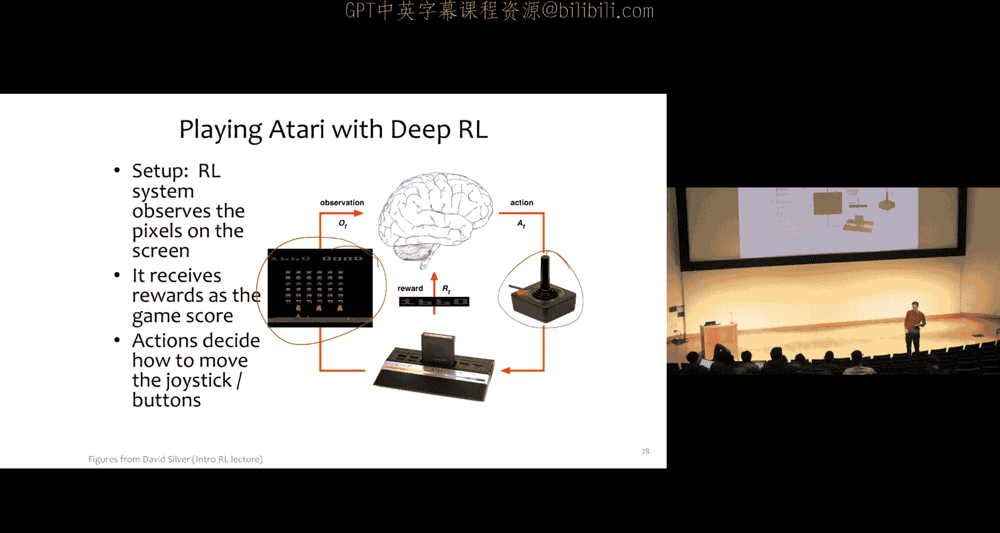

# CMU《机器学习导论｜Fall 2023 10-301⧸601 Introduction to Machine Learning》：强化学习之Q学习与深度强化学习

## 1. 回顾价值迭代与策略迭代

在本节中，我们将回顾价值迭代和策略迭代算法，这是我们在强化学习中已经学习过的内容。

**价值迭代**：

1. 初始化一个包含所有状态值的表格。
2. 在每个步骤中，遍历所有状态，并使用以下更新规则重新计算每个状态的值：
   $$
 V(S) = \max_{a} [R(S, a) + \gamma \sum_{s'} P(s'|s, a) V(s')]
$$
3. 当表格不再变化时，我们可以返回策略 $\pi$，它与更新规则相同，但使用 $\max$ 而不是 $\arg\max$。

**策略迭代**：

1. 初始化策略 $\pi$。
2. 使用价值迭代算法计算新的值函数 $V^*$。
3. 更新策略 $\pi$，使其与新的值函数 $V^*$ 相匹配。
4. 重复步骤 2 和 3，直到策略收敛。

## 2. 随机奖励

在本节中，我们将讨论如何处理随机奖励的情况。

**随机奖励**：

1. 与之前一样，我们假设给定一个状态-动作对，有一个固定的奖励。
2. 现在，我们假设系统的动态特性使得奖励本身是随机的。
3. 这意味着，即使给定一个状态-动作对，也可能得到不同的奖励。

**价值迭代算法**：

1. 与之前一样，我们初始化一个包含所有状态值的表格。
2. 在每个步骤中，遍历所有状态，并使用以下更新规则重新计算每个状态的值：
   $$
 V(S) = \max_{a} [R(S, a) + \gamma \sum_{s'} P(s'|s, a) V(s')]
$$
3. 当表格不再变化时，我们可以返回策略 $\pi$，它与更新规则相同，但使用 $\max$ 而不是 $\arg\max$。

## 3. Q学习

在本节中，我们将介绍Q学习算法，这是一种基于Q表的强化学习算法。

**Q表**：

1. Q表是一个表格，它存储了每个状态-动作对的预期奖励。
2. Q表可以表示为 $Q(S, A)$，其中 $S$ 是状态，$A$ 是动作。

**Q学习算法**：

1. 初始化Q表为所有零。
2. 在每个步骤中，执行以下操作：
   1. 选择一个动作 $A$。
   2. 执行动作 $A$，并观察新的状态 $S'$ 和奖励 $R$。
   3. 更新Q表：
      $$
 Q(S, A) = Q(S, A) + \alpha [R + \gamma \max_{a'} Q(S', A') - Q(S, A)]
$$
3. 将当前状态更新为新的状态。

## 4. 深度Q学习

在本节中，我们将介绍深度Q学习算法，这是一种使用神经网络来近似Q表的强化学习算法。

**深度Q学习算法**：

1. 使用神经网络来近似Q表：
   $$
 Q(S, A; \theta) = f(S, A; \theta)
$$
2. 使用随机梯度下降来学习神经网络的参数 $\theta$。
3. 使用经验回放来提高学习效率。

## 5. 总结

本节课中，我们一起学习了强化学习中的Q学习与深度Q学习算法。这些算法可以有效地解决强化学习问题，并在许多领域取得了成功。