# CMU《机器学习导论｜Fall 2023 10-301⧸601 Introduction to Machine Learning》中英字幕（deepseek p23 Lecture_23_Dimensionality_Reduction_PCA.zh_en -BV1Z2cUefE4A_p23-

Very， good morning。Today we're going to be talking about a totally new topic。

 which is dimensionality reduction so in some sense。

We've actually sort of thought about dimensionality reduction before， though never under this name。

 so the place where it showed up before is when we were thinking about learning neural networks like simple feed forward neural networks that take in say1 million features and then have a thousand hidden units in the hidden layer and then make some prediction。

So the process of going from that million。Let that length 1 million input vector of features down to just a vector of 1000 sort of hidden states you could think of as reducing the dimensionality of something from a million down to 1000。

So what we're going to do today is think about sort of a canonical method for doing this in a very specific linear way called principal component analysis。

😊，And we'll think about how to do it when you don't have supervised labels the way that we did in a neural network。

Great， so homework seven is due today， homework eight is out today and due on the other side of。

Thanksgiving B。Okay， so。So I think I mentioned this video last time。

 if you haven't checked it out yet， you should do so。

So let's jump right into dimensionality reduction。There's a lot of sources of high dimensional data。

嗯。These range from higher resolution images， say， consisting of。Potentially millions of pixels。嗯。

If you had， say multilingual news stories and you wanted to。

Represent the vocabulary of a bunch of different languages。

 each language might have you know hundreds of thousands of words in it。

 and so many languages together could quickly balloon to more than a million。Another example is。

Oh yeah。啊。Thanks。嗯。Thent click。Whatll fix them。Reportding in progress。

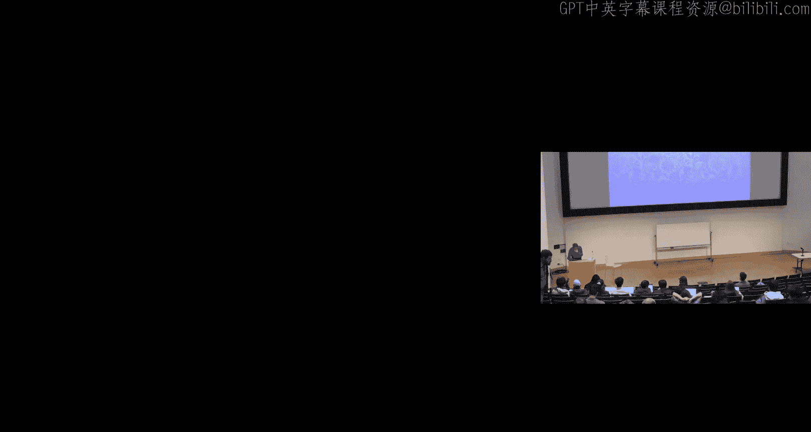

O。We'll be up and running in a second here。

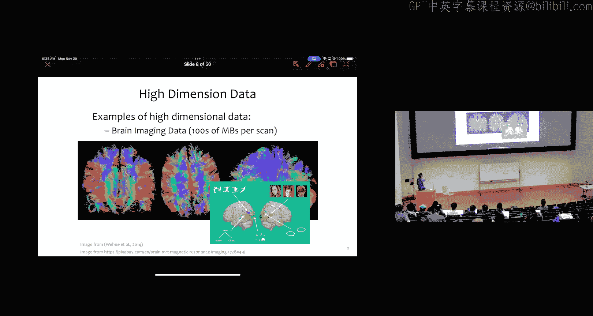

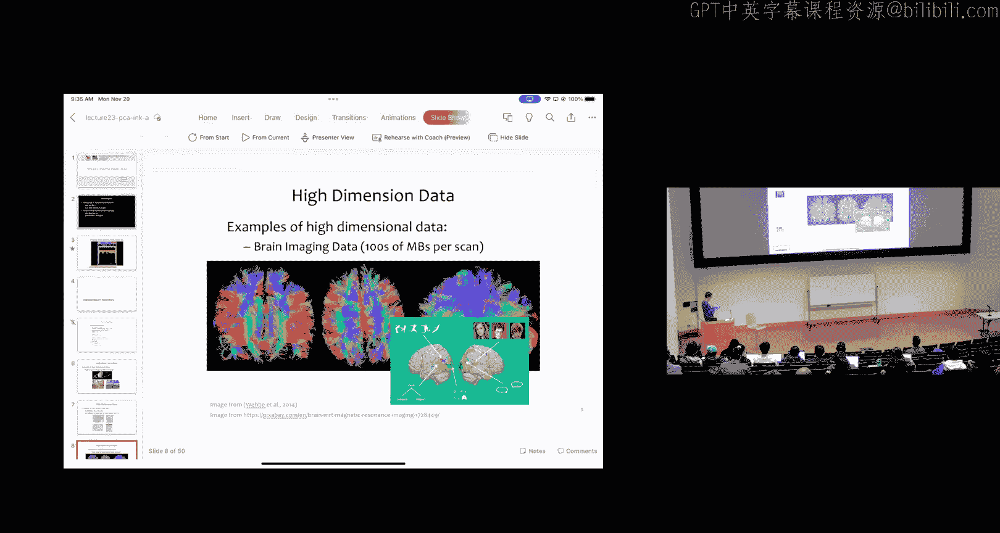

There we go， okay。

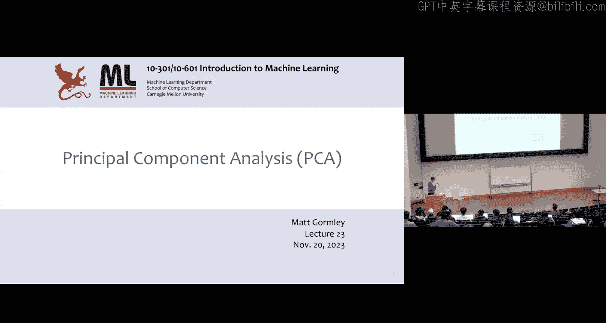

All right， so back to PCA here。

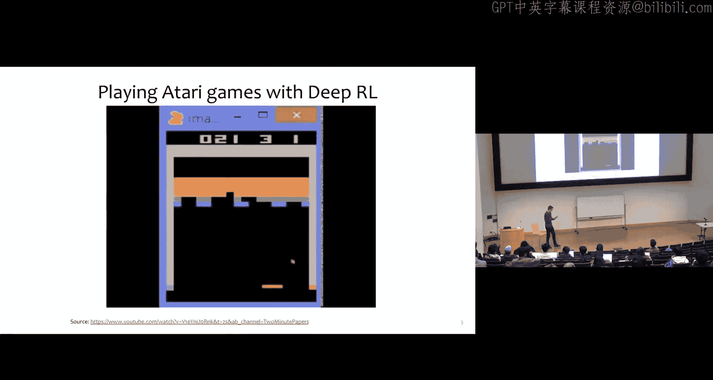

So another source of high dimensional data。Is that of brain imaging data， so this could come from。

 for example， FMRI or EEG and each sort of frame of data is already pretty high dimensional。

 but when you stack many frames of them together over time I could get really high dimensional data。

😊。

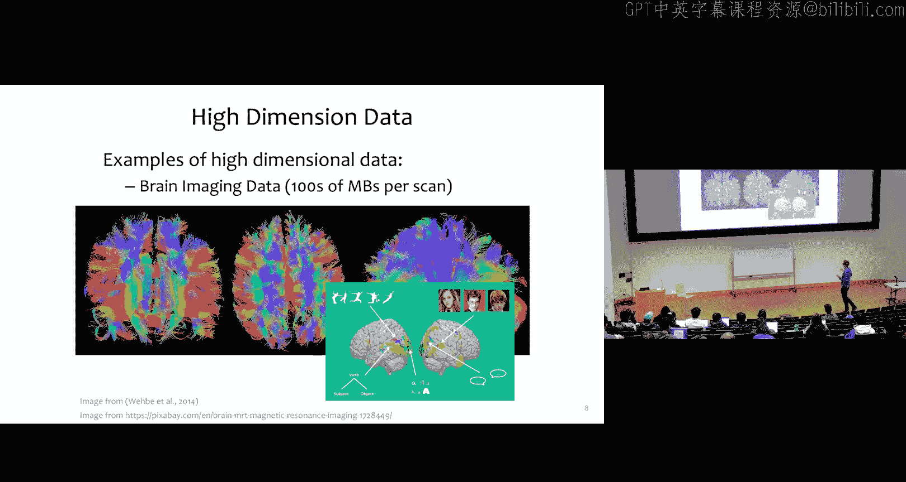

嗯。Another source of data would be customer purchase data， you know。

 they might have lots of information about past purchases。

 oh I love love G peanut butter man you just can't go wrong with Jeff。

 I know the natural stuff is it has that delicious salty crunch but。Oh， I forgot to get the yeah。

And then some things are actually a little out of date。

 but you know some things just never get out of date。

 I mean even if deep learning has really taken over so anyway the point is there's lots of sources of high dimensional data out there and depending on what you want to do with it。

 it can be useful。😊，To take that high dimensional data and reduce it down to some lower dimensional space。

And there's a lot of dimensionality reduction algorithms out there that do exactly this。

 often in an unsupervised way， and could one way that you could think about what they're doing is sort of extracting some hidden structure that's latent in that data。

😊，And so there's lots of different examples of this PCA。TN is a popular one。

 autoencors are sort of a neuralnet's way of doing it， we'll talk about matrix factorization。

And this can be useful because you might want to visualize your data or maybe just sort of make more efficient use of your resources。

嗯。As well， we've talked a lot about how having fewer dimensions can sort of lead to general better generalization in a statistical learning theory sense。

Finally， in removing some of the dimensions， you might also end up removing noise from your data if you happen to know that some of your data is noisy。

Okay， so。This one slide sort of represents everything that we're going to do today。

 so I want to start with kind of the big picture of where we're going because it's a little bit different from how we often tell the story of of say a particular method or a particular algorithm okay so the idea is first we want to just kind of think about dimensionality or reduction what it is what it's actually doing。

And towards that end， we're going to think about just a very simple strawman algorithm called random rejection。

嗯。Then what we're going to do is is sort of backwards from what you might expect we're going to define what it is that PCA is going to give us。

Without yet saying how we get it。So we'll just say like what is the mathematical object that comes out of this PCA thing？

Then we'll say， by the way， there's actually like a variety of different algorithms。

To get what we want。And finally， we'll look at an example。Okay。

 so why is it that we're doing it this way， well it's going to turn out that what PCA is going to give us is going to be the K eigenvectors with largest eigenvalue from a very specific matrix。

And the linear algebra people over the last many， many decades have spent a lot of time figuring out how to efficiently get an eigen decomposition or some extract some eigenvectors from a matrix。

 and so we'll actually be able to employ sort of existing algorithms to solve this problem once we actually establish what it is that we actually want。

Okay， so let's start with this idea of random projection。Okay。

 so the idea here is we want to get down to just k dimensions from some higher M dimensional space。

 so M is larger than K。And so you could think of our data as being sort of end。

Unlabeled training instances， each one is an M dimensional vector。And our algorithm is going to。

Do the following， it's going to randomly sample a matrix V。Okay， when I say randomly sample。

 what I mean here。Is that each entry， so this matrix is going to be K by M。And each entry。

 the KMth entry， is just going to be sampled from a01 Gaussian。哎。

And then what we're going to do is use that matrix to take our vector Xi and project it down to a lower dimensional UI just by multiplication。

And then we'll project back up to the original dimensional space by multiplying by V transpos。Okay。

 so let's actually think about what it is that we're trying to do here。嗯。

So when we do this projection。In step two。We're basically saying that we have some vector X that you could think of as an M by one matrix。

 I mean， it's a column vector。And we're multiplying it by some k by M。Mattrix V。

So the result that we get back must be a K by one vector。

And that's what we're going to call our low dimensional representation。So now。

The first thing to notice here is that。This low dimensional representation is a linear projection。

So if this was producing the first hidden layer of a neural network。

 how would we change this computation？Suppose we wanted UI to be the first。

LayHdden layer of a neural network， what would you do differently？对啊。

the number you're not in that how many times you should。Yeah。

 so you're definitely right that we want to project。From this M dimensional。

Feature vector down to essentially what we're doing is down to K hidden units， right？

But I claim that。This UI isn't really。Like hidden units of a neural network。

We would need to do some additional computation。To get the hidden units。

What is it that we usually do differently？Yeah， we need to have some activation function right if we took UI and we applied element wise。

 something like the sigmoid or the TNH function， a RE。

 then the output of that we could call hidden units of a neural network。😊。

But here we're just doing a linear projection。Okay。

 so let's think about this for two dimensional data so we have these these six training instances x1 through x6 and they're in two dimensional space and and so here。

Oh， I guess we should think this is like think about this as x1 and x2 axes and when we project down。

So in this case， we're projecting down to one dimension， so k is equal to 1 m is equal to two。

 which means in this simple example， vector this matrix v is just a one by two matrix。

 so it's a vector。Okay，Conly， a one by two， a two dimensional vector。

 I can actually plot in two dimensional space， so that's what that blue arrow is showing us。Okay。

 so when we project down what we're going to do is we're going to get back a bunch of numbers on the real line。

 those are the values of u so x1 will become u1， x2 will become u2， x3 will become U3 and so on。

And the way that we get those numbers is by。By just taking the original point， x1。

 which is two dimensional， and we're basically just taking its dot product with this two dimensional vector V。

And so what you can see happening is that。The order of U1 through U6 is the same as the order of what you would get if you project x1 in two dimensions onto that blue line。

Okay。But it's important to distinguish what it means to project down versus project up。Okay。

 so we can take。The numbers you1 through U6， and we can recover x tilde 1。

 x tilde 2 up to x tilde6 by just multiplying by V transpose。So since v is one by two。

 this means that we're taking a one by one matrix here。And we're multiplying it by。A。Two by one。

 V transpose。To get back a two by one x tilde。And so you could think of it as here。X 1。

Is projected down in one dimension to u1， which is basically just the distance from the origin to。

This extilda one。And X Tilde 1 is recovered by taking that distance and multiplying it by V transpose to get back a vector in two dimensions。

 which we can plot on this top part as X Tilde 1。and we can do that with each point。

 so x2 projects down to u2， which is its distance from the origin and then x tillil to 2 we we get recover by projecting back up。

Okay， so you could think about how well you're doing。

essentially looking at how close are the recovered projections x til to 1 through x til to 6 to the original points。

 x1 through x6， and here it seems like we've actually kept a lot of the information。

From these points。Okay， so here you'll notice if。If we look at these points。Well。

 this was a different random V right， and now it looks like we've actually like not preserved quite as much information。

And the way that you can sort of see that more directly is you could think about the distance from the original point to the Tilde point as the distance of that black line and here a lot of those lines have a lot longer distance so they're a lot farther away from the original point。

 so we've lost a lot of information。Okay， so this is the problem with random projection it's it's not actually looking at the data。

 it's just randomly giving us a vector and then hoping that we preserve some information。😊，Okay。

 so it turns out somewhat surprisingly that you can actually preserve a lot of useful information through random projection。

Okay， and the Johnson Lynden stress Le Lemma actually tells us that。

Just how much information is preserved， so the idea is we have this random linear projection obtained from like01 Gaussian that we just called V in the previous slide。

And this is a paper that kind of summarizes the actual JL theorem and gives it sort of a different proof of it。

 so this is a nice nice summary， so it basically dilemma shows that a set of endpoints in high dimensional Euclidean space。

Can be mapped onto a lower dimensional Euclidean space such that the distance between any two points。

In that lower dimensional space changes only by a factor of one plus or minus epsilon。

Where Epsilon is dictating how low dimensional your new space is。

So essentially there's a tradeoff right if you go down to really low dimensional space。

 there's going to be higher error， if you go just a little bit down， then there's less error。And。

And what's impressive about this is the logarithmic factor here。

 because it means that we can actually go down in dimension quite a lot。

BeforeBefore we actually incur much error。Okay， so we could stop here， we could say all right。

 we did it， we've got dimensionality reduction， but instead what we want to think about from here is can we do a little bit better than just picking this matrix entirely at random？

😊，Okay， and that leads us to this idea of principal component analysis。😊，Okay。

So our assumption is that the data lie on some low kdiional linear subspace。

 meaning like they live on a hyperplane in in some like lower dimensional hyperplane so this picture down in the bottom right is kind of a nice example of that so here these points are in three dimensions but all of the points are actually almost on this rainbow colored plane maybe there's a little bit of noise pushing them off of the plane in either direction。

 but if we could recover that plane then we would have almost all the information about these points。

Okay。So our goal is going to be to identify the axes of that subspace and then project each point onto that hyperplane。

😊，So here in this top example， we have some Gaussian data and what we're showing is the red arrow is going to be called the first principle component。

 the first axis of the data， and the second principal component is orthogonal to it。

 it's at a right angle to it。And so if we wanted to project down to one dimensional space。

 we'd be projecting down onto that first principal component。In the second picture。

 we're showing the first and second principle components and what would happen if you projected onto it。

So the algorithm， as we'll talk about， is going to be to find the K eigenvectors with largest eigenvalue and we'll use these classical matrix decomposition tools。

Okay， let's talk a little bit about the data though because this is going to make some really have some really important consequences yeah like how notice is distributed like gas because I know on the previous like the theorem kind of assumption that it's like gassline zero1 so we're not going to talk at all about like we're not going to talk at all about the theory like this is as far as we're going to go in terms of theory today so here the。

So this， this was not talking about the actual noise of the data though。

 this was talking about the randomness that we're inducing in our low dimensional projection。

So I think that you can actually obtain sort of similar guarantees about the quality of a random projection if you use things other than Gaussian noise though。

 to form your matrix I think the Gaussian just like has a lot of really nice properties to it and so I think that's。

Probably why the original Johnson Londonman stress theorem used it。Great question。Yeah。

Weum the data lies on the northern average sub。Oh， like why would we assume that？

It lives in some low dimensional subspace at all because I guess if。

If we don't believe that that's the case， then projecting down to some lower dimensional subspace is pretty much guaranteed to lose us a lot of information。

So if you're okay with that， then you could drop that assumption。

 but if you don't if you want to kind of say， well， you know。

 there exists some low dimensional subspace and we just need to find it。

 that's what PCA is sort of that's the sort of motivation for PCA。Yeah。

It doesn't have a very obvious conventionalal space that you can exist in， but we like。

Perform some transformation on it or like do something to it so a way maybe advise and' and re or some probability instead that。

So there are other algorithms that。That are going to be able to find non linear low dimensional representations TSNE or TCE is a very popular one and。

And so that's actually totally fine， it just it's just you're starting from a different place in that case。

 and so if you start with that assumption that you know your data lie on some lower dimensional spiral。

 okay， well then you need to be able to account for spirals in your nonlinear representation。Okay。

Yeah， the intuition for reminding the KI connectors with a large side of well。

 we should just minimize the instruction。Someet and I also it let's we haven't defined almost any of those terms so let's come back to that question。

 but it's a very good one， so ask it again if I don't answer it Okay so the data for PC is going to be。

These N M dimensional vectors， but we're going to assume that the data is centered。

 meaning that the sample mean is zero。So if you compute the average of the vectors。

 then that average is going to be zero。Okay， so what to do if your data is not centered， well。

 just subtract off this sample mean。So you could just take all your points。

Subtract off the sample mean， and then that would be a nu is that you can add the sample mean back when you're done to figure out where they originally were。

So。We could also think about the sample variance of our of some data this is just a definition of sample variance。

 so suppose we have a sequence of random samples x1 through xN。From random variable x。 So then the。

The sample variance， which we call sigma hat squared， is given by。One over n。

Times the sum over all the data points， so these are one dimensional data points now。

Where we subtract off the sample mean。And then square that quantity。And。

This is the biased sample variance， there's other ones。

 but this is the one that we're going to work with。And。

So what we can think about then for the high dimensional data that we're working with。

Is a sample covariance matrix， which is going to compute。

The covariance between every pair of features。So here's what I mean。If you want the covariance。

Between the Jith feature and the Kth feature。Then you would compute one over n times a sum from I equals 1 to n。

Of the Jaeth。The Iya instance minus。The mean of that Jaeth feature。

Times the Chath feature from the Ih instance minus the mean of the cath。Feature。

And so if you think about what this thing is doing on along the diagonal。

So if you pick the feature to be the same， so Sigma JJ。Then this simplifies to be I equals or sorry。

 one over n times I equals1 to n。嗯。XJI。Minus。Mja。The quantity squared right because those two parentheticals are the same quantity now。

And since the data matrix is centered。Which means that that vector mu is just all zeros。

Then we can actually rewrite。This sample covariance matrix in a much simpler form。Which is just。

One over n times x transpose x。Where X is like that design matrix we used for linear regression。

Each row is an instance。And we have N such risks。And so essentially you could think of this as in this case。

 each entry in like sigma J J K the is just the dot product of the。JF column with the KF column。你看。

So PCA is going to also do a linear projection just like that random projection。

But it's going to work a little how we actually get。The linear matrix is going to be different。

So given a。K by M matrix v， the projection UI would just be v times Xi， just like what we had before。

And。呃。V here。Is going， we want to think about it in terms of the vectors that comprise its rows。

So we'll call the first row vector v1。And the second row vector V2 and the third row， so on。

So if we want to project down decay dimensions， then we're going to have。

K different rows in the matrix feet。So okay， so here is PCA for us。

 at least the definition of what it's going to do。It's going to repeatedly choose a next vector VJ。

That minimizes what we're going to call the reconstruction error， we'll define that in a minute。

 such that Vj is orthogonal to V1， V2 all the way up to Vj minus1。

And then we're going to call VJ the JF principle component。Okay， just by way of a reminder。

 two vectors A and B are orthogonal if their dot product or a transpose B is zero。So。

What this means for us。Is that the K dimensions of PCA？Are going to be uncorrelated。

So if you have a point and you change it along one of the principal components。

 that won't lead to a change in any of the other principal components。So they're kind of like axes。

 you could think of this like we're trying to find the k axes of some lower dimensional space。

But it's not like we're just selecting k of the existing M axes。

 these axes can be kind of rotated in some interesting way。

But they still have to be orthogonal to each other。Okay。

 so this is something that we just haven't seen in a while so I just wanted to bring up projection again I think we you know we first introduced this when we were talking about the Perceptron algorithm so here this is just sort of some review。

 so if we project vector X onto vector V。Then the length of that projection。If。V has length one。

Is just going to be v transpose x。For arbitrary length v， we have to divide by the L2 norm of V。

 and that's the length。Okay， the projection of x。Onto V， so not the length。

 but the actual projection itself is where we take that would give us some vector u like in the picture。

 we take the length A and multiply it by the vector V。Okay。

 so that's just the a that we came up with up there times the vector v。And so if V is of unit length。

Then。We're going to have。Vectctor V。呃。Transpose X。That's a scalar times vector V。

But if it's not of unit length， then we need to divide both of the Vs。By its length。

 the L2 norm of v， and so that's why we have a squared L2 norm in the denominator。O。

So what I want to think about next。😊，Is。嗯。How do we come up with some different objective functions for PCA？

Okay， so the first of those is going to be this idea of minimizing reconstruction error。

This is already kind of similar to the pictures that we were drawing。So。The idea here is。

That if we were working in two dimensions。We would have some points。

And let's assume further that we have some vector。V that we're trying to project onto。

And our points are， you know。These points like this。And each of those points。

 we project onto V to get some other point。That's the X tilde。Okay。

 so we could label these so this out here is vector。X1， and this would be x tilde 1。

And if this is vector x2， then this is x tilde 2， and so on down the line， three， four， and 5。

So that we have。Both the original point and their projection。

So what we want to think about is how do we come up with？嗯。OrWell， basically。

 we want to answer the following question。Um。What should we choose？As。First。Prncipple component。

And we're going to call that vector。V1。So this first principle component will be a vector of V1。Okay。

 so。Vectctor V1 here。Is going to be。An argument over vector's view。Of。One over N。

Times a sum over our end data points。Where our goal。Is to minimize。The distance between。

The original Xi。And X tilde I。And we'll take that distance and square。Okay。

 so let's expand this out a little bit。So here we have this argument min over V and we have1 over n times。

I equals one to n of。The vector X。Minus。So this is going to be an L2 norm squared which is the distance squared。

 so here we're using the idea of Euclidean distance。And essentially。

This x tilda is like the vector projection。Of。Xi。Onto the vector V。Okay。So。

This is not the the low dimensional representation of Xi it's just the projection of Xi onto this one specific vector remember that to get the low dimensional representation we're actually going to end up projecting onto。

😊，V different vectors。That's how we get our low dimensional representation。And so here。

 what we're doing is we're actually computing this vector projection on2 v。So this is。I mean。

 this is。X tilde I。But we computed as。V transpose Xi。The quantities。

 that's the scalar times vector v。And then divide by that alt2 norm。A vector v squared。So。

We could then。We could just directly substitute that little green expression in for our parenthetical here。

And that would get us。Our objective function。But I want to make one more change。Which is。

I want to actually。Do away with this pesky L2 norm in the denominator。Okay， so to get rid of it。

What we could do is we could say we're going to take the argument over vectors V。Such that。

The Lorma V。Is it equal to one？So now we're going to only consider vectors。That have unit length。

 and so when we now write down。The subjective function。

 we can write it as just Xi minus v transposexii。Times V because we don't need。

Because we know that now V is going to be of unit length。Okay， so before I go any further。

 let me just make sure that we don't。Lose track of。What it is that this quantity is doing。Okay。

So you could think of this as constructing。Some vector consisting of entries， you UI1。UI2。Down to UK。

Oh， sorry， Ui2 down to UIK。And each of those entries。

Wwhich is given by v times Xi is going to be one of the vectors times Xi。

 so the first entry Ui1 is just V1 that vector transpose。Xi。

And then the second entry is vector V2 transposexii。All the way down to VK transposexii。

So right now we're just trying to figure out how to get back。Vectctor V1。

 which gives us the first element of U。Okay， and this is one way that we could do it by minimizing that reconstruction error。

Okay， so let's think about another another picture。So suppose now we had some real line。And。

The real line。Was。Like so where。We have。嗯。To hear。Zero， and then。Over here， negative one。

And let's put this all in the top。one and over here， positive one up here， positive2 and negative2。

Then what we could think about is。If we have。This as our vector V。That we project our data onto。

Remember that low dimensional representation， it would look like a collection of points on。

On this real line。Each has some distance to zero。And the idea of maximizing variance。Is to say。

That if we want to find。V1。Then one way that we could do that would be。By saying， okay。

 we're going to choose the vector v1 to be。An Argm。Over possible vectors V。Of any length。

Which is going to be a sum， so one over n times a sum from  equals 1 to n。Of。A length。

Of the vector projection。Of Xi on TVV。So， and then we'll square that one。

So the length of the projection is just that first term in the predictionion。

 what we were calling a on the previous slide。So what we can do。

Is if we play that same trick that we just played， which is take an Argm over vectors V such that the length of V。

Is equal to one。Then the length of the projection onto vector v is a very simple quantity。

 it's just the dot product， namely it's just vector V transpose Xi。And then we're squaring that。对下。

So。What I like about this objective？Is。The way that we can rewrite it。So namely。

We can actually take this summation。And。We can instead think about。体劲。嗯。

Picking that matrix X that we had defined before， where each data point is a row of the matrix。

And we can write this summation just as one over in。Of。V transpose X。Transpose。Times。X。Times。你。可以。

So if you think about why this is working。When you take x times the vector V。

What you're doing if you're thinking about the matrix multiplication is you're just taking the dot product of V with each row of x。

 and then you get back a vector with each of those dot products。

 each of those dot products is exactly v transpose Xi for some I。Okay， so if you take this matrix。

 x times V。It gives you a vector。Now take the dot product of that vector with itself。

 that's just the sum of these squares。Okay。So the reason that we rewrite it this way， though。

 is because。It turns out that。X transpose X。Because we centered our data。Is or times1 over n。

Is our sample Covariance matrix。So what we can do then is take an Argm。Over vis。Of unit length。

Where we just have this simplified quantity， which is v transpose sigma。Times V。Okay。

 and the sigma here is just。1 over n。Times。X transpose x。I just write that out explicitly。

And this is because our data is centered。This was the definition that we came up with。

SecondBecause in this case。It seems like everything will be scale by one， regardless of。Yeah。

 so if we didn't do that， let's go back to our definition for the projections。

So then we would have this， we'd have to keep on dividing by the length of V。

So instead of dividing by the length of V， I've just kind of folded it in as a constraint on that agonmax。

That's the only reason we did。Co。Okay， so this gives us two different ways of two different objective functions for PCA。

 you could minimize the reconstruction error， you could maximize the variance。

So I want you to think about an actual data set now。

 these is corresponding to your two poll questions。

 this is going to be question one and this will be question two。And。So what I have shown here。are。

Two possible projections that you could make and I forgot to fix these axes。

 so ignore the actual values on these axes。😊，Let's assume that this here is the origin so that the data actually looks centered。

Since otherwise， it's kind of confusing。And。Okay， so the origin is kind of at the center of these points。

 the data on the left side and the right side those are exactly the same data sets the only thing i'm changing is the vector that you're projecting onto。

The red line is the only thing changing， the blue dots are identical。So the first question。

 poll question one is which of these two options， option A or option B maximizes the variance？

And which of these two options minimizes the reconstruction error？

That's question two and for both of these option A and option B are given and C is the toxic option。

 so don't pick C。Okay， so chat with your neighbor， see what you come up with and。嗯。And we'll discuss。

Okay， so you guys are coming in on question one。As。56% A。Well， it's kind of changing the 44% B。

And for question two， you're at。15，85。So it seems like you guys are very confident here on。

Question two， does someone want to just sort of explain why it is that。

Option B is better for question two。Yeah dash lines are smaller the dash lines are smaller right so the dashed lines we're just going to take those lengths。

 square them add them up or average them I guess that's our reconstruction error so naturally option B is better here。

Okay， what about the variance though？When you think about variance。

You should think about the center of the line here。As being a。Sort of the。The zero point， right？

And variance is telling us how far are we spread around the zero point？

If we're spread out a lot away from zero。Then our variance is high。

If if all the points are sort of condensed close together near zero。Then the variance is low。Okay。

 so in this case， with that in mind， we can see that option B here。

Is also going to maximize the variance。Because there's more spread。

So the distance from those zeros is going to be higher。Okay。

 so so that's one way that you could have answered this question。

 another way that you could have answered this question is by observing or proving to yourself that these two objective functions are actually equivalent they're accomplishing exactly the same thing。

 so here's a little proof of that fact。😊，Okay， so。So my claim here is that minimizing the reconstruction error is entirely equivalent to maximizing variance。

Okay， so first at the top， just this is sort of a little algebraic note。So because。

We've assumed v transpose v or the L2 norm of v squared， or because the length of v is1。

 we have that v transpose v is one。So if you take the L2 norm of X minus v transpos X v。

 which is going to come from the reconstruction error， the L2 norm squared。嗯。

That is equivalent to the L2 norm of Xi squared transposexi minus v transposexii squared。

So this is just sort of the linear algebraic expansion of the altoon norm。So。嗯。

And the way that you could think about this is。If you have two vectors。

a minus B and you have their L2 norm squared， this is going to be a transpose a minus2。

 a transpose B plus b transpose B okay， so you could do this this little bit of math and work this out for yourself。

Okay， so。So taking this fact。嗯。If you go to our minimization problem， so here on line two。

 we're minimizing reconstruction error。And you make the substitution that we just got from above。可以的。

Then we end up at line three。Which is still a minimization problem。

 but now it's over the L2 norm of Xi squared and v transposexii squared。Okay。And。

So the first thing to know， notice here is that。This term does not involve。V。It's just a constant。

 so we could just ignore it。Hey， let's ignore it。And then we have argman one over n sum equals one to n of negative v transpo Xi squared。

If you just negate that。And then switch to maximization。Those two are equivalent。

And so we get back line four， which is arg max of one over n sum i equals 1 to n of v transposexii squared。

 which is exactly the definition for maximizing the variance that we came up with。

So it turns out these two objective functions are equivalent。

You could think of what we're doing as either minimizing the variance or maximizing or sorry。

 minimizing the reconstruction error or maximizing the variance。

 but they're accomplishing the same thing。Okay， so now we should stop。

 we should pause here for just a second to answer question free on the poll。😊，Which is？嗯。

Why don't we just use gradient descent to find the minimum of the PCA optimization problem as it's written here？

So here we have this minimization problem。So why don't we just use gradient descent on that？And find。

The vector V that。Minimizes the reconstruction error Okay so I think question three is just open ended there's no toxic option so take a second how what if you just directly apply gradient descent to this how would that work out。

嗯。有。有。Okay， so there's a lot of good answers streaming in so so one of them， let's say。

Answer one here is this is a non convex objective。So that could pose some problems for us。🤧嗯。

The other answer is the one that I think is more severe here， which is that。Graadient descent。

Is for unconstrained。Problems。And here we have a constrained problem。

 so you could think about that as like， you know， if you have some objective function like so。

Or this is your。Your objective and then you have some constraint that says。You know your。Your answer。

Needs to lie， say somewhere on this circle well， what gradient descent is going to do。

 even if it starts on this circle。It's just going to immediately move in the direction of steepest descent。

 and there's nothing about it that knows that we've included this constraint that the vectors have length one。

So this is the problem that gradient descent would pose for us now this is not to say that we can't we could actually go and use gradient descent for PCA。

 but just we couldn't use it the way that we have it set up here。Okay。

 so the reason that we've been setting it up this way is so that we can actually。

Find these principal components by a different mean。嗯。And。To understand what we're about to do。

 we need to have some background about eigenvectors and eigenvalues。是好。系挂晒。呃 just on。That's not true。

 so I mean this function， if you think of this over here。As some function F of x。

 this is certainly differentiable。Yeah， so whatever that online thing was maybe maybe I was talking about there oh the other thing is there's other formulations of PCA so you if you put like you could put an adjective in front of PCA like the word robust and you get back a different PCA I think that one would also be differentiable but there's various PCAs out there so maybe there's a non non differentiable one。

Okay， so eigenvectors and eigenvalues， so if we have a square matrix a the vector V。

Is said to be an eigenvector if there exists some scalar lambda， which we call an eigenvalue。

 such that。When you take a times V。That's equal to some lambda times vhi。So。

What this is saying for us？Is that。That a is some linear transformation。

 and the only thing that it does。To the vector V。Is a scaling of that vector？By some lambda。

 so you could think of this as like， you know， if this here is your original vector V。Then。

If V is an eigenvector of a。You can't have。AV being you know pointing off in some other direction right that wouldn't just be a simple scaling of the vector now it's a rotation of the vector as well。

So if it's an eigenvector， it means that there's some lambda such that we take that vector V and we stretch it in some direction。

Now you don't have to stretch it in the direction via pointing。

 you could also stretch it in the opposite direction that would be like a negative lambda。

 that would be fine too。So。Okay， so we say Lada v is a scalar multiple of V。

 and that's what an eigenvector is。It that。You can capture some scalar multiple as AV。Okay。So。

Two important facts here， one is the eigenvectors of a symmetric matrix are orthogonal to each other。

Okay so you'll remember way back at our PCA definition slide that we said we're setting out to find a bunch of vectors V1 through VK that are orthogonal to each other so VJ needs to be orthogonal to all the Vs that came before it。

It also needs to minimize reconstruction error。And the important thing there is that， you know。

 v1 through Vj minus1 will have minimized the reconstruction error in some direction。

And by having VJ be orthogonal to those， it means that it's now minimizing reconstruction error in some other direction。

Okay， so the second important fact is the covariance matrix sigma is。Cymsymmetric。Okay。Okay。

 so here what we want to establish is that。The vector that maximizes the variance。

Is the eigenvector of Sigma with the largest eigenvalue。Okay。

 so we're going to kind of run through this little proof sketch。So。

To find the first principle component， we want to solve this constrained optimization problem。

Which is variance， sorry， maximization。And。And so that's finding V1。

 that's the argm subject to the constraint that V is length one of V transpose sigma V。Okay， so。

If you want to take this constraint。That V has length one。Out of the picture a little bit， well。

 one thing that you can do is turn to the method of Larrange multipliers。

And fold that constraint into the objective。Okay， so here's the intuition。嗯。If。V transpose V。Sorry。

 is yeah， so if V transpose V。Is equal to one。Then that means that v transpose v minus1。

Must be equal to what？Zero。Okay， so here's the idea we write down this new objective function called the Larangian。

 it's a function of V and this lagGangrange multiplier lambda。

And you might have seen this before depending on what your calculus class looked like。

And so the objective function now is v transpose sigma v minus。

LaGe multiplier lambda times v transpose v minus1。So this objective function is going to be happy whenever。

That last term。Is driven to zero。So。What we're going to do then？Is we're going to。

Actually find what what's called a saddle point of the Larian。

 a saddle point is like if you have a function like this， a saddle point is like a flat part。嗯。

And it comes about because we're maximizing over V， but we're actually minimizing over Lambda。

And so when we take the derivative of this thing and set it to zero。

 we get the derivative with respect to V。Is going to be just， this is just a matrix calculus。

 sigma v minus lambda v。And。So if we now add lambda v to both sides。

Then we get sigma v equals lambda v。So does that look familiar？

This is just the definition of an eigenvector and an eigenvalue。So。呃。So what we just found was that。

Whatever V has zero derivative。Is going to satisfy this equation。

Which means that it will be an eigenvector of sigma。And its eigenvalue will be land。So。

What this means is that。We can actually just。So that's the proof but or that's the proof that it is an eigenvector now the question so we know now that it is an eigenvector of sigma。

 but why is it the largest eigenvalue okay， so to do to figure that out。

 let's take this objective which is the argmax of v transpose sigma v and let's rewrite it。So。

Here's the objective function that we're maximizing。And because we know that sigma v equals lambda v。

 we can rewrite this in line seven as V trans is lambda v。

Now lambda is just a scalar so we can pull it out in front and get lambda v transpose V。

V trans was v is just the Lt norm squared。And we already know that the L2 norm squared is one。

So that means that。Our objective function is actually just to maximize Lambda。Okay。

So what that means is we are choosing a vector V。That is an eigenvector。And。

We're going to choose V such that Lada is as large as possible。

That's what this maximization is accomplishing， it's like an this thing is equal to arg max over Lada。

Which is basically like saying we're choosing the eigenvector with largest eigenvalue。Okay， so。呃。

If we want to actually then think about the whole principal component analysis algorithm。

Then what we're saying is that the first principal component。

 V1 is the eigenvector of the sample covariance matrix associated with the largest eigenvalue。

And that V2。Is the eigenvector of the sample cavariance associated with the second largest eigenvalue？

喂。Because。Well， as we saw in the earlier facts。Each of the eigenvectors of a symmetric matrix are orthogonal to each other。

So if you were to pick。The vector V2 that is orthogonal to v1， but maximizes the variance。

 that's going to been the eigenvector with second largest eigenvalue。And so on down the line。

 until we get to the kth one， that'll be the eigenvector with cath largest eigenvalue。Okay。

So we just spent all this time defining。Oh， let me say one more note here about the sample variance。

So the sample variance。Is the thing that we're maximizing， right？

But we just said that that's the objective function V transpose。

Sigma V or V transpose xx transpose V， right？So。So we're saying that this is equal to lambmbda。

And so what that means for us is that the eigenvalue is actually capturing the variance。

 it's the amount of variability captured along a particular dimension。And so。

So just keep that in mind， we'll come back to that idea when we think about how to choose the value of k。

Okay， so now in the remaining 10 minutes。We'll think about how you would actually go get eigenvectors for this sample covariance matrix。

 okay， so obviously you would compute the sample covariance matrix first。😊。

And then to find eigenvectors， you could choose among， say， three different options。

The first one is maybe the most intuitive from how our discussion has gone so far。

Which is called power iteration。And the idea is you find each principal component one at a time。

So in fact， what you can do is you find the first principal component。

And then you actually subtract off its influence from the data set。

And then you find the second principal component， and it'll be guaranteed to be orthogonal to the first because you' subtracted off the influence of that first one。

And you just keep on doing this down the line。So this is an iterative way to do it。

 the most common way is actually using an existing sort of classic matrix decomposition to find the eigenvectors。

 the most popular one being the singular value decomposition。

 which finds all the principal components at once。😊。

And there's actually two options here option A is you run SVD on。Sigma， right？

Which is an M by M matrix。A。The only problem is the whole reason that we're doing this is that M is some really large number。

We're trying to go from high dimensional space down to low dimensional。So M by M is a giant matrix。

Even constructing it might be expensive。It turns out that you can also run SvD on。X。

 which is just an n by M matrix。And hopefully that is a lower dimensional matrix if it is。

 then you should run SVD on that。Okay， so at first glance。

 it shouldn't be obvious why option B should work we just did all this math to show that。呃。

The eigenvectors of the covariance matrix are what we want so y I would work on x should not be obvious and if there's time I'll come back to that and then the third option would be stochastic methods turns out that these are very efficient for super high dimensional data sets with a lot of points。

So if efficiency is the most important thing， then you can find sort of approximate eigenvectors。

V these stochastic methods。And they might not be exactly the same as the true eigenvectors that you would find if you ran SVD。

 but you'll be able to get them a lot faster and they usually perform just about as well。Okay。

So what is singular value decomposition？If you have a matrix X。Then。Where here for us。

 it's going to be one row per data point。Then its singular value decomposition is going to consist of three matrices。

A matrix U， rectangular， a square diagonal matrix S。And a matrix V。And。And so。Here。

The diagonal matrix S。Is actually holding along its diagonal what are called the singular values？

Of the matrix x。But it turns out that if you take that singular value。And you square it。

So SK is the singular value， SK squared is actually the kth largest eigenvalue。😊，And。This matrix V。

Consists of unit length vectors。And each one of those。Are an eigenvector of x transpose x。

 the covariance matrix。And so。What this means for us is， oh， if our data is centered， then。呃。

These eigenvectors are the principal components of x。And not only that。

 they're in one to one correspondence with the squares of those singular values， so the kth row of V。

Has eigenvalue。SK squared。And so if you want， say the top K eigenvectors。

 then you would just take the top K rows of this matrix。And that would give you。The matrix V。

 I guess there's actually two V's on this slide now， so I need to be a little careful。

 let's call let's say that would give you your V prime projection matrix。If you took those top K Rus。

So to summarize the algorithm。You mean center the data。Okay。So subtract off the mean。

And then you create a matrix x with one row per zero centered vector。

And then you solve the singular value decomposition。That gets you U and V transpose。

And then the principal components are just the columns of V。

And and because the eigenvectors are sorted from largest to smallest， by eigenvalue。

 you can just keep the kth， the first k， if you want to project down to k dimensions。Okay。

So there's this question then of how do you pick the number of principal components？

And one option is you could actually look at the variance reduction that you get from each principal component。

😊，This would be lambda1 lambda 2， lambda 3， lambda 4 and so on。

 or actually I guess if this is if you want the percent of variance。

 then you would take these and you divide them all by。By some sea。

Where that constant C is just the sum。Of the lambmbda eyes。

So that's telling you of all of the variant in the data。

Some percentage of it is explained by principle component one and by principle component two and  three and so on。

And so one way that you could do it is you could say， well。

 I'm going to take as many principal components。As。That explain more than 5% of the data。

Those are going to be some really important principal components。

 so in this case you could say pick four。Or if you wanted to pick say。

 some principal number of principal components that explain 90% of the data。

 then you could say stop after principal component number seven。

 if the sum of these numbers up through seven add to 90%。So let's end with an example。

So suppose you're taking MNIS digits， so these are handwritten digits。They're 28 by 28。

Densional images。😊，And let's suppose we want to project it down to k components。

And then we'll report the variance explained by those k components。

 and then we'll project it back up to a 28 by 28 image。To visualize how much information。

We preserved。Okay。

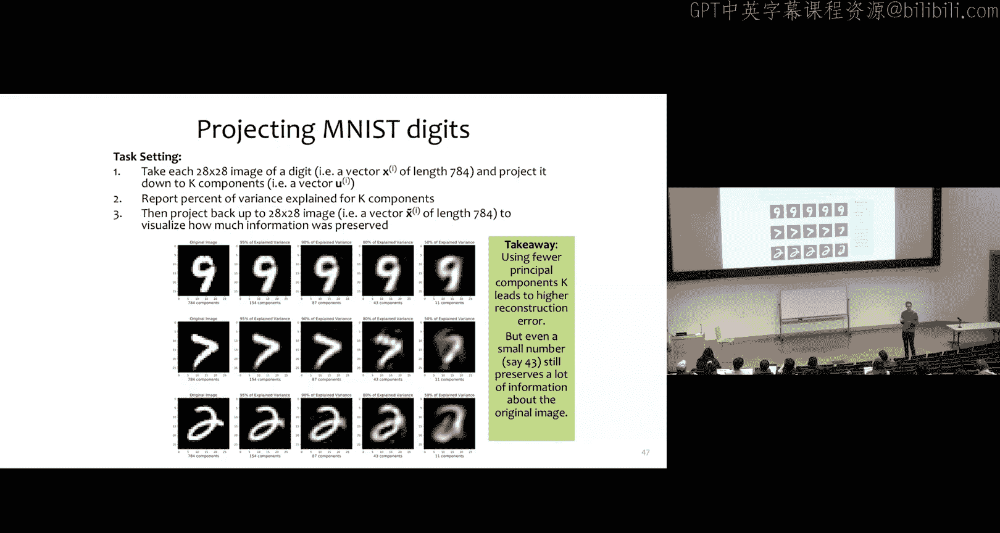

So。So here on the left is the original image so this is。If you do no dimensionality you reduction。

If you reduce it down to k equals 154 dimensions。And then project it back up so multiply by the 154 by 784 matrix and then multiply by the transpose of that matrix you would get back this image and you can see it's pretty close it's a little blurry。

A little blurry error， but pretty close。If you go down to 87 components， you get this 43 components。

 you get this one， even at 11 components， most of the shape of the nine is there。

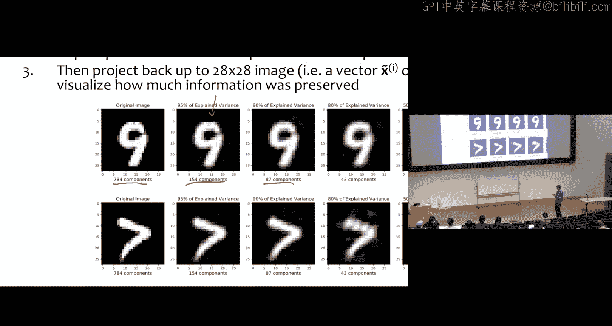

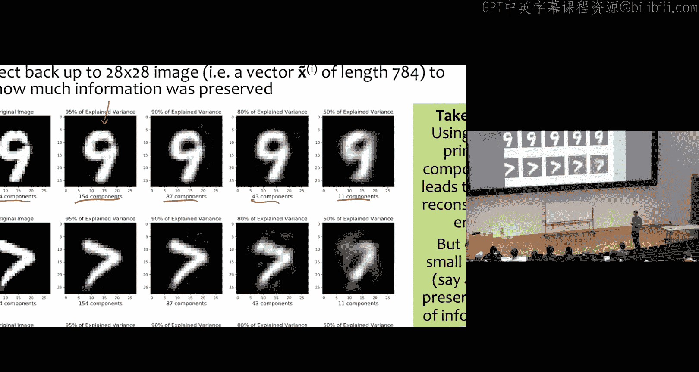

Okay， now it's not perfect if you look at like here going from 784 on the seven down to 11 components。

 I mean， this is pretty， this is honestly kind of a mess。

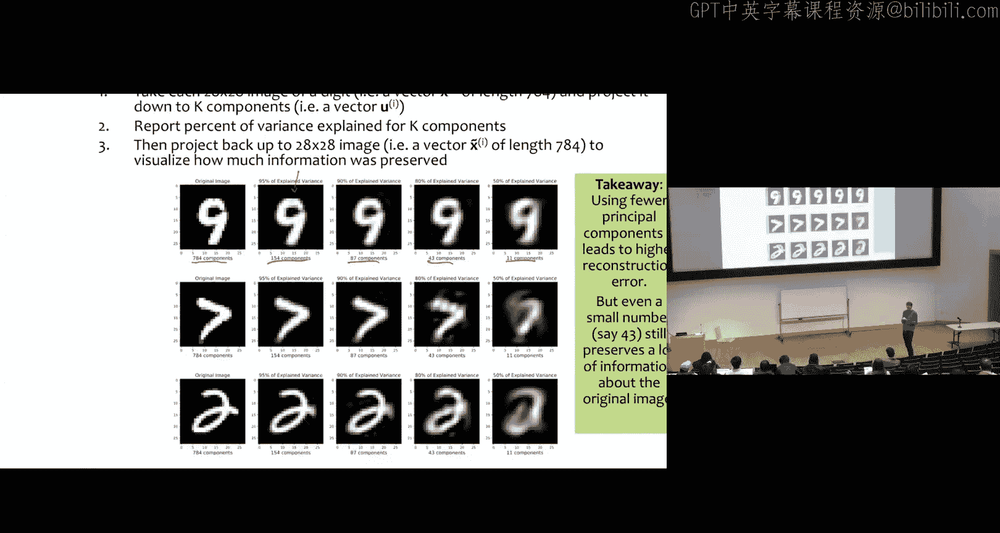

嗯。But you know， at 43 components， these images all look like we've kept a lot of the information。

Okay， so the takeaway here is using fewer principal components leads to higher reconstruction error。

But even at a small number， you preserve a lot of information about your data。Okay。

 so the last thing that we could do is。We could take our data points。

 project them down to just two dimensions， and then plot them。Now。

 PCA doesn't know about what digits they were， but I do， and so I can label those points by color。

And so if I just do digits， zero， one， two， and three。

And project them down to two dimensions and then label them by color。

 you can see that what we get are a bunch of zeros over here。And ones are way over here。

 which are very different looking than zeros。And then the twos and the threes are kind of spread out in here in the middle。

And so even though PCA doesn't know anything about the labels of these。

 you can see that it's done a nice job of keeping the ones， the twos， the threes。

 and the zeros away from each other， and it figured that out on its own。So。So in this sense。

 we've kind of captured some of the latent information that is present in our data set。Okay。

 so we'll stop there for today with this as our picture of dimensionality reduction。

 we hope you all have a great break and we'll see you on Monday of next week after the holiday。

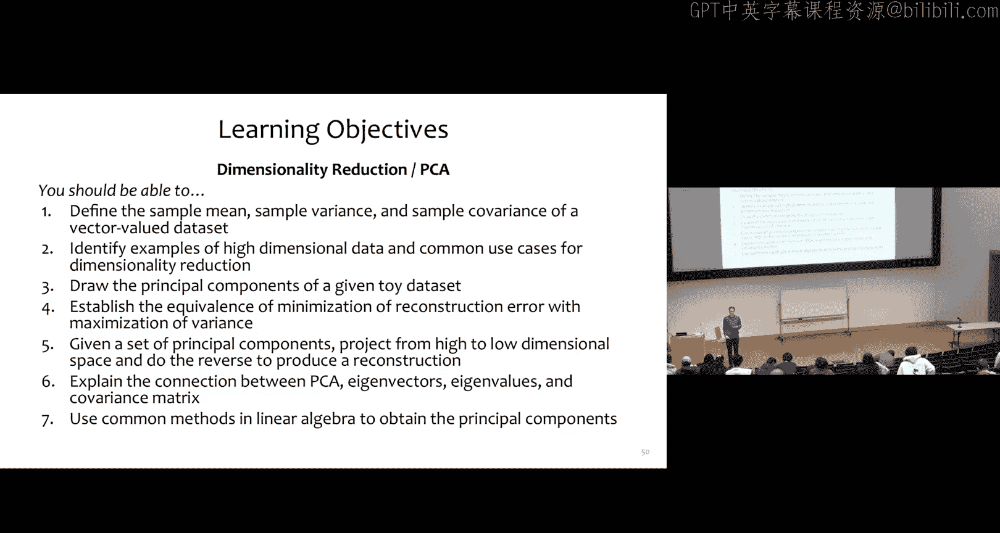