# CMU《机器学习导论｜Fall 2023 10-301⧸601 Introduction to Machine Learning》中英字幕（deepseek p23 Lecture_23_Dimensionality_Reduction_PCA.zh_en -BV1Z2cUefE4A_p23-

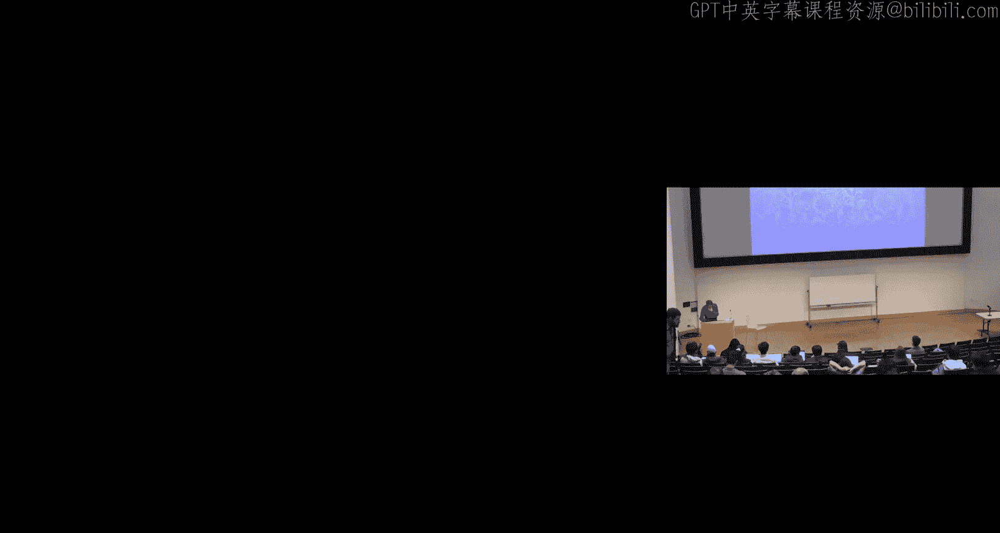

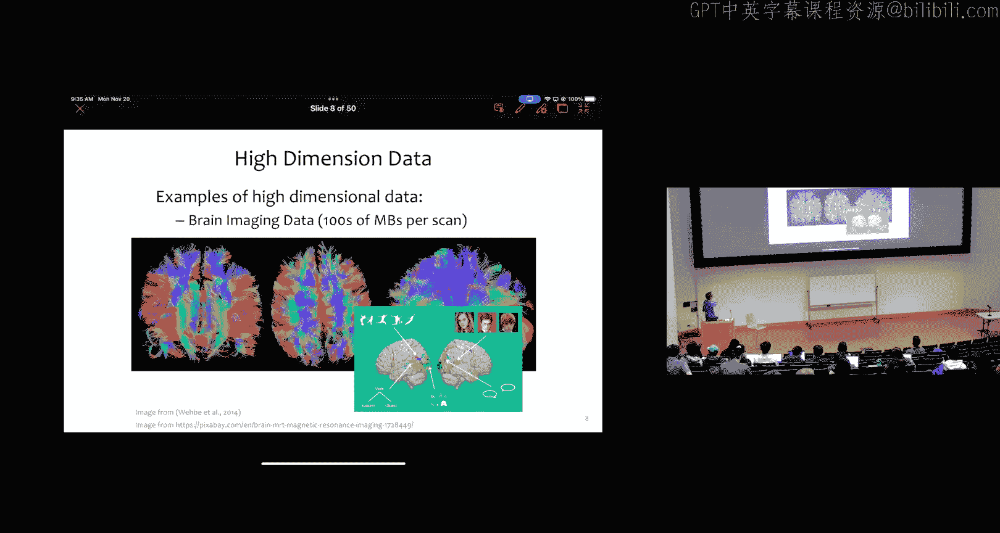

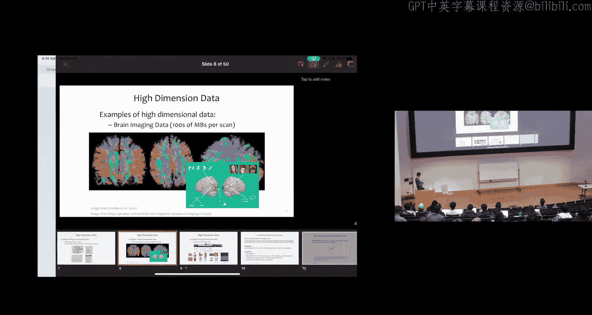

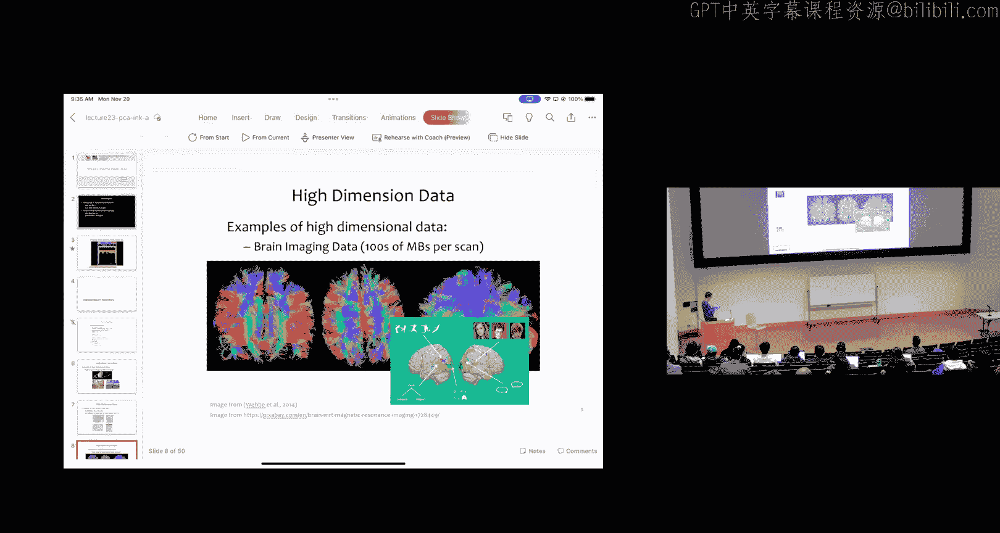

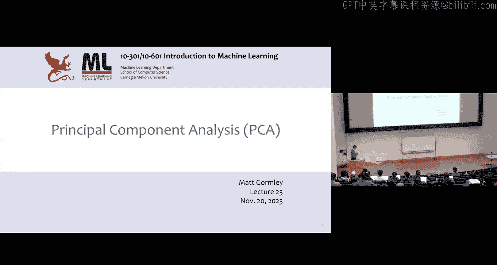

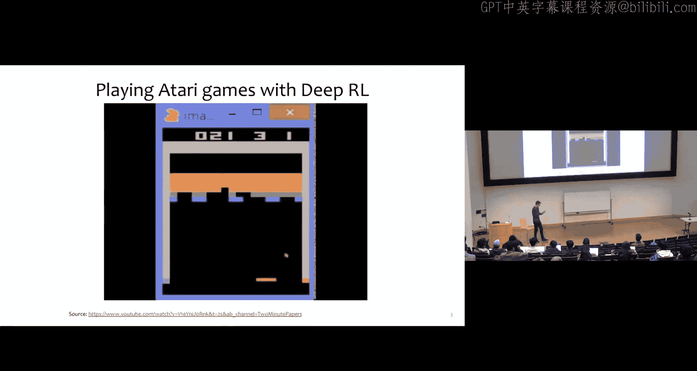

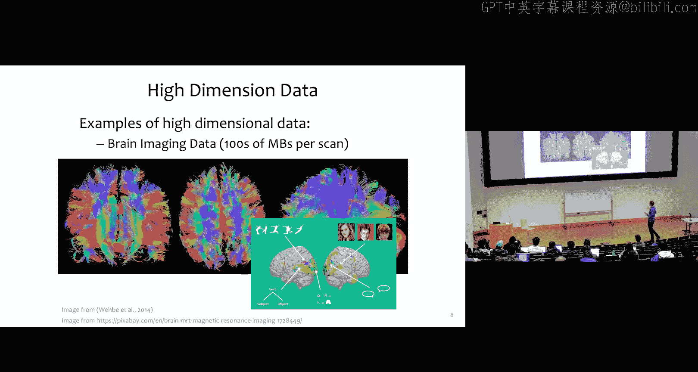

## 1. 引言

在本节课中，我们将学习降维技术，特别是主成分分析（PCA）。降维是将高维数据转换为低维数据的过程，这在许多机器学习任务中非常有用。

## 2. 高维数据来源

以下是高维数据的一些常见来源：

* **高分辨率图像**：例如，具有数百万像素的图像。
* **多语言新闻故事**：每种语言可能包含数十万个单词，多种语言结合在一起可能超过一百万个单词。
* **脑成像数据**：例如，来自fMRI或EEG的数据。
* **客户购买数据**：包含大量过去购买信息的客户数据。

## 3. 降维的目的

降维的目的包括：

* **可视化数据**：将数据投影到二维或三维空间，以便更容易理解。
* **提高效率**：减少计算资源的需求。
* **提高泛化能力**：在统计学习理论中，减少维度可以提高泛化能力。
* **去除噪声**：去除数据中的噪声。

## 4. 降维算法

以下是一些常见的降维算法：

* **PCA**：主成分分析。
* **自编码器**：神经网络的一种形式，用于降维。
* **矩阵分解**：将数据分解为更简单的表示。

## 5. 主成分分析（PCA）

PCA是一种线性降维方法，其目标是找到数据中的主要方向，并将数据投影到这些方向上。

### 5.1 PCA的目标

PCA的目标是找到K个具有最大特征值的特征向量，并将数据投影到这些向量上。

### 5.2 PCA的数学描述

假设我们有一个N个数据点，每个数据点都是M维的。我们可以将数据表示为矩阵X，其中每一行都是一个数据点。

PCA的目标是找到K个特征向量V1, V2, ..., VK，使得：

* V1, V2, ..., VK是正交的。
* V1, V2, ..., VK与数据X的协方差矩阵Σ相关。

### 5.3 PCA的求解方法

求解PCA的方法包括：

* **幂迭代法**：逐步找到每个主成分。
* **奇异值分解（SVD）**：一次性找到所有主成分。

## 6. 选择主成分的数量

选择主成分的数量取决于数据集和任务。以下是一些选择主成分数量的方法：

* **方差解释率**：选择能够解释大部分方差的主成分。
* **信息保留率**：选择能够保留大部分信息的主成分。

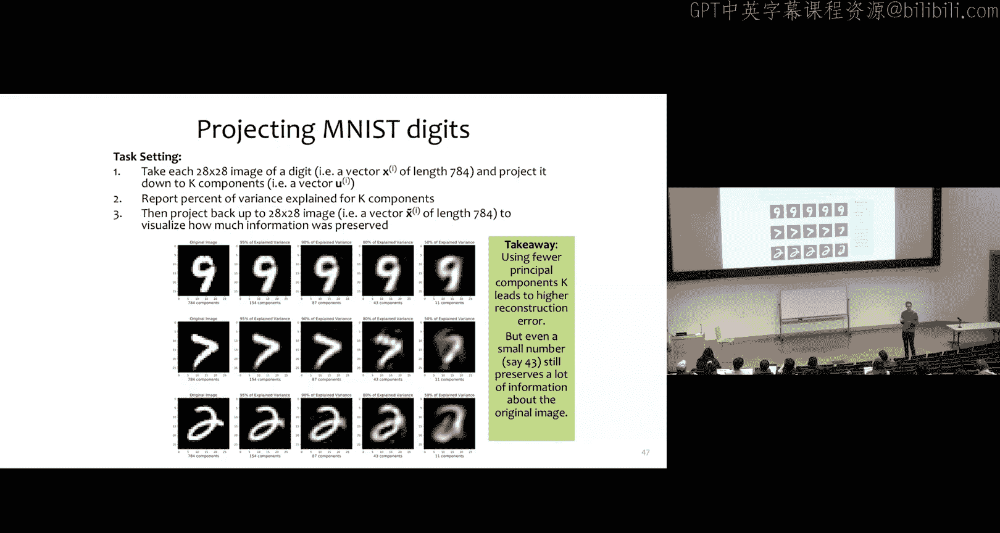

## 7. 总结

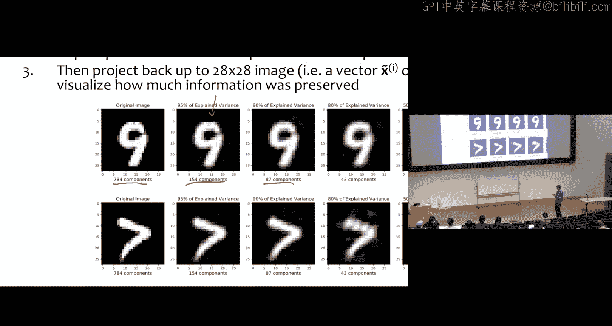

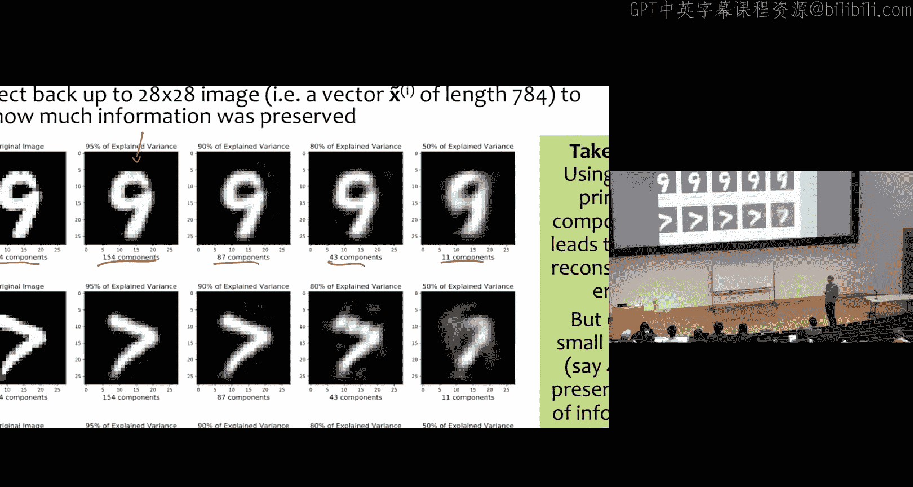

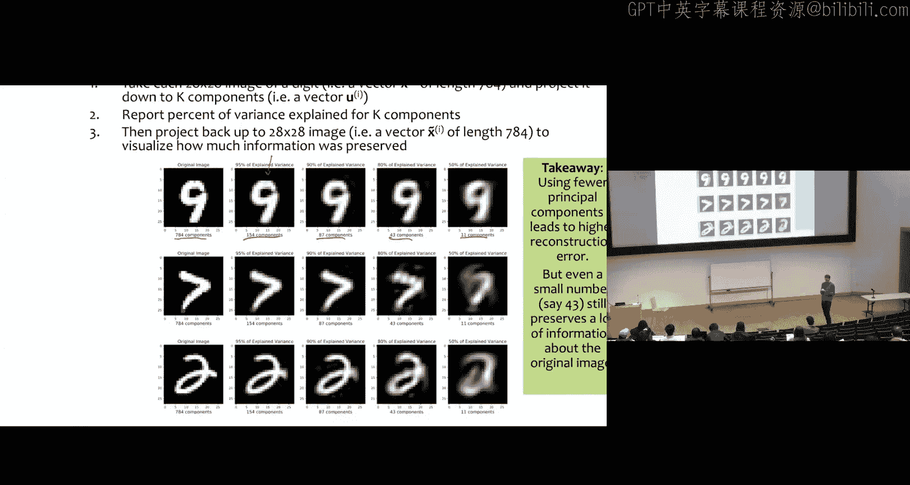

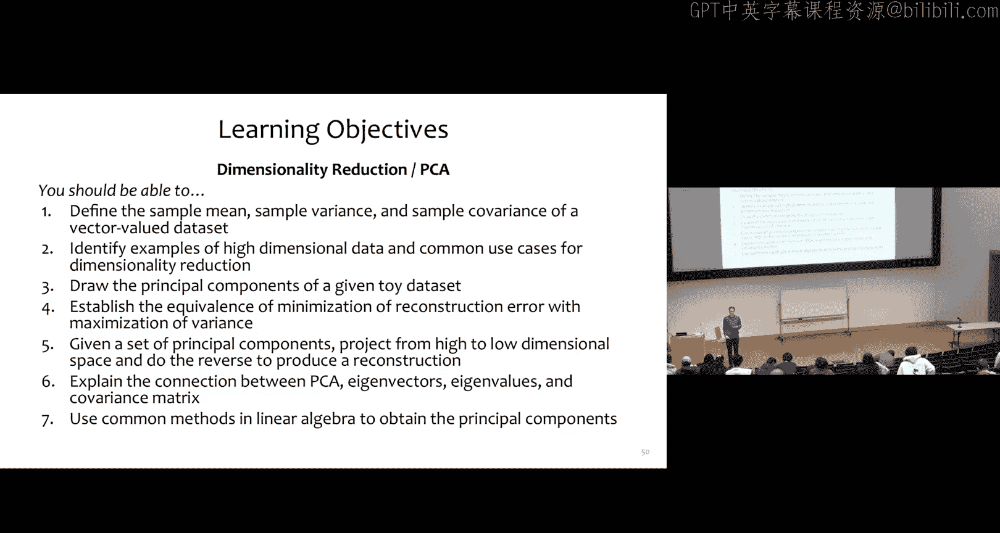

在本节课中，我们学习了降维技术，特别是主成分分析（PCA）。降维是将高维数据转换为低维数据的过程，这在许多机器学习任务中非常有用。我们介绍了PCA的原理和求解方法，并讨论了如何选择主成分的数量。