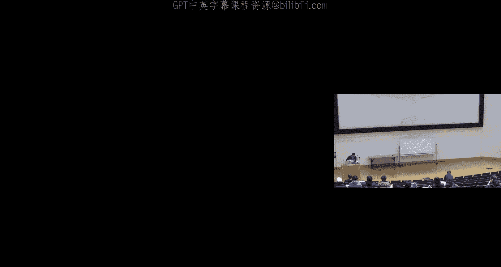
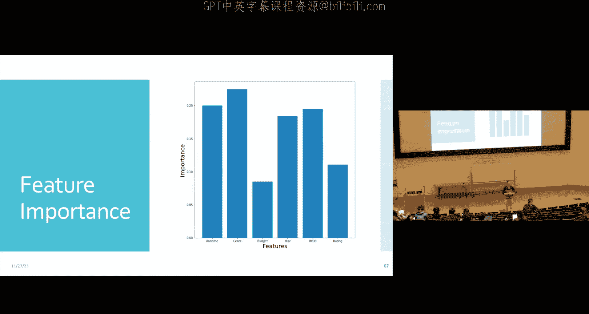

# CMU《机器学习导论｜Fall 2023 10-301⧸601 Introduction to Machine Learning》中英字幕（deepseek p24 Lecture_24_K-Means_Ensemble_Methods_Bagging.zh_en -BV1Z2cUefE4A_p24-

Okay， good morning， everyone。Happy Monday。 Welcome back。That's not working。

Wow， I know why。All right。Now， as you can see today。

 we're going to pick up where Matt sort of started。On Monday before break。

 and we're going to continue looking at another kind of unsupervised learning known as clustering。

 and then we're going to think about a whole different kind of machine learning。

 or rather like a broad technique you can apply to lots of the different kinds of machine learning methods that we've studied up until now。

😊，We got a lot to cover today， so this is your reminder that you have a homework app。All right， so。

On Monday before break， Matt talked about one thing you can do with unlabeled data。

 which is dimensionality reduction and that led to this really great discussion of PCA so today we're going to consider a different thing that you can do with unlabeled training data and that is clustering and the goal here is broadly speaking going to be to take our entire training data set of unlabeled data points again。

 crucially unlabeled and we're going to split them into groups or what we'll call clusters of similar data points and I think this is maybe a little abstract and certainly the presentation that's about to follow is a little abstract so I think it's helpful to ground it in some use cases right so like why might you want to do this in a real machine learning setting so。

😊，Some possible use cases would be stuff like。Organizing your data so that you know maybe you want to store different clusters in different places or helping you to discover certain you know patterns or things about your data you might have not otherwise known like if you're doing some sort of multi-class classification problem using this data but you're not sure how many classes to use well clustering might give you some sense of what the number of classes to consider are another way to think about this might be as some sort of preprocessing step where like you first cluster your training data and then build separate models on each of the different clusters to try and get like more specialized models that are hopefully better at predicting within each of their own little clusters here。

So in terms of applications， I always like to give a few examples here， I can maybe start。😊。

In previous life。I used to be a consultant。I know gross right sorry if any of you are going into consulting lovely work。

 but I hated it anyway， one of the first projects I got put on as a consultant was doing some sort of like market analysis for a large like home goods retailer where like I was clustering customers based on what sorts of things they were buying and so like the training data would be like carts check out carts and the sort of task was to figure out are there any similarities between different types of people and to give you a sense of how ridiculous this particular job was。

😊，I would take these carts in clusters and then I would take them to some sort of like marketing specialist and they would come up with like。

Well， frankly， what I thought were ridiculous names for clusters like you know。Do it all。

 dad or like。Struggling first time homeowner kind of like cluster name， so anyway let's see。

The application might be。Organizing customers。Into。Similar。Shopping。Roups。Anyone else have any？

Potential applications they might think of for like this kind of unsupervised machine learning。

What else might you be able to do with this kind of clustering？Yeah。Stlls into deeper organs。

 can you expand on that a little bit？So as a as sometimes when your family like sell as they develop my choices the you what I simply comes from。

啊。Okay， interesting， Okay， so let's say maybe identifying。😊，Differentence。Types of cells。

I like that one。And then a handway in the back。Housification， if you have a new customer。

 you can class which。好 there。Yeah， in some sense， that was the use case for that first step。

 the like preprocess that we were defining these buckets and then we were going to advertise them in different ways。

Any other applications people can think of Yeah， right here based user spaces。 Yeah， okay。

 I like this。 So trying to do some sort of like。😊，Facial similarity。Slash。Detection。In images。

For sure， for sure， I think that's a really great use case because like you're never sure like how many distinct like individuals might be in some corpus of photos and so like you would want to do this sort of clustering as opposed to like just straightforward classification。

Okay， cool， so this is going to be the setup of the problem Now we're actually going to think of some ways that we can solve this before we do that。

 we have to get a little bit more formal here right because like。

What do we mean when we say similar what what defines like a cluster right well to motivate this I want to think back give me a lot of callback to this lecture that's fun I want to think way back to the beginning of the semester where we talked about another kind of similarity right for KNN classification we had this sort of fun little exercise where we distributed these folders amongst you all and we thought about how you could use those sort of physical locations of certain folders to determine。

What the class of nearby students should be and there our intuition was that two points are similar or should have similar labels if they are near to one another now here again unlabeled data。

 no notion of a label， but we can still use that notion of similarity to say maybe two points belong in the same cluster。

If they're close to one another。All right so here's a formal statement of the problem we're going to do what's known as partition based clustering it's not the only kind of clustering but it is perhaps the most common and the idea is given some desired number of clusters we're going to just return a partition of the data into those k clusters so here C1 consists of some number of data points C2 consists of some number of data points that are all mutually sort of。

Disjoint sets that total up to the whole original data set here。

And so there are two big questions that I want to think about here at the beginning of lecture。

And which is？In machine learning we think about solving problems via optimization。

 so what is the optimization problem here， what is the objective function。

 and then once we've sort of defined that objective function， how are we going to solve it？😡。

So let's start with that first question and to maybe motivate the objective function a little bit。

 I'm going to give an example。So here is a set of unlabeled data points， right。

 just these black dots in some real valued space。And there's lots of different ways that you could cluster this data set into。

 let's say two clusters right， you could do sort of this clustering where all of the red points are in one cluster and all of the blue points are in another cluster or you could do this one。

 similarly we have two clusters， all of the blue points form one cluster and all of the red points form another cluster。

😊，And I want to think about this sort of well somewhat straw manish example here in let's say your first two poll questions。

 so let's go ahead and take I don't know， two minutes here。😊。

Pick which option you prefer notably I'm being a little trickxy here B is the toxic option and then justify your response in like a short sentence there are also some questions there about homework 7 feel free to fill those in but we'll reconvene I again mostly care about your responses to these two questions we'll reconvene in two minutes and see what you all have to say。

😡，All right， I got a shout out someone here， I think I just like the best answer I've seen to this question in a while all right so。

First， let me back up here， the vast mass majority view have selected option C。

 perhaps unsurprisingly， that's coming in at a strong 95% one individual who selected A gave as their justification great Thanksgiving。

😊，Which。There's so many ways I could read that。 Like， did you have a great Thanksgiving。

 Are you asking I had a great Thanksgiving， I had a great Thanksgiving。

 Are you suggesting that if you have diverse people at two separate Thanksgiving dinners。

 you're gonna have a better Thanksgiving。😊，I'm also open to that suggestion anyway。

 great answer that being said I think the majority of you are sort of onto what I was very much so leading towards here。

 which is that I think C leads to a very natural clustering here someone even wrote makes more sense by my intuition I think we all agree that intuitively C makes for a better clustering。

 but let's try and find some more like quantitative answers here。😊，Let's see。

The clusters are sort of further apart from one another I like that answer。

 both clusters are fully separated， no overlap of the two clusters。

There are some troubling answers in here that I' really want to push you away from some stuff say like zero classification error or perfectly separates the data again。

 we're thinking about this data set in an unlabeled way。

 there is no right or wrong answer for each of these data points， I can cluster them however I want。

But。😊，We also agree that C is a more natural cluster。

 not because it is correct or lines up with the training labels， there are no training labels。

 but for many of the geometric reasons that you all are laying out before that let's see similar colored dots are closer to each other and further from on the other color of dots。

All right and that's the intuition that we're going to expand on I'm going to formulate that objective function in a slightly different way。

 one that's going to allow us to solve the problem somewhat cleverly using a new optimization technique so here's the general recipe for what we'll call the K means clustering algorithm。

😊，And what we're going to do is we're going to assume。😡。

We have some number of clusters specified for us， specifically k clusters and we're going to use。

The Euclidean distance。As our similarity metric。And I'm going to define a somewhat strange set of parameters。

 you'll see why in a minute。What I'm going to say is。For each of my clusters。

 I'm going to have a cluster center， mu1 up through mu K， these are my centers。

And then for each of my data points。😡，S Z1。Z2。All the way up to， let's say I have n data points。

I'm going to have cluster assignments as well。And my objective function is going to be to try and minimize。

The sum of the distances。Between。Each data point。XN。And。It's a signed cluster center。唔 sorry。

These are supposed to be eyes。Wass that？Okay， so this notation here is a little weird what I'm saying is。

ZI is the cluster that I assigned the Ith data point to， and mu subziI is that cluster's center。

So I'm trying to minimize the distance between each data point and the cluster center that I assign it to。

😡，How are we going to optimize this， we're going to optimize this using something known as blocklock。

😡，Coordinate descent。And we'll talk more about that in just a minute， but again。

This is the thing I really want to highlight here， this is just another way of representing the intuition that many of you had about the sort of more ideal clustering on the previous slide that we had two clusters where their centers were very far apart from one another and each data point was very close to its own cluster's center。

😡，Okay， so how exactly are we going to optimize this thing well。

 what is this block coordinate descent？😡，It's a new optimization。

Approach that tries to make use of the fact that。Optimizing sort of smaller subsets of my variables is often easier than optimizing them all at once That is if I can break my sort of high dimensional optimization problem down into sort of 1D or you know small D optimization problems that I can solve quickly or maybe I can find a solution faster so you have some number of parameters theta and you're trying to optimize some objective function J the idea is going to be pick one variable at a time。

😡，And then keep all the others fixed and minimize the objective function with respect to just that one variable。

😡，So what does that look like here all right， so imagine you have this sort of wonky looking objective function where again these contour lines are like a bowl going into the screen and I'm trying to find like that minimum。

 let's say。😊，What I'm going to do is I'm going to start at some initial location call that theta not and。

😡，I'm going to fix one variable， let's say I fix theta2 first。😡。

That means the only direction that I'm allowed to move along is this theta1 direction。

 I'm optimizing this objective function using just theta1 keeping all of the other parameters faced。

 so if I look along that line I just sort of do a simple search maybe the value or the location that minimizes the objective function along this axis is that new point theta1 so I move there。

😡，And now I'm going to switch， I'm going to keep theta1 fixed to this new value and look just along the theta2 axis and find the next smallest or the smallest location along that dotted line there。

😡，And that's going to move me to theta 2。And I can keep doing this and I'm getting pretty close and I think if I taken one more step。

 I probably would have found something pretty close to the true global minimum and the hope here again is that each of those sort of 1D optimizations is a lot easier to do than the whole sort of 2D optimization problem at once。

Now， this is kind of a fiction because。Probably not too hard to optimize this 2D function。

 but for higher dimensional problems， this can actually be sort of a big game。And in fact。

 we can extend that intuition a little bit further into something known as block coordinate descent。

😡，If the idea is that we're trying to find simple to solve optimization problems。

 what if it's easy to optimize one set of variables keeping the other fixed？😡，And then switch。

So this occurs when。Your。Optimization problem sort of naturally decomposes into two kinds of variables。

 say， I don't know， cluster centers and cluster assignments， for instance。

We're going to see in just a second that if we split our parameters like that along those two groups。

 if you will。😡，We can fix， let's say， the cluster assignments。

And solve for the cluster centers and then fix the cluster centers and solve for the cluster assignments。

 each of those optimizations is very easy individually。

 but if I wanted to do them both at the same time be actually really difficult so block coordinate disscent says let's just solve the simple optimize problems as sort of standalone optimization problems and then flip between them so we're going to iteratively sort of pick one block of these variables our cluster centers or a cluster assignments minimize the objective function with respect to that block and keep the others fixed and these blocks again should be as big as possible such that they can still be efficiently optimized as a group。

😊，And that again， is the intuition behind these two types of variables。Okay。

 so next we're going to see what that looks like。😡。

For the K means objective function and then we're going to put this all together into the K means algorithm I'll stop and take some questions after that。

 I just want to get through this next bit here because again， here's the sort of magic。😡。

Each of these two different kinds of optimization problems is really， really easy。

 What do I mean by that Well， let's start with。Actually might be easier if we start with the cluster the cluster centers here。

 so if my cluster centers are fixed， that is， I tell you。

 these are the locations of the K cluster centers。😡。

How do I assign data points to cluster centers so that I minimize this objective function。

 what is the optimal assignment？😡，Of data points to clusters if their centers are fixed。

given point in respect assigned cluster Yeah， exactly well。

 it's a respective assigned cluster center， that's exactly right。So。

If my cluster centers mu 1 through mu here fixed， then for let's say the I data point， X。

 all I have to do。😡，Is maybe， I don't know， loop over。These cluster centers。And find the closest one。

That is the one that minimizes。The distance between Xi。And。the UK。

And I can do this sort of for each of my data points individually all at once。

 because if you look at the way my objective function decomposes。

 my assignment for the first data point doesn't affect what the correct assignment for the second data point is or the third data point。

 each one just cares about getting as close to a cluster center as possible。😡。

As long as the cluster centers are fixed and that's the real trick。

 if the cluster centers weren't fixed， then all of a sudden this becomes a much more complicated。

 much more difficult optimization problem。All right， if all of my cluster assignments are fixed。

 this one's a little trickier， but I think we can do this。

 if all of my cluster assignments are fixed， so I've already said you know these five data points belong to cluster one。

 these 10 data points belong to cluster two， so on and so forth。

 how do I pick cluster centers to minimize this objective function？😡，It's the optimal cluster center。

Yeah， that's exactly right， how do I compute the center though？对。That's exactly right， but again。

 there's a formula I can use to compute that， does anyone know what that formula is？

Add up on the next click。The each dimension out up all the points in the divided over。

That's exactly right I take the average I take the average of all of my data points effectively right so what I'm saying here is the cluster center。

 the optimal cluster center。😡，I put little hats over these to say they're optimal the optimal cluster center。

 if my assignments are fixed are is one over， let's say N。Where。And K is。The number of。Data points。

Assigned to。Cluster， K？And this is just。三。Overall data points。I， such that。ZI is equal to K。Of。

Exll slide。Again， this is just sort of an annoying mathy way to write out the average of all of my data points。

And again， you can sort of prove this to yourself that if you're using the Euclidean distance。

 the average of all of my data points is going to be the thing that minimizes the sort of sum of distances from each of those data points to the cluster centerric。

😊，Okay， so these are the steps that we're just going to iterate between we're going to start actually here。

 let me go to the algorithm and then I'll stop and take some questions。😡。

We're going to start with our sort of unlabeled data set x1 through x capital N， no labels Y here。

 and we're going to take in。😡，A number of clusters that we want to partition our data set into。

And we're going to initialize our cluster centers， we'll talk about different ways to do this。

 you can imagine just sort of doing this randomly though。😡。

While we haven't converged and again we'll talk a little bit more about what that means in a second。

 we're just going to iterate between those two steps， so with our initial cluster centers。

 we're going to keep those fixed and assign each data point to the nearest cluster center。

 the cluster with the nearest cluster center that is that first optimization and then with our assignments fixed we're going to compute new cluster centers and we're just going to split fl between these two things until we converge。

And at the end， we'll have。You know optionally， we can return in the cluster centers。

 typically all that we care about are the cluster assignments。All right。

 so this is the whole Ka means algorithm next we'll go through some examples of what it looks like and then we'll talk about a few of the sort of nuances of the algorithm。

 but before I move on， what questions do you have？😊，Yeah。

 I was wondering why we don't do the distance square just do the visit。

Because both should give you the same answer。The question was。

W we're just using the distance versus the distance squared here。

 it really doesn't matter because I can do sort of these computations and they'll be the same regardless of if I'm using square distance or just normal distance。

😊，Yeah。We got two3人说。Yeah， so there are different ways of doing the initialization。

 one common one is to pick data points at random from your data to serve as the initial cluster centers。

 the other is just to pick points in your space at random uniformly at random。All right。

 so let's take a look at an example here。😡，Here's a data what i'm showing here is that this data is drawn from three different Gaussians but again I really want to drive this point home this is a fiction you don't see this when you're doing unlabeled or unsupervised machine learning what you see is something like this just a cloud of points that all look the same to you right what I want to sort of emphasize though is that hopefully if I do k means clustering with k equals three here I can recreate those three different groups that would be the goal right and so。

😡，I can do this by say randomly sampling three initial cluster centers。

 that is that sort of red oval， that blue oval and that green oval。

 and then I color each of the points according to which cluster center it's closest to so I'm doing two steps at once here I sampled my initial cluster centers and then did the cluster assignment based on which cluster center each data point is closest to。

😊，So the next step is going to be， okay， with these new cluster assignments with this new collection of red points。

 this new collection of blue points and this new collection of green points。

 I'm going to recompute what the cluster center should be right and just sort of eyeballing this picture。

 what we would want to see is that this green center moves sort of more towards the middle of those green points。

😊，This is red one， it's a little tricky， but maybe it moves down a little bit and this blue one seems like there are more blue points over to the left。

 so hopefully it moves that way， right？And if we do our update， that's sort of exactly what we see。

 and now we've reassigned the points and we're already starting to see the sort of three Gaussian samples。

 the three Gaussian distributions that I generated this data set from start to emerge。😡。

After a few more updates。Looks like things are getting pretty good。Oh。

 that one point in the middle there seemed to flip between iterations three and four， all right。

 here's the thing to keep your eye on right here at the top right just after four iterations through that wow loop。

And then。You're five。So。If nothing changes from one iteration to the next。

 we have a really simple definition of convergence if none of my cluster assignments change then none of my cluster centers are going to change and if none of my cluster centers change。

 none of my cluster assignments are going to change and so that is the sort of very intuitive definition of what convergence here means that is if none of my parameters change within a single iteration I can stop right？

😡，All right， so this is all well and good， we're showing here that after sort of five iterations。

 we can recover the actual sort of true underlying pattern in this unlabeled training data set。😊。

Just to give you a flavor of what this might look like in reality。

 in reality you don't know how many Gaussians generated your data set。

 so maybe you pick k equals 2 instead， and even when you pick sort of an unrelated number such as k equals 2。

 you can get pretty good performance here。😡，So after some number of iterations looks like seven or so。

 we can converge into roughly， two clusters， two Gaussians in that top cluster。

 and sort of one Gaussian in the bottom。Okay， so that's an example of what the algorithm looks like。

 let's talk about the unspecified bits from that pseudocode。😊。

Another very common question here is how on earth do we pick K right if I'm saying you don't actually know what the right number of clusters for your data set is。

 how do we go about picking this？😡，What are some suggestions？What are some ways that we can pick K？

Yeah。Okay， but then how do we pick the constant？Any ideas？

How we pick the right number of clusters to split my data set into？

Mize total distance minimize the objective function basically。Yeah， okay。

 that's a reasonable suggestion。😊，What happens if I do that right。

 here's maybe like a little cartoonish picture。😡，If we plot objective function with respect to K。

And I keep increasing K。My objective function is just going to keep going down and down and down until I get to k equals n。

 then everyone's happy， everyone gets to live in their own little cluster。

 the distance from themselves to their cluster center is zero and I've minimized the objective function。

Seemed like a good answer， seemed like a useful clustering。And not so much， right， so instead。

What we can do though， we I think we still can use our objective function a common approach is to look for this so-called elbow in this objective function curve that is which value of k causes the largest decrease from the previous value of k so looks like here going from three to4 there's a big drop in my objective function and then after four there are only sort of very marginal gains so I might use k equals four here as my。

😊，Value of care。All right， the last thing I want to touch on before moving on is how we initialize K means right so I mentioned it before one of the most common ways for initializing the K means algorithm is to randomly pick K data points from your data to serve as your initial cluster centers and that's what's known as Lloyd's method and that can work out reasonably well in certain settings but it can also go horrendously wrong what do I mean by that well here is some unlabeled data。

Let me pick three data points from this data set， something like this， right？

And if I run the Ka meanss algorithm using this initialization。😡，Here's what I converseged to。😡。

Which like I said， that's a valid plus string， but I think many of us agree that we could probably do a little bit better。

 in fact， we might think this is a really bad。😊，Final solution。But I can make it worse。

Here's a like what's I'm looking for， adversarially constructed example。

 Imagine you have these nine data points， right， and I use Lloyd's method and I randomly pick。😊。

The three middle points to be my cluster centers。Then。At conversionence。

Each of these two columns on the left and right of the center column are equidistant from that middle column。

 so I assign。😡，All of the points in each of the rows。Two the same cluster。And now。

 if you can imagine。😊，I had a much bigger slide if I had a much bigger projector。

 I just take these two columns and move them equally far from that center cluster in both directions。

 so there's one column way out over here and one column way out over here I can make this solution artificially bad relative to the optimal solution of sort of the columns being the clusters that I really wanted to find。

😡，So this is all a sort of very complicated and fancy way of saying。😡。

Lloyd's method converges to a local minimum， in fact。

The cameian objective function is littered with local minimum because this is a nonconvex optimization problem the easiest way to convince yourself of this is just imagine taking this picture and swapping the colors right if I put the blue row on the bottom and the red row on the top I would have another equally good local minimum。

😡，So。This is a non convex optimization problem， and we all know that our initialization。

For non convex optimization can affect the quality of the solution that we end up at。Luckily。

 unlike say trying to optimize the parameters of a neural network。

 we have some intuition that can help guide us with our initialization of k meanss which is that we want the cluster centers to be further apart from one another right like the real issue with this first example that I gave is that there were two cluster centers that started off very close to one another and we're fighting over the same group of points so I can just use that intuition to develop a new initialization scheme that cares about how far apart the initial cluster centers R and that's what's known as k meanss plus plus here I'm going to write it out in words the idea is I can pick one cluster center from the data points at random first still doing the like Lloyd's method thing and then for each other cluster center what I'm going do is I'm going to compute the distance between that point and the nearest cluster center that I've already picked。

😡，So I pick one data point， I compute the distance from that data point to all of the other data points。

😡，And then I select at random a new data， a new cluster center with probability proportional to here they're doing the square distance。

 but again you can think of this as just caring about how far the data point is so if the data point is really really far away。

 that makes it much more likely to be selected as a cluster center and if the data point is very。

 very close to an existing cluster center and then the probability that I select is low。😡。

And I do this k minus one more times， and you can show there's some very interesting theory that you can get a probabilistic approximation to the true optimal solution。

 a log K approximation to the optimal clustering in expectation， but if you want to do even better，😡。

Both Lloyd's method， frankly， and this method， as we've seen。

 can benefit from multiple random restarts。Just another way to combat non convexity。Okay。

 that was a lot I'm moving kind of quickly because we have a whole other topic to get to and we'll talk about that next。

 but before we move on from Kay meanss， let me stop here， what questions do you have？😡，Yeah。

 does random restart mean we restart once it's converged or just restart at any time restart after conver so we run this initialization to convergence and then we start a new run with a different initialization。

And then we compare the objective functions at the end to pick the best final solution。

Its three acres one set so we're computing the distance between x and the nearest cluster send so if there are already five I have to first find which of the five my data point is closest to and I use that as the distance。

Yeah。Does mean like the number of iterations no mean that the optimal solution is。

In expectationation within。A factor of log K of the optimal objective functions value。

And usually K is small， right， usually K is something like five or 10。

 so log K is like pretty small too。Yeah。😊，我的不意。呃。How would you prove the first bullet point？

Do mean how would you prove this result？You would convince yourself that's true by reading their proof。

And then you get into a question of how you go about proving this。

 and I confess I haven't actually read that paper in a while。 So I don't know。 Matt。

 do you know how they prove this。😊，Yeah， yeah， I don't know off the top of my head either。

 maybe you can read about it and report back to us。Let's talk about movies。All right。So back in the。

 you know， I was going to say early 200s， but like 2009。

 I don't know if that counts back in like the。Early 200s， whatever Netflix ran this competition。

 this is really famous machine learning competition known as the Netflix Prize it was a really big deal because。

What they wanted was they wanted some machine learning group。

To develop an algorithm or a method to predict how users would rate their movies right and this is a big game right because if you can get a system to recommend movies to people that they like。

Well， then they're going to spend more time on Netflix， actually。

 they're going to spend more time on Netflix like getting DVDs mailed to them。

I think this is still in the DVD era。 Maybe I'm wrong， but regardless。

Netflix wants people to like the movies that they recommend right they want this so badly that they offered a million dollars to a group of individuals who could beat to the highest performing group of individuals at this particular task。

And I don't know。2009 a million dollars is probably worth a lot more in 2009 than it is now。

 but like this is a really big deal right this is like wow。

 machine learning can actually win me a million dollars so a lot of people jumped at this right here's the problem before we talk about the the winners in a second。

So they released this data set。😡，very problematic data set actually。

 maybe we'll talk about that in a little bit， but they release this data set of 500。

000 users ranking 20，000 movies and that in theory gives you 100 million ratings except not everyone rates every movie and so this is a much sort of smaller data set than that。

And the goal is to obtain some lower you error for each sort of held out example。

 you're predicting how this user is going to rate this movie and you're just sort of doing some sort of mean squared error minimization。

 right？😡，All right， so here is the leaderboard when the competition concluded and the team that won is this team called Belco's pragmatic Chaos。

 which like。This is a ridiculous team name， right， where does that team name come from？Well。

 if you scroll down a little bit， you might be able to notice some interesting trends here。

 there are two teams in sixth place and seventh place。😊，Called pragmatic theoryory。

And Belco in big chaos， right， so what happened here well， these two teams， they were like， okay。

 we're not winning， we're not doing great。But。😡，A million dollars split two ways。

 still a lot of money Like what if we got together， we put our models together somehow。

 we teamed up and we formed a supermod right And in fact。

 I'm actually sort of bearing the lead here because Belcor and big chaos is actually you know a combination of the 10th and 12 place teams here。

 Bcorn and big chaos and actually， if you look at you know team two here。

 this is just called the ensemble because they did exactly what I said。

 but they didn't have a clever team name even further down there's like opera solutions and Vandalay United。

 which is like opera solutions and Vandalay industry。

 So the point here is that people realized in this competition that we could combine models。

To have performance greater than any individual model。

 and that is the whole idea behind what we're going to talk about N。

 which is what's known as ensemble methods Can I take lots of separate models and combine their predictions somehow to get even better results。

😡，So why might that work？Well， let me give you a high level example using， again。

 movie rankings to try and motivate this problem。So。

Here's a data set of my actual personal ranking of movies for those of you who want to know a little bit more about me。

You can try and figure out what each of these data points maps to from this data set this is actually me ranking these movies saying whether or not I like them so that's a binary classification task right we've seen lots of different ways for doing binary classification again lots of callbacks this lecture we can think about maybe training a decision tree to do this task right so here's the decision tree fit to my preferences。

😊，But。YouPeople get older， people tastes change， right。Sometimes I go back and I rewatch all movies。

😡，And I decide。Maybe I like a movie that I previously didn't like。

What effect on my decision tree would that have Well here's something about decision trees that we didn't tell you when we first introduced though decision trees are great for lots of reasons they have their own problems right Here's another problem Dec trees are what we call high variance It's actually related to their tendency to overfit So what do I mean by high variance。

😡，So here's that data set again， right， let's say I go back and I rewatch。Oh yeah， this movie。Which。

I think is lay Mz。I could be wrong anyway， I rewatched that movie and I said know what。

Russell Crow did great singing phenomenal， really good movie。

 so I changed my answer from a no to a yes， I did like that movie。

Here's the new decision tree that I would learn。Here's the old decision tree just so we can compare them。

 right， not only do they look fundamentally different。

The predictions they would make on new movies is also fundamentally different just because I changed my rating for one of the 20 data points。

And that。It can be problematic for lots of reasons right like imagine you know you're watching Netflix and you finish watching one movie。

 but because you watched it now all of your recommendations fundamentally change it like overfits to that one most recent piece of information that it gets。

That can be sort of annoying from a user standpoint， but it could also just be wrong， right？

So what we have here is a very high variance method。

 a method that changes completely just due to small minute changes in the training data。😡，啊。

One way to address this somewhat。Annoying tendency to overfit to small variations in my data is with ensembles turns out when you ensemble a bunch of decision trees。

 when you combine a bunch of decision trees， you get a forest and the way that we're going to combine them gives rise to a new classifier known as random forests。

😊，Okay so here's the intuition I'm going to lay out the intuition for a random forest and we'll stop and take some questions。

 but the big idea is we're going to combine the predictions of lots of diverse decision trees here。

 crucially they're going to be diverse decision trees。😊。

To try and reduce their individual variability and hopefully get higher performance。

So mathematically， why does this make sense well you can imagine？

You can think of like all of our decision trees as being these like independent random variables。

 right， like they're all making their own predictions。If I combine their predictions。

 let's say each of their predictions has some variance sigma squared。

 if I combine their predictions using like an average or something like that。

 well then I can reduce their variance of the ensemble by a factor of one over B。Which can be good。

But now we need to think about how on earth we're actually going to combine these diverse decision trees。

The method that we're going to explore in just a minute is what's known as random forests。

 group of trees， mix of forest， right， but there's going to be some randomness in how we build these trees。

So specifically， random forests do two kinds of what we'll call bagging。

 They do sample bagging and feature bagging Now bagging itself is。like a。Hort monteau。

 like a weird combination of two words， bagging is what we'll call bootstrapping and aggregating our two components here。

 and then for the features we'll also be doing what's known as split feature randomization。

So that is where we're going， we're going to talk about each of those two components。

 well three components really we're going to talk about bootstrapping。

 we're going to talk about aggregating and we'll talk about split feature randomization before I move on。

 what questions do you have。Okay， so。We have to。We're going to work backwards a little bit right let's imagine we've already built our collection of decision trees and now I have to figure out how to combine their predictions in some way to make a single prediction for each data point。

😊，Well there's lots of different ways to do this， it just depends on what your task is right so let's imagine we've grown capital B decision trees T1。

 T2 all the way up to TBB here。😊，If we're doing a regression task， remember。

 we can use decision trees for regression where at each of the leaves we predict some real value number。

😊，Well if we're doing regression， a very intuitive way of combining them is take their average right and again this has that nice intuition of reducing variance。

 the average of some collection of independent random variables is going to have lower variance than each of the individual components and so I can do an average of each of my trees predictions on some new data point X。

For classification。Things get a little weird。 The intuition here is that like。Well。

 maybe the most natural way to combine trees is to have them all take a vote and then do a plurality or majority if you're doing binary classification。

The thing that I'm trying to highlight here。😡，Is that if you have your binary labels encoded as plus ones and minus ones。

 you can actually write a majority vote as an average。

 specifically all I'm doing is I'm adding up the number of pluses and the number of minuses and then if there are more pluses than minuses。

 this sum is going to have a positive sign and that's going to be the prediction or the final vote of my ensemble and sum if there are more negative votes then that sum will have a negative sign and I'll be doing sorry I'll be predicting a minus for the majority。

Okay， so we can combine trees pretty easily again， this sort of average notion appears in both of these contexts and I'm really trying to drive this idea of like averaging trees together because that's really where the like reduction in variance comes in。

 but there's a really big caveat here。Sttered throughout this slide is the assumption that these trees are like somehow diverse or independent。

 right？Here's the extreme scenario， say you grew 20 decision trees。But they are all identical。

Well then combining them together doesn't really get me anything right that's sort of the key behind enssembling that you need to be pulling from different like sources of knowledge the reason the Netflix Prize was sort of won by these ensembles is because each of their models was doing something different they were each training their own models in potentially different ways and like intuitively maybe some models were very good at predicting certain kinds of users or certain kinds of movies right and in isolation they were making mistakes that the other models the other decision trees could hopefully cover for and that's the intuition behind bootstrapping and then sample bagging which we'll talk about next so。

Here's the big question。The ID3 algorithm， the sort of way we've studied for training decision trees。

Isn't inherently random， right， what do I mean by that？

Like if I give you a fixed data set and you run the IDd3 algorithm on it 10 times。😡。

You're going to get the exact same results， supposing you like consistently break ties。

 you're always going to learn the same tree。So in order to get diverse or independent trees。

 I have to change something， I have to change the algorithm or。😡，I can change the data set。😡。

So one way of generating different decision trees is by feeding them different data sets。😡，Okay。

 that's all well and good。We typically only have one fixed training data set right Netflix only released that one set of users ratings of movies。

 How can I take that one。Data set and generate lots of different looking ones。😡。

Well the idea here is is what's known as bootstrapping is I can resample that data set multiple times with replacement。

 what do I mean by that well here's a cartoon。😊，Let's say we start with。

20 training data points here I'm going to resample 20 data points from this data set with replacement so my first bootstrap sample might have lots of instances of the first movie and it might skip I don't know 1516 1718 but ultimately it's gonna to have 20 data points as well and I can do this again and again this one has two copies of four and two copies of 16 I can do this a bunch of times。

😡，And I can get a bunch of different looking data sets。😡，And the idea here is that， well， now。

If I train a decision tree on， say， this first bootstrap sample。Oh this point here。

 this is actually more of a like design choice or like a hyperparameter it doesn't have to be the case that each bootstrapap sample has the same number of data points as the original it's just sort of like a very natural stopping point like how else would you decide how big to make each of these bootstrap samples why not make them as big as your original data set it also has some like。

Theoretical analysis implications， but even think of that as like a hyperparameter in some sense that you can tune。

And the idea here is that。If I have。One data point that's repeated lots of times in a particular bootstrapap sample well then the decision tree I train on that sample is going to get really。

 really good at predicting data points that look like the oversampled ones right like in this first bootstrapap sample the decision tree I learned there well it's going to care a lot about getting the first movies prediction right and for this second bootstrapap sample it's going to care a lot about movies4 and 16 so this is going to give me a collection of diverse experts。

 decision trees that are really good at certain kinds of movies and then hopefully in the aggregate they can all sort of like cover for each other's knowledge gaps。

😡，Okay， so that's the intuition behind bootstrapping。Next I'm going to talk about feature bagging。

 but before I move on， what questions do you have here？😡。

If you were a partition in training dataset set with this smaller parts。

 so like I'll say that instead of samplinging from it。

 you just like split it into like say four different lens and some treat on all four of the most average those results would that be any different than just writing like super when you built point。

那谁关系。So you take your data set， you split it into four chunks， you get four different decision trees。

And then you treat those as an ensemble， will that behave differently from one decision tree trained on all 20 data points？

I'm pretty sure the answer is yes。Can't prove it off the top of my head。

 but I'm pretty confident that yeah， those should behave very differently。Anything else here？嗯哼。😊。

we try samples。That's a really great question that's another hyperparameter we're going to talk about a very specific way for tuning random forest hyperparameters。

 but the intuition is going to be we're doing hyperparameter optimization again we're going to compute。

😊，Effectively a validation error， not quite a validation error。

 but we're going to compute something similar for different numbers of bootstrapap samples and just compare。

 find the one with the best sort of performance。😊，The intuition is it's going to be a lot。

 it's going to be like a very big number。There's a problem， though， empirically。

This bootstrapping sounds really like great and idealized in theory。In practice， what happens is。

It doesn't quite do enough。To generate independent or diverse trees like even with this resampling technique。

 it turns out that these bootstpped trees will still behave very similarly because you're letting them learn from all of the features So what that means is that like even if I have like sort of different chunks of my data set for different bootstrap samples if there's one like sort of very good feature like a universally powerful feature it's always going to get selected by the ID3 algorithm to be the root and then from there。

The trees will start to behave very similarly and we get stuck in that problem of。

Individual trees that are too dependent， that are not diverse， right？

So we can do another kind of bagging， another kind of this sort of resampling known as split feature randomization where we sample the features as well as the data points a cute way of thinking about this is like if you arrange your data in the traditional like matrix form where you have data points along the rows and features along columns you're resampling both the features and you're resampling both the rows and the columns of this data matrix right so each time I go to consider a split in my ID3 algorithm I'm going to sample just a subset of my features you can think of this as like sampling with replacement or you can think of this as just sampling like a smaller number effectively similar methods here what do I mean by this well so imagine I had those six features from my movie data a few slides ago when I go to grow some decision tree。

For the root。I sample some subset of my features， say three here。😡，And I say， okay。

 for this first feature， you are only allowed to consider runtime year or IMDB score。😡。

Maybe from amongst those， runtime has the。Highest mutual information， and so I use that。😊。

And then I'm growing a binary decision tree here， so I have two more splits to consider here。

 let's say down the left branch， I resample again for a new split。

 I always resample new features I resample runtime genre and budget I pick genre here and then same down the other branch I resample three new features genre year and rating and just happen to pick genre again。

 so I do this for every decision tree for every split。😊，Really。

 what I'm trying to like demonstrate here is I'm just injecting randomness wherever I can find it。

 sort of like independent uniform randomness into the decision tree learning algorithm here to give me different diverse looking decision trees。

😡，And if you combine that all together， you get what we call a random forest。

 so here's the sort of picture of the algorithm， then I'll stop and take some questions。

 so you take your additional your original training data set D here and you have these two hyperparameters。

 B the number of decision trees you're growing and row。

 the number of features you're using for split feature randomization so on the previous slide row was three。

😡，And then for each of these decision trees， I'm going to create a new data set by bootstrapping my original data set。

 so sampling end data points with replacement， and then growing a decision tree using split feature randomization。

 sampling row features here for each split。😊，And at the end。

I'm going to output this sort of aggregate hypothesis， T bar， the average hypothesis， if you will。

 of all capital B of my decision trees。Okay， so that's the algorithm next we're going to talk about hyperparameter optimization for this method。

 but before I move on， what questions do you have？😡，Yeah， very internal yeah。

 snap bagging mean the first thing they're asmbling well is finally aggregating so I think when we say sampleple baggging。

 we're referring yeah to those first two steps that I'm reampling my。

Data points with replacement and then combining the aggregated hypotheses at the end。

Then feature guide。You can also think of feature bagging as like the second and the third step。

 if you will， like if you just started with a fixed training data set。

 you could still do that feature resampling thing and grow lots of different decision trees each time and then combine them random forest is what happens when you do both when you do resampling of your data points and resampling or just samplingling of your features。

Yeah。It seems like you have to use like these two methods to inject random inness。

 I be bringing after them， why not just choose algorithm that already has randomness for。

It's an interesting question。 The answer to many questions like that are that。

This is the method that did empirically well historically and is like。

 you know written the history because it was a victor right there are lots of you know alternative ways of imagining sort of making randomness into decision trees。

 It just so happens that this one did empirically well has some reasonable theoretical analysis to go with it and I think。

😊，Has some nice like intuition behind it。 I think people really like it for those reasons。

 but certainly I'm not saying that this is like the best or only way that you could do this。

 Actually， one thing that I want to reinforce here。

 we call this random forest because it's like acute like play on decision trees you can apply feature and sample bagging to basically any of the simple baseline methods that we've talked about in this course you can imagine doing like sample and feature bagging for like K andNs or even like linear regression for regression tasks like you can imagine learning a bunch of different lines and then averaging them together to get。

😊，And I don't know have a random polygon。Something like that。

So really the thing I'm trying to drive home here is that。

Feature bagging and sample bagging are very general ensemble methods and when you combine them together for decision trees。

 you get a specific instantiation of an ensemble method known as a random forest。

 but there's lots of different ways that you can generate sort of different base learners。Yeah。

R theized tree in the forest would perform worse than a you have just done every year this year that's an interesting question I think。

The question is， is it reasonable to think that each individual decision tree in my forest will be worse than a tree trained on the entire data set？

I think for large training data sets， the answer should be yes。

Like if my training data is sufficiently large that a single decision tree won't overfit it。

 then all of these like randomizations are just sort of making the individual trees underfi my training data。

But in the aggregate。Empirically， we see that these will outperform a single decision tree。Yeah。😊。

你嗰呢公信方目必出诶嗱几个咁俾。Is it some kind of regularization， it's an interesting way of thinking about it。Sure。

 I think that's a potential way like in some sense。

 like if you were applying this to say like linear regression。

I'm effectively setting the weight some of the weights to zero when I do feature bagging。

 and so that is exactly a form of regularization， so yeah that's a reasonable analogy here。😡，Okay。

 really great questions， let me answer the question that was raised a little earlier。

 which is how do we decide how many trees to use， how do we decide how many features to resample in each iteration。

And the normal answer that I would give you is just do the hyperparameter optimization thing， right。

 do some sort of like validation。😡，Split out some portion of your data to be a validation data set and then minimize the validation error with respect to those hyperparameters。

It turns out。That with random forests， we get like a validation set for free in some sense。

What do I mean by that？😡，Well。When I'm doing this sort of sample bagging。😡，That means。

For each decision tree that I train， it's trained on some subset of the data。

 I'm assuming I don't you randomly sample just one through 20 or like the exact training data set ever。

 although if I do that's not a huge issue， I'm assuming there's some number of data points in my training data set that the decision tree wasn't trained on。

😡，So that forms a natural validation data set for that specific tree right。

 you can do some fun math facts to prove that roughly like a third of each for each decision tree。

 roughly a third of the training data points won't be used to train it。😡，So I can call those。

The notation here gets really wild I'm calling that t minus n of one。

 the idea is that it's just some subset of my training data for each decision tree each decision tree will have a different subset that it wasn't trained on so what I can do is I can then take each of those decision trees。

Have them make predictions on the data points that weren't used to train it。

And then average all of those predictions together。So。

Each decision tree makes a prediction for each data point it wasn't used to train on think of this as like filling in some big like B by n matrix。

 if you will， each decision tree makes a prediction for each data point it wasn't used to train on and then I just average all of those predictions together and I can compute the out of bag error and you know if I'm using like the ensemble for regression I can compute this is just a fancy way of writing out the squared out of bag error or I could do the like binary。

😡，Z1 loss。Out of Bagar。Again， this is just like a fancy way of saying I get a validation set for free basically when I do sample bagging and I can use that instead of having to like hold out some validation data set and do the normal you know hyperparameter optimization tuning thing instead I can use this out of bag error as a proxy for that validation error and then use this to do hyperparameter optimization right and so if I do that for the training data set that I sort of generated on the first slide I get a very sort of typical。

😡，Behavior of the hyperpar。 so here is some actual data for。

That movie data set I had a few slides go of those 20 movies that I ranked right I grew a bunch of random forests for those different。

😊，For those for that data using a bunch of different combinations of the hyperparameters here。

 so here I tried what is this like one5，10， 20100， 200 5001000 different different values for the number of decision trees and the trend that we see is empirically very common which is that the number of decision trees that I need tends to I'm calling it converge very quickly really the way to think about this is it like it saturates it hits some limit and then stops decreasing that limit can be really large though right like I had 20 data points and it turns out in this setting the right number of decision trees to grow was 200 so it can be a really big number for the other hyperparameter。

 the number of features to use in split feature randomization this is maybe pretty intuitive turns out the right number is typically。

Somewhere right in the middle， there were six total features。

 both one and six lead to sorry six leads to that sort of problem of the decision trees not being diverse enough。

 six is saying I'm letting all of the decision trees always use all of the features， one is saying，😡。

I'm basically randomly picking the split feature， I'm not allowing the ID3 algorithm to do any learning somewhere in the middle。

For here I guess was the right answer and again I'm using on the y axis for both of these plots the out of bag error instead of the validation error。

 so that's a nice sort of for free thing that decision trees give you。😡，Oh sorry。

 random forests give you。Okay， I have one last thing before I let you go， which is that。

In addition to this out of bag error， there's another sort of cool like byproduct of random forests that we can use。

 which is this notion of feature selection or feature importance tying this back to last Monday's lecture。

 you can also maybe imagine this is doing some sort of，😡。

Dimenssionalality reduction or like selection of which features to keep or which are the useful features from your data set。

Here's the intuition。😊，One of the things we really liked about decision trees is that they're nice and interpretable。

 you can sort of explain to a user why the decision tree is making a particular prediction right when it comes to a forest that gets a little trickier you're sort of like looking across all of the trees and saying okay this tree believes this。

 but that tree believes that so on and so forth， however we can actually compute a quantitative metric here for feature importance。

 maybe something that is a little trickier in a decision tree。

The way that we're going to do this is as follows。We're going to say for each of my features。

 you start at zero importance， and then each time you're selected to be split on by some decision tree。

😡，I'm going to add some like value to your importance and this can be related to like your split criteria。

 something like the mutual information or reduction in entropy， again。

 weighted by the number of data points。😡，And then we're just gonna keep track of each scores or each feature's importance and then at the end we can create a plot that looks something like this so after I've trained my decision tree using however many number sorry after I've trained my random forest using however many decision trees this is like the final score and what this is saying is that like I tended to split on genre and runtime a lot maybe I like a certain kind of movie and I can tell you this for free I really hate long movies so actually that actually tracks and then some of the features that yeah I typically don't care about I typically don't care if it's like a really high budget movie or not right so this is a very useful tool for doing this kind of like explanation of why my model is making certain predictions that can be very useful in certain contexts。

Okay， that was all I had for you today， sorry about that it kind of a whirlwind mashup of two different topics for today's lecture。

 more of the same on Wednesday actually on Wednesday we're going to continue talking about ensemble methods with a different way of generating and combining base learners known as boosting until then don't forget about your homework and we will see you all back here on Wednesday。

😊。

