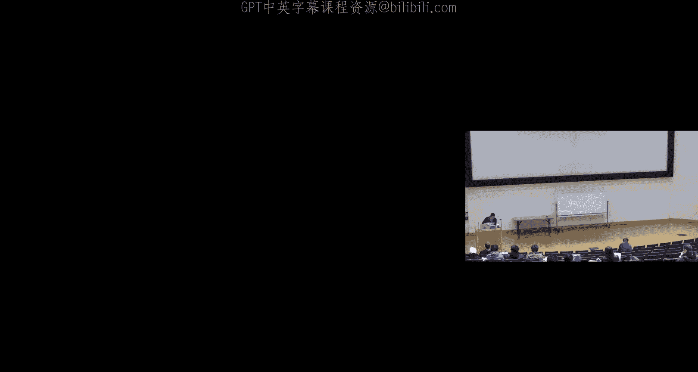
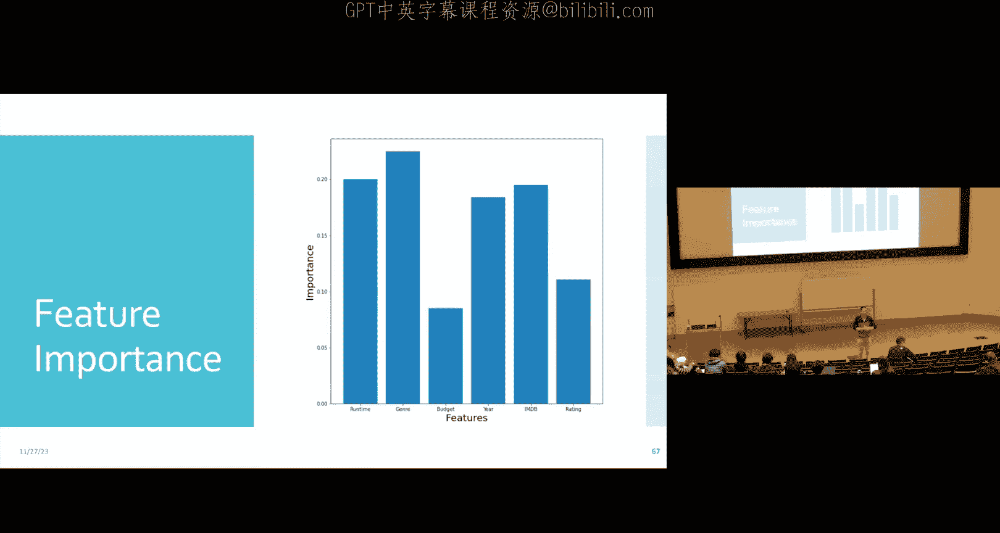

# CMU《机器学习导论｜Fall 2023 10-301⧸601 Introduction to Machine Learning》中英字幕（deepseek p24 Lecture_24_K-Means_Ensemble_Methods_Bagging.zh_en -BV1Z2cUefE4A_p24-

## 1. 引言

在本节课中，我们将学习两种重要的机器学习技术：聚类和集成方法。聚类是一种无监督学习技术，用于将数据点分组为相似的数据点。集成方法是一种将多个模型组合起来以提高性能的技术。

## 2. 聚类

### 2.1 聚类概述

聚类是一种无监督学习技术，用于将数据点分组为相似的数据点。其目标是找到一种方法，将数据点划分为多个组或簇，使得同一簇内的数据点尽可能相似，而不同簇之间的数据点尽可能不同。

### 2.2 K-Means 聚类算法

K-Means 聚类算法是一种常用的聚类算法。其基本思想是：

1. 随机选择 K 个数据点作为初始聚类中心。
2. 将每个数据点分配到最近的聚类中心所在的簇。
3. 计算每个簇的中心，即该簇中所有数据点的平均值。
4. 重复步骤 2 和 3，直到聚类中心不再变化或达到最大迭代次数。

### 2.3 K-Means 算法的优化

K-Means 算法的优化可以通过以下步骤进行：

1. **固定聚类中心**：对于每个数据点，将其分配到最近的聚类中心所在的簇。
2. **固定聚类分配**：对于每个簇，计算该簇中所有数据点的平均值，作为新的聚类中心。
3. 重复步骤 1 和 2，直到聚类中心不再变化或达到最大迭代次数。

### 2.4 K-Means 算法的初始化

K-Means 算法的初始化可以通过以下方法进行：

1. **随机选择**：随机选择 K 个数据点作为初始聚类中心。
2. **K-Means++**：选择一个数据点作为初始聚类中心，然后选择下一个聚类中心时，选择距离已选聚类中心最远的点，并重复此过程。

## 3. 集成方法

### 3.1 集成方法概述

集成方法是一种将多个模型组合起来以提高性能的技术。其基本思想是：

1. 训练多个模型。
2. 将这些模型的预测结果组合起来，以获得最终的预测结果。

### 3.2 随机森林

随机森林是一种常用的集成方法。其基本思想是：

1. 使用 bootstrapping 技术从原始数据集中生成多个数据集。
2. 在每个数据集上训练一个决策树。
3. 将这些决策树的预测结果进行平均或投票，以获得最终的预测结果。

### 3.3 随机森林的优化

随机森林的优化可以通过以下方法进行：

1. **超参数优化**：通过交叉验证等方法，选择最佳的树的数量和特征数量。
2. **特征选择**：通过计算特征的重要性，选择最有用的特征。

## 4. 总结

在本节课中，我们学习了聚类和集成方法。聚类是一种将数据点分组为相似的数据点的方法，而集成方法是一种将多个模型组合起来以提高性能的技术。这些技术是机器学习中非常重要的工具，可以用于各种应用场景。