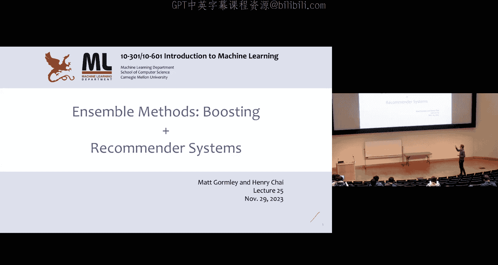
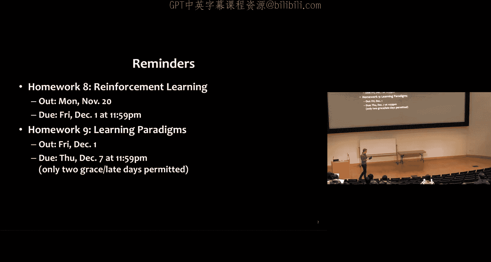
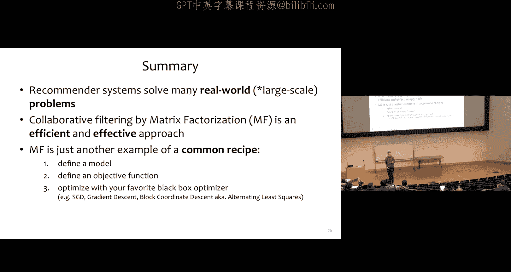

# CMU《机器学习导论｜Fall 2023 10-301⧸601 Introduction to Machine Learning》中英字幕（deepseek p25 Lecture_25_Ensemble_Methods_Boosting_Recommender_Systems.zh_en -BV1Z2cUefE4A_p25-

All right， good morning。Today we're going to talk a bit more about ensemble methods。

 this is kind of picking up where Henry left off in thinking about baggging we're thinking about sort of a。

Complimentary very sort of different looking approach called boostting today and。And then from there。

 we'll think about recommender systems。

So。Here's the usual reminders， homework8， homework nine。

The usual thing that we do for homework nine is like homework three and six。

 you can use up to two grace or late days and that's so that we can get you feedback quickly in time for the final exam。

So at this point。We've actually seen a variety of different learning paradigms and so I kind of wanted to like sketch out what some of those are so we've mostly focused on supervised learning here where our data consists of XY pairs where we kind of assume that you know x's are sampled from some distribution and then Y are given by some unknown target function and our goal is to learn some function that closely approximates that function。

And。SoIn regression we assume that our Ys are scalar classification， we assume they're discrete。

 we can binaryize those and then in structured prediction。

 we assume that we're actually predicting an entire vector。

So this would be like the machine translation examples that we saw where your output is actually a sequence。

嗯。As well， we've been thinking about unsupervised learning。

 so this encompasses data sets that don't have labels， where we only have X's。

And Henry described sort of an approach Kamins for clustering last time。

 where the goal was to predict some labels ZI， where ZI are discrete and the ZI。

 you could think of them like YI's except that we don't actually have any ground truth necessarily for what they should be。

Dimenssionalality reduction was different， we've seen this kind of appearing in different forms throughout the course。

 but PCA was the most recent example where we were thinking about how to convert excIs in high dimensional M space to the lower dimensional K space。

We're not going to talk really much about semi supervised learning directly。

 though in fact the the sort of。Sort of modern example of semi supervised learning that you all are working with is this paradigm of pretraining on unlabeled data like unlabeled sentences and then fine tuning unlabeled data and so this is an example where we have some small amount of labeled data like you do in the homework and some larger amount of say unlabeled data。

In online learning we assume that there's sort of a sequence of examples perceptron was kind of the canonical example of this active learning we're not going to talk about except I guess right now it's where you have unsupervised data but you're allowed to query for true labels Yi but it costs something and so you know you have to pay maybe time or money every time you want one of those labels and your goal is to learn as successful a classifier or agressor as you can at low cost。

😊，And then we also saw reinforcement learning where our training examples consist of these state action reward tus。

 and this allows us to kind of recast the entire learning framework in a very different light where our goal is now to choose actions that maximize reward。

This is sort of related， by the way， to imitation learning。

 which is where you have examples from some， say， expert that tells you in a given state what your actions should be。

So in terms of this sort of big picture slide that we've revisited a couple times。

 what I now want to do is kind of explore sort of this specific learning paradigm of recommender systems。

😊，And it's been sort of。across the globe influential in a lot of different ways。

 so I think it's really important to actually understand what these systems are。

 what they're doing and in some sense also that might help you aid you in understanding what their deficiencies could be and towards that end we'll also be thinking about the separate example of ensemble learning through boosting。

Well。Okay， so we're going to be talking about these two totally distinct topics。

 ensemble methods are all about how to combine or learn multiple classifiers into one recommender systems are just how to produce recommendations that a user would like we're going to use that same Netflix prize though as our motivating example that Henry brought up last time。

😡，Okay， so let's first think about recommender systems because the Netflix Prize is one。

 so assume that you're a company selling items of some sort。

 maybe movies or songs or products and you collect millions of ratings from users of these items。

And so to maximize supposedly user happiness you want to recommend items that users are likely to want okay。

 usually the goal is profit but well at least some people might you know delude themselves so anyway the idea is that you know if you could actually recommend things that people like they would be more likely to buy them man I really just did actually run out of Jasmine tea see this is like I'm。

😊，foiling myself here with this slide so the point of the Netflix prize was to basically to get people to watch more movies right this is this is the only notion of user happiness that Netflix could come up with I guess and so they figured you know if our users are watching more movies then they will be happier and so we be more successful。

😊，So。嗯。So the problem set up was that。They had a data set consisting of 500，000 users。And 20。

000 movies。嗯。And you could think of this as like a big sparse matrix。

Consisting of 100 million ratings， I say it's sparse because 500，000 times 20。

000 is much more than 100 million， so it's not like every user rated every single movie right they had just rated a handful。

 but this was still a massive data set and the goal was to obtain lower root mean squared error。

 the Netflix Netflix's existing system on 3 million heldout ratings。So for some users。

 you wouldn't know what they had given as the rating for particular movies。Ok。So。啊。

As Henry pointed out last time， you the actual winners of this setup were primarily ensemble methods and so what we want to think about then is how you could effectively build other kinds of ensembles now I think Henry you already talked about the names of these teams。

 did you mention the submission times don't think so。

It turns out that there were two systems at the end here that Belco's pragmatic Cha and the ensemble that got a root mean squared error of 0。

8567。And。And so this was above the threshold of a 10% improvement over what Netflix had done。

So the thing is。There was also a timestamp attached to when their submission came in and you'll notice here that it was on the same day and that this submission was 20 minutes earlier than that submission。

 thereby rendering Bel Cour's pragmatic Cha， the winner of the million dollar prizeze and the ensemble as second place。

 so if you take nothing else away from this lecture。

 it should be that you should always submit early。😊，It will literally pay off okay。

So one really interesting way that you could combine say two or three or four or five trained algorithms right is called the weighted majority algorithm and this is a lovely and very simple algorithm the idea is that you're given a pool of。

😡，A pool we call it a of binary classifiers that you know nothing about right they're just classifiers out there in the world and you have also a stream of training examples coming through okay so this is an online learning setting。

😡，And the goal is to design a new learner that uses the predictions of the pool to make new predictions。

So here's the whole algorithm。Initially you weight all of the classifiers equally now remember these classifiers are fixed somebody you know you were a Netflix team you worked really hard for weeks to train your model and then。

😡，You know， another team over here trained another model and now you're going to combine them。

So initially you weight them all equally。And then you receive a training example and you predict the weighted majority vote of the classifiers in the pool。

And and then。You look at those predictions and you down weight the classifiers that contributed to a mistake by a factor of beta。

So if the weighted majority vote is a mistake。Then you're going to basically say， well。

 who's at fault here？😡，Okay， it was it was these two classifiers， they got it wrong。

 so let's down weight those， they made the mistake， we'll leave the weight on the other one say。Okay。

 so so here's the same algorithm but a little mathier and I think I think it's actually kind of helpful to make this a little more concrete so suppose we have this pool of classifiers a and there's capital T of them。

 so we have H1 h2 up to Ht and each Ht maps from an m dimensional vector to a plus1 minus one prediction。

😊，And we're going to let alpha T be the weight。Of the little Teth classifier HT。And。

So we initialize all of those alphas to one。对。And then for each training example。

 which is our XY pair that comes in， we're going to predict the majority vote class。

We'll split ties randomly， say by computing H hat of X。So H hat of x。

Is just going to be where we take the prediction Ht of x for each one。

And it's a plus one or a minus one， and we multiply it by the current alpha T for that classifier。

And then we sum those predictions and we take their sign。Okay， so。

I think it's actually kind of interesting to think about like what is this doing？

So to get a sense for that， let's start by sketching out so in this first iteration。

Suppose all the alphas are one。And we have three classifiers and they look like this。Classifier one。

 two and three。And the direction of the arrow is indicating the plus one side。ok。

So what we could reason about here is what are the votes for these different regions？Okay。

 so if the training point comes up in this region up here。😡，Where the arrows are pointing。

Then it's going to be， you know， all of them are predicting plus one。

 all the weights in this first iteration are one。So。

The sum t equals 1 to T of alpha T Ht is going to be what？3。Okay， so the sine of three is plus one。

 so we return plus one。Okay。So。Over here in this region。Let's see two of them are predicting。

Plus one， and one of them is predicting minus1。So that means that the summation is going to equal。

Plus one。So again， we'd predict plus one here。Over in the opposite corner， it'll be the same thing。

 two for positive， one for negative in this region here。In the middle。

 we actually have two that are positive。And。One that is negative， so that's also plus one。

And then back in this corner， all three of them are minus， so this is minus3。

 which predicts minus one。And then over here we have two minuses and a plus that's minus1 and minus one Okay。

 so now we could actually draw the final decision boundary， which is going to look like this。Right。😊。

That's the decision boundary that this weighted majority classifier is coming up with on the first iteration。

Okay， so now suppose on that first iteration a mistake is made right you classify the example incorrectly so y does not equal your prediction H hat of x so then what we would do is we would go through each classifier t one through capital T and we would say if that classifier made the mistake as what it was predicting you know minus one when it should have been plus one。

Then alpha t will be now beta times alpha t。And beta here。Is a hyperparameter？

And it's going to be in the range zero to one。So it's always going to。Shrink the weight。

So this is the whole algorithm， it's kind of remarkable how simple it is。

Might be one of like the simplest algorithms that we see in this class。

Arguably even simpler than perceptron。Speaking of perceptron。

 both of these algorithms come up with are associated with mistake bounds。And。

So what Little stone and Warmouth came up with in 1994 was that。In the general case。

 you can actually come up with an upper bound on the number of mistakes。And so for example。

 if one algorithm in that pool a makes at most M mistakes。

 then you can come up with this bound big of log of size of a plus M if you know a little bit more about your pool of algorithms that you know k of the algorithms make at most M mistakes you can make your bound a little tighter。

 if you know a little bit more you can tighten the bound even further right so these are sort of different mistake bounds depending on how much information you have about the individual classifiers。

But the point is that you can actually bound the overall number of mistakes in terms of the mistakes of individual classifiers。

Okay， so in some sense， that algorithm is a nice little warm up so that we can， yeah。

What it work for like regression tests so maybe like we use like means greater to scale down to the weights good question so there are sort of related algorithms so this is this algorithm is explicitly designed for binary classification but there are sort of。

Similar kinds of algorithms that。Do like a weighted combination of regressors and so you're no longer voting you're taking like a weighted combination of the regression predictions and but they fundamentally kind of work the same way。

Good question。Okay， so。From here， I want to talk about AddA boost， which is a different algorithm。

And。It。It's differ it differs in a really fundamental way。

 so in weighted majority we had there you know both this was an example of an ensemble method。

 but it assumed that the classifiers were learned ahead of time。😡。

And we only learned basically the weight of each classifier， how to combine。In Add a boost。

 this is an example of a boosting method because it simultaneously learns the classifiers themselves。

And the majority or the weights for each of those classifiers， how to combine them。Okay。

So just some quick definitions here， so in Addbu we say a weak learner is one that returns a hypothesis that is not much better than random guessing。

And we say that a strong learner is one that returns a hypothesis of arbitrarily low error。Okay。

 so at a boost is essentially an answer to this interesting question， does there exist？

An efficient learning algorithm。That can combine weak learners to obtain a strong learner。

So basically， if you have this collection of classifiers that you know are not particularly good。

Not much better than random。 Can you combine。Their information to get back one that is actually pretty good。

Okay， so here's at least in pictures， how it works， then we'll look at the algorithm。

So we're going to work with。The set of weak classifiers that are vertical or horizontal half planes。

 so you could think of this as like decision trees over real valued features where you limit their depth to one。

So this is a pretty weak。Collection， you know。Hypothesis class。

And so here we're looking at our data set。At the first time step， so we call this D1。And。

What we do is we train our decision tree of depth1 or our vertical horizontal half plane on this data set。

 and this is the classifier that we learned H1。And so if you look at H1， you can see that it's made。

Three errors。On these three pluses that are circled。

And so there's 10 examples up there in the training set， so that means that our error。

On this first time step is three out of 10 or 0。3。And the algorithm at this moment says， okay。

 I'm going to give weight of 0。42 to this classifier。

 we'll talk about where that weight comes from in a second。😡，And then。

 and this is the fascinating part about this algorithm。It says let's create a copy of this data set。

Where we upweight the examples that we just got wrong and we down the ones that we got right。

So if you take here the weight of a particular example to be like its size in the picture。

 we're basically saying on those examples we got wrong， give them more weight。

 make them more important。And make the other ones less important， so that's why we've shrunk them。

OkayAnd now we're going to work with this new data set， this weighted data set。

 and train our classifier again。😡，Okay， so when we retrain on this new weighted data set。

 the classifier is going to work harder to get those three big pluses right。

Because they have more weight。And so。The new H2 that we learn now makes a different three errors。

 but it gets those three pluses correct。So how do we conceptualize weight of a data set well there's two ways that you could do it one way is you could imagine like you make。

Copies of training examples right so we have 10 training examples。

So let's say that you start by making five copies of each training example。

And that's your new copy of the data set and now if you want to upweight。

You add more copies of a trading point， maybe you push those pluses up to eight copies。

 and if you want to down weight you push the other ones down a little bit down to just three copies。

Okay， so now when you're training， your decision tree learner is going to work harder to get the ones that we have many copies of。

Another way that you can conceptualize this is that you just train。

 and this is more practically how people do it， you adjust your learning objective so that each example in the training objective actually has a weight term on it that says you know multiply this loss by eight and multiply that loss by three。

Okay， so。So here H2， you can see that。The error that it got Epsilon to is 0。21。

But that's weird because it got three examples wrong well so why is that happening。

 why why didn't we get 0。3 error here？Yeah。Yeah exactly if we think of this as duplicating examples now we have a larger number we don't just have 10 examples we have many more than that and so you know we're not dividing by 10 anymore and so you know getting those three wrong is sort of less bad than getting one of you know those three pluses wrong。

So it only got a weighted error of 0。21。Okay， so now we create data set D3 in the same way。

 we up the ones that we just got wrong， those minuses， we downwe everything else。

 and so now what you can see is these three pluses have actually kind of returned to normal size。

But these pluses and these minuses that seem to be kind of the easy training examples they're kind of far off out on the side they're really down weighted now the classifier is not going to work very hard to get them right at all。

Okay， so we now train a third classifier on this and this is what we get。

And you can see that at this point， it got error a weighted error of 0。14。

 because all it got wrong were these three low weight examples。

So it did pretty well and it gives this classifier a weight of 0。92。

 which is the highest weight we've seen so far。Because its weighted error is quite good。Okay， now。

We have these three classifiers and we use those weights， alpha 1， alpha 2。

 alpha 3 to produce a weighted。combinationbination。Just like we did before。

 but now the weights are more interesting and this is the final decision boundary that we end up with。

喂。Everything on this side is classified as plus。And everything on the other side is classified as minus。

So even though we had these very simple weak learners that could only learn these very simple access aligned linear decision boundaries。

The final decision boundary that we learn is this interesting nonlinear thing that gets zero training error。

Okay， now let's look at the algorithm in detail。😊，So suppose you are given。呃。You know。

 M training examples。And then what you do is you initialize their weights。To be。

One over the number of training examples， little M。Okay， so D1i is on the first iteration。

 the weight of the Ih example。Okay。And so they're all weighted uniformly at the start。

 and then for each time step we train our weak learner using that distribution DT。

 which is D1 at the beginning。And then we get some weak hypothesis Ht。And we evaluate its error。

Which you can conceptualize as。The probability。Of making a mistake。

On a training example that is sampled from the distribution。

 the probability distribution defined by DT。And after the first iteration it's probably not a uniform distribution and so this is a correct notion of weighted error。

Yes。Okay， so now。We're going to choose alpha T。To be one half times the log of one minus epsilon T over epsilon T。

Okay， so this choice was a careful one and it。It has some important consequences if you actually do the theoretical analysis。

 what I want to think about is just what on earth this quantity is giving us。Okay， so。

Let's think about two cases。So if。嗯。Your error is high。And if your error is low。

So if your error is high。What is alpha T going to be？So if epsilon T is close to one。

What does alphapha T get close to？Yeah， so if so let's think this through so we have。

Epsilon close to one， let's say it's like 0。9 or something right， so then we have some number like 0。

1 over 0。9。Right。The log of。Of that number between zero and one。Is you know。

 if we think about the log function。Here's one。It's going to pass through at one so it's going to be in this range down here。

 it's going to be some large negative number， so the closer your error gets to one。

 the closer alpha t gets to infinity。Okay， so now。So。诶。So that means if we get low error。

 we're going to do the opposite thing， we're going to give high weight。To this classifier。

A high positive weight。🤧So。So this is a nice property。And。And then。What we could think about is how。

嗯。The next thing that we do here is actually update the distribution。Over the training examples。

So we're saying for the next round， so we want the distribution in the T plus first round to be d subt plus1。

Okay， and for the IF example。😊，We're going to compute this as。Whatever the current weight is， DTI。

Times some scalar， either e to the negative alpha t or E to the alpha t。So basically。

 we have two cases。If you're correct so if sorry if。The prediction。嗯。For this current classifier。

On the Iath example was correct。Then。We'll get some value e to the negative alpha t if we're incorrect。

 we get some other value。Okay， so let's go with the correct case， so if we're correct。

Then what are we going to do？Relative to the previous value， DTI。Is it going to go up or down？Yeah。

 so it's going to go down can you sort of explain like why is that happening？At the smaller。Yeah。

 so here E to the negative alpha t。Is going to。Tend to be so we're exponentiating it and we're going to tend to pull that down。

And so we will effectively。Down weight。And if we're incorrect， we will up。诶。So that said。

 I'm kind of。Sort of sweeping an important detail under the rug。Which is。呃。

That how much you are upweighting or down waitinging， it actually depends on alpha T， right？So。

We if let's think about the case where we're incorrect。 So here if we had。Hi， Er。

And we were incorrect on this training example。Then we're going to Up more。And if we had low error。

Oh wait， did I get that backwards yep sorry， I got that backwards so if we had high error。

Then we will up less。And if we have low error， then we'll Up more。

Because alpha is going in the opposite direction as the error。And we're raising not the error。

We're not doing E to the error， we're doing E to the alpha。Okay， so。

You'll notice here that we have this ZT term， ZT is just to make sure that everything adds up to one because we need it to be a properly normalized distribution。

 so you compute all of these weights and then you just add them all up divide by their total sum and that gives you the probability distribution。

Yeah。你定白自己快月十岁。Yeah， so if alpha is。Yeah， so maybe I actually I'm kind of misrepresenting this so if。

If when we have low， yeah， so if we have high error。And。We are。呃。So yeah， this I need to be careful。

sortrt of。Relative。2。Correct。Or relative to incorrect。So。

This is the confusing part we're changing the value for on so if Al is negative。

 we're changing the value for both negative and positive examples。

Sorry correct and incorrect example。And so。What matters is are we。呃。

Are we changing that relative how are we changing that relative to the incorrect and relative to the correct examples？

So that's the key。Distinction here， so you're right that。That the actual value。So E to the。Alpha T。

 it's always going to be some positive number。Since the X。X function is， it looks like this， right？

And so the question is， in the end， what's the result， right。

 because we're changing the weights of all of these things。你看。So。At the end。

Our final hypothesis is exactly what we did with weighted majority vote。

All we do is we take the sign of the sum of alpha THT for each classifier and that's it weighted majority just like we had before。

 but now we're actually learning these HTs as we go and sort of the information that's flowing from one iteration to the next is flowing through our reweighting of the data set。

So it's a very different paradigm。So there's some interesting theory that comes along with this。

 so if we say if we let epsilon T be the error of HT and write that as one half。

Minus gamma tea then you can think of。Of gama tea as saying how much better than random。

HT's predictions are。That's essentially what we care about most these are weak learners and we want to know how much better than random is it？

And so what what？The authors of this out of boost algorithm found was that they could actually come up with a bound on the training error。

 so this is like the number of mistakes on the training set。

And they could say the training error is at most this quantity。And。

So what this means is that if each weak hypothesis is slightly better than random。So that。

Gamma T is greater than or equal to some gamma greater than zero。

 then the training error is going to drop exponentially fast。Okay， so this is nice。

 but usually what we care about is not a bound on the training error。

 we care about a bound on our generalization error or our true error。😡。

And so this is a bound on that true error。And。What it's saying is we can write this bound in a rather familiar looking way from Pecklin。

 it's in terms of our training error。Our sample size M， the VC dimension。

 D of the weak hypothesis space。And the number of boosting rounds， T。

 like how long we run the algorithm？Okay， and what we find is that where the left term here is the training error。

 we get training error。Plus， some constant term in terms of the VC dimension divided by the sample size。

 and its times the number of boosting ramps。So what this bound actually says is that。

It's sort of suggesting to us that boosting should overfit if you run it for too long。

This is sort of what we are used to seeing when we train algorithms right。

 you know if you train them for too long and you're not regularizing。

 eventually you kind of overfit and your validation error comes back up， right？

So that's what this bound is suggesting， but empirically people found that boosting often does not overfit even when it's run for thousands of rounds。

So there's this interesting like self regularization that's happening in boosting。And。

And so what these are the sorts of results that people were used to finding。

 which was that here on the left。If you look at the number of rounds， this is T。That we're running。

Or you could even think of it as like little T， and then you have the test error on the vertical axis。

Then it starts out that。Oh sorry， actually that's not true。

 this is error where the bottom curve is our training error and the top curve is our test error。

And what's fascinating about this is that you can see that before we even get to 10 rounds。

Our training error has actually hit zero。So we bottom out on this。This red curve at zero。And yet。

 even though our training error is zero， our test error continues to go down。For some time。

So this is sort of a not terribly intuitive result。

 which is that it feels like you know once you've maxed out the training error。

 you should be overfitting right the test error should start climbing back up。

 but that's not what we actually see here， we actually see that when you've like fully overfit the test error can continue to go down。

And this has something to do with sort of the fact that we're enssembling these predictions together。

Okay， so。Before we jump to recommender systems， I just want to kind of wrap up with just this contrast。

 so bagging tends to be most useful when your classifiers exhibit high variance from one training sample to the next。

Booting tends to be most useful when your classifiers exhibit high bias。

 meaning that they're very simple。And and so bagging is kind of capitalizing on the high variance of your training samples。

 whereas boosting is capitalizing on the simplicity of your classifiers okay so what do we actually mean by high variance and high bias here so this is a different term bias than what we've talked about before。

 so suppose we have a regression data set D for which。

We have some true target function C star that gives us a value for Xi。

 and then we add some Gaussian noise epsilon。From a  zero1 Gasian。

So it turns out that you can actually write down the mean squared error of a classifier as the expected。

Squared error between y， the true label and H theta x， the prediction of the classifier。

 the quantity squared。And this expectation is taken under data points。😡，And so we can rewrite that。

Mean squared to error as two terms。The bias squared plus the variance。

Plus some sigma squared where the bias is the difference between the expected prediction of your classifier。

With the expected prediction of C star。So maybe on average， over all of the examples。

 the average prediction of C star is something like seven。And if you have high bias。

 it's kind of like your classifier in expectation is predicting more on average， something like high。

 like 17， right？So。If you have。High varianceance， this means something different it means that。

Whatever that 17 is。Is on average， pretty far from whatever you actually predict for each example。

So there's like a wide spread of values that your classifier gives out that would be high variance。

Okay。And so okay， so all the algorithms for boosting and begging that we were talking about were actually for classification for。

😊，For classification， it's a little bit harder to talk about biosvariance straight off。

 but basically you can take the probability of y equaling one given x。

To be H theta x and then this same idea of a bias variance decomposition still holds。

 so if you have a probabilistic classifier， you can think of it as a kind of regression over probabilities。

So if you have two regressors with the same mean squared error。

 but classifier A is heavily overfitting。😡，And classifier B is heavily underfitting。

Then we can interpret this bias variance trade off as a tradeoff between you know classifier a achieving low bias at the expense of high variance。

 that's sort of what overfitting is doing and classifier B is sort of achieving low variance at the expense of high bias。

Towards something simple。So it's of underfitting。And。

And so you can think of bias as like bad assumptions in your learner。

Maybe overly simple assumptions and high variance as sensitivity to noise in the data set。Okay。So。

So this is sort of our big picture of ensemble methods boosting in particular is interesting because it's。

It's simultaneously learning these classifiers and how to combine them。So with our remaining time。

I want to think about recommender systems and specifically dive into how we could implement。

Not a bunch of systems together for this Netflix prize problem， but how to implement just one。Yeah。

I guess like I'm think others it requires like one model and it just like combining multiple versions of that model。

 but it seems like in the that simple， you're combining with different model。

 so it's possible that you do seem to combine a different model right。

So boosting is sort of different than so weeded majority is more the kind of thing that the Netflix Prize winners would have been doing right they would have had like you know somebody was doing matrix factorization。

 someone was building a neural network and they put these completely different models together after having trained them separately so you could have the class of models that you're considering in at a boost be broader than just like vertical and horizontal half planes。

You could allow the actual learner to choose between， you know， say neural networks and I don't know。

Logister regression classifiers or something with special features and。

But it would it would actually need to like in order to choose between them。

 it would actually have to train them both and then like pick the better one。

So you can actually have it apply to a broader class。

 but usually I would say most settings that people use at a boost。

 they're actually just sort of picking one family of classifiers that's uniform。Great question，K。

So let's think about how to build something to win this Netflix prize so the setup again is that we have items。

 users and feedback where feedback is like ratings and our key assumptions are that we can represent the ratings numerically in some user item matrix。

And the users are only rating a small number of items。

 so here Alice watched you know the first movie and the third movie and Bob watched the first and second movie but not the third and Charlie has a lot of time on aance。

So there's sort of two types of recommender systems， content filtering and collaborative filtering。

So first I want to start by distinguishing these so content filtering an example of this would be Pandora。

com， which relied at some point on the music Genome project。

And the idea here is that you have a massive database of information about every song and artist。

 and you could think of this as like describing all the different aspects of like the beat of the song and what instrumentation is involved and whether or not there's vocalists or their backup vocalists。

 what's the style of the music and so on， so this is like carefully curated handwritten information about each of your items or each of your songs。

And then you could imagine building a classifier that looks at what kinds of songs people like。

Based on the features that you've written down here in order to predict whether or not they'll like another song based on its features。

So the problem with this approach is that it assumes you have access to side information about those items。

But the nice thing about it is if you have a new item to add， it's not a problem。

 you just write down all the side information about it， get a music expert to do that for you。

 add it to your database， and now you can immediately start recommending it to people。😡。

Collaborative filtering is what we're going to focus on today， and it's quite different。

The Netflix movie recommendations are a nice example of this。

 where you just assume that you have this user item ratings matrix。

And you assume that you have no side information about the items like you don't even know what the movie title is。

 you just know that column 37 is some movie and some people like it and some people don't。

The problem with this setup is that if you have a new item。

 it's like you're adding a column to this matrix， but you have no ratings for it。😡。

So that column for that new item is completely empty。

 and so you have no information about it to make a prediction。Okay。So。

So let's delve into collaborative filtering， the second one of these a little further。

so for collaborative filtering， you know there's lots of everyday examples of this right the besteller list。

 the top 40 music list， you know， if you go to your friend and you say， hey。

 have you read any good books lately， that's a recommender system right it's a collaborative filtering where you're relying on other people's ratings of things to inform your own。

😊，And the common insight is that personal tastes are correlated。

 so if Alice and Bob both like X and Alice likes Y， then Bob is more likely to like Y as well。Okay。

 especially if Bob happens to know Alice or something。You know information about。Okay。

 so I want to think about two collaborative filtering methods。

 the neighborhood method and latent factor methods。

And neighborhood methods are just like a nice really quick example that we'll look at and then we'll focus mostly on latent factor methods。

Okay， so here's the idea of a neighborhood mandate。😊，In this figure。

 we're going to assume that a green line indicates that a movie was watched。

By a particular user that it's connected to。So the algorithm is this。

 say you're trying to make predictions for some user on the left。So first what you do is。呃。

You find all the movies that that person has watched and let's assume if a person you know。

 actually watches an entire movie， that's kind of like giving it a high rating because they didn't turn it off halfway through。

So this person watched these three movies，St Wars， savingaving Private Ryan and something else。

And so what we do there is we then look for other users who also watched or liked those same three movies。

Okay so we search in our database of ratings and we find our main matrix of ratings and we find， oh。

 there's these other three users and all three of them also watch those same three movies。

So we could say these three people probably have similar tastes to this one。So what do we recommend。

 we recommend the other movies that those three people watched。Okay。

 but there's this question of in what order should we recommend them and the way that we do that is we just look at how many of them watched each movie so here。

Oh， this one looks like saving private Ryan so this one was watched by three people。

 so we recommend it first。This one Dunne was only watched by two people。So we recommend it second。

This one was only watched by one person， so we recommend it third。😊。

And this one was watched by zero people， so we would recommend it fourth。

So this is the idea of the neighborhood method。You're here。It is beautifully simple in some sense。

The trouble is what do you do if if if you know， you have someone who hasn't like watched the same movies as someone else。

 well now you need to think about how to sort of generalize this a little bit。Okay。

 so what I want to do is now consider a totally different kind of method。

Which is called latent factor methods。So。Our assumption。Excuse me， going into this approach is that。

Both movies and users live。In some low dimensional space that describes their properties。

And so the idea is going to be that we'll recommend movies。

Based on their proximity in this latent space to the user。So let's say for example。

 that the low dimensional space that you have。嗯。Is。You know。

 on one axis varying between whether the movie was escapist or serious。Right。

And then on the other axis was whether or not the marketing team was marketing towards。You know。

This or that gender。So。Here we could say that。You know， if we have some。A person like this user。

Then they're going to tend to favor things that are both escapist and marketed towards males。

And so we should recommend things like Independence Day and D and Dmon。By contrast。

 maybe some new user comes along up here。And theyre like really serious。

Movies and so we should recommend something like amaadeas to them or maybe the color purple or brave heart。

Okay， so now。This figure。Comes from a paper where they were just trying to illustrate the idea of a latent factor method。

It's not the actual latent factors that were learned in practice。

 the latent factors that you're going to learn with an algorithm like matrix factorization are not going to be labeled。

There won't be this notion that you have an axis that varies seriousness versus escapistness。

They're latent in the sense that we're going to learn some axes and we don't know what they are ahead of time。

 and they won't have labels at the end。Okay， so before we dive into matrix factorization。

 I just want to kind of make sure you're tracking me with all this terminology。

So let's look at the first and only poll question for the day， so applied to the Netflix Pri problem。

 which of the following methods always requires side information about the users and movies。And。呃。

The options are PCA， principal component analysis。Collaborative filtering， latent factor methods。

 ensemble methods， content filtering neighborhood methods， recommender systems， and H is toxic。

 so don't pick that。 so go ahead and。Submit your answers when you're ready。Okay， so。

With these methods。You all are answering somewhere in the range 20 to 30%。And then for this one。

 you're answering something like 75%。Of you are answering that one， so that's generally good。😊。

Not great， but。So in fact， the only answer correct here is content filtering it's the only one that always requires side information。

 so let's maybe just draw a little picture so that we understand what the setup is okay。

 so the picture that we want to draw here。😊，Is。Here， the collection of all。

Algorithms that are recommender systems。And we said there's within that collection。There's sort of。

Two kinds that were primarily concerned with。 One is content filtering。

And this does require side information。And the other is called collaborative filtering。And it。

Does not necessarily require any side information。嗯。There's also within collaborative filtering。

 sort of two categories that you could think about， one is neighborhood methods。And the other is。

Latnt factor methods。And what we're about to do is talk about。

A particularly latent factored method called matrix factorization。Oh。

 and then over here outside of this box altogether is PCA， it's not a recommender system。嗯。Okay。

 so this is sort of the picture of what it is that。嗯。That we're doing and where we're going。So。

So matrix factorization is fundamentally about how to factor a matrix into the product of two other matrices or three other matrices。

Great。So we're going to consider。Three different ways of doing this。 But primarily。

 we're going to focus on the first one， which is unconstrained matrix factorization。

 And then if there's time at the very end， I'll just kind of like off handedly mention these other two。

And what we're going to find is that major factororization is just another example of a common recipe。

Which is define a model， define an objective function。

And then optimize that objective function with something with your favorite algorithm。

 maybe something like stochastic gradient descent。Okay， so。To get an idea for。呃。

What it is that we're doing， I want to think about low rank matrix factorization。And。

The first case that we're going to consider is exact factorization of。Of a matrix。

And so we'll assume that we are given。Some M by n matrix R。Of。Rank。Okay。对。

Where that rank K is substantially less than。The men。Of M or N。

So essentially what that means for us is that this matrix is low rank。嗯。

Does anyone remember what it means for a matrix to have rank K？

Is there a way that you could describe that？Yeah。你个你讲。Yeah great answer。

 so we could say this just means that。The matrix has K。Linely independent。Let's say columns。

You could also say rose。Just to be narrowed down。Okay。So。The claim here is that。There exists。

A matrix that is M by K。We'll call it matrix。You。And another matrix that is n by K。We'll call it V。

Such that。R is actually exactly equal to U V transpose。Okay。So pictorially。

 you could think of this as we have some。Mattrix R。And it's M by N。

And we're saying that is going to be equal to the product of some matrix u。

 which is m by k where k is much less than。MN and some other matrix and we're multiplying it by some other matrix。

啊。V transpose， that is n by k。Here。So if you think about， you know， what is the value of？

This first element of the matrix。Well， it's going to be a do product。Of。The first row of you。

With the first column of V transpose。And。呃。And then the second。

Element to the right is going to be the dot product of the first row of U with the second column of V transpose and so on。

Okay。So。There's some interesting things to note here。One is that。The columns。Of you。Are said to be。

The K basis vectors。Of the columns。Of our matrix R。And then similarly。呃。The rose。Of V transpose。

Are the K basis vectors？Of the rose。Of R。Okay and so what on earth does this mean this this idea of basis vectors so what it means for us is something kind of fascinating it means that。

Oh， sorry， I missed the number K here。Okay。Basis vector。So。This means that。

For say let's think about the rose case so every。A rowow。Of R。呃。Is a linear combination。

Of these vectors。Right so。呃。Or similarly， every column of R is a linear combination of the vectors in U。

So let's think about the columns case。You know， this first column of R。😡，Is essentially。

Like where you take all of the columns of you。And you take some waiting of them。

Add them up and those that weighting is going to give you the value of R。

Of like the corresponding column in R。So where does that weighting come from for those columns well the first column。

呃。Of R is going to be weighted by this， the weights are this first。😡，Column of V transpose。

And it's going to be essentially multiplied by each row of U。

 thus giving you back some representation of R。Okay。So。The second case that I want to think about。

Is where we do approximate factorization。So here we're going to assume that。We're given。

An M by N matrix R。Of rank。L， which is actually greater than K。Where。K equals the number。Of columns。

In U and V。Then。My claim here。Is that we can approximate R。With a。Rannk K。With rank K matrices。

U and V。So meaning that we can write something like R is approximately equal to。UV transpose。对。Okay。

 so。嗯。Why are we talking about this at all， Well， if you think about R as a ratings matrix。Right。

What we're saying is we want to come up with some factorizations。Of that ratings matrix R。

But we don't actually know exactly what its rank is going to be。And so we're saying if the rank was。

Was low， then we could come up with a dimension K factorization。

That exactly reproduces that ratings matrix， but in practice， it's probably not going to be low rank。

Or at least as low as we want the rank of U and V to be。

 and so we're instead going to be approximating。Okay， so then we could think about， you know。

 we have this approximation R that is u times v transpose， well， what is its approximation error？

So to think about this。We could define a residual matrix E。Where the residual matrix E。Is。

R minus UVv transpose。Okay， so if UVv transpose is exactly R。

 then the residual matrix is all zeros we got every rating exactly right。😊。

But if we're a little bit off， then UV transpose。Isn't exactly equal to R and those values in that residual matrix show us how far off we were from the true rating。

And so what we can do is we can actually take what's called the Frrobeius norm。Of。

That matrix E and square it。Now， the Frroenius norm。

Of E is really the Frrobinnius norm of R minus Uv transpose， the quantity squared。

Where a Frrobinius norm。Is。That down here。Is just like a。Like an L2 norm。

Except that it's for a matrix， so we have to sum over all of the rows。

And all of the columns and take each element。Of the matrix and square。

 and then we take the square root of the whole thing。So this is the Frrobinius norm。And。

It's just sort of the matrix generalization。Of an L2 norm for a vector。

But the other way you could think of it is if you took the matrix and stretched it into a vector。

 the Frrobinius norm is just the L2 norm of that stretched out vector。Okay。

 so the idea here is that we could actually。嗯。We could actually come up with a way of approximating。

OrThe quality of effect factorization。Or measure the quality of effectization by looking at this mean squared error。

 basically， or this squared error。Okay， so what we're going to do for matrix factorization in a recommender system is say we want some rating matrix R。

To be the product of U with V and ideally what we would learn is these k factors right and the factors would allow us to like learn something about users and items so we could think about R as our ratings matrix and then U you could think of as consisting of here K is equal to2。

😡，So we have two dimensions for you。Two dimensions for V and here we've actually labeled what those dimensions are。

 maybe post hoc just so that you can conceptualize what's going on。

And essentially what we do is we have seven users， 1， two，3， four， five67， and for each one。

 we come up with a two dimensional representation of that user in this latent factor space。

And it tells us how much does this user like history and how much do they like romance？

And the idea then is that we also do the same thing， we come up with a representation。

 a two dimensional representation of each movie。And now。

 if you want to know how much a particular user likes a particular movie。

 you take the dot product of the row for the user with the row for the movie。

 and that gives you their rating。😊，Like this one。If you take the dot product of the second row with the third movie。

 that would give you the rating of user two for the third movie。Okay， now in practice。

 we won't have these history romance labels， we're just going to learn these latent dimensions so that we do a good job of reconstructing the ratings matrix。

And then we can compute our residual matrix， which looks at the difference of R with UV transpose and tells us where did we actually make errors in our ratings？

Predictions。So this is the idea of matrix factorization and you could compare this or you could think of this as in contrast to regression where in regression we have。

😊，X1， x2， we have these features。And then a single label Y。And the unknown quantities。

Are at only at test time。Wwhichch are the values of Y at test time and what we're doing is we're trying to fill in these unknown y values at test time。

Collaborative filtering is different it's like we assume that we have this matrix and we're just trying to fill in thismattering of missing values in the matrix。

😊，喂。And there is no demarcation between train time and test time。

 it's just that when we want to predict， we're going to try to fill in what those missing red values are。

Okay， so unconstrained matrix factorization is one way of solving this problem。

And the way that we set this up is by saying we're going to find。A。Two matrices。嗯。You had。And V hatt。

Which are。The arg min over possible matrices， U and V。Of some objective function， JUV。What is JUV。

 well， it's just the objective function that is。The approximation error。Of。Are predictions。

 so it's going to be the Fenius norm of R minus UVv transpose， the quantity squared。Times  one half。

Now， this makes sense if you have a fully observed ratings matrix， right？

You're going to come up with these two matrices， U and V that best。Match that whole ratings matrix R。

But in practice， we don't actually have a fully observed R。

 we only have a partially observed ratings matrix。Okay， so what do we do well？

We're going to let RIJ equal the， say， IJth entry of the ratings matrix。We're going to let vector UI。

Be the ih row of the matrix U。And vector Vj is going to be the Jeth column of V。So。Essentially。

 you could think of this as RIJ is the rating。Of item I。By user J。

And UI is essentially a user factor， it's a vector that represents the interests of the users or the features of the users。

😊，And VJ is like an item factor， it's telling us information about the item。😊。

And so both of these are essentially learned feature vectors， right。

 they're not like feature vectors we wrote down ahead of time。

 they're more like the hidden states of a neural network。😊。

And so if we want to write down an objective function。😊。

Then we're going to let Z be the set of all Ij entries。呃。In the ratings matrix R。

Such that RIJ is observed。So these are the entries in that ratings matrix that are not shaded out red。

And now what we can do is we can write down a new objective function。😊，JUV。

That is almost like that Frrobeius norm from before。But instead， it only sums。

Over the observed entries of the ratings matrix。And for each one。We want to choose。The vectors UI。

And Vj。Such that their dot product is close to the predicted rating for that entry。All right， Jay。

Okay。So。嗯。So this is now an objective function that we could use to learn that partially observed ratings matrix。

Okay， so when we at test time want to make。Model predictions for the missing entries。

 all we need to do is compute the dot product of UI。😊，With VJ。

And that will give us our hat IJ for the missing entries。So you could think of this as like。

 you know， we have our matrix U。And our matrix we transpose。And if we're trying to fill in。

Some missing entry here are Hat IJ。Then we take the corresponding。

Item vector and user vector and their dot product gives us the prediction。Okay。

 so the last detail here。😊，Is that while we've not converged。We can actually。Run gradient descent。

As we usually would。Where we compute the gradient of the matrix U。

This is just a differentiable objective function， J of UVv。

 so we take the gradient with respect to U and store it in GU and the gradient with respect to V and store it in GV。

😊，And then we do the usual update rule where U goes to u minus some learning rate gamma times G。

And V goes to。V minus gamma times Gv， and we have our usual gradient descent algorithm。Okay。

So I'll take two more minutes here just to wrap up。Excuse me。So there's a couple other details。

 you could instead run stochastic gradient descent on this。😊，嗯。The gradients are very simple。

They look like those。But what you could do also is when you run stochastic gradient descent。

 you could actually， your training examples are essentially your observed ratings。

 so you could sample an observed rating。From Z， a set of observed values。

And then compute the error for it and then update。😊，The values of UI and VJ。

 only the ones that are involved in constructing that rating。

And so you could do that for each IJ pair。You could also add regularization like we usually do where you regularize both the user and。

And item。Factors。You can also add in a bias term， you could do this carefully by kind of folding in the bias term to the matrices or you could think of it as your prediction is some bias term that's user specific and some bias term that's item specific added to whatever your prediction is。

 so this would allow that you to sort of shift the ratings appropriately。😊，And。And then。Finally。

 you could run this algorithm called alternating these squares by observing。

That this objective function is essentially just like the linear regression objective function。

And so if you keep。The matrix you fixed。Or rather V fixed， then you can minimize directly over you。

Enclosed form。And then if you keep U fixed， you can actually minimize over V in closed form。😊。

And so if you go back and forth in this way solving this linear regression problem in closed form。

 this gives you the alternating least squares algorithm and it turns out that。

That if you run these algorithms and then you look at the feature vectors that are learned。

They actually tend to make a lot of sense。😊，So here this is an actual。Example of two learned factors。

And this was on the Netflix data。And basically what we see is that you get these kind of clusters of。

 you know， like。Musical comedies over here and scary movies that I'd never watch over there and you know Wizard of Oz in the middle。

 which is both musical and a little scary when you think about that green witch and so so the things that it's actually learning here are quite reasonable as well as doing a good job of prediction。

And finally， if you look at these different optimization algorithms。

 we find that stochastic gradient descent， maybe not too surprisingly。

 actually usually beats out the alternatives for optimization。

Even though that alternating least squares is a rather lovely algorithm， SGD usually does better。

Okay。So I'll skip these last little bit， there's other things that you can do with singular value decomposition and handling things like five star ratings that are never negative。

 and there's sort of other variants of this algorithm to handle that case。

So thanks for staying five minutes late and we'll catch you guys again on Friday。

