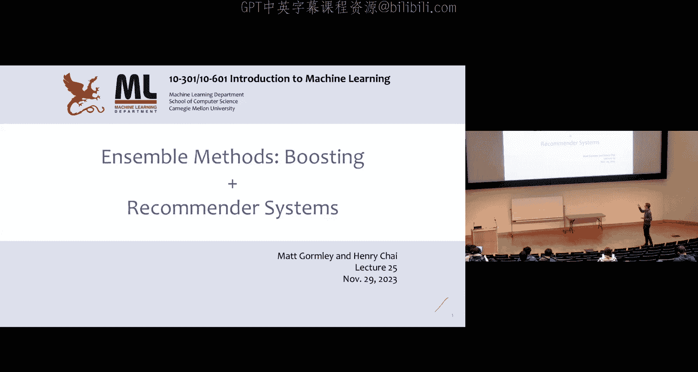
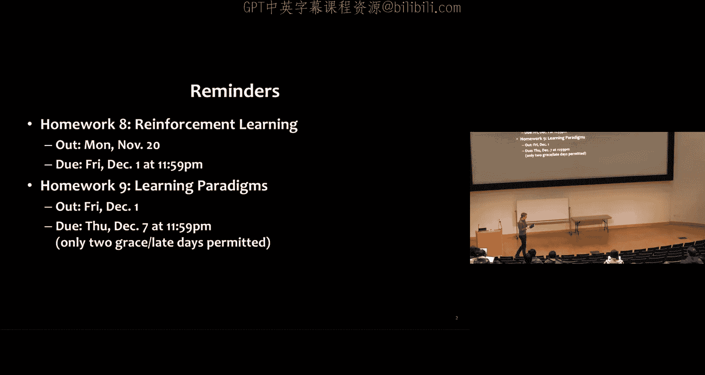
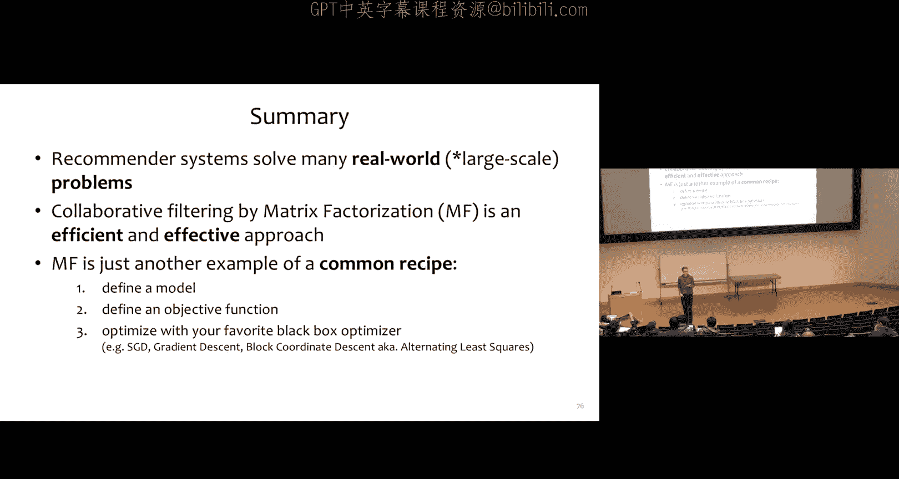

# CMU《机器学习导论｜Fall 2023 10-301⧸601 Introduction to Machine Learning》中英字幕（deepseek p25 Lecture_25_Ensemble_Methods_Boosting_Recommender_Systems.zh_en -BV1Z2cUefE4A_p25-

## 1. 集成方法

**概述**：本节课我们将探讨集成方法，特别是提升法和推荐系统。

**集成方法**：

*   **集成方法**：将多个分类器组合成一个更强大的分类器。
*   **提升法**：同时学习分类器本身和它们的权重。
*   **加权多数算法**：给定一组分类器，使用它们的预测来做出新的预测。

**提升法**：

*   **弱学习器**：返回一个与随机猜测差不多的假设。
*   **强学习器**：返回一个任意低误差的假设。
*   **Adaboost**：将弱学习器组合成强学习器。

**推荐系统**：

*   **推荐系统**：根据用户的历史行为和偏好推荐项目。
*   **内容过滤**：基于项目特征进行推荐。
*   **协同过滤**：基于用户行为进行推荐。

## 2. 提升法

**Adaboost**：

*   **初始化权重**：将所有训练样本的权重设置为均匀分布。
*   **训练弱学习器**：使用当前权重分布训练一个弱学习器。
*   **计算误差**：计算弱学习器的误差。
*   **更新权重**：根据误差更新权重。
*   **重复步骤**：重复步骤 2-4，直到达到停止条件。

**Adaboost 的优势**：

*   **提高性能**：通过组合多个弱学习器，Adaboost 可以提高分类器的性能。
*   **泛化能力强**：Adaboost 具有良好的泛化能力。

## 3. 推荐系统

**协同过滤**：

*   **邻居方法**：找到与目标用户相似的用户，并推荐他们喜欢的项目。
*   **潜在因子方法**：假设用户和项目都存在于低维空间中，并使用矩阵分解来学习潜在因子。

**矩阵分解**：

*   **目标函数**：最小化预测评分与实际评分之间的差异。
*   **优化算法**：可以使用随机梯度下降或交替最小二乘法来优化目标函数。

**矩阵分解的优势**：

*   **提高性能**：矩阵分解可以显著提高推荐系统的性能。
*   **可解释性**：潜在因子可以提供关于用户和项目的更多信息。

## 4. 总结

本节课我们学习了集成方法、提升法和推荐系统。集成方法可以将多个分类器组合成一个更强大的分类器，提升法可以同时学习分类器本身和它们的权重，推荐系统可以根据用户的历史行为和偏好推荐项目。矩阵分解是一种常用的推荐系统方法，可以提高推荐系统的性能和可解释性。