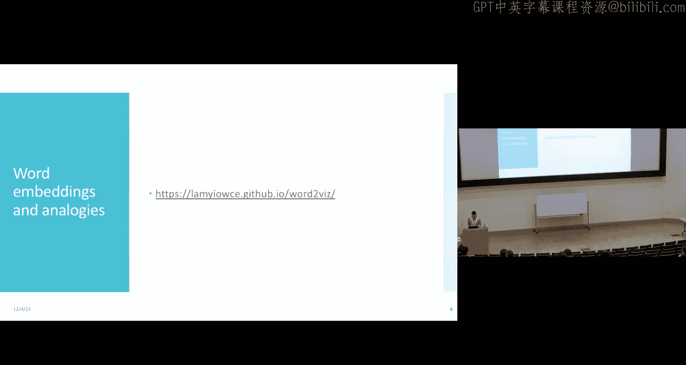
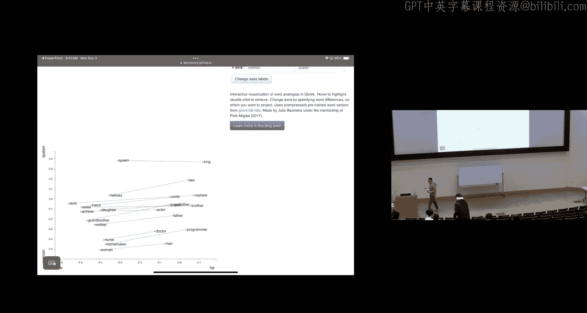
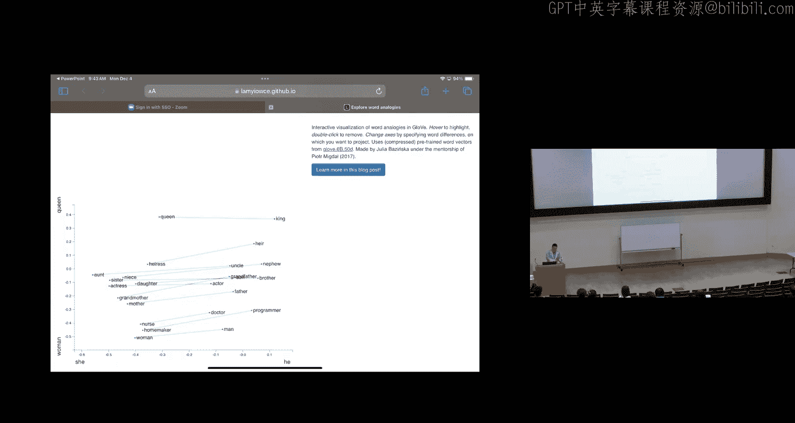
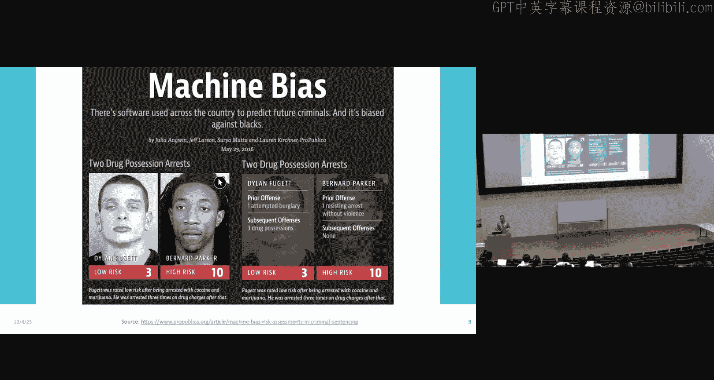
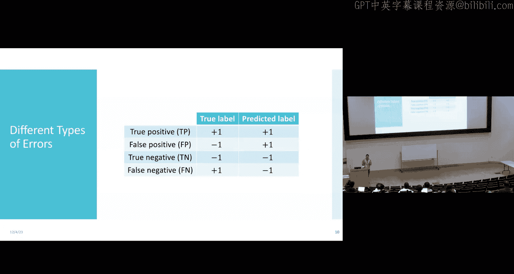
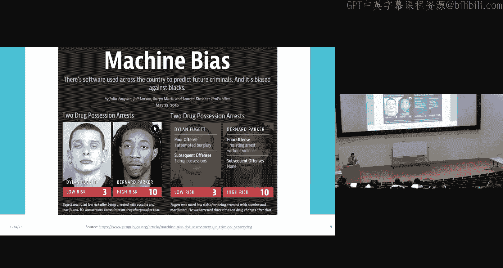
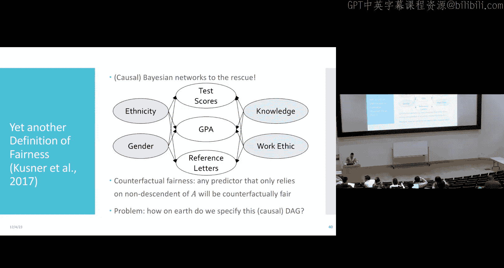

# CMU《机器学习导论｜Fall 2023 10-301⧸601 Introduction to Machine Learning》中英字幕（deepseek p26 Lecture_26_Algorithmic_Bias.zh_en -BV1Z2cUefE4A_p26-

You know， this's kind of the problem with transparency。Like as soon as I put something like。Oh。

 the final is only going to test like up through last Wednesday's exam well。

 people do the rational thing， you know？I get it， I get it。Anyway， all this to say。

I'm really glad you guys decided to join me this morning because I think like。

This is probably like the second or third most important lecture if I had to pick like which ones I think are like really crucial for you to walk away from this class with today we're going to talk about you know。

The dangers of machine learning in some sense。We've taught you a lot of stuff。

 Matt and I have taught you a lot of stuff this semester and I think like。

In some sense we've taught you just enough to be dangerous right and so today in the next 80 minutes I'm going to try and do my best to teach you how to be slightly less dangerous。

 but we're really just going to be scratching the surface here。Some announcements。

 you do have a homework， it's due on Thursday and remember it's a written only homework so if you do have any late days left。

Good for you you might as well use them but you can only use two on homework nine that's because we want to get it back to you in time for this exam exam three on the 12。

 which is like a week from what tomorrow or something like that。😊。

It is scheduled from 530 to 830 on the official registrar's website。

 we will not be using all that time， we're going to stick with our two hour exam format so it'll be from 530 to 730 you will have assigned rooms and seats stay tuned to Piazza for that and as I alluded to earlier today's lecture is out of scope for the exam everything from lecture 17 to 25 which I believe was last Wednesday's lecture will be in scope。

Okay， so let's talk about algorithmic bias， actually， before I move on。

 are there any logistics questions？All right， let's talk about algorithmic bias and the way that I want to motivate this topic is with a series of increasingly distressing stories。

 perhaps。This is kind of an old article。From 2010。And。The question asks and the article asks。

 are face detection cameras racist So before I talk about this， I should probably so cameras。😊。

There used to be this thing separate from your phone。

 which you could like hold and point at people and take pictures with。And。All right。

 huge tangent here， I'm just really curious who here knows what older brother Co is？

Doesn't mean anything to anybody。 Yeah， okay， this picture just gives me huge older brother Corvis。

 which is just like so insulting because like。This is just like a normal yeah， anyway。

The point of this article， however。Is that this individual here？They got a new camera， right。

 brand new camera， and it kept prompting them whenever they were trying to take pictures of themselves or their relatives that someone in the photo blinked。

And。If you sort of dig through here， you'll see that it was only when。

This individual's brother opened their eyes so wide as to appear bugeyed that the messages finally stopped。

 right？Now， what can we say is happening here？😡，Camera。

 it has some software in it that's doing some sort of like blink detection， right。

 It's trying to be helpful。 It's trying to be intelligent。

 It's using some sort of image or facial detection algorithms to determine whether or not the subject is blinking。

But what went wrong here， why is the camera sort of making this erroneous prediction on this individual？

Yeah， right here straight or data sets where like the faces are the eyes of average bigger。什么。Yeah。

 no， I mean， hey， we can call a spade to spade here。

 this camera is largely trained or the software in this device is largely trained on Caucasian faces。

 faces that look fundamentally different when blinking and not blinking to the subject here an Asian American。

 it seems。And this is。Certainly one possible explanation， yeah。

So were big of those on so timeers that wouldn't。Work with soap detectors like thats soap dispensers potentially for sure。

 I'm not too familiar with that exact use case， but yeah。

 I think you guys are sort of hitting on a common theme。

 which we'll talk about in the rest of this lecture， which is that。😊，You know。

 one of the things that we tried to impress upon you this whole semester is that like it's very important that your training data matches your test data no matter what that looks like right whether that's。

 you know。Different pictures of cats or pictures of humans。

 it can be very important and it can lead to some sort of really， you know。

Bad outcomes if you're applying your algorithms to out of distribution tasks right because like this is annoying。

 honestly it's kind of funny more than truly like cumbersome because it doesn't actually stop you from taking the picture。

 that would be really annoying， but as it turns out。

This kind of software is used for lots of things that aren't just， you know。Early 2000s cameras。

 So this is a story again it's kind of old。 I think Apple has gotten slightly better at this。

 but if you remember there's this whole scandal when the Apple 10 first came out in 2017 where people were able to unlock other people's iPhones。

 So here's a story about two women in China where。😊。

One was able to unlock the other's Apple device using their face ID。And。The story goes on。

 I think this is really funny here that says thinking that this was a faulty camera。

 this individual went back and bought another iPhone。

 but surprise surprise that iPhone had the same problem and then the article goes on to say it is unclear whether she purchased a third phone I think I probably would have called it quits at that point but again。

It's a very similar issue here， predominantly actually this issue is slightly more insidious。😡。

This facial recognition software， it was later revealed。

 was trained predominantly on a data set of not just Caucasian bases but male Caucasian bases。

 but sort of ones that predominate large image， large facial recognition data sets at the time and again I say like at the time because these are somewhat like historical anecdotes like the first articles from 2010。

 this ones from 2017。😊，To the best of my knowledge。

 Apple iPhones have gotten slightly better at this task。

 but this is just to give you some sense of like how this problem has evolved over time and the fact that like it can have some very serious implications right the ability to unlock other people's iPhones just because you happen to be of the same race in the same gender can be incredibly problematic and that's you know nothing to say of all of the much more insidious uses for facial recognition technology you know。

The Amazon software that is used by， let's see， police departments and immigration and Customs En。

 two organizations that have never been involved in anything morally dubious at all， I'm sure。

All right， but like。You know。These are all problems with like image systems and facial recognition software。

 right？We spent a lot of time in this class thinking about large language models and text data。

 and surely like。Those are resilient to this kind of bias， right。

 like if you think about you know the large language models that we've talked about in class。

They're trained on web scale data， right， There's no like one specific data set that is predominantly white male faces that it's overfitting。

 too。 It's trained on like the entirety of Wikipedia and Github and。

Archiive and just like a whole host of these you， open source text repositories。So I say all this。

 I want to share a somewhat fun example with you all here。

Here's another example of a word embedding it's called glove and it's a bit like what you guys have seen before。

 stuff like word tovec， it's an unsupervised word embedding model so it maps words to these sort of numerical representations and it's trained in a slightly different way it's trained to learn effectively relationships between words sort of like a co-occurrence probability in one of the cool things that it learns somewhat implicitly is it learns spatial relationships between words it's very cool you can do some sort of like analogy learning so you know the relationship between the word。

😊，Woman and man is very similar to the relationship between the word mother and father。

 between the word queen and King， like if you took the sort of distance between those two words in this 2D representation of the word embedding。

You can see there are a lot of similarities。But there are also some problematic similarities。

Let's see if I can remember。What the exact？Pair in。The article is。So。If you were to put in。

I don't know， let's start with a benign one， let's start with。Oh no， they already got so yeah。

 they aunt uncle， sister， brother so。People were playing around with this word embedding。

 and they discovered some interesting learned analogies， say。Programr to。It's homemaker。

And if we put that in here。Oh dear， that's not great。Again， if you extend this sort of analogy。

What this language model seems to associate is that the word programmer is much more similar to the sort of male connotated words in the English language and the wordhomaker is to woman as the word man or programmer is to man this one。

Another one this is my wife's favorite， my wife is an actual doctor， not like me， I'm a fake doctor。

 and you can see that again， it's learned these sort of really problematic analogies as well。But how。

 how did this happen， right， if you look at sort of。

You see this does it if you look at sort of what it's trained on， it's trained on。

The entirety of Wikipedia and these common f data sets， Twitter。So how do we explain this behavior。

 how do we explain this learned sort of relationship between gendered terms and not so gendered terms？

H对。Yeah， I think so。The majority of the content online is pretty biased。

 I think that that's a reasonable assertion。 I would say that what it's learning is。

The sort of observed relationship between gender terms and those sort of professions that we have here and whether or not that's an accurate reflection of our society that's certainly up for debate。

 I think a lot of these demographics are moving in the other direction。

Whether or not this is sort of like a true reflection of what we observe。

The fact that it appears in our large language models is in and of itself arguably problematic right。

 I think people will come and see this and say， well。

 that's just sort of the relative proportion of those words or the true sort of conditional distribution of those words in the underlying data set。

😡，And I think even if that were true， you can make the argument that this is a problem and we need to address it。

So。The point that I'm trying to make here is that。There are lots of different sources of algorithmic bias right in our image data sets。

 we saw bias arise because of disparities between training and test distributions here。

 even if this is like a representative sort of model。

 even if this is a representative distribution of how these words occur in practice，😡。

They can lead to some really sort of problematic behavior that we might want to address。

And just to really drive this point home to connect it to what we've been talking about。😡。

People have looked at this in the presence of large language models too this is sort of one of my favorite experiments。

 but therere a whole host of experiments of this nature where you can basically give large language models the sort of ambiguous gender promptngs right so the running example in the text is in the sentence thiss bullet one in the sentence the doctor phoned the nurse because she was late for the morning shift who is the she referring to is it the doctor or the nurse right？

And。Predictably， given what I've just showed you。There are a lot of problems with the models in these kinds of predictions。

 This chart is a bit of an eyesore， but basically what it's saying is when that pronoun is a she。

 the model associates the subject with the female associated profession。😡。

74% of the time and when that pronoun is he， the large language model associates the pronoun with a male associated profession 66% of the time or you know varying amounts for different。

Open source large language models I forget exactly which ones they're testing I'm sure it includes like GT and llma and all that good stuff。

 but like outside of just these sort of predictable correlations。

 I think maybe the more interesting stuff is when you ask the model to tell you why it thinks that because that's a thing that you can do with large language models you can ask it for explanations and you know they come up with a whole host of different explanations here I picked out a couple that the authors highlighted one is what they call context which is。

😊，Effectively the model gaslighting you in some sense。

 saying that it's not possible for he to refer to anything but the doctor。

Also sometimes the model just outs itself as straight up gender bias。

 she cannot refer to the doctor because she is a third person singular pronoun that refers to a female person or animal and the only female person in the sentence is the nurse clearly right and so this problem is very much so something that is present even in large language models trained on corpus level data yeah。

嗯。Not course that might have different。U gendered words like the worker explained is not a notcular gay nurse or a female nurse and would be able to。

So people have done experiments with translation from English into languages with gendered pronouns like explicitly gendered pronouns and nouns and the problem in some sense is exacerbated by that right like if you ask。

A large language model translate that sentence into say French It will translate the nouns into the gendered versions。

 despite the ambiguity。 So in some sense， it's doubling down on that bias I'm not sure how like the models that are specifically trained for one language or another would behave。

 but my suspicion is that if it's trained on data from similar sources， it will have similar like。

Results。Okay， so next we're going to sort of dive deep into like maybe the most famous example or like the classic example of machine bias。

 the one that sort of really sparked the whole field。

 and then we'll talk about some ways that we can actually go about defining and addressing bias and algorithms before I move on。

 let me again stop here because I think this is like a really important and difficult topic to sort of wrap your head around。

Let me stop here and take any questions you might have just so I make sure we're all on the same page here before I move on。

Yeah。😊，And an of a name Spanish speaker due assign gender to most things。To how this。就是，你个so。这个。

你切就可以发 gender。So like nurses or doctor or like a lot of the like profession。

 the they would be very specific so if for would be off brain。Right， no， for sure， I mean I think。

I think there's a lot of interesting work to be done in that space and not knowing very much about Spanish。

 I am not going to comment on that。Yeah。There't seem here to think about like yeah。

 because most of the research of course that it being done。

 especially in the US course are going to be in English。

 but because we don't have a national language， it's written about like why did everything be done specifically。

It didn't be growing。啊。I mean， I think that in and of itself reflects like a huge source of bias。

 right， like the fact that。The reason a lot of this research is being done in English is because the large curated data sets that are readily available to train large language models on are all predominantly English。

And that in and of itself is very problematic。😊，All right。

 so I'm going to talk about race next and I just you know I have to call out the elephant in the room here。

 I am not like an expert in race or political theory or really most aspects of life outside of machine learning so I'm going to do my best talk about this subject as delicately as possible。

 but please forgive me if I。Mipeak about anything All right。

 so the most famous case of machine bias arguably is this case well。

 it was a first sort of published by this group of propplica about a piece of software known as compass and this is just like a wild story because like I don't think a lot of people knew about this that like there was actual machine learning being used in courtrooms to decide whether or not to release people convicted crimes on sort of early parole basically the way it worked is。

The software would take in some sort of set of attributes about individuals convicted of crime and then make a prediction about whether they were at high risk。

 medium risk or low risk to recidivate， which is to commit another crime again。

 and then this information was being used by judges to decide whether or not these individuals should be released sort of early from their sentences。

 because you know if they're at high risk to commit another crime。

 then maybe we shouldn't release them back into society， that's the claim here， right？

And here are two individuals， crucially one of them being Caucasian and one of them being black。

 and the system， the software rated one as sort of very low risk and one as the highest risk。

 this is a score from one to 10。And we can analyze this sort of counterfactually， right sort of。

 it's a little difficult to exactly say what would have happened， right， but。

Upon the white individuals's release， they had three subsequent offenses。

 they recidivated three times effectively， and so the model got them wrong。

 it made an incorrect prediction about them being at low risk and the individual on the right，Here。

 the black individual was rated as high risk。Subsequently went on to have no future offenses。

Now the reason I say that this is sort of a very difficult thing to analyze counterfactually is because we don't know what would have happened if the black individual had been let out on parole earlier because that is not sort of the decision that was made here。

 all that we can observe is that eventually when they were released back into society。

 they didn't commit any future crimes so it's very hard for us to say whether or not this model made an incorrect prediction on that person。

 but we can say certainly that the model was incorrect about the Caucasian individual here and in order to sort of talk about this in like more technical depth。

 we actually need to introduce some terminology， which we've kind of been like dancing around throughout this whole semester。

 but now we need to make slightly more explicit， which is that when we think about what's going on here fundamentally this is like like a binary classification task right where the model is trying to predict whether or not someone will commit future crimes。

And when we have binary classification tests。

There are two kinds of mistakes we can make， right？And we can make mistakes。On positive points。

 by predicting them negatively， that's what we'll call。A false positive， no， sorry， a false negative。

I get this backwards all the time we predicted someone to be negative， turns out they were positive。

 false negative， similarly， if we predict someone to be positive。And they turn out to be negative。😡。

That's what we'll call a false positive。And in the context of this particular use case。

 in the context of the criminal justice system。These two kinds of mistakes have vastly different implications。

 I would argue that neither are great， but。Let's say that a positive case in this instance is someone who recidivs someone who goes on to commit a future crime。

 right？Under the American like legal justice system， we have this principle of like。诶。

I forget how it's exactly phrased， but the idea is that like we would rather let guilty individuals go at the expense in order to not persecute the innocent。

And that we can translate into a trade off between false positives and false negatives。

 that is the idea of a。😊，False positive， the idea of us saying that you will go on and commit crimes。

 therefore we need to sort of keep you in prison longer， that is。

A higher cost or less ideal under the American legal system than potentially releasing individuals who would go on to recidivate。

And。I want to take a minute because okay， so next we're going to talk about how you can trade off between those two things。

 but I want to take a minute and just like think about how ludicrous this is from like。

like dystopian perspective right like what is happening here。

 this is like big brother looking down on you and saying because I think you will commit crimes in the future。

 we're going to keep you in like think about what that would imply for like if we use this in the real world like before anyone is committed to crime I could use I could run you through the system and if you come up high risk I'll just put you in prison prettyemptively like this is so dystopian or anyway。

 the like article led to this huge takedown of the compass software and the company behind it who you know then immediately did the capitalist thing and rebranded and put out new software and they're still they're still going at it。

Anyway， let's talk about。Sorry， I just， I get like。

It's just like loves me the wrong way so bad I I can't anyway。

 let's talk about like what we can do about these different kinds of mistakes here so what is fundamentally going on。

Up until now， we've thought purely in terms of accuracy in this course。

 like sort of a 01 binary loss and you know we've even tried to like directly optimize for this loss function in many of the models that we've been training。

 but this is only you know appropriate in settings where well。

 there are lots of issues with the accuracy metric。

 it can be problematic in settings where you know you have imbalanced labels。

 let's say where one class is much more prevalent than another。

And also in the setting that we just observe where you can have sort of these asymmetric costs。😡。

For different types of errors where false positives might be much more damaging than false negatives。

Let me just stop here for a minute so we're on the same page。

 can anyone give me an example of a setting with like heavily imbalanced labels。

 maybe one slightly less charged than what we've been talking about yeah。嗯。

This is sort of the canonical example， yeah detection。😊，Rare diseases。

Where you know the prevalence might be something like 0。001% in that setting。

A high accuracy model would be to predict that no one has the disease， right， you'll get 0。999。

9% accuracy， I forget the exact number I said you can get really high actually by just saying that no one has the disease。

But that like is really bad because then you'll miss everyone that does actually have the disease and those are the people that you really care about。

Correctly identify。We care about all people， but you know in this setting we care about identifying people with rare diseases can anyone give me an example of a setting with asymmetric costs。

 maybe something we haven't talked about yet？Where the result of a false negative might be very。

 very sort of different from the result of a false positive。Yeah。他对。Yeah， sure sure。

 let's go up with a slightly different example， another idea here， same idea， okay。

 fair enough is very leading here yeah。😊，Its。Oh， okay， I see what you'， so hang on。😊。

Give me be slightly more explicit， which is， which is bad in this setting like you're doing research and like what is。

下就系。对吧。Maybe you have to try it out on。I dont know，It takes a lot of super。啊。嗯。

You have this is what is the problem with modern research is that it's very empiricist that like we only care about like positive results and not negative results。

 I would say that even if your experiment doesn't go the way that you want。

 it's still worth pursuing or like it'll still need to be traded off with the costs， yeah。

That's a spaceship moon even if you have the 99。9% So but what would a false negative in that setting look like I hear what you're saying that like the false positive is I believe that I can successfully land this spaceship on the moon and I can't that would be bad a false negative would be the spacecraft the shuttle expose its but it actually would have been successful。

 Okay， okay， all right， I see where you're going with this So we'll say experiments。With high。

 we will call this like reagent costs。All right， I think that that's an interesting example。

 a reasonable example， the idea being that like we want to be very。

 very certain about one particular outcome before we commit to it okay cool so there's lots of different machine learning settings in which accuracy is not a good method where we care about sort of trading off between false positives and false negatives or you know just correctly identifying the rare cases and for those settings we're going to talk about two common alternatives。

 to accuracy。😊，嗯。What we'll call precision and what we'll call recall。So let me define these first。

 and then we'll see how they actually affect。😊，Are predictions in this setting so precision。😊。

Using the terminology from the previous slide is。All right。

 the way you should imagine computing these。😡，You've trained your model on some training data set now you're evaluating it on some heldout test data where you know what the true labels are。

 but you're just using your model to make predictions and so if you know what the true labels for all of your test data points are you can compute the number on the previous slide you can compute the number of false positives and false negatives along with the number of true positives and true negatives so if you can do that。

😡，Then you can compute something called the precision， which is the number of true positives。

Divided by the number。Of predicted positives。Or。Sort of more explicitly in terms of this stuff on the previous slide。

The number of true positives。Divided by everything you predicted as positive and everything you predicted as positive has two outcomes。

 it's either a true positive。Or。It was a false positive。

And so you can just add up those two quantities to get the number of predicted positives here。

All right， let me define recall， and then we'll stop for a minute， whoops。

Let me define recall and then we'll stop for a minute and talk about those too。

Recall is the number of true positives again。Divided by the number。Of actualctua positives。And again。

 we can rewrite this as。The number of true positives。Divided by。The number of true positives plus。

The number of false negatives。These are where the positive points that your model。Called。

Negative classes。And so how do these two metrics alleviate the problem？Actually。

Before I talk about this， maybe I'll have you guys think a little bit about how these two metrics behave and that'll illustrate the point here and so the way that I'm gonna to ask you to think about it。

 hey look nice techup versions of those equations is going to be through your first two poll questions for today and so I want you to think about a setting of imbalanced labels specifically this will apply or this logic will apply to the case where we care more about false positives or negative but for right now let's stick with maybe an easier to reason about setting which is suppose you have a test data set here again with only 1% of your data points having a positive label。

So the two things that I want you to think about are suppose you have a classifier that is perfectly accurate that always makes the correct prediction。

😡，In that setting， what is going to be the precision and recall of a perfectly accurate classifier。

 and then let's think about， well sort of a really bad classifier。

 a classifier that predicts that every data point is positive。😡，All right。

 so go ahead and take let's say three minutes here， think about that。

 use the equations at the bottom of the slide， and then we'll reconvene and see what you get。😡。

A is the toxic options for both of these， sorry， I didn't actually explicitly write that out。

But clearly precision and recall can never be negative， so don't pick a for either one。All right。

 and then we'll reconvene in three minutes and see what you have to say about this。All right。

 just out of curiosity， how many of you all have seen something like this before？

How many of you all have seen something like this like not in this class？Okay， good， good， all right。

 so based on your poll responses， I'm sort of coming to that conclusion as well。

Something like 85% of you have gotten both of these right。

 so let me just step through this very quickly the first the correct answer for poll question one is that。

😊，A perfectly accurate classifier will have precision and recall of one as well。

 the way to see this is that like。😊，If you're sort of perfectly accurate。

 the number of true positives you have will be。I guess like0。01。Times n divided by 0。

01 times n plus0 here and same thing as well， basically if your classifier is perfectly accurate。

 you make no mistakes， you have zero。False positives or false negatives。 So that's good。

 What this is trying to highlight here is that。Precision and recall are not at odds with the optimal classifier in some sense in this setting。

 however。maybe sort of a weird one I realized as I was reading this。

 I think I did this example backwards， I think this is supposed to be asking what is the precision and recall of a classifier that predicts every data point as negative。

 but regardless I asked this question so we'll go through it the correct answer here that you all have conged on is in fact C and the idea is。

😊，If I predict everything is positive。😡，Actually， I get the same result for recall because I make zero false negatives。

 I'm not predicting anything as negative so I can't have any false negatives and so the recall is great for this particular very naive classifier。

 however， the precision is incredibly low because I'm predicting everything as positive so let me mix up the colors here。

Again。I find all of the true positives but。I have a whole heck of a lot of false positives as well。

All right， so what am I trying to highlight with these examples here？😡。

The idea is that we can use these two alternative metrics to accuracy。😡，As。

Search criteria or as our objective function for finding or defining what a good classifier is。😡。

Now there's a bit of an issue with this， which is that these metrics。Are not。😡。

Generally differentiable unless you sort of know what the true underlying distribution is。

Basically in order to compute precision and recall。

 you have to evaluate your entire sort of data set， you have to evaluate each data point。

 and that makes sort of optimizing the parameters with respect to these。😡，Metrics。

 somewhat difficult。So instead what typically happens is we evaluate these metrics like post hoc。

 we train a classifier using whatever sort of training metric we want。

 be that accuracy or sort of likelihoods， we train our classifiers as we normally would。

 and then we tune them。😡，In a sort of like hyperparameter tuning S way using these two different metrics here。

But intuitively， what's going on is that these two metrics care about two different kinds of mistakes differently right if you just sort of look at the appearances of these formula。

😡，Well， precision cares about false positives and trying to keep those low。

Whereas recall cares about false negatives and trying to keep those low。And again。

 like we've said in some settings we might care more about false positives and in others we might care more about false negatives and so that can lead us to picking between these two。

 however， there are lots of settings in which both are bad right we want our model to be sort of as accurate as possible along both of those two axes and in those settings we can define a sort of compromise between precision and recall if you will。

 known as the F score or alternatively the F1 score and the idea is that this is like a fancy average。

 so it's known as the harmonic mean between precision and recall just for those of you who haven't seen this before。

 although I suspect。😡，That's not many of you， I'll write out the equation。😊。

The harmonic mean between two quantities is this weird formula that's like。One over the like。

Reciprocals of those two quantities multiplied by the number of those quantities。

 so in this case that's two or you'll commonly see this rewritten and this is just some simple manipulation of fractions。

 precision times， recall。Over precision。Plus。Recall。And again。

 this is just some fancy metric that says I care about both of these two different kinds of measures in some equal way。

 so let me combine them in this formula and giving me a new way of describing the kinds of performance that my model is making。

😡，The kinds of mistakes that my model is making rather。Okay， so that was a bit of a tangent。

 I think we'd be remiss if we you know graduated you from an intro to machine learning course and you hadn't seen these words before。

 this is much more about getting these words in front of you。

 but now we're going to go back and we're going to talk about how we can evaluate machine bias or algorithmic bias using these two new metrics。

😡，So let me stop here， give you guys a chance to catch up。

 what questions do you have before I move on？嗯。Yes。Have you wondered why is called recall recall。

I think the semantics is like it's your ability to recall or like。Like retrieve in some sense。

 the set of all positives。I think that's where it comes from。

 I confess I don't actually know the origins of the words。Yeah。😊，This in like other classes。

 but even when it're looking at like resource keywords and stuff like that。

 there're like precision and we call art usually the metric theyre able to utilize the there kind。

If there's any way to one So I will say these metrics themselves are very narrow and that they largely only apply to binary classification tasks or like there are multiclass variants。

 but like they become a lot more nebulous like。You have to scale them based on the relative proportion of the classes that you're observing and so I think a lot of people prefer sort of simple accuracy for many reasons I will say there are lots of tasks like especially like in the new generative world that we live in where like accuracy and like getting something right in and of itself is like poorly defined so I think that that might be some reasons why it's not very popular in the literature。

I would argue that it probably should be， you know？对呀。都我系嗱边做嘅现之咧，我系。

You care more about like yeah there are analogies in regression the big ones like I can think of come from like finance like you have upside and downside risk so like if you are making sort of probabilistic predictions you can estimate like your tail outcomes like what is in the upper5% of my sort of predictions what is in the lower 5% like basically。

Is the true target？Well contained within my like probability distributions so you can make sort of estimates that way that reflect sort of whether or not you care more about overestimating or underestimating the target。

Yeah。好的。When evaluating certain things know that decision course want to be called you want。

 so there's no home positive minimum time the data。Or is there really any other like。

 so it a specialties to decide whether there be no causess or no standards？

Were special cases some or where you can see that this might or may not possible to you just asking me the homework question in like a roundabout way。

😊，喂，Yes，so it's an interesting question I。The way that I would try and construct this is like I would think about the extremes right like like think about what happens when your classifier predicts everything as positive。

 think about what happens when your classifier predicts everything as negative。

 think about what happens when your classifier predicts everything correctly。

 think about what happens when your classifier predicts everything sort of exactly 50% correctly like those are maybe the like notable like。

😊，Edges of this like simplex， I don't know。With。Yeah， thank this is by here。

If you predict everything as negative。😊，Number of true positive should be zero。Yes。

It should give you a divide by  zero4 precision， so think about that。

Think about whether or not that makes any sense。And yeah。Sensitivity。

 so sensitivity is another sort of metric that I think would capture。A better metric for。

Classifiers that predict everything is negative again I forget what the equation is off the top of my head it's something like number of true negatives over like number of predicted negatives or something like that I think like it's analogous to like precision if you care about negatives instead of positives and so those do exist as well again I forget what the exact formulas should be but there are versions of this that aren't defined true exclusively in terms of positives。

😊，That may be appropriate in some settings， depending on how you've coded your。Your labels。

Very always。でだか。Or there do people still use F1 in industry I really can't comment on what happens in industry I will say that there are variants of f1 that like。

Maybe more or less appropriate， things like F beta that weight precision or recall somewhat like unevenly。

Again， I think it really like。We talk about industry as this monolith right like I don't know that there is one universally accepted like metric across all of。

 you know， academia or all of industry。All right， let's get back to the good stuff。

Armed with this new terminology， we can think a little bit more about what was going on in this compass system specifically。

 we can think about the kinds of mistakes that it was making more at a population level right so we saw these two anecdotes。

 these two examples， but what we can see here is that。Between。Black defendants and white defendants。

 there's a huge disparity amongst the false positive and false and negative rates and just to tie this back to what we were talking about before。

 this false negative rate you can think of as like one minus recall right recall is the number of true positives divided by the number of true positives plus false negatives here we're just caring about the false negatives in the numerator as well and again。

We can argue about which one is sort of better or worse in this particular setting。

 but what matters or arguably what matters from this perspective。😡。

is that there's a disparity between these two populations right if you know they were both sort of equally bad along one of these two metrics。

 then maybe there's no case for bias here， but the fact that there is a disparity represents at least one possible definition of unfairness。

😡，All right， so we're going to actually go through a whole bunch of definitions because frankly。

 like the state of the field。Is very like。Uncertain about what is the correct definition of bias that's the way I would categorize it And I think like different definitions are going to be appropriate for different applications。

 but as we'll see in a minute， there's a whole host of literature that's just like here is the correct definition of bias that we should be using so I just want to present a bunch of them and in order to present them to you I'm going to come up with like a running example that will help like。

😡，Standardize our notation here。The idea， the example that I want you to keep in your mind。😡，Is that。

 you know， you are all。CMU students and。Maybe some of you are near the end of your program。

 you can imagine that like you know you graduate from your program and CMU says to you hey。

 you clearly know what it takes to be like successful in your particular degree program so we're going to have you decide what the next class should look like。

😡，But you having just taken a machine learning course decide to put you know your newfound knowledge to work and so you're going to build a model that takes in some features of an applicant and makes a prediction about whether or not they should be admitted right so you're going to have two different kinds of attributes。

 two different kinds of features will have nonprotected features so things like you know。😡。

Test scores， GPA。Letters of recommendation， stuff like that。

And then we'll have some set typically of protected attributes。

 the way to think about this for our running example is we're going to imagine we have just one protected attribute。

 say gender and for the most part you can think of these protected features as categorical there are some exceptions you know like age is generally a protected feature in some legal settings which is more continuous but for right now we're going to imagine that we have sort of capital C different genders here that we want to be sort of fair with respect to。

😡，And here's the real sort of twist or like。Difference between a lot of these algorithmic fairness applications。

 your model is going to be making a prediction about typically some sort of action like whether or not to release this individual on parole or in this setting。

 whether or not to admit this student to your degree program。😡，But here's the sort of real tension。

The thing that we're trying to predict is not whether or not。

We should admit them right the thing that we are trying to predict is whether or not， I don't know。

 they would be successful here， right the thing that compass is trying to predict is whether or not they would recidivate but the action corresponds to some decision about whether or not to release them on parole。

 So there is like this tension here There's some inherent like causal effect of your decision and has some impact on this underlying target variable。

 So that's the thing that I want you all to keep in the back of your mind for right now。

 but I'm kind of gonna brush that under the rug and assume that these two sort of entities。

 your model's prediction and the label correspond to similar。😡，Things in the real world。Okay。

 so let's have a crack at this right， we've spent a lot of time talking about bias。

 How can we go about mitigating bias， right？😡，So here's our first attempt。😡。

We've said there's some number of protected attributes and there's some number of non protected attributes。

 right？😡，Can we just build a model on non protected features？Well， in some sense， yes。

 it achieves what we might call some notion of individual fairness that is if two people have the exact same set of non-protected attributes。

 then your model will behave identically on them that's sort of a fundamental tenet of machine learning there's we're assuming that there's sort of no randomness and so if we have two sets of identical inputs。

 our model is going to make the same prediction for each right so two individuals who are exactly the same except for their protected attributes will get the same predictions。

What's the problem with this？嗯。😊，What if the protected feature is very important？Give me an example。

 make an argument for that。I' say that you pick a bunch of okay。

 you want to pick some tight and you use like know the color of the shirt that they're wearing。

 there' kind of big glasses that they're wearing， there was skin color I might actually and then last you left me through his shoes on this。

And you drop maybe on Thursday。So okay， I won't deny that there are some settings in which。😡。

That feature might be useful Heck in this setting， that feature might be useful。

 but there are sort of like。😡，Legal ramifications for using certain features when deciding whether or not to admit someone to。

A university， very recent legal development， in fact。对。Yes， this is a key argument against this。

 that there is some correlation between your protected feature and your non protected features。😊。

Its not like a first action， like this would take that way enough but not to get into that argument。

 but it's still like still something that needs to be taken into account。

 which would be a part of the compact future。这己。I appreciate I appreciate your your like delicacy on this subject it is it is very hard for me to talk about。

 but I will say that you guys have hit on the key connection here。

 which is that your non protected features might be affected by your protected features this is。😊。

Let's call it an assumption that is borne out in the data that like an individual's gender might have some impact on their GPA might have some impact on their recommendation letters for universities。

 so if we want our model to make sort of balanced or unbiased predictions with respect to this protected feature。

😡，According to the definitions for fairness that we've laid out。

 we actually need to incorporate that into our model in some way。😡。

here's just another example from a slightly different application highlighting this in the setting of healthcare。

 even though this algorithm for risk estimation didn't directly consider race。

 the idea here is that the，😊，The bellwes for health were correlated with a patient's race and so ultimately。

The model did end up making predictions that were sort of dependent on or related to the protected feature here。

😡，So if that is going to be our sort of。Definition or our intuition behind fairness。

 then a reasonable definition。I what we'll call independence right if we said we care about whether or not our predictions are statistically correlated with a protected attribute。

 maybe we can just enforce that my model's predictions H of X and a。

 that is my decision to admit or not admit individuals。😡。

We can enforce that that's independent of the protected feature， say gender here， right？😡，In words。

 what that means is that the probability of being accepted。

 the probability that your model returns plus one is the same for all genders。

 or you can write this out as something like P of。😡，H of x and a equaling plus1。Is given。

The applicant's gender is。Setting。A J here is equal to。The probability that your model accepts them。

 given that。They are of some other gender for all pairs。AI and AJ。Or if you wanted。

 you can have some sort of natural relaxations or you can phrase this as some sort of like constraint where like。

Maybe you care about these two quantities。Being like close to one another。So one way to write that。

 one way that this frequently appears。Actually，'ll write it this way。This needs to be。

Greater than or equal to some1 minus epsilon or something like that。

The idea is that we want these two predictions to be roughly equal to one。

So this is all well and good， let's actually take a look at how we can go about achieving this so in general oh sorry let me give you a minute to write this down here in general we can think of three ways that we can intervene into our model to achieve fairness and roughly it's going to be like preprocessing in training and postpros。

😡，We're going to spend most of this next little bit thinking about ways that I can sort of tinker with my dataset in order to make it have sort of fair predictions。

 I just want to give you the idea that there are other ways of doing this but a very common strategy is preprocessing the data right so intuitively if I want my models predictions to be independent of the predicted feature the way that I can do that is by making the training data reflect that desire so there are a few different ways that you can imagine doing this so massaging the data here is what we would call flipping some label strategically what's going on here so you should imagine that you've trained some sort of naive off the shelf model say like a logistic regression model right the output of a logistic regression model。

We call it a probability， but you can think of it as like some score function。

 some way of ranking the inputs。😡，Based on their probability of being positive， right？

So what we see here in this data is that the attribute A and the label Y are not independent if the input has an a value of plus1。

 the label is much more likely to be plus1， and if the input has an a value of minus1。

 the label is much more likely to be minus1。😡，Using this score， however， I can sort of pick which。😡。

Labels to flip in order to make。These two random variables independent of one another in the data set and the way that I would do that is I would say。

 okay， let's say I want the relationship to be 5050。

 the probability of y being plus one given either value of a well the way that I would do that is I would say。

 okay， I'm going to use this score to pick the least likely examples from a equaling plus1 and just flip those to being negative and similarly。

😡，I can use this score again。To flip。The most likely example from a equaling negative one to being a plus one as well。

 and now if we compare the columns a and the column Y prime，😡。

We have achieved independence of the labels and the protected attribute in my training data set。

 and the implication is a model trained using。😡，The Y prime label instead of the Y label will achieve independence。

😡，There's another way of doing this as well， it involves sort of weighting the training data points kind of like what you guys saw in boosting。

 where now the total weight of each data point makes it so that the distribution between a。

 the sort of weighted distribution rather between A and Y is independent。😡。

And just to give you an idea， this is one of those things that is frequently done in like even large language models。

We're like。One of the things is called data augmentation where。

Let's say you have some sentence in your training data set that looks like he is a great doctor。

Data augmentation would add a sentence that says she is a great doctor to sort of balance out the prevalence of male and female pronouns。

 or you can do sort of a massaging thing where you take the sentence he is a great doctor and replace it with。

 they are a great doctor or something like that to make your sentences sort more gender balanced in your training data set。

Okay， so this is one way that you can achieve independence。

 another way sort of related to this equation on the previous slide is that you can explicitly add。😡。

sortrt of stuff like this into the training as a constraint you can make this sort of like a constrained optimization problem like we talked about with regularization as well this is just sort of another way of regularizing your model to achieve certain outcomes。

😡，And then post processing predictions is literally just you take some labels and you flip them after your model has made predictions。

But。There's a problem with this particular definition， and it's a bit of a subtle one。😡，Which is。

This。Definition of fairness permits what we would call laziness right so let's take that sort of example from a few slides ago if I have a classifier that always predicts something is positive。

Well， first of all， everyone gets into CMU， great， but that meets this definition。

 the probability of being accepted is always one regardless of your protected attribute。

Which isn't great， you might actually care about sort of making accurate predictions as well and this is one of the things that I want to highlight that is some sort of fundamental tension between making sort of accurate per the letter of the law predictions per like you know the observed outcomes accurate in that sense versus sort of fair and that is like a tradeoff that you are going to have to make if you care about sort of making unbiased predictions here。

It can even be worse than sort of just laziness， it would say you could say that this permits like malicious actors who like actively select sort of for one gender。

 the best applicants and then either at random or select the worst percentage of applicants from all the other genders to perpetuate existing biases so this is the really problematic definition because it's so in some sense narrow as an alternative。

People have proposed what's known as separation， which says， okay。

Your model's predictions and the protected feature have to be independent given the true outcome why。

 so what is this saying that is saying as long as a candidate is qualified。

 you admit them with the same percentage。😡，Relative with you o them with the same likelihood。

 regardless of their gender。Or again， we can write this out in math as saying something like the probability that your model admits them。

Given that they would be successful at CMU and their gender is some category。

 AJ is equal to the probability that your model admits them。Given。That they would be successful。

And their gender is some other category AI for all pairs， AI and AJ， and you might actually。

 you do mean to enforce。That this is true。For the not qualified individuals。As well。And this。

Definition。Is very much so related to what we saw in the compass setting that is saying basically we don't have we have equal odds of false positives and false negatives。

 sorry， this is just true positives and true negatives here for or false negatives， gosh。

 false positives。I just having a day here anyway， what this is saying is that we admit people。

Equally across all genders based on whether or not they would or wouldn't be successful。

And in some sense， this is a very sort of like。😊，Desirable property sorry one thing that I want to highlight here is that there's another metric or another way of assessing your model's accuracy or your model's performance known as an ROC curve there are lots of different variants of this the version that I learned plots true positive rate against false positive rate at different prediction thresholds or different amounts so again imagine that you're using a logistic regression model but instead of using 0。

5 as the threshold， you can either sort of make yourself more or less confident in the predicted class by shifting that say 0。

9 or 0。1 regardless what that gives you are sort of different false positive and true positive rates。

😊，And you can achieve separation by finding the intersection of all of these various curves for the various different gender categories here。

So。This is one way of achieving separation， basically what you're doing is you're setting different thresholds for confidence or different thresholds。

 different score thresholds for different gender categories in our analogy， in our example。So。

This all seems well and good， but there's a bit of an。Insidious problem here as well。

Much like independence had its issues with sort of laziness。

This is getting back to the point that I was making earlier。😡。

If we want our model to sort of care about why。The variable Y？Well。

 I have to know what the variable y is， right？I don't actually see that。Right， I can't。

Look into your brain and know like whether or not you would be successful at CMU。

 all I can see is a historical record of individuals who were and weren't successful in your degree program。

I can see which individuals or maybe I can see， not always。

 but let's assume that I can see which individuals like successfully completed your degree program in however many years versus those who ultimately didn't。

That doesn't tell me anything about the people that were rejected， first of all。

 that doesn't tell me whether or not they would have been successful， but regardless，😡。

All I can see is based on the people who were admitted which ones were successful and that in and of itself can be sort of laden with historical bias as well。

 can be incredibly problematic and so what we，😡，Can observe。

Is that this definition allows for a perpetuation of existing biases in our system。And that。

Leavs a lot to be desired as well， So let me just get to our third definition here and then we'll wrap up the idea with sufficiency is that okay。

Now。What I want truly is for the target variable to be independent of the attribute given my model's prediction。

 this is sort of another way of saying my model is very good at identifying the individuals who would or wouldn't be successful in your particular degree program。

😡，Let's see the definition for this， well， it looks a lot like what we had on the previous slide。😊。

The probability that an individual will be successful here。Doesn't actually depend。On。

What your model predicts。Or rather。ItDoesn't depend on their gender。

As long as your model is making some sort of prediction one way or the other about them。哎，姐姐。

All right， and so let me just cut to the punchline here as turns out that。A model achieves。

Sufficiency。If it's what's known as calibrated so again let me go back to my logistic regression analogy here。

 if your score function that you're using to make predictions represents this probability of an individual being successful or not。

 or rather it represents what your model believes to be a calibrated probability for whether or not this individual would be successful or not。

 then it achieves sufficiency for free， like most off thes shelf of models that make probabilistic predictions while they meet this criteria just like。

😡，By doing nothing。And that in and of itself like that sounds like a good thing。

 but like that in and of itself is also problematic right because that's saying like oh。

 the status quo is fine， like I can just use my off the shelf logistic regression model and it'll get this sort of very like weak or insufficient definition of fairness for free。

So my point here is that many of the existing definitions of fairness or algorithmic bias in the literature。

 they have all these like sort of you know clever ways that they can be achieved here's a fun slide that shows like wow there's lots of different kind people spend a lot of different a lot of time thinking of different ways to define algorithmic bias they fall largely into these three categories。

But all of them have their own existing issues， all of them have their own shortcomings and here's another fun fact about these。

They're all mutually incompatible， any two of them are mutually incompatible with the third。

 given any reasonably interesting setting， like as long as there is some dependence between your protected attribute and your feature。

 then you will not be able to meet all of these definitions of fairness and in fact，😡。

That is the primary argument against。Or rather four， depending on how you think about this。

 the primary argument for the piece of compass software that we spent a few slides ago talking about。

😡，That。They specifically were not meeting one of these definitions， they were not meeting separation。

 but they were achieving both of the other ones that if you look at the sort of underlying training data。

😡，The actual distribution between。诶。Caucasian and African American individuals in their recidivism rates reflected their sort of distribution of predictions for your model and so that represents one of the definitions while it fell short at some of the others and the key takeaway here is that。

😊，Given。Some of these definitions of fairness that they were meeting。

 it is mathematically impossible for them to meet all of the other ones。😡。

And so the last thing that I want to leave you with before we wrap up here。

 this is an alternative to the sort of statistical or probabilistic definitions of fairness that we've explored thus far so thus far all of the definitions we've considered are like probability based are these two entities like statistically independent are they statistically correlated there's an alternative that really tries to capture this notion that I was getting at earlier of causality。

 the fact that your model's predictions have an impact in the real world can be modeled with something known as a causal Bayesian model or a causal Bayesian network here。

And the idea is that if we define protected attributes in this causal network。

 we can ensure something known as counterfactual fairness that says as long as our model doesn't depend on those variables。

 but we are taking into account their effect on other variables。

 we can build counterfactually fair models。😡，It is all well outside the scope of this class because we haven't talked about causality or Bayesian networks at all。

 I just want to make it aware that there are alternatives that think very sort of critically about this and this is the kind of thing that interests you we have a whole class on this next semester that I highly highly recommend you take it feels again completely insufficient that we are gonna to let you walk out of here with 80 minutes of discussion on this and say you are now prepared to use machine learning in the real world but that is what we are going to do so with that we will see you all back here on Wednesday for our final wrap up lecture in the meantime don't forget about your homework assignment don't forget about your exam and yeah I'll take any questions you have up here at the front because I know I had to rush here a little bit at the end。

