# CMU《机器学习导论｜Fall 2023 10-301⧸601 Introduction to Machine Learning》中英字幕（deepseek p27 27_Special_Topics_Generative_Models_for_Vision_Significance_Testing_for_ML -BV1Z2cUefE4A_p27-

Let's start that over， okay。Welcome back Okay， so today's lecture。😊。

was great fun for me to prepare as it was kind of thinking about some new topics but we're going to actually start with a very old topic and statistics which is significance testing this is something that is critically important enabling you to think about whether or not your machine learning algorithm is actually working and then from there we're going to pivot towards thinking about computer vision and we'll sort of narrow in on this problem of image generation and think about a particular method for doing image generation that has grown both in popularity and in the size of the models that it's used to train called generative adversarial networks or gangs。

😊。

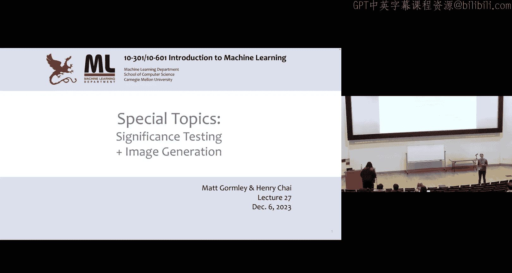

Okay so let's start with just some logistics so homework nine is due on Thursday and this is one of those with just two grace slash late days permitted exam three review is happening on Friday in recitation we'll go through some practice problems with you guys then exam three itself is on Tuesday。

 December 11th。At 5 30 pm I think what's that December oh thank you Tuesday， December 12。

 I think 530 yeah we said 530 right yeah so 5 30 pm and and then just a heads up that there will be some participation required poll that comes out after exam three so keep an eye out for that as well。

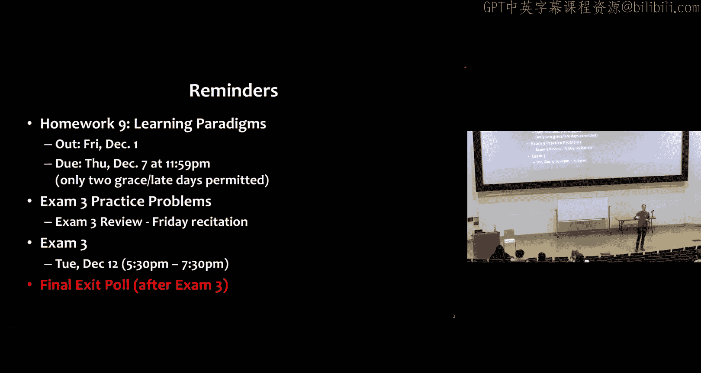

Okay， I think at this point， you guys kind of know all of the logistics， what the exam looks like。

 just a reminder to bring a sheet of notes and that the covered materials lectures 17 through 25。😊。

And you know how to prepare kind of all the things that you've been doing。

 including going to recitation on this Friday to work through some practice problems with the TAs。

And you know we've kind of covered at this point a massive number of topics we took you guys in the semester farther I think than maybe we've ever taken any class before you we pushed you to to try out a whole bunch of sort of new topics that our prior students hadn't seen before so this first sort of third of the course was really centered around this idea these ideas of classification and regression and then that second third of the course we started to branch out and look at some more sort of met both。

😊，Mathematical foundations， for machine learning through the lens of probability and statistics。

 but also some of the theoretical foundations through this lens of learning theory。😊。

We also got to bring in this picture of。Neural networks that has really sort of shaped where machine learning has been going for the last decade and certainly where it is likely to go in at least the early part of the coming decade and then。

As we moved into this third， third of the course， we delved into topics in deep learning and really we tried to focus here on foundational models。

 recurrent neural networks， convolutional neural nets and transformers and then。

We also pivoted towards reinforcement learning， which。

Looks quite different from sort of a lot of the other learning that we've been doing in this course。

 but provides a really powerful paradigm for。Actually working with agents that are learning in the real world。

And then these last couple weeks， we've been sort of sprinkling a bunch of different learning paradigms out there to kind of give you a sense of what some of the really important foundational ideas in machine learning are that are driving the solutions to sort problems beyond just classification and regression。

So so today will certainly fit in that sort of other learning paradigms bucket as we think about both how do you evaluate your models and also how do you generate images。

 which is a sort of a fundamentally different way of learning and generation。Learning and prediction。

 rather。So。We've seen this slide before， I just kind of bring it back up to remind you of this picture that we had laid out this idea that there is sort of this recipe that we're following over and over in this class。

 this idea of sort of taking in data， choosing a decision and function and an objective function。

 optimizing that objective function to learn some parameters and then predicting on new examples and。

You knowAt the time， I think， you know we had only seen decision functions up through maybe naive Bays or something like that。

But since then， we've looked at a bunch of other decision functions like the ones that I was just naming that we use for things like deep learning as well。

 we've thought about sort of additional ways that you could do optimization algorithms ranging from you block coordinate descent to sort of the latest greatest most popular。

 which is atom。And then we've also thought about sort of on the models modeling side。

 different objective functions and these kind of came in as we were thinking about things like doing multiclass prediction with neural networks and doing generation of text from a language model。

So we also were able to kind of stretch the picture of what it is we were doing in terms of different learning paradigms。

嗯。Today for image generation， the learning paradigm is going to be a little bit flipped actually。

 where we'll take a label as input， like a y as input and we'll actually try to generate an X。

 an image。😊，So I guess maybe this list isn't even completely exhaustive and this slide certainly isn't exhaustive either。

 but hopefully now I think this is like one of the first slides we had in lecture one。

 hopefully now this slide starts to pull together a lot of the things that we've been doing together。

😊，This picture of， you know all of these different learning paradigms that we've been looking at。

 you know， ranging from hyperparameter optimization to recommender systems to reinforcement learning。

 sort of a picture of different theoretical foundations。How to formulate different problems。

 these facets of building ML systems that are like genuinely hard。And。

I think you know like one one of the things that we've exposed you to now in homework seven was like blind assessment on test data right we kind of held your hand through a lot of the programming assignments saying like here's what we think the right answer is whereas in reality like you generally don't know what the right answer is and this is one of the main challenges of building a successful ML system。

We we kind of explored a variety of different big ideas。

 and even today we're going to sort of grow the space of application areas that we'll be talking about。

So so these are the different course learn level objectives and I think that you guys have been doing a great job of actually getting to those and a big part of I think why is like all of these amazing TAs who have worked incredibly hard to bring you guys tons and tons of office hours and recitations and so on they've put tons of effort into this course so anyway。

 I just wanted to make sure that we recognize them and set of big thanks。Okay。

 so on to significance testing。So。What I fundamentally want to ask is this question。

 which classifier is better？So if we have two classifiers like H of x and Hb of x。嗯。

Usually what we do is we compare their accuracy。So we have some test set。

It's not a perfect measure of generalization performance。

 but it's a good one and a good surrogate and we report which has higher accuracy okay。

 so which is better H or H。How many for HA？How many for HB？Okay， yeah。

 everybody's kind of in favor of HA， right？Okay， so the thing is。Oh。

We should really think about when we try to answer this question。Two sources。Of variantance。

One source is randomness in our training data and the other is randomness in our test data。So。

What do I mean by this well let's first think about randomness and training so suppose now I agree with you。

 by the way， on that first slide I would have said H as well。

But now let's suppose we're training a deep neural network with a non convex objective function。

And part of training， we're going to do random restarts。

 meaning that there's some random seed in our pseudoran number generator that decides how we set the initial parameters of the model。

Okay， and because it's a non convex objective function and we're using something like。You know。

 stochastic gradient descent to optimize it if we randomly start here we'll come up with。

one set of model parameters， whereas if we start here。

 we'll come up with a different set of model parameters。

And so the idea is we collect a sequence of classifiers for our random restarts。

 okay each one gets a different random initialization。😊，And this gives us you， Hbx1， Hbx 2。

 Hbx all the way up to R。And then what we do is we create a little histogram。Right like this。

Where now I've flipped the axes a little bit， so accuracy was on the vertical axis before now it's on the horizontal one。

 and the vertical axis is the number of classifiers that had a particular range of accuracy。

So here we might say that， you know， if we go back or sorry， so let's say this is like。嗯。

Scaled so that we have something like 25% accuracy here。Or sorry， let's see。Rather。

75% accuracy here and 90% accuracy here。And on our previous。

Maybe what we had seen was something like， you know， this was around 91% and this was around 74%。

Right。嗯。So。What we're saying now is that。Sometimes HB gets 90% accuracy。

But sometimes it gets much lower， close to 75%。And most of the time。

 HA is getting close to 75% accuracy， but sometimes it gets higher。So what we're saying then is that。

 you know， these could cross as well。On some occasions。

 we might train HA and it will do better and get higher accuracy than HP and sometimes it'll go the other way。

Okay， and so without actually running a bunch of random restarts and getting a histogram like this。

 you can't actually really tell which is better。喂。Okay so another way that you could report this is with a confidence interval。

 so you could say， okay， the average of HA is like 45% plus or minus 5% error or  47% plus or minus 8% right and that would also give a picture of you know what's going on between these different models。

Okay， so another source of randomness comes from our test data and here。

 if we assume that our x's are randomly sampled。From some key star and wiser set by some C star。

 or maybe they're just both drawns from a random distribution then。

We could say that like as an example。Suppose we had a data generating distribution。

That was given by P star being an even coin flip so you flip the coin and you either pick。

A red or a blue label。And if you pick blue， then you sample from the blue Gaussian distribution up there and if you pick red。

 if it lands on red， then you pick the red Gaussian distribution and you sample your X point from that corresponding Gaussian。

Okay， so if。Our test data。So say our real population of data comes from this data generating distribution。

Now we randomly pick out of our， 1，000 examples，100 of them to be our test data。

That means that effectively， we've just randomly sampled 100 examples。So。

Now let's consider two classifiers the classifiers here are fixed but the data is different so this is test data set one and this is test data set two so in the first case you can see that H has made five errors right it got this minus wrong this minus wrong。

And then these three pluses wrong。By contrast， H。呃。HB。Has gotten only three errors。

 it got this plus wrong， this plus wrong and this minus wrong。Okay。So the thing is。

If we had gotten a different test data set。Our test error could have gone in a different direction right so here on this randomly sampled test data set which seems equal probable to that one。

 HB actually got five errors so the green classifier incorrectly classifies one，2， three， four。

 five points。😊，Whereas the orange classifier gets only three wrong， one， two， three。

And so the actual。Variance in our test data is leading to different results。

So one answer to this is significance testing。But there's this nice quote from。

This lovely book called Statistics Don Wrong， the Wooefully Compte Guide， that says。

 so because any medical intervention or intervention usually has some real effect。

 you can always get a statistically significant result by collecting so much data that you detect extremely tiny tiny but relatively unimportant differences。

So as Bruce Thompson wrote， statistical significance testing can involve a tautological logic in which tired researchers having collected data on hundreds of subjects。

 then conduct a statistical test to evaluate whether there were a lot of subjects。

Which the researchers already know because they collected the data and they know they are tired。

This tautology has created considerable damage as regards the accumulation of knowledge。So。

This paints a rather dreary picture of statistical significance testing。

 but in machine learning we need to take a careful view because it's still for us answering an important question because you see usually we were not the ones going out and collecting the test data and so we are neither tired nor not tired from collecting data so we don't have this sort of topological problem and so we need to run the significance test to figure out do we have enough test data to make the conclusion we want to。

😊，And so we asked this question， did we evaluate our model on enough test data to conclude that our improvement over the baseline is surprising？

And the way that we do that or one way is with a significance test like the paired bootstap test。

And the key idea here is that you just simulate the resampling of many test sets from your own test set。

So。So let's assume that you have。A test data set， detest。And。

So what we do is we draw a bootstrap sample， meaning that we randomly sample a subset of end test points from detest。

Okay so if we had， say， 500 test examples， maybe we randomly sample a set of just 250 of them。

And then we let this little increment start at zero， so v equals zero。

And then we iterate through our bootstrap samples， so each one is a set。

 a random set of 250 examples。Right so there's there's actually many different bootstrap samples。

 there's two to the five or let's see there's。There's 500 choose 250 different possible bootstrap samples。

 which is a large number。What we do is for each one we ask if deelta Sb is greater than two deelta detest。

 then we increment our counter by one。And what that is asking is so we let delta of some data set D prime be the difference in accuracy between HA and HB on D prime。

So the quantity on the left here。Is or let's let's start with the quantity on the right。

 the quantity on the right is the test error on the full test data。Right。So maybe you got5%。

The quantity on the left is that。The error that you got of the bootstrap sample from the test set。

So what we're asking is。Did the？Test error on the Botrapap sample。

Exceed two times the test error that you actually got。If it did。We would feel like， oh。

 that's actually a pretty surprising event， right， because just by randomly sampling a different subset of our test data。

 we got a higher test error。So what we're doing is we're counting up the number of times that that event occurs。

If it occurs a lot。If random samples of test data randomly give us。A higher sorry。

 not a higher test error but a higher difference in accuracy right so let me be careful here so let's say on the left here the difference was like 5%。

So we got one classifier had 95% accuracy and the other had 90% accuracy。Right。Then。

What we're curious about is sometimes did we get greater than a 10% difference？

Like was our classifier randomly 10% error better？So if that occurs a lot by chance。

 then our P value is really high。Like。The P value is going to be v over the total number of samples。

If it doesn't occur a lot， then our P value will be low。

And so the null hypothesis here is that the performance of these two classifiers is the same。

 and we can reject that hypothesis if that p value comes back low， say less than 0。05 or 。01。

And that would only occur if it was pretty unlikely that a randomly sampled different test data set would give you a greater difference in error。

Okay。Any questions， yeah？So and also depend on our selection B and then and also whether like the data like go like that yes。

 absolutely so well so it doesn't depend on the。Data distribution for the data itself so that's one nice property of this bootstap test also it doesn't depend on the metric we don't have to use accuracy here you can pick whatever your favorite metric is it could be precision recall f1。

And。So why is that too there so there's this distinction of。

Sort of one tailed and two tailed significance tests。 and when you're testing for the。

Two tailed test， which is actually the one that I have here。You can reject。

Both directions so basically like here our null hypothesis is that the performance of these two classifiers is the same and so we're if we reject that hypothesis we're saying well either one classifier is HB is much better than HA or HA is better than HB so we can do it in another direction。

Did I miss any of the？That's where the two comes from。If it's one tail test we useYeah。

 so if you only wanted the one， so if you only wanted to do one direction。

 then you'd be able to drop the two， conventionally we stick with the two tail test。可是。有是。啊，所点0个。

So we're saying that the pe is very small， there are very few instances where。

All of the groups not saying what the difference between。

The two hypo hypotheses are the refugees with that。Before course scientific is。Yeah。

If these guys are small， you guys are small， then check the dollar， that's right。So we reject。H0。

 let's write this down。P value。Is say less than 0。05。And so in that case， what we're saying is。

In less than 5% of the bootstrap samples。Did the tester of the bootsottrap sample exceed two times the test error that we actually observed？

So that's the claim that we're making。And another yeah。This like Belelta about absolutely vi。啊哪里。So。

Oh， and this isn an absolute。Yeah， that's right。So it's an absolute value of the day。So。

So you could use the same test either direction。Thanks， good catch。

So I guess the importance of these methods， right， significance testing。

 creating a little histogram of validation errors or test errors are that they enable you to convince others that the result that you got isn't just some artifact of statistical noise as an artifact of some randomness in your data。

And so that's really important both for you to convince others。

 but also for you to question others if they bring a result to you and they say， look。

 my classifier is better than the old classifier that we had， we should use this new one。

 you should push them a little further to actually convince you of that fact。All right。

So now I want to switch to thinking at a really high level about some computer vision tasks。

 and then we'll narrow down to image generation。So namely， I want to run through。A couple different。

Common tasks in computer vision。That are somewhat discriminative， they're not generative。

So the first one is image classification this is one that you're familiar with。

 you've done it on you know homework five， given an image， you want to predict a single label。😊。

So this is usually a multi class classification problem and IageNe was sort of the canonical example that we had seen before here。

😊，嗯。So image classification plus localization is a little bit different the idea here。😊，Is that。

You're given an image and you want to predict。Both a label， a single label。

But also a bounding box for the thing that you're labeling。

So a bounding box is just like a little literally rectangle that you place somewhere over the image to say where that thing is right so up on the top left here。

This is actually a particularly hard one but it got right。

It correctly identified the position of a car that's kind of。Obscured by these cows and。On the right。

 it managed to pick out one of the chairs。呃。Over here。You can see that。This incorrectly labeled。嗯。

A bus as a car， which it shouldn't have done。And then this one kind of looks like it circled like an entire table。

As a chair。嗯。And then here， what we're looking at is。A wait。I don't actually see a chair。

So I'm not sure about the third one， so we'll skip it so the next task is human closed estimation。

And this one is challenging， so here we're given an image of a human。And we want to predict。

The position of essentially like。Some what we call key points that represent their actual sort of skeletal frame。

So these are things like the position of their left hand， right hand， left elbow， right foot。

 and so on。And if you can identify all of those different key points。

 then you can essentially kind of capture the pose that they actually are holding。

And you can think of this like a multiple regression problem where each key point is some corresponding real valued position XyYi that you're trying to predict。

So semantic segmentation is another discriminative problem where we take in an image and we want to。

 instead of just putting a bounding box around something。

 we actually want to go in and label every pixel by what it is。

So here the labels might be like person table chair and background where on the right the black in the。

The ground truth is like all of this part is being labeled as background。And here。

 it's correctly labeled this。These it would， you know， if well， this is the ground truth。

 this is the actual training example， but you would hope to predict correctly predict， you know。

 the position of the cow in front of the car。嗯。So as it happens。

 the kinds of models that are used for this tend to combine convolutional neural networks。

 which you guys know about with deconvolutional networks。

That take a small representation of the input。And expand it back out into the full size of the image。

 so we'll actually see some models that are somewhat similar to that when we think about image generation。

 though they're not actually strictly deconvolution。Okay。

 objectject detection is for an image want for each object in the image。

 you want to predict a bounding box。So for example， here we have a person。

A horse and some other things in the background and and so for each of those bounding boxes。

 we want to predict a separate set of you know four corners of a rectangle to actually identify where that image is and all you really need are two points of a rectangle。

 the two opposing corners。And then a label for each one。

So instant segmentation is like semantic segmentation， but now。

 whereas before if you had two people in an image all of the people would have the same pixel color right they would all be labeled with you know the person label now you actually in instant segmentation want to separate those out so you want to identify this is person one and on the left and that's person two on the right。

Okay。So。Image captioning is another interesting one where you take in an image and you want to generate a sentence。

Actually describing it say in plain natural language。And。

The typical methods for this actually combine things like a convolutional neural network。

 say to build up some。You know， vector representation of the image itself。That is then handed off。To。

Something like an RNN or a transformer language model that generates a sequence of words conditioned on that vector representation to get back a caption。

And。This is。Just kind of an example of。Sort of a wealth of papers that that came around in the range of like 2014 to 2017。

And it's showing in these two columns the actual image encoder on the left and then the language model that was used on the right。

So this is sort of from the age where AlexNet was still kind of being used by people。

 now it's kind of considered a small model that people don't use as much and people were using all of these RNs and LSTMs。

And then down towards the bottom。The models were starting to get a lot bigger like inception vGG net。

 but this is sort of right before。Transformers came along and sort of swept away the use of R&N language models。

嗯。So。Medical image analysis sort of has all of these sort of same kinds of problems that come up so you know this is a laundry list of some examples。

 fundus detection， henoccampus segmentation you know pulmonary nodule classification and so on and so being able to solve these problems in medicine can also be really important。

As well。Okay， so the last task on my list was image generation。

 but I want to take that and further break it up into five different tasks。

 so let's go through these one at a time。So class conditional generation。

Is where you're given a class label and you want to generate an image of that type。

So you could imagine taking that imagenet data set that we've talked about that has you know a million images and a thousand different classes and then you instead of taking an image and trying to predict the label you take the label and try to sample a new image and that's what we're seeing on the right so here we're taking samples from a probability distribution。

😊，Probability of image given label right where here this is our label and each of these is a sample given that corresponding label so we're seeing sea andemity brain coral slugs gold finches but you can see these these images are are from 2019 and even back in 2019 things weren't going so great like this this bird doesn't。

doesnn't really have a head。And。Are slugs and snails are snails a kind of slug？No， okay。

 so here you can see it's drawing snails， but it shouldn't be right they're not actually a kind of slug they just maybe they look similar but。

The model got confused。So， you know， this is a challenging problem。

Super resolution is where you take in a low resolution image like these， so these are your input。

And then these on the right are your output。So you're essentially hallucinating pixels， right。

 you don't actually know what this guy looks like。But the model just decided that he would look like this and so it。

It's kind of like in the movies where they have that like low resolution gray scale you know closed circuit security camera that like spots the bad guy and then you know there's someone standing over a computer guy saying zoom in and he zooms in and it's all pixelly and then he clicks a button and it like miraculously materializes into the bad guy's face well you know if your model already knows what the bad guy looks like and has a high prior towards generating images of him then he's going to show up all over the place from these grainy images so we should be careful when when using this。

Here this is kind of some other image editing tasks in painting is kind of an interesting artistic tool where you could imagine taking something out of the image and then having the model actually fill it back in and here's three different ways of filling in the missing bird here if you have an Android phone you've probably tried this out and a colorization is where you take a grayscale image as input and try to generate colors for it uncropping is kind of like a different version of in painting where you just sort of making up what would have been in this part of the image。

Yeah嗯嗯。Style transfer， the goal here is to actually blend two images in a very particular way。

 so the idea is that you start with some image like a here of some buildings。😊。

And then you give it a。Say another image that's supposed to dictate what style you want your original image to come back in。

And so here you can see in C， it has regenerated an image。😊。

Or an image like with the semantic content of a， but in the style of the provided painting。

And here we see a couple other examples of that with different famous paintings。Okay。

 so text to image generation is we're given a text description and you want to sample an image that depicts the prompt so the following images are samples from the stable diffusion Excel model with refinement so the prompt here is。

😊，A propaganda poster depicting a cat dressed as French emperor Napoleon holding a piece of cheese。

And this is a remarkably good depiction of a Napoleon cat。But you know。

 we've all seen examples like this and honestly， I have to question like why this is useful at all。

 like you could just go ask an actual artist to give you an image like this， right？And you。

 they might even come up with something better。So here's another prompt。

 an epic long distance cityscape photo of New York City。

 flooded by the ocean and overgrown buildings and jungle ruins and rainforest at sunsetet。

 cinematic shot， highly detailed 8K golden Light。And what they get is this。Stunning picture of。

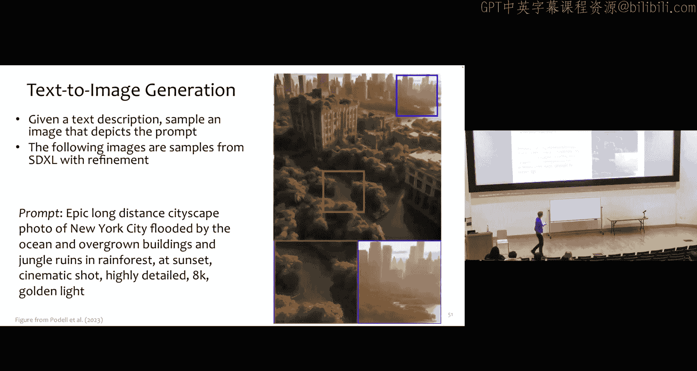

if you look at this thing， the amount of detail here and sort of realism is kind of remarkable。

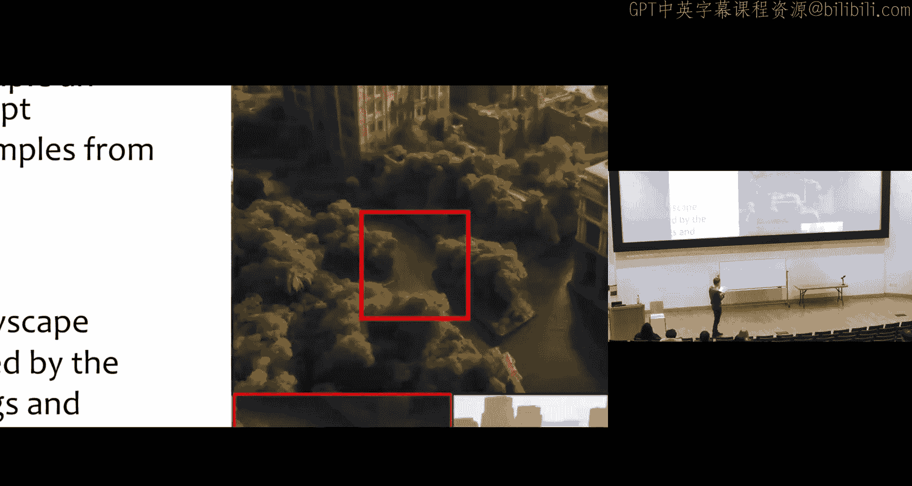

And。And if you look at these sort of zoomed in shots。

 there's even these kind of like little waves in the water。

 it's captured some of the skyline of New York correctly。

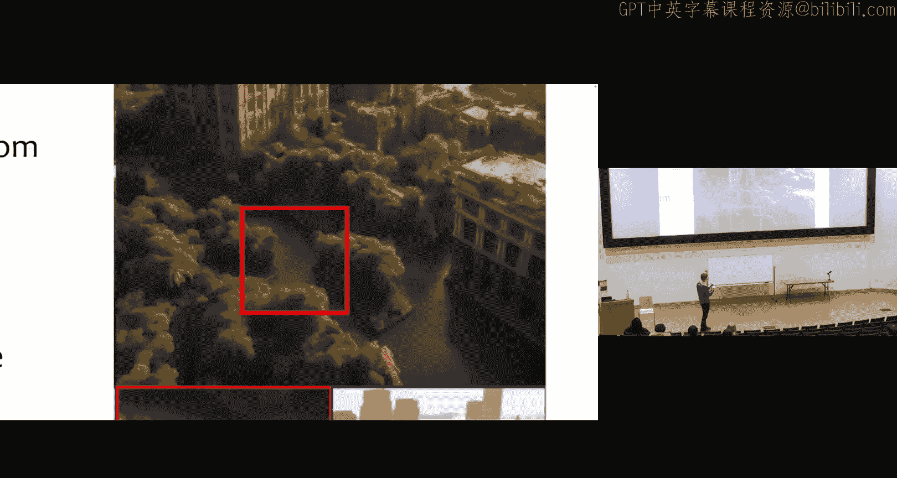

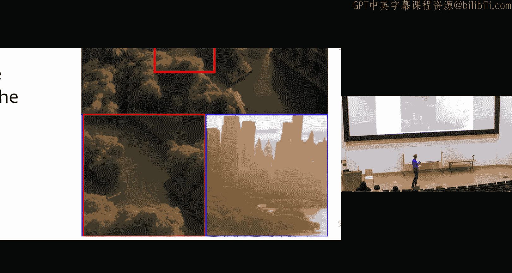

嗯。I mean， it's just all around it， pretty amazing。So here this asks for a close-up headshot。

 futuristic young woman wild hair slice smile in front of gigantic EFO digital SLR camera。

 sharp focused dynamic composition， and again， instead of giving us like a really creepy looking person where like one eye is like you know two thirdds of the way down their face。

 this is actually like a rather realistic looking person， if you change it to a futuristic old man。

 it does a nice job as well，It didn't actually get the rule of I added rule of thirds thinking that I could get it to do some composition。

 but maybe the whole close up headshot and rule of thirds kind of disagreed with each other anyway。

So these are a lot of examples of image generation and so now for our in class poll， I want to ask。

 what are the potential societal impacts of image generation？😊，So there's no toxic option here。

 but before you get to question one， please do fill out the questions that we have there about homework A。

嗯。Yeah， so in addition to fake news。You know， I think。呃。I primed you a little bit on this one。

But I mean， propaganda， I think is like a real problem that we could。Could face that。

 you know that not that the propaganda would be a picture of a cat holding cheese。

 but that there could be like real significant propaganda coming through。

With making it more difficult to detect。Another one that a couple people touched on is。

Copyright infringement， this is a really。AProblematic one。

 I we'll actually mention attribution later and how much of a problem that can be。嗯。And。

There's this concern that there could be less demand。For。For real artistry。嗯。

I think this is like a great problem with sort of the direction that this goes。嗯。And。

One sort of positive that came through here is that。The entertainment industry。

Could potentially sort of。Reduce costs or time。And maybe sort of like。呃。呃。

Related to that is sort of enabling new types。Of creativity。嗯。

And and then I think a big one is privacy so right now there's there's not a lot of restrictions on。

嗯。Which？Images could be used to train a model like this and so if there are images of you on the web。

 you know you could send an email now to stability AI and say excuse me。

 I'd like you not to include those images of me when training your model but I have a feeling they might not reply to your email at the moment。

So this is something that I think we need to think about because you guys might be the ones going out and actually building these models or managing the team that builds one of these models or and so thinking about these kinds of things is really important because not only can we sort of be politically active in this sphere。

 but I think there's also an opportunity to directly influence these things as they're being created。

Okay， so the meat of what we're going to do here is going to center around a particular way of doing image generation called GNs or generative adversarial networks。

And so we'll look at the actual model itself， we'll think about how to learn the model。

 we'll think about how recently people have been scaling these models up to enormous size。And。

And it looked like for a little while， like maybe GNs weren't going to be used very much anymore。

 but there's actually some I'll show you some very recent work this year that suggests they're still very relevant despite the introduction of stable diffusion。

And just by way of mentioning it， in case I forget later。Stable diffusion is a very popular method。

 a popular model actually diffusion is the more general method， but for generating images。

 and I encourage you to go learn that it's a little bit more technical and we didn't think it would fit well at this point in the course。

 so we're going to focus on generative adversarial networks instead。So I did， you know。

 I was working on these slides admittedly a little late last night and I thought to myself， boy。

 you know， I had some friends over for dinner and I thought， you know。

And have to put the kids to bed and then make all these slides if only stable diffusion could do it for me so I prompted stable diffusion and I asked it for a slide explaining Gs to an intro and ML course carefully designed easy to follow I even gave it a negative prompt which is sort of saying what you don't want you know boring unclear non technicaln。

I'm going to be honest， though， I don't think this is even any human language。Not only that。

 it has absolutely nothing to do with generative adversarial networks as far as I can tell。

 maybe this is what stable diffusion thinks a gamem looks like and I just don't speak its language。

I didn't specify English。Anyway。Because this machine couldn't write my slides for me。

 I went ahead and made some myself， so here they are， again consists of two deterministic models。

So there's no randomness inherent in in these models themselves。

 a generator takes a vector of random noise as input。And then it generates an image。

The discriminator takes in an image and classifies whether or not it is real。

 we'll call that label one。Or fake label zero。 So it's just a binary classifier trying to。

Detect fake images。Okay， and both of these are going to be neural networks。

So they'll be assumed to be differentiable。Okay， so。The generator。

It's excuse to have an example of what this model might look like， so here is one。😊。

You could think of this as the DC G。And it's an inverted CNN with four fractionally strideed convolution layers。

 okay， so remember if you have a stride of two， it's like you take your convolution and you move it。

 say two pixels at a time。And by jumping along in that way。

 you're effectively downsampling the previous layer， making it smaller。In resolution。

 so if you're doing fractional striding， it's like taking a half of a pixel step each time。

And so that means that you effectively are up sampling。

 so here they start out with 100 dimensional vector of random noise。

And then they project and reshape into a four by four image with 1024 channels。

And then they do the fractional striding thing to get up to an eight by8 image with 512 channels。

Then more convolution to get up to 16 by 16 with 256， 32 by 32 by 128。

 and then finally 64 by 64 in three channels， which gives you a red green blue image of resolution 64 by 64 so this model is from 2016。

 so they were working with small low resolution images at that time。Here。

 this is an example of a discriminator model， this one's called patchcam。

 and it's also a convolutional neural network， but more in the traditional sense。

 and it looks at each patch of the image and tries to predict whether each patch is real or fake。😊。

So ultimately the prediction is going to be a bunch of ones and zeros and then it's going to make a majority vote prediction at the end to do the final real real fake prediction。

 but when you're trading with fake labels， it would say with fake images it would say every patch of this image is fake。

 when you're training it with real labels， it would say every patch in the image is real。Okay， so。

So the G。Can be understood。During training as playing essentially a two player miniax game。

 which I'll explain soon， where the generator is trying to create realistic images to fool the discriminator into thinking they're real。

And the discriminator is trying to identify the real images from the fake ones。Okay。

 so here you could think of this generator。As let's think of it as a computation graph that takes in a random noise vector where here that random noise。

 you can suppose was sampled from。Like each entry of Z was say sampled from a Gaussian with zeroroine and variance one。

Okay， so it's really just。A random vector。And then the generator takes in Z and some parameters theta because it's a big neural network like that DC gamem。

 right， the inverted convolutional neural net。And it takes that Z and it produces a fake image。

So remember。It's not actually sampling from a distribution over images。At least on the strict sense。

 at least G theta is right because G theta is deterministic for the same Z。

 you'll always get back the same image。So if you want a different image， you need to resample Z。Okay。

 so the discriminator， its job would be to take in， say a fake image。And some parameters phi。

And produce a probability。Of。The fake of the input image being real。Okay。

 so the discriminator doesn't actually know that this is a fake image。It just sees an image。

 the pixels， and it's just trying to predict the probability that particular image is real。Okay。

 it could alternatively take in in a real image。But again， not with the label that it's real。

And try to predict that probability distribution this is， by the way。

 actually a real image from C far 10 this is a game generated image。😊，From 2017 of an airplane。So。

We've gotten a little bit better at generating images over the years。U。So。

So how do we actually learn this generator and this discriminator？So。

The idea is that we're going to build a computation graph that mirrors what we said， right。

 we're going to build a computation graph so that the generator is trying to create realistic images and the discriminator is trying to identify the real images from the fake ones。

Okay， so the funny thing is we're going to use the same loss function for both of them。

Okay but one of them when training is going to the generator。

 it's going to choose its parameters theta so as to maximize the objective。

And the discriminator simultaneously， while its training is going to be choosing its parameters phi to minimize the objective。

Okay， so let's see what this objective looks like， so again， we start with our random noise。

 the generator generates the fake image， let's call that X。

And then we're going to sample some X prime from our actual data set of real images。

Then we're going to feed the fake image into the discriminator and get the probability that it's real。

And we'll feed the real image into the discriminator with the same parameters。

And get the probability that it's real。Okay。So the probability that maybe the fake image is real might come out you know。

 0。6 and maybe this comes out。0ero。7。Okay。And now。We have these little binary cross entropy losses。

This is just like trading a binary logistic regression model。Where we're saying on this side。

We want to maximize the so d phi of x prime is the probability of x prime being real。

So the discriminator is going to try to。啊。Let's see Did I get that backwards。メビ？

So this is the log likelihood of the image being。Labeled of the real image being labeled as real。

And this。Is the。Log likelihood of the。fake image。Being labeled as。Thick。Okay。

 and then we're going to add those two up。And I think I just missed a minus sign out in front。

 so conventionally we'll stick with this and I just missed my minus sign out in front。

So our loss function is going to be the negative log likelihood of this。

And so the discriminator is going to want to drive this negative log likelihood down。

Thereby making it more likely that the real image is labeled real and the fake image is labeled fake。

Thanking them for every state image everyone else has Pat UW。Not necessarily， so if you wanted to。

You could say for every three fake images， you could only feed one real image in。So itself。

The sameSo I guess I put these together just so that we could see。

 but really you could think of this as like an alternating thing where。Where you。I don't know。

 you flip a coin to decide whether you're going to train with a fake or a real image。

And then if it's a fake， you have to get the generator up at running， get a fake image。

 train the discriminator on that。 if it's a real image。

 you just pick a random real image and you do that。

 So then we would just have either we would just have。

Either the J loss function or the J prime loss function so you could just pick so in general it's kind of nice to have a balanced data set when you're doing binary classification。

And so that's one of the reasons that people can eventually do it this way。Okay。

 so here the so the minus sign is missing as well so we're so we have the generate the disc let's think about the discriminator first the discriminator is trying to。

呃。嗯。Yeah， so I really did minimize。A standard cross entropy loss for binary classification right so it's trying to。

Bake the real image。Come out classified as real and the fake image classified as fake。

The generator is maximizing the same objective function。

But where the discriminator is minimizing over phi， the generator is maximizing over theta。Okay。

And so it's the same objective function， it's just that notice that this first term。

Does not involve theta。So when you maximize over J plus J prime。Well。

 you don't actually need the J prime when you're maximizing over theta because。It doesn't show up。

So here the generator is trying to maximize the likelihood of its generated or fake image。

Being classified as real。According to a fixed discriminator。So in fact， what we're doing here。Is。

Is essentially a block cord descent algorithm。Where but it's sort of set up in a funny way because we're not just minimizing over one block and then minimizing over the other block。

It's that we're bitimizing over one block and we're maximizing over the other。

So if you think about this in terms of the computation graph。

The whole thing is a differentiable function。Because we chose neural nets here。

And what we're doing is alternating between keeping G fixed。

And back propagating through to get the gradient of our loss with respect to phi。And then。

Back propagating or keeping phi fixed and back propagating so that we get the gradient with respect to theta。

And we go back and forth， so we get the gradient with respect to phi and we step in opposite the direction of that gradient。

And then we get the gradient with respect to theta and we step in the direction of that gradient back and forth。

ok。So。So like we said， this is similar to blocklockcorn that said。

 except that we're going back and forth between minimizing and maximizing as well。

We're not exactly solving the bin or max problem。We're actually taking just a step of Mi batchch SGD。

And so the idea here is。That。哦。The typical thing we do。Is simple。A midi batch of。M noise samples。

And M real， which will give rise to fake images。AndT examples， which will give rise to our。

Our actual exons。And then。We compute the gradient over that mini batch。

 right averaging over M examples。So the。The original GAN paper did this by further doing more steps of discriminator trading。

For every one step of generator trading。So here you can see then。

We just do one step of generator trading on a single MIi batch。

And then go back and do more steps for the discriminator。

And this was essentially reflective of the fact that。

They sort of wanted the the generator to learn a little more slowly than the discriminator。

 essentially whatever。You're generating a new image。

 you want to make sure that the discriminator is actually like pretty stable。嗯。If you want to say。

 for example， do generation of images of a particular type。

Then you could also incorporate into trading labels right so if you have labeled trading data。

 then you can feed the label in as a feature to your generator。

And now it could actually learn how to generate specific types of images。And。

And this same idea extends beyond labels to things like generating from a prompt right so here we're thinking of our prompt as just a fixed vector。

 a feature vector representing which of you know say a thousand different labels you care about。😊。

But instead， you could have as input to the generator， a vector representation of some text。

And then try to generate something that looks like that。Okay， so。

So a lot of the examples that I was giving were from sort of the heyday of Gs。

 which was kind of around 2015 to 2017 when they were first coming out。And honestly， at the start。

 they weren't doing very well， but they were doing a lot better than some of the alternatives。嗯。

Recently， they've kind of had renewed attention。And one of the reasons is that people have been scaling up the model sizes。

So over on the left here， you can see back in 2016 through， I don't know， 2020 or so。嗯。

A lot of the game models had fewer than。NowThis is 0。1 billion parameters。

 so fewer than 100 million parameters。And then in 2020。

 there was kind of this big step forward very rapidly over the course of a couple months where people started pushing the models bigger and bigger and bigger and Dali was kind of maybe the most visible of these models and coming in just over 10 million parameters。

U。And then around this time， we started to see。So models that were using diffusion rather than GNs。

But then there was this interesting sequence of models。Named party or party that。

Looked at some massive model sizes all the way up to 20 billion parameters。Okay。

 so what is this model the idea of。The party model is that its pathways auto a regressive text to image。

Is that you treat image generation as a sequence to sequence problem。So the idea is the text prompt。

Is input to a transformer encoder This is just like the the transformer that you all built。

So the problem might be two dogs ready to get a field。

And then the decoder does something kind of wacky， at least it seems wacky the first time you think about it。

But it outputs is a sequence of discrete image tokens。

So imagine what you have is a library of image patches。😊，Okay。And。To construct a new image。

 you go to your library and you know， if you want to get a picture like these dogs。

 then the upper left corner， you grab that patch that looks like you know a little bit of sun flare on your lens okay and you put that here。

And then you go one to the right and you say， oh， I want like， you know， the ridge of a tree line。

 grab this other patch and you put it there and then oh。

 I need another copy of that tree line patch and you put it next to it。And then， oh。

 I need like a dog ear patch and you put that underneath there and you kind of construct your image by literally dropping in these little patches of images。

So。That's essentially what this transformer decoder is doing and you could think of the representation of each of these image patches as just being an integer。

 it's like a vocabulary， like some language， but the language isn't represented by you know words like two or running。

 it's represented by these patches。Okay， so then。There's actually a gad that。

Pakes in the image tokens and generates a high quality image from them。And。呃。

And so it's the image tokens themselves， if you just put them together might not look like anything reasonable。

 but the G takes the image tokens。Which are representing what the semantic content of two dogs running in a field might maybe should look like。

And it transforms it into something that actually looks like a realistic image。

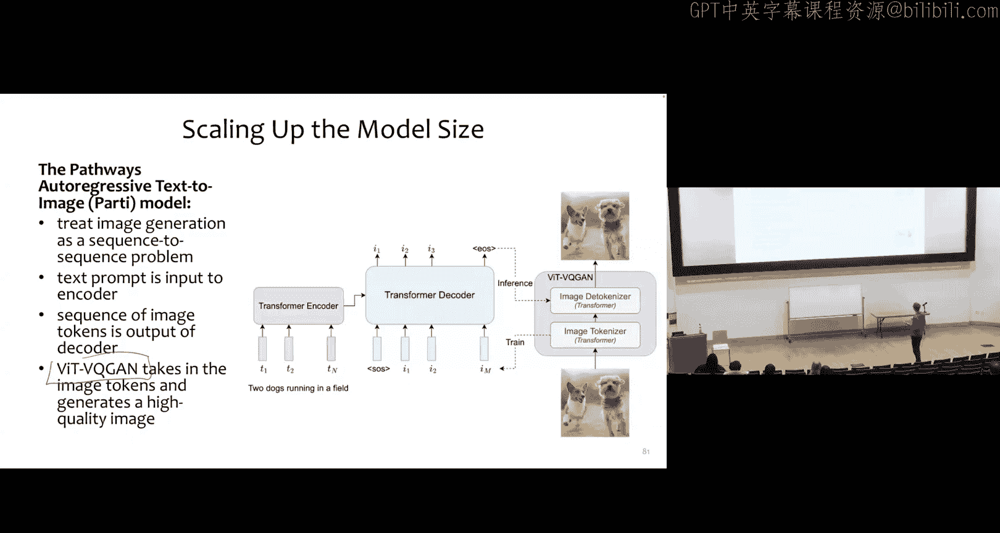

嗯。So。This is an example of what happens as you scale up the model size。

So the prompt here was and pay close attention to the prompt。

 a portrait photo of a kangaroo wearing an orange hoodie and blue sunglasses standing on the grass in front of the Cindy Opera house。

 holding a sign on the chest that says welcome friends。Okay， so with 350 million parameters。

I'm not sure if this is like a two headed kangaroo or if he just has an extra ear。Either way。

 it looks like he's wearing a snugggy。Not a not a hoodie。

And this is definitely not a sign that says welcomee friends。

 but this might be the Cdy Opera house and he's definitely standing on grass。Also。

 he looks more like a dog to me than a kangaroo。At 750 million。

 for some reason there's two kangaroos， I don't know why and this one is maybe missing an ear or maybe this part of the Sydney Opera house is his ear。

At 3 billion， he's starting to look really good， though he doesn't yet speak English。

And he has two signs and neither of them is。啊。Neither of them is even actually this one。

 this one does say friend， that's not that， so it's pretty close。

But it doesn't say friends and then finally this last one at 20 billion is pretty remarkable。

 it hits all of the the things that it's supposed to。

 it looks pretty convincingly like a kangaroo to me， it's got the hoodie and the sign。

 pretty much everything that it asked for。

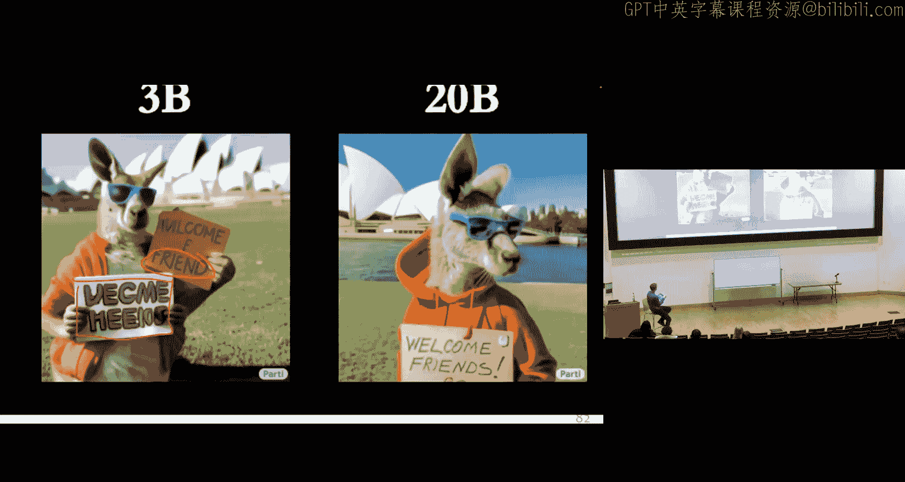

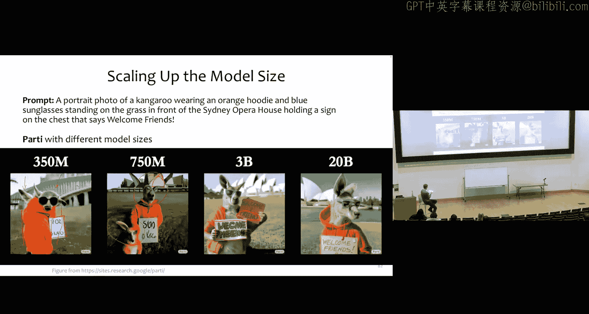

🤧嗯。So。As these models get really good。And actually， long before they got good。

 people started thinking about watermarking。The idea of watermarking is that you could put like a digital watermark that's not visible to the human eye。

 but that allows one to identify。When an image has been created by one of these models。

And most methods for image generation Gas VA stable diffusion can already be augmented with water marking。

嗯。And。呃。And so this is one way that you could imagine。Enabling。So of。

Fake image detection the trouble is anyone who's malicious could just train a model without watermarking so then there comes this question can we do fake image detection？

😊，Um，You know， identify the fakes even without a watermark。Or more challenging。

 could you do model attribution， identify which generative model created an image？

But it turns out that this has been very successful。

 it seems like these models are almost injecting like natural watermarks of their own。😊，Where the。

The actual process of generation in say Dolly2 versus SDXL looks different and you can detect something about like those differences to actually figure out which model gave rise to the image。

Image attribution。Is a highly undisolved problem。Wwhich would aid in copyright infringement issues。

 I think， there the goal is to identify the source images that led to the generation of a new image。

But that's proven to be very difficult and there haven't been a lot of great successes in that realm。

 this is an open problem area。

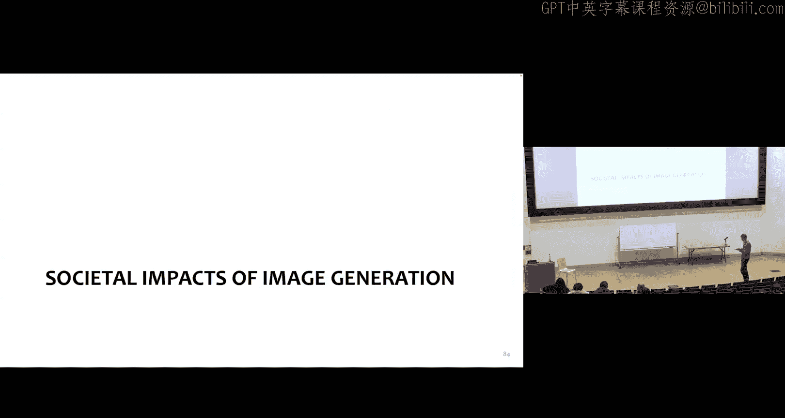

O。So I want to end we talked about this already， I want to end by thinking about。

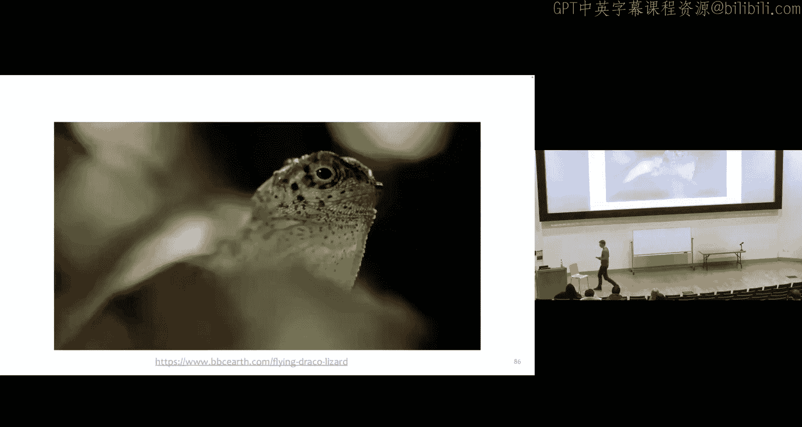

The fact that。One of the。Sort of crazy parts about image generation is that。

Video generation is just around the corner。And I think that there's a lot。

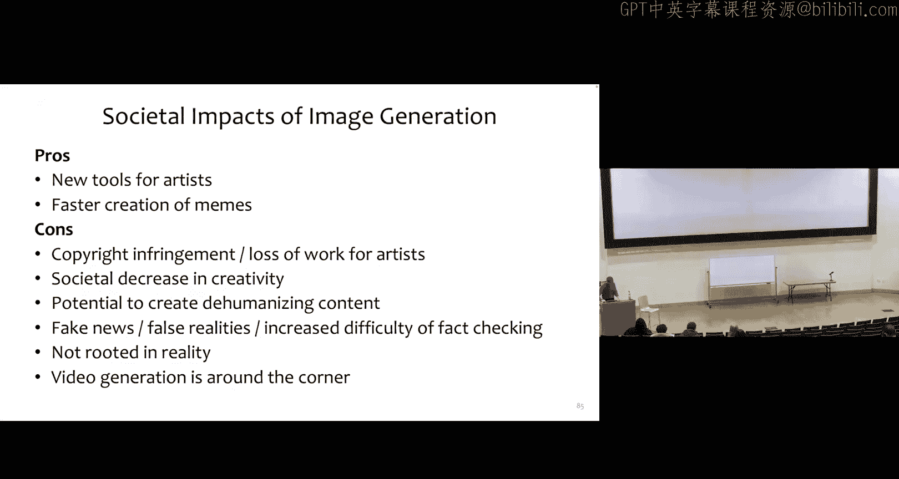

Of complicated implications that come along with that。And。And yet。嗯。Oops。

Did you change something that turned off the audio for？嗯。

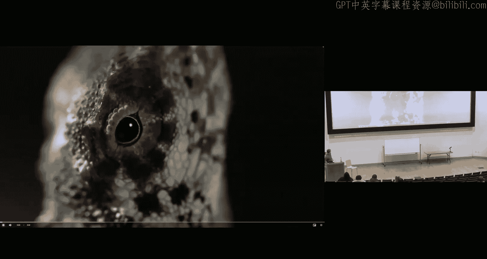

嗯。So I'm at the exact same settings as before。我 what。These are drink。

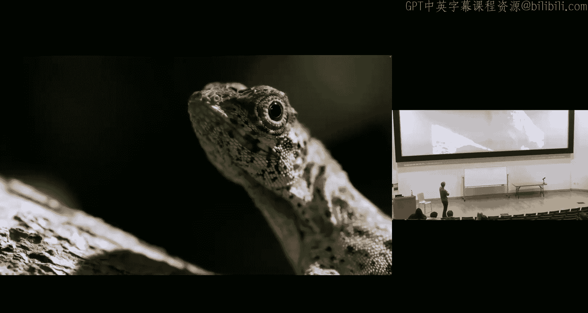

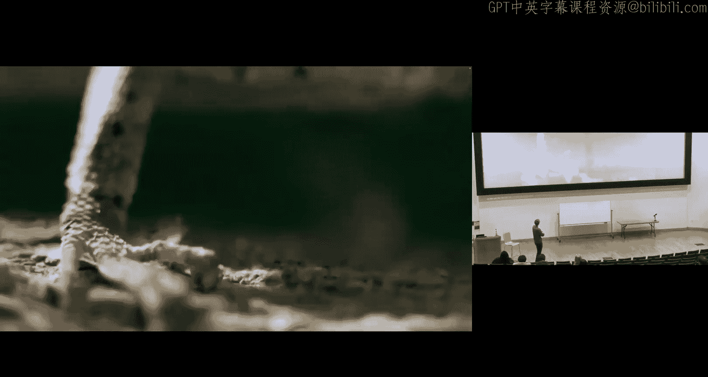

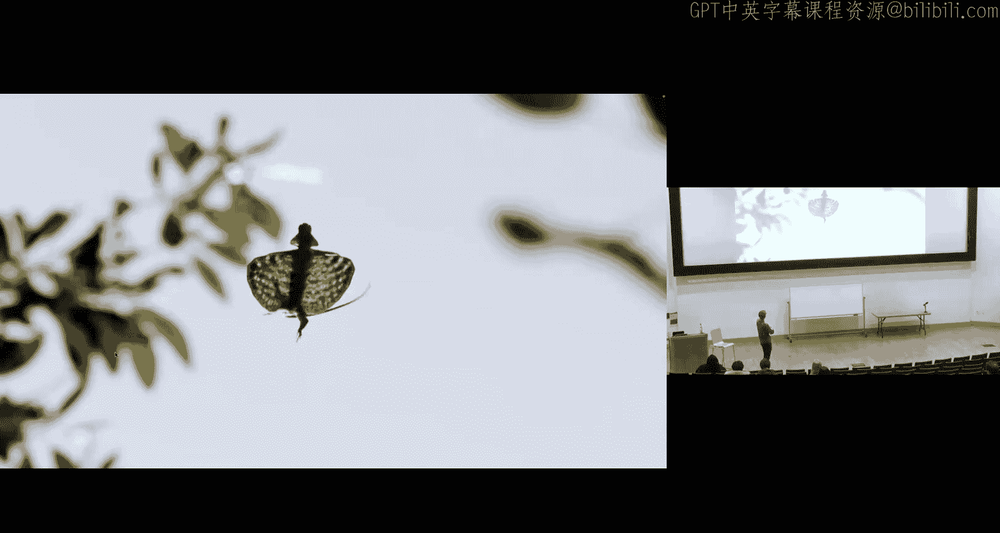

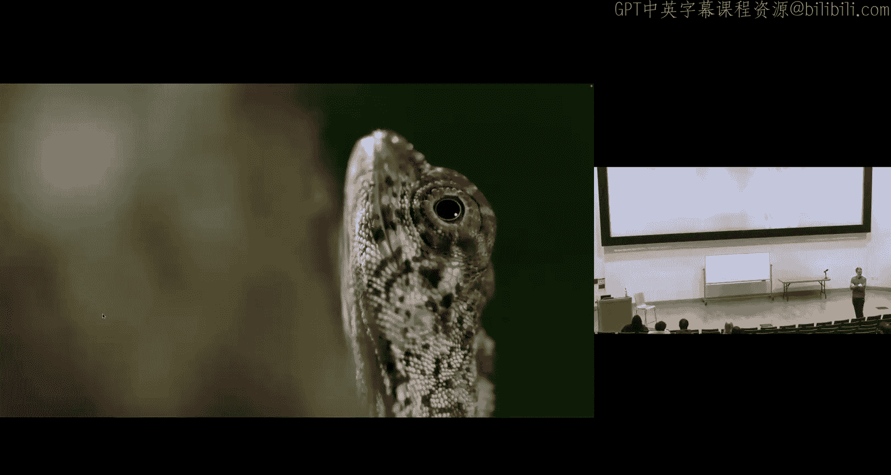

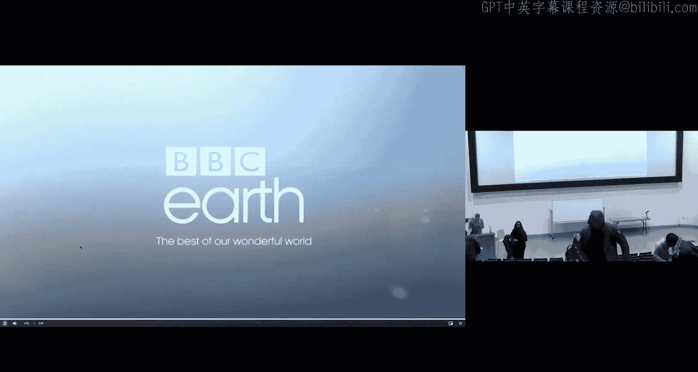