# CMU《机器学习导论｜Fall 2023 10-301⧸601 Introduction to Machine Learning》中英字幕（deepseek p27 27_Special_Topics_Generative_Models_for_Vision_Significance_Testing_for_ML -BV1Z2cUefE4A_p27-

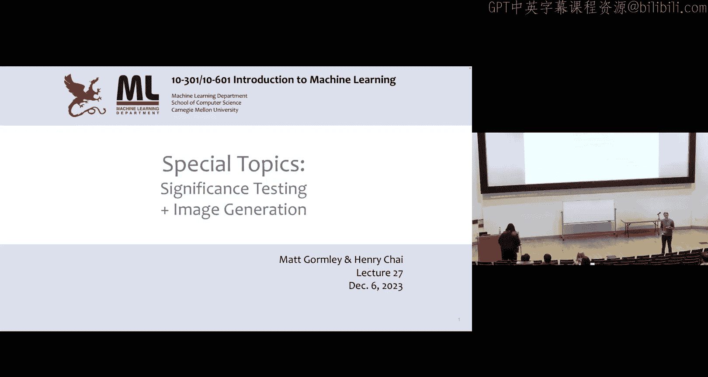

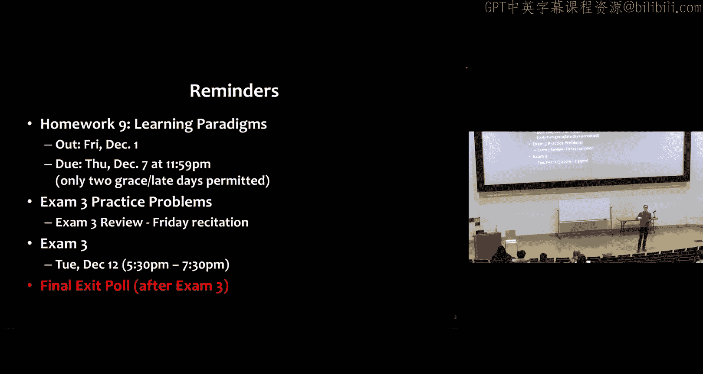

## 🤖 CMU《机器学习导论｜Fall 2023 10-301⧸601 Introduction to Machine Learning》中英字幕（deepseek p27 27_Special_Topics_Generative_Models_for_Vision_Significance_Testing_for_ML -BV1Z2cUefE4A_p27-

### 概述

在本节课中，我们将探讨机器学习中的显著性检验和计算机视觉中的图像生成。我们将从统计学中的显著性检验开始，然后转向计算机视觉中的图像生成，特别是生成对抗网络（GANs）。

### 显著性检验

**1. 问题**

我们如何确定一个机器学习算法是否真正有效？

**2. 方法**

*   **比较分类器**：比较两个分类器（例如，H 和 Hb）的准确性。
*   **考虑随机性**：考虑训练数据和测试数据中的随机性。
*   **置信区间**：报告置信区间，例如，HA 的平均准确率为 45% ± 5%。

**3. 显著性检验**

*   **假设检验**：假设两个分类器的性能相同。
*   **P 值**：如果 P 值小于 0.05 或 0.01，则拒绝原假设。

**4. 例子**

*   **配对自助法**：从测试集中随机采样多个测试集，并计算每个测试集的准确率差异。

### 计算机视觉中的图像生成

**1. 任务**

*   **图像分类**：给定图像，预测标签。
*   **图像分类 + 定位**：给定图像，预测标签和边界框。
*   **人体姿态估计**：给定图像，预测关键点位置。
*   **语义分割**：给定图像，为每个像素分配标签。
*   **目标检测**：给定图像，为每个对象预测边界框。
*   **图像字幕**：给定图像，生成描述图像的句子。
*   **医学图像分析**：例如，眼底检测、肺结节分类。

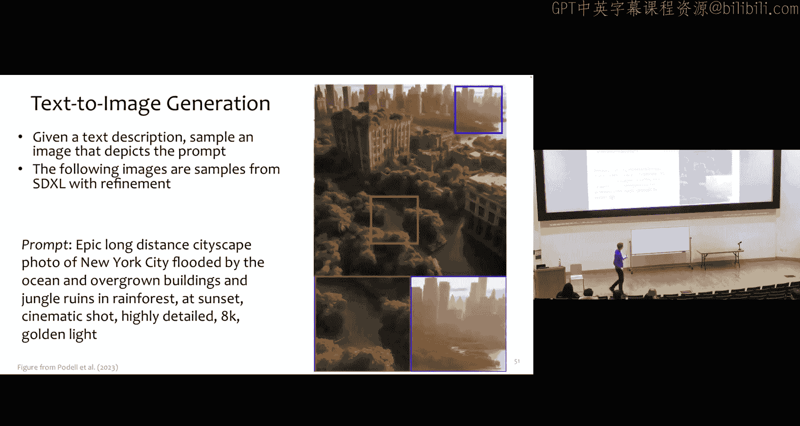

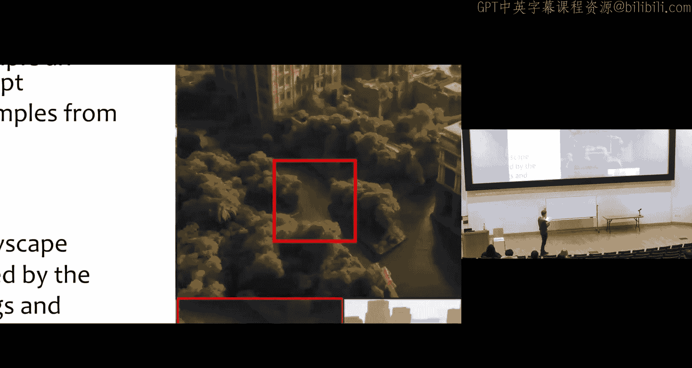

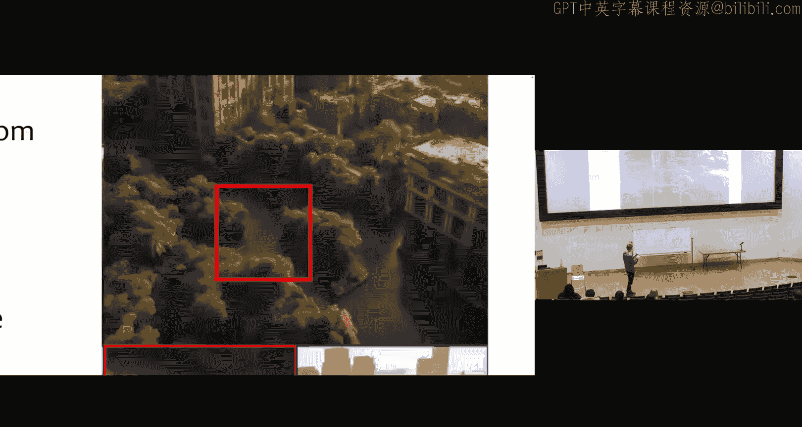

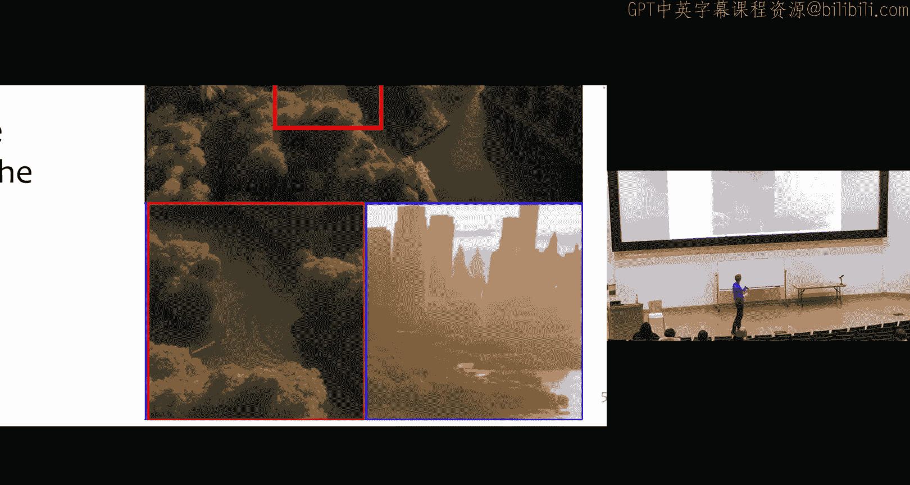

**2. 图像生成任务**

*   **条件生成**：给定类别标签，生成该类别的图像。
*   **超分辨率**：将低分辨率图像转换为高分辨率图像。
*   **图像编辑**：例如，去除图像中的物体并填充空白区域。
*   **着色**：将灰度图像转换为彩色图像。
*   **风格迁移**：将图像转换为具有特定风格的图像。
*   **文本到图像生成**：给定文本描述，生成图像。

### 生成对抗网络（GANs）

**1. 模型**

*   **生成器**：将随机噪声转换为图像。
*   **判别器**：将图像分类为真实或伪造。

**2. 训练**

*   **目标函数**：最大化生成器生成的图像被判别器分类为真实的概率。
*   **交替训练**：交替训练生成器和判别器。

**3. 应用**

*   **图像生成**：例如，生成逼真的图像、风格迁移、文本到图像生成。

### 总结

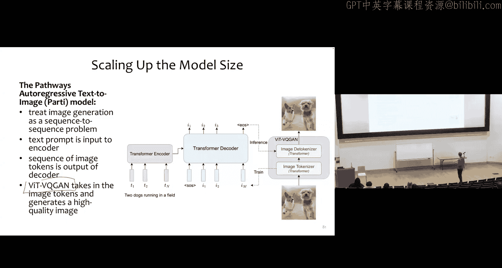

在本节课中，我们学习了显著性检验和图像生成。显著性检验帮助我们确定机器学习算法是否真正有效，而图像生成则允许我们创建逼真的图像。GANs 是一种强大的图像生成方法，可以生成各种类型的图像。

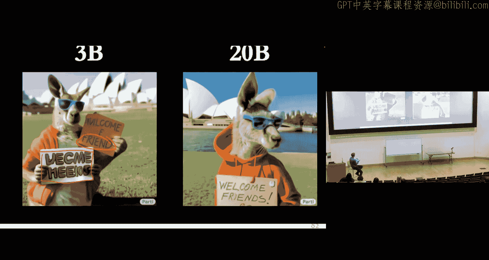

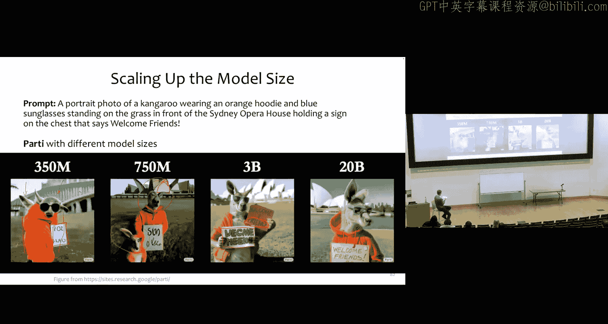

**本节课中我们一起学习了**：

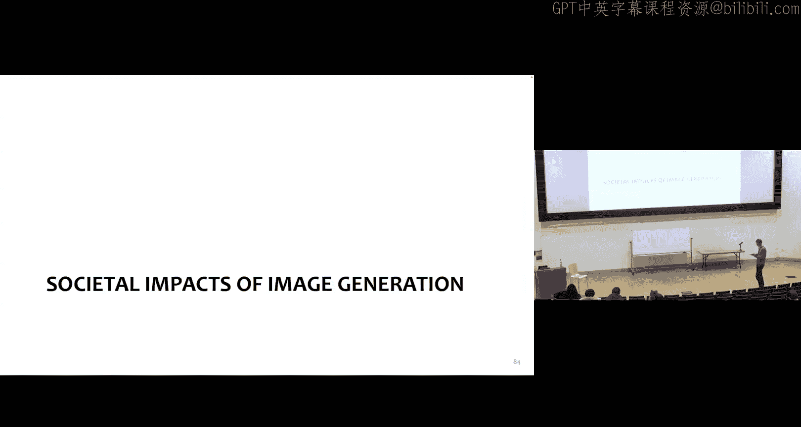

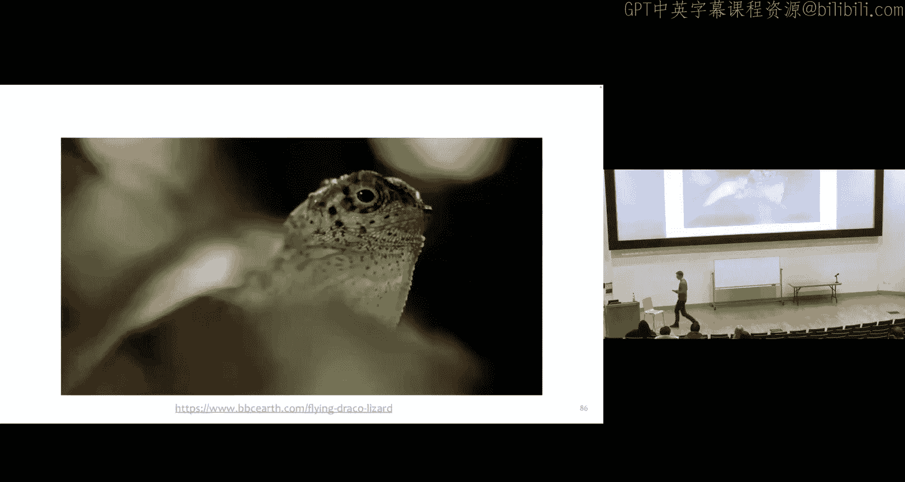

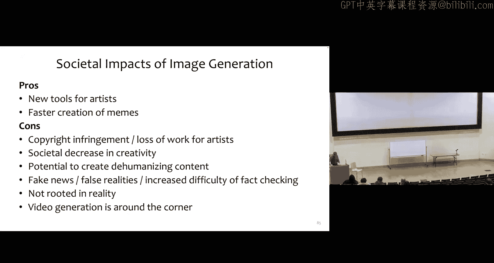

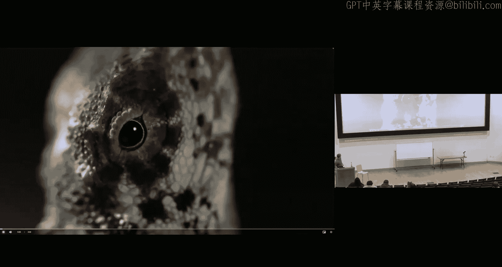

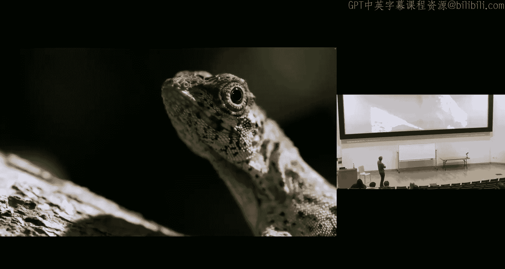

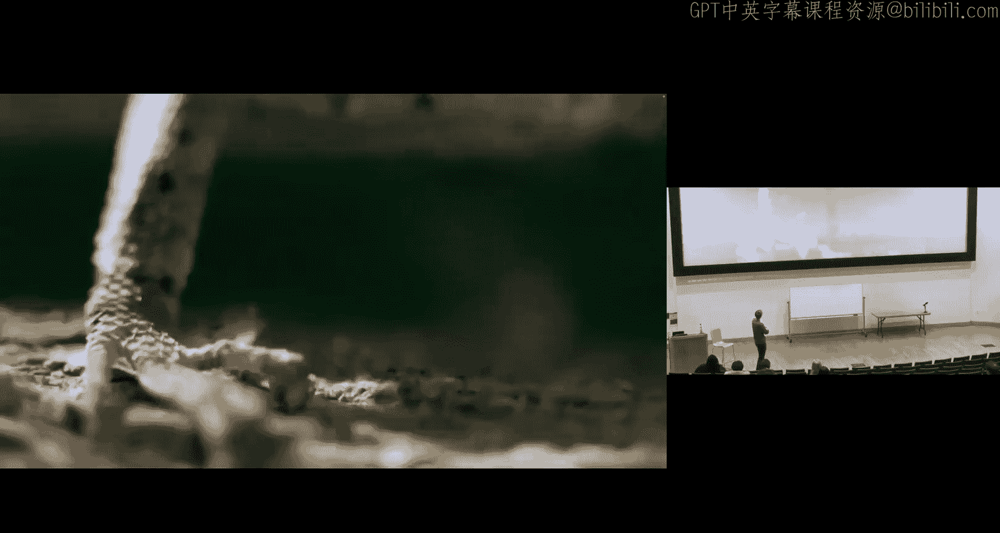

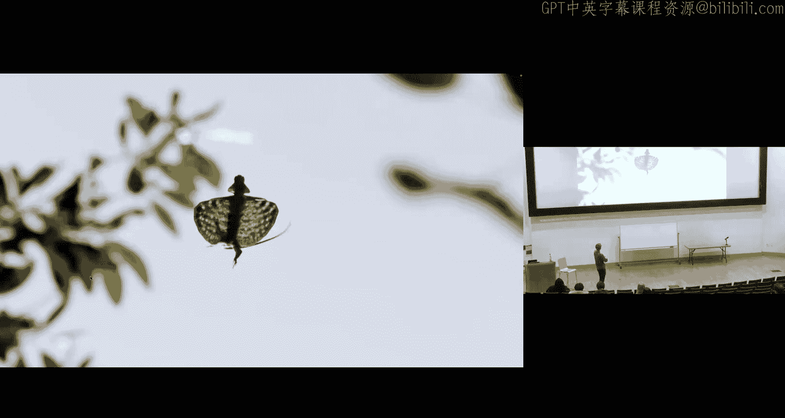

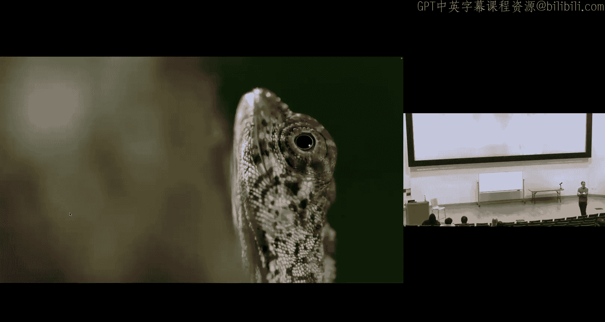

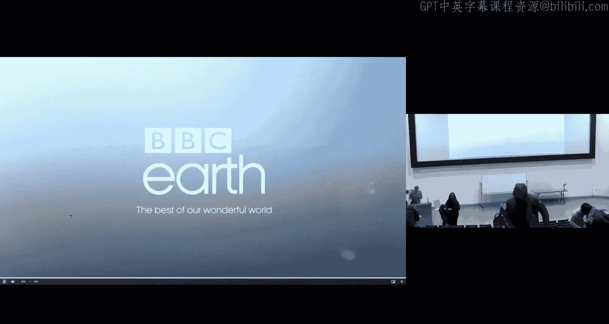

*   显著性检验
*   计算机视觉中的图像生成
*   生成对抗网络（GANs）