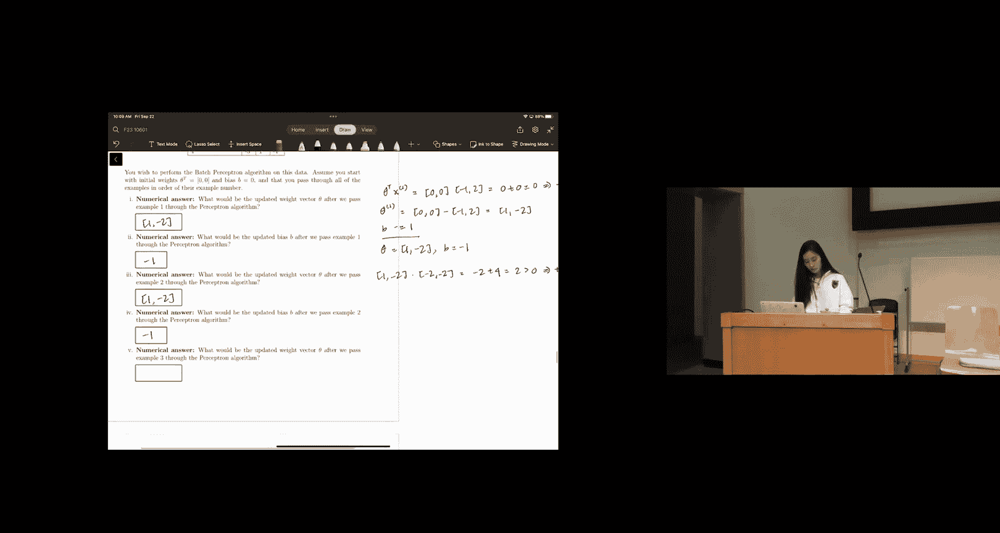
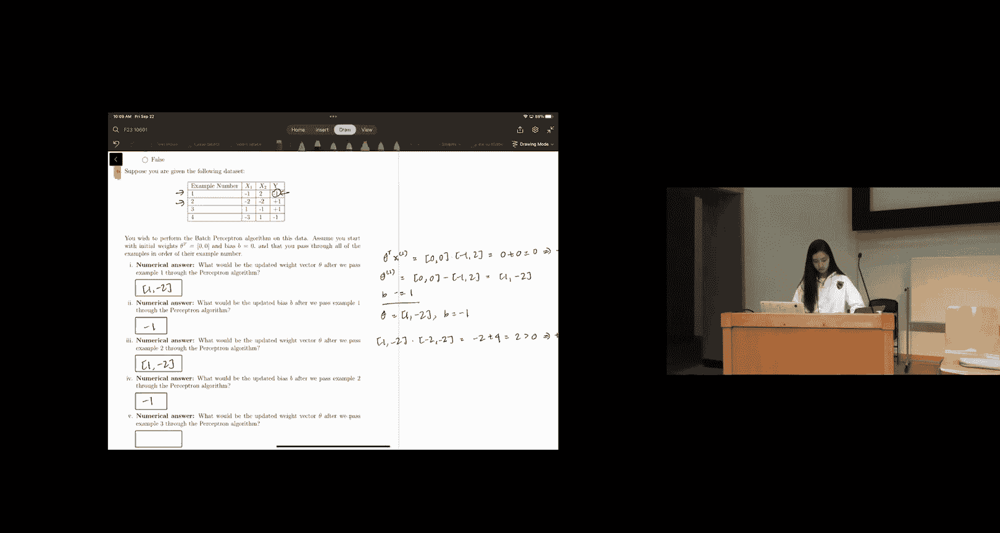
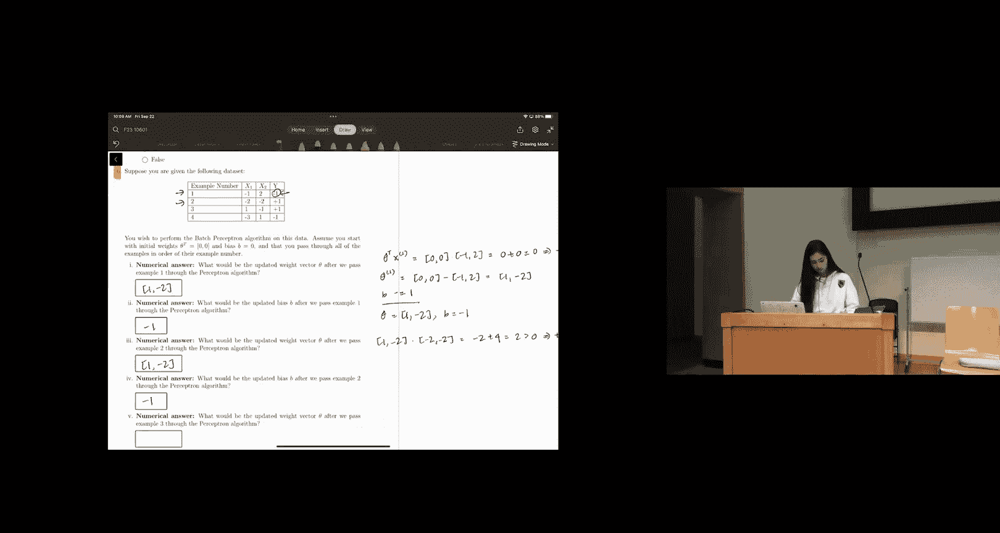

# CMU《机器学习导论｜Fall 2023 10-301⧸601 Introduction to Machine Learning》中英字幕（deepseek p28 Exam_1_Review.zh_en -BV1Z2cUefE4A_p28-

Oh， okay， I don't know what the three means for it。Oh。

 that's just the frequency that it's on Oh there go is this thing， can you guys hear me okay？

That'sOkay。不是。

哎啊 can you oh你 guys hear名ok。😊，Okay， so yeah this is our recitation right before exam one real quick if you see at the top these are a list of all of the questions we have for her to answer oh God。

But yeah， if there's nothing or just real quick， is there are there any questions anyone else would like to see covered that aren't on this list？

Yeah。Yeah， this isn going to be recorded if you look in the back there's there's some stuff going on or actually sorry there's cameras out here yeah。

 but without any further ado we can just get started so first off questions 1。1 through 1。

4 we're here。😊，嗯。I I'm having some trouble scrolling down。There we go， so 1。1。I name my on， okay？

Like， is this， can you guys hear me？I feels like I。It feels like my voice is not being project。

 I don't know， let's into my pocket。P谢。Yeah， nothing's happening。Okay there we go Okay。

 so let's look at this real quick。😊，Question 1。1a is the gist of this is we have we're combining the properties of perceptrons and decision trees right so up at the top we see we have a kind of decision tree like structure where we're casing on the values of A。

 B and D for some feature or rather for some data and then after we've successfully cased on these things we're also going to run the remaining features through some kind of perceptron to get our ultimate output so。

To do1 a we note that we're given one row that we would feed into this really big structure so real quick we have one or sorry our a variable is one B variable1 C variable0 you know D1 e0 and F1 so when we're trying to calculate like what our prediction is for this data what we do is just pass it through this you know pass it through this structure so real quick we see that our we are splitting on variable a initially。

Yeah we're spliting a variable a initially and we see that the value of a in this sample x is1 so we're going to go right and so once that's done we have sample or we're looking at feature D we notice that feature D is a value of1 this is one so we go right again after this we're going to want to pass the remaining values of B。

 C， E and F。Over to the。Over to the。Over to that perception。

 so this is just kind of a little bit of linear algebra where we're going to do is essentially dot products this vector I'm going to use a different pen。

This vector。1，0， negative 1，1。With the vector。What is it so this is going to be one。0ero， A， B， C， D。

 E， F， So this is going to be something like1，0，0，1。 Does it make sense why I'm getting these values？

Just general consensus。 Okay， cool。 So once I dot product these two， I'm going to get something like。

1 plus0 plus0 plus1。嗯。Equals two and so this is a positive number and so I would predict positive one look like a do want back in。

So I'm just going to make sure I'm not feeding you guys bad info and check the key hopefully。

There we go。I think。Yeah give me a second Oh there's a biaser Oh oh there's a bias term I'm being told there is a biaser okay sorry one thing I didn't notice B equals one and so in fact we have to add one to every single thing that our perceptron ever outputs and so two plus one gives you three which is a positive term and you would still predict positive one。

So let's keep going。Yeah， let's keep going。This question asks if the decision boundary of a perceptioncept tree is always going to be a linear。

Does anyone have any kind of intuition as to what the answer to this might be？Yeah。

Say false because decision trees aren't necessarily limited exactly exactly so we might have in in the case of like real value data let's say we have two dimensions right this is like an x1 this is like an x2 and let's say we have you know a bunch of data a decision tree might learn some。

Some you know， funny boundaries， basically every single individual split is going to be a line。

 but if we have like a bunch of lines， right？And we make a bunch of different splits we're ultimately going to end up with a nonlinear decision boundary just because you know we're going to get something that looks a lot more like a rectangle or a bunch of lines。

Superimposed upon one another rather than like you know， a direct linear boundary。All right。

 so let's look at part C， which says that for small values of max depth。

 disries are more likely to underfi the data than per front trees again does anyone have a sort of intuition about this question。

Yeah， I was thinking。I'm more likely to underfi。Data then percept on。So yeah。

 exactly so essentially like。What am I saying the reason that this is okay is just because like perception trees can they make use of the stuff that you haven't used before in order to ultimately make your correct decision right。

 whereas a decision tree has a non nonlinear like decision boundary。

 this perception tree is going to at its very root， create a linear decision boundary for you。Yeah。

 so this kind of combines the non nonlinearar characteristics of decision trees with like the better generalization ability of perceptrons right so if we essentially if we cut our tree off early with this perceptron tree method。

 we're going to be able to get some good generalizability just because our leaf nodes are going to be linear and better at you know on not overfitting stuff。

Okay so let's move on look at 1。2 yeah so this is saying given some given some bunch of real value data we want to predict like either what is it a one or a negative one so really quickly this was kind of a tricky question in my opinion but I'll just say like this was I believe the answers were yeah it was k nearest neighbors and then I think it was a decision tree yeah it was a decision tree but basically the gist of this is。

Like whenever you want to select a model for for your experiment there's always a set of assumptions that comes with it right if you're doing linear regression there's a ton of assumptions that needs to be made if you're just doing like ordinarily squares or OLS and among those for perceptron and linear regression those kind of assume that your data is somehow going to be linearly separable along some dimension and again yeah you just want to keep in mind like the assumptions that your model entails before you choose anything because you can nearest neighbors in this decision tree are ultimately like a bit more unparameterized and therefore make a few less assumptions about the data that they're trying to classify is I think is the general idea here。

Okay， moving on， the IDd3 algorithm is guaranteed to find an optimal decision tree。Yeah。

 so does anyone have any idea as to why this might be？I can， yeah。

 it it because you use mentioned information as a splitting criteria once you don't get like a certain amount mentioned information。

 you don't split it there。Could you elaborate a bit more on that so like us split crion is mutual information so please play the if the mutual information is greater than some value and that basically means that only if you gain a certain amount of information doesn't make sense to spread because you don't prevent overfi I mean that's how you kind of prevent overfitting you know annually like adapting to the hearing data but at the same time you're ensuring there's some sort of like generalizability when there's not too much information gained。

Yeah yeah I guess so so I think what you're kind of trying to get at is like the inductive bias of this model to begin with does that sound right so essentially yeah yeah exactly so the ID3 algorithm is greedy and what that means is it's just going to take whatever variable gives you the most mutual information with respect to your outcome variable and it just splits on that the outcome of that is that it doesn't look at what future nodes might do at the current split it only looks at your current level and it just keeps going from there it's called a greedy algorithm it doesn't care about future nodes it only cares about where your tree is at the moment and so as a result you might end up with trees It's hard to come up with like an adversarial example on the fly but essentially because it's greedy you might not end up with the tree that best classifies your data if that makes sense。

Okay so moving on one advantage of decision trees is that they're not easy to overfit I can go ahead and take this one this one is going to be well there's a there's some double negatives here I got to think about but the answer is the answer is essentially false I mean decision trees with unlimited depth I think is the caveat are very easy to overfit the reason for that is without any stopping criteria decision trees just going to keep on making branches until it can maximize its training what is it it minimize its training error and as it was yes。

Just exam should be assumed that whenever told a decision tree。

 unless we're told there's stopping criteria， explicitly， it will have an them depth。fair warning。

 I haven't seen the questions， but yes， I would assume that if if I were taking the exam probably。

Yeah， but in general， yes， if we don't impose any sort of， you know。

 pruning or early stoppage or something along these lines。

 decision trees are likely to wildly overfi just because if you see data that if it sees data that it hasn't seen before。

 it it might just kind of not know what it's doing intuitively。Okay， so let's move on to。I'm sorry。

 move on to。Oh it was fine。Oh， I wasn't planning to cover that one， but would you prefer me to do so？

Yes， okay， so let's do this one N the narwwall flips two fair coins let y denote the number of heads that are facing up then the entropy of y is one so let's see here off the top of my head if we think about the。

Let's think about this if we think about the formula entropy here。

 it's something along the lines of like the sum， the negative sum I think of the probability of sum outcome。

Times the log base two of the probability of the outcome。Like probability of outcome。

That was a terrible way to notate this， let's try that again。

There we go so swimminging along these lines and so when we think about the number of heads that are facing up when we're flipping to fair coins yeah it occurs to me right now that there are three possible outcomes right we can either have zero coins we can either have one coin or we can sorry we can either have zero coins give you a head we can have two heads or we can have one head those are three objects and so those are kind of the three outcomes we should be summing along this is the sum overall outcomes as well yeah does that make sense。

😊，So at a high level so okay I'm going to continue with the math now and so in the case that our outcome is equal to zero we have two we have zero heads。

 we know that the probability of this occurring is like one half times one half equals one fourth right and so this is going to come out to negative you know one fourth log。

One fourth plus and now we can move on to the next case。

 which is one head occurring we know here that there are now two possibilities ways we can have one head。

 which is like a head tail or a tail head。And so because of that our probability is actually I think one half right because there's four possible outcomes of a foot of two coins so it's going to be one half log。

 one half and similarly two heads is kind of the same as the zero heads scenario just in terms of the probability of that occurring we need you know headhead as opposed to tailt so this would again just be one fourth log。

😊，One fourth， Yeah， has anyone done the math for this already， just so I don't have to。

Think about this yeah。It was 1。5， okay。Goals 1。5 and as we can see。1。

5 is definitely not equal to one， and so we have our answer， which is that this is false。All right。

 so with that being said， I'm going to move on to the next few questions。I think 2。4 was a big one。

 which was。What was this okay， so this is k nearest algorithms or k nearest neighbors。

 but for what was this real valued data？And so we see here that we have a training set with a bunch of data in the form of X Y pairs or like X label pairs right so our x's that we're feeding in are just real numbers and we're getting back real numbers as are wises as well。

So they say that the essentially what they're trying to say is that if you get a new training sample。

And we are trying to do this with K neighbors， we essentially get the K you know closest points to your x along this x axis。

You find the y values of all of those k neighbors and then you take an average of them that's really all this that's really all this algorithm is trying to do and so with that those semantics out of the way we're going to move on to what is this。

This okay so it seems like where I'm just meant to cover a through E so we can do that real quick so if k equals one what is the mean word error on the training set well one interesting work about K and N with one neighbor is that you can actually guarantee that your training error is pretty much always going to be zero Does anyone understand why that might be。

Yeah okay so essentially if K if n equals one all you're really doing in your training data is you know you get your  point。

2 you say oh my god I have a point at2 and it's equal to2 and every single point becomes its own nearest neighbor and as a result you're never going to make any incorrect predictions right and so almost kind of trivially we can just say that when k equals 1。

 the mean scored error is also gonna to be zero just because we don't have any error okay so when k equals2 is this new question what's the predicted value at a so we notice that the value of a here is4 and so our job is now to find the two points in our training data closest to this value of4 we notice that there's actually kind of a tiebreaker right we know that the point。

44 is definitely one of the points we want but we also know that there's a tiebreaker between these two luckily for our case it doesn't really matter matter how we make this split because in the end we're going to be doing is taking an average between one4 and another four we don't know which of。

Tex coordinates we pick， but we know it's what live value is going to be four and so our results just going to be what is it4 plus4 over two equals4。

 right？So boom， I think this is four so when k equals 2， what's the predicted value app B？All right。

 does anyone want to tackle the Matthew here a little bit， make my life a little easier here？

I'm looking at that。With that means five because it's approximately at the midpoint。

 it's an under can answer so the midpoint doesn't matter， but it's between one year sta or four。

 the other year sta or six， so it would take the average if we try to draws a line it be。呃。

A horizontal line at five。I want at five。啊。Oh I'm sorry you're talking about the second question right the prediction at B yeah sorry sorry I thought you were asking your question about the previous part that was that was my be that was my bad Okay。

 so what you're saying is that B has two nearest neighbors six and four。😊。

Okay yeah I agree with you completely and so here what we're going to do is just say six plus four over two because we have two points and you know that just gives you five and that's your prediction yeah so。

😊，Good stuff there。Okay， so when k equals 3， what is the predicted value at C？

Going to erase some stuff real quick。Okay， that's not what I wanted。 Okay。

 so and K equals what was it3， what's the predicted value at C I can take this one as well。

 so we just see。These three points right which have values of six。

 seven and eight again I'm just going to say this the the average between6。

 seven and8 is just going to be seven， and so this is the value that we ultimately predict。😊。

Cool so in k equals8 what is the predictive value at C Okay， this is a lot more points。

 but we can do some math here， let's say one，2， three，4， five， six，7。

 eight so if we notice there's only eight points in our entire training data set。

Which kind of implies that the eight nearest points are just going to be a training data set right and so ultimately what we're just going to do is sum up you know。

Sum up all of the。Like what is it y I's from I equals zero to n， which in this case。

 after you do this math。After the writing by n comes out to something like 5。375。

 I think is just what the answer key says。But yeah， does this notation make sense to people？Okay。

 this is like。I'm just not going to write these down。But yeah， I think let's move on to。

Some more problems。In question three， okay， I think this， yeah。

 this might have been the last question I was meant to cover。

 but let's see we're doing some kind of learning algorithm that uses。Two hyperparameters。

Two hyperparameters， what is it gamma and mega？And let's see here。Oh is it the math here。

 so there's okay， and it's。Is okay， so we know that this model takes one hour to train regardless of the set of the training set。

 we're going to do some random subsampling cross validation where we do K runs of cross validation。

 every single run， okay， we sample some random amount of our data。

 we use the rest of for training and let's see here given1 thousand data points。Four runs。

 and we sample a fourth of our data each time。Let's assume we have 100 hours to complete the entire cross validation process。

So what is the maximum number of discrete values of？

Gamma that we can include in our search if we also want to include eight values of omega assume that any computations other than training are negligible all right again。

 one lasts time does anyone have some sort of intuition as to the math that we're going to need to do to figure this out。

Yes， no。All right let's look at this again then so we have 100 points we have four runs and we have and we sample a fourth of our data each time to do cross validation on one thing to note is that we are going to essentially be training。

K equals four models， right just because we have four runss that are fixed。啊。

What is the maximum value of？What as the maximum number of discrete oh。

 this is a very confusingly worded question， I agree with you guys。

So essentially what we want to do is。Let's see here。

We have eight hours and we note that we have four runs， right。

 and so what we're going to be doing is。Training some sort of model on each of like training some number of models on each of our runs is the question that we want to figure out so we have 1000 data points and alpha equals 0。

25。Let's see here。That's the maximum number of discrete values of gamma。

 we can include in our search if we also want to include eight values of mega。Just one second。

 I need to read through this question as well just because I'm also a little bit confused by the wording。

Sorry just one second， and you allow me to puzzle to this as well。打了。Yeah。Oh。

 we have 100 hours to complete the process， I missed that part。Oh oh， I'm so sorry guys actually。

So we have four runs here and for each run， we want to include eight values of omega。

 So let's see essentially what we're okay， I understand is now。

 So what we're going to be doing is doing。We're going to be splitting our data for individual times after each split we want to have we want after each split we also want to test eight individual values of omega so what that ultimately means is like let's say we have。

100 little points of data right we're going to be able to create four different distinct sets of train validation sets so let's see here there is going to be you know train one test one train one test two train two test three train three test four train four we can imagine that each of these has a bunch of different training examples this is a quarter each of the tests。

Ass a quarter of the size of the trains。So this is how we've like this is how we figured out our train test split specifically。

 but at the same time within each of these splits， we can also create some number of models， right？😊。

We want to test eight individual values of mega， which means that we want to， let's see here。

 which means that for each of these runs， we want to create eight models。So overall。

 if we have four individual sets of models， along with eight values of some parameter。

 we want to test per model that ultimately comes out to four。

Like four splits times eight models per split， which is 32。Overall。

 if we have 100 hours to do all of this， we just take the floor of 100 over 32。

 which is roughly three， which is where we get our final answer here， for this problem。Okay。

 so they're asking again to give one advantage of increasing the value of alpha。

 so essentially what this means is if alpha is higher。

 I believe we're going to have a bigger a bigger train set。Yeah。

 so I guess does anyone have any intuition as to why increasing your validation set might be a helpful thing to do？

If not I can also answer this so essentially if we have more data for validation。

 we can make better assumptions as to the generalizability of our model right so if we have if we decrease our train set size and we increase our validation size and our model still does pretty well that means it's really。

 really good at generalizing right？😊，And so yeah that's that's about the intuition for this question Okay。

 so sorry about the brain form in the middle there but that was one through three and I think Annie can cover the rest of this。

Hey， can everyone hear me okay？Certain echo okay so I'm going to go through sections4 and5 so starting with 4。

1 we're given a set of linearly separable points and we have another set of points where we just multiply you can see the difference is that all the x's are multi multiplied by a constant C and。

We're asking which of the following statements are true so let's just go through all of the options and decide whether or not we think they're true since its select all that applies so for a the mistake bound on perception on S prime is larger than the mistake bound on S so remember that the formula for the mistake bound is R over gamma squared where R is the radius of the data set so that me that's referring to the furest so the distance between the origin and the furest point in the data set away from the origin and。

Over the margin。 So let's just consider what happens to。The data set S prime。

 So all the x's are multiplied by constant。 So that means that。

If you think about it for the numerator originally let's say if the radius for the data set S was R。

 then the radius for the data set s prime would be c times r because all the points have been scaled upward like up by a factor of c so the radius is equivalently also been scaled up as a factor of c and now let's consider the margin so the margin of an example of a single example with respect to a linear separator is the distance from x to the plane W times x equals zero so let me just write that out so the margin。

Of an example。X with respect to a linear separator W。Is the distance。Between x。

And W times x equals 0。 So we see that。Using the same logic that like the radius has been multiplied by C。

 if we scaled all the points by a factor of c， the margin also gets scaled by a factor of C so then the mistake but this is for S then for S prime。

 we get CR over C times gamma， if let's assume R and gamma here are corresponding to the original data set squared。

So this actually like cancels out on the numer and the denominator so the mistake ground doesn't actually change。

Okay， so this is false now。For。Option B， the perceptron algorithm when we run on S and S prime return the same classifier modular modular constant factors。

 so let's consider what happens when we train a perceptron algorithm on S so let's just assume that for the first example it gets misclassified。

Because I'm just using the case that it gets misclassified because if in the perceptioncept algorithm if a point doesn't get misclassified the parameters don't change right so let's just consider the cases that like it gets misclassified and let's say that like y one。

Is equal to one。Okay， then what happens with the original data set S is that so data。

What plus equals？X1 and B， the bias term will plus equals one。

 So let's consider what will happen for S prime instead of。Data being incremented by just x1。

 it'll be implementedcremented by cx1。And B also be incremented by one。

So now let's consider another theta point x2 if it's also misclassified。

And let's also assume that y2 is just one for s so theta。Stteair。Two， let's equal to theta1 plus。😔，2。

Which is equal to basically like x1 plus x2。And for the data point。

 a data set S prime will have that the 2 is equal to x1， wait， sorry。Theta 1 plus x。Plus thex2。

Which is Cx1 plus Cx2。So we notice that there's just constant factor that's being multiplied。

So if we consider it， it's called this prime。The relationship between theta 2 and theta prime2。

 we see that the。Prime2 is just equal to seed times state up。two。So the second option is true。

Running on this returns the same classifier module is some constant factor and the constant factor here would be C。

Okay， option C， the perceptron algorithm converges on S prime。

 so this would also be true just following this assumption that the perceptron algorithm converges on S and was the same reasoning as option B。

 we see that like if it converges on S， then the percept on like algorithm will return something that's the same classifier modules some constant factor so that means that will like the new classifier will also converge。

Because it's only off by a certain factor。Okay， so it's not none of the above。Any questions？Okay。

 if not， let's go to 4。2 so given a linearly separable data set the convergence time of perceptron algorithm depends on the sample size and so let's look at this formula again。

 like does the radius or the margin depend on。The data set， the size of the data set。

What do you guys think？Yeah。I think it depends a little bit because if you're sembling from some distribution the more points you have the closer you're going to get to the true max radio well there's no yes。

 that is true like okay let's say if you have a。If you have more data sets。

 the chances of you having a point that's further away from the origin is higher。

 let's say like in terms of determined radius， but in general。

 there's no like direct relationship between radius and。

And the number of data points right because you could have。

 let's say 100 data points if this was the origin and it like all centered around here。

 you could also only have two data points once here and once like out here So in general there's no like set relation like the radius or the margin it's not really directly related to the size of the data set so like like you can always construct counter examples where like the radius and the margin are also not determined in terms of n at all in terms of the sample size so like you could come up with like edge cases where that does happen but in general there's no like。

Set relationship so that's why the answer is actually false here it doesn't really depend on the number of data points yet search for the maximum maximum distance right we're talking about the oh you're saying convergence time。

I believe this question is more。Towards like。Give me one second。All right。

 also and another point that I would make here is that because we're given that this data set is linearly separable to begin with。

 so the perception algorithm will just terminate after it's it doesn't。

Make any mistakes anymore like so the perceptioncept algorithm will have because it's linearly sparable we will have like after it stop making mistakes it'll just converge so by having more data it points it out doesn't actually like change the convergence time。

No。That it doesn't make any mistakes if it doesn't check all these。

So the upper bound on the number of mistakestic， that's where this mistake brown comes in。

The mistake bound is the upper bound and the number of mistakes it would make。

 and that doesn't depend on it。Okay。Moving on to the next question this question six。

 we're just going through like walking through an example of running the perceptron algorithm on four examples。

 so it's initialized to be zero zero and was the bias term zero okay。

 so what would be the updated weight vector after we pass example one。Through the algorithm。

 so let's see。In iteration one， what we'll do is dot the data vector with x1 so we get。0，0。

 thought it was。Negative 1，2， which is equal to。哪个种。是。0 plus zero which is zero。

 so this is going to predict a positive one label。And we see that this is actually a mistake because the y here is negative 1 right so then we're going to add this vector oh sorry subtract this vector from the theta vector because it's a negative the real label is negative  one so we're going so theta1 is going to equal to00。

Minus negative 12， which is equal to1 negative 2。Yeah， and that's correct。

 so then B is going to minus equals one。So this actually answer is part one and part two， I believe。

 so this is one negative two。And negative one。Okay。

 now let's pass through so now like just to as a recap， our theta vector is now。

One negative2 and our B is negative one。 so we're going to pass this into the second example。

We're going to get one negative2 dotted was negative2 negative2。

Wwhichch is equal to negative to plus4， which is equal to2， which is greater than zero。

 so we're going to predict a positive label and we see that we don't actually make a mistake here so whenever a perception algorithm does not make a mistake we don't update any of the parameters so the weight vector and the bias term actually stays the same。

And now example three。

It's frozen。

Wait， sorry。

So example three， we will have so' do the same data vector with。One， negative one。

And we will get one plus two and actually I got sorry here there should have been a minus1 here because there was a bias term but this doesn't actually change the answer because it's still positive Okay。

 so one plus two and then we have a bias term minus1 which equals to 2 and it's greater than zero so we're going predict a positive one and we see that like this is also still not a mistake so。

The parameters stay the same， still one， negative two and negative  one。Okay。

 now your friend tells you to stop here and that you don't need to update the perceptioncept of rates for bias anymore。

 do you what do you I think is this true or false？Let's look at example4 as well。

 so one negative2 it was negative 31 equals negative 3 minus2。

 and then you subtract a bias term again this is equal to what negative6 right which is less than zero so you should have predicted a negative one for example4 and that is actually。

Correct as well， so given this information。Do you agree with the statement that we should stop here and not update the ways or the bias anymore？

Any ideas？And we're assuming that the data， the four examples given here are all the data that you've been given。

That's okay， so the answer is true because we see that we've correctly classified。

All of the data that's been given to us， and that means our algorithm has converged like our perception on classifier has converged。

So okay， question seven。The data set X Y has a non nonlinear decision boundary， but we know that。

If we map x to F of x using this function F， then F of x Y is actually linearly separable。

 so we're trying to decide if this algorithm is correct or not so。Remember。

 in the usual like percept font algorithm， it'll be like if the sign。

Of w times X I plus B is not equal to Yi， then you make updates and you update it as the weight would be equal to the original weight plus Yi times。

Xi。And then B prime would be equal to B plus Y I right so this is the original like the perceptron algorithm that we got through in lecture and then the class in general so in this question you basically just think about like just let's know like an x prime is just f of x since we know that like F of x comma Y like f of x yeah f of x comma Y is linearly separable we just pass like x prime through this algorithm right and we see that like actually。

It's the exact same thing if you just replace x with x prime in the algorithm， so the answer is true。

Any questions？Yeah， a question about for when would the batch perceptron algorithm converge if it's not linear the effort？

we could have like a。Stopping criteria in terms of like if the mistake bound is or okay。

 if the number of mistakes that the algorithm is making is like you can see that if。

The changes that's been happening to your theta vector is like getting smaller and smaller。

 then like if it's within some like epsilon range， then you can say that it converged。Yeah。

But there are certain cases， if the data is not linearly separable， for example。

 then like the perception algorithm might not converge in which case like the data vector will probably would be shifting around like pretty big like was yeah。

 having pretty big shifts from iteration to iteration。So what are we doing that？Then like。I mean。

 if you feel like the data set is not linearly separable。

 then perception is not the best algorithm for you to run on it to train and classifier to be good with。

Okay right， linear your regression。So we've given you the closed form of linear regression。

 have you guys gone through this inlecturing yet no， right？Anyways。

 for the sake of like this question doesn't actually matter。

 but this is a closed form for solving for theta given a x vector and y so suppose you have n equals 35 training examples and M equals five features so once and we're going to fold the bias term in so we want to look at the dimensions of X Y and theta so let's start with like the easy ones so we know the y vector。

As a column vector was one row corresponding like each row corresponds to a label for that corresponding like data point right。

 so we see that we have。35 training examples， so we have 35 data points and it's a column vector so y is going to be 35 times one。

Which already illuminates two of the options。Now let's look at。X。

So x should have one row for each data point and one column for each feature。

So like if you like think about the data sets that you were given for the home the second homework。

 the decision tree homework， like each row of the data set corresponded to a training point like a data point right so here。

X should have 35 rows and it should have five plus one columns because we're folding in the bias term so we have one more column for the bias term and we have five features to begin with。

 so x is 35 by6。Which illuminates another option and。A is the correct answer。

 but also go through the reason for the vector theta。

 so the vector theta is also a column vector and it should have one row per feature。

 so this would be5。Plus。One because of the folded and bias term times1， so it's six times six by one。

Okay。Now5。3， I believe this is the last question that we were planning on like going over。

 but even more if you have more questions feel free to come down and ask us or come to office hours so 5。

3 we're just。Checking which of the ones are following which of the following expressions are valid for the mean squared error objective function so like one thing to notice is that like they all look the same except for the expression inside the norm So the point of this question is actually to get you thinking about dimensions and what can be like like what can be dotted was。

What and what cannot。Let's see。 so we have x being in thes of n by m plus1。And。

We have so then we have data being an R of m plus one by one， and then we have y。In R of n by one。

Okay， so let's see。 Can we dot theta with x in the way that it's written here。

 Like theta is n plus one by one and x is n times M plus one。

 This doesn't actually work out because this one doesn't match up with this N here， right。

 So we know that。This is not a valid option。And this is not a valid option either because like theta dot x is just not a valid matrix or vector multiplication。

 Now let's look at it what if we got x multi x by theta， then we get。

The M plus one actually matches with M plus one， right， So what's the resulting dimension of that。

 So x by theta would be。N by one and we see that this dimension also matches with the dimension of Y T so。

Believe。Wt， sorry， no， it doesn't match with Y T， it matches with Y。

 so this is also not a valid option， which leaves us to the last one。

Was the same logic like x multiplied with data gives us。N by one， and then y itself is an n by one。

 so only option D is valid。Any questions？Okay， then this concludes what we plan to go over in recitation。

 I guess we can stop the recording maybe and then if you guys have individual questions you guys can come down and ask us。

Okay， thanks for coming。

