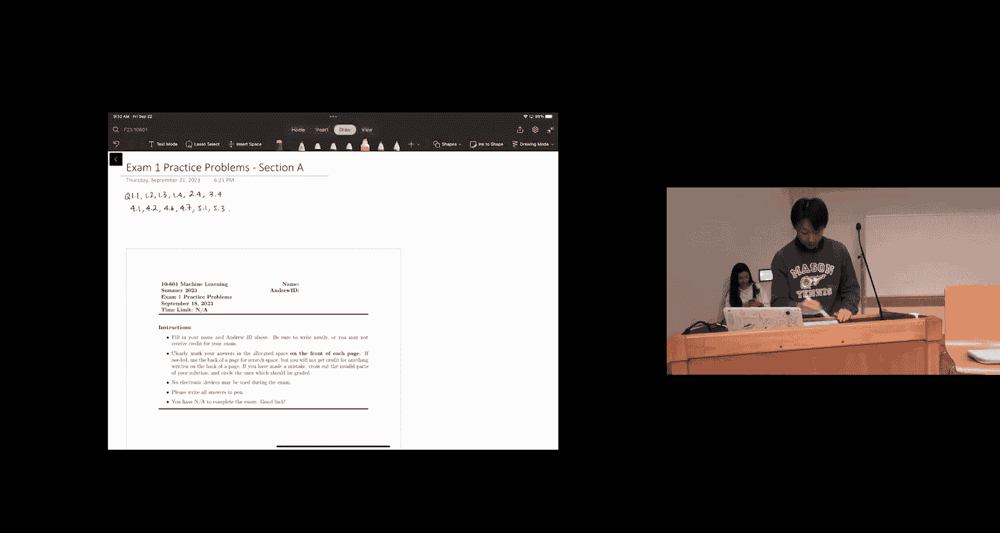
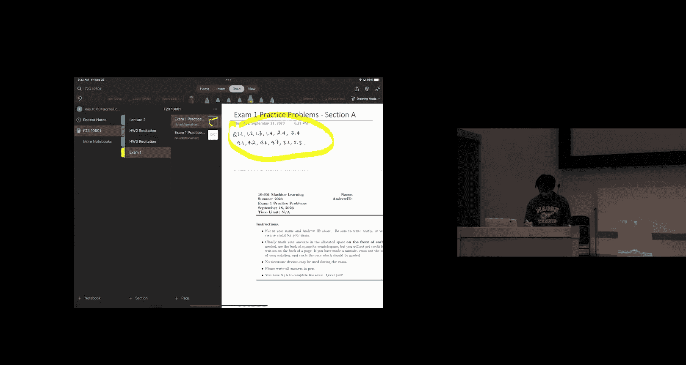
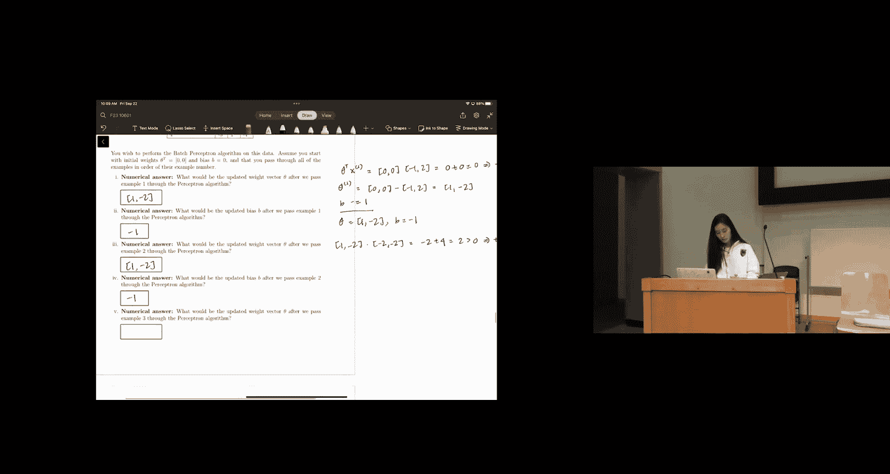
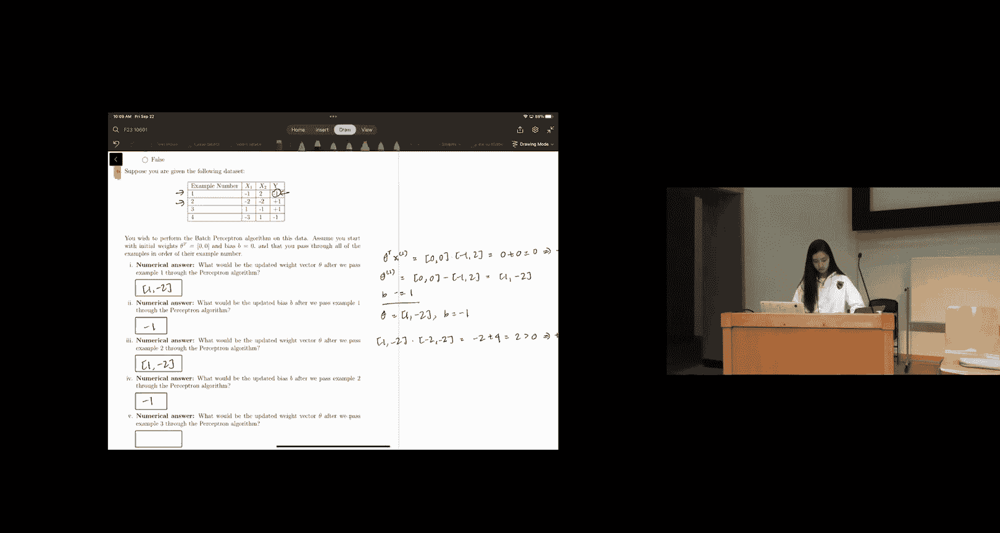
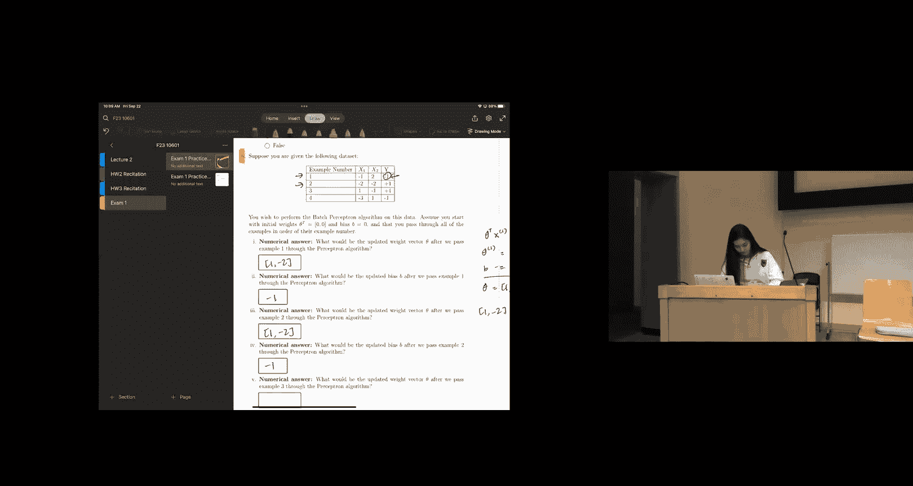
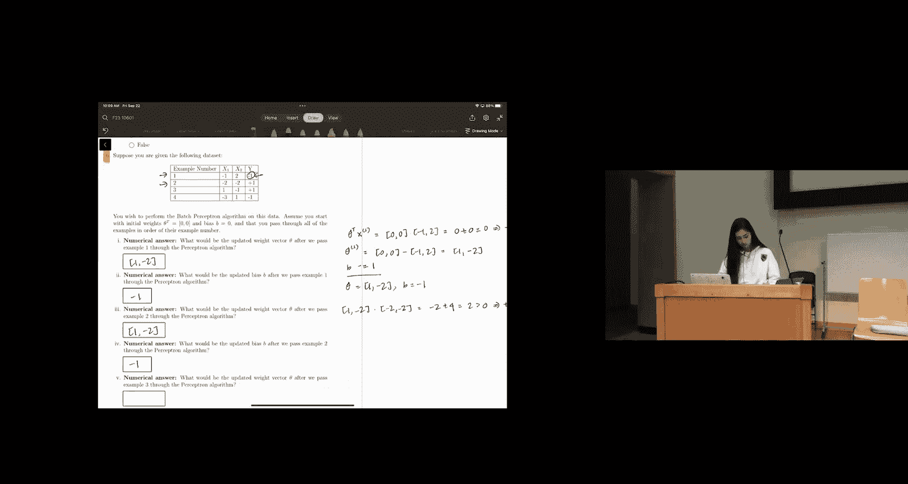
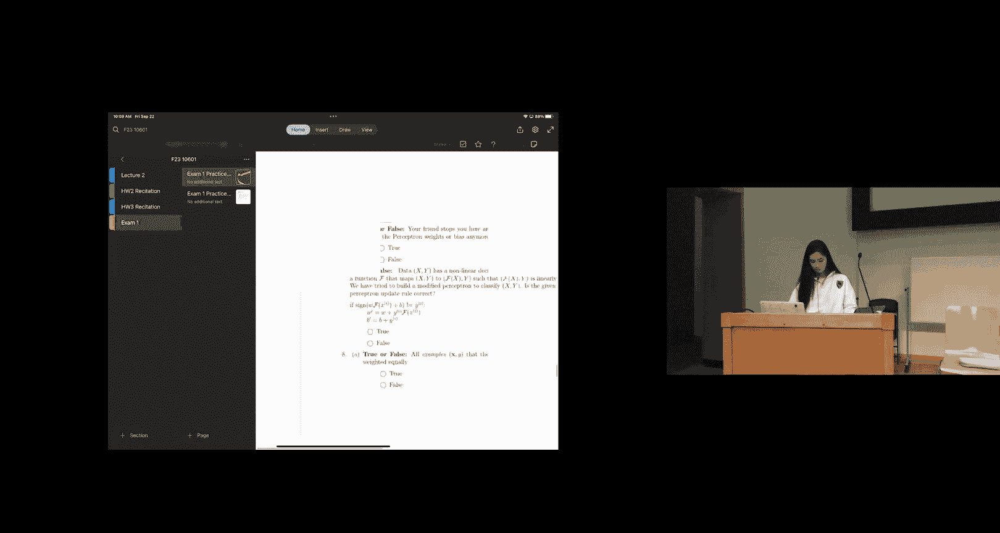
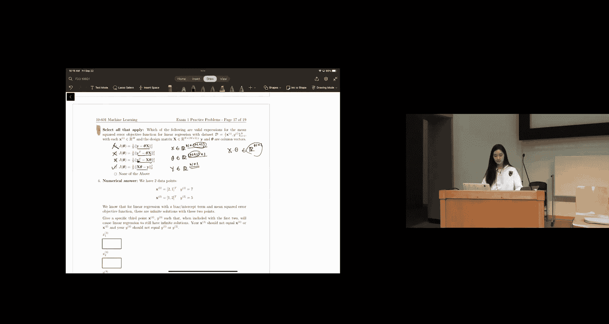

# CMU《机器学习导论｜Fall 2023 10-301⧸601 Introduction to Machine Learning》中英字幕教程

## 1. 机器学习基础

在本节课中，我们将学习机器学习的基本概念和常见算法。

### 1.1 机器学习定义

机器学习是指使计算机能够从数据中学习并做出决策或预测的技术。

### 1.2 常见算法

*   **线性回归**：用于预测连续值。
*   **逻辑回归**：用于预测离散值，如二分类。
*   **决策树**：用于分类和回归。
*   **支持向量机**：用于分类和回归。
*   **神经网络**：用于复杂的模式识别。

## 2. 线性回归

线性回归是一种用于预测连续值的监督学习算法。

### 2.1 线性回归公式

**公式**：y = θ0 + θ1 * x

其中，y 是预测值，x 是输入特征，θ0 和 θ1 是模型参数。

### 2.2 线性回归损失函数

**公式**：MSE = (y - y_hat)^2

其中，y 是真实值，y_hat 是预测值。

## 3. 逻辑回归

逻辑回归是一种用于预测离散值的监督学习算法。

### 3.1 逻辑回归公式

**公式**：P(y = 1) = σ(θ0 + θ1 * x)

其中，σ 是 sigmoid 函数，θ0 和 θ1 是模型参数。

### 3.2 逻辑回归损失函数

**公式**：Log Loss = -[y * log(P(y = 1)) + (1 - y) * log(1 - P(y = 1))]

## 4. 决策树

决策树是一种用于分类和回归的监督学习算法。

### 4.1 决策树结构

决策树由一系列的决策节点和叶子节点组成。

*   **决策节点**：根据特征值进行决策。
*   **叶子节点**：包含预测结果。

### 4.2 决策树算法

*   **ID3 算法**：基于信息增益选择特征。
*   **C4.5 算法**：基于增益率选择特征。

## 5. 支持向量机

支持向量机是一种用于分类和回归的监督学习算法。

### 5.1 支持向量机公式

**公式**：f(x) = sign(w * x + b)

其中，w 是权重向量，b 是偏置项。

### 5.2 支持向量机损失函数

**公式**：L = (1/2) * ||w||^2

## 6. 神经网络

神经网络是一种用于复杂模式识别的监督学习算法。

### 6.1 神经网络结构

神经网络由多个神经元组成，每个神经元都连接到其他神经元。

### 6.2 神经网络算法

*   **反向传播算法**：用于训练神经网络。

## 总结

本节课中，我们学习了机器学习的基本概念、常见算法以及相关公式。希望这些知识能够帮助你更好地理解机器学习。