# CMU《机器学习导论｜Fall 2023 10-301⧸601 Introduction to Machine Learning》中英字幕（deepseek p29 Exam_2_Review.zh_en -BV1Z2cUefE4A_p29-

Hello， welcome to exam toacation well be basically discussing some selected problems on the handout portion on the website。

And so we'll be going through the sessionss one by one and please ask me whenever questions pop up。

The first section is optimization。嗯。So we'll be discussing question。To be。Oh。

So the question is consider the convex function absent equal to z squared and alpha be the learning rate of gradient descent。

😊，Oh。For which values of alpha B the limit of our solution layer indent solution to be0。

 assuming the initial value of Z we are starting with is  one。

And that is basically like a notation for third value of that after like the T iteration。😊。

We will start by writing down what very decent does。So this is our function f z equal to z squared。嗯。

The gradient dissantiation looks like。Right？Any questions on this part？

So DF p that in this case is given by。To that。I'll just targeting in here。This is how we will be。

Updating our solution。It's basically。Okay。We will basically multiply it by。We managed to alpha。

 so let's try these values of alphas to to see if we reach 0。😊。

Another solution I can write on is like Z zero is 1 so。Z T has a close form solution。Like this。Right。

Because we are just multiplying one minus to alpha to get the next state rate。And that zero is 1。

And we just need to figure out which values are alpha leads to the limit of0。If I put in l P is 0。

 you can see this value would be1 to part T and the does not go to 0。😊。

If I put an alpha equal to half， then this gives me 0。So the limit will also goes to  zero。

If I put alpha equal to one。This would be minus1 to the party。And the limit will this。

 the limit does not exist because it will just。And go between1 and minus1。

Even at t is equal to infinity。At alpha equal to 2。It is。Minus3 to party。And this is again。

 the limit does not exist because it will add higher values of T Jaco between class infinity and minus infinity。

😊，So we have found value of Alalpa， so this will be the correct answer。Any questions for the spot？

Okay， we can move on。The second section is MLE MAP。

 and we'll be discussing two questions in this part。😊。

So the first question will be soon with the question too。So the question is。

 let X1 until x your data drawn independently from a English form distribution。

Over a diamond shaped area。The time shift data looks like this。And like each x is two dimensional。

 that is why it is shown on a 2 d coordinate grid and basically the point is selected uniformly from this area。

And the side of the square is root 2 theter。AllAs given。And he does like a positive for lumber。哦。So。

 this is another way of writing a distribution， the Pfx given the will be one upon 2 lit square 2 little squared is the area of the square。

😊，So selecting any point across in the8 uniform area and if it's outside the square。

 the probability is 0。And by norm X in this definition we mean the L norm and the question asks to find the maximum likelihood of theta。

😊，And it doubts in the question itself。O。So basically we'll follow the visual up， yes， one。

So the first time of the question is that the points are taken from this square uniformly。

So each point is our two dimensional thing， right？So each point is the two dimensional thing is here x comma y in this coordinate grid and if I say that the side is。

我 do t大 here。Just because the distance between0 comma 3ta and minus theta comma 0 is 2 to theta。

 the area of the squared becomes2 theta squared。So我。Assuming a uniform distribution。

 what will be the like the uniform？Distribution of any one point here， one by input itta squared。

And other way to think about it is like if I the the poverty should indicate out to be one right yes。

 yes。😊，Yes。And properties like should integrate out to be one if I integrate1 upon2 litta squared over this square it will give me one right because the area is。

Don't think out squared。Yeah， so。Any other questions for the questions？So。

 we will follow the usual approach of finding a maximum likelihood which begins by will first write down the likelihood and try to maximize with respect to the unknown parameter which is theta。

😊，I'll start by writing the likelihood function。嗯。So since the points are like independently drawn。

 I can。Right。I can just multi the properties to find the probability of the whole sample。Oh。と。

One the thing to note done is like I can write the of equation as。我就是。Yep。

 does this make sense it is like the one is like the usual indicator function and when upon through to square this basically exactly emulates the probability given above。

😊，This one。So， if the norm of Xi is less than theta。

 it will give me1 upon2 tta squared the inside term otherwise it will give me 0。😊。

So this is the exact multiate like mathematical function al function for this P of x of data just makes things a little bit easier。

😊，Okay。So I can simplify this。一。そ that呃。Like the L norm of access is data。So he decomposed that。

 would it just be that the absolute body。Sure。Because I mean， what if I did ask people？

X would be So X I is a two dimensional vector。in itself because its a point on the square right it has both the x and the y coordinate like or x1 and the x towards coordinate。

So if I pick a point here， for example。Then this probably can be like， for example，1 comm of1。

 so it will be a vector of size2 include1 comm of1。绝地去保邮的。

So writing down mod exercise basically means like L1 now so I can。To make things much。

An exciso vector。Okay。I other questions。This this is just like another mathematical way of writing the probability equation。

😊，So when upon to the square comes out。Right。And I like to simplify the second term once again。没有。

So we can probably。Focus on this part。Just to。This will be one this the whole thing this is just like a multiplication of one or zeros right so it will be one when all of these are ones and when all of these are ones will be basically and it will be zero otherwise so。

If all the xs are less than theta， the norm of all the x is are less than theta。

 then only it will be 1 otherwise it can be 0 right。I can size。

But I can just compare the maximum normal excite。And call it if it is less less than theta then all exercise size will be less than theta。

And this expression will be one， otherwise it will be0。This has removes the multiplication。

From the above don't。And we don't really need to write them on negative log likelihood we can just basically maximize this with respect to theta。

😊，Intuitively this， this is either one or 0 and this first term is。Degreasing with respect to theta。

 so I would like to plug in as small a value of data as possible to maximize the likelihood。😊。

RightBut without making it zero without making the second of zero。

 otherwise it doesn't make sense anyway。炖。Kutah can just be。The maximum value of。

Because I cannot pick anything smaller than this and anything larger than this will strictly be sub optimal。

😊，Does this make sense？How did I maximize the function and any of the questions？On the solution。Yeah。

All would like to this zero or going to provide like few data。Yes， yes。And the non to two values。

 like it will be either 0 or 1 upon 2 the squared to the par end。

 but theta can take different values。😊，对。播。To give you more intuition。

 I can show you what like the function might look like。For example， here， right？This is like。

And let's just say this is my max value。This tweet， this is El。Right， so it will be like zero。

 let's say this is zero。Right because he is smaller than that。And then。哎。

Whenever theta becomes something， it will be1 upon2 theta squared。I1 upon2 theta ML squared。

To the power N， and then it will just keep decreasing， right？Assuming it has in 3 it's again0， right。

Because。Tut is like in the denominator， so we just want this value right。

 this is where the function is being maximized。This is a function light。

So you just want to max of the function， basically sorry。这ます。This blow data zero。Thats all right。

Yeah， so there is the value here， right？So， until it is less than that theta it doesn' not matter anyway it is all zero right as soon as theta crosses max theta I。

😊，Max X。The second term becomes one and we don't need to worry about it。

Right and then all that matters is 1。2 litta squared to par n。Which is decreasing in theta。

Is it clear， any other question？And possible like another 2 second minutes。

Just because this is like a little bit unusual。やep。Yes。Yes。😊，Yes。

So the indicatorous function is I think you already know like whatever whenever the argument inside it it2 is one。

 otherwise it is zero and。😊，We just basically use indicator function to compact write down this。

If you proceed with this we again get the same solution don't really need to ne use indicator function but they are like again like a convenient mathematical tool this allows me to take the one upon test squared out and also solve for the multiplication of indicator functions in a convenient manner。

😊，From this to this。Okay， so we have to maximize this function of the theta， is that clear？😊，Yes。

 from here to here， right， yes。For ML， we need to maximize the likelihood， right？😊。

And so basically I need this is a function of theta given excise。😊。

Right this this is a function of theta given an Xs and I need to maximize it with respect to theta。

 so assume like theta is less than maxxii。😊，Right so like this graph so basically we are plotting like a graph that is also the return getting to maximize that function right？

😊。

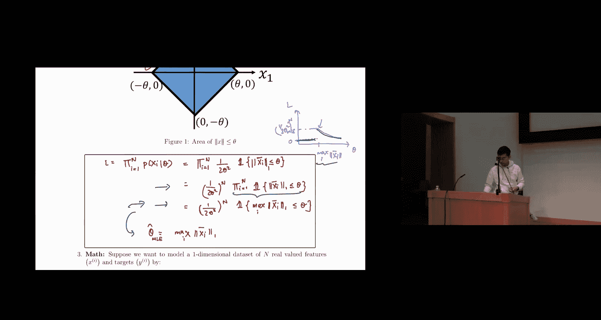

So whenever theta will be max less than maxxii， it will be 0 because one of the indicator functions will just make the whole thing zero。

😊，And does that make sense？And as soon as it reaches max side， it indicator is 1。

 it will always be one after that， so all we need to worry about is one upon 2 theta squared to the power n。

😊，And this is a decreasing function of theta right as street increases this will keep decreasing so it will have some value at max Xi which is here。

😊，And then it will keep decreasing from the all so you can imagine if the infinity the value will again be like basically0 right this is what I try to show here it will just go down to 0。

😊，So we need to maximize this with theteta， so this is like the optimal point something。😊，Allい。

D rumless， you mean？But this numbers is like given the value of theta， we don't know theta。So。

 for any given the this this will be like the probability distribution of excs。

 we need to give the batchh theta， we need to give the batch numbers， which fits the data。😊。

So what is the side of that rous， that is basically the question is answering。嗯。small it yes。

 my smallish because the likelihoodli is decreasing it's not like we need to do every time。

 but I just like the likelihood is decreasing as theica increases。So yes， basically it。

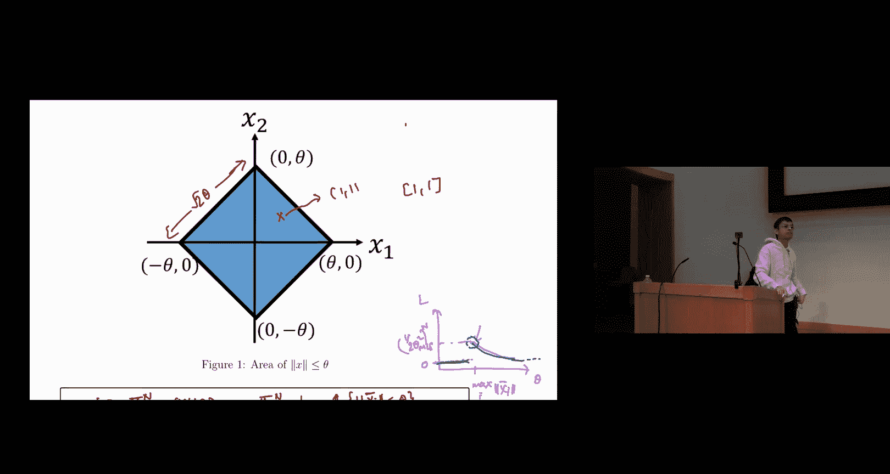

Goodby。

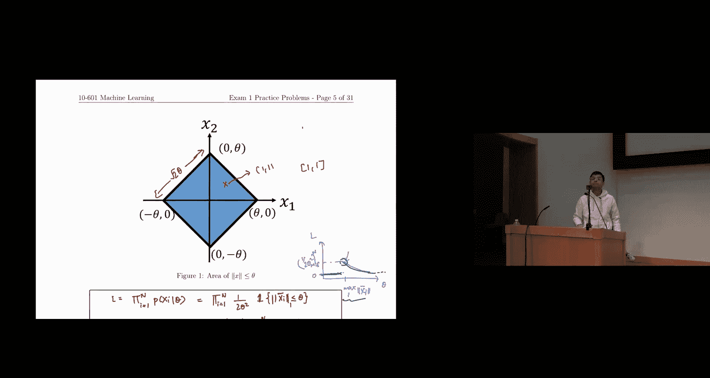

啊。Yes， yes， exactly。So the last question we're doing in this section is question three。

So it basically says we want to it is a similar question on maximum likelihood estimation so we want to model a one dimensional data set of n real valued features and targets and this is the equation we are like modeling it this way。

😊，And W is the unknown function， which we want to find out。And。

This is like the equation for the normal distribution and we need to find out if the maximum conditional。

negativeeg look likelihood estimate can be solved analytically if not you just need to give out like a gradient descent kind of。

😊，And you call it them to find out the maximum value estimate。

So I started again by writing the likelihood。 this will be。

Does this make sense why this is the likelihood I just put in the formula for normal and the normals mean is given as。

Exponion of Wxi。And the variance is one。And the simple since the samples are independent。

 I can write as multiplication of the probabilities。😊，And this is basically the likelihood， right？

For the examples。Any questions for this part？Okay， and we just convert it to the negative lock likelihood just for analytical purposes so。

😊，I didn as like negative local likelihood code， what I' will do is just take the minus log of this。

Right。So the multi of exponentials will be another exponential and then I can take the law of this。

As just simplified the equation of it multiplication of exponentials will translate to sum of。Yes。😊。

哦，两开始哦，OK。😊，Okay。So now basically we need to find out a w which maximizes this。And clearly。

The sum of exponential does not have a。Exponential like analytical solutions。

So this cannot be definitely yes。This final an example。

 how do we just I think writing like some of you cannot write some of exponentials as anything more than some of exponentials。

 So， for example。

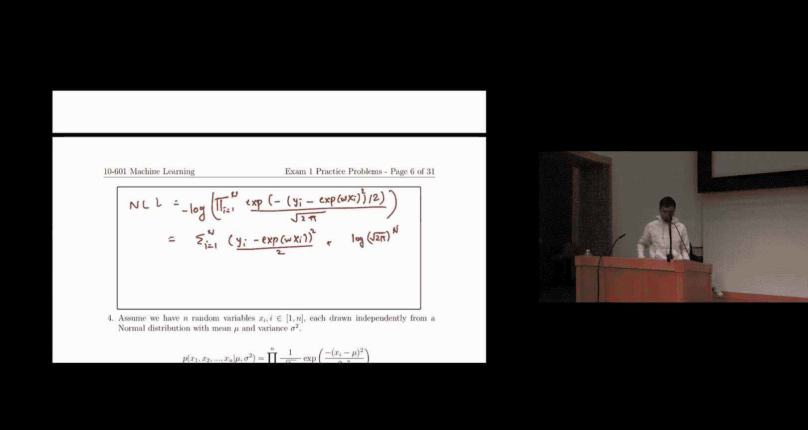

If I write it as like。A very simple example， E for x1。The C per x2 it。

This is a sum of explanations right， you cannot simplify this any further just to get like an analytical solution for this。

 right？😊，哦。Another example is like if it's。Epo x1 squared。so we don't need anything。Yeah， yeah。Yep。我。

Oh， its just like the multiplication terms as like n terms and the root 2 pi will always be multiplied。

 right？😊，So I'm just taking this log it translates it to a sum。

Whereas if this sum was a multiplication。Then， it will。Be like。

And then I can maximize this analytically。Because I can just maximize x1 plus x1 squared and not worry about the exponential。

But there are some you cannot really even if you differentiate it。

 you will find you will get something but you cant release solve the question。

And I think arguing it even in words is fine。Any other questions？Yes。😊，Yes。

 you can just take the power outage。Oh it is the power to the further to I can write this as this。

Yep。嗯，好的。No you want hear back my。Yes。哎。Yes。Yes， we need to minimize this function with respect to W。

Or did I have maximize before， I'm sorry for that。we need to maximize the local likelihood or the low likelihoodli。

 but we need to minimize the negative log likelihood it is the same thing。😊，Oh。

 I think that's that's like a that's the issue with the question， I'll just get it corrected。Okay。

 so all we need to do here is like then provide like a gradient decent update for this question。😊。

So I'll take the derivatives。麻烦你你。嗯。This is not I of an LL you can simplify it a little bit。

 but not that much the summ which shall be there。And。Then the update rule is basically。

Where it has a learning rate。Any questions on the solution for this question？

Illate another 30 seconds and let me think yes。Yes。You see this equation， right？This one。

 this is the NLL， right and this is a。Some of kind of exponentials。

 some of exponentials with different powers， right？嗯。

So that does not have like a compact mathematical solution。

 even if you differentiate you will find out yes， one second， sorry。Yeah。

 so even if you differentiate it。You will find out you cannot like solve the problem analytically。

 it does not give like a closed storm solution。But as I said earlier like aggregate terms in words is fine so as I explained here suppose the two functions as x1 and x words squared right so you cannot really solve this。

😊，Analytically， just try to maximize or minimize it with x1。

 you will find that it is like difficult to solve。😊，But if it is like in multiplication， for example。

 then you can just forget about the exponential and focus on this， right？😊，So yeah。

 this is basically a rough argument of saying that this cannot solve analytically。

They're like a it's the。Qus that can't be followed。关就是下。啊。

I think that is really discretion based and if youre like unsure about something you just the tax differentiated it。

😊，And。If you can write all the terms basically on the left hand side involving the parameter and。

And the terms which are not included the parameter on the right hand side and if you can actually get out the parameter equal to something。

 something which does not include the parameter。Then。

That probably is the meaning of solving analytically。I just don't know how I would go up song。

I don't know that。So yeah， so another way is like just differentiate the equation。

 just differentiate it， right？😊。

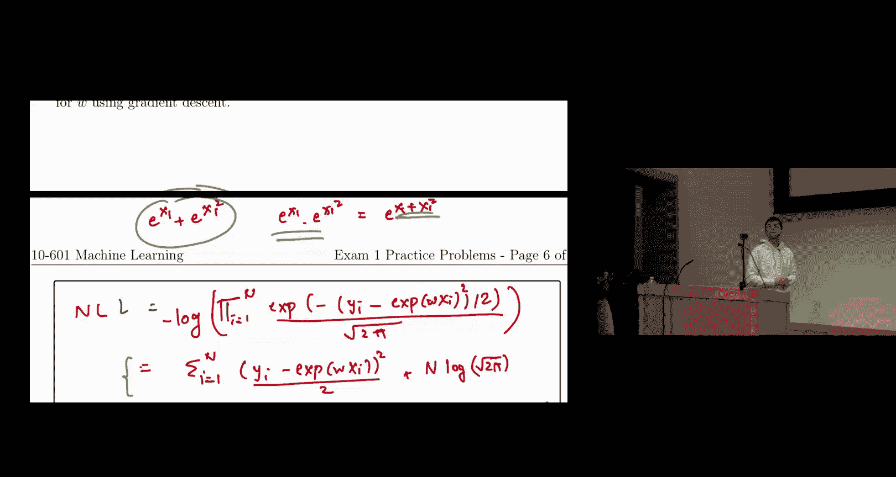

And differentiating equal to 0 right will will get something。

 something something equal to 0 right and。Suppose theta is the parameter you want to find out then if it if this equation you don't need any other information if this equation leads to theta equals to something。

 something， something and this something does not have3ta in it。😊。

Then this means an analytical solution can be found， otherwise you can just argue that is not there。

OhYes， there that question。Yep。D为块。A legal solution is。Which you can like。

Compute kind of instantaneously is that like it's like a function of theta so。For example。

X1 equal to。5。Is like an analytical solution， right， but x1。

Equal to 2 into e part x1 is not an analytical solution because the equation the x1 still occurs in the function of x1。

This is not analytical， this is analytical。Now it's like if something is known， for example。

 if theda is known， some there is some theta in the question， this is also analytical。

 but even this is not this is not analytical because axon is still occurring on the side of。😊。

function date。if you can write if you can still solve this， I don't think so though。

 but if you can still solve this and you can write it as x1 equal to something。

 something will does not include x1。😊，And only in the terms of known parameters。

 that means to solve it analytically。不是对。对的。Then you didn't really solve it， right， like because。

You can't really find out the value of x1 but it is still kind of analytical in x1 because there is no other Xon dependence。

😊，Okay， so now。We're going to be looking at。Nive bay and logistic regression。

So we'll look at for the naive base section。Question 3。3。

 which looks at the differences between a phase and logistic regression。

Just as some background before we go into that question。

 a little bit of review about what ninth phase is and what the goal is in this case。

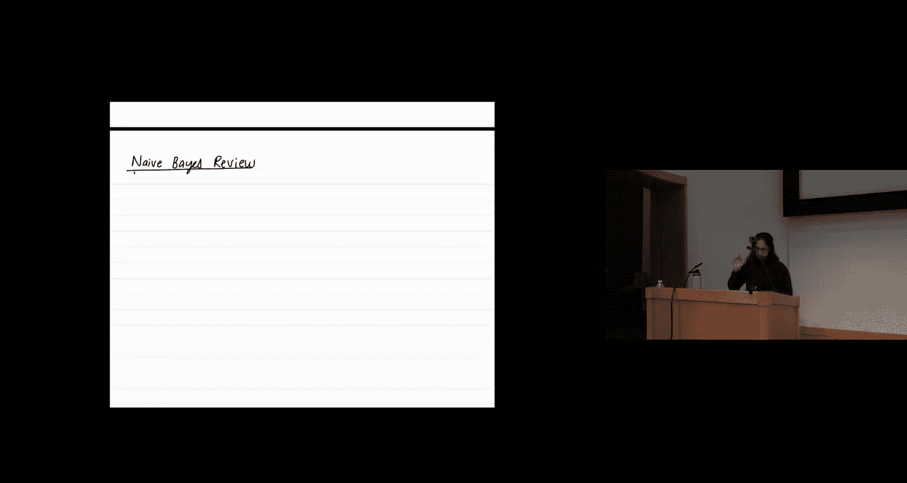

So。Remember that the goal of naive Bays is to predict。The value of some label y。

 which in this case is usually zero or1。Given。X is which is usually a vector of our feature。

 So this is。Probably like x1， x2。All the way up to XD， if we have D dimensions in our。Data set。

So if we're predicting the value y given x， you may expect that we want to be able to figure out some probability that looks like this y given x。

 right？But in the setup of naive Bay we say that we don't have access to this probability。

 so if we don't， then how else can we solve this to predict the value of the label given our features。

So what we can do is apply。Base rule。Which tells us that the probability of y given x is equal to the probability of x given y times the probability of y divided by the probability of x。

系い。And then we make one more simplifying assumption in this case and we say that the probability of x1。

 x2 all the way up to XD given y， so the probability of our features given our labels。Is equal to。

The product from i equals1 to D。Of X I given y。So all we're saying here is that the probability of some。

X， I。Givener the probability of some XI is conditionally independent of some other Xj given or label。

I won't write that， but。Does that make sense so far？Okay， so this is an assumption that we're making。

And given this， we can simplify further this expression up here。To get that the probability。

Of Y given x。Is equal to so instead of。This value here we're going to substitute in this expression that we get from the simplifying assumption to get。

 so we have the probability of y times this product from I equals1 to D of the probability of X I given y。

So that's the numerator from here， and then still dividing by the probability of x。

And sometimes we also say that we can。Ignore this like probability of x in the denominator and we can say that this is simply just proportional to the probability of y。

Times the product equals1 to D of probabilityability。Ex slide， given why。

So when we want to do prediction in the case of naive Base。

 now all that we're doing is saying that the label that we predict is the AG Max。

Over all the possible values of y of this expression， so the probability of why。

Times the product from i equals1 to D， probability of Xi given y。Does this make sense so far？

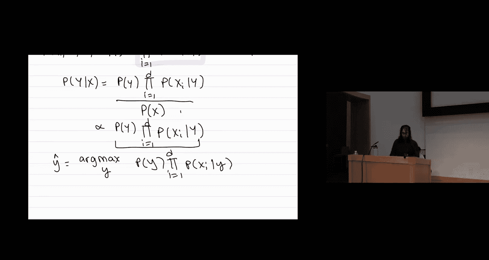

O。嗯。So this is naive Base in the case of logistic regression。What your stick。Russia。So in this case。

 we say that。Going back to what we were trying to figure out up here is this probability of y given x。

 we assume that we have some form of y given x that we think will happen so in this case we assume a functional form。

Of the probability of y given x。And we say that it looks like。This sigma of。Theta transpose X。

If y equals one。And then one minus this value。If y equals0。

So remember that the sigma is the sigmoid function。

And the sigma of x looks like1 over 1 plus e to the negative x。Right。So using this now we're able to。

 instead of trying to learn these probability of x and the probability。

 or instead of given the probability of x and the probability of x given our labels。

 trying to learn this function here， we directly try to learn the decision boundary and logistic regression。

 right？And we'll go into how we can do that。A little bit later。

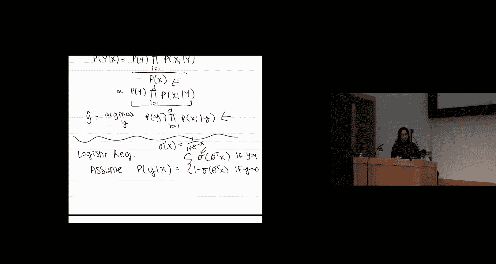

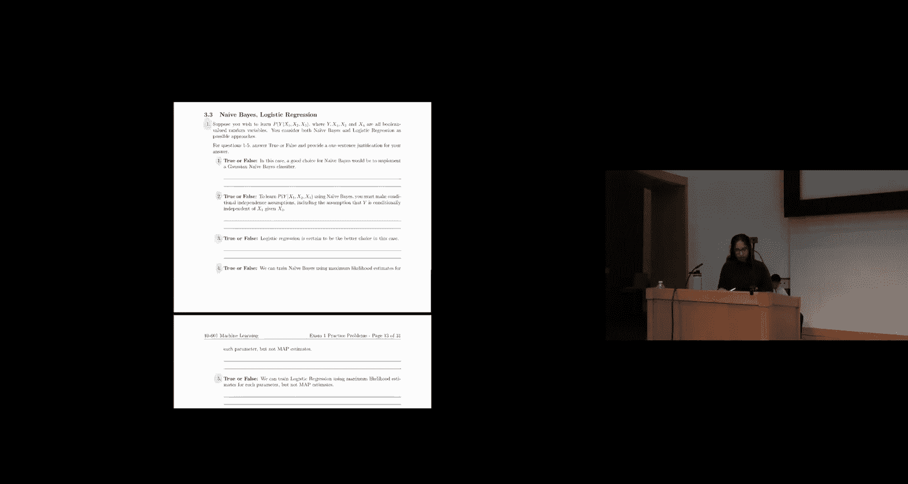

Any questions before we go into this one？Okay。So in this question。

 we say that we want to learn the probability of why。Given x1， x2 and x3。

 so in what I was writing before， the dimension of our data set3 here。

Where all of these parameters are boolean valued or random variables。

And we can say that we're going to consider either using naiveE Bayase or logistic regression to solve this problem。

So the first question asks。In this case， a good choice for naive Bayase would be to implement a Gausian naive Bayase classifier。

Does anyone know whether they think this is true or false and why？行。Yeah。

 so what he said is that in this case， we wouldn't want to use a Gaussian knife base classifier。

So this is the false part here because we usually use a Gaussian distribution to represent。

A variable that's real valued， so remember that we said our all our variables are boolean valued。

So instead， what we would want to eat。To do。It's just use something like the Bernoulolilip。嗯。不。

Going on to the next one we say。To learn the probability of Y given all of our features using naive B。

 you must make a conditional independence assumption。

 including the assumption that Y is conditionally independent of x1 given x2。Is this true or false？

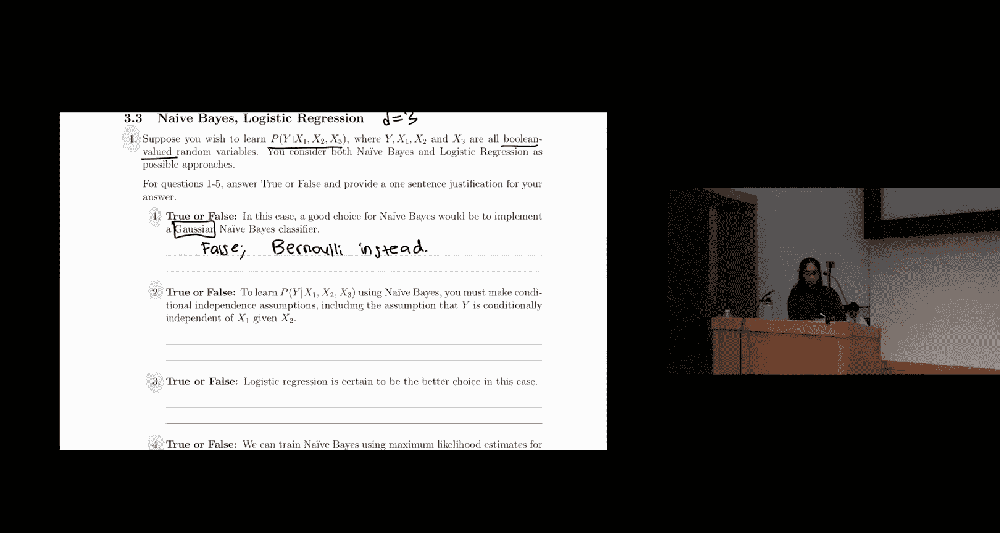

So this is saying that we need to make the assumption that。The probability or。

That y is conditionally independent of x1 given x2。Any ideas？Right， yeah。

 so this is not exactly what our conditional independence assumption is saying， so this one is false。

Like I mentioned before， what we assume here with the naive Bay assumption is that x1 is independent of x2。

 conditionally independent of x2 given or label Y， right？看。

The third one here says that logistic regression is certain to be a better choice in this case。

Does anyone have an idea of whether this is true or false？不。Okay， that's okay， so in this case。

 this is false。So。What we see in practice is that naive Bay does relatively well when the assumption that we're making so that。

X1 is conditionally independent given x or of x2 given y is true in practice。

 so if we make this assumption and it actually holds for the data that we're looking at naive B can be a pretty good classifier。

So it depends on。Oh。Whether。The naive phase assumption。Os。对。And depending on that。

 you may choose to pick an naive base rather than a logistic regression classifier。Co。

The fourth question here says that we can train naive bays using maximum likelihood for each parameter but not using map or maximum a posterior estimates。

Does anyone know or have an idea whether they think this is true or false？Okay。So once again。

 this is false。So remember， the only difference between a map estimate and an MLE estimate is that we include this prior term。

 right， so like the probability of theta if theta is our parameter。So this doesn't really impact。

Whether this is like Emily or map is a good estimate in this case。

 so adding this prior doesn't make much of a difference so either either one can be used in this case。

Cool。嗯。For the sake of time， I'll just skip to。Question six and seven now so now we're asked。

 how many parameters must you estimate for a Bernoulli naive based classifier？

Does anyone have any idea like just what some of the parameters may need to estimate are？Yeah。

 why excellent one。Cool yeah， so that's almost there so the only thing that we want to consider is that we have two different values of y。

So you're right that we want。The probability of y so we can just estimate the probability that y is equal to 1。

 and then we don't need to estimate the probability that y is equal to0 because this is just one minus。

The probability that y is equal to one right， so this is our first one。

Then we also need to estimate the probability。That Xi is equal to1， given that y is equal to zero。

And remember that the probability。That X I is equal to zero。

 given that y is equal to zero is just one minus this probability here right so we don't need to estimate that one either。

Right。And then the last thing that we need is the probability that Xi is equal to one。

 given that y is equal to zero。Oh sorry， that y is equal to one。

And then we can also get the probability that X is equal to zero， given that y is equal to one。

 by just taking one minus this value here。Right。So we need to estimate these two values。

For all of our values of y， so I is equal to either one， two， or three here。

So this gives us six parameters here plus the one parameter up here， so that's a total of seven。系。

Does anyone have any questions about this？

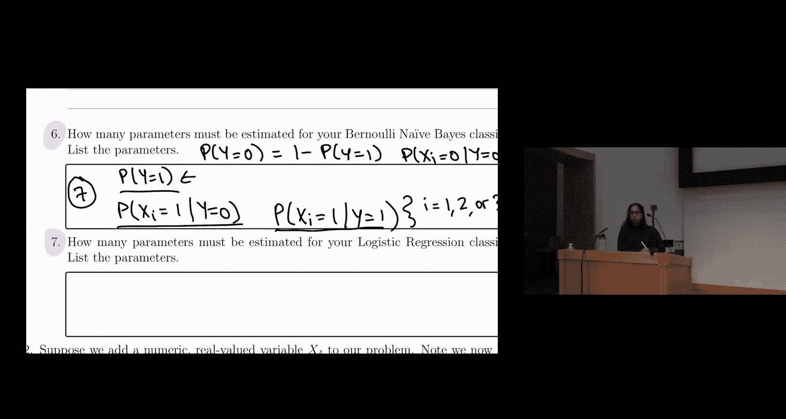

好。And then。In contrast， how many parameters must be estimated for a logistic regression classifier？

Yeah， so do you know what the four are？有嗯。That we have three time。Okay。Yeah。

 so in this case we're estimating weights， right so we have。The weights for first the bias。

And then we have weights for each of the values or each of the dimensions in our features right so that's a weight for x1。

 a weight for x2 and a weight for x3。So that gives us fork。Right。

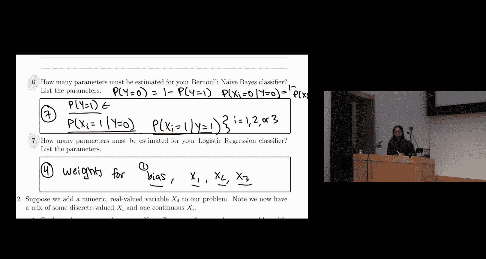

空。Okay。Now， we'll go to。Logistic regression。

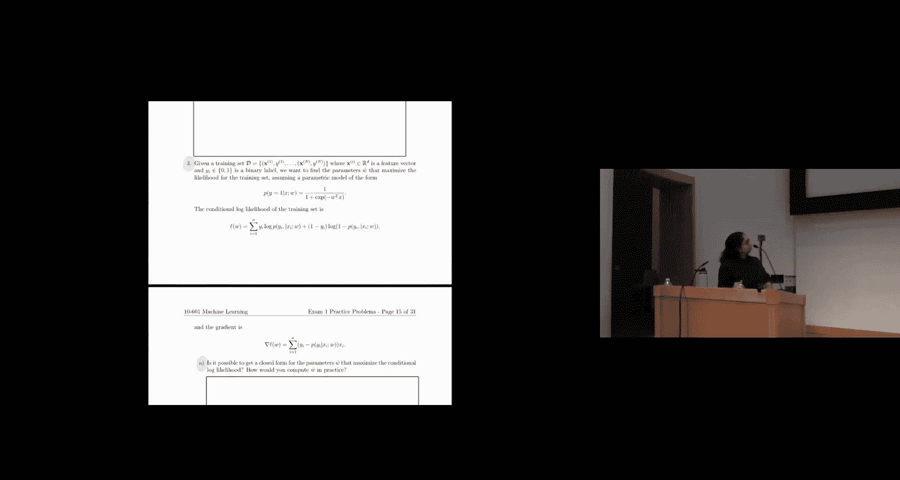

So let's first look at question number three。So we're given a training set。Is capital D。

 which includes。Tups。Should we have parenthees here tus of our features with a label？

Where our feature vector is in RD， which means it's the D dimensions。And our labels are binary。

 so either zero or one。So we want to find the parameters W hat that maximize the likelihood for the training set。

 assuming a parametric model of the form。That's written here。Right。

 so remember I said before in logistic regression， where you're assuming this form of the probability of y given x and also our parameters。

 and then we tried to find the maximum likelihood of our parameters given this。Okay。

So we also give you here in the question， the conditional log likelihood for this training data。

So that is equal to。This is a simplified form， but it's the sum over all of our samples of the value of the label times the log of the probability of that label given the features and the parameters。

Plus one minus the value of the label times the log of that one minus that same probability。O。

And then we also give you the gradient of this conditional log likelihood is equal to this expression here。

So given we have all this information， the first question asks。

 is it possible to get a closed form for the parameters W hat？

That maximize the conditional log likelihood and if so， or if not。

 how would you compute these values instead？Does anyone have yeah？Yeah。

 and can you explain a little bit why you think that's true？Yeah， right。

 so what was said is that in this case， in order to find a closed form for the parameters W hot。

We want to be able to simplify this expression set equal to zero to the form W hat equals something。

Great。In this case， that is not possible。So what we can do instead。

 does anyone have an idea of how we solve for parameters instead if we aren't able to find a closed form？

OhYeah。Cool， so instead。We will use。😔，Graian decent。

We can also use stochastic gradient descent or some other buried。Cool。

 so the next question asks for a binary logistic regression model。

 we predict y equals to one when this probability of y given our features is greater than or equal to one half and then contrastly we predict the label is equal to zero if this probability is less than a half。

So what we want to do here is show that this gives us a linear classifier so that logistic regression has a linear classifier in this case。

So I'll just go into how we can do this。So we start with what's given that the probability that y equals1。

 given x is greater than or equal to a half。This just plugging in for the functional form that we assume of this probability。

 this gives us one over one plus。E to the power of negative W transpose x。

 so that's just what this probability is equal to。Is it greater than or equal to12？

And then what we want to do is just simplify this expression so we can say multiplying or like cross multiplying we get that this is。

P。1 plus E to the power of negative W transpose x。Is less than or equal to two？

AndThen subtracting by one on both sides， we just have E to the power of negative w transpose x's less than or equal to 1。

We can take the natural log of both sides of this to just get that negative w transpose x less than or equal to zero。

All， because a natural log of one is just zero on the right。And then finally。

 multiplying by negative one， we say that w transpose x should be greater than or equal to zero。诶。

So saying that we predict the label one when this probability is greater than or equal to the half is the same thing as saying we predict the label one when the dot product of our weights with our features is greater than or equal to zero。

 and if this is not true we predict that the label is equal to zero。可以。

Does this make sense so now our decision boundary is just this line， W transpose x。

 which is why we have a linear classifier。any questions on this？嗯嗯。I'll just do one last part。

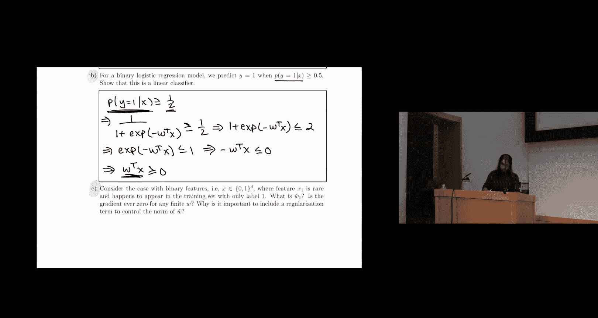

So what it says here is consider the case with binary features。

So each of the XI's is either zero or one for all of the dimensions where x1 is a very rare feature and it only happens to appear in our training set when the label for that like row in our data set or that sample is equal to one。

So in this case， what happens to the weight in that first index W1 hat？

Is this gradient ever zero for a finite？W and why is it important to include regularization based off the answers to the first part so let's just break up the bunch of questions that are asked here so first given we have this setting what do you think will be the value of W1 hat？

In this case。哦。 can you explain a little bit why you think that？Yeah， okay。

 so you're right in that what we're trying to do is maximize likelihood right and we're trying to figure out values of these parameters that maximize our likelihood。

So if we see in our training set that the label is always equal to one。

 when we have that x1 is equal to。啊。Yeah， when we have that x1 is equal to1。

We can give that weight an infinite value right and that will always maximize our likelihood yeah that y is one so like what we're saying here is that。

嗯。I guess。Like if we have our data set looking like this。

Whenever we see the value of x1 being non zero， so all of the columns that have this。

 the label is also one。If labeling applied is not possible it affects one material。We're saying。

The feature is where the feature X1 is rare and happens to appear in the training set。When。

With only the label one， so every。Value or every row in our data set where we have x1。

 the value or the label is one in that case。Does that box is not mean。Yeah， why， why can。B0。

 but not when we have x1 equal to1。I mean， this seems like it't make the train either ex so how can those them always have to be。

We're saying that in this case， what we're saying is that the probability that the label is equal to1。

 given that x1 is equal to 1 is one。So this is always true。Does it mean that both text and？Yes是。

X1 yeah， X1 appearing in this training set is we're saying that it has a value of one。

 and that tells us that our label is also equal to。Okay。2。Okay， so if we have this setup。

 basically we're saying that whenever we see x1 being equal to one。

We know for sure that our label is equal to one。Right。Because of the assumption that we just made。

So in this case， if we're trying to maximize likelihood。

 we can set the weight that corresponds to x1 to be as large as possible right if we set this weight to be equal to infinity。

 our probability is going to be very large。Does that make sense？Okay。

 so that tells us this part of what the value W1 hat is。And then what is asked is。

Is the gradient ever equal to zero for a finite value of w so in this case no we can continue to move towards a like more maximum value of our likelihood by continuing to increase this weight until it reaches infinity。

没有。And then the final thing is， why is it important to include a regularization term to control the norm of WH？

So in this case， this will not generalize well right because we're making this very strong assumption about our data set we're saying that when x1 is equal to one。

 we'd know for sure that y is equal to one in general maybe if we have more data or if we just look at a different data set this may not be true right so having this perimeter w1 equal to infinity is saying even if I look at another data set and I see that x1 is equal to1 I'm just going to predict y is equal to one which may not be true right so the generalization of this。

Is very low。So when this happens， we include regularization to control the norm of our weights。

 so to control like the values that these WI's have。Right。So in this case， we would like add。

To our loss function， a term that looks like maybe。The L2 norm of our weights。

 which says that if our weights get bigger， our loss is also going to be bigger。

 which is not a good thing right when we're trying to minimize the value of our loss。

Does this make sense？Yeah。你没说一下。The second like this part。Yeah。😊，So in this case， what we're saying。

 you understand why this W1 would would be equal to infinity， right， w1。Yeah。

 so what we're saying here is that whenever we see x1 equal to one in our data set。

We know that the label is one。Right， so if we're trying to look at。For a new data point。

 say we got a new data point that wasn't in our training set。Which looks like101。

 and we're trying to predict the label of this， right？What our weights tell us is。

Which values should we look at most to predict the label Y， right？ So this W1 says。

If this value is large， this x1 value in our new sample is。

Going to impact the label that we pick a lot。Does that make sense versus if W1 is very small？

The value x1 is equal to1 here is not going to impact our label a lot。哎。

So if we're saying that when x1 is equal to 1， we know for sure that our label is equal to one。

We can just set this。Pimeter in our weight vector equal to infinity right and that tells us when we see x1 equal to one。

 we can just for sure predict that y is equal to one because we know that that's。

True in our data training data set。

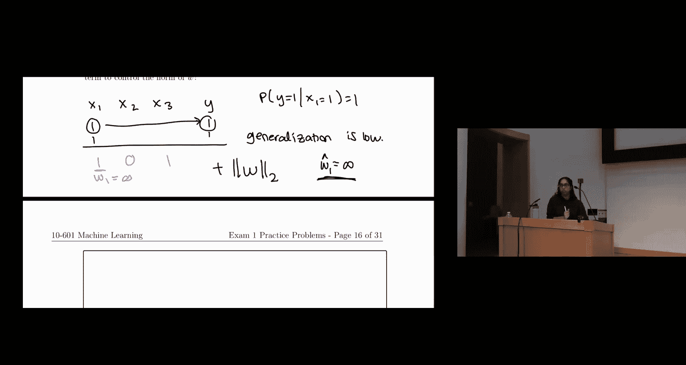

Does that make sense？Cool。Yeah、それすです。

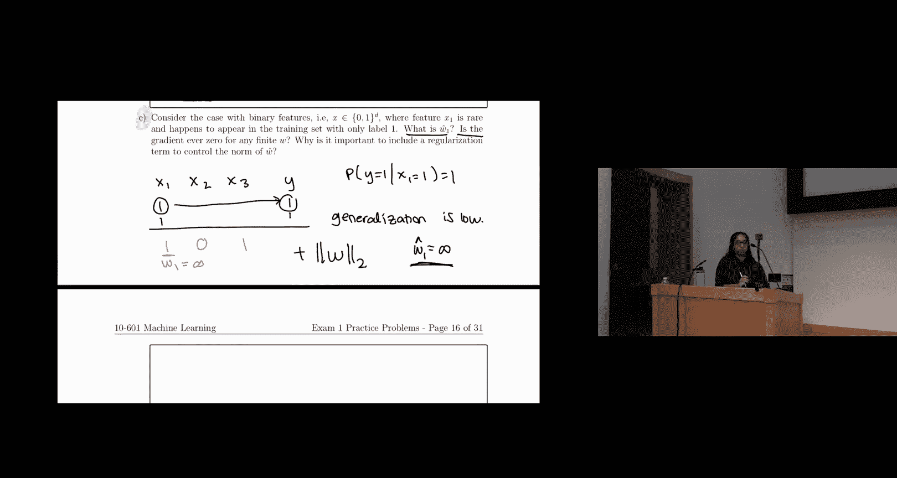

If this value is always zero yeah。So if the label is or if the feature is always zero。嗯。

I will get back to you on that， I don't want to tell you the wrong thing。

Any other questions does the gradient of？Yeah嗯。

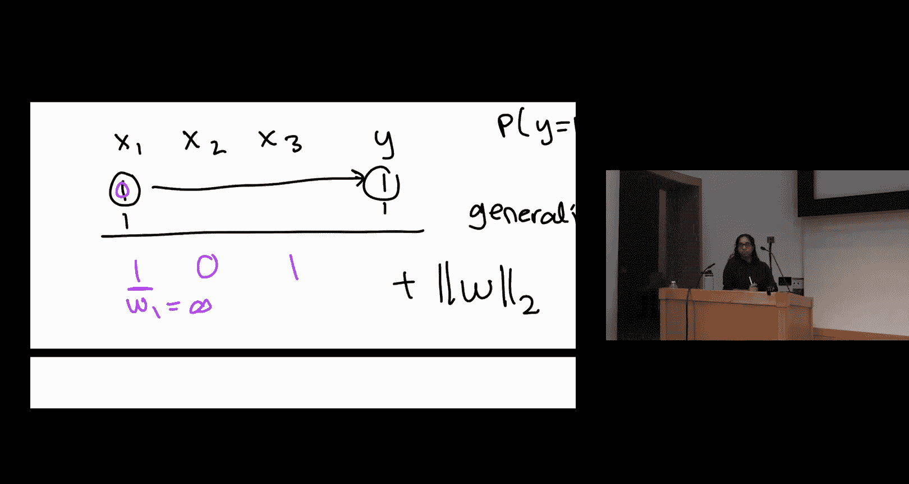

Okay， maybe we can do like the first one together。You have to identify which one of these is like an activation function。

 loss function optimizer， or like a layer in the neural network。So cross entropy is。

Does anybody know the answer？Loss that， yes。耶路。It's like a variant of yellow， sorry activation， yes。

 linear is。哎有。Me， absolutely error， sorry。Los al right means square error is also loss realo is also an activation function Sigma is also activation softm is a kind of。

So。Softmax also kind of layer， I think we've covered that in lecture to castastic degree incent。

 does anybody want？Think about what that could be exactly。It's one of the optimized strategies， dage。

I think we've covered this in lecture， it's a pretty popular activation function， okay？So yeah。

 that's that， yeah。The difference between player。Layer， we mean like a layer in the neural network。

 like a linear layer， because activation is like a function that you apply on the outputs of the layer。

😊，But can you have a same one。Sigmoid is the activation function because it's like it applied piecewise。

 right it applied element wise on the outputs， does that make sense？It is a bit fuzzy， I agree。

 it is it could be a bit like confusing。😊，I actually。

 let me get back to you on that because we have it down as， yeah。

 because I think that should also apply， so let me get back to you on that。Yeah。Could be， yeah。Yeah。

 that's sort， yeah， that's I was like a bit algabactery on softftmax， all？😊，嗯。Yeah。

 if there's like an update in the solution， then I'll update on Piazza in a post。Okay。

So this is a simple neural network， okay， it might look a bit confusing but like this is。谢跟。

This is the first layer all right， so this term sort of depicts the bias term corresponding to like this。

 so we have basically one input。And then our like hidden layer is going to convert that into like。

Two nodes and this is the bias term corresponding to these and like soil， this is the output。

Is that clear to everyone？Okay， so now the first question says for x1 equal to 0。3。

 compute z3 in terms of E。嗯。Does anybody want to think about how you can do that？

You don're not going to actually give you the number， but like maybe describe how you can do it。He。

 you basically just need these equations all right， so you just plug in the value of x1。

 which is so let's look at Z3。Z3 is like compute in terms of a3 and if you even look at this entire sort of graph here。

 then this Z3 is like a function basically of input X1 and the rest of the weight so you just have to sort of plug in all of your values Okay and so if you plug in all of your values you get。

Look at this， you get a3 is equal to minus0s。You get a3 is equal to 0。15。

So then z3 is a sigmoid of that， which is equal to 1。1 plus e power minus 0。15。Okay， so given this。

 this is basically all the information you need to make a prediction for the output for the input 0。

3 so you guys want to work on this for a bit and try to figure it out。Ins2。

We basically need to check if Z3 is greater than r or not。

So we need to compare this term with one by two。So the way to do it is basically if you calculate it out。

E power minus 0。15 happens to be less than one and I won't do this right now。

 but you can prove that it's less than one without actually putting into a calculator。So yeah。

 so because it is less than one that means that this entire the denominator becomes less than one so because it sorry the denominator becomes less than one plus something less than one so the denominator is less than two which means the entire term is greater than half does that make sense can anybody get confused there。

Okay， so yeah， so the prediction is going to be one over here。

Now we want to perform back propagation， we basically want to express this term Dellll by dell B21 in terms of like a series of partial derivatives the way we did in class。

So the way we go about that is let's go。

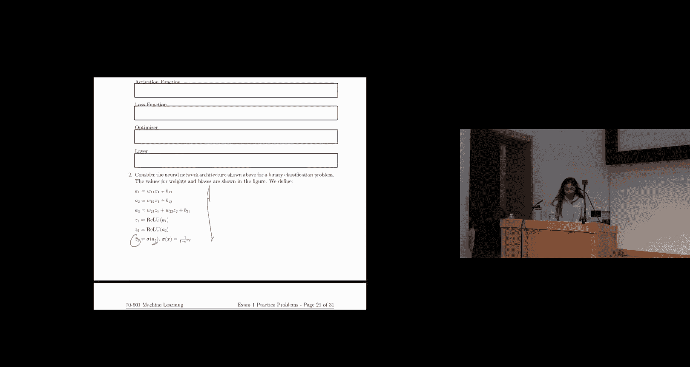

Over here， hell， here。Don then right then we do one。

So let's look at which of these equations the V21 term appears in， so that is this A3 term right。

 so we can use the chain rule and write it like this。A three times de by sorry， not。Dell a3 by Dell。

Be the one， okay。Is this application of change rule fair to everyone？I see some confused faces。

Does this make sense？不。Okay。So now we basically you sort of just do this thing recursively you keep trying to break down the first term so now let's try to break down the first term further so we can see that a3 is sort of a function of Z3。

So then let's just write it here， so this term is LA3 by LV21。So then we know that we have Z3 here。

Os。Dell a3， now we look at Z3 Z3 is sort of。嗯。We觉得。😔，I think that's it actually yeah。

 you can't sort of you can't because Z3 sort of are output， so yeah that's it we can't。

We can't break down Dl by Lz3 further， so that's the answer。That makes sense。Okay。

 so now for the next part， we want you to calculate。

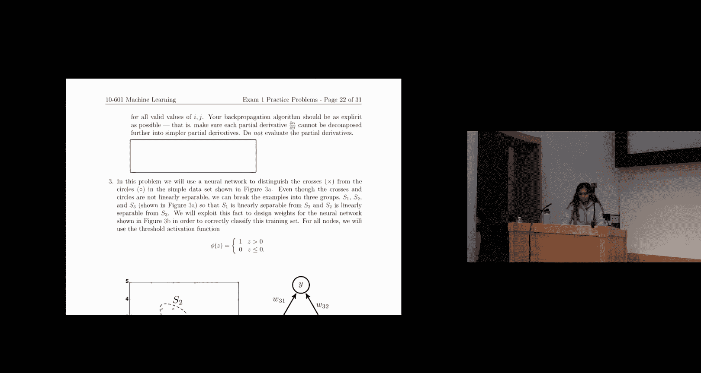

Dellll by dell B1 B12， so can someone give me the answer for that like just follow the similar procedure that we did。

I it out here。You need to just basically use these equations。嗯。Anybody wants to give this a shot？

Okay， I just going to get into it。So the answer is del by L z 3 times del z 3 by del a3。

Right similar to what we had done in the previous part。

Let me just write this out where you basically need to just think consecutively apply the chain rules so then you're going to get to z2 you're going to get get get to a2 and then you're going to get to B1 two okay just quickly writing this out in the interest of time does anyone does everyone understand what I mean like in this shorthand form which is basically I like expand out of the chain rule。

Okay。嗯。Yeah。Let's move on。

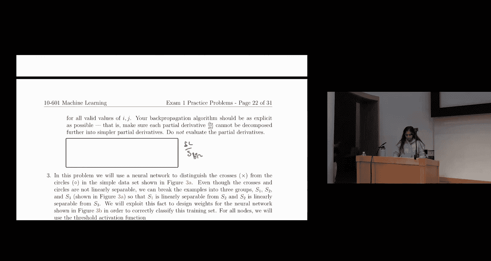

For this one in the interest of time， I'll just do kind of the first sub part。嗯。So the first apart。

 Okay， so we basically have like。The whole theme of this problem is that we have a set of points that is described here。

 we can kind of visually separate them into S1 and S2 and S3， S1 and S3 out of the same class。

And we sort of want to show that with this architecture， neural network architecture over here。

You can find weight such that you will be able to like sort of split these points yeah that's it basically。

嗯。So yeah， so let's just I'm just going to go over the first sub so。

Forfigud4 real lets first draw a linear decision boundary that separates S 2 and S 3。

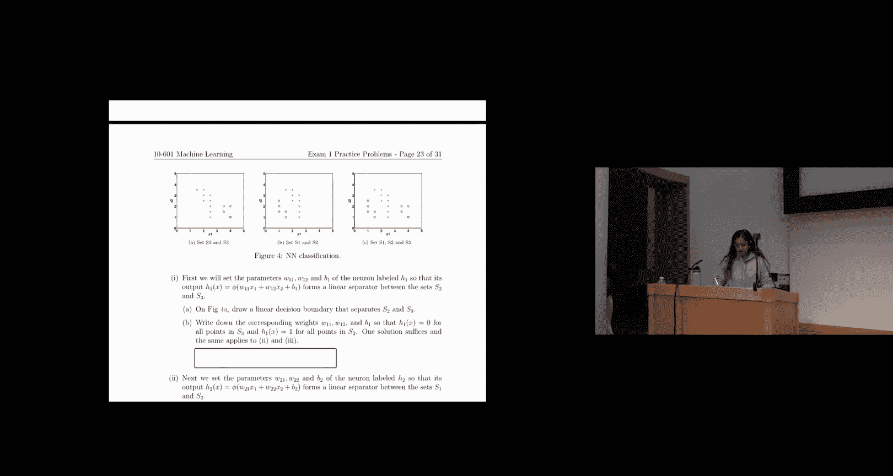

So just to make because we want to write out the equation for later， just to make our life easier。

 I'm going to draw it like this。so that's basically x1 equal to 3。

So you guys like figure out what would be so we basically want to this is sort of our equation of the line。

So given that we have this green line， what would the equation of the line be for this green line over here。

 this green line？What would the W1 W2 and B1 be？Sorry， w 11， w12101b。

So if you're getting confused like。And sort of this is unusual。You know space， this is the X1 axis。

This is the X2 axis。If that helps you visualize it， I basically try to plot out this line。

The creation of this line。As you know， some sort of w1，1， x1 plus w 1，2 x2 plus b1 equal to zero。

So yeah。W one one one。啊几个。Right， okay， so that is one way to look at it。But。

So I'm glad that you actually said that because you can also write it as this， right？

I everyone agree with that so why do you do it as like so the actual answer we're looking for is this that was bad but you can we're looking for the lower one and not the upper one so that's because。

😊，When we do h one of x， we basically want to plug in the values。You know。

 if you plug in the point into the equation of this line。

The label should match the sign that we want， so basically this sigmoid of z sign whatever this theta of z this is phi sorry phi of z。

 we're going to say that we're predicting one if z is greater than0 and0 of z is less than equal to0。

So what you need to do is， I think we've like。Given here that which one of these can response to label actually for but one of these is actually label zero and one of them it label one like for now let's just assume it's like this。

So yes， the equation of the line is correct， but also be cognizant of the signs of the line that you plug in because like when you plug in those values and then we're going to take the five function on it。

 we want to make sure that the label we predict is correct。

 corresponding to whatever zero or one of the classes all right。

So that's just one thing to watch out for， okay？Attle bit of short on time。 So I'll just。

Skip ahead for this question sort of it's basically exactly the same thing that we have done writing out the chain rule right to calculate this term it's also easy to think about the question also by just looking at the graph。

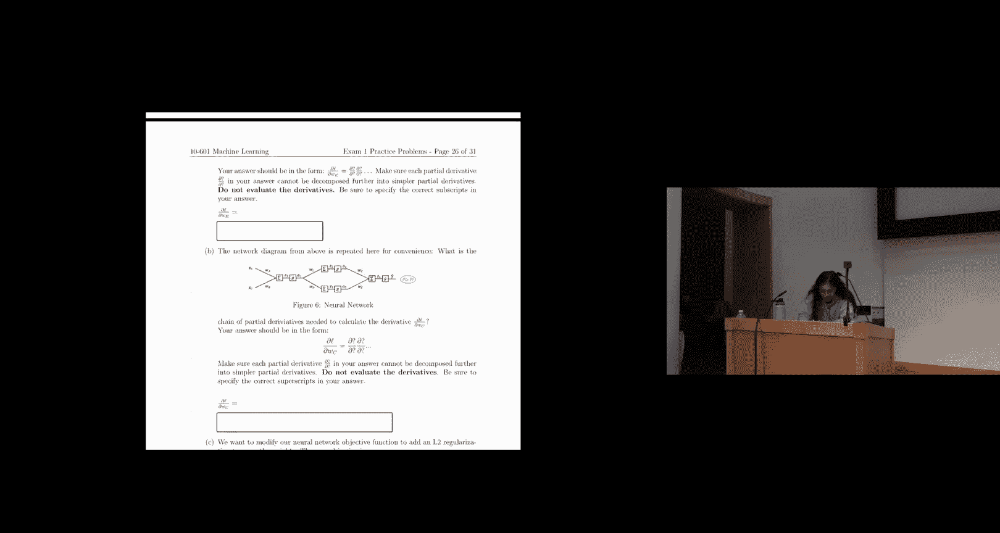

So if you just look in WC， you can just consider that okay， you know。

 you're going to have to write it in terms of why had Z4 WE right so that's the way you sort of expand out the chain rule。

Okay。Now let's go to learning theory， I'm going to go over the VC dimension question does anybody remember what we covered in lecture。

 let's look at this question。Just get anybody done me what the answer for the first sub part is kind or cannot？

They can' share。なほ的。Yeah， good， that is it。So I just want to sort of like clarify one thing over here。

Can shatter subset means that you need to find one specific sort of like suppose we have like a 2D space and give like we're saying like a set of three points d equal to three。

 right？Shattering means that some said means like。Where the points are positioned is fixed but for every possible labeling of these points you can find a subator okay so you need to some set means some fixed positioning but you need to make sure that for all possible labelings that should be ableish out。

Is that clear？All right， so let's consider this hypothesis function。

 I believe this was also a poll question and lecture， but let's just go over here。😊，Briefly。

 just justify why the VC dimension of H is less than three so you basically just need to show that H cannot shatter。

Any set of three points， okay？And we are considering sort of like one dimensional value。

 so youre basically considering points on like one dimensional line。

So a separateator is basically a positive interval。So that means that we're going to choose。

We can choose whichever interval we want going from A to B。

And we're going to say that everything inside the interval is positive。

And everything outside is negative。So it should be pretty obvious now that suppose you have。

Poins three points in a line like this and you label them so that's so that's the thing where VC dimension right is like you should be considering。

A fixed positioning of the points， but it should。Be able to shatter basically every single labeling of them so let's if we can find one labeling of the points which this hypothesis is not able to shatter then the VC dimension cannot be three okay so if you if you basically put these class labels then I won't be able to shatter it。

Does that make sense？Okay， so what's the V dimension of age if you actually do it？

Turns out to be two。And I think we're out of time， but basically you have to sort of you have to think a bit about this part sea。

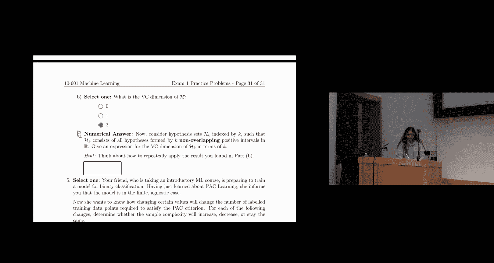

But basically， sort of by induction， you can prove that if you consider just one interval。

 then you know the VC dimension was two。So like we can the sort of place intervals sort of at whatever quite we want。

 at whatever areas we want for a certain ordering of points。

 and we can create whatever labeling we want up to two k points， right？

And then for the 2 k plus18 thing， you can prove that for any2 k plus12 k plus1 points that are arranged on a line。

For like a certain labeling of them like similar to the way we identify like a labeling for this three for certain labeling of them you will not be able to position the k interval such that you get able to like shater it all right say that's it for thank you。

😊。

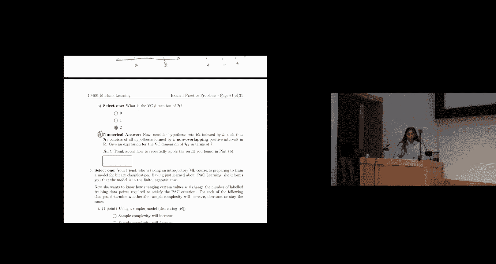