# CMU《机器学习导论｜Fall 2023 10-301⧸601 Introduction to Machine Learning》中英字幕（deepseek p30 Recitation_8_Reinforcement_Learning.zh_en -BV1Z2cUefE4A_p30-

on reinforcement learning。So we're just going to start with some definitions and background to get us all on the same page。

 so the first concept that we're going to talk about is a Markov decision process。

So we define a Markov decision process。Can you not hear me？啊。Hello， okay。

 so we define a Markov decision process as a tuple or a six tuple that we write like this。

So we'll just go through what each of these elements mean。

 so the first element in the tuL is capital S， which is our set of states。

 so this will look something like S zero S1 S2。For all the states that we have in this game。

The second element is capital A， which is the set of actions， so this will look something like a0。

 A1， A2 for how many ever actions we have in this game。The third element is this function T。

 which we call the transition function， so this function T takes in。A first element。

 which is a state。Second element， which is an action， we'll just call it A1 and a third element。

 which is a state as well。And it gives us back some value between0 and1。

 representing if we're starting in state S1 and taking action A1。

 what is the probability that we will end up in state S2 so this is some probability that is in the range0 to1。

はい。The next thing that we have is a reward function。

 so this function similarly takes in a state S1 an action A1 and a state S2 and gives us back some real number reward which represents starting in state S1 and taking action A1。

 what is the reward we get if we end up in state S2。系。

And then the last two that we have is this gamma， which is a discount factor that we'll use in calculations later on。

 as well as the state S0 which we start our game， so this will be an element of our set of states as。

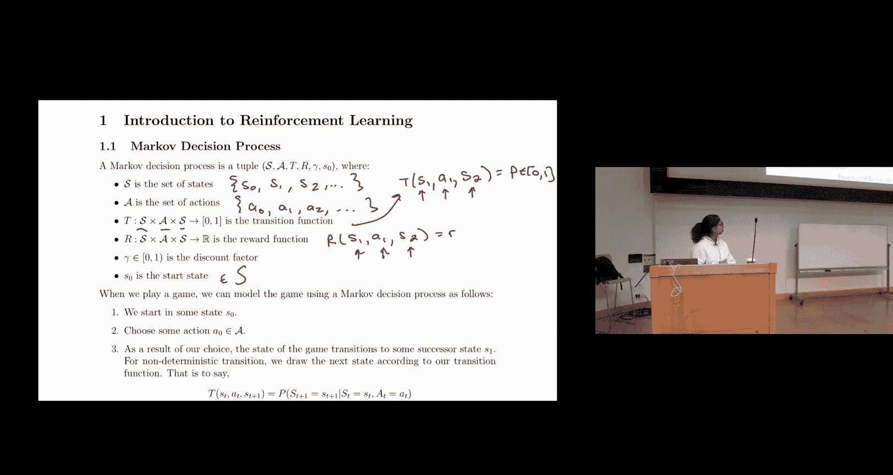

Do these definitions make sense so far？Co。Okay， so now we can go on to talk about how we play this game and how we can model it using a Markov decision process so like I mentioned we're going to start in some state S0 which is an element of our set of states and the first thing that we're going to do is choose our first action which we'll call a zero so this will be from our set of actions。

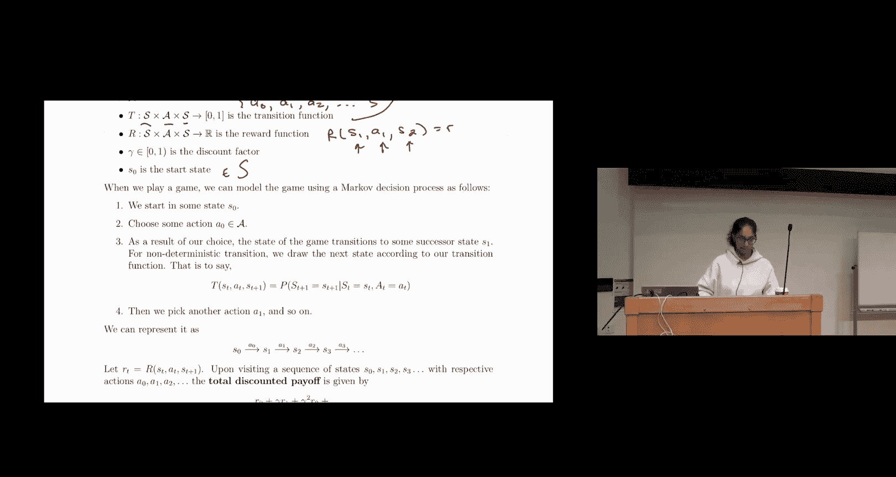

So like I mentioned before， so let's say we're starting in stay at zero and we're taking action A zero。

So in general there's two kinds of transition functions。

 so either a transition function can be deterministic。

 which means starting in state S0 and taking action A0。

 we will always end up in just one state S1 there's no chance about that。

This is if our transition function is deterministic， if our transition function。

 like it says here is non deterministic。That means that starting in state at zero and taking action a0。

 there are several states that we could end up in and then in that case like I mentioned before。

 our transition function defines the probability that we end up in each of those possible states so in that case we may have。

Something that looks like this。Where maybe the probability of going from S0 to S1 is like 0。

8 and the probability of going from S0 to S2 is something like 0。2。Okay。Oh。

So once we end up in our first state S1， we just continue this process we'll pick another action to move to another state and just continue as long as we want to play this game。

The next thing that we talked about before was the value of this reward。

 so remember we have that the function R from S taking action A and ending up in ST plus 1 gives us some real value。

 R subt， which is the reward of taking that step。So we can calculate the total discounted payoff or the total reward for taking several steps as this value here。

 so if we have some as zero or I'll just write it here， if we have this first step here。

 the reward of this would be R0。We take our second step， we add the reward of that step。

Multiply by the discount factor。For the second step or for the third step。

 we add the reward of that step。Times the discount factor squared and continue multiplying by another factor of this discount product every time we take another step。

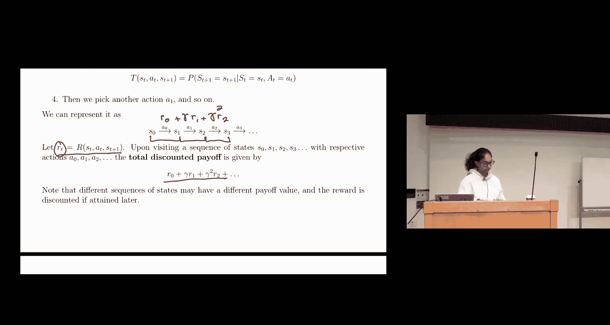

哦。So the next thing that we're going to talk about are policy functions。

 so a policy function which we call pi takes in a state S and gives us an action A and tells us when we're playing this game and say we're using the policy function pi if we're in state S what is the action that we should take right so this kind of tells us or makes the decision for us of which action we should take in every state in our game。

So the optimal policy function pi star is the function that will give us the largest payoff that we calculated before。

系。So we can compute the value function。V of a certain policy function。

 in this case we're doing it for the optimal policy pi star。As this expression here。Right。

So what this is telling us is the expected discounted total payoff of starting in some status。

Right says here the best possible expected total payoff that we can get under any any policy rate。

 so in general just v of s for some policy tells us the total discounted payoff that we can get starting in state S。

And if we're doing that for the best policy， this is the best total payoff that we could get。

Does this make sense？一狗。And we can calculate so we can write this as v of pi star of s just to shorten this。

 we'll write this as v star of S， we can write this using the Belllman equations。

 which tells us that we can calculate v star of S as this formula here right so basically what we're doing is taking the maximum over all of the possible actions that we can take starting in some state s。

And calculating some kind of like expected value rate。

 we sum over all of the possible states that we could end up in。

 So any other state S prime in our set of states。And then the expression inside the sum is the probability that we end up in that state S prime。

 given that we're in state S and take action A。Times the reward of doing so and then recursing so like adding this expression of the discount factor times this same V star for the state that we end up。

So you can see how this looks like an expected value right we're summing over all of our possible values and inside the sum we have a probability times the value of that。

Probability。So in general， what this V function is telling us is how valuable is it for us to be in this state S？

And then we just make one simplifying assumption so in the case that we have a deterministic transition function。

 we can just write our reward as R of S and a right because。If we're in state S and taking action A。

 we will always end up in this state S prime if our function is deterministic。

 so we can just drop that S prime parameter。And then in this case， we can write V star。

As the maximum over all of the actions of the reward of being in that state and taking that action。

 plus the discount factor times recursing on this expected value for the state that we end up in SP。

Yeah， so like I said before， the intuitive interpretation of this V function is how valuable is it to be in our current state S。

 so this V star of S。

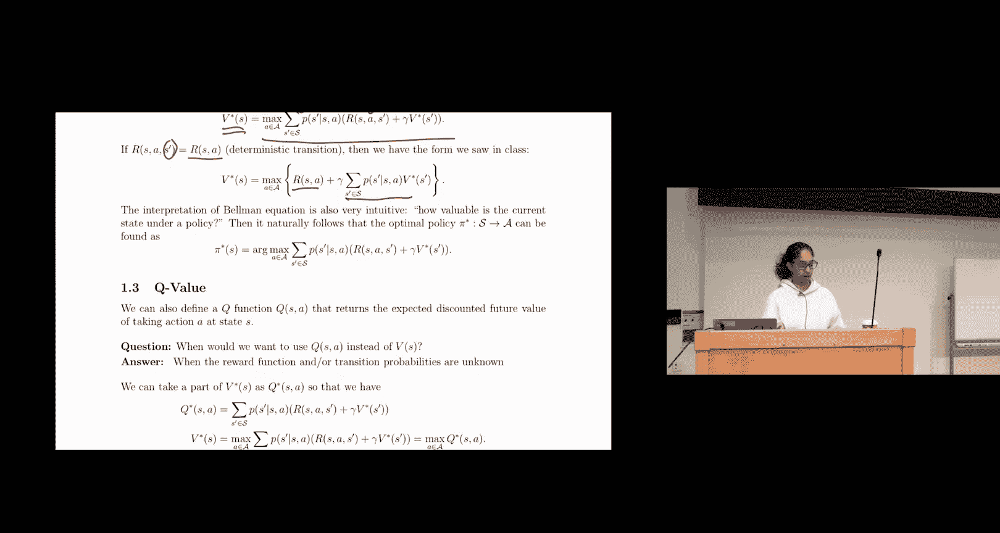

Tells us how valuable is the current state under some policy right so in this case the policy is pi star the optimal policy。

So then naturally we can also compute the optimal policy if we have this v star function by simply taking the arg max over all of the actions instead of the maximum which we use to calculate V star。

And then the final thing that we'll talk about is this Q function。

 so Q is a function that takes in a state S and an action A and returns the expected discounted future value of taking action A at state S。

 right？So remember that we said that V of S is how valuable is it to be in our current state under some policy？

Q of S and A tells us。How valuable。Is taking action A from status。Yeah。So these seem very similar。

 but there is like a slight difference between what we use Q for and what we use the function V for so in general we will use the function Q if we have a reward or a transition function that is unknownnote。

Okay， so that's what this says here。But the concepts are very similar so we can calculate kind of Q in terms or v in terms of Q so we'll define Q star of S and a。

 which will give us how valuable is it to take action A if we're in state S as the sum over all of the possible states that we could end up in。

Of the probability of ending up in that state， if we're starting in state X and taking some action times the reward of taking that step and then recursing so adding a discount factor times the same value for the state that we end up in。

系。So just remembering。Our equation for v star of S before。

 this is the expression that we had so we see now that we can kind of plug in the expression that we have for Q star into this to say that just V star is equal to the max over all of the actions that we have of Q star of S company。

Right。And this makes sense because remember what Q star is saying。

 it is how valuable is it to take action A if were in state S。

 if we take the maximum over all of the possible actions that we can compute this value for。

 we are calculating how valuable is it to be in state S， which is exactly what V tells us。哎。

And then the last thing that we computed above was the optimal policy。

 so we had this expression here。And we can similarly write this expression in terms of Q star as just the arc max over all of our actions of the expression Q star that takes in the state we're in S and the action A。

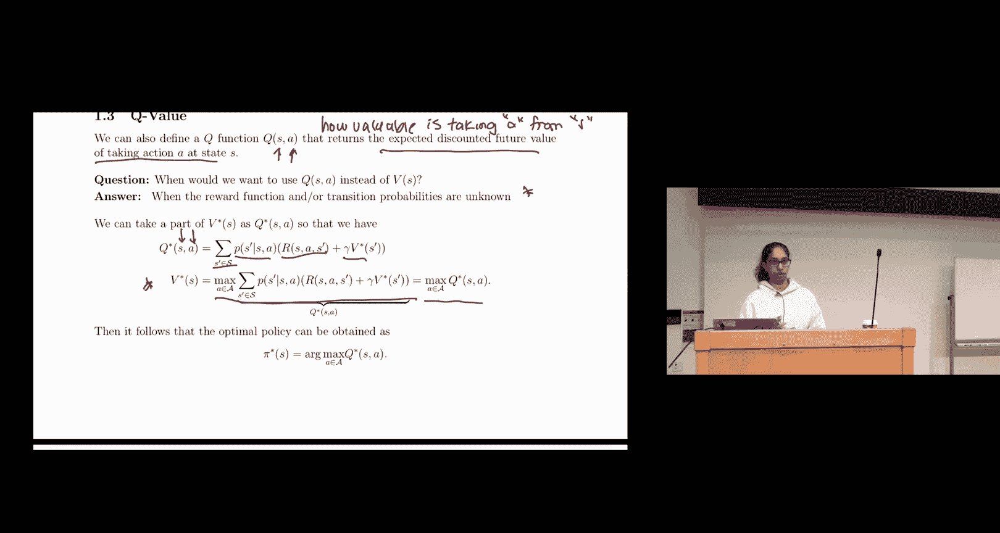

helello。Okay， let's go over an example of value aration now。

So let's look at this Melour optimality equation again。

So just to recap what it does is it looks at all possible actions and then this part is basically the Q value。

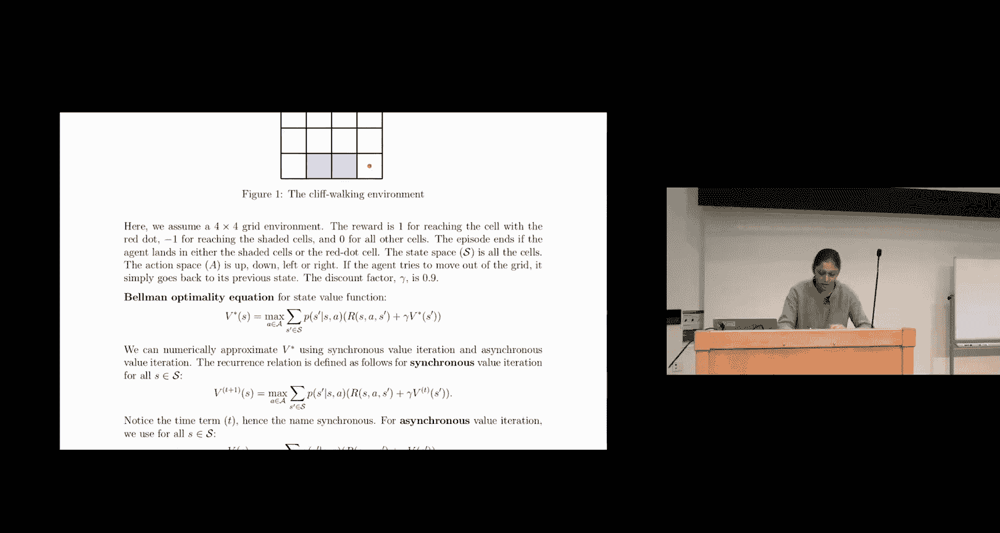

So we look at all possible states that you can end up in。

 we multiplied by the probability that youll end up。In state S dash。

 when you take action A from state S。Times the reward of doing that plus the gamma factors times v star of S dash S dash being the state you'll end up in so let's actually look at the difference between synchronous and asynchronous value okay。

So if you look at these two formulas， the main difference is this superscript over here。

 which is not present over here， okay？So。In value iteration what you're going to do is you're going to go over all the states and you're going to apply this equation one by one on each of the states and keep updating it right so you basically need to keep some kind of track of your values right and use your old values to update your new values so in synchronous value iteration what you do is you basically sort of make it very distinct which iteration you're present in。

And when you're updating suppose you're doing a t plus1 at iteration。

 then you have to use the values that you calculated in the T iteration right so you have to sort of maintain that separation between the separate different iterations。

But if you're doing asynchronous value iteration， then you sort of don't really have a concept of like previous and next iteration you still do visit all the states in different in each iteration you like visit states one by one and apply the equation。

 but you don't sort of maintain a sense of which was the last value and which is the current value so in this time in this formula V of S dash is going to be the last updated value which may or may not have been in the current iteration okay。

Any questions？So probably this formula will become a bit more clear through an example。

So let's get into the example。😊，唔事。So this is sort of we imagine that we have sort of this grade world over here for Gr4 grade。

 we have three terminal states。This one with the red dot and these two shaded states now what the problem setup says is that if you take an action which makes you end up in one of these terminal states。

 suppose you end up in the red state。呃。Like this， if you take an backtracking。

The setup is that from each of these cells， you can take four actions up。

left down and right okay and then suppose if you're in some boundary cell and then you take an action which would take you out of the board you'll end up in the same cell Okay so that's how the actions are and then if you take an action which puts you in one of the terminal states then you get a reward otherwise the reward is zero for every other action so if you enter the red the red dot state then you get a reward of plus one Okay this there's only one way you can enter the red dot state right is that clear why。

Okay， and to enter the shadeds， if you enter the shaded states， then you we going to a water minus1。

 so there are three ways in which you can enter it。

So if you take any one of like these actions and end up in these states。

 then you're going to get these rewards， otherwise there's no reward。Okay。Good。

 let's get into an example。This only has the answers， but。Let's try to calculate them ourselves。So。

Imagine that imagine that sort of these two grades are empty okay and we want to use this to calculate for these two grades okay。

 so let's get into that。😊，We write in pink so that okay for the what we do is first we look at the terminal states。

 so for the terminal states you don't really take any action so we copy over the values so those are going to be zero。

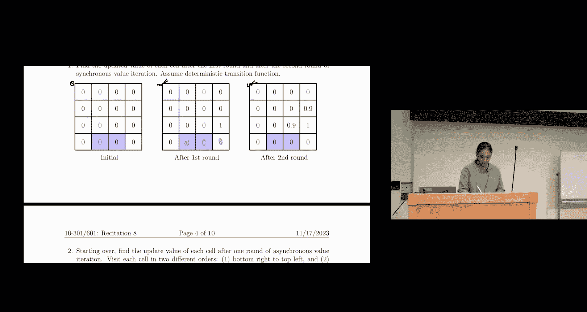

Now let's look at this cell， okay？Considering our formula。

 what we do what we're doing is we're doing synchronous value it and we're doing deterministic transition function。

So synchronous value means we have to apply this formula over here。

And deterministic transition function means that when you take a certain action from a state with probability1 you'll go in the direction you intended to go okay so what will happen is for all these states else only basically only one of the states which is that state which you intended to go in for that would the probability be one and for the rest of them it would be zero so that means in deterministic transition function this entire summation were sort of just boil down to this term for one of the states okay one S dash these are clear。

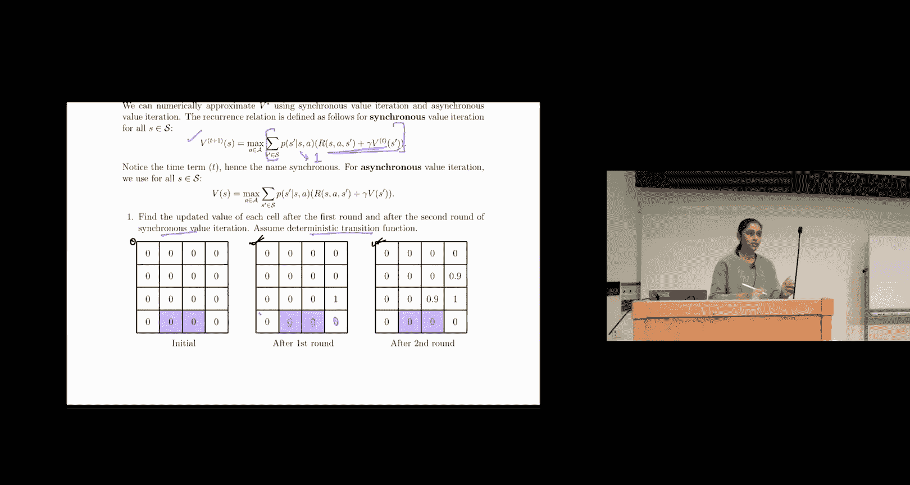

So let's go to this state， let's calculate for that。 So now suppose you consider。

Taking the action of moving right， okay？

嗯。The reward of moving to the right is going to be putting us if we move into the right we're going to move into a shaded state。

 so the reward for that which is this RFf SAS dash is going to be minus1。

Plus gamma discount factor is they specified here， so a discount factor。0。

9 times the value of the state which we end up in so the state which we end up in is this state state but we need to look at the previous iteration what we had stored so we're going to look at we're going to use basically this0。

Okay。So this is equal to minus1。And now let's consider moving in the other three directions。

 the math is going to actually be the same for those。Moving left down or right。So for any of those。

 if we we' are not going to end up in a terminal state if we take those actions right。

 so that means as per a problem setup the reward is zero for that。😊，Plus 0。

9 times the value of the state which we end up in， which is also going to be  zero for all of these cases。

 so that is 0。Okay。So now we have for each of the four actions we have these these Q values and now we need to take the maximum over them right so the maximum of these is zero。

Okay， so that means that zero is the value for in this itation for the value is this。

That makes sense， is that clear？Yeah二。你道西。Yeah， yeah yeah。

 so because this is a deterministic transition function。Basically。

 we have to look at every single state in S， which would be essentially be looking at all 16 of the states in this formula。

 right？😊，So because it's a deterministic transition function deterministic transition function means that like for example。

 let me give you like explains an example， suppose I'm in this state and I take my action my action is to move down okay。

 deterministic means that with probability one I'll actually end up down。😊。

Does that make sense so only one of these terms which is like for this case only for this state which is the state I intend to go and would the probability be one and then there's no other in with zero probability would end up in any other of the states so those would become zero。

Okay。Any other questions？

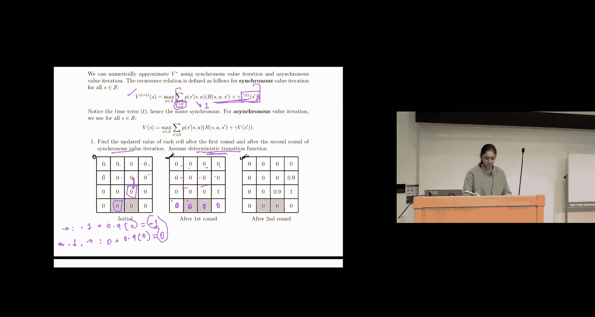

All right， let's just evaluate it for a couple more states let me clear this up。

I'll copy back the things that we justcalalculated。Okay， now let's look at this state， okay。

So let's consider moving down。When we move down Al reward we we're moving into let me actually copy over the rewards here。

 so what we discussed was that if you move into the red state a reward is going to be one。

And if you move into any of the shade states， today water is going to be minus1。Okay。

So let's do maybe actually write it in a different color。

 so if we're considering this state if we're considering this state let's consider actually moving down the reward for that would be one right because of're moving into the red dark state。

Plus， the gamma factor is 0。9 times the value of the state which we end up in the state which we're ending up in when we're doing action down is this state。

But we're going to look at this value because we are doing value synchronous value attri。😊，That is0。

 so that is equal to one， okay？And then similarly， if you move left， down or right。

You're going to end up with 0 plus 0。9 times 0， which is equal to 0。Does that make sense why？

These numbers are going to be the case。So we again， we take the maximum out of these。

 which is going to be 1000 and the maximum is 1。So we're going to just so that's where value becomes when here。

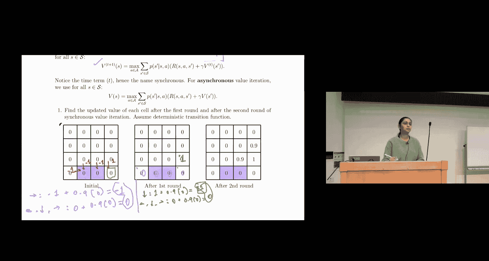

Okay。Now let's actually calculate it for this one。

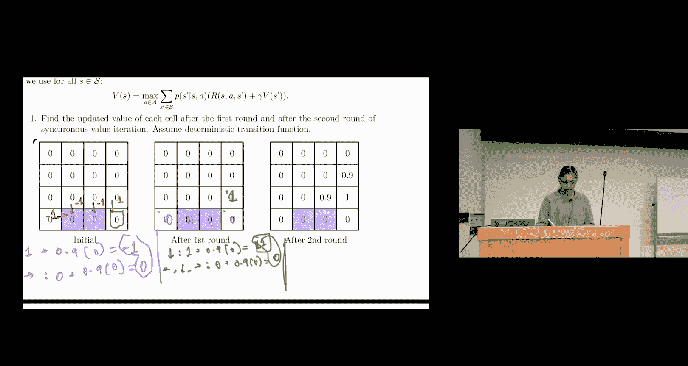

Let's consider the action of moving to the right。Could someone tell me where the reward will be for this if we take an action of moving to the right from this cell？

It won't be one it will be zero because we're not going into the terminal state yeah so these are the terminal states the red arrows are basically the rewards that have run right so from this cell when you take a right action the reward is going to be 0 plus 0。

9 times the value of the state which we end up in so can someone tell you what that will be。😊，No。

 it's not one， it's zero because we're doing synchronous value it， so we need to look at this value。

 not this value。This is in the t plus1 at titration。

Wwhichch is the current iteration basically that we are doing t is the previous iteration okay so the state we're going to end up in is this state but the value were looking at is0。

😊，Because it is synchronous value e。All right， so that is going to be times  zero。

 which is equal to0。Okay。And then if you consider moving down。

 could someone tell where the reward will be？The reward will be minus1， this action。

 we're taking this action so the reward is going to be minus1。Plus 0。

9 times the value of the state which we end up in， which is this state， so zero。

 which is equal to minus1 okay。So then like if you calculate for the rest of them they come out to be zero for like moving left and moving up they come out to be zero and so if you take the maximum out of all of these。

😊，Synchron maximum all of these is going to be equal to zero。

 which is why the value for this state is here。Okay。😊。

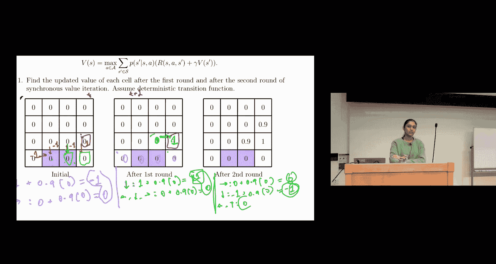

So does that make sense？Good let's actually look at asynchronous now so we can distinguish between using the previous versus using the latest okay。

 when you're doing asynchronous right the order in which you visit the nodes really matters because you're going to be using the value which you have last updated。

 right？So if you actually work out the math， you can see like if you go from like the bottom right to the top left like you know。

 like this， then these are the values and if you go from the top left to the bottom right。

 these are the values that you end up with。😊，In the first iteration。

 so like these two are separate cases。This and this， this is like one way of going over the cells。

 this is another way of going over the cells， both of these are the first iteration and youll at different values。

Let me。Let me actually， let's work out the math for that。So。If we consider。

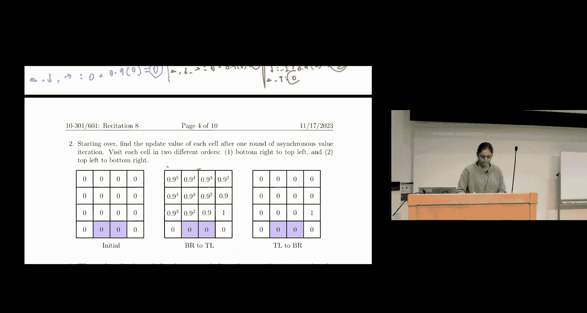

If you consider this state okay the math is going to look the same as this okay I had you work out by yourself but the math for this state when updating from this cell from this as our initial to our first iteration output。

What calculation we've done here is going to be the same and zero is out。Okay。

Then if we look at this cell。The calculation is actually again going to be the same just because the numbers all match up。

😊，Okay， so let's actually look at a more interesting case， which is this case。Let me copy over it。

The rewards once again。us1 okay， so suppose now we're going to be moving down。Okay。

 what's a reward for moving down？It's minus1 because we're moving into a shaded state Okay。

 just that's just a problem set up we're just looking at the red arrows here So when we're in this state and we're moving down the reward that we get is minus1。

us 1 plus 0。9 times the value of the state which we end up in， which would be what？0い。So that is。

Yeah， so that's equal to minus1。Okay。Just a second。

on this user spin so now consider moving to the right。

The reward we get from moving to the right from this cell。Is0。Plus 0。

9 times the value of the state which we end up in， which is going to be。Any guesses？

One exactly is's going to be one because now we're doing asynchronous value so we need to look at the last updated value which we have happen to have updated to one right just in the last because we looked at this cell last that's why it's important the order in which I trade over the cells okay it's times one。

So this is equal to 0。9。And then if you do it for like moving for the other directions。

 you end up getting zero， okay？So you take the maximum over minus10。9 and 0 and then 0。

9 is what you end for。Okay。Everything is clearly now。Now let's look at what policy do you learn。Okay。

😊，So okay， the answers are given here， but let's try to actually come up with them ourselves for the terminal stage there's not really an action in which you take so like it doesn't matter。

😊，Now let's come to this state right we're talking about the policy that we learned from the asynchronous value。

 so I told you that the math that you do for calculating this state is going to look the same as this one。

So let's come here。We got this zero， right， the maximum amount of all the Q values for all the actions was zero。

Okay。So three of these states have zero， so how do we do it。

 how do we lecture choose between these three water beer policy。

We just take a simple tie breaking mechanism whatever you want you can decide as for the question we have specified the de in alphabetical order。

 which means this is the precedence so down happens to have the highest precedence in these three。

So Darwin is what we get as our policy here。Okay。For this， the policy， let's look at it。

We got one as our maximum over here which happened to come from this action yeah sorry go ahead。好。

So why don't we go up because let we go so that's a in this is only the first iteration this is just the policy up to the first iteration it might make sense that we want to go around and actually you're right we want to essentially make sure that that everything finally ends up going to that red dot state right but for that you need to update this over a couple of iterations yeah。

This is just the first， this is just just like the baby policy that we've got just after the first iteration。

After every iteration we end up with a new policy so we basically what we generally do is like we'll keep doing this so one iteration means taking like one grid and going and like getting another grid right and then we use the new values and then we update again again that's each in each iteration we visit all the cells and update all the states all the values of the states okay。

😊，And then every time we update it， we get a new policy right so yeah does that make sense？So yeah。

 coming to this cell。We got the maximum from taking the action down。

 so the policy is to move down from here。Now coming to this cell， we got this 0。

9 from moving to the right。So our action is to move to the right， okay？Is that clear to everyone？

Okay， now let's actually let's do this for a non deterministic case。 Okay。

 we're going to be doing synchronous values that's similar to the first example that we saw。

 but we're going to be seeing。Nondeminacy probably。 So the what I said before was basically。

This if it's deterministic， then you know， only one of these terms will remain blah， blah blah。

 but now that's not the case Okay， now this probability is going to be。

Non zero for multiple states let's look at the setup it totally depends on what your environment is what your setup is let's look at the setup in this case。

What we're saying is that for every action that an agent takes。

 suppose you're in like a certain cell， if you take an action。

So if my action suppose is like my action is that I want to move right。Then with 0。5 probability。

 it'll actually end up in the right state。And with 0。5 probability。

 I'll slip and move into the state which is below。Okay。So action is where you intend to go。

Whi is a S is the state which are currently in， let's go over here S is the state which you are currently in for which you' are updating。

A is the potential action which you're taking。S dash is the state which you might end up in。

 which in this case is going to be one of two okay either the one which you intended to go。With 0。

5 probability it will be there so for that so for the state which you intended to go in this term is going to be 0。

5。And for the state which is below you， the state is the probability is going to be 0。

5 and if you take action to move down then like it's just going to be with 0。

5 probability you move down the 0。5 probability you slip and go down so its just going to be with probability1。

Is this setup up clear to everyone？Okay， let's do the math then。Right。😊。

Let's consider this calculationc， okay， let me write the rewards again。Plus plus one， minus1。

 minus1 and minus1。😔，Okay。So consider moving down。Right if we move down with probability one。

 were going to end up in the state below us， so we do one times。The reward of moving down。

 the reward of moving down from that state is one。Plus 0。

9 times the value of the state which we end up in， which is going to be from here。

So this is equal to one， okay？Is that clear？😊，And then if you consider like moving to the left up or right。

the math is going to turn out to be the same for all of these。There with 0。5 probability。

 you're going to actually move in the direction which you intended okay。

 so if you move in the direction which you intended left upper right。

The reward of doing that would be zero。And the value of the state which you end up in will also be zero right so that is one term。

The second term with 05 probability， we slip and move down。So， when you move down。

 when you enter the terminalist state， what we said is when you enter the terminal state。

 your reward is going to be one。For the red Dot state。So if we slip from this state。

We're going to end up sorry。Yeah， if we slip and move down from the state。

 we're going to get a reward of one。Plus 0。9 times 0。Which is equal to 0。

5 so we take the maximum of1 and 0。5。Which is equal to one。Okay。

So that's how we do like the probabilistic transition function， Let's also take this example。

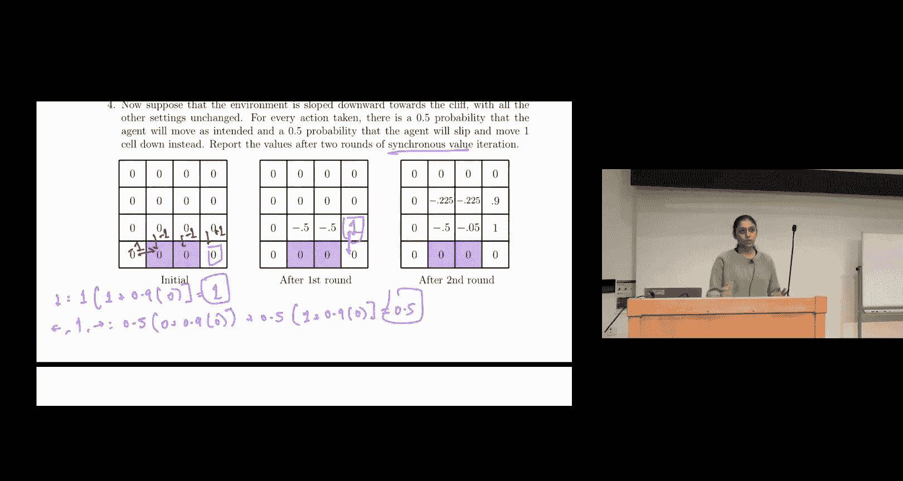

嗯。I serious is this。Okay， so now consider。Moving down。

When we when we take the action to move down the probability one will we actually go down？So。

 one times。Minus 0。1， okay？Why because that is the reward for entering the shared state。

Sorry you're not minus0。1， it's minus1。1 times minus 1 plus 0。

9 times the value of the state which we end up in， which is this state。

 remember we're looking at this state we're taking action down。Which is equal to -1。OK。Now。

 let's consider other actions。 Well， actually， let's consider moving to the right just act one。

With 0 So okay， so with 05， let me era some things here。With 05 probability。

 we are actually going to move right and with 0。5 probability were going to enter the lower stage。

 So let's first consider the case we we're moving right。0。

5 is a probability times the reward of doing that would be what can anyone tell me？Yeah，0 plus 0。

9 times what。0ero， exactly， because we're looking at the previous and not。

This because we're doing synchronous and not asynchronous allergy， okay。Plus 0。

5 times if we move down so that' is going to be minus1 plus 0。9 times0。

 which is equal if you do this math， it is minus 0。5。Okay， so then we take the maximum of this Oh。

 and if you like， if you do this calculation。For the other states also you will get the math looks exactly the same as this for the rest of the actions as well Can you get minus0。

5 for that as well so now we take the maximum of these and that is minus0。5 so that is your answer。啊。

O。Any question at this point about anything？

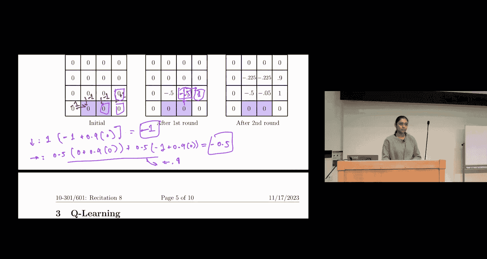

It's about Q learning。 so before I start this question。

 let's discuss discuss like the motivations for Q learning and why we do even do Q learning when we have stuff like value。

 Everybody wants to comment on this。You can basically do the same thing。

 but what do we need another method。嗯。So， the primary reason is more often than not we do not know what the transition states are。

 what is the model of the world， basically what the valuation is assuming that we have the transition probabilities and the model of the world that if you are in this state and you take action this is the probabilities that you end up in these states。

So you often don't know what that is， so we need。To explore as well by taking different actions with different states and see what rewards we get to actually learn the Q values。

And learn anything of importance。 So that is why cu learning exists。

And we'll learn about good learning in the specific setting of football here。So， the American kind。

So we will divide the field into h states。So this is the star state。 This is the field coal。

 This is the。I think。They just call it TD。 I'm not sure ya。

 And then these are the yard lines that 10，30，50，17，90， this is like an arbitrary。

Definition on state， you can make it more arbitrary if you want， but。This is how it is divided here。

And there are two teams， they are offense and defense and so the total length is 100 yards。

And these three in purple are the end zones where the game will end。

 so it is kind of an episodic task that if you keep taking actions until you reach one of the end zones。

🤧嗯。And there is no reward for moving between the white states， for example， here， but if you go。Hi。

 sorry before on every I state there is two actions。 you can run the ball or pass it and。

The path will always be in the direction of T。 I think it's such tongue。 Yes， sorry。So。

You have a coach which basically tells you what what is the reward。

You only get a reward when you reach。The TD state and where you get seven points。Otherwise。

 you don't really get a robot。😊，Okay。So now we want to basically do Q learning on this and we will start by building a Q value table so lets start by discussing what is the size of this Q learning value table in this question。

Any comments。So， we have two actions for every state and then eight states。

 So what is the size do you think。16。 So it's like age states。Inter two actions。

So basically we have 16 entries in the Q value table and that is what we want to learn。O케이。

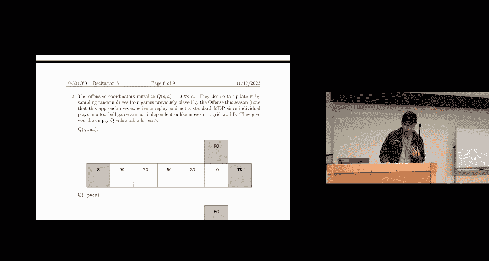

And。So we start our Q learning and we will initialize the key value table as all zeros。So。

That's all zeros right now。These other the two。Diagrams corresponding to the run and pass actions。

And we use these we use experience replays so basically past experiences of the game of the authentic team how what did the move and then what actually what did they got at the end to fulfill these Q values。

Okay。And we will assume the learning rate is alpha discounted is 0。5。

So how do we update the Q value table。In reality L So there is like an update rule right。

 So I just briefly mentioned the update rule here。So we update the new value with the old value。And。

SoWe have the learning rate alpha。The reward we got。And。Discounted value of。A dash is the。

State you reached after taking action A。Okay， I think gos。For this update question。

So this is basically what we are using for filling out this entire thing starting from zero。Okay。

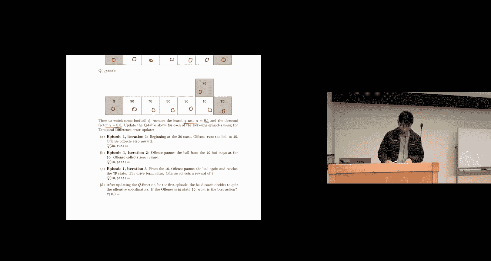

Let's start with the first episode， and。Ittrieration one。

 so we seen the experience simply that the team begins at state 30。

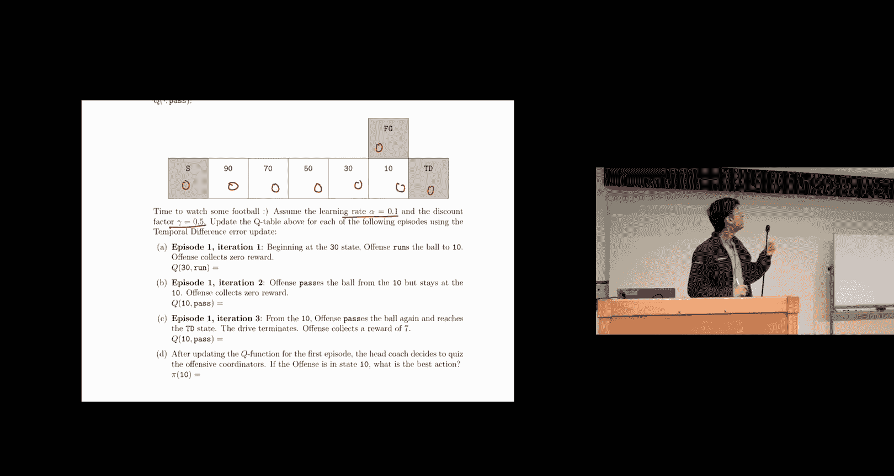

And。So team begins here。And then it runs the ball to 10。

 the action is run and it runs the ball to 10。And the offense collects zero remote。

 because you are still。At1 didn' tell to anything。

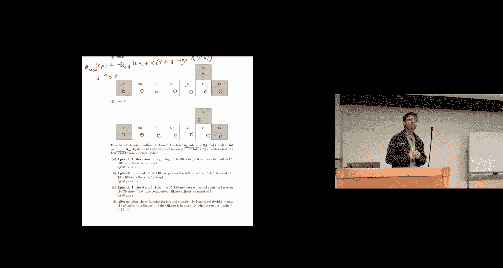

So， the Q value will be updated as the Q 30 run because the action me has run and the initial shades of 30 the initial value was 0。

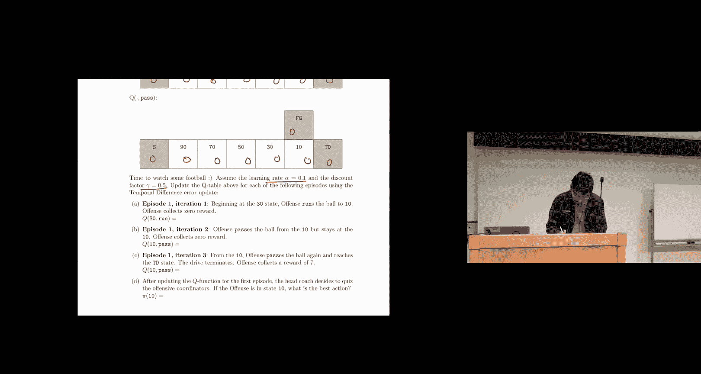

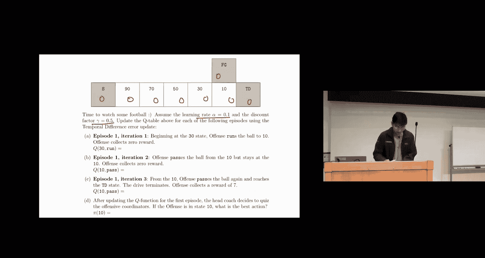

Plus， Al find 2 v or0 board。And。Now we are at state 10。

 so at state 10 the two possible actions lead to0 and 0 rewards00 and0 q values， sorry。

 so the max will be 0 again。

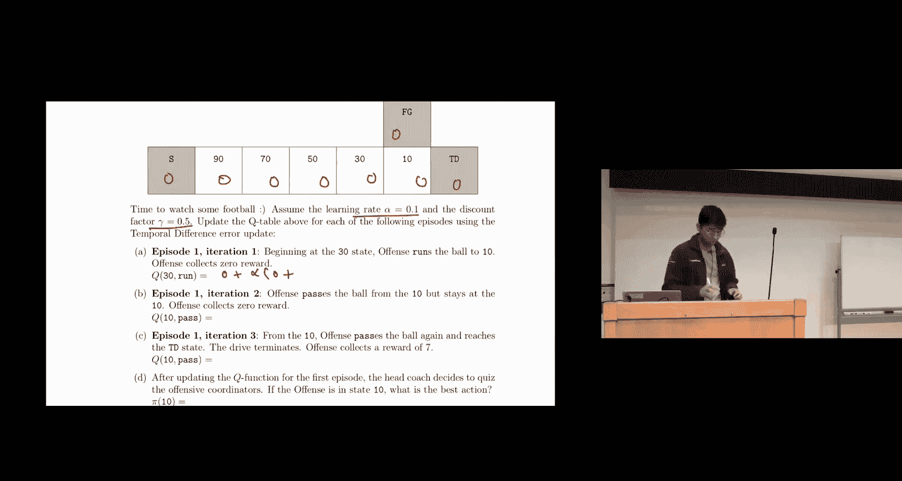

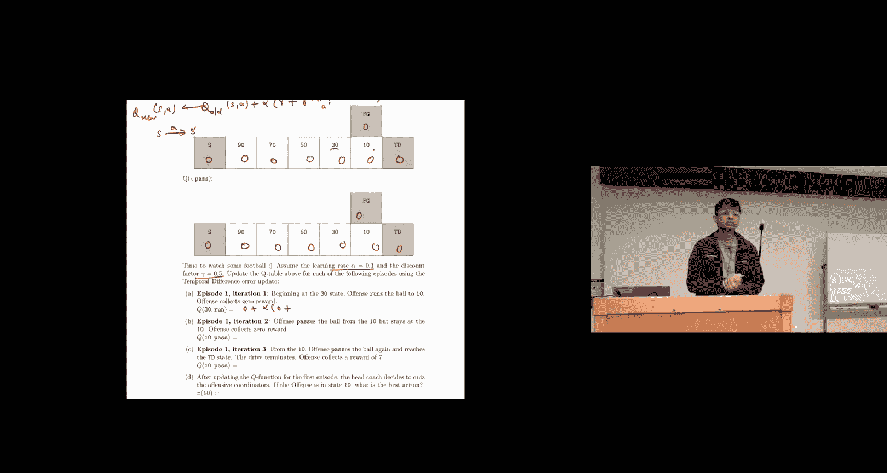

So it will be。So the updated value is 0。That's basically because we didn't really get any reward。

In shock with policys。Any questions， This is a basic theme which we do for all the parts and will go a little bit faster。

Okay。So。Now， what happens is we are at 10 and we stay at 10。So， we basically pass and。

We again collect zero reward， because we still at 10。So now the update will look like the old value。

 which was 0。Learning rate。0 reward。Gmma and still values are all 0。 So the max will be 0。Okay。

So now episode 1， it 3。So from of from the state 10 we pass the ball again and we finally each touch down and we get a reward of plus 7 and the episode ends actually because this is one of our end zones but we still get one update for the 10 pass。

And this will be。The initial value is 0。Learning rate。We get7 dev。And as values are0 right now。

 the max will be。You as well， from state 10。I believe Al is 0。1， so this will be 。7。So now。

 we have our。你外6。Q 10 pass。As burn 7。Okay。So time to talk about some policy。

 So after updating the Q value now。If you are in take 10。

 what is the best action that is basically what py 10 means。

 So the best action will correspond to the highest Q value we get。And。So for A state 10。

 we have two options run or pass and the the Q values are 0 n。7 so the。

Best action to take at10 is pass。As of pregnant。哎。So into Delhi Vi is it passes because the only action we learned that leads to anything of importance from 10 is past because it the model learned that the team passed from 10。

And then it got seven rewards， and otherwise it was not getting anything else for the whole episode so。

Just kind of like intuitive， I even believe that that is the answer。

So now we have another experience for the team， like another episode， so well。Go like this。

So now we begin at 90 state and we run the ball。And we enter the safety state。

And we again terminate the episode 2 terminates。Because we are in end zone and we collect minus2 reward。

This is all given by the code this is not the model is learning how much robot is less basically it data action and then the environment gives it the reward。

 right？不能。The old value is 0。Alpha is the learning rate。You get minus2 reward。

Gma to now the final state we reach is s and at the both Q values are 0 right now。

 so the max of 20s are 0。So this will be -02。我 here。짜리 뉴스 할 때 많이。Okay。

So now we are asked to like the policy at 90， So the 90 has two vacuum Q values minus。2 and 0。

 So the best action to take is pass。0 is better than -02。So you have another episode。

 so now we begin at 50 and offense passes the ball。And stay at 50 and we collect0 robot。

So it basically at 50 the both the Q values are0 and the old value is 0 as well。

And we collect this robot。Now we begin at 50 again and pass the ball and we reach 30。

at 30 also all the Q values are 0， so basically kind of。It's the same thing。

now we begin at 30 and often the ball to 10 and we again collect0 reward。

So the value of 30 comman is 0 right now。So the old value is 0。

Learning rate we cut the reward and now we reach 30。

We each 10 and the best Q value at 10 we have is 0。7。So， we'll have。7。

 This is the max solve tocito and 。7。believe this will be Al is。1。And this is 。5。 It's O。

So the true value of 30 kran is。0バ0。Okay。So now we are at 10， and。

We run the ball and end the drive entering the F G state the。And we collect a reward of three points。

So now the value at Q of 10 run。0。To start with。Learning rate we get a reward of three points。And。

With each fg and the both values， Q values at Fg are 0。So the max is 0， and we'll get 。3。So Q1 is 0。

3。O。So now we asked the policy at 10。 So at 10 we have two actions run and pass the better action is passed because Q value is higher。

 so it is again pass。And basically， this completes the question and the three episodes and it outs。

I'll wait in 10 more seconds。 Then we can move on to the next question。Okay。

This question is also about cool learning but now we have so many so many different states basically infinite finite that we cannot really make the table so we will discuss how to do Q learning in that kind of scenario and。

So， this is the mountain car environment where we have to control the car which is currently at the bottom of the valley and your goal is to each here。

And。The car is kind of underpowered， so cannot just push right once and then just reach the climb by itself。

 So this is by design and。So you must have to actually push the car left first and then leverage gravity and momentum to make your way to the flag。

So if you just push right。If it is not。If you start pushing right。And then you will not reach a flat。

So the state of the environment here is represented by two variables essentially because like a 1 d problem。

 so position and velocity position can be between minus point。-1。2。And burn 6。

And the velocity is between。-007。2 plus。07。So now there we had actually the number of states given to us as 8。

 but now how many states do we have intuitive。If we have just like two numbers to get the number of states。

We basically have infinite because the state is like real number。

 even if it was like just one real number， we had kind of infinite states。

 So this is like the kind of problem。 and we cannot really build a table。

 So we we see how we solve that problem， but。This is like one word example。O。And the actions。

 the actions are finite。They are 0，1 or2， where you push the car left。You do nothing。

And you push the car right。These are the three actions we can take at every state。

And we again need to do Q learning because we don't have the translation function。

 We don't know if I take， for example。Action 2 here， where I will end up。Right。We。

 I know I somewhere on the right， but where we don't know。

And girls also don't know what they want will get。We will probably get reward 0 because the only reward I would imagine will get is like when we reach a flag actually。

 but。So， one。Thing is you want to learn the Q function， so。

We we have to parameterize the function because we cannot learn the table so one parameterization is like the linear approximation so given the Q values SN we have three different weights for each action w0 w1 w2。

And this is the Q value。When you take any single action。这。

This is we are parameterizing the Q value by these three weights and this is the function value le so now the task will basically reduce to learning these3 ws。

So， suppose we are actually given the values here if we had this linear approximation and we had the state and weight values and these V values。

 what are the key values from are all actions performed at status。So status is given。

So it's like relatively straightforward。So if it 0 will just do。Right。And I think。This will be。

We disabled-5。Okay。Other values and just not down for references。Okay， any question。

We should be clear on like why do we actually need an approximation in the first place and why this is an approximation。

 why this does not may not reflect the belief of the world。好的。

So we we try first like a naive representation for Q learning what are the so the state position is basically position in common velocity two size vector as we had before。

And we we are trying to rule linear approximation so once again as I said this is not really capturing everything which may be possible so what are some of the disadvantages for this linear approximation。

So。What are we assuming about。The world here， by doing the early approximation。I invite any comments。

Any comments。What is the linear approximation assume or anything。YouBa assume that it is slim， right。

The example is for it like if state is kind of fixed s， right？So what might you value will look like。

With velocity。Is either this or this， right。It cannot be like this if that is the belief of the world。

 right。给 you at you。Right， if my velocity is。Let's just a0， right， I just want to stay with the call。

But what is the。Q values of the car staying still at like different positions。 So the Q value。

And position。It will either look like this or like this right but intuitively if the car is has zero velocity would you prefer to for a bit to be here or here？

😊，Up there left right， but also would you prefer it to be here or here。Right on the right。

Does anyone everyone agree that this is better and this is better。And this is bad it zero velocity。

But this cannot be like anyway。We get by the like the linear approximation， right。

 because the linear function can either increase the Q values as we go from left to right or decrease the values。

Does that make sense。That is why unit approximation is back for this question。

Even though it might work very well for some other question。For this。

 like one intuitive reason why we will not want to do a linear approximation here。 Any questions。So。

So now we will try to emulate what we did in the previous question。

 but we kind of want to build a table but we still have in finance states so whatever do we do。

So we do is like we discretize the state values state position space。

 so the state space is basically conal common velocity and position。😊。

And we just assumed that the Q values。F。States which do not differ by a lot we just that they are the same。

We kind of discretize it and。

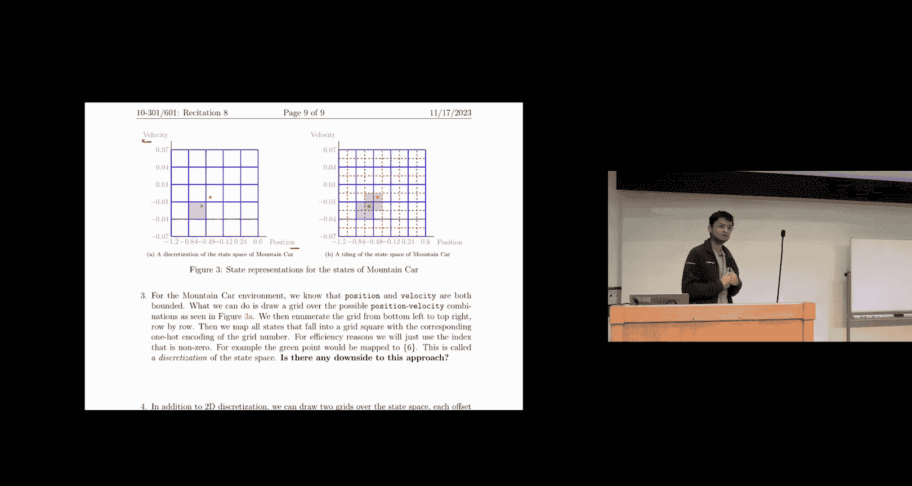

So， the position can be between minus 0。21。21。6 minus 0。07 and 。

07 and this is the disization we do want。😊，25 different values， the sizes of the table is 25。

And each。All the points in one box will get one value。내설서에서 썸신。

But they not the same as making the linear， which has different assumptions。

Its just that the assumptions we took in the linear approximation of the bad and they are in here they are somewhat reasonable。

This also has its own set of problems stop。Any questions for the setup of the discretization and the motivation。

So， it is basically if I if I have the value1 here that all the points here where whatever falls in here will have the Q value one and we will actually learn the value but yes。

Any questions。Okay。So， as I said， this is also an assumption because otherwise we are have to have a different Q value for different state so what are some downsides of this approach。

And we see these downs are not as bad as the approximation， but yeah。Yes。法的。

People how you point to that。Take for。

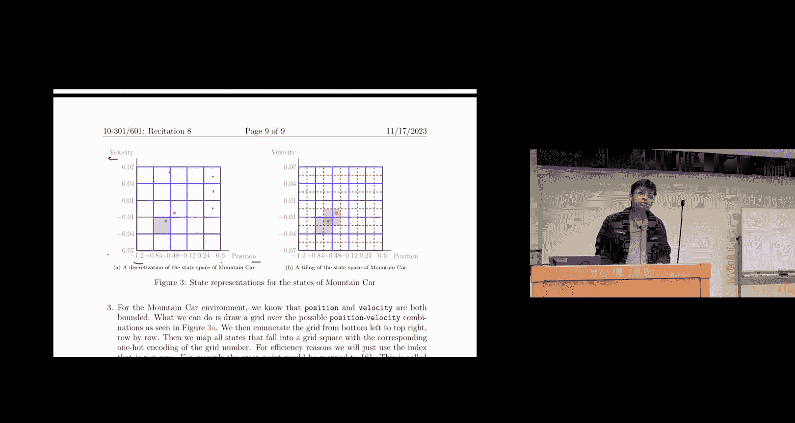

But。

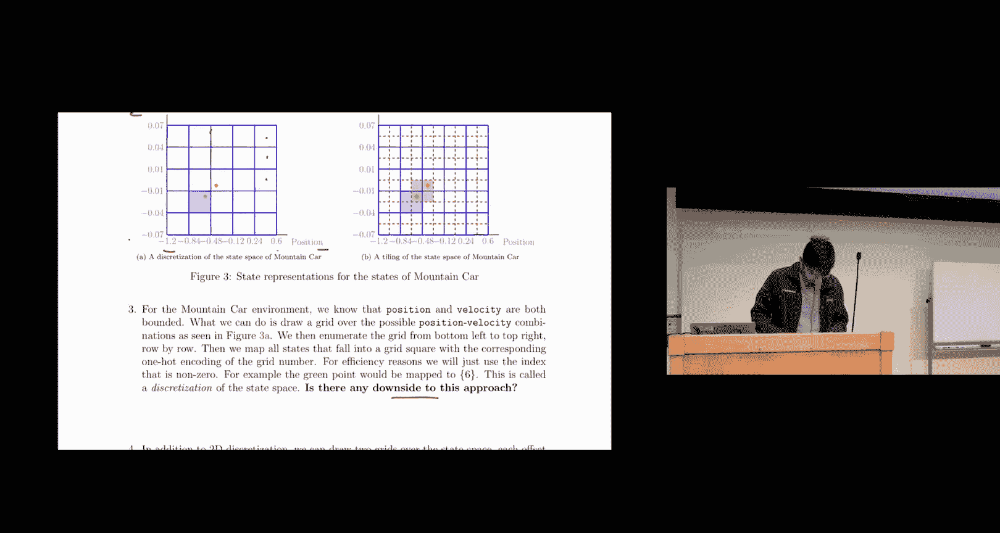

Okay， so。はい。Okay， I think the very part， it basically you need a representation of the window the smallest thing right。

 So we just have number and know the orderez one。こ。They need actually present these boxes， right。

 So this is how we will do it。So we'll say that at the green point。

Has 6 So like the Q value corresponding to the box 6 will is the Q value for the green point the Q value of the green point is not 6 It is the Q value corresponding to6 is the same as Q value of the green point and all the points like this like this like this。

Okay。回家す。So is there any else how to doing this approach？

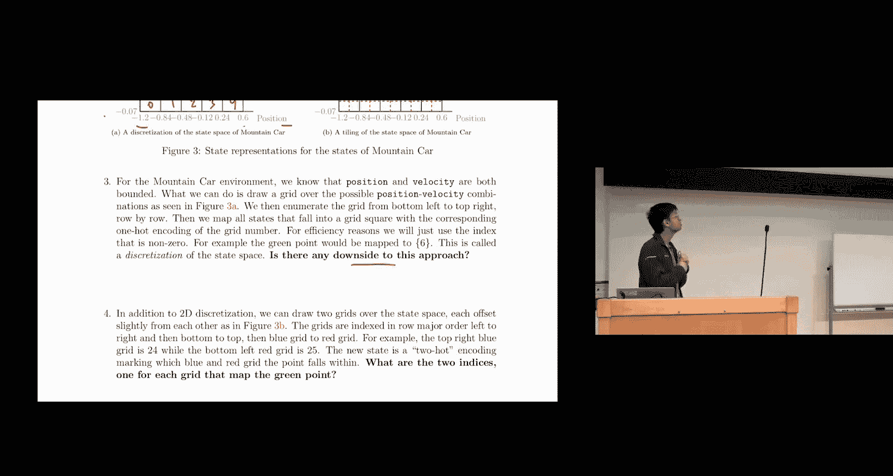

Give you a hint here。Yesス。法庭。I that might yes so。What is the solution to that。

There is definitely one difficulty with this， for example。

 here green and orange right they will have different Q values， but by similar logic。

Green and blue should also have different two values actually， blue seems farther than。

The distance between green and blue seems is farther than green and orange。But just by design。

 they have different the same values。So， yes。 so one solution would be just to increase our disctization。

 We have the size of 5 co 5， right， They can have arbitrary sizes， right。 So 10 cross0。

200 cross 200 million cross million， whatever right。 They will just have。

We have to learn more parameters right now because we have to learn like 1 million cross 1 million numbers instead of just5 plus 5。

 that will slow down our training process a lot。But if we have。If you want to like， go it faster。

 then we have to kind of。Make it more。Disre and like have one cross one。

1 cross one doesn't even make sense because we have one guy value for everything。So two cross  two。

 three cross  three， these have their own problems that now they are like mapping different points to the same Q values。

 which maybe are two different。But still， it doesn't have the same big problem as building approximation。

I will discuss one possible workaround for the different。2 values for the same different one， y。

Where is your linear package？你讲。That also increases number of parameters。No， but yes。

 that makes sense。 And that is something you can this is something which is quite possible to do。

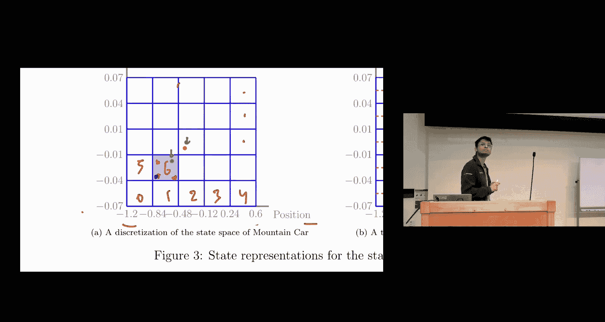

Okay。So， this is the downside basically we have downsides for going too large or too too less in the state space so this is 5 plus 5 is later。

This nibble thing， which works on machines， CPU machines。Okay。

So now what we want to do is like at least solve the problem for this green and red point so we have we add another grid。

😊。

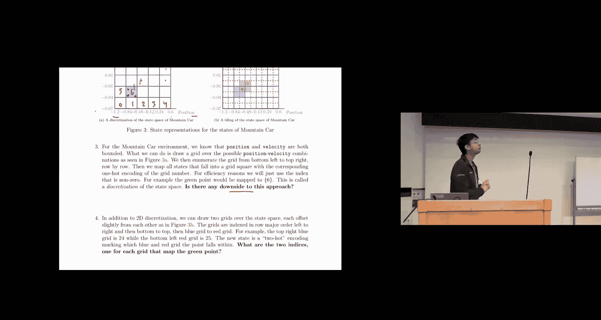

嗯。好。Just for fun。 But yeah， So we are another grid。 This is the red grid。 So now we have this grid。😊。

This is this works exactly like the blue grid， it just like a different grid which is kind of displaced and we will see how it works。

😊，So now every point can be marked to different。valuealues in these two grid side。

 So now the representation of one point will be their positions in the red grid come the blue grid。

And you see， even though red and green and。啊。Orange have different Q values。In the red grid。

 but they will have the same Q value in。Lo great。Sorry， yes， center Kong。Yeah。

 I think the question will make it bigger。So， for example。

 the top right so now we number the grids so this was 0 to 24 right。

So the red gets will start from 25 year and then go till 26。Like this。Right。

 so now it is basically increasing the number of parameters we are estimating it is very similar to increasing the size of the first rate but we see there are some differences。

😊，This is not necessarily like doing something magical。

 which is like in trying to increase performance by increasing the number of parameters。

 which is anyway expected。😊。

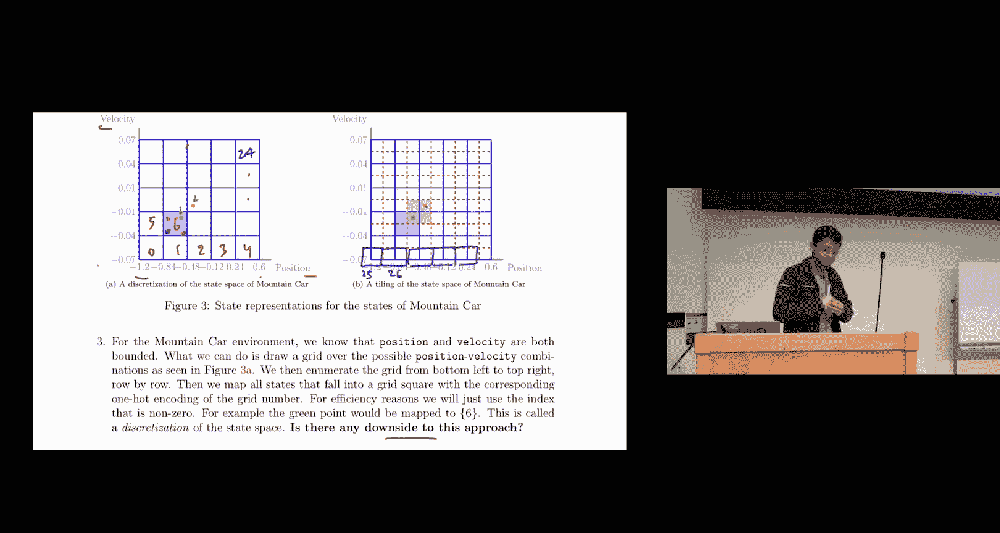

So。So， we can。We can see where the green point will map so the green point representation will be6 as you have already discussed and for the blue grid it will be。

25，31。37。调解来。So， the blue grid is。Ofside 6 by 6。So the green point instead of just mapping to the6。

 it will now map 26 comm 39。This is not the Q value。

 It is just like the representation where we will actually look for the Q value of the green point。

So every point which has the representation 6 form 39 will have the same value。

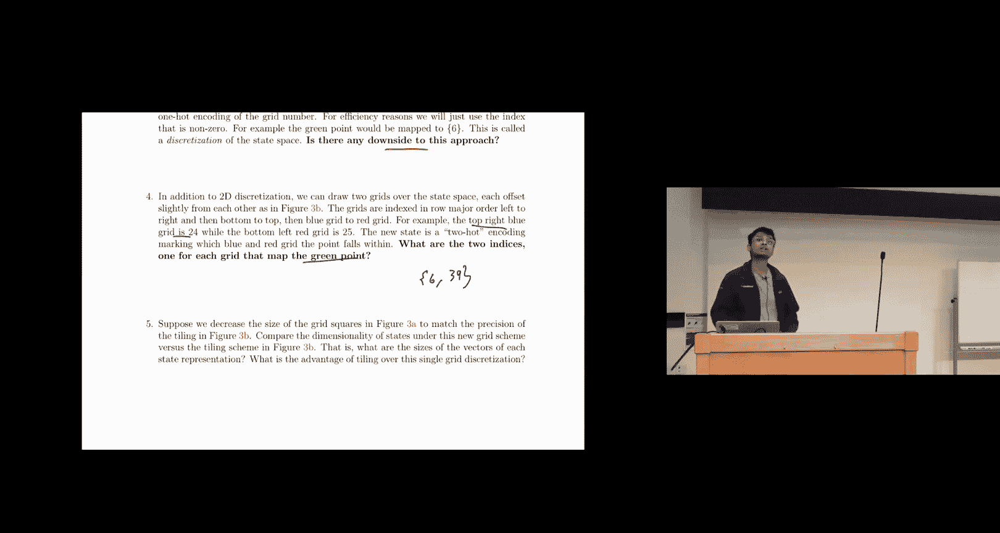

And this will be much smaller than the previous。So now only kind of this point。

All the points in this region will have the same Q value， rather than。All the points in for example。

 this region having the same value。

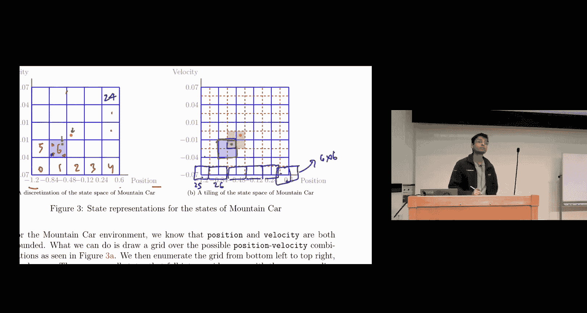

So， one question is。

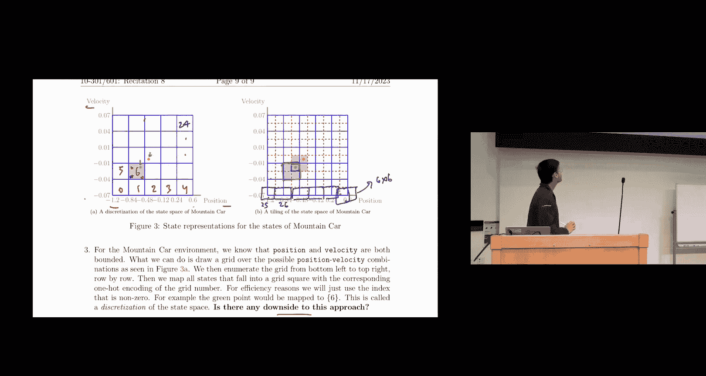

We could have just。Made the first grid bigger than having this additional grade and increasing the confusion rate。

嗯。You could have just like had smaller grids。But now there is some additional benefit to doing this is that。

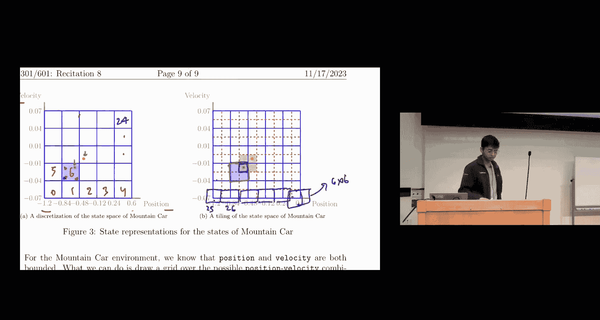

This is kind of emulating。嗯。关不。Size 10 by 10 grid right。

 So if we had just taken the 10 by 10 grid the number of parameters would be 100。Right， but here are。

 they are 25。study6。They' are basically doing the same job。I think this homework is。

 this question is also in the homework， so。

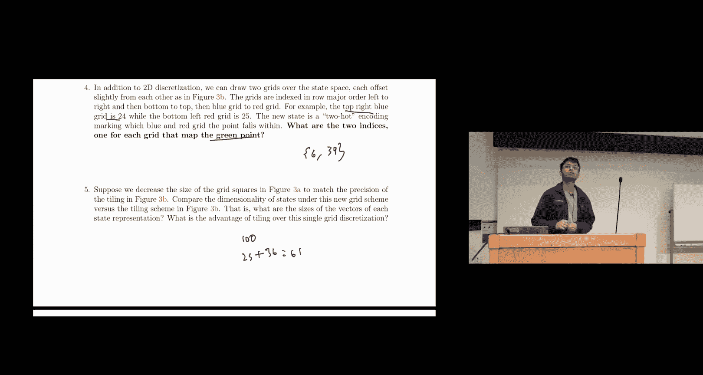

Good to understand it here。 Any questions。