# CMU《机器学习导论｜Fall 2023 10-301⧸601 Introduction to Machine Learning》中英字幕（deepseek p31 Recitation_Exam_3_Review.zh_en -BV1Z2cUefE4A_p31-

So we're starting with RNN and CNN for this review session and first off let's go like let's。

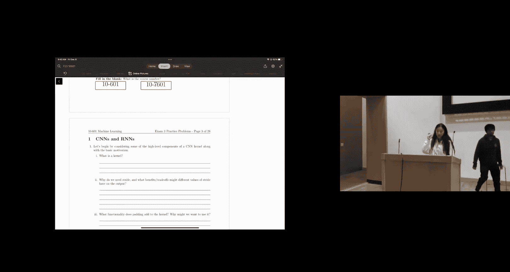

Talk about what a kernel is right do I have to write it should I write it down Okay because have right so I guess like everything we discussed here can be found in the solutions anyway just so you guys know it's posted on the course website right next to the link where you could get the blank practice problem so what is a kernel a kernel is a collection of weights or filters that will pass through an image along with the hyperparameter such as like padding stride and filter size。

😊。

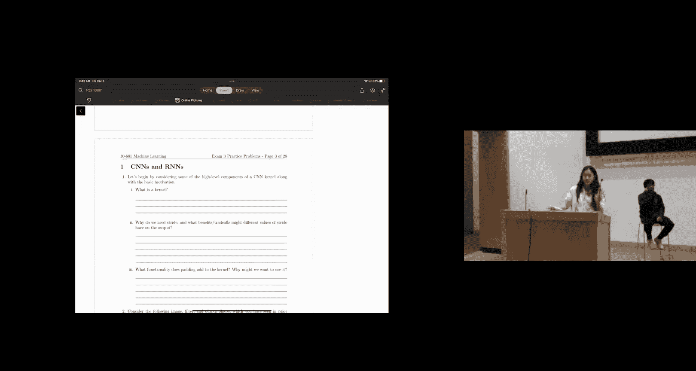

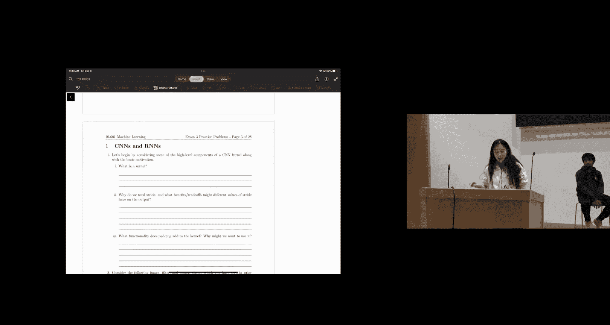

Or quantity。

Yeah just quick definition and then why do we need stride and what benefits or tradeoffs might different values of stride to have on the output so when we think about the concept of stride it's like how far we're moving this filter each time as we're like convolving through our image okay and then we have that stride is what allows the filter to pass through the CNN and it says like how fast we'll move through the rows in the columns so larger values of stride will reduce the output dimensions and if we wanted to like keep the same or more or less the same output size we would keep the stride like a smaller number if we have larger values of stride we could combat overfitting right because we would lose some noise but at the same time we might lose like granularity or information that we had in the original image。

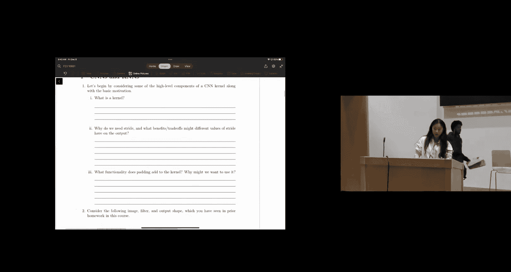

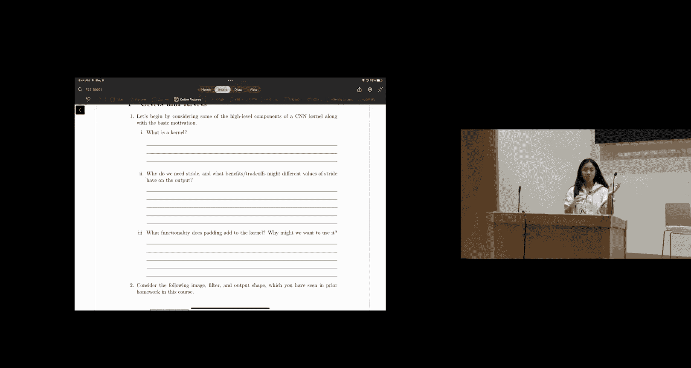

Any questions so far？

Okay。Okay， and then what functionality does padding add to the kernel so padding is I guess it's what it sounds like you're adding I guess like。

What you can think of as almost blank space to the side of like your image as you're convolving through your inputs and essentially like if you think about what happens as you're like moving this filter through your matrix at some point you could think of like the filter as falling off the edge of your original input right so then or I guess like in other cases we would only be seeing the corners or the edges of your matrix like。

Or。The edges of your inputs will be seen fewer times and every other lake。Pixel in your inputs。

 but padding can help combat that so you're essentially just like able to see I guess like more parts of your image overall and yeah it also can help you keep the same input shape。

As your input sorry output shape as your original input。

ok。

Any questions？

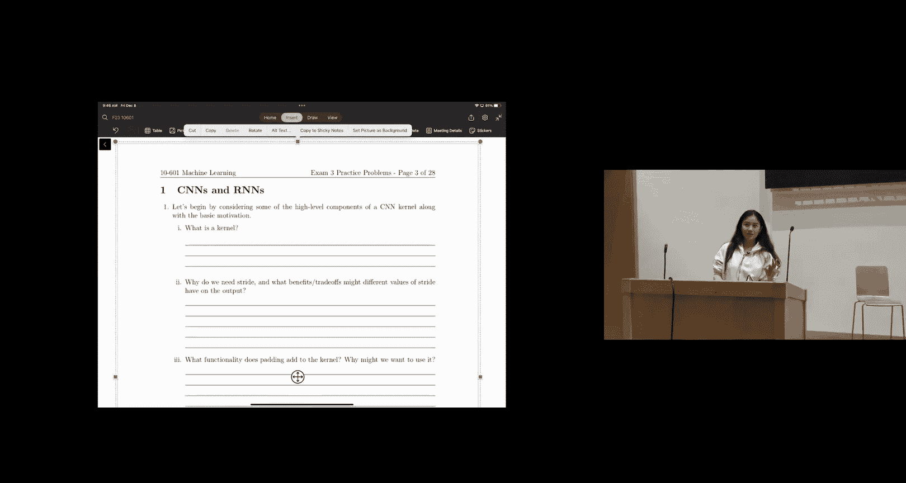

Cool。嗯。ok。

So here we have like an input。

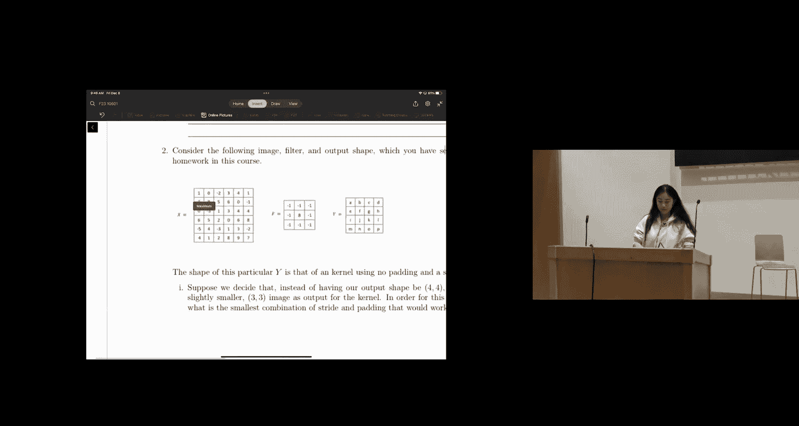

Image and then here like in the middle is our filter and why here is our output matrix。

Okay， feel like you guys have seen this in homework before， but yeah。

 suppose we decide that instead of having our output shape before4 we want it to be slightly smaller through three as an output for the kernel in order for this to happen。

 what is the smallest combination of stride and padding that would work？

So。The larger stride you have the smaller your image will become right so like the more your input will get compressed and then if we。

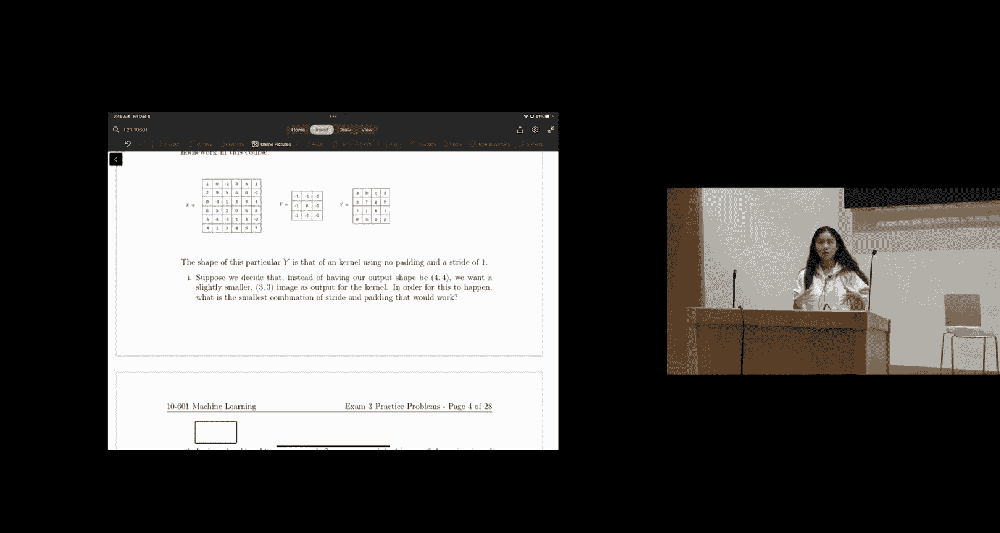

Okay， so let's like consider this， right？嗯。Since we have a three by three image。Or sorry， filter。

 if we move this by like a stride of say。One， right we would get。Oh sorry。

 would be here and then that would so basically he would get like。One pixel output， two， three。

 and four。Right but then we want a three by three image so that wouldn't work so like with reconsiderate if we move by two we have one pixel two and then this like if I end here。

 then this pixel kind of falls off the side of the image so that's how we know that we need to add padding of one。

And so here for this problem， we have stride is equal to two and we have a padding of one would give us an output size of four by four。

 sorry， three by three。

Does this make sense？O。

Cool， so to make this more general， right， when our input has shape a by a and our output has shape B by B with a filter shape of K by K。

I'm just going to give you guys the equation， but to convert from A by A to B by B with a filter of size K by K。

You can use this formula。Or I guess it's more like。

A plus 2 p minus K。Over S。Plus one。

And I feel you guys have seen this before， maybe in recitation。

Any questions so far？Okay。

Okay， and suppose we want to add another convolutional layer。

 in particular we want to output a single cell one by one binary label。😊。

So we want to basically just kind of like reduce everything to just one value and。

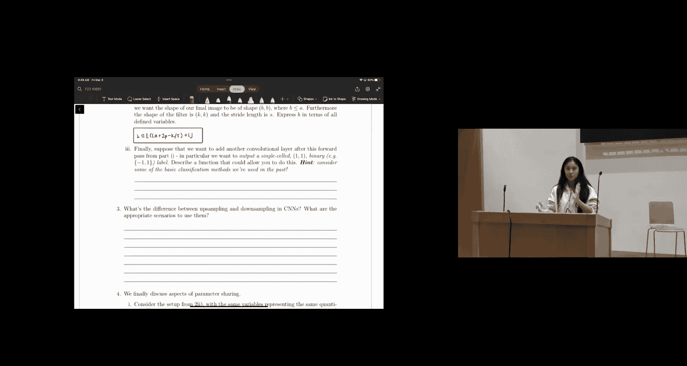

so if you think about the binary binary classification methods we have in the past something that you could like use to achieve the goal would be like perceptron right if we have a three by three filter with zero stride then we would create like a single number right we'd be looking at。

I guess like the entire image as like one value and then output the sign of it as like a prediction for which binary label or classified classification we want there's a lot of other ways you could go about this but the idea is just that like you consider all the binary classification methods we or classifications we've these in past and like how do you kind of。

Change that into like a binary classification method。

And then briefly up sampling and down sampling in CNNs down sampling we want to reduce the output dimensionality。

 up sampling， we want to increase the output dimensionality。And then for down sampling， again。

 we could use it to combat overfitting。Like we essentially compress our image and we get rid of noise in the image up sampling like why we would want to make an inch larger is maybe to increase the dimensions to be the same as like the original input size or something like that。

啊。Everything good。

Cool。And then for parameter sharing， so consider the setup program 2。2。

Re。

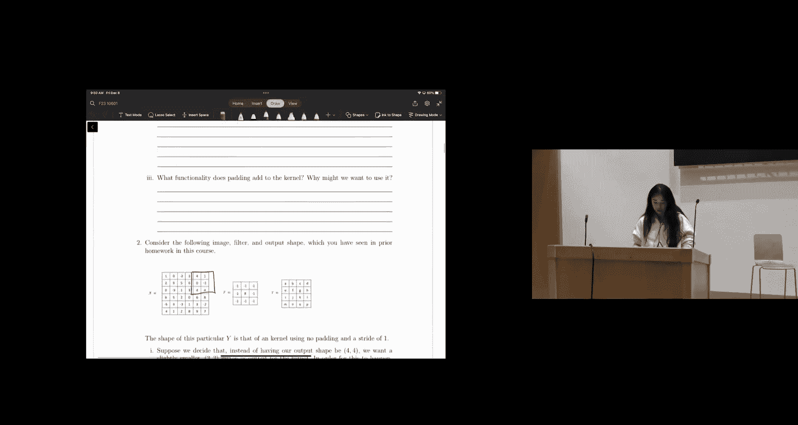

Okay。是。

The same variables representing the same quantities， how many parameters do we learn。

 both with and without parameter sharing。

So。

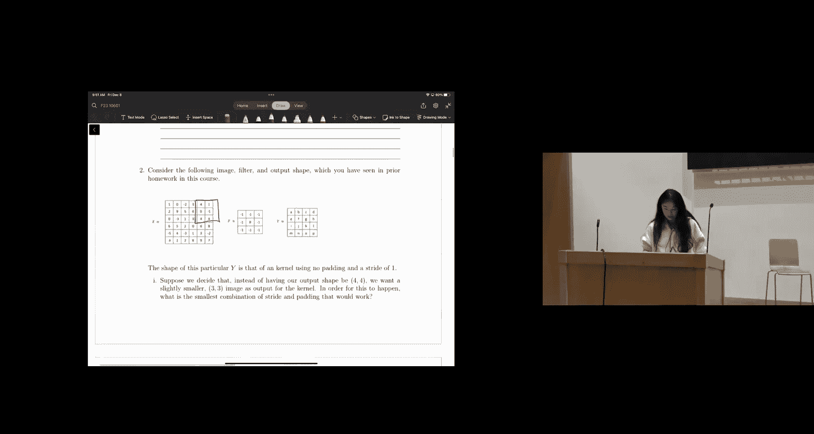

Where文。Here。So with parameter sharing， essentially we're using the same filter for like every step that we take。

 so all we learn is essentially the filter size， right？

So we have K by K。Which gives us k squared。If we are doing parameter sharing without parameter sharing。

 we basically learn a set of like。Pixels or we have like a different filter for each pixel in our output。

 so we essentially multiply that by the size of our output so we get K squared B squared。

Does this make sense？嗯这。Consider。This bias。Do we consider a bias？Oh，그か哦あケブ。

There's no bias in the convolution layer。It's just the co。I mean， like the like I guess padding。

Is the closest thing I can think of almost do you mean late？

Like a bias when we're classifying something No， when we done it when you see an inch and you'll。

Mo move your kernel through the image。 just sometimes add a dryer so that your image is。

And end up put something so oh I don't get we doing that we're just moving the we're just moving it wait yeah in this we yeah bias like there's yeah。

 there's no bias。

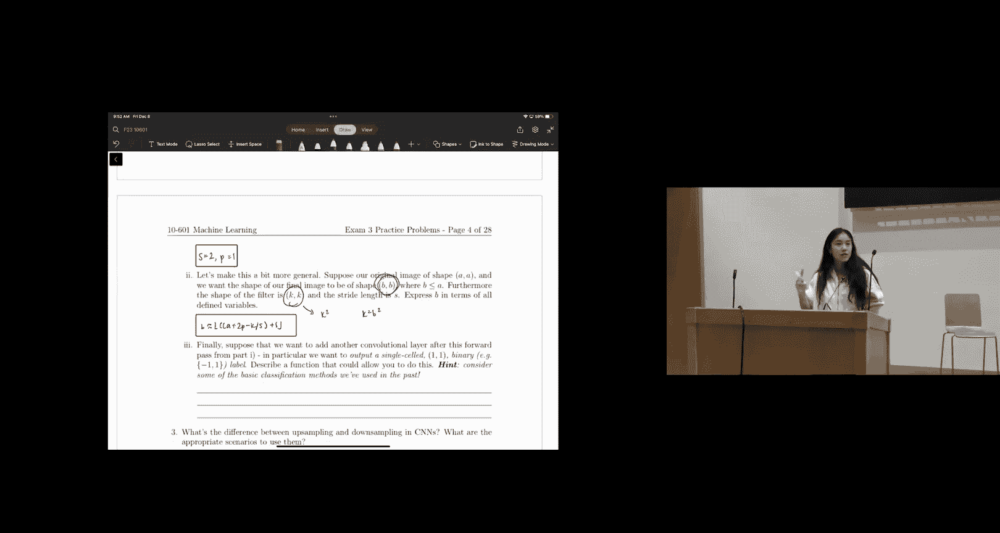

嗯。

Oh okay， cool okay， suppose a CNN is being used for a prediction task and a subject you have prior knowledge in for instance you're suppose you're being asked to classify。

😊。

The image into classes of cars and you know that each image contains a side view of the car with the front of the car facing right with each car being roughly the same and this scenario would parameter sharing be appropriate disregarding computational constraints so the key to this problem is that we know that each image contains a side view of the car with the front of the car facing right with parameter sharing a big pro to it would be that we can recognize or detect patterns within an image So if we had like images of say like a car or multiple cars in one image parameter sharing might be more helpful but here。

In this scenario， parameter sharing is。Not， or it's more appropriate to not share parameters since we'd be looking at。

 I guess like。Curves in image it might look at wheels or something like that。But yeah。

 so like we don't need a separate or sorry we don't need to parameter share because we could just create like a different filter for each of these。

Detection mechanisms or like， yes。For example， if he knew we had the image of the car。

 it wasn't like。Cent you correctly， it could be in the different corners that me one cheese parent are sharing。

Yeah， well。Paentnder sharing， let's see。You're able to look for like patterns within an image。

Right so I guess like if you saw multiple cars in this same image。

 maybe it's more appropriate than if I if it's like just was it called transformed， I don't know if。

Prameterter sharing is like ultimately that necessary because again。

 we could just make like multiple what's they called。We could make multiple filters， I guess， huh？Oh。

 so if we just like put if like our data was just cars in different corners of the image overall。

 would we need parameter sharing for that？Yeah。Because like in practice you have more than one filter as well yeah and like I guess parameter you can think of as like helping you detect。

Like things within an image。嗯。

Okay。你看。

Cool。Cool is it more appropriate to use rNs over CNNs in the following settings so basically you can think of like r andN as being better overall if you have some like dependency on like past or past data or like previously seen things so for speech recognition。

😊，I mean。Yes， this would like you would gain some advantage by knowing like what you've seen in the past for facial recognition。

 not really right， for music composition， autocra system。

 these would all benefit from like you using an RNN over a CNN。Be could hear。

And then not facial recognition， but yes， but we do use speech recognition。

Theyal recognition like， okay， in what context would you？Feel like。

Faccial recognition might benefit from。Using an RnN overseeing it。Like？

Stpe。So what do we use RnNs for like recurrent neural networks right so can you describe like basically a difference between the two？

I think the architecture like we feed it back in for an R andN。I' wasm wondering。

 is there a case where once you use a CNN for speech recognition like a focus forward？

A phone will give it a passphrasing， just do that one time， but you still use an on then。I mean。

 like you feed something back in right so maybe you look at like the previous word or something like that。

 which could。Like you could benefit from that but with facial recognition you're just taking something kind of at face value right there's no concept of like the past or some。

Feedback。Does that clear things out？

Okay。And then RNNs are helpful in analyzing time series data。Again。

 so we have some like time series data you or I guess like in practice there's a lot of you know anomaly detection and like forecasting basically looking at trends so inherently there's this kind of like dependency on what you've seen in the past which is where RNNs would come in really useful they're able to incorporate information from previous time steps into the current time step and RNNs can process inputs a variable length which is really helpful in time series data。

Okay。

Hey。I think we're doing transformers now。

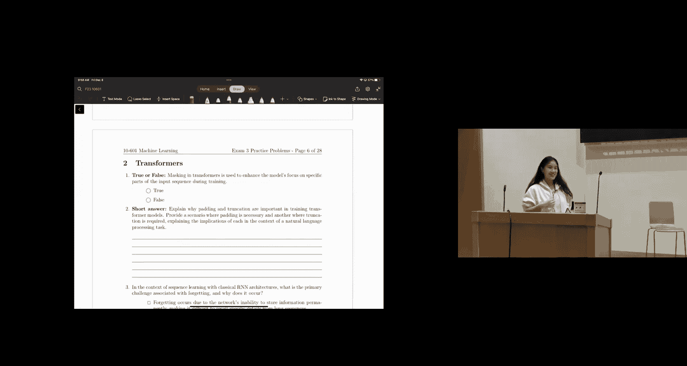

Hello， okay， cool， all right， now we're going to go over transformers。嗯。

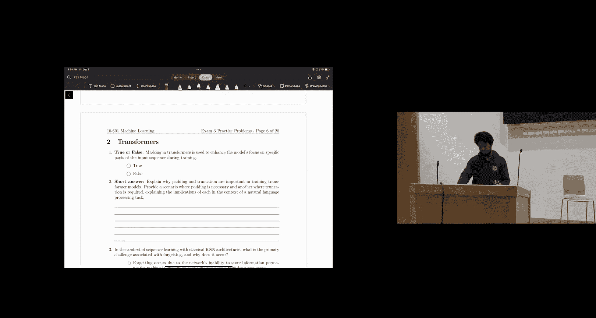

So I guess like a transformer， you can just think of it as a。Another sequential model。

 just like RMMs， but it kind of behaves like。It behaved very different because you're allowed to like look at inputs that occur after the current one as well right that's what sort of the attention does。

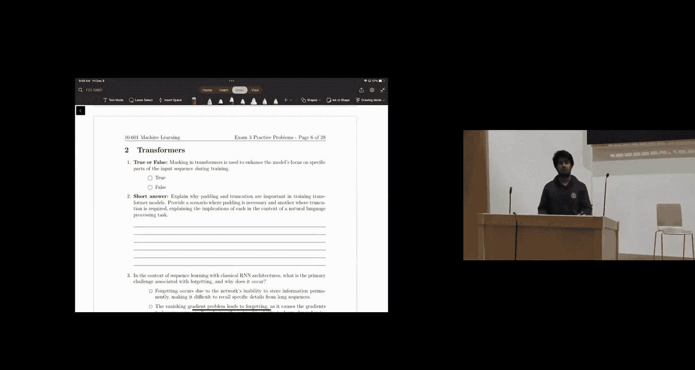

And so like。For this first question， right？嗯。So the reason that we have masking right like I mentioned for a transformer if you don't have masking。

 it can look at inputs that occur after in the sequence to make a prediction which is basically like cheating right so the reason we have masking is so that we don't allow the model to access the future future inputs to the transformer right so like if I have 10 words and I'm on the fifth word I mask off the sixth。

 seventh， eighth and ninth and 10 word because I don't want the model to look at that to predict the next word or whatever task that I need to do so the answer to this is false right so the reason that we use masking is not to enhance its focus on specific parts but it's to make sure that it doesn't like look at things that happen afterwards。

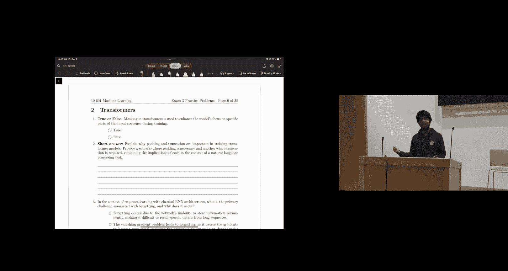

Okay。

The next one， so explain why padding and truncation or work are important。

Transformers models like essentially like the reason that they're so successful is because we're able to sort of process the entire sequence and at a time right and so when we。

😊，So one way we take advantage of this is like taking multiple sequences and just sending them through at the same time and what we call batching right it's just adding another dimension to our like input so now that there's a batch dimension however the important thing that we need to remember for when we do like batching sequences is that we need to make sure that all the sequences are the same length right so if I have a sentence like the cat is cute and then I had another sentence that's like。

😊，I love machine learning right there's like different different lengths so you need to make sure that all the oh they're not different lengths but also pretend that they were different lengths but like。

😊。

You need to make sure that all your sequences have the same length。

 so what we do is we add padding to the end of the shorter sequences to make it the same length as the longest sequence that way we can send all of our sequences through the transformer at the same time and allows for parallel processing which speeds the model training。

😊。

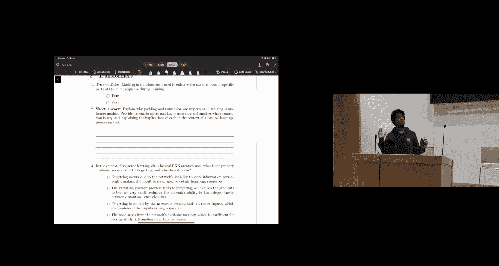

Okay， however， like let's say that my longest like， you know， sentence or whatever was 30 words。

 but my most of my sentences are like five or six words right because I'm going to add like 20 at least like 20 like characters of padding。

So that might cause some problems when we train the model because the model is just going to see so many like pad like when we pad we add like useless characters right so it's going to see like a bunch of nonsense for most of the sentences and for that one sentence that's 30 words it's going to see like 30 words so it's important that like you know maybe it's not always the best to pad to the longest sequence sometimes you might have to like split your data set or do something else with okay truncation which brings me to the next point which is truncation right so truncation is the idea that we like cut all of our sequences to be some maximum length and the reason we do that is just like what I said right sometimes you might get like really long sentences and paragraphs and things like that but if you want your model to be able to actually learn and also like efficiently learn like load all the sequences into memory and through the model then you're going to have to trunccate the sequences so that。

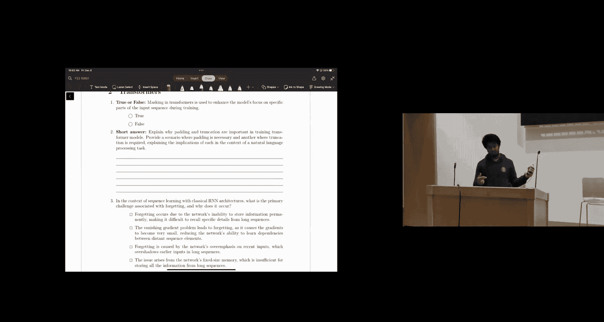

It's a length for which that's feasible given your constraints right like we talk about the ability for these models to train on anything。

 but when we like actually train them in the real world there's some physical capacities that we have to like observe right so that's where like truncation comes in handy。

😊。

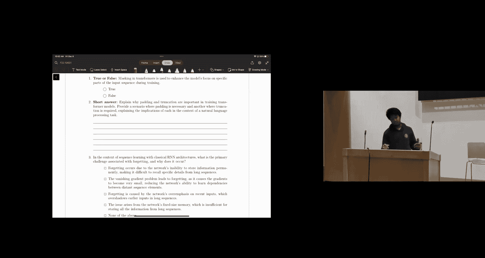

Okay。嗯。In context of learning with classical RN architectures。

 what is the primary challenge associated with forgetting and why does it occur？So。

If you recall the iron and architecture， it's like one very long chain right you take the first thing。

 you send it through the hidden unit， you pass the hidden unit to the next hidden unit and you send the second input and it's just like one very very long chain。

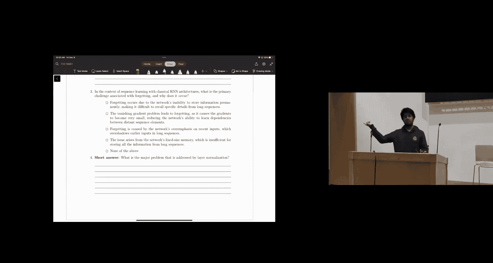

So if you recall when we take the gradient。

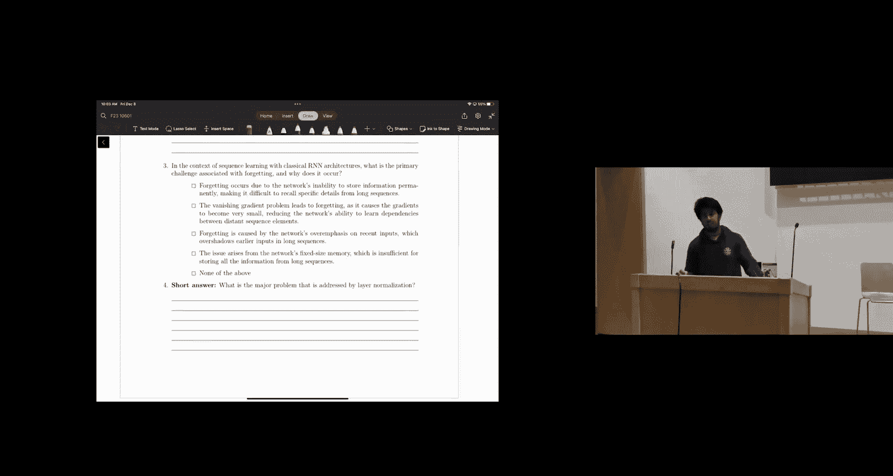

If our gradient is a very small value as we move it back through the network to the first second third inputs right it's going to get even smaller if you recall from homework7 there was one problem where you guys have to find a gradient and you saw that it was taking a matrix to the power of something I don't know if you remember that if you don't remember maybe look at that question but that essentially shows like you know why we have this sort of forgetting because let's say that your matrix is already very small every single time you rate you square it it's going to get even smaller and what we we call that as a vanishing gradient because。

😊，Like。At each time step， it just gets smaller and smaller and smaller until it' becomes like meaningless right so the reason like。

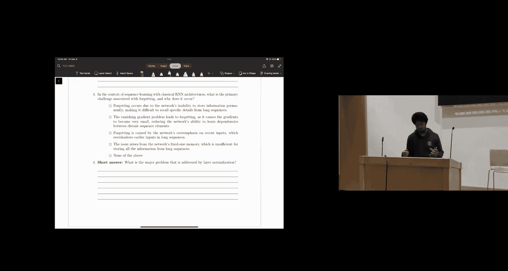

That's sort of like the biggest challenge that happens with R andNs Okay。

 what is the major problem that is addressed by layer norm so。

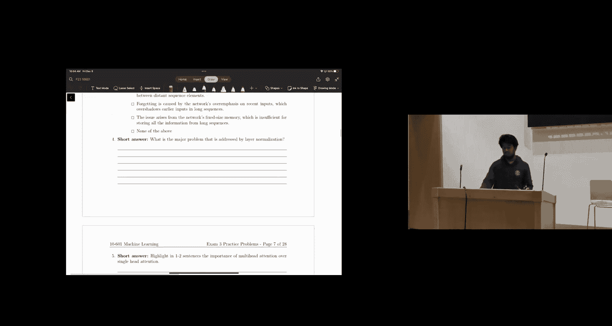

Essentially sometimes when。When we train our neural network the distribution of our network activations might change so that would make trading harder because the distribution that we're trying to train on keeps moving around so that's why we sort of normalize the layer to keep the inputs approximately the same throughout the whole trading process。

 so it's just a stabilization。Okay highlightigh in one or two sentences the importance of multihead attention over single head attention so multihead attention is just sort of similar to why we would have multiple filters in a convolution we might want to have multiple heads in an attention layer because we're able to learn sort of more things about the sequence structure rather than focusing on one just one feature of the sequence right and similar why we have multiple filters but maybe we want to detect multiple things in the image right so it's similar reasoning there yeah and and like adding heads doesn't really affect your training time right because it's just another dimension and it's just like you can parallelize over all your heads when we actually train。

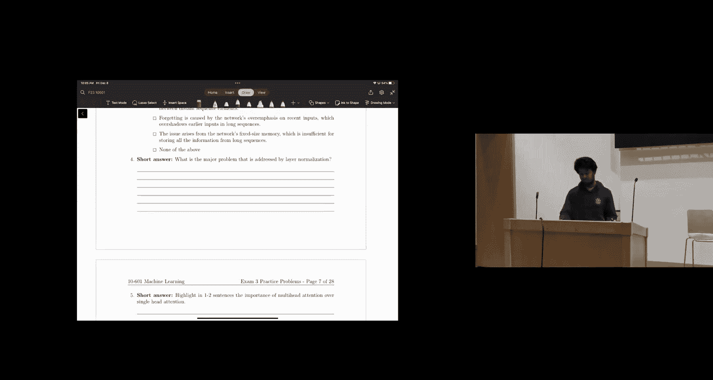

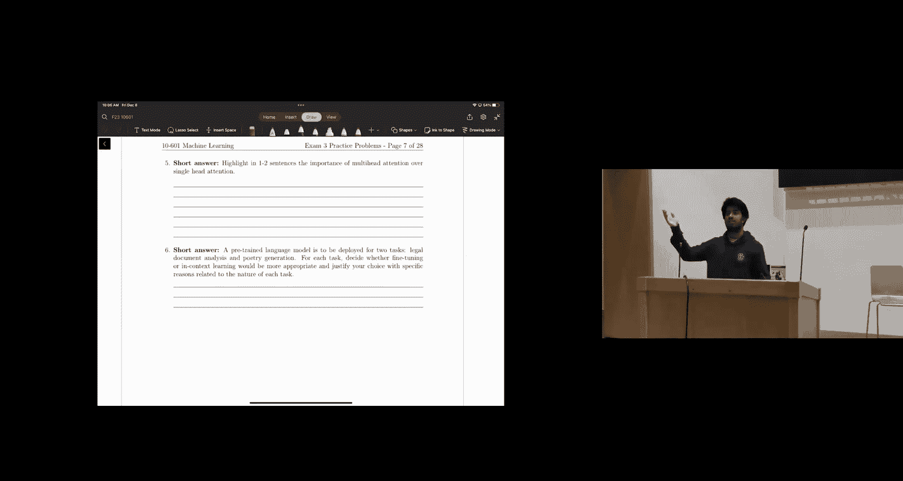

Okay。Last one I think yep okay， a pretrain language model is to be deployed for two tasks。

 legal document， analysis and poetry generation for each task decide whether fine tuning or in context learning would be more appropriate and justify your choice for specific reasons okay so。

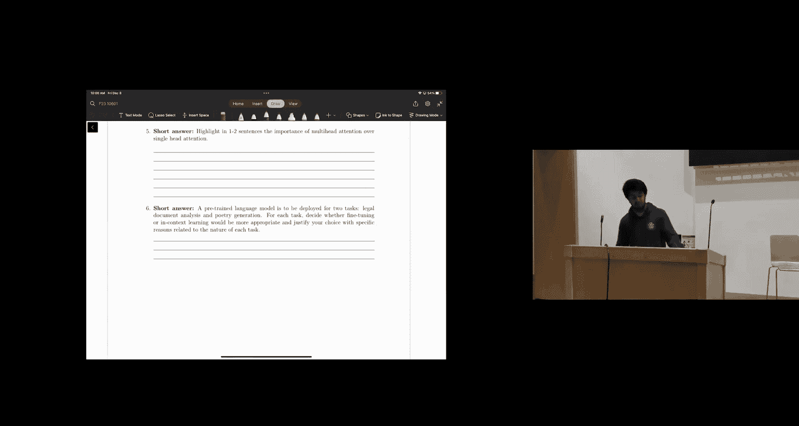

Recall that fine tuning is when we sort of take very few amounts of examples that is very specific to the task and we train on that so for something like legal document analysis。

 something that's very very specific right has really set big like set of rules and it's like a very specific domain。

 we want to do fine tuning because we'll get very specific examples to train on but something like poetry regeneration。

 it might be better to use in context learning so that it can learn about like sort of all the different styles of poetry and use its pretrained knowledge to sort of like elevate its generation right as it learns about different types。

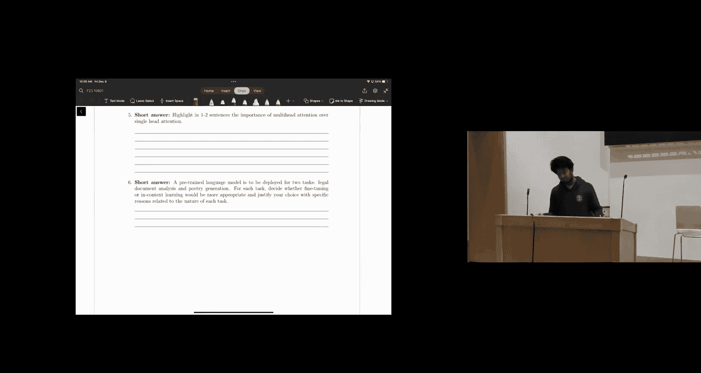

Of poetry。Okay， any questions on transformers？

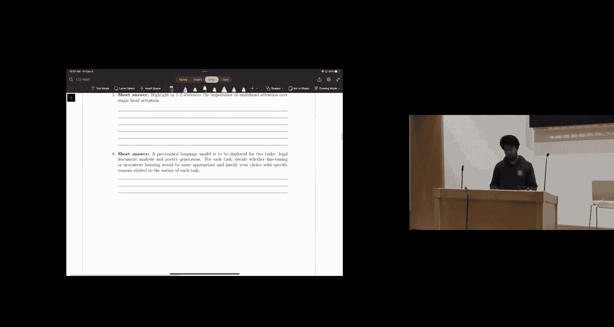

Yes。

All right let's move on to reinforcement learning okay so I'm just going to walk through so this first question is kind of long so i'm just going to go through the first half of it。

 but a lot of the questions in the second half build off concepts that we work off of in the first half and also you guys have the solutions so。

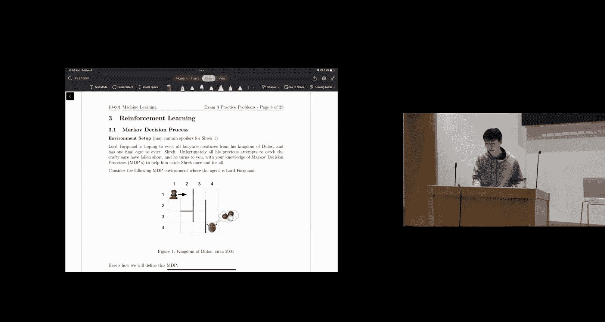

Yeah， let's get started。

Okay， so 3。1 Lord Farquad is hoping to evict all fairy tale characters from his kingdom of Dlock as one final o to evict Tk unfortunately all his previous attempts to catch a craft Yo have fallen short and he turns to you with your knowledge of Markcald decision processes to help him catch Chk once's in for all consider the following environment where the agent is Lord Farquad and he's trying to get T all right so we're defined this MDP in the following ways so we have the state space which is just going to be a set of states that the agent is in as well as the orientation that the Lord Faquihar is in so he can be in any location given by the two B row column and in any orientation which means that he's just facing North。

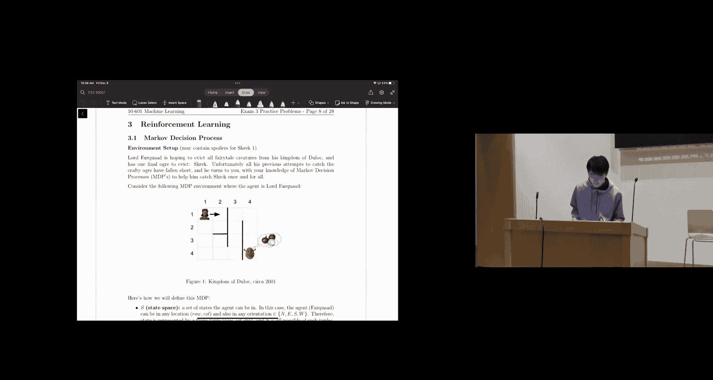

East， southwest。West is left right， yeah， okay， therefore any state any given state could be represented by the V2L。

 which is row column and the direction or the orientation that he's currently facing。😊。

So an example of this is just the start state is even as 11 e so that means he's just he is chilling in this corner over here and he's facing to the east okay the action space is just any set of actions that the agent can take so in this case our action station is just RLM with when this refers to Lord Farco either turning right turning left or moving forward okay。

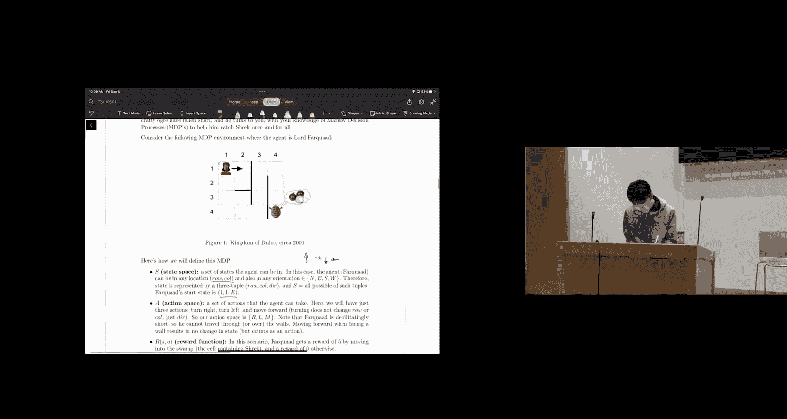

Noe， that turning does not change row or column just the direction。

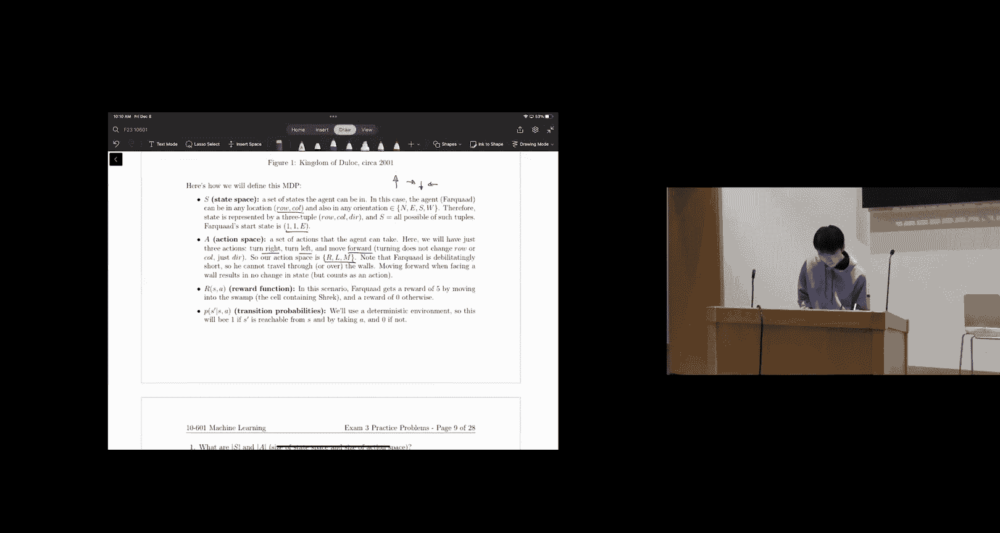

We also have a reward function and in this scenario lower far qua gets a reward of five by moving into the swamp and a reward of zero otherwise。

 and we have our transition probabilities for this problem we'll just assume that it's deterministic so that it will be one if S prime is reachable from S and by taking a and zero otherwise okay。

All right， so for the first question， what are the size was the magnitude of S and a in other words。

 the size of the state space and the size of the action space right so recall that。

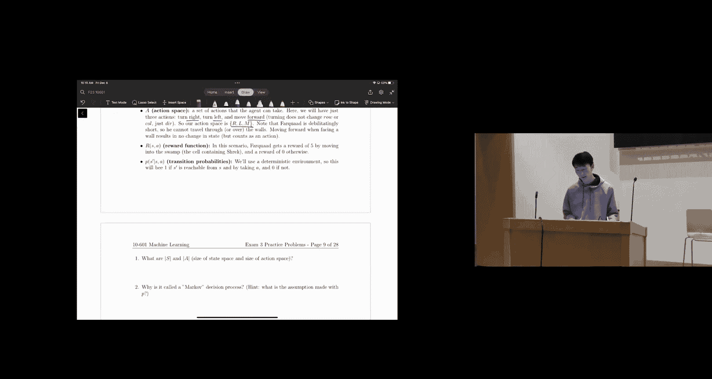

Let's see so the state space so recall that the state is given by a three tuple which is the row column direction right so in order to find the size of the state space we just need to find all the possible combinations that this tuple can take on so if we take a look here we see that this dimension of we see that there are four rows and we also see that there are four columns right so there's four times four possible locations he can be and then we also need to consider the possible orientations that he can be which is given by any ESW Northeast southwest and so that that gives us an additional orientations that he could possibly be in any one of these states okay so what this just means is that so what this means for this question is that the number total size of state space is just going to be four rows times four columns times four directions。

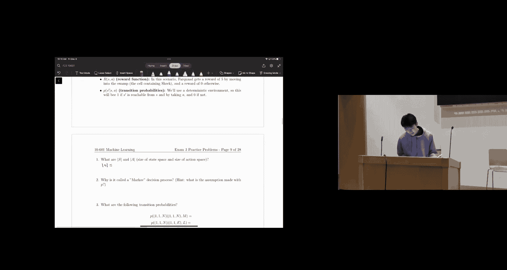

Which is equal to 64 okay？And as for the size of the action space。

 that is just refers to this total set of actions that we can take and if we recall that we've defined that to just be this set RLM and so just by definition the size of mathematical sets。

 this is just going to be equal to the size of RLM。

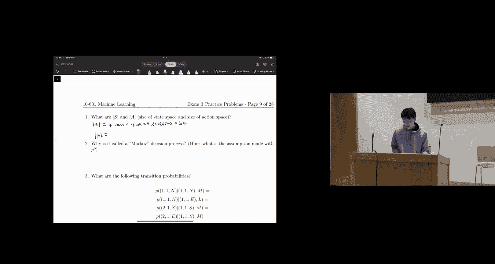

Eals 3 okay， does anyone have any questions on how we did that？Awesome sauce， Okay so number two。

 why is it called a Markov decision process what is the assumption day with P Okay。

 does anyone recall there is a lecture slide that specifically talked about this is can anyone remember that off the top their heads。

All right， that's okay， that's why we're here to reinforce our learning。

Okay， so recall that our the probability function here S prime given SA assumes that S prime is determined。

Only by S&A。In other words， the current state and the current action。那么。Not by。

Anything else which includes previous states and previous actions that we took。

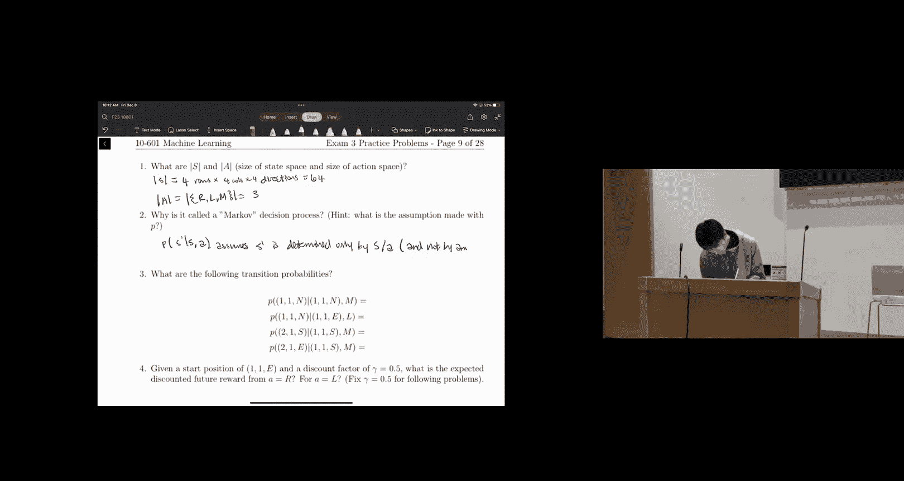

If you guys are familiar with hidden Markov models。

 it's a similar set of assumptions there where we assume that the only thing that the current the probability function here only depends on the current state and action that's taking and nothing before it okay does anyone have any questions on the logic behind that？

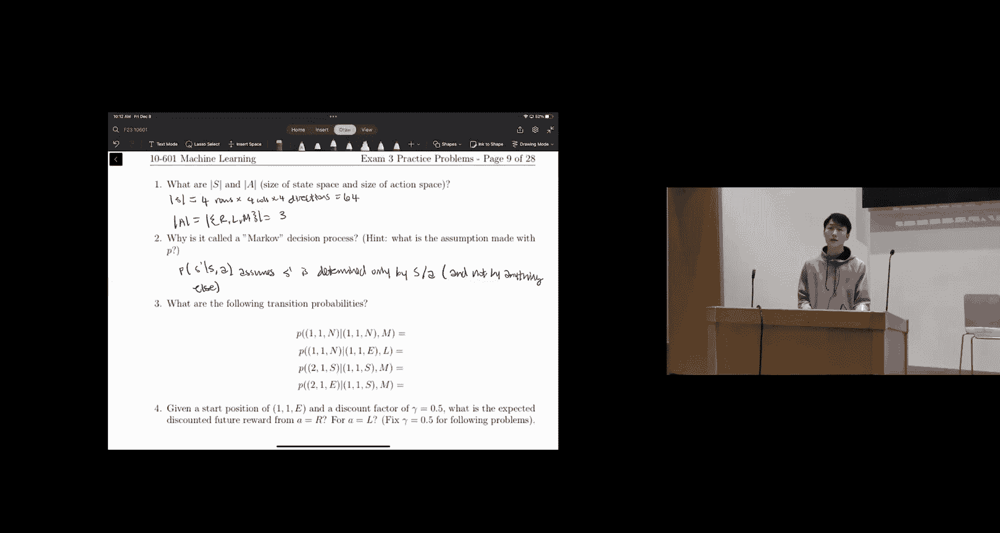

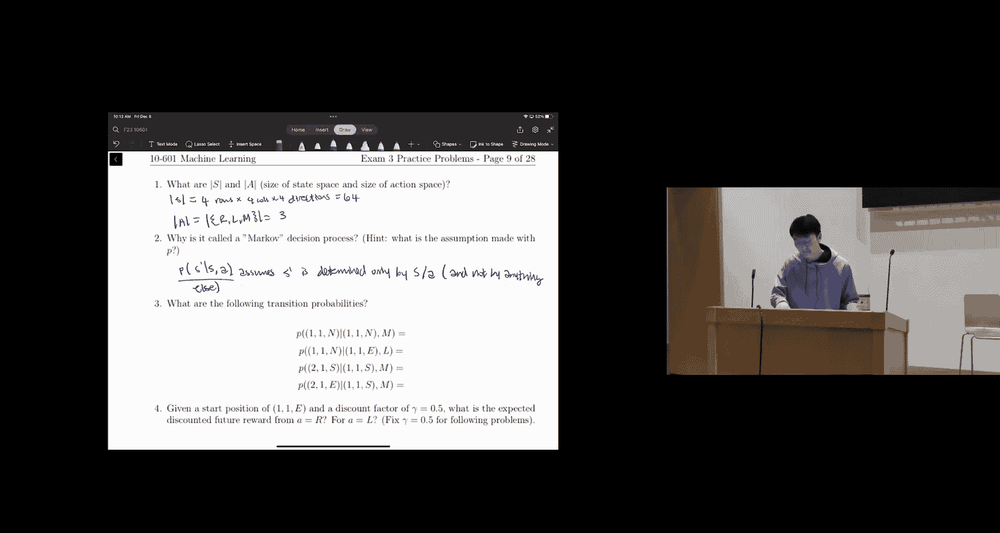

我。All right， question three， what are the following transition probabilities， Okay。

 so let's just work through these one by one。

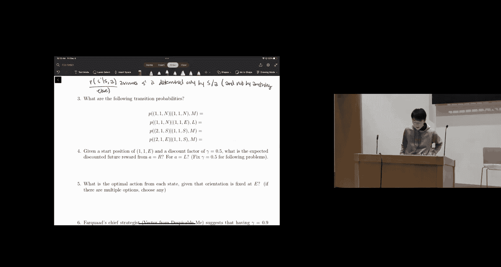

Right so what is the probability that we end up at 11 with new orientation of North given that we were at 11 north before and we just simply moved forward so let's just take a look at this with regards to。

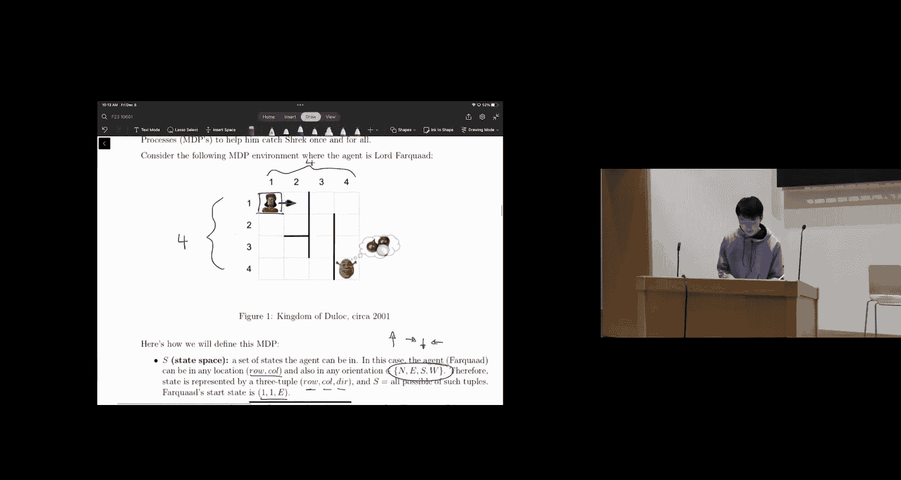

Our state space right so assuming that we were Lord Farquat is in this top left corner here but he's initially facing north and he wants to move forward right the probability that we end up staying in the same place is just going to be equal to one because there's nowhere else that we can go right so。

😊。

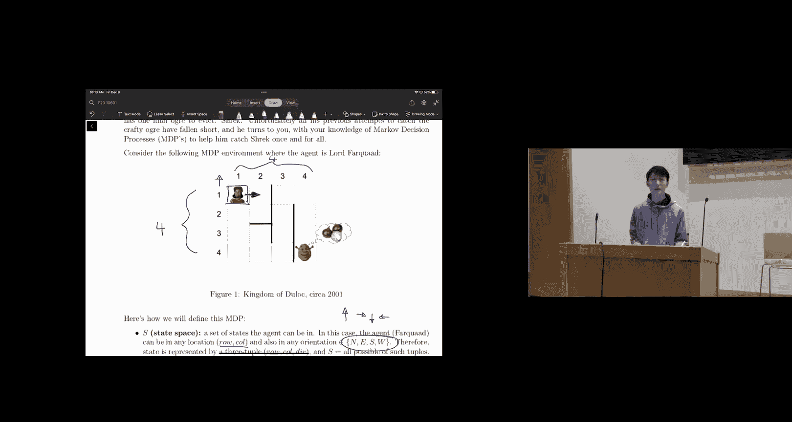

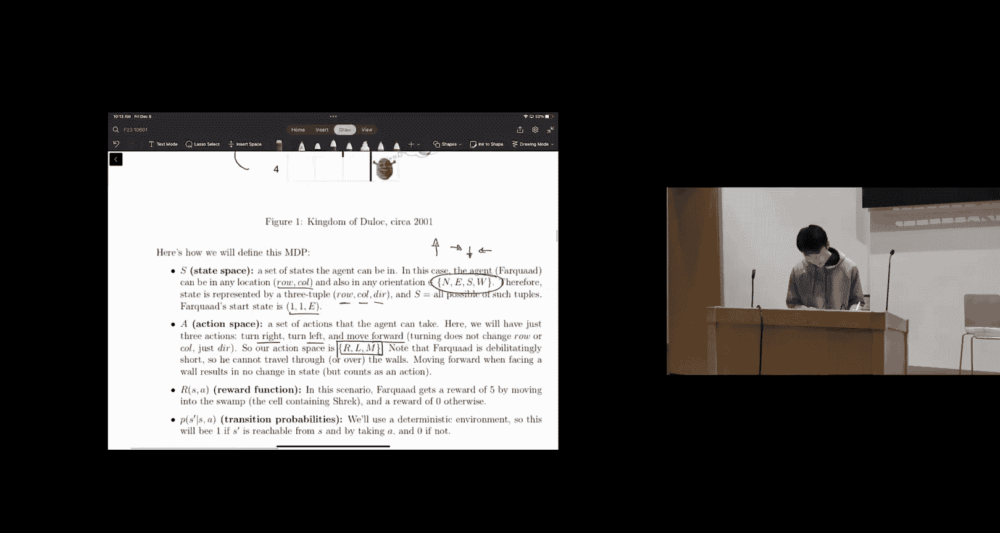

This is just equal to one。Perfect， okay。Now let's take a look at the probability that we are in 11N if given that we were in 11e。

 but we decide to turn left， right。

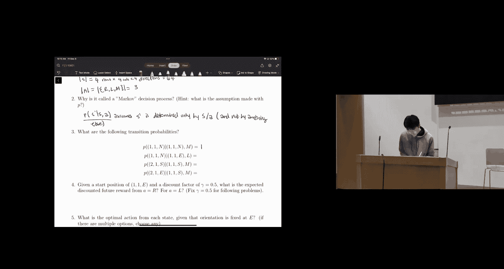

Basically， this is starting to get crowded， so let me clear it and clean it up。

So what's the probability that given that we start exactly like what we are in the figure right now。

11 north and we're facing east and we turn left， what's the probability that we end up with in the state 11 north。

 I'll let you guys think about this。As a hint， the answer is really。

 really similar to what we just did。Does anyone want to say it？Just what。啊，就这。

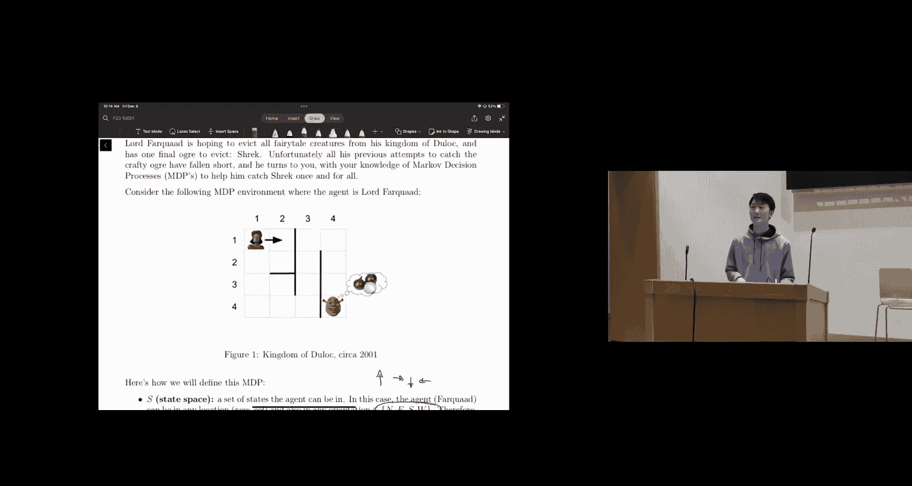

Yeah， exactly。So it' was just one。Okay。

Okay， so next what's the probability of us being into one facing south if we were part if we were previously at one one south and we moved forward okay so。

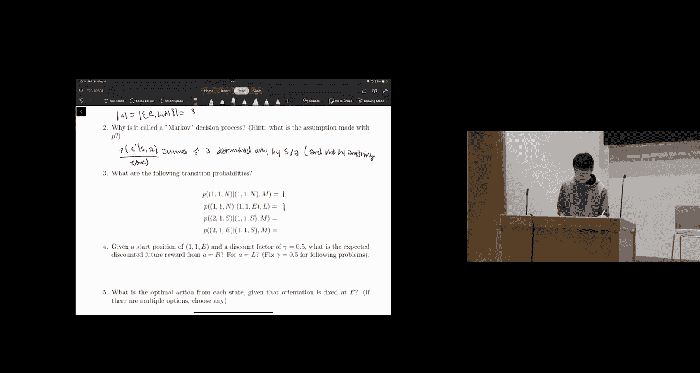

What's the probability of so we were initially in this space and we were facing south what is the probability that would end up into one facing south if all we did was move forward from the top so as we see here if we just move forward we would just end up into one facing south right so it's just a probability of one because that's literally what's going to happen if we make that move okay？

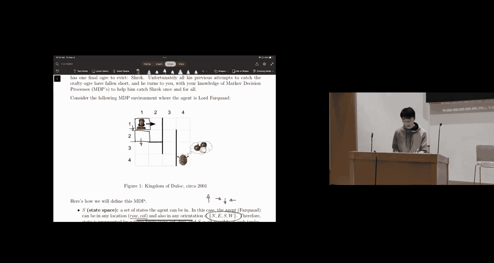

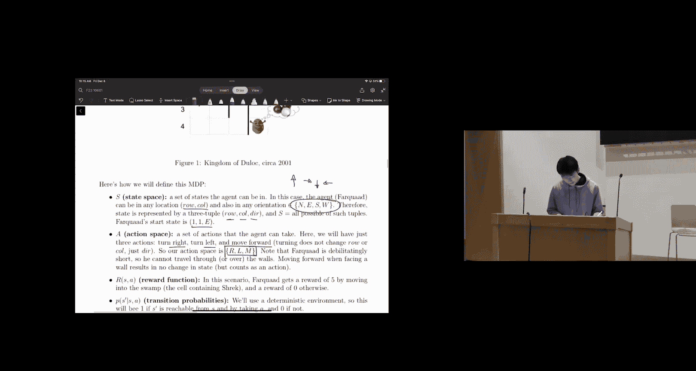

RightAnd so for the final question we are probably the probably us ending up at21 facing east given that we were at one1 facing south and we just moved forward right okay so this is now we don't even have to look at the we don't even have a look at the statesmate honestly for this one because if you notice that the difference between these two is just the orientation that we're in with regards to the final position right south versus east we know that if we move forward from the position one1 facing south we're going to end up at21 facing south right but is there any possible way that we could end up at 21 facing east without taking more than one move the answer of course here is no right because when we move one fold we're going to end up at21 south but we can end up at21 east without making another move aka turning。

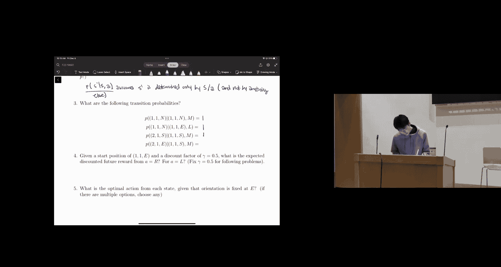

Left yeah going from southeast so we would have to make another move turning left in one go。

 but in this case we can't do that in one go so the probability would just be zero does that make sense to everyone。

要不然。

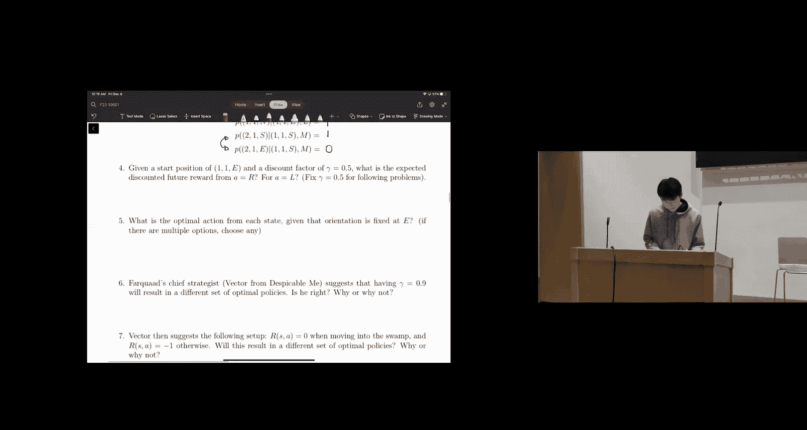

Okay， all my questions are this night？😔。

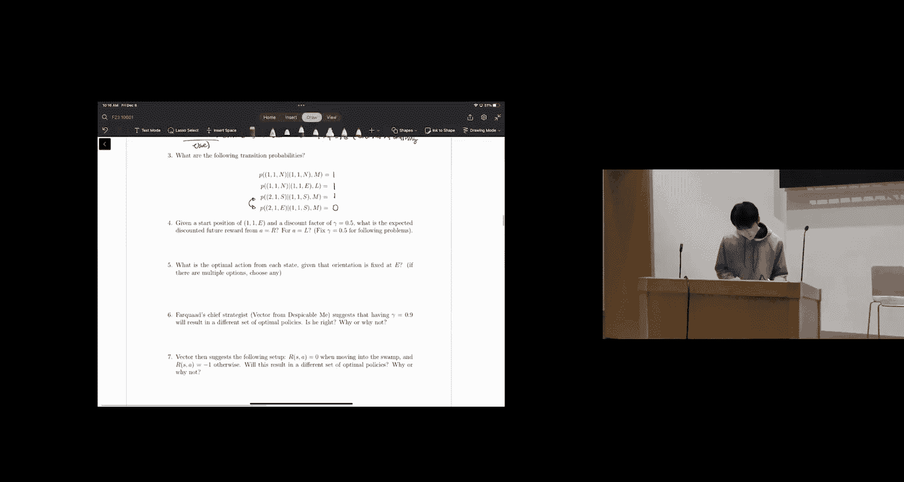

I will go ahead and do one more of these questions。😔。

1016 oh， actually and this this session is actually long。

 I think I'm just going to move on because we're already at 116， okay。😊。

Unless anyone really， really wants pageon number four。

Okay， cool。Okay， so from here on I think I'm just going to go ahead and do like every。

 I'm going to jump around and just do sort of like every other question unless anyone has a burning desire to see one over the other。

 okay？So let's go ahead and start so select all following which of the following select all that apply which of the following environment characteristics would increase the computational complexity per iteration for value iteration algorithm choose all that apply okay so let's think back the computational complexity for value iteration per iteration if you remember in lecture it was presented to you as o of the magnitude of a times the magnitude of s squared right so in other words the only thing that the only thing that affects the computational complexity per iteration is just going to be the size of the action and the size of the state space right and we see this。

😊。

Options here so we can select both of them。stochastic transition function and unknown reward functions。

 these like neither of these play a factor into determining the big O bound here。

 so we're just not going to select them so the answer is just going to be A and C here okay。

I think question two is honestly like the same logic， so I'm not going to go over that regard。

Okay， so number three and the image below is a representation of the game that you're about to play。

 there are five states， ABCD and a goal state， the goal state when reach gives 100 points as a reward and in addition to the goals points you can get points by moving to different states as given by the eras。

😊，So let's say we start at state B， which is given in the yellow and to figure out the best policy use asynchronous value iteration with a decay gamma of 0。

9 and you should initialize the value of each state to  zero perfect cool。

So when you first start playing the game， what action would you take up down left right at state B。

 right？At state B， we can only move either up or to the right okay so when were first start starting the game we're just going to assume that all of remember that all of these values are going to be zero so the only reward we're considering is the word associated with moving up or to the right okay and we see that the reward associated with moving up is 50 I think that's pretty visible but I'll zoom in a little bit anyway and the reward associated with moving to the read is 30 okay so in this case we want to move up at the very start of the game。

给。

Right。So what is the total reward at state B at this time right so the total reward at state B is just going to be defined here by the immediate reward that we get from like taking an action plus any like plus any like future reward or any like delayed reward that's associated with each one of the places that we want to go right so at the very beginning。

We're going to get an initial， let's say let's。It's a media reward plus delayed reward。

RightThat's the general way you can think about this。

 so the immediate reward that we get is just going to be 50。😊。

Just for moving up one right but the delay reward here is actually going to be zero because recall that all the values for each one of the grids ABCD is initialized to zero right so we don't have any associated reward with reaching a like no one's giving us a sticker when we reach station A saying good job because there's just nothing there yet right so this delayed reward is just going to be zero。

😊，So the To award at StaP at this current time is just going to be 50。Remember。

 this is at the very beginning of the game。Yeahep。

All right， so now let's break out of this beginning of the game mindset。

 let's say we keep comp we keep playing until the total values for each task inverged what value would you take at state B right so here the way I'm thinking good about this is that assuming that。

Assuming that everything has converged， what we need to do is once again。

 we need to take into account the immediate reward。😊，Plus， a delayed reward， okay？

RightAnd so if we work out actually， let me go ahead and just work it out here。

 so let's say we move to the right Okay， so that's going to be 30 plus a delayed reward of。😊。

43 times 09 plus。😔，100 plus 40 times。😔，9 squared。Eals 152。

1 All okay and let me pause here right so where do we get all these values from so remember that this is we're assuming that we've kept playing until oh i'm also realizing but this is the wrong place。

All it good okay right so we're assuming that we've we've played until the values have converge right which means that in asynchronous value iteration we've kept updating the values until they haven't changed anymore right and so because it's 1021 I'm not going to go through like the math of itself but basically what's happening here is that we have that associate reward of 30 moving。

😊。

We have that As reward of 30 moving immediately to the right。

 and then we also have the delayed reward of 43。

Rely reward of 43， which is going to be the value at C at the convergence multiplied by our gamma factor 0。

9 right and then we're going to also have and then we're going to also need to add that to 100 plus 40 which is going to be。

Or sorry， not sorry， 43 is the sorry value here， my bad， sorry， I think I said the value in C。

 sorry 43 is the value associated with between from C to D my bad。

And then we're also going to need to add that to the reward associated with moving to the goal which is 40 plus our 100 value here。

 and we're going to scale that by 0。9 squared because that's a section action we take which is going to be 152。

1 and that's and we see that that's and if we work out the math or the other way that we see it's going to be greater than just moving up。

To the right and to the right。

Okay， so this is going to we're going to want to take over to the right。

am by writing this out， I also sort of give you the answer to the final part of this question where what is the total reward oh I I this out wrong。

 sorry， what is the total reward at StaP at this time， which is just going to be 182。

1 because again that's the need of reward plus all delayed rewards associated with taking the direction that gives the most reward okay？

😊。

All right。

Yeah， I know I went through that sort of quickly， so does anyone have any questions that sort of like the high level of like what we were doing for this question？

Again the math for this is fairly simple and it's like the math that you guys did for your homework A I believe was a lot more involved in this。

 so I trust that it's fairly simple to work through on your own time so I'm just not going to do it right now in the interest of time but as long as you understand sort of like the high level and like why we're doing what we're doing I think that's good enough。

Okay， let's move on。Let's move on to a Q learning section， okay， so we have a future and here。

Okay one advantage that Q learning has over value and policy iteration is that you can account for non deterministic policies Okay so my first thought is that I don't think that this is true can anyone tell me why I would think that。

Okay that's fine so one advantage key learning has overvalued value and policy iteration is that can account for nongederomicistic policies so this sort of to me implies that Q learning can can account for nondeterministic policies whereas value and policy iteration can't right but by definition of value and policy iterations they can account for nondeterministic policies right so this isn't necessarily an advantage that's specific to key learning so this is going to be false。

😊。

Okay。Okay， now question two， you can apply value， a policy iteration to any problem that Q learning can be applied to。

 is this true or false？Okay so let's think about this again so why said before that the advantage that Q learning has over value policy iteration isn't that Q learning can account for nondeterministic policies right because all three of them can do this right the key advantage of Q learning is that Q and learning doesn't necessarily need to know all the transition probabilities associated with our state space or the reward function in order to train right so that's its basic biggest advantage here so because of this we can't necessarily apply value or policy iteration to any problem that Q learning can be applied to because what if the problem has again we don't where we're in a space such that we don't know the transition probabil and or we don't know the reward function okay。

So。Youre good in this case。V you polyeration。Not good。嗯。And for the last one。

 Q learning is guaranteed to converge to the true value Q star for a Greek U policy。Right。

 so I'm thinking。Garanteed to converge Okay， so I'm thinking not this isn't necessarily true because do you guys remember and I and this is in one of the reinforcement slides as well do you guys remember under what scenario that we are guaranteed that it will converge to Qstar because given as it is we don't necessarily know that this will be true we need to have some sort of guarantee and does anyone remember what that guarantee is。

Yeah， exactly we yeah， we're only guaranteed that Q learning will converge if every state is visited infinitely often。

 that's exactly right。So we have that this is false as well。哎。

Okay， I think I will do one more problem and hand it off because it's almost 1030。

Well。

Okay， I guess I will just go ahead and do number three， just keep it the pattern okay， all right。

 so like QA indicate the estimated Q value of state action pair at some point during Q learning and supposeupp you receive a reward after taking action A and state S and arrive at a new state S prime before updating the Q values based on the experience was the relationship between QSA and this value indicate the most restrictive relationship that applies okay。

Al right so if we take a look at this here okay so my thought。

 my immediate first thought is that okay so Q learning we don't necessarily need to know the transition probabilities right but here what I'm noticing is that we don't know what gamma is and we don't know what R is right and so because of this personally I'm having a really hard time reasoning about any possible relationship we can have here because like for example what if for example here like what if the reward is0 gamma is one and like this max value is just equal to QSa like that's one scenario that could be possible right so like this value here is just equal to QsA or something like that's completely possible alternatively what if gamma is less than one and then we would have to scale by some factor and that would give us a different relationship the point here I'm trying to make is that we don't really know what because we don't know what these values are it's really hard for me personally to assign a relationship to these two right？

So because of that， I'm going to select question mark here。

Because given as it is in the problem statementing here。

 we just can't really make a concrete conclusion about the relationship between these two equations okay。

All right， does anyone have any questions on this or anything else I've done in this section because I think I'm just going to go ahead and wrap it up here。

Hello， okay。Right so now we're going to talk about principal component analysis so the idea behind principal component analysis is we want to find components for which when we project our high dimensional data set onto we get like。

Maximum spread on that dimension， right， like we want to maximize the variance。

Of the dimension that we project to， oh my God， what is going on？

So for example， in the first data set。

Like I guess you can see if I project along this line here and like keeps the spread of the data set roughly the same right。

 like all these data points are still the same distance apart and then I guess the second principle component is sort of。

Like this way， but it's not as big because like the the the like variance along the axes is not as large so sort of the the length of the principal component is like how large the magnitude it is and the direction is just like which way to project on so for this one right I think there's a lot more variance on horizontal so draw something like this and then maybe the vertical is like not as much。

As the horizontal。So those would be my principal components， let me draw in red。

Okay。嗯。So now we're doing the reverse so we're given some principal components that we want to draw sort of what the data could look like so if you notice the magnitude here is much larger so we're going to have a lot more data on this like this line here so maybe the our ellipses like this and then since like the other component。

IsIn that direction we can like draw the ellipse up， sorry。

Well we can draw the ellipse to come back like that。😔，And then same thing for this。

 since they're both roughly the same magnitudes， it's just like sort of like a circle。

Or pretend that's a circle， but yeah， thats that's like PCA。

U。Okay， let's do some true false questions。So the goal of PC is to interpret the underlying structured data in terms of its principal components。

That are best at predicting the output variable so this one is false so it's we're not caring we're not worrying about our predictive performance with PCA we're most worried about sort of our reconstruction error or like representing the inputs at this lower dimension right we're not really too worried about the performance。

Okay， the output of PC is a new representation of the data that is always of lower dimensionality false because I can just keep it the same dimensions。

😊，As we saw in the earlier example。

Okay， any other questions about PCA？

No， okay。

是。that first one， would it be incorrective？

The first one， sorry。The way I drew it， I had the line the on the top line that went that way on the opposite side。

 would that be incorrect or does it matter。

So like this， yeah， that's fine。

は不对。我。No， he means。嗯。Cool， so for a particular data set in particular kK means does always produce the same result given that the initialization。

 sorry the initialized centers are the same， this is because it's a deterministic algorithm and whatever means we go about to calculate the distances between the two points or between any points is going to stay constant。

嗯。Cool and part two K meanss will not always converge the global optimum。

 this is because it depends on the initialization if we initialize the centers really poorly。

 then we could possibly lead to a local optimum。嗯。

Number three， K means is in fact sensitive to outliers as it computes cluster centers based off of the mean value of the data points。

 so I guess if you had data points really far off that would affect the mean value of whatever clusters you're looking at。

And another K we've seen in this course is K and N the difference between these two or like I guess the difference in the K is that K N is looking at like the。

😊。

Sorry， the number of data points we need to look at。When classifying a data point。

 right because it looks at the K nearest neighbors and K means it's describing the number of clusters that we have。

Rather than how many neighbors each point has。

嗯。See， the biggest difference between K and nearest neighbors and K means is that K andN is a supervised algorithm and k means is unsupervised right because in KNN we have some concept of like plus or minus right。

 you just go with whatever label the closest of sorry。

 the K nearest neighbors give you whereas K means is a clustering algorithm。

He。Okay。嗯。And then in Ka means like， okay， actually， the interest of time。

 I'm just going to skip to number two。

So here we can any questions with the first part so far？Okay， we're good。 Okay， so part 2。

 we talk about。

Or okay， here。

I think we're given the K plus+ initialization algorithm。😔。

嗯。So。

Okay， when we analyzed like these data points right so we've already said that the point as00 is going to be our first cluster center and then now in this problem we want to find the probabilities that the other points are going to be chosen as another cluster center so given this algorithm right to find our cluster centers for initialization。

😊。

Like we can see right here， this is how we're going about calculating the probabilities and so when we look at this right so the idea is kind of like the squared distance right so the square of the Euclidean distance from each cluster center or the minimum squared Euclidean distance from any equi cluster center right？

😊。

And so here in this problem， we see that if I say like。

Or 。00。Is a distance of zero away from itself right so the probability that we have this one as center is zero and then for one comma two。

The distance from this sorry， the distance from 00 is5 away right。

 so let's do some like quick math here， I guess so this one's five away two comma3。Is。13 years away。

 this is just the squared。3 comma 1 is 10 units away， and then4 comma 1 is 17 units away。 right。

 So in this algorithm， the probabilities here we're going to get。A。Oh god math。3。40，45。 Okay。

 we're going to get five over 45 for this one。 we're going to get 13 over 45 for this one and get 10 over 45。

And we're going to get 17 over 45。Everyone follow how I got here。

Okay。Again， like how I'm computing the probabilities is dependent on the metric I use for distance。

 so in this case it's the square of the Euclidean distance。

And then looking at this rate， which data point is most likely chosen as a center for cluster 2 so in this algorithm we want to choose the furthest point away and in other words that's the the highest probability rate of being picked so in this case the data point that's most likely chosen as a center for cluster2 would be for one。

Right。And so now the next problem we're choosing clusters again。

So。In this case， now we have two cluster centers right now。

41 has become a cluster center and then we want to reevaluate our probabilities。

 So in this case now we have to consider the minimum distance from either of these cluster centers。

 So one comma 2 is going to be closest to0 comma 0 at a distance of5。Right with the metric。

And then three comma 1 is closest to four comma 1 with a distance of one。

And then two comma three is closest to four comma one with a distance of。8ight。

Does everyone see how I got here？

So I guess I'll just write it over here。

So it's easier to see。八。If I have。0， comm 0。One comma 2， two comma 3。

 three comma1 and 4 comma1 automatically since what0。

0 and 41 have already been chosen as cluster centers。

 we know that the probability they should get picked again is zero right because they're。

The minimum distance from them to another point is zero and then8 plus one plus5 is 14。

 so we have that one coming to as a probability of 514。

Two Coma  three is。A14。Your common one is 114。Everyone follow so far。Okay。

 and then looking at these probabilities， we see that two comma 3 has the highest probability of being picked as a next center。

 so then this becomes like the second center that we pick from this algorithm。

嗯。

Oh。

嗯。ok。

And then assume for cluster three list all the data points that are classified into clusters one。

 two and three respectively， so the data points that are classified into each cluster it's just kind of the same thing as before we want the closest elements right so I guess like we could just see visually I guess here that this point one。

 two is closest to three to three。

All， so these form cluster， these two formal cluster and this one by itself。

RightThe next problem I think talks about realization of cluster centers and we know that K means looks at the mean point between all the points in your cluster。

 so here 00 would stay the same。But then for this okay so i'm going to label this cluster one cluster two and cluster three right I think our solutions have like two and three flipped。

 but that's beside the point。So here like the mean point between points one。

 all the points in one is just going to be itself， the mean point between all the points in two is going to be 3。

5 comma 1， so this is our new cluster center。And then for the third cluster。

 the mean point is going to be 1。5 comma 2。5， so that's our new cluster center。

All right。So for ensemble methods， I guess。It's important to sort of。

Understand like what type of ensemble method it is if it's a boosting or a bagging ensemble method so we learned one boosting method and one bagging method I think the bagging method is random forest and the boosting method is at a boost so those are the two tools that you guys have so that's probably what you guys should be focusing on when you're studying ensemble methods。

呃。Yes， okay， so for the first question right， in the EA boost algorithm。

 the final hypothesis makes no mistake on the training data， which of the following is correct？

So the only answer here is like。A really that makes sense because one。

 the individual just because the overall classifier is perfect doesn't mean that the individual ones are right the whole point is we're aggregating a bunch of individual classifiers to sort of make a super classifier here。

😊，And additional routes of training can help reduce the errors made on unseen data because。

I guess they're just sort of rebalancing the weights still， which is why it's sort of。

Its helpful to continue training and it makes it robust to overfitting。In add boost。

 weights of the mixed classified examples go up by the same multiplicative factor， this is true。

 you can think of add boost as a weighted majority algorithm。

 which Matt also explained in that slide right before he introduced it。诶。

I don't want to go through the problem because it's going to take way too long。

 but you're essentially just multiplying the weights factor。

To get like the values in the previous iterations because you know sort of whether or not it was correct or not like classified。

 so you can then just like since the weight factor is the same throughout you can do like。

Whatever you need to do it， yeah。

And all let me talk about random forests。

Okay， so random forest is kind of。

And we basically allow for a bunch of decision trees to be built by randomly choosing the features。

 so there's no ID3 algorithm we're just like randomly picking the features and then we sort of aggregate all these decision trees outputs at the end to make our prediction so。

The first question is consider a random forest consisting of five decision trees and I think you see the random forest there and they're asking for what is the out of bag error。

Of the。Random forest classifier， so it's just the average error of the table， which is。不是不是。

Half of the table， so it's 0。5。And then the next question to reduce the error of each individual。

Oh wait， sorry。

It。

So I'm going to skip part B， but to reduce the error of each individual decision tree。

 we use all the fake features to train each tree， how would this impact the generalization error of the random forest so because we're allowing all the features to train each tree。

 the trees might like there might be duplicate trees there might be trees that are like very related to one another so that might increase the generalization error because now we don't have like as independent trees as we want because the whole point of random forest was to just grow like random trees which are like not that related with each other and then use them to make predictions。

And then to answer part B， the trees that will like have the highest weight are the ones that like were able to predict it correctly。

 so it would be one， two， three， four five yeah。It's all of them， actually。I don't know， yeah。

 all of them okay。Cool。I mean， I think that brings us to the end。

 we were going to talk about recommender systems but。

I think we ran out of time if you have more questions， just like。Ascar Piazza werere there to answer。

Right。

