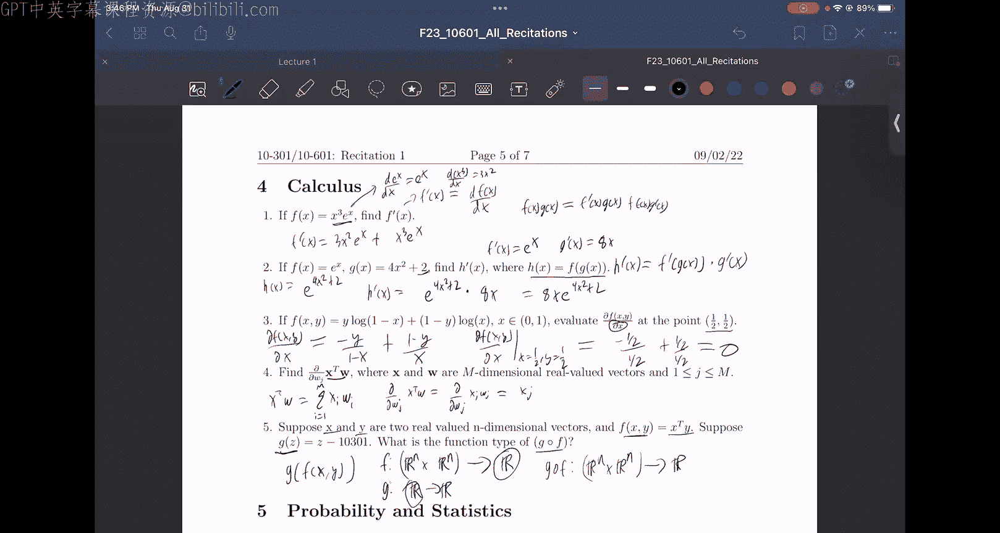

# CMU《机器学习导论｜Fall 2023 10-301⧸601 Introduction to Machine Learning》中英字幕（deepseek p32 Recitation_HW1_Calculus.zh_en -BV1Z2cUefE4A_p32-

Record。

All right， so i'm just going to be covering the calculus section of the homework so or of the recitation so first question is x cube if f of x equals x cubed times e to the x find f prime of x so just a brief reminder F prime of x is the same thing as。

D F of x D X and this is just taking the derivative and if you notice right here we have a product of two terms so we're using the product rule so remember the product rule if add two functions and'm differentiating the whole thing with respect to x the whole product its you take the derivative of the first one you leave the second one unchanged then you add the first one unchanged then this derivative of the second one and so remember the derivative of E to the x is。

Sorry，The derivative of e to the x with respect to x is just e to the x and then the derivative of x cubed with respect to x is 3 x squared so if we plug that in we get3 x squared e to the x plus。

X cubed E to the x。And that's it。Okay so that's the product rule just a brief reminder Okay so now we have two functions we have f of x equals e to the x and g of x equals 4 x squared plus2 and they're asking us to find h prime of x where h of x equals f of G of x remember so f of g of x is a composition of two functions。

 so namely h of x is going to be e to the power instead of x it's g of x so G of x is4 x squared plus2。

Now， if you're a call， when you take a derivative。Here， right。

 we're going to use something thing called the Cha。When we do the chain rule。

 we take the outer derivative。And then we go to the inside and then take the derivative of that multiply with the expression so we have F prime of g of x times g prime of x。

 so F prime of x once again is e to the x and then G prime of x is8 x that's it remember2 is a constant so it goes to zero。

 so if we plug that in to the chain rule we get F prime of g of x of e to the4 x squared plus2 times g prime of x which is8 x so we get8 x E to the 4 x squared plus2。

Okay。😊，So yeah， that's the product role of the Chaable。

Okay so the next question is talking about partial derivatives so remember when you do partial derivatives。

 you keep all terms you treat all other terms and variables as constant except for the one you're differentiating with respect to so in this case X is the only one that's not a constant but y is going to be treated as a constant what we do the derivative。

So let's do the let's evaluate the partial derivative so we just take the derivative as we would if it was a one variable function。

 so here the derivative will be negative y over1 minus x remember the derivative of log is one over one minus x so the derivative log and x is one over x。

 but then here we we have to use the chain rule。And then the derivative of the next one is just1 minus y over x。

But what this is asking us is to evaluate it at one half one half so let's do that we just plug it in and。

嗯。This is like the notation that we use to say evaluating。

 we draw a bar and then put the variable names， so that's going to be equal to。

We have negative12 over1 half。Plus one half over1 half， so this is just negative one plus one。

 which is zero。So now that we've gone over product rule chain rule and partial derivatives let's go into taking derivative of vector valued expressions so if we look here we have x transposed with W or x and w or dimensional real valued vectors so this is just like a。

Dot product， right so it's。Essentially what's happening so as you know we can write out the dot product as a summation of all the terms that are being multiplied so we have m terms right because it's m dimensional so we have。

X1 all the way to Xm and so we get the summation。RightSo this is really what x transpose W is。

Now it's asking us to find。Partial of this expression with respect to WJ where J is just some arbitrary one of these terms right so if we fix that arbitrary term all the other terms unless addition summation。

Go to zero and so the only term that's there is xjwj right so when we do partial Wj of x transpose W that really becomes partial partial WJ of Xj Wj because all the other terms there's zero the derivative of all the other terms are zero and so the derivative of this is just Xj。

So that's the answer。Okay。So this last question is about function types， so here we have。X and y。

 which are two real valued n dimensional vectors and then we have a function which is x transpose y similar to the previous question it's just like a dot product and then we have G of z。

 which is another function which is just z minus 10301 and what we're interested in is the function type of G composed with F right so remember G composed with F is just G of F of x。

Right and so it might be important to figure out what are the types of F and what are the types of G so that we can get the type of the composition。

So the type of F， if you look it takes in two inputs so the type so we're going to have two inputs and each one is a n dimensional vector。

 so we're going to say RN。Cross R app。So this RM meets n dimensional vector and lac cross is like saying there's more than one of them。

And then the output， since this is just a dot product is going to be a real number。

 so it goes from RM across RM to R。Now if we look at G， so G is just。

Taking a number and is subtracting 10301 from it so that's just a real valued function so it's R to R。

So if you recall G of F of x is going to take the inputs from F of x and use the outputs of G。

 but we need to make sure that this output and this input match otherwise they cannot be composed and since they're both real remember they match and we can compose these two functions and so the resulting type is going to be。

Going to be R N cross R N。Goes to。I'm sorry， I should say this would be G of F of X Y。So yeah。

 that's the calculus review。

